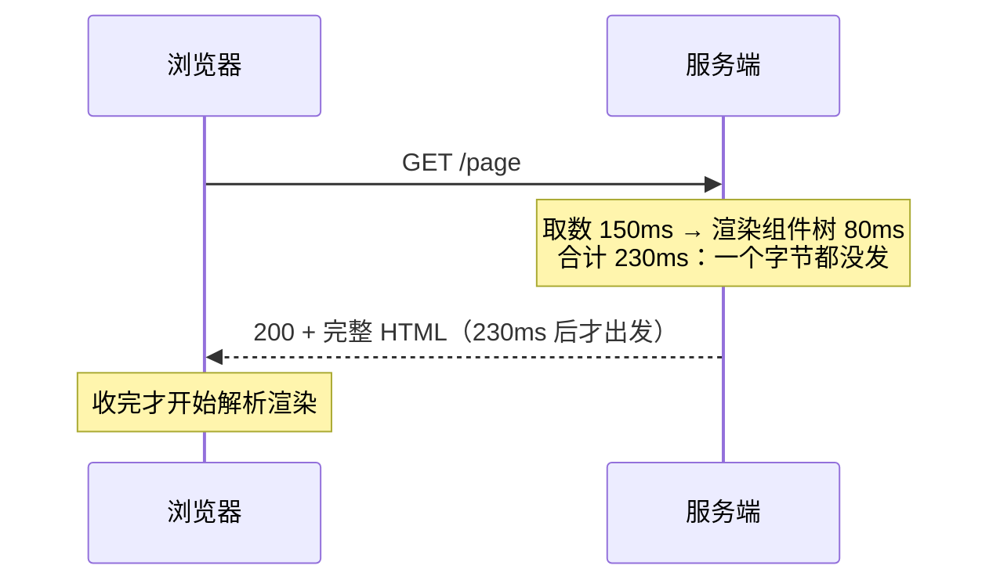
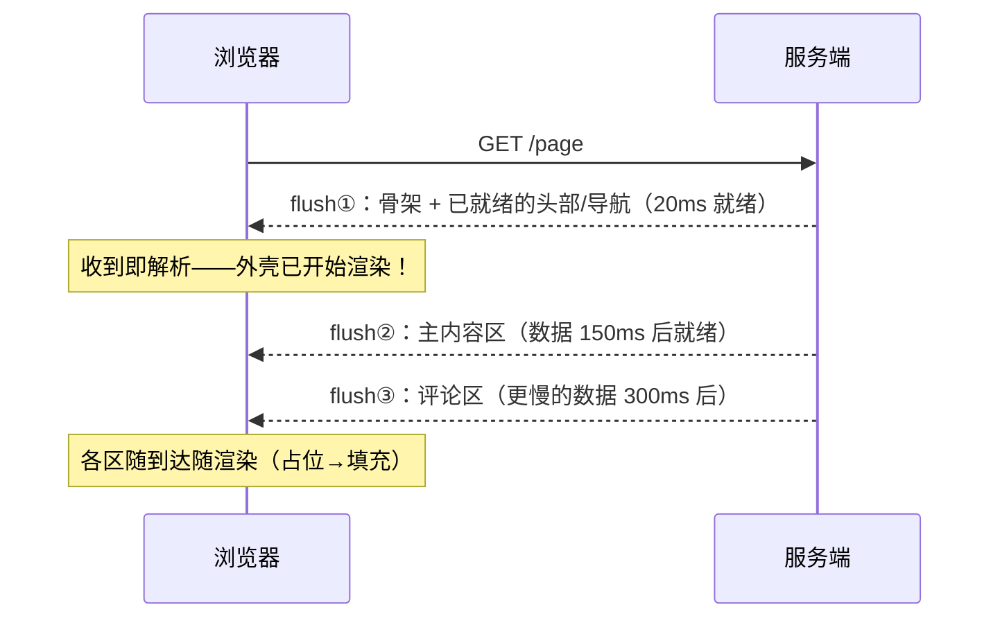

# 服务端如何生成 HTML：模板、SSR 与流式

> [← 第五阶段导览](01-导览.md) · 时间线 ⑦。请求穿过 CDN、LB、网关，终于到达应用。这一册看 HTML 的三种生产方式：静态直出、模板全量渲染、流式 SSR——以及它们在 TTFB 与首屏时间轴上的根本差异。前端框架的 SSR 实现（React/Vue）细节归各自站，这里讲的是**所有框架共用的传输与生成机制**。

## 1. TTFB 的最后构成

把 Waiting(TTFB) 的最后一层拆开（前两层——距离与网关——在 CDN/网关册已拆）：

| 构成 | 典型量级 | 谁的锅 |
|---|---|---|
| 网络（你↔边缘↔源站） | RTT 总和 | 距离/调度 |
| 网关排队与转发 | 1~10ms | LB/反代 |
| **应用内部** | **几十~几百 ms（弹性最大）** | **本册主角** |
| 首字节回程 | 半个 RTT | 距离 |

应用内部的耗时再拆：

```text
鉴权/中间件（~1-5ms）
  → 取数（DB/RPC/缓存：1ms ~ 数百 ms，弹性最大）
  → 业务逻辑（~1-20ms）
  → 模板/组件渲染成 HTML 字符串（~1-50ms）
  → flush 首批字节
```

**数据库慢查询贡献了 TTFB 的大头**是工程世界的常态——前端看到「接口慢」就骂后端框架慢，多数时候是取数这一层。所以 TTFB 排障的第一动作是给应用内部计时打点（上一册 upstream_response_time 是免费的起点）。

### 1.5 TTFB 打点的最小实现

没有 APM 也能打点——每个 HTTP 框架都有「请求开始」钩子，包一层计时即可：

```js
// 以 Express 风格示意（任何框架同构）
app.use((req, res, next) => {
  const t0 = performance.now();
  const origWrite = res.write.bind(res);
  let firstByteLogged = false;
  res.write = (chunk, ...args) => {
    if (!firstByteLogged) {
      firstByteLogged = true;
      log.info({
        path: req.url,
        ttfb_ms: +(performance.now() - t0).toFixed(1),  // 首字节 = flush 首块的时刻
      });
    }
    return origWrite(chunk, ...args);
  };
  next();
});
```

三行要点：**打在「首块写出」而不是「响应结束」**（TTFB 的定义就是首字节）；日志带 path 维度（哪条接口慢一目了然）；有流式时天然兼容（首块 flush 即记录）。这层打点 + 上一册的反代日志 + 第三阶段的 Timing 面板，就是「从用户到 DB」的完整计时链——每层一个数字，慢在哪一层不再靠猜。

## 2. 静态直出与模板渲染

两种最古老的形态，仍是今天互联网的大部分：

| 形态 | 过程 | TTFB | 例 |
|---|---|---|---|
| **静态文件直出** | Nginx 直接读文件发回 | ≈0 计算（文件 IO 微秒级） | 博客/文档/构建产物 |
| **模板渲染** | 取数 → 模板引擎填数据 → 拼出 HTML 字符串 → 发回 | 数据+渲染全额 | 传统电商列表、内容站 |

模板渲染的时序瓶颈：**取数串行**。新手代码常长这样：

```js
const user = await db.user(id);        // 50ms
const orders = await db.orders(id);    // 60ms（等 user 完才开始）
const recs = await db.recommend(id);   // 80ms（继续等）
// TTFB ≈ 190ms 全是串行等待
```

改成并行（依赖允许时）：

```js
const [user, orders, recs] = await Promise.all([
  db.user(id), db.orders(id), db.recommend(id)
]);
// TTFB ≈ max(50, 60, 80) = 80ms——省 110ms，一行改动
```

「把串行 await 改成 Promise.all」是 TTFB 优化的性价比之王——前提是数据间无依赖；有依赖的链（先拿 user 再查它的订单）没法并行，那部分是结构性成本。

### 2.5 取数反模式清单（code review 对照用）

| 反模式 | 形态 | 代价 |
|---|---|---|
| **串行瀑布** | 无依赖的 await 排队 | 白送的几十~几百 ms（§2 主案例） |
| **N+1 查询** | 列表 20 条 → 循环查 20 次关联 | 20 次 RTT 叠加——TTFB 的隐形大头 |
| **页内重复取数** | 多个组件各自请求同一数据 | 浪费 + 不一致风险；应请求合并 |
| **首屏过度取数** | 页面要 10 个字段全查全表列 | 取数与渲染都被拖累；按首屏字段裁剪 |
| **外部 RPC 无超时** | 依赖第三方接口，挂了等到底 | TTFB 被拖到天荒地老；**必须设超时+降级** |

N+1 单独强调：它是「ORM 顺手写」的特产——列表页每个条目懒加载作者信息，ORM 就发 N 次查询。检测：应用内打点看「单请求的 DB 查询条数」，>10 就该查。修复方向是批量查询（`WHERE id IN (...)`）或数据层 join。

## 3. 全量 SSR：全部拼好再发

现代 SSR（无流式时）的时序：



特点与代价：

| 优点 | 缺点 |
|---|---|
| 响应完整一致（出错可整体兜底/重试） | TTFB = 全部计算完成时间——DB 慢 200ms，浏览器白等 200ms |
| SEO 友好（爬虫拿到完整 HTML） | 长尾内容（慢接口）拖住**所有**内容的首字节 |
| 前端拿到即渲染，无白屏再注水等待 | 内存峰值：整个 HTML 字符串攒在服务端内存 |

### 3.5 全量 SSR 的兜底设计（错误/超时/降级）

「全拼好再发」的错误处理是它的核心优点，但兜底要显式设计：

| 兜底层 | 设计 | 触发时用户看到 |
|---|---|---|
| 取数超时 | 每个数据源设超时（如 800ms），超时走降级数据 | 缺区块的页面（不是白屏） |
| 渲染异常 | try/catch 整个渲染，catch 里渲染简化版 | 无样式的可用内容 |
| 整体超时 | 应用级兜底页（如 3s 上限） | 「内容马上好」骨架页 + 200（或 503+Retry-After） |
| 缓存旧版 | 渲染失败回退上次成功的 HTML 缓存 | 旧一版的正常页面 |

关键纪律：**降级也要带正确的状态码与缓存语义**——兜底页该 `no-store`（防止降级版被缓存当成正式版）；「渲染失败但返回缓存旧版」时要带头声明（如加 `X-Degraded: 1` 便于监控识别）。兜底不是「别崩」这么简单，是「崩了以后系统里每一层都知道发生了什么」。

## 4. 流式 SSR：边生成边发

把「全拼好再发」改成「**能发多少先发多少**」——依赖 chunked 传输（下一册 §3）， flush 时机掌握在应用手里：



收益的来源链：

1. **TTFB 提前**：首字节不等最慢的数据（flush① 只等头部就绪，20ms vs 全量 300ms）；
2. **FCP 提前**：浏览器边收边解析（第七阶段的解析流水线：收到一段解析一段，不用等 Content-Length 的末字节）——骨架壳先上屏；
3. **慢数据局部化**：评论区慢只影响评论区——占位符先渲染，数据到了流式补上（框架层面即 React 18 的 Suspense 流式注水，机制细节归 `react/` 站）。

约束（流式的代价，工程上必须想清楚）：

| 约束 | 说明 |
|---|---|
| **head 必须先定** | `<title>`/meta/style 已发出就改不了——首 flush 前要收集完 head 信息 |
| **状态码已定** | 首块发了 200，后面发现错误只能内嵌错误 UI，无法改 5xx |
| **错误处理变难** | 中途异常 = 流截断——要兜底「已发一半」的残页形态 |
| **压缩协同** | gzip/brotli 流式压缩与 flush 时机要配合（压缩器攒缓冲可能吃掉 flush 的及时性——下一册 §6） |

判定什么时候值得上流式：页面「头部快、主体数据慢、且有独立慢区块」→ 收益大；页面数据本来就一次查询全出 → 全量 SSR 足够，别为流式而流式。

### 4.5 flush 策略实例：三段式拆解

把「flush 什么、何时 flush」变成可执行的策略表（按页面区块的就绪时间排）：

| 段 | 内容 | flush 条件 | 量级 |
|---|---|---|---|
| ① 壳 | `<head>` + 导航 + 骨架布局 | head 信息收齐 + 鉴权完成 | 20~50ms |
| ② 主内容 | 列表/正文数据区 | 核心数据源就绪（或其超时降级版） | +100~200ms |
| ③ 尾部 | 评论区/推荐/第三方挂件 | 慢数据就绪，或干脆客户端再取 | +数百 ms |

三条策略纪律：

1. **壳要小**：flush① 的意义是「早」，塞太多内容进去反而拖慢它——壳只放「确定不变」的东西；
2. **每段设超时**：区块数据 X ms 内没好就 flush 占位/降级版——流式的承诺是「永远有东西在来」，不是「等最好的」；
3. **尾部外包**：③ 里最慢的部分，与其服务端流式等它，不如让客户端挂载后再请求（把第三段从 TTFB 链里整个拿掉）——「流式不是万能，取舍才是」。

## 5. 状态注入：一段「既是数据又是代码」的内容

SSR 的标配动作：服务端把状态序列化进 HTML，客户端复用（避免二次请求）：

```html
<script>
window.__INITIAL_STATE__ = {"user":{"name":"张三"},"cart":{"items":3}};
</script>
```

三个必须知道的工程点：

| 点 | 说明 |
|---|---|
| **序列化位置** | 必须放在 `<script>` 里的 JS 字符串上下文——JSON 的转义规则不够用（见下行） |
| **XSS 边界** | 数据含 `</script>` 时直接截断标签（如 `<script>__INITIAL_STATE__={a:"</script><script>alert(1)</script>"}</script>`——攻击面）。标准解法：序列化时把 `<` 转义成 `\u003c`（`JSON.stringify` 后全局替换），或用安全的序列化库 |
| **体积账** | 状态大 = HTML 膨胀 = 传输与解析都慢——注入的是「首屏必需」不是「全家桶」 |

前端框架（React hydration/Vue activation）消费这段状态的机制——水合（hydration）的完整链路归 `react/` 站；本册只需记住：**这段内容的本质是「用 HTML 承载的数据」，它的转义规则是 JS 字符串规则不是 HTML 规则**。

### 5.5 序列化的完整安全清单（不只 `\u003c`）

| # | 风险 | 防法 |
|---|---|---|
| 1 | `</script>` 截断 | `<` → `\u003c`（全覆盖 `</script>` 与 `<!--`） |
| 2 | JSON 里的 U+2028/2029（JS 字符串里是合法换行，旧引擎报错） | 同样转义为 `\u2028/\u2029` |
| 3 | 原型污染（`{"__proto__": {...}}` 被客户端 merge） | 反序列化端禁 `__proto__`/`constructor` 键 |
| 4 | 敏感字段混入 | 白名单序列化（只挑首屏字段），不是黑名单剔除 |
| 5 | 超大状态拖慢解析 | 体积预算（如 <200KB），超了改客户端取数 |

第 2 条是「JSON.stringify 完就完事」的经典暗坑：`JSON.parse` 没事，但作为 **JS 字面量**执行时 U+2028 会被当换行——语法错误直接白屏。框架的序列化工具（如 React 的浮点安全序列化）都已处理；自己手写 `JSON.stringify` 注入的团队要自查这两条转义。

## 6. 缓存介入后的生产形态

把前几册的缓存体系叠到 HTML 生产上，同一页面的四种命中路径：

| 路径 | TTFB | 条件 |
|---|---|---|
| 边缘命中（CDN） | ≈距离 RTT | 页面可公共缓存（登录态页不行，第五阶段 02 册口诀） |
| 页面缓存（应用级） | ≈网关转发 | 同上 + 应用层缓存（Redis 存渲染结果） |
| 片段缓存 | 部分 | 页面里「不随用户变」的区块（侧栏/页头）单独缓存 |
| 全量计算 | 全额 | 首次/穿透 |

「片段缓存 + 流式 SSR」的组合是内容站的主流架构：壳走缓存、个性化区块流式生成——TTFB 与个性化兼得。缓存失效策略（发布时清什么、TTL 多长）是这套架构的真难点——架构权衡归 `architecture/` 站。

### 6.5 页面缓存的键设计与失效策略一瞥

页面级缓存（Redis 存渲染结果）的两个真难点：

**键设计**：页面「随什么变」就要「按什么分键」——URL 之外，语言、设备档、登录态档位（游客/普通/VIP）都是键的维度。漏一个维度 = 串号（第五阶段 02 册的同款事故在应用层重演）；维度过多 = 命中率崩。「按档位而非按用户」是折中艺术：把「连续的用户身份」离散化成有限的几个档，键空间可控。

**失效**：内容更新时清谁的缓存？三条路：

| 策略 | 做法 | 取舍 |
|---|---|---|
| TTL 等待 | 到期自然失效 | 简单；新鲜度换简单 |
| 发布时目录清除 | 内容变更事件 → 批量删键 | 及时；事件系统要可靠 |
| 版本键 | 键带内容版本号，新版本 = 新键，旧键自然过期 | 无需删除；旧键占内存（配 TTL 兜底） |

页面缓存的失效复杂度随维度指数上升——所以「片段缓存」（只缓存不变区块）与「边缘缓存」（s-maxage 统一治理）常常比「整页缓存」更可维护。架构选型时先问「这个页面真正的变化粒度是什么」。

## 7. 实验

1. **串行改并行**：写三个 sleep 接口（50/60/80ms），串行 await 与 Promise.all 各测 TTFB——「一行改动省 110ms」亲手复现。
2. **全量 vs 流式对照**：用 Node 原生 `res.write()` 分三次 flush 一个 HTML（间隔 300ms），curl 与浏览器各观察一次——curl 逐段打出来（流式证据），DevTools 看 Content Download 分段。
3. **边收边解析验证**：流式 HTML 的第一段放一个巨大的 `<div>` + 内联样式，后段慢 3 秒——看浏览器是否先渲染出第一段（空白壳提前上屏的实证）。
4. **状态注入转义**：往状态里塞 `</script>` 字符串，未转义版（页面被截断/脚本注入）与 `\u003c` 转义版各跑一遍——XSS 边界的现场；再塞一个 U+2028 验证 §5.5 第 2 条。
5. **压缩与 flush 协同**：Nginx 开 gzip 反代流式响应，观察 flush 是否被压缩缓冲吞掉（首块延迟变大）；配 `gzip_flush` 或调小 buffer 对比——生产环境「流式不流」的经典原因。
6. **打点验证**：装上 §1.5 的打点中间件，对比「串行 await 版」与「Promise.all 版」同一页面的 ttfb_ms 日志——本册 §2 的实验有了持久化证据。

## 8. 常见误区

1. **「SSR 比 CSR 快」**：SSR 快的是 FCP（首屏内容上屏），慢的可能是 TTFB（服务端计算）——「快」必须指明指标；SPA 的白屏问题与 SSR 的服务端成本是两个科目。
2. **「流式 SSR 是框架魔法」**：它的传输基础是 chunked/HTTP 分块（下一册）+ 浏览器流式解析（第七阶段）——机制是 HTTP 标准能力，框架只是调度 flush 时机。
3. **「首字节早 = 首屏早」**：TTFB 与 FCP 之间还隔着「HTML 传输完 + 解析 + 关键资源加载」（第六、七阶段）——流式把它们并行化了，但不消除。
4. **「状态注入随便 JSON.stringify」**：`</script>` 截断与 U+2028 是安全与稳定双雷——没转义的注入是存储型 XSS 的直通车，也是莫名白屏的来源。
5. **「TTFB 慢就该换框架」**：TTFB 的弹性大头在取数与缓存策略，不在模板引擎——先拆账（§1）再动手，多数「框架慢」是 DB 慢的替罪羊。

### 8.5 常见问答

**Q：CSR/SSR/流式 SSR 怎么选？**
按三个问题的答案选：①首屏内容是否依赖个性化数据（依赖强 → SSR 系）；②SEO 是否吃 HTML（吃 → SSR 系）；③慢数据区块多不多（多 → 流式）。三者可混用：营销页静态直出、主功能 CSR、内容页流式 SSR——按页面类型分治是常态，别全站一刀切。

**Q：流式 SSR 下 SEO 有风险吗？**
爬虫大多支持分块 HTML（Google 的渲染器按到达顺序解析）。但「内容在很后面的 flush 才出现」会拉低爬虫的抓取耐心预算——关键内容放前两段（§4.5 策略纪律 1/2 的另一条理由）。

**Q：注入状态和「再 fetch 一次」之间怎么权衡？**
注入省一次 RTT 但撑大 HTML；再取省 HTML 但多一跳。判据：数据大小（>50KB 倾向再取）与首屏必要性（非首屏必须再取）。二者结合的成熟形态：首屏必需的小状态注入 + 其余客户端按需取。

**Q：流式 SSR 下怎么知道「第一个字节到底等了什么」？**
把 §1.5 的打点细化：t0（请求进入）→ t_auth（鉴权完）→ t_head（head 信息收齐）→ t_flush1（首块写出）——四段各打一个数字，TTFB 的构成自动拆开。首 flush 慢时看四段里最长的一段，归因到鉴权、head 收集还是数据等待，不再靠感觉。

## 9. 自测题

1. TTFB 的应用内四段构成？哪一段弹性最大、最常见的真实元凶是什么？
2. 串行 await 瀑布怎么用一行改动优化？什么情况下不能并行？列出五个取数反模式。
3. 画出全量 SSR 的时序，指出「一个字节都没发」的时间段由什么决定。
4. 流式 SSR 的三个收益（TTFB/FCP/慢数据局部化）各自的机制链是什么？四条约束是什么？
5. flush 三段式策略的内容与三条纪律？「尾部外包」为什么常常优于服务端硬等？
6. 状态注入的 XSS 边界在哪？`\u003c` 与 U+2028 转义各防什么？
7. 同一页面的四种缓存命中路径与 TTFB 排序？页面缓存的键维度怎么取舍？
8. 压缩器怎么会「吃掉」流式的及时性？（预告下一册）
9. 判定一个页面「值不值得上流式 SSR」的标准是什么？CSR/SSR/流式的选型三问是什么？
10. TTFB 慢的三嫌疑排查顺序（结合上一册日志字段与本册打点）？§1.5 的打点为什么打在「首块写出」？
11. 全量 SSR 的四层兜底各是什么？为什么「降级也要带正确状态码与缓存语义」？

## 10. 自查清单

| # | 检查 | 工具 | 异常指向 |
|---|---|---|---|
| 1 | 应用内打点齐备？ | APM/日志 | 拆不了账 = 优化全靠猜 |
| 2 | 取数有串行瀑布/N+1？ | 代码 review / APM 链路 | 无依赖的串行 await = 白送的 TTFB |
| 3 | head 信息在首 flush 前收集完？ | 流式实现 review | title 晚定 = SEO/分享卡片失效 |
| 4 | 每个数据源有超时+降级？ | 取数层 review | 无超时 = 一个慢依赖拖死 TTFB |
| 5 | 状态注入转义 `<` 与 U+2028？ | 序列化工具函数 | 没转义 = XSS 直通车/莫名白屏 |
| 6 | 注入状态是「首屏必需」子集？ | 体积分析 | 全家桶注入 = HTML 膨胀 |
| 7 | 流式在 gzip 下还流吗？ | curl 分段计时 | 首块延迟 = 压缩缓冲问题 |
| 8 | 兜底页的缓存语义正确？ | 降级路径响应头 | 降级版被缓存 = 二次事故 |

## 11. 延伸

- 下一册：[05-响应回程-压缩-分块与连接复用](05-响应回程-压缩-分块与连接复用.md)——生成好的 HTML 沿着连接流回浏览器：压缩、分块、复用。
- React SSR/水合的框架机制归 `react/` 站；页面级缓存架构归 `architecture/` 站；浏览器收到字节之后的解析流水线在[第七阶段](../07-第七阶段/01-导览.md)。
