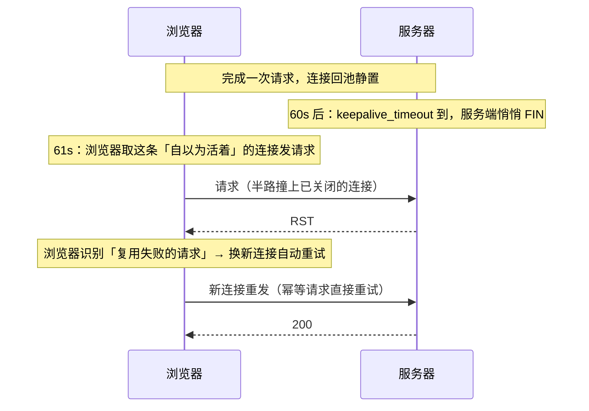

# 响应回程：压缩、分块与连接复用

> [← 第五阶段导览](01-导览.md) · 时间线 ⑧。HTML 生成好了，字节沿原路流回浏览器。这一册管回程的三件事：压缩（省带宽省传输时间）、分块（Content-Length 未知时怎么流式交付）、连接复用（响应跑完的连接怎么继续用）——并把它们与第三阶段的 TCP 分段、第四阶段的 h2 帧接成完整的一条链。

## 1. 回程链路总览

响应字节的旅程（与请求同路反向）：

```text
应用 flush 字节
  → 反代（可能再压缩/改头）
  → LB → CDN 边缘（顺手缓存一份，第五阶段 02 册）
  → TLS 记录层加密（~16KB 一条记录）
  → TCP 分段（MSS ~1460B）→ IP → 网卡
  → …网络…
  → 浏览器网络栈解 TCP/TLS → 解帧（h2/h3）→ 解压 → 解析（第七阶段）
```

三个压缩点要分清：**应用的 Content-Encoding**（gzip 压内容）、**TLS 记录层**（加密不压缩）、**TCP**（分段不管内容）。日常说的「响应压缩」全部指第一层——本册主角。

## 2. 压缩：协商、算法与取舍

### 2.1 协商回顾与响应侧

请求带 `Accept-Encoding: gzip, deflate, br, zstd`（第四阶段 05 册的协商语义），服务端挑一个，响应声明：

```text
Content-Encoding: br          ← 「体被 brotli 压过」
Vary: Accept-Encoding         ← 告诉缓存体系按这个头分桶（不配 = 串味事故）
```

### 2.2 三算法对照

| 维度 | gzip | brotli (br) | zstd |
|---|---|---|---|
| 压缩率（同级） | 基准 | **最高**（比 gzip 再省 15~20%） | 与 br 接近 |
| 压缩速度 | 中 | 慢（高级别尤甚） | **快**（同级别大幅领先） |
| 解压速度 | 快 | 快 | 很快 |
| 生态 | 全时代默认 | 浏览器全支持（**仅 HTTPS**，历史原因） | 新兴，现代浏览器已支持 |

工程分工的成熟结论：

| 场景 | 选择 | 原因 |
|---|---|---|
| 静态资源（构建时可预压） | **brotli 高级别**（11）+ gzip 兜底 | 预压不占在线 CPU，压缩率红利全拿 |
| 动态响应（每次现算） | gzip 低中级（4~6）或 zstd | 压缩 CPU 是服务端成本，高级别 br 每请求现压会烧 CPU |
| 图片/视频/wasm | **不压** | 本身已是压缩格式，再压体积不减反增（见 §2.4） |

### 2.3 压缩的经济学：省什么、付什么

| 收益 | 成本 |
|---|---|
| 传输字节 → 省带宽 + 省传输时间（弱网线性受益） | 服务端压缩 CPU（动态压缩时） |
| 包数减少 → 头开销/TLS 记录数同比例减（第三阶段 §2/§5 的推论） | 客户端解压 CPU（可忽略，微秒级） |
| 爬坡更快：同体积占更少的初始拥塞窗口（第三阶段慢启动） | 高级别 = 高延迟换高压缩率（预压场景无所谓） |

一句话决策：**传输时间用体积买，CPU 用预算买**——静态预压是「两边都赚」的免费午餐，动态压缩要算 CPU 账。

### 2.4 不该压的与压不动的

| 内容 | 为什么不压 |
|---|---|
| JPEG/PNG/WebP/MP4/WebM | 熵编码已满，gzip 再压 ≈0 收益，白烧 CPU |
| wasm（若已优化） | 通常已压缩或收益甚微，按实测决定 |
| **<1KB 的小文件** | 压缩后可能更大（字典/块开销）+ 压缩解压往返时间超过传输节省 |
| 已加密内容 | 熵太高，压不动（先压缩后加密才是正确顺序） |

还有一条安全边界记一句：加密 Cookie 的响应不能让「第三方压缩」插手（压缩侧信道 CRIME/BREACH 攻击——内容含秘密且攻击者能注入明文时可推断秘密），归 `security/` 站。

### 2.5 压缩的实测口径

```bash
# 体积对比：原尺寸 vs 压缩后
curl -sH 'Accept-Encoding: gzip' URL -o /dev/null -w '压缩后: %{size_download}B\n'
curl -sURL -o /dev/null -w '原始:   %{size_download}B\n'

# TTFB 对比（压缩计算是否拖慢首字节）
curl -sH 'Accept-Encoding: br' URL -o /dev/null -w 'br: %{time_starttransfer}s %{size_download}B\n'
```

DevTools 的 Network 面板 Size 列显示「传输大小 / 解压后大小」两值——比值即压缩率。**「体积没降 = 要么没协商上（看 Content-Encoding），要么内容本来不可压」**是排障第一分叉。

### 2.6 压缩配置的真实示例（逐行走读）

Nginx 的压缩段（每行标注本册知识点）：

```nginx
gzip on;
gzip_comp_level 5;                      # 动态压缩的级别——5 是 CPU/压缩率甜点位（§2.3 的账）
gzip_min_length 1024;                   # <1KB 不压（§2.4 小文件反而变大）
gzip_types text/css application/javascript application/json;   # 默认只压 text/html！
gzip_vary on;                           # 自动加 Vary: Accept-Encoding（缺它 = 代理串味）
gzip_proxied any;                       # 作为反代时也压上游响应（默认不压！）
# brotli（需 ngx_brotli 模块）：
brotli on;
brotli_comp_level 6;                    # 动态 br 用中级——高级别现压 CPU 伤不起
brotli_static on;                       # 发同目录下预压好的 .br 文件（§2.2 静态预压）
```

两个「默认值坑」值得圈出来：**`gzip_types` 默认只压 text/html**——CSS/JS/JSON 全裸奔是 Nginx 的出厂状态，无数站点就这么跑着；**`gzip_proxied` 默认不压代理响应**——「前面有 CDN 所以应用层不用压」的站点，回源请求（CDN MISS 时）拿到的就是未压缩体。检查自己站点：`curl -sH 'Accept-Encoding: gzip' URL -I | grep content-encoding`，没有输出 = 上面两个坑至少踩了一个。

## 3. 分块：Content-Length vs chunked

响应体长度的两种表达：

| 方式 | 适用 | 形态 |
|---|---|---|
| `Content-Length: N` | 长度已知（静态文件/攒好的字符串） | 一次交付，浏览器知道「收到 N 字节即完」 |
| `Transfer-Encoding: chunked` | 长度未知/流式生成（SSR flush、代理转发） | 分块自描述长度 |

chunked 的块格式（ASCII 实景）：

```text
4\r\n            ← 本块长度（十六进制）
Wiki\r\n         ← 本块内容
5\r\n
pedia\r\n
E\r\n
in\r\n\r\nchunks.\r\n
0\r\n            ← 长度 0 的块 = 流结束
\r\n             ← （可带 trailer 头）
```

与流式 SSR（上一册 §4）的接缝：**flush 一次 = 发出一个或多个 chunk**——浏览器每收完一块就交给解析器，不需要知道总长。这也是「流式的传输基础」的标准答案（第五阶段导览自测题 6 的前半）。

**h2/h3 下 chunked「消失」但语义仍在**：帧机制本身就是分块（DATA 帧流），`Transfer-Encoding` 头被禁用（第四阶段 03 册 §9）——「无总长的流式交付」作为**语义**仍然存在，只是载体从 chunk 格式换成了帧流。面试高频陷阱题：「h2 里 chunked 还存在吗？」答：头不存在，语义存在。

### 3.6 chunked 与流式解析的衔接（给第七阶段打的接口桩）

浏览器侧消费 chunked 流的管线（第七阶段展开，这里先立接口面）：

```text
网络栈收到 chunk → 剥壳（长度前缀）→ 字节流拼接 → 增量交给 HTML 解析器
HTML 解析器：收到多少解析多少（流式 tokenization）
  → 解析到 <link>/<script> 立即触发预解析扫描器加载（第六阶段）
  → 不等「最后一个 chunk」——首屏解析从第一个 chunk 就开始
```

两个推论：①「Content Download 长但 FCP 早」是流式的正常形态（解析与下载并行）；②chunk 边界影响解析粒度——极小的 chunk 会产生大量解析器唤醒（小 flush 太碎反而浪费 CPU），**flush 粒度建议在几 KB 量级**，不是「越早越碎越好」。

### 3.5 条件请求 × 压缩 × 分块的组合矩阵

把第四阶段 05 册与本册接龙，一个响应可能同时叠加的机制：

```text
GET /app.js（If-None-Match: "abc123"，Accept-Encoding: br）
  → 304 Not Modified（验证通过：无体、无压缩、无分块——头就完事）
  → 或 200 + ETag("def456") + Content-Encoding: br + chunked（变了的完整流式）
```

ETag 的注意点：**ETag 生成要避开压缩维度**——同一内容 gzip 版与原版若 ETag 不同，缓存体系会按「内容不同」处理；弱验证器 `W/` 或生成时排除压缩影响是标准做法。

## 4. 连接复用的两端：浏览器连接池 × 服务端 keepalive

请求-响应跑完，连接回池子待命。两端各有空闲超时，**参数不一致是「偶发失败」的工厂**：



浏览器对**复用失败**有特殊处理：请求还没写出去连接就死了 → 静默换连接重试（用户无感）；所以 Network 面板里通常只看到一次正常请求。但当请求已发出（非幂等 POST）或重试也失败时，就变成可见错误——第五阶段导览自测题 9 的完整答案。

对齐策略（服务端工程）：

| 参数 | 典型值 | 对齐原则 |
|---|---|---|
| 服务端 keepalive_timeout | Nginx 60~75s | **服务端 > 浏览器池回收**（浏览器一般几分钟级，天然安全）；<br>若 LB/反代在前：**反代 > 应用**，否则反代发过来的就是死连接 |
| LB ↔ 应用空闲超时 | 60s | 链路上逐层递增，最内层最大 |

「层层递增」口诀：**越靠内的组件超时越长**——让死连接在靠外层就被掐掉，内层永远收到活连接。

### 4.5 连接池的观测：面板与 chrome:// 两把尺子

| 观测点 | 看什么 | 判读 |
|---|---|---|
| Network 面板 Timing | 复用请求无 DNS/Connect/SSL 段 | 有这三段 = 没复用（池空/被掐/跨进程上下文） |
| `chrome://net-internals/#sockets` | 连接池清单：每条连接的空闲时长、复用次数 | 大量「idle 很久」的连接 = 池偏大；频繁「closed by server」= 超时错配 |
| 服务端 `ss -nt state established` | 到客户端的连接数与状态 | 连接数远超预期 = 客户端池策略异常或泄漏 |
| 抓包 RST 的方向 | 服务端先 FIN（超时掐）vs 中途 RST（异常） | 偶发失败归因的第一证据 |

一个实用判读：**Timing 里「偶发请求带完整 Connect/SSL 段」而其余请求没有**——典型的池竞争：并发超过池深度时新请求被迫新建连接（h1 每域 6 条的排队 → 超出者新建）。它在压测里会放大成「连接数抖动」，看 net-internals 的连接建立曲线就能确认。

### 4.6 h2/h3 时代连接池还剩什么

「6 条连接、连接池竞争」是 h1 的故事；多路复用时代连接池瘦身但没消失：

| 维度 | h1 | h2/h3 |
|---|---|---|
| 每 host 连接数 | 6 | 通常 1（复用流） |
| 池的竞争形态 | 请求排队等连接 | 流在连接内排队（并发流数上限） |
| 连接断开的爆炸半径 | 只死它服务的请求 | 该连接上**全部流**（§上册） |
| 空闲超时的风险 | 偶发失败+静默重试 | 同样存在，且断一根 = 全断，浏览器整体重连 |

观测上的新形态：net-internals 里一个 host 只剩 1~2 条连接，但「连接被掐」事件的影响面变大——这正是「参数层层递增」在多路复用时代更重要的原因：一根死连接的代价从「一个请求」涨成了「一个页面」。

## 5. 与传输层的接龙：压缩字节的完整分段链

把第三、四阶段的知识串成一条线（一张表收束「一个 HTML 响应的字节分解」）：

| 层 | 单位 | 典型大小 | 数量估算（100KB HTML，br 压到 25KB） |
|---|---|---|---|
| HTTP 体（解压后） | 字节 | 100KB | — |
| HTTP 体（压缩后） | 字节 | 25KB | — |
| TLS 记录 | 记录 | ≤~16KB | 2 条 |
| TCP 段 | 段 | MSS≈1460B | ~18 段 |
| h2 DATA 帧 | 帧 | ≤16KB（可更小） | 若干帧 |
| IP 包 | 包 | ≤MTU 1500 | ~18 包 |

读法：**压缩在链路最顶端做减法，下面每一层的数量都同比例减**——这就是「压缩是全局优化」的完整论证（第三阶段 §2.2、第四阶段 §2.3 的三次伏笔在此收拢）。

### 5.5 一次压缩失效的排障走查（实录形态）

「用户反馈流量翻倍，运维怀疑被刷」——按本册知识走一遍（数字示意）：

```text
① 先看压缩在不在：curl -sH 'Accept-Encoding: gzip' URL -I | grep -i content-encoding
   → 空输出！应用层根本没压
② 为什么没压？Nginx 配置排查：gzip on 在，但响应是反代转发
   → gzip_proxied 没配（默认 off）→ 代理响应全部裸奔
③ 量化损失：100KB JSON × 日均 500 万次 = 每天白传 ~470GB（压后应 ~12KB/次）
④ 修复：gzip_proxied any + gzip_types 补 application/json
⑤ 验证：curl 复测 Content-Encoding: gzip 出现；Size 列比值回到 ~8:1
⑥ 防复发：发布检查单加一条「curl 验证主流路径的 Content-Encoding」
```

方法论：压缩失效是「静默型退化」——不报错、只烧钱，靠流量账单或偶然的 curl 才发现。**把 §2.5 的两条 curl 写进常规巡检**，这类事故就从「运维凌晨告警」变成「发布前自检」。

## 6. 实验

1. **三算法实测**：对同一静态资源分别请求 gzip/br/zstd（`curl -H 'Accept-Encoding: xxx' -w '%{size_download}'`），记录体积与 TTFB 差——本机资源用 Caddy/Nginx 配三种压缩。
2. **chunked 观察**：本地写个每秒 flush 一块的流式服务，curl 看块结构（`curl --raw -N`）；Wireshark 里对照 chunk 边界与 TCP 包边界（不是一比一）。
3. **h2 下找 chunked**：对 h2 站点抓解密包（SSLKEYLOGFILE），确认响应无 Transfer-Encoding 头、DATA 帧流式到达——「语义仍在、载体换帧」的实证。
4. **死连接复现**：本地 Nginx `keepalive_timeout 5s`，浏览器访问后静置 6 秒再点击链接，Network 面板看是否有静默重试；改非幂等 POST 场景对比错误可见性。
5. **压缩率普查**：对五个常用站的主文档与主 CSS 记录 Size 列两值，算压缩率；找「没压缩」的反例（通常是配置失误或小文件）。
6. **复现 §5.5 的坑**：本机 Nginx 反代一个 Node 服务，故意不配 gzip_proxied，curl 验证「代理响应没压」；补配后复测——配置坑的亲手复现比读十遍记得牢。

## 7. 常见误区

1. **「开了压缩一定更快」**：小文件可能变大、动态压缩烧 CPU、TTFB 可能因压缩计算变长——压缩是「传输时间 vs 计算时间」的交换，按内容类型分级配置。
2. **「Content-Length 和 chunked 可以共存」**：互斥（Transfer-Encoding 优先，规范禁止同发）；见到的「既有 Length 又有 chunked」是实现 bug，也是走私攻击的经典漏洞形态（security 站）。
3. **「复用连接失败是网络故障」**：多数是空闲超时参数不对齐（§4）——「重试就好」的偶发失败先查两端 keepalive 配置。
4. **「h2 分块就是 chunked 换了个名字」**：chunked 是应用层自描述格式；h2 帧是协议内置机制，且帧可以再切应用消息——粒度与控制主体都不同。
5. **「压缩率越高越好」**：高级别压缩的延迟开销在动态场景吃掉 TTFB——级别选择跟着「预压 or 现压」走，不跟着压缩率排行榜走。
6. **「Nginx 开了 gzip 就万事大吉」**：`gzip_types` 默认只压 HTML、`gzip_proxied` 默认不压代理响应——两个默认值坑（§2.6）让「开了」与「生效」之间隔着一行 curl。

### 7.5 常见问答

**Q：流式响应能配 Content-Length 吗？**
不能——流式的本质是「总长未知」。工程上见过「先攒全量再发」换 Content-Length 的做法：TTFB 换传输确定性，流式场景（长页面/生成式内容）通常不值得。判据：生成时间 > 传输时间的，选 chunked 流式；反之攒齐再发也无妨。

**Q：h3 下压缩有什么变化？**
协商与算法不变（Accept-Encoding 照旧），但 QPACK 头压缩让「Vary: Accept-Encoding」这类协商头在连接内的重复开销更低。另一个微观差异：QUIC 流控是流级的，压缩器缓冲行为对 flush 及时性的影响与 h2 类似——§3.6 的「flush 粒度」建议在 h3 下同样成立。

**Q：CDN 边缘会二次压缩吗？**
可能——若源站未压缩而 CDN 开了「边缘压缩」，回源后边缘会补压（第二轮的压缩点）。两处都压不会叠压（CDN 尊重已有的 Content-Encoding），但会造成「同一资源不同边缘压缩率不同」的观测差异——RUM 里压缩率抖动的隐性来源之一。

**Q：同一资源在 DevTools 里传输大小比 curl 量的大，为什么？**
curl 量的是体大小；面板的「传输大小」含头 + TLS/协议层开销（h2 还有帧头）。正常差异是几百字节级；若差距巨大，多半是「面板走的响应被反代重新分块/加了头」或压缩版本不同（br vs gzip）——对比时先对齐 Content-Encoding 再比数字。

## 8. 自测题

1. 响应字节的完整回程链（应用 flush → 浏览器解析）经过哪些层？三个「处理点」（压缩/加密/分段）各在哪层？
2. gzip/brotli/zstd 的取舍表？静态与动态场景各选什么级别，为什么？
3. 压缩的三收益与两成本？「包数同比例减少」的论证链经过哪两层？
4. 列出不该压缩的四类内容与各自原因。
5. Nginx 的哪两个默认值让「开了 gzip」不等于「压缩生效」？各自的症状与修法？
6. chunked 块格式怎么自描述长度？流结束的标志是什么？
7. 「流式 SSR 的传输基础」标准答案是什么？h2 下这个答案怎么变？chunk 边界对解析粒度有什么影响？
8. 条件请求 × 压缩 × 分块的组合矩阵：304 与 200 各叠加哪些机制？
9. 画出复用死连接的时序；「层层递增」口诀的内容与原理？
10. 浏览器对复用失败的静默重试条件是什么？什么情况下失败会可见？
11. 100KB HTML 压到 25KB，TLS 记录/TCP 段/IP 包各约多少？这个估算在抓包时怎么用？
12. （提示题）§5.5 排障走查的第①步为什么先 curl 验证 Content-Encoding 而不是先看流量图？——「静默型退化」的排障顺序。

## 9. 自查清单

| # | 检查 | 工具 | 异常指向 |
|---|---|---|---|
| 1 | 静态资源 br/gzip 双配？ | curl Accept-Encoding 对比 | 只有 gzip = 预压链路没搭 |
| 2 | 动态压缩级别合理？ | TTFB 对比（§2.5） | 高级别现压 = CPU 换延迟失衡 |
| 3 | gzip_types 覆盖 CSS/JS/JSON？ | curl 逐类型验证 | 只压 HTML = Nginx 默认坑（§2.6） |
| 4 | 图片/视频被误压？ | 响应头 Content-Encoding | 压缩媒体 = 白烧 CPU 且没收益 |
| 5 | Vary: Accept-Encoding 在？ | 响应头 | 缺失 = 代理串味风险 |
| 6 | keepalive 参数层层递增？ | Nginx/LB 配置 review | 内层更短 = 死连接递给上游 |
| 7 | 流式响应在压缩下仍及时？ | curl 分段计时 | 首块延迟 = 压缩缓冲配置 |
| 8 | 主流路径的压缩进了巡检？ | 发布检查单 | 静默退化无人知 = §5.5 重演 |

## 10. 延伸

- 本阶段收束：响应已到达浏览器门口。下一站：[第六阶段 · 接收、缓存与调度](../06-第六阶段/01-导览.md)——浏览器接收流水线、HTTP 缓存判定、子资源排队上路。
- 压缩侧信道与走私攻击归 `security/` 站；解压与解析的衔接在[第七阶段](../07-第七阶段/01-导览.md)。
