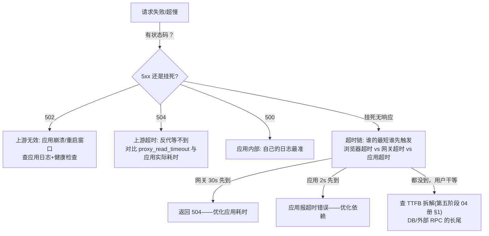

# 错误、重定向与失败模式

> [← 第五阶段导览](01-导览.md) · 时间线 ⑦⑧ 收束册。响应不总是 200：重定向把请求带去别处、错误码宣告失败、网络栈在你看不见的地方自动重试。这一册把 3xx 全家族、自动重试机制、超时定位方法收成一张排障速查表——它是第五阶段的出口，也是日常线上排障最常翻的一册。

## 1. 3xx 全家族：两个维度定语义

重定向的语义由两个维度完全决定：**永久性**（缓存权重）与**方法保持**（重发什么方法）：

| 码 | 永久？ | 方法保持？ | 典型用途 | 备注 |
|---|---|---|---|---|
| 301 | 永久 | ❌ 实践中常变 GET | 域名迁移、旧 URL 下线 | 规范未承诺方法行为，实践包袱与 302 相同 |
| 308 | 永久 | ✅ 严格保持 | 现代永久重定向 | 301 的「规范修正版」，2015 才有 |
| 302 | 临时 | ❌ 实践中常变 GET | 登录跳转、临时维护跳转 | **历史包袱之源** |
| 303 | 临时 | ❌ 强制变 GET | PRG 模式（POST 后跳结果页） | 语义最明确「用 GET 去看」 |
| 307 | 临时 | ✅ 严格保持 | 临时重定向且不许改方法 | 302 的「规范修正版」 |
| 304 | — | — | **不是重定向**——缓存验证通过（第四阶段 05 册） | 常被误归入 3xx 家族讨论 |

302 的历史包袱值得单独讲：规范只说「临时跳转」，没说方法怎么处理——但早期浏览器实现成「POST → GET」跟随跳转（因为当年的用例就是 POST 后跳页）。这个「实现先行」的既成事实被写进了实践规范（303/307 才把语义切开）。**结论口诀：302/301 的方法行为不可依赖，要保方法用 307/308。**

### 1.1 重定向链的乘法效应

一次跳转不贵，**链**是 killers：

```text
http://a.com → 301 → https://a.com → 301 → https://www.a.com → 200
```

| 环境 | 每跳成本 | 3 跳链的总代价 |
|---|---|---|
| 热连接（复用） | ≈1 RTT | ~150ms（RTT 50ms） |
| 冷启动 + 跨域名 | DNS+TCP+TLS 全套 ③④⑤ | **每个新域名重付全套**，秒级 |

链式重定向还叠加两个坑：每跳都可能被**缓存**（301 会被浏览器与中间缓存长期记住——改错目标后「撤回」极难，要等缓存过期或换 URL）；跳转中途丢失 Referer/清理 Cookie 的边界差异（跨域跳转策略）。

工程纪律：

1. 发布前扫重定向链（`curl -sIL -w '%{url_effective} %{num_redirects}\n'`），**链长 >2 就是整改对象**；
2. 永久跳转用 308（现代）并想清楚再发——它会长久驻留在全世界的缓存里；
3. 高频入口（落地页）的跳转在配置层收敛到 0~1 跳。

### 1.2 重定向循环与防护

跳转指向自己的链（A→B→A）会以 `ERR_TOO_MANY_REDIRECTS` 收场（浏览器在 ~20 跳处熔断）。三类真实成因：

| 成因 | 形态 | 防法 |
|---|---|---|
| 配置叠加 | CDN 一条 http→https 规则 + 源站一条反着来的规则 | 变更前后跑全链 curl 扫描 |
| Cookie 条件跳转 | 「无登录 Cookie 就跳登录页」而登录页也判无 Cookie | 条件互斥检查 + 灰度验证 |
| 域名规则循环 | www 跳裸域、裸域又跳 www（两条 301 互相成环） | 规范域名唯一化，规则单向 |

排查方法：`curl -sIL -v` 逐跳看 Location 链，直到出现重复 URL——环就在那里。防护要放在**发布流程**：重定向规则变更必须配「全站 URL 扫描」的自动化检查（人工抽查必然漏）。

## 2. 网络栈的自动重试：你看不见的第二条命

浏览器/网络栈在失败时会**静默重试**，理解哪些情况会重试，才能解释「Network 面板里一次请求偶尔显示失败、页面却正常」的怪象：

| 触发条件 | 谁重试 | 是否静默 |
|---|---|---|
| 复用连接已死（服务端 keepalive 掐断，请求未发出） | 浏览器换连接重试 | ✅ 静默（用户无感） |
| 复用连接死且请求**已发出**且非幂等 | 不重试（防重复提交） | ❌ 报错可见 |
| TCP 层丢包重传 | 内核 | ✅ 完全不可见（Network 面板无感知） |
| Happy Eyeballs 双栈竞速失败一侧 | 浏览器放弃失败侧 | ✅ 静默 |
| HTTP/3 连接失败回退 h2 | 浏览器换协议重试 | ✅ 静默（Protocol 列能看到痕迹） |
| DNS 解析失败 | 浏览器换 resolver 重查（部分实现） | 半静默 |

**幂等性再次出场**（第四阶段 02 册 §2 的第三次呼应）：网络栈的重试决策树第一问永远是「这个请求幂等吗」——GET 敢反复发，POST 不敢。自己写应用层重试时必须沿用同一纪律。

### 2.5 429/503 的重试：应用层的责任

网关限流（第五阶段 03 册）不会被浏览器自动重试——`Retry-After` 的消费方是你的代码。标准退避模板：

```js
async function fetchWithBackoff(url, opts = {}, max = 3) {
  for (let i = 0; ; i++) {
    const res = await fetch(url, opts);
    if (res.status !== 429 && res.status !== 503) return res;
    if (i >= max) return res;
    // 优先信服务端 Retry-After，否则指数退避 + 抖动
    const base = Number(res.headers.get('Retry-After')) || 2 ** i;
    const delay = (base + Math.random()) * 1000;   // 抖动防同步风暴
    await new Promise(r => setTimeout(r, delay));
  }
}
```

三个要点：指数退避（2ⁱ 秒）、**随机抖动**（防止所有客户端同时重试的第二波风暴）、尊重 Retry-After（服务端比你更知道自己何时恢复）。

### 2.7 不可重试清单（重试纪律的另一面）

「敢重试」讲完了，反向清单同样重要——这些情况重试只会更糟：

| 情况 | 为什么不重试 |
|---|---|
| 非幂等请求且不确定是否送达 | 重复下单/重复扣款（§2 第一行） |
| 4xx（除 429） | 客户端错误——重发一百次也是你的错（400/403/404） |
| 熔断打开期（连续快速失败后） | 服务在求你别打了——立刻退避或走降级 |
| 已到业务 deadline（支付超时后的重试） | 用户可能已放弃，迟到的「成功」更糟 |
| 认证失效（401） | 先刷新凭证再重试，直接重试还是 401 |

一条总纪律：**重试预算**——任何请求的重试上限（如 3 次）+ 总时间预算（如 10s），超了就失败并上报。「无限重试」是把客户端变成 DDoS 的第一课。

## 3. 失败模式速查表

排障总表——从现象到归层：

| 现象/错误码 | 含义 | 最常见根因 | 归层 | 第一动作 |
|---|---|---|---|---|
| ERR_NAME_NOT_RESOLVED | DNS 解析失败 | 域名配错/解析商故障/本地断网 | ③ | dig 验证、换 resolver |
| ERR_CONNECTION_REFUSED | 端口没人听 | 服务没起/端口错/防火墙 REJECT | ④ | telnet/nc 探端口 |
| ERR_CONNECTION_TIMED_OUT | 建连超时 | 防火墙 DROP、路由不通、SYN 丢失 | ④ | ping/mtr 查路径 |
| ERR_CONNECTION_RESET | 连接被掐 | keepalive 错配（§上册）、LB 摘除、防火墙 RST | ④⑤ | 重试是否可复现→抓包 |
| ERR_SSL_PROTOCOL_ERROR | TLS 层错 | TLS 版本/套件不匹配、非 443 端口上的 TLS 服务 | ⑤ | openssl s_client 诊断 |
| ERR_CERT_*（COMMON_NAME/DATE/AUTHORITY） | 证书验证失败 | 过期/SAN 不匹配/**缺中间证书** | ⑤ | 第三阶段 TLS 册 §8 排查树 |
| ERR_EMPTY_RESPONSE | 连接通但没回数据 | 应用崩溃、反代上游瞬断 | ⑦ | 反代错误日志 |
| 404 | 资源不存在 | 路径错/路由没配/构建产物没传 | ⑦ | 直连源站 curl 对比 |
| 403 | 被拒 | 鉴权/WAF 拦截/权限 | ⑦ | 看是谁的 403（应用 or WAF） |
| 429 | 限流 | 请求频率超配额 | ⑦ | Retry-After + 退避 |
| 500 | 应用内部错误 | 代码异常 | ⑦ | 应用错误日志 |
| 502 | 上游无效响应 | 应用崩溃/重启窗口/反代连不上应用 | ⑦ | upstream 日志+健康检查状态 |
| 503 | 暂不可用 | 过载/熔断/维护 | ⑦ | Retry-After + 容量 |
| 504 | 等上游超时 | 慢查询/下游依赖超时 | ⑦ | upstream_response_time 定位 |

**归层**列是这张表的灵魂：错误先按主时间线 ③④⑤⑦ 归位，再下钻——「先分层再定位」避免在错误的机器上查一小时。

### 3.5 错误码的「伪装」识别

排障时要能识破三层伪装——每一层都在偷换「错误的真相」：

| 伪装 | 形态 | 识破方法 |
|---|---|---|
| 200 包错误体 | 业务失败却回 200 + `{code: -1}` | 监控失明——约定「HTTP 状态码只表达传输语义，业务错误也用 4xx/5xx」或至少双轨上报 |
| 自定义错误页吞状态 | 反代把 502 换成品牌 404 页 | curl 直连各层对比状态码（穿过分页层看真身） |
| WAF 的 403 | 应用 403（权限）与 WAF 403（拦截）同名 | 看 403 响应头/体特征（WAF 通常带自家标识） |

识破的总原则：**同一条 URL，从浏览器、过 CDN、直连源站各测一遍**——状态码在哪一层被改了，那一层就是伪装者。这也是「分层 curl」排障法的又一场（第五阶段 02 册事故复盘的通用方法论）。

## 4. 超时定位：一条链上的五个表

一次请求会经过多个超时阈值，**最短的那个先触发**：

| 超时 | 谁配置 | 典型值 | 触发后用户看到 |
|---|---|---|---|
| DNS 查询超时 | 浏览器/OS | 1~10s | ERR_NAME_NOT_RESOLVED |
| TCP 建连超时 | 浏览器 | ~10~30s（内核 SYN 重试决定） | ERR_CONNECTION_TIMED_OUT |
| TLS 握手超时 | 浏览器 | 秒级 | ERR_SSL_PROTOCOL_ERROR 类 |
| **响应超时**（浏览器等首字节/完整响应） | 浏览器 | 数百秒（很宽，实际很少触发） | ERR_TIMED_OUT |
| **网关等上游超时** | LB/反代 | 30~60s（Nginx proxy_read_timeout 默认 60s） | **504** |
| 应用内部超时（等 DB/RPC） | 应用 | 1~30s | 500 / 自己的超时错误 |

定位决策树：



排障纪律：**超时问题的第一手资料是各层超时参数表**——拿不到参数表就画出你这条链的配置（浏览器默认/CDN/LB/反代/应用），「谁先超时」决定了「谁返回什么错误」，倒着推就能定位慢的那层。

### 4.5 一次完整超时排障的实录（五层表填空形态）

「大促预热夜，支付回调偶发超时」——把五层超时表当问卷填（数字示意）：

```text
① 画链路：浏览器 → CDN → LB → 网关 → 支付应用 → 银行 RPC
② 填参数：
   CDN 回源超时      : 30s
   LB read 超时      : 60s
   网关 read 超时    : 15s        ← 注意：比 LB 短！
   应用 RPC 超时     : 3s
   银行接口 P99      : 2.8s       ← 贴着应用超时！
③ 对账现象：银行抖动到 3.2s → 应用 RPC 超时(3s) → 应用快速失败返回 500
   但日志里还有一批 504 → 银行 RPC 挂死（无响应）→ 应用等满？不——
   应用 RPC 库的「无响应重试」把 3s 变成 9s → 超过网关 15s？没有。
   真凶：应用线程池被超时等待占满 → 后续请求排队 → 网关 15s 到 → 504
④ 修复：银行 RPC 超时 3s→2s + 熔断；线程池排队上限；网关超时 15s→8s（快速失败优于挂死）
⑤ 复盘一句话：超时参数不是独立数字，是「整条链的联动方程」——改一个要看全链
```

这个案例的通用教训：**超时链的每一层都要「比内层宽」才能让错误从内向外正确传播**——应用 3s < 网关 15s < LB 60s < CDN 30s（CDN 这层反而要按「总预算」重排）。参数表填空就是把这条方程显式化。

## 5. 错误页与用户体验的交界

错误到达用户眼前的两种形态：

| 形态 | 谁渲染 | 前端可控性 |
|---|---|---|
| 浏览器错误页（恐龙页） | 浏览器 | 几乎为零——网络层失败的兜底 |
| 应用错误页（自绘 404/500） | 你的代码 | 完全可控——应用层能捕获的错误 |

由此推出前端的错误分级策略：**能拿到的错误尽量自己兜住**（fetch 的非 2xx、超时中断转成应用内提示），让用户少看到浏览器恐龙页；导航类失败（主文档都拿不到）才回落浏览器页。「错误页体验」的完整设计（重试按钮/状态上报/降级内容）归产品与前端工程交界，observability 站继续错误上报的采集侧。

### 5.5 用户侧错误观测的最低配置

不引 APM 也能搭起的错误观测地基（observability 站的系统版之前的「保底版」）：

| 钩子 | 捕什么 | 注意 |
|---|---|---|
| `window.onerror` / `error` 事件 | 同步 JS 错误 | 跨域脚本只有 "Script error."（CORS 限制，需 crossorigin 属性） |
| `unhandledrejection` | 未处理的 Promise 拒绝 | async 时代的主流量 |
| fetch 封装层 | 非 2xx + 超时 + 网络异常 | 带状态码/URL/耗时维度 |
| `navigator.onLine`/事件 | 断网感知 | 仅本机判断，别当服务端健康信号 |

上报纪律：带「URL + 状态码 + 耗时 + 版本」四元组——没有版本的错误数据无法对应发布，等于没报。采样与去重（同一错误风暴时限量上报）是进阶，observability 站展开。

## 6. 实验

1. **重定向链测量**：`curl -sIL -o /dev/null -w '%{num_redirects} %{url_effective} %{time_total}\n' http://某老站`——数跳数、量总耗时；对比单跳站点的数字。
2. **方法保持验证**：本地起接受 POST 的服务，配 302 与 307 两条重定向，观察请求体/方法在跳转后的变化——「302 变 GET、307 保 POST」的实证。
3. **301 缓存的顽固性**：本地配 301 → 后改配置换目标 → 浏览器（不清缓存）仍然跳旧目标——「永久跳转撤不回」的现场；清缓存后对比。
4. **502/504 制造**：本地 Nginx 反代一个会挂的应用（kill 进程观察 502）与一个 sleep 70s 的应用（超过 proxy_read_timeout 观察 504）——两种错误各自的「出生地」亲手看一遍。
5. **退避重试实测**：对限流接口分别跑「立即重试 × N」与「指数退避 + 抖动」脚本，观察第二次 429 风暴的差异。
6. **静默重试观察**：本地 `keepalive_timeout 1s`，浏览器访问后等 2 秒点击链接——抓包（Wireshark）能看到「发到死连接的请求 + RST + 新连接重发」，而 Network 面板只有一条干净请求——「面板的干净是重试洗出来的」的实证。
7. **循环制造**：本地配 A→B→A 两条 301，观察 ERR_TOO_MANY_REDIRECTS 的熔断行为与浏览器提示——§1.2 的现场。
8. **伪装识别**：给反代配 error_page 502 →502.html，用「直连源站 vs 走反代」的分层 curl 对比——看穿错误页伪装的手感。

## 7. 常见误区

1. **「302 和 307 差不多」**：方法行为天差地别（POST 变 GET vs 严格保持）——表单/支付场景用错会产生真实的业务事故。
2. **「301 发出去随时能改」**：301 被全球缓存长期记住——改错目标后自己都撤不回；拿不准就用 302/307（临时），稳定后再「升级」为永久。
3. **「重定向链多一跳没多大事」**：每跳都是 RTT 且可能冷启动建连——3 跳链在弱网是秒级代价，且每跳都在稀释转化。
4. **「浏览器会帮我重试限流」**：429/503 的重试 100% 是应用代码的责任；Retry-After 不看 = 风暴制造者。
5. **「504 就是服务器慢」**：504 精确含义是「网关等上游超过了网关的超时阈值」——可能是应用慢，也可能是网关超时配得过短；先对参数再定责。
6. **「挂死比报错好」**：挂死触发的是用户端百秒级超时（体验最差），快速失败（503+Retry-After）才是对用户友好的过载姿态。
7. **「错误页渲染出来就没事了」**：自定义错误页若吞掉真实状态码（§3.5 伪装），监控与排障都会被带偏——错误页要「好看」更要「诚实」。

## 7.5 三个排障案例复盘

把本册全部工具串进三个真实形态的案例（数字示意）：

**案例一：「某地区整站打不开」**
```text
现象：华南用户 ERR_CONNECTION_TIMED_OUT，其他地区正常
分层：③④ 段挂（Timing 只有超时）→ 不是应用问题
定位：mtr 到源站，华南出口丢包 100% → 运营商链路问题
缓解：CDN 多节点兜底（切调度）；根治：运营商报障
教训：「整片地区失败」先查链路层（③④），别进应用日志大海捞针
```

**案例二：「发布后 5 分钟 502 风暴」**
```text
现象：滚动发布窗口内 502 率 3%
分层：502 = 反代收到上游无效响应 → 查 upstream 日志
定位：502 全落在「正在重启的实例」→ 摘除机制没配 graceful shutdown
修复：应用处理 SIGTERM 先摘流量再退出；健康检查在就绪后才返回 200
教训：502 的「时间分布」（发布窗口）本身就是定位证据
```

**案例三：「白屏但面板显示 200」**
```text
现象：用户白屏，主文档 200、无失败请求
分层：⑦ 成功 → 问题在 ⑦ 之后的回程或渲染
定位：主文档 Content-Length 只有 40 字节 → 网关返回了空壳（缓存污染）
定位二：网关侧同一 URL curl 正常 → 特定用户态触发（某 Cookie 组合下上游异常）
修复：上游修复 + 网关对该异常回 502 而不是 200 空壳（诚实原则）
教训：「200 但体不对」是 §3.5 伪装的变异——Content-Length 是最快的照妖镜
```

三个案例共用同一条方法论：**现象 → 归层（速查表）→ 分层取数（日志/状态码/Timing）→ 修复 → 防复发进流程**。第五阶段学的是「链」，排障用的是「分」。

## 8. 自测题

1. 3xx 的两个语义维度是什么？按维度给 301/302/303/307/308 建一张矩阵。
2. 302 的历史包袱是什么？哪个场景必须用 307 而不能用 302？
3. 画出三跳重定向链在冷启动下的成本构成；为什么说「每跳可能重付 ③④⑤」？
4. 301 被缓存后撤回有多难？「拿不准先发临时跳转」的原理是什么？
5. 列出网络栈静默重试的五种情况；幂等性在重试决策里扮演什么角色？
6. 写出带指数退避 + 抖动 + Retry-After 的重试模板，解释抖动防的是什么。
7. 列出不可重试清单的五条；「重试预算」包含哪两个上限？
8. 失败模式速查表里，ERR_CONNECTION_RESET 的三个最常见根因分别属于哪几层？
9. 502 与 504 的出生地差异？各自的「第一动作」是什么？「时间分布」怎么当定位证据用？
10. 一次请求经过的六类超时是什么？「最短的超时先触发」怎么用于定位？
11. 超时链的「整条联动方程」是什么意思？§4.5 案例里真凶是谁、修复动了哪四处？
12. 错误码伪装的三层各是什么？「分层 curl」怎么识破？
13. 浏览器错误页与应用错误页的分界在哪？前端的错误分级策略是什么？
14. 用户侧错误观测的四钩子与上报四元组是什么？

## 9. 自查清单

| # | 检查 | 工具 | 异常指向 |
|---|---|---|---|
| 1 | 站点重定向链 ≤1 跳？ | curl -IL 扫入口 URL | 链长 >2 = 整改 |
| 2 | 永久跳转用 308 且确认过？ | 跳转配置 review | 302/301 保方法场景 = 事故隐患 |
| 3 | 前端重试有退避 + 抖动 + 预算？ | 代码 review | 立即重试/无限重试 = 风暴制造者 |
| 4 | 各层超时参数表画出来了？ | 运维文档 | 没有表 = 504 排障靠猜 |
| 5 | 应用可捕获的错误都自兜了？ | 错误处理 review | 恐龙页高频 = 分级策略缺失 |
| 6 | 502 的重启窗口有预案？ | 部署流程 | 滚动发布裸奔 = 发布期 502 |
| 7 | 错误页诚实（不吞状态码）？ | 分层 curl 对比 | 伪装错误页 = 监控失明 |
| 8 | 错误上报带四元组？ | 埋点 review | 无版本错误数据 = 无法对应发布 |

## 10. 延伸

- 第五阶段闭环：请求出去、响应回来了。下一站：[第六阶段 · 接收、缓存与调度](../06-第六阶段/01-导览.md)——字节回到浏览器：接收流水线、HTTP 缓存判定、子资源调度。
- 错误上报与监控采集归 `observability/` 站；HTTP 走私与重定向钓鱼归 `security/` 站。
