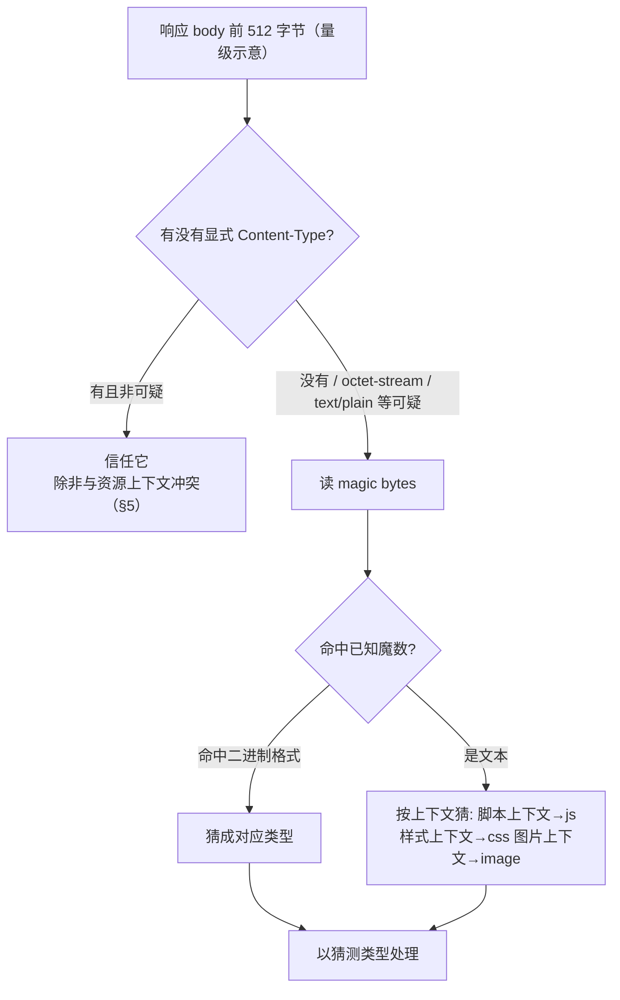
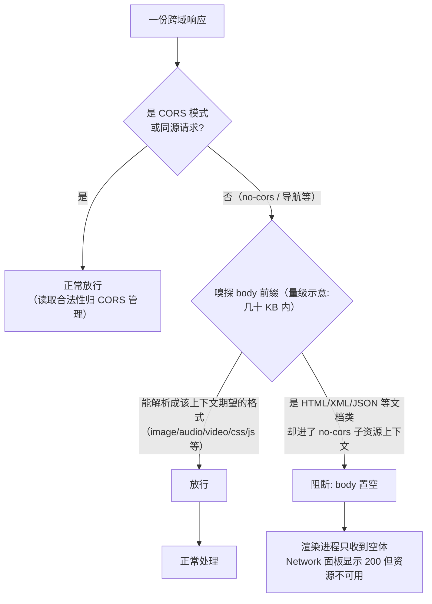

# 网络进程接收流水线：响应字节进门后的第一段路

> [← 第六阶段导览](01-导览.md) · 时间线 ⑨（网络进程接收），同时是 ⑥⑧ 的接收侧。上一阶段把响应从服务端送回了浏览器门口；这一册从门口开始：解密后的字节流怎么被解析成 HTTP 响应、`Content-Type` 缺失时浏览器怎么猜类型（MIME sniffing）、`nosniff` 怎么把猜测关掉、CORB/ORB 为什么宁可把 body 扔掉也不让跨域数据进入渲染进程，以及**首字节一到渲染进程就已经开工**的乐观准备——⑨ 与 ⑩⑪ 不是严格串行的接力，而是流水线上的重叠。

## 1. 总账：接收流水线在主时间线的位置

| 前一步（谁交给 ⑨） | 本步发生什么 | 下一步（⑨ 交给谁） |
|---|---|---|
| ⑧ 响应回程（第五阶段）：压缩分块的字节到达本机 | 解析头 → 类型判定 → 安全检查 → 分发 | ⑩ commit + 渲染进程就位 → ⑪ HTML 解析 |

一条响应字节从 TLS 解密出来到交给渲染进程，中间要过五道关卡：

```text
socket 收包（内核 → 网络进程的接收缓冲）
  → ① TLS 记录解密（若 https；第三阶段 05 册）
  → ② HTTP 头解析（头部流式到达，头到齐即触发 commit 判定）
  → ③ MIME 类型判定（显式 Content-Type 或 sniffing）
  → ④ 安全检查（nosniff 强制校验 / CORB / ORB）
  → ⑤ 交给渲染进程的数据管道（body 边到边转）
```

**头解析完 body 还没到，导航就已经在推进**——这是本阶段最重要的流水线事实。第五阶段 04 册讲过流式 SSR 为什么能提前 TTFB；从接收侧看是同一件事的另一面：浏览器不需要等最后一个字节，头一读完整格就开始做决定。

各关卡出问题时你在 DevTools 里看到什么：

| 关卡 | 正常表现 | 出错表现 |
|---|---|---|
| ① 解密 | 透明（头都解析得出来） | ERR_SSL_PROTOCOL_ERROR / ERR_HTTP2_PROTOCOL_ERROR |
| ② 头解析 | 响应出现在 Network 面板 | 头畸形：ERR_INVALID_HTTP_RESPONSE / ERR_RESPONSE_HEADERS_TOO_BIG |
| ③ 类型判定 | Network Type 列正确 | 类型猜错 → 渲染成乱码 / 触发下载 |
| ④ 安全检查 | 透明通过 | 控制台 CORB 警告；资源被拒（nosniff） |
| ⑤ 分发 | 响应流式进入文档 | 进程崩溃 / ERR_PROCESS_OUT_OF_MEMORY（极端） |

## 2. HTTP 头解析：接收侧的第一份决定权

### 2.1 流式解析的时间线

网络进程逐字节喂给 HTTP 解析器。以 `curl -v` 能看到的明文 h1 响应为例：

```text
HTTP/1.1 200 OK                       ← 状态行一到，状态码已知
Date: Sat, 14 Nov 2026 10:00:00 GMT
Content-Type: text/html; charset=utf-8 ← 类型与编码在这
Content-Length: 1042                  ← 长度模式（或 Transfer-Encoding: chunked）
Cache-Control: no-store               ← 缓存判定材料（下一册）
Set-Cookie: ...                        ← Cookie 进 jar
                                       ← 空行：头结束的标志
<!DOCTYPE html>...                     ← body 从此流式到达
```

逐段在接收侧的用途：

| 字段 | 接收侧用来干什么 | 不给会怎样 |
|---|---|---|
| 状态行 | 决定「继续收 / 重定向 / 报错」；**commit 判定的前置材料** | 解析失败 |
| Content-Type | 本册 §3 的类型判定起点 | 走 sniffing（§3.5） |
| Content-Length / Transfer-Encoding | 决定 body 长度模式（第五阶段 05 册） | 无法确定 body 边界 |
| Cache-Control / ETag / Last-Modified | 强缓存/协商缓存判定（下一册） | 走启发式缓存 |
| Content-Encoding | 解压（gzip/br/zstd，第五阶段 05 册） | 当作原始字节 |
| Location | 3xx 转向（第五阶段 06 册） | 重定向无法执行 |

### 2.2 commit：为什么「响应头到达」才算导航落地

第二阶段 04 册埋过伏笔：UI 进程选择渲染进程、渲染进程开始接收数据，以**响应头到齐**为信号。原因很朴素——头之前你连「这是 HTML 还是图片、是 200 还是 301」都不知道，替它准备好渲染进程纯属浪费；头一到，答案齐了：

- 文档类响应（HTML/XML）→ 按文档导航走，渲染进程就位；
- 下载类响应（`Content-Disposition: attachment` 或未知类型触发下载）→ 走下载流程，不惊动渲染进程；
- 3xx → 发起新一轮请求（第五阶段 06 册）。

**「提交」（commit）之后浏览器的 UI 才开始切换**：地址栏更新、加载指示器换图标。这就是为什么有些站点「地址栏先变了、页面还是白的」——commit 已发生，首字节/首帧还在路上。

### 2.3 body 长度的两种模式对接收的影响

| 模式 | 接收侧怎么知道「收完了」 | 收尾动作 |
|---|---|---|
| Content-Length | 收满指定字节数 | 响应对象标记完成 |
| chunked | 读到 0 长度块 + 结束块 | 同上（第五阶段 05 册逐块格式） |
| 两者都没有 | 连接关闭 = body 结束（h1 老语义） | 连接关闭即完成，无法复用连接 |

## 3. MIME 类型：响应的第一张身份标签

### 3.1 Content-Type 的构成

```text
Content-Type: text/html; charset=utf-8
              └─┬──┘ └─┬─┘ └────┬────┘
              主类型  子类型    参数（分号分隔）
```

高频类型速查：

| MIME | 是什么 | 典型资源 | Type 列显示 |
|---|---|---|---|
| text/html | HTML 文档 | 页面本体 | document |
| text/css | CSS | 样式表 | stylesheet |
| application/javascript | JS（text/javascript 亦常用） | 脚本 | script |
| image/png、image/jpeg、image/webp、image/avif | 位图 | 图片 | image |
| image/svg+xml | 矢量图（本质是 XML！） | 图标、插画 | image |
| font/woff2 | 字体 | 字体文件 | font |
| application/json | JSON | XHR/fetch 数据 | fetch/xhr |
| application/octet-stream | 「未知的二进制」 | 兜底值 | — |
| text/plain | 纯文本 | 文本预览 | — |

**`application/octet-stream` 是服务端的「我不知道这是什么」**：显式声明「未知二进制」。它是后面 sniffing 故事的主角之一。

### 3.2 类型错了会怎样：一张故障表

| 场景 | 表现 | 根因 |
|---|---|---|
| CSS 以 text/plain 返回（无 nosniff 时） | 样式居然生效 | sniffing 把它当 CSS 救了回来（§3.5） |
| CSS 以 text/plain 返回（带 nosniff） | 样式全部失效，控制台报 MIME 错误 | 拒绝 sniff，严格校验（§4） |
| JS 以 text/html 返回（带 nosniff） | 脚本拒绝执行 | 同上 |
| HTML 以 image/png 返回 | 图片图标碎裂；当图片加载失败 | 类型不匹配 |
| JSON 想直接展示却被当文件下载 | 浏览器弹出下载 | 无 Content-Type 或 octet-stream 触发下载 |
| 中文 HTML 乱码 | 乱码 | charset 参数缺失 + 无 meta（第七阶段 02 册讲编码判定链） |

**注意第二行的反直觉**：没有 `nosniff` 时，`text/plain` 的 CSS 常常「碰巧能跑」——这不是服务端对了，是浏览器猜对了。一旦有人加上 `nosniff`（安全加固的标准动作），这批「碰巧能跑」的站点集体翻车。生产事故里相当一部分 MIME 故障的剧本都是「安全团队给响应头加了 X-Content-Type-Options，然后一半 CSS 神秘消失」。

### 3.3 sniffing 到底是什么

MIME sniffing = **当显式标签缺失或「可疑」时，浏览器偷看 body 的前几个字节自己猜**。这不是 Chrome 的私有行为，而是 WHATWG MIME Sniffing 规范定义的标准化流程，Firefox/Safari 同样实现。

触发 sniffing 的典型条件：

| 条件 | 会 sniff 吗 |
|---|---|
| 完全没有 Content-Type | 会 |
| `application/octet-stream` | 会（试图升级成更具体的类型） |
| `text/plain` | 在「可能当作脚本/样式/图片加载」的上下文里会 |
| 明确且匹配的类型（如 image/png + ``） | 不会 |

猜的依据是 **magic bytes（魔数）**——每种格式开头都有特征字节：

| 前几个字节（示意） | 猜成 |
|---|---|
| `25 50 44 46`（`%PDF`） | application/pdf |
| `FF D8 FF` | image/jpeg |
| `89 50 4E 47`（`.PNG`） | image/png |
| `1F 8B` | gzip（需解压后再猜内层） |
| `3C 3F 78 6D`（`<?xm`）或 `<` 开头的结构化文本 | text/html / XML 家族 |
| 以 `{` 或 `[` 开头的短文本 | application/json |
| 其余文本 | text/plain |

判定流程（简化自规范）：



### 3.4 sniffing 的历史原罪：它曾经是 XSS 的富矿

偷看字节猜类型，猜错了就出事。经典攻击剧本（细节归 security 站，这里只给指针）：

1. 攻击者把一段以合法图片头开头、中间藏着 `<script>` 的文件上传到图片床；
2. 受害站点直接以「无 Content-Type / octet-stream」伺服用户上传的文件；
3. 浏览器加载该 URL，sniffing 猜成 text/html → 脚本在**受害站点域**下执行——存储型 XSS。

这类历史事故的直接产物就是下一节的响应头。`` 拿到的「HTML」还引出了本册另一个主角：CORB。

## 4. `X-Content-Type-Options: nosniff`：把猜测关掉

### 4.1 它改了什么

一个只认两个值的响应头（实际只用 `nosniff`）：

| 维度 | 无 nosniff | 带 nosniff |
|---|---|---|
| Content-Type 缺失 | sniffing 兜底 | **不猜**；脚本/样式上下文直接拒绝 |
| text/plain + 脚本上下文 | 猜成 JS，可能执行 | **拒绝执行**，控制台报错 |
| 类型与上下文不匹配（如 css 当 js） | 可能被上下文「救回」 | 严格匹配，不匹配即拒 |
| 图片/文档类 | 不受影响 | 图片上下文的 MIME 校验不受此头影响（各家略异，示意） |

规范原文只对 **script 与 style** 两个上下文强制「严格模式」：加载脚本/样式表时，响应的 MIME 必须是 JS / CSS 家族，否则拒绝。这就是「加了 nosniff 之后 CSS 全没了」的精确机理——你的 CSS 真的一直在用 `text/plain` 甚至 octet-stream 伺服，浏览器此前一直在替你圆谎。

### 4.2 严格校验下的「合法 MIME 清单」

| 上下文 | nosniff 下会被接受的类型（示意） |
|---|---|
| `<script>` / Worker script | application/javascript、text/javascript 等 JS 家族；module 脚本还要符合 JS MIME |
| `<link rel="stylesheet">` | text/css |
| 其他资源 | 不受 nosniff 强制校验（仍可能受 CORB/ORB 影响） |

一个常见翻车点：某些老服务器给 `.mjs` 或给经网关转发的 JS 回 `text/plain`——开发环境没 nosniff 一切正常，上 CDN（默认注入 nosniff）之后脚本全部拒绝执行。**排查口诀：控制台出现 "Refused to execute script ... because its MIME type ... is not executable" 时，去看响应的 Content-Type，而不是去怀疑浏览器。**

## 5. CORB 与 ORB：跨域响应的读阻断

### 5.1 背景：Spectre 与「数据不能进攻击者进程」

2018 年 Spectre 类侧信道攻击披露后，浏览器的防御思路从「让数据读不到」退守到「**让数据进不了能读它的进程**」——站点隔离（第一阶段 03 册）让每个站点一个渲染进程，CORB/ORB 则是站在更上游的闸门：**如果一份跨域响应「看起来不该被当前站读」，就在网络进程里把 body 剥掉，只留一个空壳交给渲染进程**。数据压根不进攻击者所在进程，侧信道自然无从发起。

两个名字是一套机制的演进：

| 名称 | 时期 | 覆盖范围 |
|---|---|---|
| CORB（Cross-Origin Read Blocking） | 2018 起，Chromium | 跨域 + 判定为 HTML/XML/JSON + 与请求上下文不匹配 的响应 |
| ORB（Opaque Response Blocking，即 ORB v2） | 2023 起，Chromium 全面替代 CORB | 覆盖面扩大到**所有**跨域 no-cors 响应，判定从「黑名单」改为「看起来像合法的预期格式」 |

### 5.2 触发条件：以 ORB 的思路理解

ORB 的核心问题变成：「这份 body 拿来当 ``/媒体等 no-cors 上下文期望的格式，解析得通吗？」



典型命中场景（排障高频）：

| 场景 | 现象 |
|---|---|
| 把一个跨域 HTML 页面 URL 塞进 `` | 图片不显示；控制台 ORB/CORB 警告 |
| 用 no-cors fetch 拉一段跨域 JSON 当数据 | 拿到空响应体 |
| CDN 配错，把 JSON 数据以 octet-stream 回给 no-cors 请求 | 空体（octet-stream 无法证明自己是图片） |
| 把跨域网页当 iframe 之外的「数据源」探嗅 | 空体 + 警告 |

控制台警告的形态（措辞随版本变化，量级示意）："Cross-Origin Read Blocking (CORB) blocked cross-origin response ... " 或新版 ORB 的 "... blocked ... ORB"。看到它意味着：**HTTP 层一切正常（200），是浏览器在渲染进程门外把数据撕了**——排障方向不是网络，而是「该资源为什么被跨域 no-cors 地请求」。

### 5.3 与 CORS 的分工：别混

| 机制 | 管什么 | 数据去向 |
|---|---|---|
| CORS（第四阶段 05 册） | **JS 能不能读**跨域响应（读取授权） | 通过 CORS 的数据照常进入 JS |
| CORB/ORB | **数据能不能进**渲染进程（进程边界防御） | 阻断的数据根本不存在于渲染进程 |

一句话分工：CORS 是「给不给你读」，CORB/ORB 是「你根本看不到」。一个响应可以 CORS 全通过但被 ORB 撕掉（no-cors 模式下），也可能 CORS 被拒但 body 照常进了渲染进程（如跨域图片 `` 能渲染、JS 读不了像素级数据——canvas 污染是另一条线，第八、九阶段再收）。

## 6. 分发与乐观准备：首字节一到，渲染进程已开工

### 6.1 数据管道

commit 之后，网络进程与渲染进程之间建立一条流式数据管道（Chromium 用 Mojo IPC；架构对照第一阶段 03 册）：body 每到一个 chunk 就转手一份，**不攒齐**。渲染进程主线程的 HTML 解析器（第七阶段 03 册）从管道另一端读字节、边读边建 DOM。

### 6.2 乐观准备的三件事

「乐观」指 body 还没到齐、甚至刚到第一个字节，接收侧和渲染侧已经开始做的提前量：

| 提前量 | 谁在做 | 何时开始 | 收益 |
|---|---|---|---|
| HTML 解析 + DOM 构建 | 渲染进程主线程 | 第一个 chunk 到达（⑪ 开始） | 后续字节到达即续解析，零等待启动 |
| preload scanner 预约子资源下载 | 渲染进程（解析器旁路） | 已解析片段里出现 `<link>/<script>/` | 子资源请求提前上路（本阶段 05 册） |
| 字体/图片解码的提前探测 | 网络进程/解码器 | 响应头一到，按类型准备解码器 | 收尾阶段少一个准备步骤 |

这就是为什么流式 SSR（第五阶段 04 册）能压 FCP：发送侧分块流出、接收侧流水线重叠——⑨⑩⑪ 三步在时间线上不是接力棒，而是三段并行推进的传送带。

### 6.3 接收侧的完整性：截断与中断

| 情形 | 接收侧行为 | 页面表现 |
|---|---|---|
| 连接中途 RST/超时 | 已到的字节照常交给渲染进程，响应标记失败 | 页面截断在某个位置；控制台 net::ERR_* |
| Content-Length 不满即断 | 同上；h1 下无法区分「截断」与「结束」的差异取决于实现 | 可能渲染出半截文档（不校验体哈希） |
| chunked 未收到终止块 | 解析器报错终止 | 同上 |

HTTP 不对 body 做完整性校验（TLS 保证传输完整性，但「服务端本想发的全文」只有应用自己知道）——「页面莫名短了一截」的排障从这里入手。

## 7. 实验

1. **头到达与 body 到达的分界**：`python3 -m http.server 8080` 起本地服务，Wireshark 过滤 `http`，观察一个响应的「头包」与「体包」到达时刻；再对一个开启 chunked 的大页面观察多包流式形态（对照第五阶段 05 册）。
2. **sniffing 复现**：写一个小服务，把 CSS 文件以 `text/plain` 返回——`<link>` 加载，样式生效（sniffing 救回）；再加 `X-Content-Type-Options: nosniff` 重启，样式失效，控制台出现 MIME 拒绝报错。这就是「nosniff 上线日」的事故复刻。
3. **octet-stream 的下载陷阱**：同一 HTML 文件分别以 `text/html` 与 `application/octet-stream` 返回，浏览器里前者渲染、后者弹下载——观察 Type 列与下载行为。
4. **ORB 观察**：写一个页面用 `` 加载一个跨域 HTML 页面 URL，打开控制台看 ORB/CORB 警告；对照 Network 面板——请求显示 200、Size 有值，但图片不渲染。再用 CORS 模式的 fetch 请求同一 URL，对比报错形态（CORS 报错 vs ORB 静默空体）。
5. **乐观准备观察**：DevTools Performance 面板录一次真实站点加载，找到「Parse HTML」与网络活动重叠的区段——主线程边收边解析的实证；对照第一帧上屏时刻。
6. **commit 观察**：对慢速站点（或 DevTools 模拟 Slow 3G）刷新，注意地址栏何时变成目标 URL（commit，头到达时刻）与首帧上屏的时间差——量出「白屏期」由哪两段构成。

## 8. 常见误区

1. **「响应要全部下载完浏览器才开始处理」**：头一到就做 commit 判定，body 流式分发给渲染进程边收边解析——「攒齐再处理」只发生在极少数场景（如部分预解析优化）。
2. **「Content-Type 只是给人看的注释」**：它是安全边界（nosniff 严格校验、ORB 判定的输入）、进程分发依据（文档 vs 下载）、编码判定的第一优先级。乱码/不渲染/下载弹窗三大概率故障都指向它。
3. **「nosniff 只是安全头，不影响功能」**：它对 script/style 是**拒绝服务级**的行为变化——「碰巧能跑」的 text/plain CSS 会被当场掐掉。上线它属于行为变更，要按发布对待。
4. **「CORB 是网络错误」**：请求 HTTP 层成功（200、数据到过网络进程），是浏览器判定「跨域不该读」后在渲染进程门外撕掉了 body。看到 CORB/ORB 警告先查「为什么这个资源被跨域 no-cors 请求」，而不是查网络连通性。
5. **「CORS 通过了就肯定能拿到数据」**：CORS 管读取授权，ORB 管数据进不进进程；no-cors 模式下即使 CORS 头全对，ORB 仍可能撕体。两套机制各管一段。
6. **「sniffing 是 Chrome 的歪门邪道」**：它是 WHATWG 规范化的标准行为，各家浏览器一致实现——正因如此，禁用它的头才需要规范级的精确定义。
7. **「commit 之后就不可能再失败」**：commit 只代表「渲染进程接手了导航」；body 截断、解析崩溃仍会让页面半途而废——「地址栏变了」不等于「页面会完整」。

## 9. 自测题

1. 从 TLS 解密到字节进入渲染进程，中间过哪五道关卡？每道关卡对应 DevTools 里的什么表现？
2. commit 为什么以「响应头到齐」为信号？commit 前后浏览器 UI 各发生什么变化？
3. Content-Length 与 chunked 两种模式下，接收侧分别怎么判定「收完了」？都没有时会怎样？
4. 写出 `` 收到一个 `text/html` 跨域响应时的完整判定链：sniffing 会不会触发？ORB 会不会撕体？CORS 在哪一环？
5. `text/plain` 的 CSS 在无 nosniff 时为什么可能生效？加上 nosniff 后被拒的精确规范依据是什么（哪两个上下文强制严格校验）？
6. magic bytes 说出三种：JPEG、PNG、gzip 的开头字节（示意即可，说明「前缀特征」思想）。
7. `application/octet-stream` 语义是什么？它在「脚本加载」「图片加载」「直接访问」三种上下文里分别会导致什么？
8. ORB 与 CORB 的判定思路差异是什么（黑名单 → 白名单）？为什么演进方向是 ORB？
9. ORB 撕掉 body 后，Network 面板里这条请求显示什么？与 CORS 失败的显示差异是什么？
10. 流式 SSR 把 FCP 提前，从本册接收流水线的视角解释：哪些步骤在时间线上重叠了？
11. 页面渲染出「半截文档」的可能原因有哪些？HTTP 协议为什么没有提供 body 级完整性校验？
12. 你的站点要上 `nosniff`，发布前应该用 DevTools 做哪一步体检？（提示：Type 列 + 控制台 MIME 报错过一遍。）

## 10. 自查清单

| # | 检查 | 工具 | 异常指向 |
|---|---|---|---|
| 1 | 全部响应的 Content-Type 正确且带 charset（HTML/CSS/JS/JSON） | Network 面板 Type 列 + 响应头 | 缺失/猜错 = 未来上 nosniff 或 ORB 收紧时的定时炸弹 |
| 2 | 响应头带 `X-Content-Type-Options: nosniff` | curl -I 抽查 | 缺失 = 用户上传内容类站点的 XSS 面扩大（security 站展开） |
| 3 | 控制台没有 CORB/ORB 警告 | 控制台过滤 "CORB"/"ORB" | 有 = 某资源被跨域 no-cors 地请求，查请求发起方 |
| 4 | HTML 响应带 no-store（或明确策略） | Network 响应头 | 与下一册缓存策略联查 |
| 5 | 大响应是否流式（chunked）且首字节早于完成 | Network 面板 Timing | TTFB 远早于完成 = 流式生效 |
| 6 | 用户上传文件的伺服域与内容域隔离 | 架构 review | 同域伺服任意上传文件 = sniffing/XSS 历史剧本重演（security 站） |
| 7 | 站点首页「地址栏变化」与「首帧」的间隔量级 | Slow 3G + 观察 | 间隔过大 = commit 后的白屏期值得优化（第九阶段课题） |

## 11. 延伸

- 下一册：[03-HTTP缓存体系全解](03-HTTP缓存体系全解.md)——同样在 ⑨ 的门口，还有一道比类型判定更早的分流：这份响应要先查缓存，命中时本册整条流水线一步都不会发生。
- 头部字段的协议语义（第五阶段 05 册已拆 Content-Length/chunked/压缩）；导航与 commit 的进程流转细节在[第二阶段 04 册](../02-第二阶段/04-导航执行-跨进程流转与commit.md)；站点隔离与多进程架构在[第一阶段 03 册](../01-第一阶段/03-浏览器组成-进程线程与站点隔离.md)；CORS 的完整语义在[第四阶段 05 册](../04-第四阶段/05-请求语义-协商-Cookie-条件请求与Range.md)；nosniff/CORB 背后的攻防面（XSS、Spectre 缓解史）归 security 站展开。
