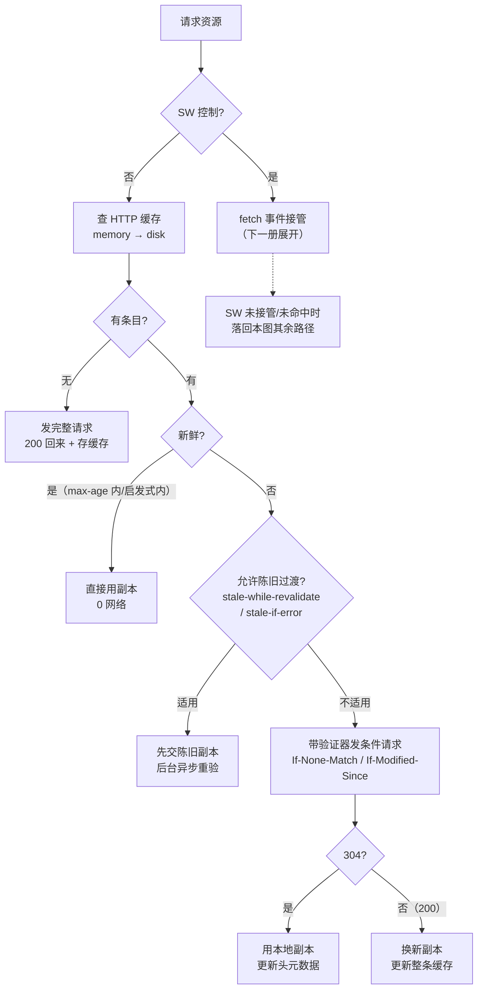
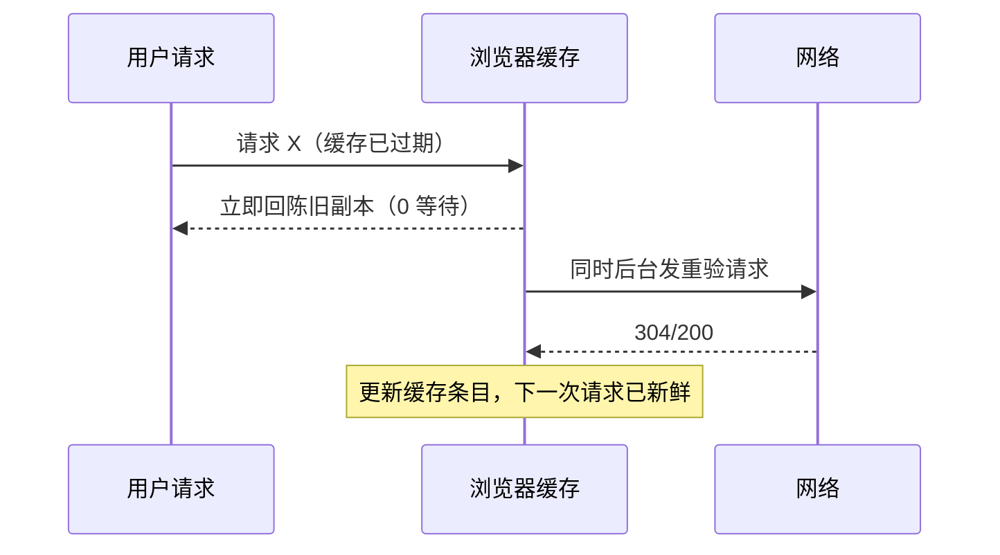

# HTTP 缓存体系全解：强缓存、协商缓存与判定流程

> [← 第六阶段导览](01-导览.md) · 时间线 ⑨ 的第一道分流（响应到达后先过缓存判定；反过来，命中时 ③④⑤⑥⑦⑧⑨ 整段直接消失）。这是全链路里性价比最高的一段路：命中强缓存，一次网络往返都不发生；命中协商缓存，只花一个往返确认「没变」。这一册把 Cache-Control 全表指令、启发式缓存、验证器与条件请求拆到可以照着判定的粒度，并给出一张能直接背下来的完整判定流程图。

## 1. 总账：缓存判定在主时间线的位置

| 命中层级 | 消失的主时间线步骤 | 网络成本 |
|---|---|---|
| Service Worker 缓存命中 | ②③④⑤⑥⑦⑧⑨（连 SW 都不碰网络栈） | 0 RTT（第二阶段 03 册） |
| HTTP 缓存命中（强缓存） | ③④⑤⑥⑦⑧⑨ | 0 RTT、0 字节上行 |
| 协商缓存命中（304） | ⑥⑦⑧ 的「内容传输」部分 | 1 RTT + 请求头 + 响应头（无体） |
| 全未命中 | 全步骤照走 | 完整请求（上一阶段的全程账单） |

**强缓存的 0 字节上行意味着什么**：DNS、TCP、TLS、请求、等待服务端——全部不发生。Network 面板里这类请求的 Timing 区块几乎没有耗时条，Size 列显示 `(from disk cache)` 或 `(from memory cache)`。这是「HTML 不缓存 + 带哈希的静态资源长缓存」这套经典架构能成立的原因：页面里上百个资源，大多数在第二次访问时一毫秒内到账。

本册只讲 HTTP 缓存这一层；SW 缓存是独立体系，见[下一册](04-ServiceWorker-生命周期与拦截时序.md)。

## 2. 缓存存在哪：memory cache 与 disk cache

### 2.1 两级存储

| 维度 | memory cache | disk cache |
|---|---|---|
| 位置 | 渲染进程内存 | 磁盘（Chromium 在用户数据目录 Cache/Cache_Data 下，格式与目录结构属实现细节，示意） |
| 速度 | 极快（内存级） | 快（磁盘级，仍远快于网络） |
| 存活 | 进程内——标签页关闭/进程退出即消失 | 跨会话存活，重启浏览器仍在 |
| 典型命中场景 | 同一页面刷新（F5）：图片等重复资源 | 二次访问、重启后访问 |
| 谁决定存哪 | 浏览器内部策略（大小、资源类型），**没有头能指定存哪** | 同左 |
| no-store 的效力 | 两级都禁止存 | 同左 |

DevTools Size 列的四态判读：

| 显示 | 含义 | 本册判定路径 |
|---|---|---|
| `(from memory cache)` | 内存级命中 | 强缓存 |
| `(from disk cache)` | 磁盘级命中 | 强缓存 |
| `304 Not Modified` | 带验证器的条件请求通过 | 协商缓存 |
| `200 OK`（真实体积） | 全新下载 | 未命中 |

**记忆口诀**：普通刷新（F5）时浏览器对可缓存资源「先问本地，再带验证器问网络」，常出现混合瀑布——一部分 `(from memory cache)`、一部分 304、少部分 200。强刷（Ctrl/Cmd+Shift+R）则无视新鲜度、全部带条件头重验。DevTools 面板开着时 Network 面板的「Disable cache」勾选还会再禁一层——调试缓存问题时先确认这个勾没打上，否则你看到的永远是最坏路径。

### 2.2 缓存条目里存了什么

一条缓存条目 = **响应头副本 + body 副本 + 元数据**（存入时间、请求 URL 与 Vary 头值、请求方法）。判定时用的全是元数据与头副本；304 时的「更新元数据」就是用新响应的头刷新副本——注意 304 的缓存条目 body 不变，但 Cache-Control 等头会以新响应为准。

## 3. 强缓存：新鲜度判定

### 3.1 两条新鲜度指令的优先级

| 指令 | 出现 | 语义 |
|---|---|---|
| `Cache-Control: max-age=N` | 响应头 | 秒数计的相对寿命；N 秒内 = 新鲜（RFC 9111 §5.2） |
| `Expires: <http-date>` | 响应头 | 绝对过期时刻；**客户端时钟不准就判错**——历史遗留，仅作 max-age 缺席时的兜底 |
| `s-maxage=N` | 响应头 | 优先级最高的共享缓存（CDN/代理）寿命；浏览器缓存仍看 max-age（共享缓存在第五阶段 02 册） |

判定优先级：`s-maxage`（共享缓存）＞ `max-age` ＞ `Expires` ＞ 启发式（§3.3）。

### 3.2 新鲜 ≠ 完好

「新鲜」判定只看时间，不看内容——内容有没有变，缓存层一无所知（那是验证器的职责，§5）。强缓存期内内容真变了怎么办？没有协议层面的办法，只能靠：

1. **URL 变化**：`app.abc123.js` → `app.def456.js`（哈希指纹）——缓存键变了，等于一条新条目。这是工程上唯一可靠的失效手段；
2. 手动清缓存（用户动作，不算方案）。

「缓存键」这个思想在 CDN 层同构（第五阶段 02 册），只是 CDN 的失效多一个 purge 工具可用。

### 3.3 启发式缓存：没有指令时浏览器自己定寿命

响应**既没有 max-age/Expires，也没有 no-store/no-cache** 时，浏览器不会零缓存——它会按 RFC 9111 §4.2.2 的启发式估计一个寿命：

```text
启发式寿命 ≈ (响应收到时刻 − Last-Modified) × 10%（规范建议的系数，示意）
```

例：响应带 `Last-Modified: 三天前`，无任何 Cache-Control/Expires → 启发式寿命 ≈ 3 天 × 10% ≈ **7 小时**（示意计算）。这 7 小时内该资源走强缓存，之后带 If-Modified-Since 重验。

启发式缓存的两个推论：

| 推论 | 说明 |
|---|---|
| 「没配缓存头 ≠ 不缓存」 | 大量老站点/内网服务的静态文件因此被缓存几小时——「我明明没配缓存，为什么改了文件用户看不到」的经典谜底 |
| Last-Modified 更新会拉长寿命 | 文件 mtime 越新、间隔越短 → 寿命越短；十年没动过的文件寿命趋近无穷（会被不断启发式续期） |

### 3.4 强缓存判定的完整规则表

| 响应头组合 | 下次请求行为 |
|---|---|
| `max-age=31536000`（一年内） | 强缓存（disk/memory），0 网络 |
| `max-age=0, must-revalidate` | 每次都带验证器协商（≈no-cache，见 §4.3） |
| `no-cache` | 存进缓存，但**每次使用前必须重验** |
| `no-store` | 不存。每次都是全新 200 |
| 只有 Last-Modified，无 CC/Expires | 启发式缓存（§3.3） |
| 只有 Expires，无 CC | 按 Expires 时刻判定（受时钟影响） |
| 什么都不带 | 多数实现仍走启发式；但行为属于「实现自由区」，别依赖 |

## 4. Cache-Control 指令全表

### 4.1 响应指令（服务端 → 浏览器/中间缓存）

| 指令 | 语义 | 常见误读 |
|---|---|---|
| `max-age=N` | 新鲜寿命 N 秒 | 误当「有效期从文档 Date 算」——从响应收到时刻算（Age 头参与修正） |
| `no-store` | **任何缓存（私有/共享）都不得存储** | 误当「不缓存」的温和选项——它是最强禁令，连协商缓存的资格都没有 |
| `no-cache` | 可以存，但**每次使用前必须带验证器重验** | 误当 no-store 同义词；名字反向——「no-cache」恰恰是有缓存的 |
| `must-revalidate` | 过期后不得使用陈旧副本，必须重验（不可降级为直接用过期） | 单独 `max-age=0` 在部分实现下仍可能被容错使用；组合上才严格 |
| `proxy-revalidate` | 同上，只约束共享缓存 | — |
| `immutable` | 寿命期内**永不重验**（连用户强刷都不带条件头，Chrome 实现示意） | 配合长 max-age + 哈希文件名的招牌组合 |
| `public` | 允许共享缓存（CDN/代理）存储 | 并非「必须 public 才能缓存」——默认行为已允许，除非有 private/auth 相关限制 |
| `private` | 只允许浏览器私有缓存，共享缓存不得存 | CDN 命中率排查的常见根因 |
| `stale-while-revalidate=N` | 过期后可先交陈旧副本给用户，同时后台异步重验（N 秒内） | 误当「延长有效期」——有效期语义不变，变化的是「过期后怎么过渡」 |
| `stale-if-error=N` | 过期后若重验失败（5xx/断网），N 秒内可回退陈旧副本 | 容灾指令，与 SWR 常一起下发 |
| `s-maxage=N` | 共享缓存的寿命（优先于 max-age） | 只影响 CDN/代理，不影响浏览器 |
| `no-transform` | 禁止中间缓存/代理改体（压缩、转码） | — |

### 4.2 请求指令（浏览器 → 缓存/服务端）

| 指令 | 语义 | 谁在什么时候发 |
|---|---|---|
| `max-age=0` | 告诉沿途缓存「别给我陈旧的」 | 普通刷新 F5 的请求头 |
| `no-cache` | 强制重验 | 强刷（部分浏览器实现口径示意） |
| `no-store` | 别给我缓存的副本 | 强刷（另有实现发 no-cache，口径示意） |
| `only-if-cached` | 只接受缓存命中，不联网 | 离线优先应用的 SW 内 fetch（下一册） |

普通刷新 vs 强刷的请求头差异（Chrome 口径示意）：

| 动作 | 请求头追加 | 缓存侧效果 |
|---|---|---|
| F5 普通刷新 | `Cache-Control: max-age=0` | 本页资源一律重验（304/200），不直接用陈旧副本 |
| Ctrl/Cmd+Shift+R 强刷 | `Cache-Control: no-cache`（或 no-store，实现口径示意） | 重验且不接受陈旧；配合 immutable 也照样带条件头 |
| 地址栏回车/链接导航 | 无追加 | 完整走 §6 判定流程 |

### 4.3 三胞胎辨析：no-store vs no-cache vs max-age=0, must-revalidate

| 组合 | 存吗 | 每次用前问网络吗 | 三次刷新的 Network Size（示意） |
|---|---|---|---|
| `no-store` | 不存 | 无从问（根本没副本） | 200 / 200 / 200 |
| `no-cache` | 存 | 每次都问（条件请求） | 304 / 304 / 304 |
| `max-age=0, must-revalidate` | 存（瞬间过期） | 每次都问 | 304 / 304 / 304 |

`no-cache` 与 `max-age=0, must-revalidate` 在主流浏览器里判定结果一致（都走协商），语义细节差异在极端实现下才显现；工程上选 `no-cache` 更达意。**HTML 的推荐配置是 `Cache-Control: no-cache`（或 no-store）**——文档本体必须每次重验，否则发布新版本用户永远看到旧页面。

### 4.4 组合速查：五类资源的推荐配置

把 §3~§4 的指令落到一张可以直接抄进网关/nginx 配置的表：

| 资源类别 | 推荐 Cache-Control | 为什么 |
|---|---|---|
| HTML（文档本体） | `no-cache`（重验）或 `no-store`（敏感页） | 发布触达用户的第一入口；指纹化困难，内容随发布变 |
| 带哈希的 JS/CSS | `max-age=31536000, immutable` | 内容变 = 文件名变 = 缓存键变，可放心一年 |
| 图片/视频等静态媒体 | `max-age=604800` 量级 + SWR | 不带哈希时寿命取中等值，配合 stale-while-revalidate 抹平过期瞬间 |
| 字体文件 | `max-age=31536000, immutable` | 变动极少，且重复下载的代价高（第九阶段字体 FOIT 课题） |
| 用户敏感的接口响应 | `no-store` + `private`（或干脆不下发缓存头） | 个人数据进共享缓存（CDN）是安全事故；no-store 连浏览器层也禁 |
| 强实时的接口响应 | 不发缓存头或 `no-store` | 发了 max-age 接口就可能被中间缓存住，实时性被缓存层劫持 |

两条配置纪律：

1. **别用同一个配置模板伺服所有路径**——「全站 max-age=31536000」的配置在发布日就是事故（HTML 缓住新版触达不到、接口缓存住旧数据）；
2. **配置变更按行为变更对待**：缓存头一改，判定路径全改（§6 流程图），上线前用 §9 实验逐类验证一遍四态分布。

## 5. 协商缓存：验证器与条件请求

### 5.1 验证器与条件头配对

| 响应给的验证器 | 下次请求带的条件头 | 服务端判定 | 通过时回 |
|---|---|---|---|
| `ETag: "abc123"` | `If-None-Match: "abc123"` | 当前 ETag 与条件头相等？ | 304（无体） |
| `Last-Modified: <date>` | `If-Modified-Since: <date>` | 内容修改时间晚于该时刻？ | 304 |
| 两者都有 | **If-None-Match 优先**（ETag 强验证器） | — | 304 |
| Range 场景 | `If-Range` + Range（第四阶段 05 册） | 未变则回 206 | 206 |

304 响应的规矩：**不带 body**；但会带新的缓存指令/验证器头，浏览器用它刷新缓存条目元数据（§2.2）。304 省下的是 body 传输；请求本身的 1 RTT 照付。

### 5.2 ETag：强验证器与弱验证器

| 形式 | 语义 | 判定 |
|---|---|---|
| `ETag: "v1"` | 强验证器：字节级一致才算相等 | `If-None-Match` 精确匹配 |
| `ETag: W/"v1"` | 弱验证器：语义等价即可 | 匹配规则更宽松，用于 Range 等场景谨慎 |

**Last-Modified 的三秒坑**（RFC 9111 承认的历史问题）：HTTP 日期精度是秒，一秒内多次修改分辨不出——所以规范要求「ETag 与 Last-Modified 并存时 ETag 优先」。只发 Last-Modified 的服务，秒级内的连续修改会漏检。

### 5.3 ETag 生成策略：决定失效风暴的开关

| 生成策略 | ETag 反映什么 | 「内容没变但重新部署」会怎样 | 代表 |
|---|---|---|---|
| mtime + size（Nginx 默认） | 文件的修改时间与大小 | mtime 全变 → ETag 全变 → **所有用户的缓存一夜失效**，全量 200 回源（ETag 失效风暴；案例复盘见第十阶段 03 册） | Nginx |
| 内容哈希 | 文件内容的摘要 | 内容不变 → ETag 不变 → 缓存继续命中，部署零代价 | 多数应用框架/构建产物服务 |

工程结论：静态资源走「构建产物 + 内容哈希文件名 + 长 max-age + immutable」，ETag 是否生成已无关紧要；动态/难指纹化的内容才需要 ETag，且优先内容哈希策略。多机部署场景还要注意每台机器 mtime 不同导致的 ETag 不一致——同一资源在不同节点返回不同 ETag，缓存验证逻辑直接错乱（CDN 场景常用统一剥离 ETag 的手法，第五阶段 02 册）。

## 6. 完整判定流程：一张能背下来的图



三个易漏点：

1. **Vary 参与条目匹配**（§7）：验证器比对之前，先确认「缓存的请求键 + Vary 头值」与本次请求一致，否则条目根本不算命中；
2. **Age 头**：响应在共享缓存里排队的时间会被累计进 Age，真实剩余寿命 = max-age − Age（CDN 场景出现 Age 大于 0 是正常现象，第五阶段 02 册）；
3. **`Vary: *` 等于永不匹配**：任何请求都命中不了这条条目——变相 no-store。

## 7. Vary：缓存键的扩展

```text
Vary: Accept-Encoding      ← 缓存键除了 URL，还要纳入 Accept-Encoding 的值
Vary: User-Agent           ← 反模式：UA 值几乎人手一份，命中率崩塌
Vary: *                    ← 永不命中 = 不缓存
```

| Vary 值 | 效果 | 工程判断 |
|---|---|---|
| `Accept-Encoding` | 区分压缩格式（gzip/br 的不同副本） | 正确且常见——该头本来就该按客户端能力区分 |
| `Accept-Language` | 区分语言版本 | 能用，但现代多语言站点更常用 URL 路径区分（缓存键更友好） |
| `User-Agent` | 按 UA 细分 | **反模式**：UA 字符串五花八门，几乎退化为不缓存 |
| 自定义头 | 按业务头细分 | CDN 需显式配置才支持（第五阶段 02 册） |
| `*` | 每次都不匹配 | 等效禁存 |

浏览器 HTTP 缓存同样按 Vary 匹配条目——排查「同一 URL 有人命中有人不命中」时，先 diff 两边的请求头与响应的 Vary。

## 8. 过渡策略：stale-while-revalidate 与 stale-if-error



| 指令 | 用户体验 | 适用 |
|---|---|---|
| `stale-while-revalidate=N` | 过期后的 N 秒内永远秒回（旧的），后台静默换新 | 非关键实时性的静态资源、API GET |
| `stale-if-error=N` | 重验失败时回陈旧副本而不是报错 | 容灾加分项，两者常一起下发 |

代价是「用户可能在 N 秒窗口内看到旧内容」——电商价格、库存类接口慎用；文章、图片、JS/CSS 尽管用。CDN 层同样支持这套指令（第五阶段 02 册），两层协同时的判定层级：浏览器自己的新鲜度判定先走，SWR 只在「已过期」分支生效。

## 9. 实验

1. **四态观察**：准备一个页面引用 2~3 个静态资源。首次访问（全部 200）→ F5（观察 memory/disk cache 与 304 混合瀑布）→ 关标签页重开（观察 disk cache）→ 重启浏览器再访问（disk cache 仍在）。每步截图记录 Size 列与 Timing 区块。
2. **三胞胎对照**：本地服务分别给同一资源下发 `no-store` / `no-cache` / `max-age=0, must-revalidate`，各刷新三次，记录 Size 列（预期：200×3 / 304×3 / 304×3），对照 §4.3 表。
3. **启发式缓存测量**：服务器只发 `Last-Modified`（把文件 mtime 设为 3 天前）而不发任何 CC/Expires。首次访问后立刻改文件内容（不改名），刷新观察是否命中——在启发式寿命内应命中（内容已变但缓存不知）；等过期后再刷新应走 If-Modified-Since 拿到 200。量出你的浏览器的实际行为窗口。
4. **304 的元数据更新**：响应先发 `Cache-Control: max-age=60`，到期前服务端改发 `max-age=600` 并配合 ETag 变化回 200，再观察后续命中时长——验证「304/200 都会刷新条目元数据」。
5. **ETag 生成策略**：Nginx 默认配置下 touch（只改 mtime）一个静态文件，用 curl 带 If-None-Match 重验，观察 ETag 是否变化（风暴预演）；再用内容哈希策略的静态服务重复同样操作对比。
6. **immutable 验证**：资源下发 `max-age=31536000, immutable`，强刷（Ctrl/Cmd+Shift+R）——Chrome 下 immutable 资源仍跳过重验直接用缓存（版本相关行为，以实测为准）。
7. **Vary 现场排查**：找一个 CDN 站点响应，检查 Vary 头与 Age 头；手动改请求头里的 Vary 指定头重发，观察缓存命中状态变化。

## 10. 常见误区

1. **「no-cache 就是不缓存」**：恰好相反——no-cache 存副本、每次重验；真正不存的是 no-store。这对指令的命名是 HTTP 历史上最成功的命名事故。
2. **「没配缓存头浏览器就不缓存」**：启发式缓存会让带 Last-Modified 的响应缓存「间隔 ×10%」的时间——改了文件用户看不到的谜题多半是它。
3. **「HTML 也配个长 max-age 省流量」**：HTML 指纹化困难，长缓存等于发布失效。经典架构是 HTML 用 no-cache（每次重验）+ 静态资源哈希文件名 + 长 max-age + immutable。
4. **「304 比强缓存快」**：304 至少付一个 RTT + 完整请求头；强缓存 0 RTT。性能预算里「提高强缓存命中率」永远优于「提高 304 率」。
5. **「Expires 和 max-age 都发更保险」**：并存时 max-age 优先，Expires 只是给不支持 CC 的上古客户端兜底——现代环境发它只有维护成本（两个时刻要同步改）。
6. **「ETag 总是有益」**：mtime+size 策略在每次部署时引发全量缓存失效（失效风暴）；多机部署 mtime 不齐时 ETag 自相矛盾。该用内容哈希策略或干脆剥离。
7. **「Vary: User-Agent 能帮 CDN 精细分发」**：UA 取值近乎无限，命中率趋近于零。要区分能力用 `Accept-Encoding` 这类低基数头，或用 URL 显式编码变体。
8. **「stale-while-revalidate 延长了有效期」**：它不改变新鲜度判定，只改变「过期之后」的行为（先交旧的、后台换新）。判定流程图里它挂在「不新鲜」分支上。

## 11. 自测题

1. 强缓存命中与协商缓存命中分别让主时间线哪些步骤消失？Network 面板里怎么区分这四种形态（memory/disk/304/200）？
2. 写出三次刷新下 `no-store`、`no-cache`、`max-age=0, must-revalidate` 各自 Size 列的期望值，并说出三者语义差异。
3. 一个响应只有 `Last-Modified: 三天前`，浏览器会缓存吗？缓存多久？这个机制的规范出处与计算公式是什么？
4. 为什么「内容哈希文件名 + immutable + 长 max-age」是发布安全的？如果只用长 max-age 而不换文件名，新版本怎么触达用户？
5. ETag 强/弱验证器的区别？为什么 ETag 与 Last-Modified 并存时前者优先？
6. mtime+size 型 ETag 在「每次部署都 touch 所有文件」的流水线下会造成什么连锁反应？多机部署下还有什么额外问题？
7. 304 响应里没有 body，浏览器怎么「知道」内容没变？缓存条目在 304 之后更新了什么、没更新什么？
8. `Vary: *` 的效果是什么？`Vary: User-Agent` 为什么是反模式？
9. stale-while-revalidate 的 N 秒窗口内用户可能看到什么？这套指令挂在你判定流程图的哪个分支上？
10. F5 与 Ctrl+Shift+R 在请求头上的差异是什么？为什么强刷对 immutable 资源的效果与普通资源不同（实现口径）？
11. Age: 30 出现在响应头里意味着什么？真实剩余寿命怎么算？
12. 把本册接到时间线账本：哪一层命中能让 ③④⑤⑥⑦⑧⑨ 全部消失？哪一层命中仍要付 1 RTT？

## 12. 自查清单

| # | 检查 | 工具 | 异常指向 |
|---|---|---|---|
| 1 | HTML 用 no-cache/no-store，静态资源用哈希文件名 + 长 max-age | 抽查响应头 | HTML 长缓存 = 发布后用户看不到新版 |
| 2 | 带哈希的静态资源带 immutable | curl -I | 缺失 = 强刷时多付一批重验 |
| 3 | 没有响应在裸奔（既无 CC 也无 Expires 也无 Last-Modified） | 抽查 | 裸奔 = 行为落入实现自由区，不可预期 |
| 4 | ETag 生成策略已知且适合部署形态 | 服务器配置 review | mtime 型 + 频繁部署 = 失效风暴（第十阶段 03 册案例） |
| 5 | Vary 头最小化、无 User-Agent | 响应头 | Vary 泛滥 = 命中率崩塌 |
| 6 | 非实时性静态资源考虑 stale-while-revalidate | 响应头/CDN 配置 | 缺失 = 过期瞬间用户白等一个 RTT |
| 7 | 四态分布合理（二次访问强缓存占比高） | Network 面板 Size 列 | 304/200 偏多 = 强缓存配置漏了 |
| 8 | CDN 层与浏览器层的缓存指令不冲突 | 对照第五阶段 02 册 | s-maxage/private 的组合决定 CDN 是否可缓存 |

## 13. 延伸

- 下一册：[04-ServiceWorker-生命周期与拦截时序](04-ServiceWorker-生命周期与拦截时序.md)——HTTP 缓存之上还有一层完全由你编程的缓存：SW 在请求离开页面之前就把它截住，两层缓存的叠加顺序是本册流程图第一个分支的展开。
- CDN/共享缓存视角（s-maxage、purge、命中率）在[第五阶段 02 册](../05-第五阶段/02-CDN-边缘-回源与调度.md)；条件请求与 Range 的协议语义在[第四阶段 05 册](../04-第四阶段/05-请求语义-协商-Cookie-条件请求与Range.md)；导航前「缓存/Service Worker」两道捷径的决策链在[第二阶段 03 册](../02-第二阶段/03-导航决策链-HSTS-ServiceWorker-缓存与BFCache.md)；ETag 失效风暴的完整案例在[第十阶段案例复盘集-加载类](../10-第十阶段/03-案例复盘集-加载类.md)。
