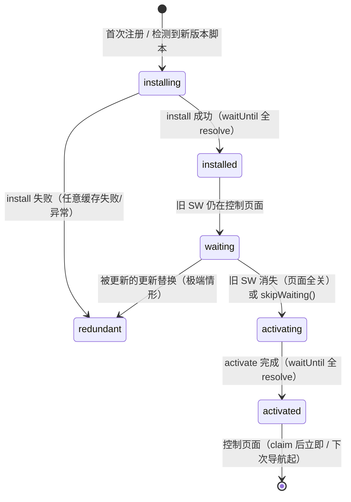
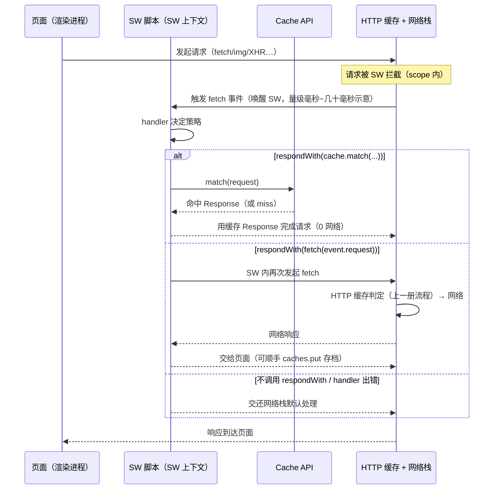

# Service Worker：生命周期与拦截时序

> [← 第六阶段导览](01-导览.md) · 时间线 ②（导航决策的 SW 检查）与 ⑨（每个资源请求的拦截层）。HTTP 缓存（上一册）是协议自带的、浏览器说了算的缓存；Service Worker 是一层**完全由你用 JS 编程**的代理——它站在页面与网络之间，install/activate/waiting 的状态机决定了「我更新了代码为什么页面没变」，respondWith 的时序决定了「这次请求到底从哪拿到数据」。这一册把状态机、更新时序、拦截时序拆到事件级别，再谈它与 HTTP 缓存的叠加关系和对 BFCache 的影响。

## 1. 总账：SW 站在整条链路的哪里

```text
导航/资源请求
  → ② 导航决策：有 SW 控制这个 scope 吗？（第二阶段 03 册）
     → 有：fetch 事件在 SW 脚本里触发（本册主角）
        → respondWith 给出响应（Cache API / 网络 / 兜底）
        → 无 respondWith / SW 内部出错：落回网络栈
     → 无：直接走网络栈
  → HTTP 缓存判定（上一册，SW 内 fetch 仍会经过这里）
  → ⑨ 接收流水线（第 02 册）
```

| 特性 | 含义 | 推论 |
|---|---|---|
| 运行在独立上下文 | 不在页面 JS 线程里，是独立的脚本环境 | 页面关了它可能还活着；它崩了页面照常跑 |
| 事件驱动 + Promise | 平时休眠，事件（fetch/push/sync）来时被唤醒，事件处理完被杀 | 不能在 SW 里存「活着的全局状态」——状态要落进 Cache API/IndexedDB |
| 仅 HTTPS（localhost 例外） | 拦截响应的权力太大，明文信道装不下这信任 | 本地开发用 localhost 直接可用 |
| 作用域（scope） | 默认 = 脚本文件所在路径 | `sw.js` 放在 `/` 才能控制整站；放 `/js/` 下只能管 `/js/` |

**「代理」二字要读重**：SW 是浏览器内置的编程代理层，HTTP 缓存的所有判定规则（上一册）在 SW 内部再走一遍——两层体系叠着，谁也替代不了谁。

## 2. 生命周期状态机：五态一图



| 状态 | 谁在里面 | 此时页面谁说了算 |
|---|---|---|
| installing | 新版本脚本在跑 install 事件 | 旧 SW |
| installed/waiting | 新版本装好了，排队等接手 | **旧 SW（页面不受新版本影响）** |
| activating | 新版本在跑 activate 事件 | 旧 SW 直到 activating 结束 |
| activated | 新版本就位 | 新 SW（claim 后立即控制；否则下次导航） |
| redundant | install 失败或被替换 | — |

生命周期三条铁律：

1. **install/activate 是事务**：事件里 `event.waitUntil(promise)` 的 promise 全部 resolve 才算成功；任何一个 reject，整个阶段判失败（install 失败 → redundant，页面由旧 SW 继续).
2. **一页一个 SW**：同一 scope 下任意时刻只有一个 SW 在「控制」页面——这是 waiting 存在的全部理由。
3. **原子的版本切换**：要么旧版全权、要么新版全权，没有「半新半旧」的中间态（除非你主动 skipWaiting + claim 打破它，§5）。

## 3. install：预缓存窗口

install 事件触发一次（每个版本一次），典型任务是**预缓存**（precaching）：

```js
// sw.js v2 —— install 预缓存骨架
const CACHE = 'app-v2';
const ASSETS = ['/offline.html', '/app.css', '/app.abc123.js']; // 关键资源清单

self.addEventListener('install', (event) => {
  event.waitUntil(
    caches.open(CACHE)
      .then((cache) => cache.addAll(ASSETS))  // 任一失败 → 整个 install 失败
  );
});
```

| 设计点 | 为什么 |
|---|---|
| `cache.addAll` 是全有全无 | 清单里任何一个 URL 拿不到响应，install 判失败——保证「新版本上线时必备资源已备齐」 |
| 缓存名带版本号（app-v2） | activate 阶段按名字清理旧版本（§4） |
| 只预缓存关键资源 | 全量预缓存 = 用户付一遍全站流量才能完成更新；其余资源靠运行时缓存（§6） |

**install 失败的连锁反应**：新版本被标记 redundant，下次页面事件再触发更新检测、重新走 install。线上「SW 更新一直不生效」的排查第一站就是 install 里哪个请求失败了（Application 面板的 SW 状态区会显示）。

## 4. waiting：为什么新版本必须排队

新版本 install 成功后进入 waiting，**一直等到旧 SW 控制的所有页面全部关闭**才 activating。设计动机：

```text
没有 waiting 的世界（假想）：
  页面 A 加载中，旧 SW 响应了它的 HTML（app-v1）
  → 新 SW 激活，接管后续请求
  → 页面 A 的 CSS/JS 请求由 app-v2 的逻辑响应（新缓存名，命不中 v1 的资源）
  → 同一页面半旧半新 → 样式错乱、代码对不上数据的隐性 bug

有 waiting 的世界（现实）：
  新 SW 排队 → 页面 A 全程由 v1 响应（一致性）
  → 用户关掉所有该 scope 的页面 → v1 释放 → v2 activating
```

**「我更新了代码，页面怎么没变」的九成答案在 waiting**：SW 的更新要在「所有旧页面关闭」之后才生效，用户开着标签页的这段时间里永远是旧版本。Application 面板里能看到「waiting to activate」字样，就是它。

更新检测的触发时机与节奏（浏览器口径，量级示意）：

| 时机 | 说明 |
|---|---|
| 导航请求经过 scope | 每次导航都会检查脚本字节是否变化（byte-wise 对比） |
| fetch/push 等功能事件 | 事件触发时顺带检查（间隔有节流，量级分钟级示意） |
| 注册时手动 `registration.update()` | 应用代码主动触发 |
| **24 小时上限** | 一条 SW 脚本最多被当新鲜用 24h，之后必然重新拉取检查（规范要求的兜底，防「永久缓存旧 SW」） |

## 5. skipWaiting 与 clients.claim：两把打破时序的钥匙

| API | 打破什么 | 代价 |
|---|---|---|
| `self.skipWaiting()`（install/activate 里调） | 跳过 waiting：不等旧页面关闭，新版本立即 activating | 正在加载的页面「半旧半新」风险（§4 假想剧本成真） |
| `clients.claim()`（activate 里调） | 跳过「下次导航才控制」：立即接管现有页面 | 现存页面突然被新逻辑接管，旧页面的 fetch 突然换规则 |

不调用两者的标准更新流程：

```text
发布 v2 → 旧页面继续用 v1（waiting）
→ 用户全部关闭页面 → v2 activating → 清旧缓存
→ 下次导航起 v2 控制新页面
（用户最多「下一轮访问」看到新版本——多数应用的正确选择）
```

调用两者的激进流程：发布 v2 → 用户**还开着的页面**立刻被 v2 接管。好处是更新即时；风险是同一页面的资源可能一半来自 v1 的响应、一半来自 v2 的响应。**工程纪律：只有页面全部资源都由预缓存清单管理（无运行时混用旧缓存）时，才考虑 skipWaiting；否则默认 waiting 流程。**

## 6. activate：清理旧缓存的窗口

activate 只在新版本接手时触发一次，典型任务是按缓存名白名单清理：

```js
self.addEventListener('activate', (event) => {
  event.waitUntil(
    caches.keys().then((names) =>
      Promise.all(
        names.filter((name) => name !== 'app-v2')   // 不在当前版本白名单
             .map((name) => caches.delete(name))
      )
    ).then(() => self.clients.claim())              // 可选：立即接管
  );
});
```

不清理旧缓存的后果：每次发版缓存体积只增不减（v1/v2/v3…并存），磁盘被历史版本吃满。activate 的 waitUntil 全 resolve 后 SW 进入 activated，但**对未调用 claim 的页面要等下次导航才受控**。

## 7. fetch 事件与 respondWith：一次拦截的完整时序



时序上的四个细节：

1. **唤醒延迟**：SW 平时休眠。fetch 事件到达时要先唤醒 SW 上下文（冷启动），这段开销落在每次拦截请求上（量级毫秒到几十毫秒，取决于设备与脚本体积，示意）——这正是 SW 请求有时比直连网络慢的原因之一；
2. **respondWith 的 promise 决定一切**：你给什么 Response，页面就收什么。promise 迟迟不 resolve，请求就一直挂着（页面侧表现为网络面板的 pending 拉满）——给 respondWith 套超时兜底是生产实践的标准动作；
3. **无 fetch handler / 无 respondWith = 透明层**：SW 存在但没有处理该请求，请求照常走网络栈（HTTP 缓存判定照走）；
4. **event.request 是只读的**：想改请求（换 URL、换方法）要构造新 Request 再 fetch。

## 8. Cache API：与 HTTP 缓存的两层关系

| 维度 | Cache API（caches.*） | HTTP 缓存（上一册） |
|---|---|---|
| 归谁管 | 你的 JS 代码 | 浏览器实现，头指令说了算 |
| 键 | Request 对象（可自定义键策略） | URL + 方法 + Vary |
| 条目怎么进 | 你显式 `cache.put/addAll` | 响应头触发 |
| 条目怎么出 | 你显式 delete，或清空整个缓存名 | 新鲜度判定/驱逐算法 |
| 过期概念 | **没有内置过期**——要不要过期、怎么过期全靠你写 | max-age/启发式（协议内建） |
| 与 HTTP 缓存叠加 | **SW 内 fetch 会先经过 HTTP 缓存判定** | — |

最后一行是本册最容易被漏的机制：`respondWith(fetch(event.request))` 里那次 fetch 并不是「直连网络」，它完整经过 HTTP 缓存（memory→disk→协商）→ 网络栈。所以「cache-first 策略」和「HTTP 强缓存」是两道独立的命中机会：

```text
页面请求
  → SW 的 Cache API 命中？   ← 第一层（你的代码说了算）
    命中：返回，HTTP 缓存全程没参与
    未命中：SW 内 fetch
      → HTTP 缓存命中？      ← 第二层（上一册的判定流程）
        命中：返回（0 网络）
        未命中：网络请求
```

两层各管一段的推荐分工：**Cache API 管应用逻辑**（离线兜底、版本化预缓存、接口 mock），**HTTP 缓存管资源新鲜度**（max-age/验证器）。别把 HTTP 缓存该管的事（新鲜度）搬进 SW 代码手工实现——你等于用 JS 重写一遍上一册的判定流程，还写不出协议级的完备性。

### 8.5 一次拦截的性能账

把「SW 到底花了多少额外成本」拆成可量化的四段（数值均为量级示意，以自己实测为准）：

| 段 | 构成 | 量级示意 |
|---|---|---|
| 唤醒 | SW 休眠 → fetch 事件唤醒、脚本求值 | 毫秒级；脚本体积大/设备慢时到几十毫秒 |
| 事件处理 | 你的 handler 判断 + 构造策略 promise | 亚毫秒到毫秒级 |
| 缓存查询 | Cache API match（无过期索引，条目多时线性扫描代价上升） | 毫秒级 |
| 兜底路径 | respondWith(fetch) 时叠加上一册的完整判定 + 网络 | 原请求成本 + 一层 |

| 场景 | 相比直连的净效果 |
|---|---|
| cache-first 命中 | 显著快（0 网络，代价仅上面四段前二） |
| 网络直通（respondWith(fetch)） | 略慢（多一层 JS + 可能的唤醒） |
| 透明放行（无 respondWith） | 几乎无差（仍有 fetch 事件触发开销） |
| 冷启动首请求 | 明显慢（唤醒全价） |

工程推论：**SW 不是「加速器」，是「控制层」**。加速来自 cache-first/预缓存命中的那一部分请求；无差别接管所有请求等于给每个请求都加一次 JS 过路费。Whitepaper 式的「接入 SW 提升性能」结论要拆开看——提升的永远是「命中缓存的那部分请求」，其余请求持平或略慢。

## 9. 策略选型：一张对照表

| 策略 | 逻辑 | 适用 | 陷阱 |
|---|---|---|---|
| Cache First | 缓存命中即返回，miss 才网络 | 字体、带哈希的静态资源、离线页面 | 缓存永不自动过期，更新要靠版本化 URL |
| Network First | 先网络，失败才回缓存 | 接口、实时性要求的内容 | 弱网下每次都等网络超时，体验差 |
| Stale-While-Revalidate | 先回缓存，同时后台更新缓存 | 非实时内容、头像、文章 | N 秒窗口内旧内容（语义同上一册 SWR） |
| Cache Only / Network Only | 单边 | 离线兜底页 / 强实时接口（不缓存的接口别套 SW 缓存） | 误用会冻结或穿透 |
| 自定义（如 timeout 竞速） | Promise.race 缓存与网络 | 接口可用性优化 | 竞速要设兜底，否则双慢 |

SWR 的 SW 版本实现：

```js
// stale-while-revalidate 骨架
self.addEventListener('fetch', (event) => {
  event.respondWith(
    caches.open('runtime').then(async (cache) => {
      const cached = await cache.match(event.request);
      const fetching = fetch(event.request).then((res) => {
        cache.put(event.request, res.clone());  // 后台更新（clone 后两边都能用）
        return res;
      });
      return cached || fetching;
    })
  );
});
```

## 10. 对 BFCache 的影响：SW 的天然拦路虎属性

往返缓存（Back/Forward Cache，第二阶段 03 册展开）把离开的页面整页冻结在内存里，返回时瞬间恢复。SW 对它的干扰：

| 情形 | BFCache 可用吗 |
|---|---|
| 页面受 SW 控制 + fetch handler 里**没有** respondWith（透明层） | 可以（多数实现口径示意） |
| 页面受 SW 控制 + respondWith **网络直连**（fetch(e.request) 不缓存） | **通常被拒**——冻结后恢复时 SW 里挂着的网络响应无法正确续传 |
| respondWith 来自 Cache API / 可重放的存储 | 可以（响应可确定性重现） |

后果：为不缓存的接口接入了 SW 却用纯网络直通策略，可能让整个站点的「返回上一页」从瞬间恢复退化成重新加载——SW 接入本身成了 BFCache 拦路虎。这也是「SW 不是越多越好」的典型证据：只拦截需要拦截的请求（fetch handler 里按 URL 白名单分流，其余不 respondWith）。

## 11. 实验

1. **生命周期观察**：写一个最小 SW（`navigator.serviceWorker.register('/sw.js')`）+ 控制台输出各阶段。Application 面板 → Service Workers 区块观察状态流转：installing → waiting（改一版 sw.js 再刷新触发）→ 关掉所有标签页重开 → activated。全程记录「页面内容何时变成 v2」。
2. **waiting 亲历**：sw.js v1 打日志「v1 控制」；改出 v2 打日志「v2 控制」并预缓存一个新资源。刷新页面（不关）——Network 里新资源请求被 v1 逻辑响应；Application 面板显示 v2 waiting。关光标签页再开——v2 激活。这就是「发布不生效」的现场。
3. **respondWith 延迟实验（导览实践任务 3）**：策略代码里给 respondWith 的 promise 套 3 秒延迟（`new Promise(r => setTimeout(r, 3000)).then(() => fetch(e.request))`），观察首屏与 LCP 指标的变化；换 cache-first（预缓存已存）对比——同一个 3 秒延迟在两种策略下对页面的杀伤差异。
4. **两层缓存叠加验证**：SW cache-first 未命中 + HTTP 缓存里有 max-age 剩余的副本——Network 面板看这条请求显示什么（from disk cache 而非真实网络）；再对 SW 命中的请求观察（完全无网络条目）。
5. **fetch 事件白名单**：给 handler 加 URL 判断，API 请求 respondWith(网络直通)、静态资源走 cache-first。观察 Application → Service Workers 的事件计数与 BFCache 行为（返回上一页是否恢复而非重载）。
6. **更新不生效排查演练**：故意在 install 里写一个 404 的预缓存 URL，观察 Application 面板报错与 SW 停在 redundant 的状态——形成「install 失败 → 下次导航重试」的肌肉记忆。

## 12. 常见误区

1. **「SW 更新了就该立即生效」**：生效条件是旧 SW 释放控制（页面全关）或你显式 skipWaiting。waiting 状态的存在是为了页面资源一致性，不是 bug。
2. **「skipWaiting 是发布新版本的标准动作」**：它打破原子性，半新半旧的资源混用可能直接出线上故障。除非预缓存全覆盖，否则默认 waiting 流程。
3. **「SW 缓存（Cache API）就是 HTTP 缓存的编程版」**：两层独立体系。Cache API 没有过期概念、键是你的代码定的；SW 内 fetch 仍会经过 HTTP 缓存。把它们混为一谈会导致双重缓存策略互相踩踏。
4. **「SW 让请求变快」**：不一定。SW 唤醒 + 你的 JS 逻辑是开销；cache-first 命中才快。SW 的核心价值是**可控性**（离线、兜底、版本化），不是速度。
5. **「fetch handler 里处理所有请求」**：透明请求（不 respondWith）开销最小、对 BFCache 最友好。按白名单分流，别把不缓存的 API 也 respondWith 网络直通——那是把 BFCache 拦路虎装进自己站点。
6. **「respondWith 的 promise 慢点没关系」**：页面在等你的 promise，等多久页面白多久。生产策略必须有超时兜底（race 一个超时 fallback）。
7. **「cache.addAll 挂了无所谓，改天再试」**：install 失败 = 新版本整体 redundant，更新通道停摆。预缓存清单里的 URL 必须稳定可达，失败要有告警。
8. **「SW 里可以存全局变量当缓存」**：SW 随时被杀，全局状态随时蒸发。状态只落在 Cache API / IndexedDB。

## 13. 自测题

1. 画出五态状态机并标注每个状态的转移条件。install 失败与 activate 失败分别会发生什么？
2. waiting 状态解决什么问题？没有它会出现什么事故（写出资源混用的具体剧本）？
3. skipWaiting 与 clients.claim 各打破哪条铁律？各自的风险场景是什么？
4. SW 脚本的更新检测在哪些时机触发？24 小时上限防的是什么？
5. respondWith(cache.match) / respondWith(fetch) / 不调用 respondWith，三条路径各自经过哪些层？哪条完全没碰网络？
6. 为什么 SW 内 fetch(request) 不是「直连网络」？它先经过什么判定？
7. Cache API 没有内置过期机制，你的过期方案怎么写？（提示：版本化缓存名 + activate 清理，或时间戳元数据。）
8. 预缓存清单里一个 URL 404 了，连锁反应是什么？怎么在 Application 面板里发现？
9. 哪种 respondWith 用法最伤 BFCache？为什么「网络直通」反而比「透明层」更容易挡住 BFCache？
10. cache-first 策略下，静态资源更新怎么触达用户？（URL 版本化 —— 和上一册的结论殊途同归。）
11. SW 唤醒延迟大概什么量级？它对哪个指标最敏感（接口密集的页面还是静态资源为主的页面）？
12. 把 SW 放回时间线账本：SW 命中时 ③④⑤⑥⑦⑧⑨ 哪些消失？它与上一册「强缓存 0 网络」的命中在 Network 面板里怎么区分？

## 14. 自查清单

| # | 检查 | 工具 | 异常指向 |
|---|---|---|---|
| 1 | sw.js 放在站点根（scope = /） | 部署配置 | 放子目录 = scope 不够，控制不了整站 |
| 2 | fetch handler 按 URL 白名单分流，非目标请求透明放行 | 代码 review | 全量 respondWith = BFCache 被挡 + 无谓唤醒开销 |
| 3 | respondWith 有超时兜底 | 代码 review | 无兜底 = SW 内网络抖动时页面无限 pending |
| 4 | 预缓存清单最小化且全部可达 | Application 面板 | 清单爆炸 = 更新慢；404 = 更新停摆 |
| 5 | activate 清理旧版本缓存 | 代码 review | 不清理 = 磁盘被历史版本吃满 |
| 6 | 缓存名带版本号，与发布流程绑定 | 发布 checklist | 固定缓存名 = 新旧内容混用 |
| 7 | skipWaiting/claim 的使用有明确理由 | 代码 review | 无脑调用 = 半新半旧混用风险 |
| 8 | 「返回上一页」仍是瞬间恢复 | 手测 + BFCache 审计工具 | 退化 = SW 用法挡了 BFCache（第二阶段 03 册拦路虎表） |
| 9 | SW 更新流程在真实发布中演练过一次 | 发布 checklist | 「发布不生效」类工单 = 本册 §4 未吃透 |

## 15. 延伸

- 下一册：[05-子资源调度-预解析扫描器-优先级与资源hint](05-子资源调度-预解析扫描器-优先级与资源hint.md)——SW 之外，浏览器自己也在为子资源做「提前量」：预解析扫描器怎么边解析边预约下载、每个资源凭什么拿优先级。
- 导航决策链里 SW 作为第二条捷径的完整判定在[第二阶段 03 册](../02-第二阶段/03-导航决策链-HSTS-ServiceWorker-缓存与BFCache.md)；BFCache 拦路虎全表同册；HTTP 缓存判定细节在[上一册 03](03-HTTP缓存体系全解.md)；离线与后台同步等 SW 能力族的应用层展开属 PWA 专题范畴，本站不设专册——先掌握本册的生命周期与拦截时序即可。
