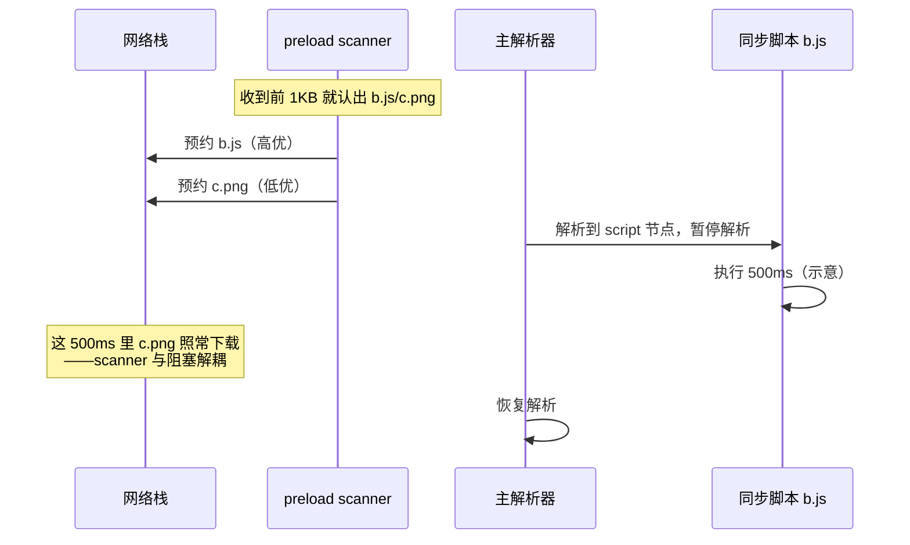
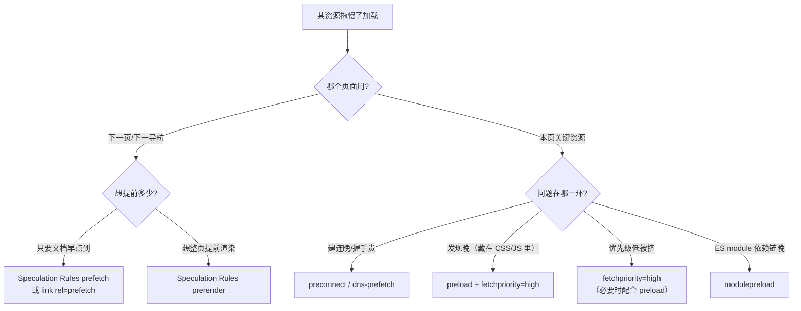

# 子资源调度：预解析扫描器、优先级与资源 hint

> [← 第六阶段导览](01-导览.md) · 时间线 ⑪ 的前半（preload scanner 挂在 HTML 解析上）与 ⑨ 的排队侧（资源请求在连接池里怎么排）。HTML 主解析器（第七阶段 03 册）是逐字节的慢工细活，但浏览器不会等它——一个轻量的**预解析扫描器**已经跳在前面，把后文的 `<link>/<script>/` 全部预约了下载；预约之后，每个请求还要在**优先级队列**里争抢有限的连接。这一册拆「谁先上路」的整套机制：扫描器、优先级表、preload/prefetch/fetchpriority、Speculation Rules。

## 1. 总账：一个子资源的旅程

```text
发现（三个来源）          排队与调度                 上路（④⑤⑥⑦⑧）              接收（⑨）
HTML 解析器     ─┐                                        ┌─ 连接池按 host 分发
preload scanner ─┼─→ 请求对象（带优先级）→ 优先级队列 → ─┤  h1: 每 host 6 条
脚本/CSS 动态注入 ┘    （fetchpriority 可调）            └─ h2: 单连接多流（第四阶段 03 册）
                                                              → 响应字节回到接收流水线
```

| 环节 | 谁决定 | 本册哪一节 |
|---|---|---|
| 发现 | HTML 解析器 + preload scanner（+ 脚本动态注入） | §2、§3 |
| 优先级 | 资源类型默认表 + fetchpriority 覆盖 | §4、§5 |
| 排队 | 优先级队列 + 每 host 连接限制 + h2 流调度 | §6 |
| 提前量 | 资源 hint（preconnect/dns-prefetch/preload/prefetch） | §7 |
| 提前整页 | Speculation Rules（prefetch/prerender） | §8 |

**为什么这一册决定首屏速度**：LCP 元素（首屏大图/标题）能否早发现、早排队、高优先级下载，几乎全部落在本册机制上。网络侧的总耗时账本（第一阶段 02 册）里，「发现晚」与「排队等」是两大隐形扣分项。

## 2. 发现的三个来源

| 来源 | 何时工作 | 能发现什么 | 发现不了什么 |
|---|---|---|---|
| 主解析器（第七阶段 03 册） | 逐 token 前进，遇到资源节点即发请求 | 一切它走到的节点 | 它还没走到的（被同步 JS 卡住时尤其致命） |
| **preload scanner** | 与主解析器并行，抢先扫原文 | `<link>/<script src>//@import 前半` 等「语法特征明显」的资源 | 内联 style 里的 url()、CSS 文件内部的资源、JS 动态创建的节点、模板里的资源 |
| 脚本动态注入 | `createElement('script')` 等执行时 | 运行时才知道的一切 | 一切运行前（发现即晚） |

**发现的时差就是下载的时差**：主解析器被一个 500ms 的同步 JS 卡住时，扫描器早已把后文的图片/脚本请求发出去了——「preload scanner 让下载与阻塞解耦」就是它存在的全部意义。反面教材：渲染关键资源藏在 CSS 的 `background-image` 或 JS 字符串里，两个发现者都看不到它，只能等 CSS 下载解析完 / JS 执行完——这就是「关键图片 LCP 慢」的高频根因（归因与处方见[第九阶段 02-关键渲染路径与首屏呈现](../09-第九阶段/02-关键渲染路径与首屏呈现.md)）。

## 3. preload scanner：边收边扫的旁路扫描器

### 3.1 它是什么

一个**不做语义、不建树**的轻量扫描器：主解析器逐字节做规范分词（状态机、容错、建树），扫描器只做一件事——在原始字节流里快进快出，认出「资源声明」的语法特征就登记请求：

```html
<!-- 扫描器认得的特征（示意清单） -->
<link rel="stylesheet" href="a.css">
<script src="b.js"></script>

<link rel="preload" href="d.woff2" as="font">
<style>@import url(e.css)</style>   <!-- import 的 URL 本身 -->
```

它**不关心**：嵌套在 JS 里的资源、CSS 解析后才发现的 `background-image`、`<template>` 内容里被 JS 实例化才生效的资源。这些进入「主链路发现」的慢车道。

### 3.2 三种典型时序对比



| 场景 | 无 scanner（1990s~2000s 行为） | 有 scanner（现代行为） |
|---|---|---|
| head 里同步 JS + body 里 30 张图 | 图片等 JS 执行完才开始发现，下载串行后移 | 图片在字节到达时就预约，与 JS 下载执行并行 |
| 大 HTML 流式到达 | 解析到哪下到哪 | 扫描器扫到哪下到哪（通常更快） |
| 解析器被 document.write/长脚本卡住 | 全停 | 下载不停，只有解析停 |

### 3.3 scanner 的边界：哪些资源注定「晚发现」

| 藏法 | 为什么扫不到 | 解法 |
|---|---|---|
| CSS 里 `background-image`（首屏关键图） | CSS 得下载+解析后才知道 | 手动 `<link rel="preload" as="image">`（§7） |
| JS 渲染的图片/字体 | JS 执行才知道 | 预加载或改 SSR（第五阶段 04 册） |
| `<template>` 内的资源 | 模板内容不参与解析发现 | 同上 |
| 懒加载图片（loading=lazy） | 故意不预约（滚动到才请求） | 别把首屏图标成 lazy |
| 动态 import() 的 chunk | 执行才知道 | 打包工具的 modulepreload/预测加载（§7） |

## 4. 资源优先级表：谁先上路

浏览器给每个请求算一个优先级（Chromium 口径，量级示意——具体值随版本微调，看 Network 面板 Priority 列才是你浏览器里的真值）：

| 资源 | 默认优先级 | 说明 |
|---|---|---|
| 字体（CSS 发现的） | VeryHigh | 阻塞文本渲染，且是链路末梢（CSS→字体，晚发现+高优） |
| CSS（非 media 限定） | VeryHigh | 阻塞渲染（第七阶段 04 册） |
| 同步 `<script>`（head，首个） | High~VeryHigh | 阻塞解析器 |
| 后续同步 script | High | 依序执行 |
| fetch/XHR | High | 数据即功能 |
| ``（视口内） | Low~Medium（布局确定后可能上调，示意） | 「先解析后布局，知道位置再定调」 |
| `` | Low（接近视口才请求） | 故意的 |
| defer/async script | Low | 不阻塞解析器，晚点无妨 |
| `rel=prefetch` | Lowest | 下一页的资源，本页空闲才轮到 |
| preload（as 指定） | 跟随 as 对应类型的优先级 | §7 |

读表的三条主线：

1. **「阻塞渲染/解析的都高」**：CSS、同步 JS、字体——渲染管线的上游；
2. **「图片先低后看」**：布局未定时一律 Low，等布局（第八阶段）知道在视口内才可能升——这是「首屏图为什么有时抢不过后面的脚本」的答案；
3. **「prefetch 是宇宙最末」**：它假设本页一切更重要。

## 5. fetchpriority：手动改判

优先级表是默认值，`fetchpriority` 属性允许你在资源标签上直接覆盖：

```html
<!-- 首屏 LCP 大图：默认 Low，手动提到 High -->


<!-- 非关键的第三方脚本：压到 Low -->
<script src="analytics.js" fetchpriority="low" defer></script>

<!-- 影视资源按媒体查询分别声明 -->
<link rel="preload" as="image" href="hero.avif" media="(min-width:900px)"
      fetchpriority="high">
```

| 值 | 效果 |
|---|---|
| high | 提到该类型的高档位 |
| low | 压低 |
| auto | 默认（表值） |

三个使用纪律：

1. **只调首屏关键资源**——把所有图都标 high 等于没标，队列又乱了；
2. **它不改变发现时机**——晚发现的资源标 high 也追不上早发现的 Low（排队早者优先积累），所以 fetchpriority 与 preload（§7）常常配合使用；
3. **LCP 图片的标准组合拳**：preload 提前发现 + fetchpriority=high 提前上路（第九阶段加载优化手册展开）。

## 6. 排队：优先级队列与连接的现实约束

优先级只是「排序意图」，真正决定发送顺序的是队列 + 连接资源：

| 约束 | h1 | h2/h3 |
|---|---|---|
| 连接数 | 每 host 6 条（第四阶段 02 册） | 通常 1 条连接 |
| 并行度 | 6 条连接各跑 1 个请求 | 单连接多流，流间按优先级树调度（第四阶段 03 册） |
| 队头阻塞 | 连接内严格串行 | 传输层仍有（h2/TCP），h3 缓解 |
| 优先级的作用 | 决定谁先占住连接 | 决定流的调度权重 |

DevTools Waterfall 里「Queueing / Stalled」长的请求，就是排队的实体：要么优先级低等着，要么 host 的连接池满着（6 连接被占满），要么 h2 下被高权重流挤着。**「总请求数不变，只调优先级与发现时机，LCP 也能明显提前」——本册机制的价值就在这里。**

### 6.5 一条请求在 Waterfall 里的排队账

把 Waterfall 左侧各时段与本册机制对上号（时段名称随 DevTools 版本略有出入）：

| Waterfall 时段 | 对应本册哪个环节 | 拉长的常见原因 |
|---|---|---|
| Queueing | 优先级队列等待 | 低优先级 + 高优先级占满；h1 下 6 连接占满 |
| Stalled | 连接池无可用连接 / 代理协商 | 每 host 连接耗尽；代理（含公司网络）协商 |
| DNS lookup | ③ | 无 preconnect 且 DNS 未缓存（第三阶段 02 册） |
| Initial connection | ④ | TCP 握手 RTT；连接建立失败重试 |
| SSL | ⑤ | TLS 握手 RTT（无会话恢复时更贵） |
| Request sent | ⑥（极短） | — |
| Waiting (TTFB) | ⑦⑧ | 服务端/CDN 慢（第五阶段账本） |
| Content Download | ⑧⑨ | 体量大 / 带宽受限 |

判读纪律：**Queueing/Stalled 长修调度（本册），TTFB 长修服务端（第五阶段），Download 长修体积（第五阶段压缩）**——先定位时段，再归因到层，避免「哪里慢就改哪里」的乱枪打鸟。

## 7. 资源 hint 全家族

| hint | 语法 | 做什么提前 | 量级收益（弱网示意） |
|---|---|---|---|
| `dns-prefetch` | `<link rel="dns-prefetch" href="//cdn.example.com">` | 提前查 DNS（第三阶段 02 册） | 省 1 次 DNS 往返 |
| `preconnect` | `<link rel="preconnect" href="https://cdn.example.com" crossorigin>` | DNS+TCP+TLS 全建好 | 省 1~2 个 RTT（第三阶段账本） |
| `preload` | `<link rel="preload" href="x.woff2" as="font" crossorigin>` | 本页必用资源提前发现+下载 | 消除「晚发现」 |
| `modulepreload` | `<link rel="modulepreload" href="app.mjs">` | ES module 及其依赖图的提前解析+预取 | 省模块链的发现延迟 |
| `prefetch` | `<link rel="prefetch" href="/next-page-data.json">` | 下一页资源，本页空闲时低速拉 | 下一页快 |
| 103 Early Hints | 服务器先发 103 + hint 再发 200 | 让 hint 提前到「服务端开始想」之前 | 与服务端 TTFB 重叠（第五阶段 02 册） |

### 7.1 preload 与 prefetch 的本质区别

| 维度 | preload | prefetch |
|---|---|---|
| 给谁用 | **本页**马上要用的 | **下一页/下一导航**可能用的 |
| 优先级 | 跟随 as 类型的档位（可高） | Lowest（空闲才轮到） |
| 用错了会怎样 | 用于下一页资源：挤占本页带宽、3 秒未用控制台警告 | 用于本页关键资源：最晚才到，关键路径被自己拖慢 |
| 典型对象 | LCP 图、关键字体、关键 CSS | 下一页的 HTML/数据/大图 |

**「本页 vs 下一页」是两者全部语义差异的根**：preload 说「这个资源马上要用，别等我解析到」，prefetch 说「这个资源下一页可能用，你有空再说」。把它们用反，一个浪费本页带宽，一个把自己的关键资源扔到队尾。

### 7.2 preload 的三条军规

1. **必须写对 `as`**：缺 as/写错 as → 浏览器不知道按什么类型算优先级、且 CORS 语义错位；`as="style"`/`as="script"`/`as="font"` 各有正确的形态。preload 了 CSS 却漏 as，请求会以低优先级、错误模式发出，等于白做；
2. **crossorigin 语义必须与实际使用一致**：字体**永远**是跨域取的（即同源也按 CORS 模式），preload 字体必须带 crossorigin；不带的 preload 与实际请求「模式不匹配」→ 缓存判定为两个不同请求 → **下载两次**；
3. **3 秒未用控制台警告**：preload 的资源当前页没用上，浏览器会告警（「The resource ... was preloaded using link preload but not used within a few seconds」量级示意）——它是「hint 与真实需求错位」的哨兵。SPA 里常见根因：入口 HTML 写死了 preload，而应用代码走了另一条 URL（带 hash 变化）。

### 7.5 hint 选择的决策树

面对「某资源加载晚了」的现场，按这棵树选工具：



选型三条红线：

1. hint 数量克制——preconnect 每页控制在少数关键域名（量级 3~5 个示意），每个 hint 都是真实的 DNS/TCP/TLS 成本或带宽占用，乱发等于给对手让路；
2. hint 过期要清理——改版后残留的 preload（页面已不用）会持续触发 3 秒警告与无效请求；
3. 先测量后 hint——Network/Performance 证明「晚发现/晚建连/被挤压」的哪一环，再下手对应工具，别凭感觉全家族乱撒。

## 8. Speculation Rules：整页级别的提前量

资源 hint 管单资源；**Speculation Rules**（JSON 配置，较新的规范）管「下一导航」整页：

```html
<script type="speculationrules">
{
  "prefetch": [{ "urls": ["/products/*"], "eagerness": "moderate" }],
  "prerender": [{ "urls": ["/cart"], "eagerness": "conservative" }]
}
</script>
```

| 动作 | 提前什么 | 效果 |
|---|---|---|
| prefetch | 下一页的文档响应（经 HTTP 缓存体系） | 导航时秒出 TTFB |
| prerender | 下一页**整个渲染流程**（解析/样式/布局/首帧）都提前跑 | 导航 = 切换现成页面，近零延迟 |

| eagerness | 触发时机（示意） |
|---|---|
| conservative | 鼠标按下/指针悬停瞬间 |
| moderate | 悬停 200ms 量级（示意）/指针进入链接 |
| eager | 链接出现在视口 |
| immediate | 不等交互，直接执行 |

三个约束要知道：

1. **prerender 消耗真实带宽与 CPU**——它真的在渲染另一页；服务端可感知（Browsers 给请求带 Sec-Purpose: prefetch 头，服务端可区别对待埋点/计费）；
2. **与 SW/BFCache 等机制有交互边界**（规范明确处理，细节见第二阶段 03 册的导航决策链）；
3. 它与 prefetch hint 的差别：prefetch hint 管任意子资源，Speculation Rules 管文档级导航。

## 9. 实验

1. **Priority 列实测**：DevTools Network 面板右键列头勾选 Priority。加载一个典型页面（CSS+字体+图片+defer+async 脚本齐全），记录每个请求的优先级，对照 §4 表（记下与你浏览器版本的差异——这张表就该用实测更新）。
2. **scanner 解耦实验**：head 放一个 2 秒延迟的同步脚本（服务端 sleep），body 放 20 张延迟 2 秒的图。观察 Waterfall：图片的请求起始时间是否早于脚本执行完成（早 = scanner 生效）；再把图片改成 `loading="lazy"` 对比（发现被推迟）。
3. **fetchpriority 观察**：给首屏大图加 `fetchpriority="high"` 前后各录一次加载，对比该图在 Waterfall 中的起始时刻与 LCP 时间（Performance 面板 LCP 线）。
4. **preload 双下载坑复现**：preload 字体不带 crossorigin（`<link rel="preload" as="font" href="f.woff2">`），页面 CSS @font-face 正常引用——Network 里同一 URL 出现两条请求；补上 crossorigin 后变一条。
5. **3 秒警告复现**：preload 一个页面根本没引用的资源，控制台等警告出现（刷新后几秒内）；记录警告原文，作为「hint 错位」的哨兵样本。
6. **prefetch 观察优先级**：prefetch 一个下一页资源，看 Priority 列（Lowest）与本页资源对比；模拟空闲 vs 忙碌（并发加载大图）两种时机下 prefetch 的到达差异。
7. **Speculation Rules 试玩**：给 demo 站配置 prerender 下一页，Application 面板 → Speculative loading 区观察状态（Ready/Used）；点击链接感受导航时延差异，并在服务端日志里确认 Sec-Purpose: prefetch 头。

## 10. 常见误区

1. **「HTML 解析到哪，资源才下载到哪」**：preload scanner 抢在主解析器前面预约下载——两者的并行是现代浏览器加载速度的隐形基石。
2. **「图片优先级低所以首屏图慢是图片的锅」**：慢常常在「发现」——首屏关键图藏在 CSS/JS 里扫不到，或被标了 lazy。发现时机与优先级要分开归因。
3. **「preload 就是更快」**：preload 不创造带宽，只改变发现时机与优先级；用错 as/漏 crossorigin 会变成双下载或低效请求——错误的 preload 比没有 preload 更糟。
4. **「prefetch 可以加速本页」**：prefetch 的语义就是「下一页 + 最低优先级」。本页关键资源用它等于主动降级。
5. **「fetchpriority 一加就快」**：它只调整序，不提前发现；晚发现的 high 也追不上早发现的 low。它要与 preload 配套、且只给关键资源用。
6. **「h2 下优先级不重要了」**：重要性与 h1 下不同——连接不再是稀缺资源，但带宽与流调度权重仍是；h2 优先级树（第四阶段 03 册）就是本册优先级的流层投影。
7. **「scanner 能发现一切资源」**：CSS 内部资源、JS 动态资源、模板内资源全在它的能力之外——「关键路径资源必须放在它看得到的地方」是一条加载性能纪律。
8. **「prerender 是免费的」**：它真实消耗带宽/CPU 且可能被埋点统计进流量；eagerness 分级就是为此设计的——别对所有链接 immediate。

## 11. 自测题

1. 子资源发现的三来源各自能发现什么、漏掉什么？preload scanner 的能力边界清单是什么？
2. 主解析器被 2 秒同步脚本卡住时，body 里图片的下载行为如何？为什么？（scanner 与阻塞的关系）
3. 背出 §4 优先级表的主线：哪三类资源天然最高？图片的优先级为什么「先低后可能升」？
4. preload 与 prefetch 的本质区别是什么？各自用于什么资源、用反了分别发生什么？
5. preload 字体必须带 crossorigin 的原因是什么？不带会发生什么（两条请求的机理）？
6. preload 了 CSS 但没写 as="style"，会发生什么？preload 资源 3 秒未被使用，控制台会警告什么？
7. fetchpriority 提升不了什么（它是干什么的、不是干什么的）？LCP 图片的标准组合拳是什么？
8. Waterfall 里 Queueing/Stalled 很长的请求说明什么？列出三种可能原因并各给一个验证方法。
9. h1 与 h2 下「优先级」分别通过什么机制生效？
10. Speculation Rules 的 prefetch 与 `<link rel="prefetch">` 的差别是什么？prerender 提前跑了哪些步骤（对照第八阶段管线）？eagerness 四档的触发时机是什么？
11. 103 Early Hints 为什么能让 hint「比 200 更早」（对照第五阶段 02 册的 CDN 行为）？
12. 你接手一个「LCP 图片慢」的页面，按本册机制列出排查顺序（发现？优先级？排队？）。

## 12. 自查清单

| # | 检查 | 工具 | 异常指向 |
|---|---|---|---|
| 1 | LCP 资源能被 scanner/hint 早发现 | Network 起点 + Performance | LCP 图藏在 CSS/JS 里 = 晚发现 |
| 2 | 关键资源 hint 无错位（as 正确、crossorigin 一致、页面真用了） | 控制台警告 + Network 双请求检查 | 双下载/警告 = hint 反效果 |
| 3 | 首屏图没有 loading="lazy" | HTML review | 首屏 lazy = 主动降级 |
| 4 | fetchpriority 只用于少量关键资源 | HTML review | 全员 high = 没调 |
| 5 | 第三方脚本有 low/defer 压制 | Network Priority 列 | 抢占关键路径 |
| 6 | 关键第三域名有 preconnect（且数量克制，量级 3~5 个示意） | head review | 无 = 每次白付握手；过多 = 反向浪费 |
| 7 | Waterfall 无异常长的 Queueing/Stalled | Network 面板 | 长 = 排队失控，查 host 分散/优先级 |
| 8 | preload 资源与实际请求 URL 完全一致（含 hash） | Network | 不一致 = 双下载 |
| 9 | prerender/prefetch 范围克制、服务端已区分 Sec-Purpose | 服务端日志 | 全站 immediate = 带宽/CPU 灾难 |

## 13. 延伸

- 下一册：[06-脚本加载模型-阻塞-defer-async与module](06-脚本加载模型-阻塞-defer-async与module.md)——脚本是最特殊的子资源：扫描器能提前发现它，但它的**执行**有一套独立的阻塞规则，defer/async/module 三张时序图是加载模型里最后一块拼图。
- 连接层约束（6 连接、队头阻塞）在[第四阶段 02 册](../04-第四阶段/02-HTTP1.1-报文语义与连接管理.md)；h2 流调度与优先级树在[第四阶段 03 册](../04-第四阶段/03-HTTP2-分帧多路复用与优先级.md)；103 Early Hints 与 CDN 行为在[第五阶段 02 册](../05-第五阶段/02-CDN-边缘-回源与调度.md)；HTML 解析器的完整状态机在[第七阶段 03-HTML解析器](../07-第七阶段/03-HTML解析器-状态机-容错与DOM构建.md)；hint 手法的收益/陷阱清单在[第九阶段 04-加载优化手法手册](../09-第九阶段/04-加载优化手法手册.md)。
