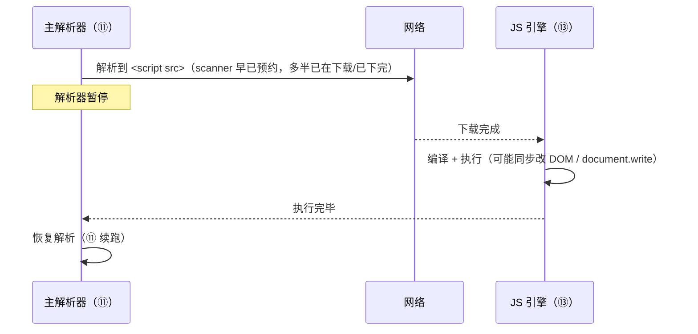
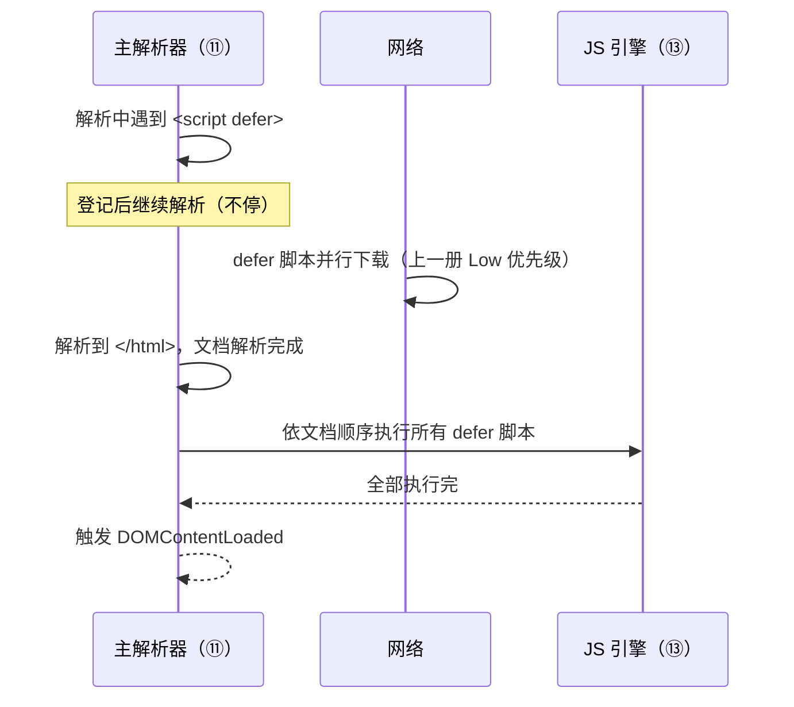
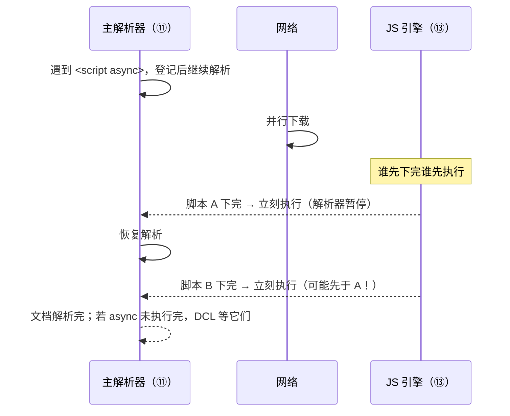
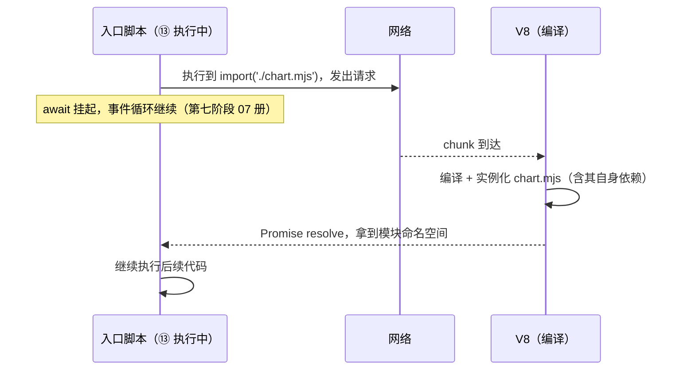

# 脚本加载模型：阻塞、defer、async 与 module

> [← 第六阶段导览](01-导览.md) · 时间线 ⑪（脚本被发现与下载）与 ⑬（脚本被编译执行）。脚本是 HTML 里唯一「既是资源又是代码」的子资源：上一册讲它怎么被发现、怎么排优先级；这一册讲它最特殊的一面——**执行会暂停整个解析器**。同步脚本的下载+执行双重阻塞、defer/async/module 三张时序图、动态注入与动态 import、以及 DOMContentLoaded 到底被谁推迟，是本阶段收尾的四道核心题。

## 1. 总账：脚本为什么特殊

| 子资源 | 到达后干什么 | 对解析器的影响 |
|---|---|---|
| 图片/字体/数据 | 解码、渲染或交给 JS | 无 |
| CSS | 构建 CSSOM | 不阻塞解析器（但阻塞渲染，第七阶段 04 册） |
| **脚本** | 下载 →（解析器暂停）→ 编译 → **执行** | 同步脚本：解析器完全暂停直到执行完毕 |

**执行为什么能暂停解析器**：脚本可以 `document.write()` 往解析器正在读的流里写字（改变后续字节）、可以同步改 DOM。解析器无法假设「执行期间文档不会变」，唯一安全的语义就是**停下来等**。这是 1990s 定下的语义，`defer/async/module` 全部是围绕它的「豁免机制」。

| 时代 | 下载阻塞 | 执行阻塞 | 靠什么 |
|---|---|---|---|
| 上古（无 scanner） | 阻塞（解析到 script 才发现才开始下载） | 阻塞 | 双重阻塞全中 |
| 现代（有 scanner，上一册） | **不阻塞**（提前发现提前下载） | **阻塞**（执行仍要等解析器走到它） | 只剩执行阻塞 |
| defer/async/module | 不阻塞 | **也不阻塞** | 显式豁免声明 |

「双重阻塞」的旧史没有过时：`document.write` 注入的脚本、动态同步插入的脚本、部分第三方嵌入代码，今天仍在付这笔账。

## 2. 同步脚本：剩余的执行阻塞



同步脚本的工程后果：

| 后果 | 机理 |
|---|---|
| 白屏时间变长 | 解析器停在 head 的脚本上，后面所有 DOM 都没建出来 |
| 脚本执行时「DOM 不完整」 | 停在哪就只看到哪——`<script>` 在 body 中间时，后半 DOM 不存在（「找不到元素」类 bug 的一半来源） |
| 长任务 | 大脚本执行是一段不可分割的主线程占用（第七阶段 07 册） |

**位置仍有意义**：即使 scanner 让下载提前了，同步脚本的**执行时刻**仍由它在文档中的位置决定。head 里的同步脚本执行时 body 尚未解析——操作 `document.body` 直接 null。放 body 尾部、或改用 defer，是位置问题的现代解。

### 2.5 document.write：执行阻塞的原罪样本

```js
// 1990s 的注入手法：解析器正在读流，脚本往流里插字
document.write('<script src="ad.js"></script>');
```

| 特性 | 后果 |
|---|---|
| 往**解析中的流**写字 | 解析器必须暂停等待脚本执行，才能知道后续字节是什么——执行阻塞语义的存在理由 |
| write 注入的 script | 浏览器把插进来的字节当文档继续解析——注入的还是同步脚本，**双重阻塞连环发生** |
| write 越晚（flush 阶段）越糟 | 晚期 write 可能迫使整页重建解析（实现相关，示意） |
| 现代 API | `createElement` + `appendChild`（不碰解析流，无阻塞） |

这条原罪链解释了一个当代现象：某些广告/统计 SDK 的嵌入码仍在用 document.write 注入同步脚本——接入它的瞬间，页面在文档中途被连环暂停，解析器被三方脚本串成长队。「引入某第三方后页面变卡」的高频根因之一，就是这行 1990s 的代码。

## 3. defer：下载不挡、执行排队、顺序保证



| 属性 | 语义 |
|---|---|
| 下载 | 并行、不阻塞解析器 |
| 执行 | **文档解析完成后**、DOMContentLoaded 事件**之前** |
| 顺序 | 严格按文档出现顺序执行（多个 defer 互相依赖时安全） |
| 执行时 DOM 状态 | **完整 DOM 就绪**（只是还没触发 DCL 事件） |

两条边界：外联脚本才有 defer 语义（内联 `<script defer>` 被忽略，示意——各实现一致忽略 defer 属性）；**只有静态 HTML 里的 defer 有效**，动态插入的 `<script defer>` 按 async 行为（§6）。

## 4. async：下载不挡、下完就跑、顺序无保证



| 属性 | 语义 |
|---|---|
| 下载 | 并行、不阻塞 |
| 执行 | **下载完成即执行**，不等解析器、不等彼此 |
| 顺序 | **无保证**——依赖执行顺序的 async 脚本随时翻车 |
| 对 DCL | 执行发生在 DCL 之前的部分照常推迟 DCL；未完成的部分也会等（实现按「stop parsing 后等待 pending async」处理，示意） |

**defer vs async 的选型一句话**：脚本之间有依赖/顺序 → defer；彼此独立且早跑早好 → async（统计、独立小组件）。

## 5. module：默认 defer 语义 + 依赖图先解析

```html
<script type="module" src="app.mjs"></script>        <!-- 默认 defer 语义 -->
<script type="module" async src="x.mjs"></script>    <!-- 显式改 async -->
```

| 维度 | module 的行为 |
|---|---|
| 执行时机 | 默认 defer（文档解析完后执行）；显式加 async 则变成下完即跑 |
| 依赖 | 先解析整棵 import 依赖图（递归），全部就位才执行入口 |
| 顺序 | 同一模块图内天然有序（依赖先于引用者） |
| 作用域 | 模块作用域 + 严格模式；顶层 this 是 undefined |
| 跨源 | 必须带 CORS 头（第二册 ORB/CORS 语义在此咬合） |

module 与 defer 的执行窗口相同（解析完成后、DCL 前），差别在**执行前的前置**：defer 只等自己下载完，module 还要等整棵依赖图的模块都下载并实例化完——依赖链长的 SPA，「解析完成后还要等几百毫秒才执行」的账要算在这里（第一册时间线账本）。依赖图的发现时机与上一册 scanner 的边界有关：module 依赖靠 import 语句静态分析（构建期工具与 modulepreload 提前续上）。

## 6. 动态脚本与动态 import

### 6.1 动态注入：默认 async

```js
const s = document.createElement('script');
s.src = '/late.js';
document.head.appendChild(s);   // 默认 async 行为：下完即跑、无顺序保证
```

| 写法 | 实际行为 |
|---|---|
| 动态插入（默认） | async（历史上 `script.async = false` 可强制改「插入顺序执行」，现代规范按插入顺序排队——以实测为准，示意） |
| 动态插入 + `s.async = false` | 按插入顺序执行（强制串行队列） |
| 动态插入 + `defer` 属性 | 无效，仍按 async |

动态注入天生「晚发现」（上一册 §3.3 的慢车道）——需要它早，就要配合 preload/hint 提前预热缓存。

### 6.2 动态 import()：按需的 module

```js
button.addEventListener('click', async () => {
  const mod = await import('./chart.mjs');   // 返回 Promise，按需加载+编译+执行
  mod.render();
});
```

| 特性 | 说明 |
|---|---|
| 时机 | 执行到才请求（运行时发现 → 晚） |
| 返回值 | Promise（不是同步的静态 import） |
| 用途 | 路由级代码分割（打包时代的主力手法，第九阶段手册展开） |

动态 import 的时序（它与静态 module 的关键差异在「谁负责发现」）：



与静态 import 的三点差异：静态的是**入口执行前**由解析器预先发现整棵图；动态的是**执行到才**发请求（延迟不可避免）；静态返回绑定，动态返回 Promise。首屏确定要用的模块别用动态 import——那是在给关键路径主动加一个串行网络往返。

## 7. DOMContentLoaded 与 load 被谁推迟

两个事件的精确语义：

| 事件 | 触发时刻 |
|---|---|
| `DOMContentLoaded` | **文档解析完成 + defer/module 脚本全部执行完** |
| `load` | 文档 + **全部子资源**（图片/字体/iframe…）都就绪 |

| 脚本形态 | 推迟解析器 | 推迟 DOMContentLoaded | 推迟 load |
|---|---|---|---|
| 同步 `<script>` | 是（执行期） | **是**（必须先执行完才 DCL） | 是 |
| `defer` | 否 | **是**（DCL 前执行完才发 DCL） | 是 |
| `async` | 否 | 执行落在 DCL 前则推迟；未完成的也等 | 是 |
| `module`（默认） | 否 | **是**（同 defer + 依赖图） | 是 |
| 动态注入 | 否（插入不暂停） | 不主动推迟（除非恰在 DCL 前执行占住主线程） | 是（也算子资源） |
| `img` 等普通资源 | 否 | 否 | **是** |

DCL 的三条推论：

1. **「DCL 前的代码可以安全假设 DOM 完整」**——defer/module 的黄金属性；同步脚本（body 途中）不行；
2. **DCL 不是「JS 全跑完」**——async 落在 DCL 后执行、动态注入、setTimeout 里的代码都不在 DCL 等待之列；
3. **Performance 面板蓝线 = DCL、红线 = load**（第十阶段 02 册全景对照）——蓝线晚多半是 defer/module 脚本执行慢（⑬ 拖的），红线晚多半是大图/慢资源拖的。归因口诀：**蓝看脚本，红看资源**。

### 7.5 打包时代的脚本形态

构建工具（Vite/webpack 等）产出的脚本标签其实是本册四种形态的组合拳：

| 产物 | 实际标签形态 | 本册语义 |
|---|---|---|
| 传统打包主 bundle | `<script defer src="main.abc123.js">` | defer：解析后按序执行 |
| 现代原生 ESM 入口 | `<script type="module" src="main.mjs">` | module：defer 语义 + 依赖图 |
| 路由级代码分割 | 入口内动态 `import()` | 动态加载：点到才请求（上一册慢车道） |
| 关键 chunk 预热 | `<link rel="modulepreload">` | 上一册 §7 的依赖图预热 |
| 老浏览器兼容 | `<script nomodule src="legacy.js">` | 仅不识别 module 的浏览器执行（差分加载） |

两个组合纪律：

1. **module 入口 + modulepreload + 代码分割**是现代标配：入口 module 拿到 defer 的「DOM 完整」好处，modulepreload 把依赖链的发现提前（抵消 §5 的依赖图等待），动态 import 把非首屏代码移出关键路径；
2. **hash 文件名**（main.abc123.js）与第三册缓存体系咬合——脚本加载形态与缓存策略是同一份发布工程的两面。

## 8. 四形态总对照

| 维度 | sync | defer | async | module（默认） |
|---|---|---|---|---|
| 下载阻塞解析 | 上古是，现代否 | 否 | 否 | 否 |
| 执行暂停解析 | **是** | 否 | 是（下完即跑，恰逢解析中则暂停） | 否（执行窗口在解析后） |
| 执行时刻 | 解析走到时 | 解析完成后、DCL 前 | 下载完即跑 | 解析完成后（含依赖图） |
| 顺序保证 | 文档顺序 | **文档顺序** | **无** | 依赖图序 |
| DOM 就绪度 | 不完整 | 完整 | 不保证 | 完整 |
| 推迟 DCL | 是 | 是 | 视完成时刻 | 是 |
| 典型用途 | 极少（需即时写文档） | 主应用脚本 | 独立三方脚本 | 现代入口 |

## 9. 实验

1. **四形态顺序实测（导览实践任务 4）**：写四个脚本各 `console.log` 自己的名字 + 在执行处对 DOM 追加一个节点（打时间戳）。组合 head-sync / defer×2 / async×2 / module 各一，刷新多次记录执行顺序与 DCL 时刻（Performance 面板蓝线）：defer 顺序恒定、async 乱序且可能变、module 在 defer 同窗口。
2. **DCL 推迟归因**：给 defer 脚本加 2 秒延迟服务端响应，看蓝线右移量级；换 async 脚本加同延迟，观察蓝线是否也动（执行落在解析完前则动）；给大图加 3 秒延迟，看红线右移而蓝线不动——验证「蓝看脚本，红看资源」。
3. **同步脚本的 DOM 不完整复现**：body 中间放同步脚本读 `document.querySelectorAll('*').length`，再在 DCL 后读一次对比——前一次明显少（只有脚本领到的前文）。
4. **动态注入归类（导览实践任务 5）**：`createElement('script')` 插两个脚本各 sleep 不同时长，观察执行顺序（默认非保证）；加 `script.async=false` 再看（按插入顺序）。对照 §6.1 表。
5. **module 依赖图等待**：入口 module 静态 import 一条 3 层依赖链（每层服务端延迟 500ms），对比「入口 module + 依赖图」与「等价 defer 平铺脚本」的 DCL 时刻差——把依赖图的前置成本量出来。
6. **scanner 与脚本下载解耦**：head 放 2 秒延迟的同步脚本，body 尾放一个 defer 脚本——Waterfall 里 defer 的下载与同步脚本的执行重叠（对照上一册实验 2）。

## 10. 常见误区

1. **「同步脚本今天还是双重阻塞」**：下载早就被 scanner 解耦了（上一册）；剩下的是执行阻塞。「下载阻塞」只活在上古浏览器与 document.write 场景里。
2. **「defer 就是「更快的同步」」**：defer 改的是**执行窗口**（解析完成后）与 DOM 就绪度，不只是时延——它让脚本第一次可以安全地操作完整 DOM。
3. **「async 脚本会推迟 DCL，所以别用」**：独立统计脚本用 async 正是标准姿势；会推迟的是「恰好在 DCL 前下完并执行」的部分，量级可控。要稳定早执行且保证顺序才是 defer 的领地。
4. **「defer 保证下载顺序就是执行顺序」**：顺序保证说的是**执行**顺序（按文档出现序）；下载完成顺序无关紧要——两个概念别混。
5. **「动态插入的脚本加 defer 就能进 defer 队列」**：动态脚本是 async 世界；`defer` 属性被忽略。要串行用 `async=false`。
6. **「module 比 defer 更快」**：module 的执行前置更多（依赖图），它赢在语义（模块化/依赖管理），不在速度。「现代入口必然 module」是工程选择，不是性能结论。
7. **「DOMContentLoaded 之后资源都加载完了」**：DCL 只看解析与脚本；图片/字体/iframe 全归 load。用 DCL 做「页面加载完成」的判断是把两个事件混为一谈。
8. **「把脚本放 body 尾就万事大吉」**：尾置同步脚本仍会暂停解析（后半解析延后）并推迟 DCL；「放尾部」是位置上的缓解，defer 是语义上的根治——现代答案是用 defer/module，不是调位置。
9. **「document.write 已淘汰，不用懂」**：第三方嵌入码、广告 SDK 仍在用它注入同步脚本——理解双重阻塞的根，才能解释「为什么引入某个三方后页面突然卡在解析」。

## 10.5 常见问答

**Q：defer 脚本一定在 DOMContentLoaded 之前执行完吗？那 DCL 会不会无限被 defer 拖住？**
会。DCL 的定义就是「解析完成 + 所有 defer/module 执行完」，所以 defer 慢 DCL 就晚——这是定义不是意外。工程含义：defer 脚本的体积与依赖图深度直接写进 DCL 指标，第九阶段指标课里 DCL 归因的第一项就是它。

**Q：多个 defer 脚本，第二个执行时第一个一定执行完了吗？跨域/缓存差异会不会打破顺序？**
一定。顺序保证覆盖执行阶段：无论下载完成顺序如何（缓存命中的可能瞬间到），执行严格按文档出现序排队。async 的乱序风险正来源于「下完即跑」没有这道队列。

**Q：我把同步脚本放到了 body 最末尾，是不是就等价于 defer 了？**
不等价，差三点：①执行时解析器仍会暂停（尾部之后的注释/内容解析延后）；②它推迟 DCL 的方式不同（sync 是「执行完才允许 DCL」，defer 是「执行完才发 DCL」——时点相近但语义与容错不同）；③DOM 完整性恰好相同，但这是位置巧合不是语义保证。位置技巧是历史缓解，defer 才是语义答案。

**Q：SPA 全是 JS 渲染，首屏白屏跟 defer/module 怎么扯上的？**
SPA 的白屏 = DCL 之后 JS 才开始执行 + 首屏 DOM 由 JS 建（第九阶段水合/CRP 课题）。本册的账只到「DCL 被谁推迟」：入口 module 的体积、依赖图深度、执行时长都计入白屏；「提前发现」归上一册 hint，「执行时长」归第七阶段 V8，「首屏渲染」归第九阶段——四册各管一段。

## 11. 自测题

1. 解析器为什么必须暂停等同步脚本执行？（document.write 之外还有哪个能力？）
2. 「双重阻塞」的现代剩余项是什么？scanner 改掉了哪一半？
3. 画出 sync / defer / async 三张时序图，标出解析器暂停点、执行点与 DCL 触发点。
4. 多个 defer 脚本的执行顺序是什么？多个 async 呢？依赖顺序的第三方组合该怎么加载？
5. defer 脚本执行时 DOM 完整吗？async 呢？sync（body 途中）呢？
6. module 脚本为什么执行一定在依赖图就位之后？这给 SPA 的 DCL 带来什么额外成本？与上一册哪个机制（modulepreload）相关？
7. DOMContentLoaded 精确等待哪些东西？load 又等待哪些？分别被上表哪几类脚本/资源推迟？
8. 动态 `createElement('script')` 插入的脚本属于四形态里哪一类？怎么强制它按插入顺序执行？
9. 动态 import() 与静态 import 的三个差异（时机/返回值/用途）？
10. Performance 面板蓝线被拖晚，先查什么？红线呢？（归因口诀）
11. 外联 `<script defer>` 与内联 `<script defer>` 的差异是什么？
12. 第三方广告 SDK 用 document.write 注入同步脚本，页面卡顿的完整机理链是什么？你有什么工程替代（对照上一册 hint 与本册 defer）？

## 12. 自查清单

| # | 检查 | 工具 | 异常指向 |
|---|---|---|---|
| 1 | head 里没有同步脚本 | HTML review | 有 = 白屏期被主动拉长 |
| 2 | 主应用脚本用 defer 或 type=module | HTML review | sync = 执行阻塞解析器 |
| 3 | 依赖顺序的组合没有用 async | Network + 执行顺序实测 | 乱序翻车是随机重现的 flaky |
| 4 | 独立三方脚本 async + 必要时 fetchpriority=low | Network Priority 列 | 抢占关键路径 |
| 5 | 动态注入的脚本有明确顺序策略（async=false 或打包器） | 代码 review | 无策略 = 随机顺序 |
| 6 | DCL 与 load 的差值在合理量级 | Performance 蓝红线 | 差值大 = 子资源（大图/字体）在拖 load |
| 7 | document.write 注入的三方脚本已替换 | 代码/三方审计 | 残留 = 解析器定时炸弹 |
| 8 | module 依赖链深度可控（关键入口） | 构建产物 review | 深链 = 解析完成后还要等一串网络 |
| 9 | LCP 相关图片不在脚本之后才被发现 | 上一册 §3.3 边界清单 | 晚发现 = 上一册问题复发 |

## 13. 延伸

- 下一站：[第七阶段导览](../07-第七阶段/01-导览.md)——字节流进入渲染进程主线程：HTML 解析器状态机、CSSOM、V8 编译执行（本册「执行」的黑盒在那里打开）、事件循环与任务调度。本阶段结束，网络侧的账全部结清；「HTML→DOM」的 ⑪⑫⑬⑭ 由下一阶段接棒。
- scanner 与优先级在[上一册 05](05-子资源调度-预解析扫描器-优先级与资源hint.md)；接收流水线与 MIME 严格校验（module 脚本 MIME 要求的出处）在[第 02 册](02-网络进程接收流水线.md)；HTTP 语义与连接层在[第四阶段 02 册](../04-第四阶段/02-HTTP1.1-报文语义与连接管理.md)；DevTools 全轨道的读法在[第十阶段 02 册](../10-第十阶段/02-DevTools深潜-Performance全轨道解剖.md)；代码分割与按需加载的手法手册归第九阶段（正文待写）；词法语法层面的编译理论归 compiler 站。
