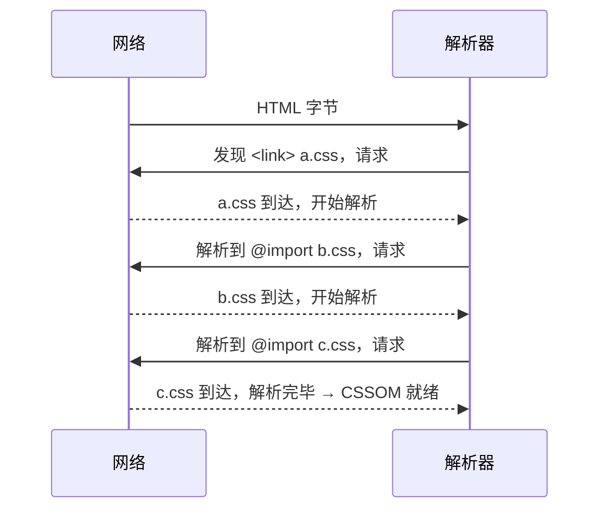

# CSS 解析与 CSSOM

> [← 第七阶段导览](01-导览.md) · 时间线 ⑫。DOM 树就位的同时，另一条线在把 CSS 字节变成 CSSOM。CSS 解析与 HTML 解析气质完全不同：HTML 是「错误也规定输出」，CSS 是「错误就地丢弃、绝不断链」；HTML 解析不阻塞任何东西，CSS 却握着渲染的闸门——head 里的样式表不解析完，浏览器拒绝上屏。这一册拆 CSS 语法分析与错误恢复、CSSOM 树结构、渲染阻塞的精确规则，以及 `@import` 串行灾难这个经典性能事故。

## 1. 总账：CSSOM 是什么、何时建、为什么卡渲染

```text
CSS 字节流 ──► 解析（css-syntax 状态机）──► 规则列表（样式表对象）
                        │
                        ▼
             CSSOM：样式表 → 规则 → 声明 的树/集合
                        │
                        ▼
        与 DOM 一起进入 Style 计算（下一册 ⑭）→ 渲染树
```

| 问题 | 答案 |
|---|---|
| CSSOM 指什么 | 广义：浏览器内部的样式表对象集合（CSSStyleRule/CSSStyleDeclaration…）；狭义 API：`document.styleSheets` 里的 `CSSStyleSheet` 树 |
| 何时建 | 样式表字节到达即开始解析，主线程逐条处理 |
| 为什么阻塞渲染 | 首屏若在 CSSOM 完成前上屏，用户会看到无样式内容闪烁（FOUC）；规范干脆规定 render-blocking |
| 阻塞范围 | 只阻塞**渲染**，不阻塞解析（DOM 构建照跑）——与同步脚本阻塞解析形成对照 |

「CSS 阻塞渲染但不阻塞解析」是本册第一句要背的话：HTML 解析继续推进，只是首帧绘制被扣住。

## 2. 语法分析：css-syntax 状态机与「永不崩溃」原则

CSS 语法由 CSS Syntax Module Level 3（css-syntax-3）定义，与 HTML 的做法哲学相反：

| 对比项 | HTML 解析 | CSS 解析 |
|---|---|---|
| 错误处理 | 每类错误输入规定唯一输出，尽力保留内容 | 错误规则**直接丢弃**，跳到下一个可恢复点 |
| 目标 | 兼容历史烂页面 | 保证一条坏规则不拖垮整张样式表 |
| 输入 | 文本 | 文本（`@import` 链式展开时是流式） |

css-syntax 把解析分成两层：

1. **分词**：字符 → token。token 级就已内建配对与「bad-token」概念——引号不闭合产出 bad-string 而不是卡死。
2. **解析**：token 流 → 规则列表。顶层两种规则：
   - **at-rule（@规则）**：`@media`、`@import`、`@font-face`……形态是 prelude + `{}` 块（或分号结束）；
   - **qualified rule（普通规则）**：prelude（选择器）+ `{}` 块（声明列表）。

### 2.2 token 家族速查

读 css-syntax 规范/看解析器实现时用得上的 token 全家福（按角色分组）：

| 组 | 成员 | 一句话 |
|---|---|---|
| 标识类 | ident、function（`min(`）、at-keyword（`@media`）、hash（`#id`） | 名字类 token；function 是「ident + 左括号」 |
| 数字类 | number、percentage（`50%`）、dimension（`14px`） | dimension = 数字 + 单位，CSS 特有 |
| 字符串类 | string、bad-string、url（`url(...)` 未解析形态）、bad-url | bad 系是「错误也有 token」的体现 |
| 结构类 | whitespace、comment、colon、semicolon、comma、`{}`/`()`/`[]` 配对块 | 配对块由分词器保证配对（吞错的基础） |
| 其他 | delim（单个杂字符）、CDC（`-->`） | `-->` 在 CSS 里是 token 级合法输入（HTML 注释兼容遗留） |

分词与解析的两层分工再收一张对照表（读报错/看丢弃范围时对号入座）：

| 阶段 | 输入 | 输出 | 错误的「波及半径」 |
|---|---|---|---|
| 分词 | 字符 | token（含 bad-string/bad-url） | 一个 token——bad 系被后续解析按规则消费，不炸全文件 |
| 解析（规则层） | token 流 | 规则树 | 一条规则（prelude 坏→整条丢） |
| 解析（声明层） | `{}` 块内 token | 声明列表 | 一条声明 |
| 取值/语义（下一册） | 已解析声明 | computed value | 一条属性（invalid 时按继承/初始兜底） |

「半径逐层收窄」是 CSS 全链路的错误处理主题：越靠近 token 越宽容（只标 bad），越靠近语义越精确（按属性兜底）——两层哲学在一条链上共存。

**错误恢复三则**（背下来，看懂「为什么我这条规则整个没了」）：

| 情形 | 处理 |
|---|---|
| 选择器部分语法错误 | **整条 qualified rule 丢弃**（prelude 坏了整个块作废） |
| 某条声明语法错误 | 只丢该声明，同一 `{}` 块里其余声明保留 |
| 块/括号不配对 | 按状态机配对规则吞到配对结束或 EOF，绝不跨规则传染 |

```css
.a { color: red; colr: blue; font-size: 14px }   /* colr 丢弃，red 与 14px 存活 */
div > { color: red }                              /* 选择器坏 → 整条规则丢弃 */
@media (min-width: 100px { ... }                  /* 括号配对吞错，块之后规则不受影响 */
```

「错误就地丢弃、绝不断链」同时解释了两件事：为什么 CSS 不需要 try/catch 式的防御结构，以及为什么**线上样式没生效时第一反应是「选择器或声明是否整条被丢弃」**。

## 3. 选择器解析与特异性预计算

选择器在解析期被结构化（复杂选择器 = 复合选择器序列 + 组合器），并**顺手算出特异性三元组**（id/class+attr+pseudo-class/tag+pseudo-element）——下一册级联算法直接消费这个预计算结果。

| 阶段产物 | 内容 | 谁在用 |
|---|---|---|
| 结构化选择器 | 右到左的复合选择器链 | 匹配算法（下一册 §2） |
| 特异性 (a,b,c) | 解析期定死 | 级联排序（下一册 §3） |
| 最右简单选择器 | 分桶键 | 规则哈希分桶（下一册 §5） |

注意 `@import` 的解析语义：它是一条 at-rule，解析到它时**登记一个子样式表请求**——子样式表本身还要再走一遍完整解析。这条不起眼的语义是 §6 串行灾难的根。

## 4. CSSOM 树结构与可编程视图

一张样式表在对象层面长这样（`document.styleSheets` 可直接查证）：

```text
CSSStyleSheet                     ← 一张 <link> / <style> 一个
 └─ CSSMediaRule                  ← @media
     └─ CSSStyleRule              ← 一条普通规则
         ├─ selectorText          ← ".card > h2"
         └─ style (CSSStyleDeclaration)
             ├─ getPropertyPriority()   ← !important
             └─ 每条声明
 └─ CSSImportRule                 ← @import（内嵌 href + 子样式表引用）
 └─ CSSLayerBlockRule             ← @layer（css-cascade-5）
 └─ CSSScopeRule                  ← @scope
```

三个工程看点：

1. **`CSSOM` 是「规则集合」不是「值计算结果」**——它不存「某元素最终 color 是什么」；那是 Style 计算（下一册）的产物。很多「CSSOM 树和 DOM 树合成渲染树」的口语化说法要谨慎：树与树之间没有直接连线，连线发生在逐元素的匹配阶段。
2. **`CSSStyleSheet.cssRules` 只反映解析产物**——被错误恢复丢弃的规则在这里不存在；调试「规则怎么没了」先看这里。
3. **运行时可增删**：`insertRule`/`deleteRule`、`adoptedStyleSheets`（可构造样式表，多实例共享一份解析产物）——样式编辑器与 CSS-in-JS 的底层通道。

### 4.5 样式表的五种来源

「哪里来的规则」决定 CSSOM 的组装方式与阻塞行为：

| 来源 | 进入 CSSOM 的方式 | 渲染阻塞 | 典型场景 |
|---|---|---|---|
| `<link rel=stylesheet>` | 独立请求 → 完整解析 | 是（head 常规位） | 主样式表 |
| `<style>` 行内 | 随 HTML 解析就地解析 | 是 | 关键 CSS 内联 |
| `@import` | 子请求 → 递归解析 | 是（串行链） | 历史遗留/第三方 |
| `CSSStyleSheet` 构造 + `adoptedStyleSheets` | 零请求，直接挂对象 | 否（挂载即生效） | Shadow DOM、CSS-in-JS、主题热切换 |
| `el.style` 行内属性 | 不进 CSSOM 规则表，挂在元素上 | 否 | JS 动态样式 |

「adoptedStyleSheets 零请求不阻塞」这一行是 CSS-in-JS 性能论证的关键论据：样式对象构造一次、多个 shadow root 共享，绕过了网络与主解析两笔账。

## 5. 渲染阻塞的精确规则

规范（HTML Standard 的 render-blocking 机制 + css 语言层的 blocking=render）给出的判定，可以收成一张表：

| 样式表形态 | 下载 | 阻塞渲染？ | 阻塞脚本执行？ |
|---|---|---|---|
| head 里普通 `<link rel=stylesheet>` | 会 | **是** | 见下条 |
| `media` 不匹配（如 `media="print"`） | 会（低优先级） | **否** | 否 |
| body 中段的 stylesheet link | 会 | 是（经典实现阻塞到该点之后的首帧） | 是 |
| `<link rel=stylesheet disabled>` / `alternate` | 视实现 | 否 | 否 |
| 显式 `blocking=render` / 移除阻塞 | — | 按标注 | — |

关于「阻塞脚本执行」要说精确：**脚本执行是否等 CSSOM，取决于脚本会不会访问样式信息**——规范口径是「可能有 style 阻塞的脚本」（a style sheet that is blocking scripts）。实践口径记成：**同步脚本排在样式表之后时，浏览器倾向等 CSSOM 就绪再执行**（脚本可能查询 getComputedStyle/布局），这也是「CSS 慢会拖住后面的 JS」这条 waterfall 现象的规范出处。

动态改变的边界情况值得单列：

| 操作 | 后果 |
|---|---|
| JS 改 `<link>` 的 `media` 为匹配值 | 该表从非阻塞转为阻塞，触发样式重算 |
| 运行时新增 `<style>` | 解析 + 加入 CSSOM + 失效相关元素（下一册失效机制） |
| `disabled` 切换 | 样式表在 CSSOM 中启用/停用 |

### 5.5 CSSOM 与 DOMContentLoaded 的边界

「CSS 到底推不推迟 DOMContentLoaded」是高频困惑，用一张表钉死：

| 情形 | DOMContentLoaded |
|---|---|
| 纯静态页，CSS 慢 | **不推迟**——DCL 只等解析（EOF）与 defer 脚本 |
| CSS 后面跟着同步脚本 | **推迟**——脚本要等 CSSOM，脚本执行又卡在解析路径上，连带 DCL |
| CSS + defer 脚本 | defer 在 EOF 后执行，不受 CSSOM 影响（实现可差异，主流如此） |

trace 验证：Performance 面板里 `DCL` 标记的位置对照 CSS 块与脚本块的先后——「CSS 拖 DCL」几乎总是通过「拖住了它后面的同步脚本」间接实现，不是 CSS 直接拖解析。

## 6. @import 串行灾难

`@import` 的问题不在「多一次请求」，在**发现时机**：



| 方案 | 请求发起链 | 首屏可渲染条件 |
|---|---|---|
| 三个 `<link>` 并列 | HTML 扫描阶段**同时**发现三个（preload scanner 兜底，见[第六阶段 05 册](../06-第六阶段/05-子资源调度-预解析扫描器-优先级与资源hint.md)） | 三者并行下载，最慢者决定 |
| 三层 `@import` | 逐层发现：a 到了才知道 b，b 到了才知道 c | **串行 RTT 累加**，弱网灾难 |

量化直觉（示意）：每层 import 至少吃掉一个 RTT + 服务器响应时间；3 层在 RTT=100ms 的网络上是 ~300ms 起步的额外延迟——而浏览器在收到 CSSOM 前不渲染。

**缓解手段对照表**（各有边界，别混用）：

| 手段 | 解掉什么 | 留下什么 |
|---|---|---|
| 构建期并列化/合并（正解） | 串行链整个消失 | 失去运行时按需加载 |
| `<link rel=preload as=style>` | 深层文件的「发现晚」 | 请求链仍串行（缓存命中才免 RTT） |
| `CSSStyleSheet` 构造/adoptedStyleSheets | 网络+主解析全免 | 需要代码组织样式，不适合静态主表 |
| HTTP/2 push（历史） | 曾想免一轮 RTT | 已被浏览器移除支持，不列选项 |

## 7. media query 与「条件阻塞」

media 的不匹配样式表是一条被低估的免费午餐：

```html
<link rel="stylesheet" href="print.css" media="print">
<link rel="stylesheet" href="wide.css"  media="(min-width: 1200px)">
```

| 场景 | 行为 |
|---|---|
| `media="print"` | 下载（低优先级）但**不阻塞当前渲染**——打印时才生效 |
| `(min-width:1200px)` 在手机上 | 不匹配 → 不阻塞；用户旋转/调窗后匹配 → 转为阻塞并触发样式重算 |
| 匹配失败原因 | 视口查询在「视口建立」后评估——移动端 viewport meta 缺失会导致评估异常，样式行为诡异 |

由此得到首屏优化的标准手法：**把首屏不需要的样式挪进不匹配的 media**（打印样式、大屏增强样式），缩小「render-blocking 集合」。构建工具「关键 CSS 内联 + 其余异步加载」就是这个思想的产品化。

## 8. @layer 与 @scope：CSSOM 里的新结构

两个新 at-rule 改变的都是「规则的**组织方式**」，解析产物直接体现在 CSSOM 对象上：

| 特性 | 解决什么 | CSSOM 形态 | 级联位置 |
|---|---|---|---|
| `@layer`（css-cascade-5） | 第三方样式与自有样式的排序战争——**先声明层序，特异性退居其次** | `CSSLayerBlockRule` / `CSSLayerStatementRule` | 级联在 origin/importance 之后先比 layer（下一册 §3） |
| `@scope`（css-scoping） | 选择器的**作用域边界**（`@scope (.card) to (.content)`）+ 就近优先 | `CSSScopeRule` | proximity 规则参与级联 |

```css
@layer reset, base, components, vendor;
/* 层序一次声明，之后每个 layer 内部随便写，互不越层竞争 */
```

对解析侧的影响：它们只是「更多种 at-rule」，css-syntax 的错误恢复机制原样适用——不支持的浏览器整块丢弃，页面不断链。级联细节下一册展开。

## 9. 实验

1. **CSSOM 可视化**：console 里遍历 `document.styleSheets`，打印每张表的 `cssRules` 类型树（CSSMediaRule/CSSStyleRule/CSSImportRule）；对照源码逐条认领。
2. **错误恢复实测**：把 §2 的三条坏规则样例贴进 `<style>`，读 `styleSheets[0].cssRules` 确认「整条丢/单声明丢/不传染」三种结果。
3. **渲染阻塞观察**：本地起一个「CSS 延迟 3s 返回」的小服务，页面 head 引用它——Performance 面板看首帧（FP）被推迟、`Parse HTML` 正常推进的分离形态；再给 link 加 `media="print"` 对照首帧恢复。
4. **CSS 拖 DCL 的间接链**：同上页面在样式表后放一个同步脚本，观察 `DCL` 标记被推迟；移除脚本对照——验证 §5.5 的间接因果。
5. **@import 链计时**：构造 5 层 `@import` 链与合并单文件两个版本（每层服务端延迟 200ms），Network 面板对比瀑布形态与总时长（示意量级，弱网模拟下差距更醒目）。
6. **adoptedStyleSheets 对照**：构造样式表对象挂到 document 与 shadow root，观察「零网络请求、即时生效」；与等价 `<style>` 注入对比 trace。
7. **media 动态切换**：JS 把一个不匹配样式的 `media` 改为匹配，Performance 面板看 `Recalculate Style` 被触发（下一册的主角登场预告）。

## 10. 常见误区

1. **「CSS 阻塞 DOM 解析」**：阻塞的是渲染与（排在样式表后的）同步脚本执行；DOM 构建照跑——把这句话说反，「为什么 trace 里 Parse HTML 没等 CSS」就解释不了。
2. **「一条坏声明会毁掉整个文件」**：css-syntax 的错误恢复按「声明级丢弃、选择器级整条丢、不跨规则传染」执行；真正要担心的是**配对结构**坏了（吞块范围扩大）。
3. **「@import 只是写法不同」**：它改变请求的**发现时机**——串行化请求链，是首屏性能事故的常客；现代工程里构建期消除它。
4. **「media 不匹配的 CSS 白下载了」**：低优先级下载换来「条件匹配时零延迟生效」；它是条件样式场景的正确形态，不是浪费。
5. **「CSSOM 树 + DOM 树 = 渲染树」**：渲染树（下一阶段主角）由 Style 计算逐元素生成，不是两棵树直接焊接；CSSOM 是规则的容器。
6. **「行内 `<style>` 不用解析」**：同样走完整 css-syntax 解析与错误恢复；内联省的是**网络**，不是解析。
7. **「CSS 拖慢 DOMContentLoaded 是 CSS 直接拖解析」**：DCL 只等解析与 defer；CSS 通过拖住它后面的同步脚本间接推迟 DCL——因果链要说对。

## 11. 常见问答

**Q：CSSOM 为什么不能像 DOM 一样边解析边用？**
可以部分做到——`@media` 外层规则先解析完，内部规则再补；但「级联结果」依赖**全部**规则就位（最后一条 @layer 声明能翻盘），所以「可用于渲染」的 CSSOM 必须等整张表解析完。这就是渲染阻塞比解析阻塞苛刻的根本原因：级联是全序运算。

**Q：框架/构建工具的「样式提取」到底在优化什么？**
三件事：消灭 @import 链（§6）、缩小 render-blocking 集合（关键 CSS 内联 + 其余异步，§7）、减少主线程解析量（源码压缩/去重）。判断一个方案好不好，就用这三条对账。

**Q：`<link rel=preload>` 能当渲染优化万金油吗？**
不能。它只解决「发现晚」，不解决「串行」与「阻塞」；对已在 head 的常规 link 加 preload 是重复下载风险。它的正确位置是「@import 深层文件」「动态插入的样式表」这两类发现晚的场景。

**Q：CSS 变量、`var()`、`calc()` 会让解析变复杂吗？**
解析阶段它们就是普通 token——`var(--x)` 是 function token，`calc(100% - 20px)` 也是 function token；值的合法性校验推迟到取值阶段（下一册的 computed value 加工）。所以「写了 `var(--不存在)`」解析不报错、取值时按 invalid at computed-value time 处理——又一处「解析宽松、语义阶段收网」的设计。

**Q：行内 `<style>` 里写 `@import` 会更糟吗？**
会。行内样式随 HTML 解析逐段处理，`@import` 触发的子请求发生在「HTML 解析推进到该处」之后——比独立 CSS 文件里的 import 链发现得更晚；再叠加它常被模板引擎逐段拼接，发现时机最不可控。行内关键 CSS 里放 @import 是首屏事故的标准配方。

## 12. 自测题

1. CSS 与 HTML 错误处理的哲学差异是什么？各自的工程收益？
2. 选择器部分写错时哪部分被丢弃？声明写错呢？说出 css-syntax 错误恢复三则。
3. bad-string/bad-url 是什么？「错误也有 token」对解析器意味着什么？
4. 为什么 head 里的 CSS 要阻塞渲染？它阻塞解析吗？哪个现象能证明「解析没被阻塞」？
5. `media="print"` 的样式表下载吗？阻塞渲染吗？为什么说它是「免费午餐」？
6. @import 灾难的根源是「多一次请求」还是「发现时机」？三层 import 在弱网下的额外延迟量级？
7. 「同步脚本排在样式表后可能要等 CSSOM」的规范依据是什么？trace 里怎么验证？
8. CSS 在什么条件下会推迟 DOMContentLoaded？直接还是间接？
9. adoptedStyleSheets 绕过了哪两笔账？它是 CSS-in-JS 性能论证的哪条论据？
10. `@layer` 改变了级联的哪一步？它对解析/错误恢复有新要求吗？
11. `styleSheets[0].cssRules` 里找不到某条规则，第一反应是什么？
12. 首屏优化中「缩小 render-blocking 集合」有哪几招？各自的 CSS 语法载体是什么？
13. 视口 meta 缺失为什么会间接影响样式行为？（提示：media 查询的评估前提。）
14. bad-string 是在分词层还是解析层产出的？它的「波及半径」是多大？
15. `var(--不存在)` 为什么解析不报错？它最终在哪一层被处理成什么？

## 13. 自查清单

| # | 检查 | 工具 | 异常指向 |
|---|---|---|---|
| 1 | 线上无未消除的 `@import` 链？ | 构建产物搜索 | 串行请求链拖首屏 |
| 2 | render-blocking CSS 数量收敛？ | DevTools Coverage/Performance | 首帧被长 CSS 尾巴拖住 |
| 3 | 打印/大屏样式挂在条件 media 上？ | Network 面板优先级列 | 全量 CSS 都在阻塞首屏 |
| 4 | 样式未生效先查「整条被丢」？ | `cssRules` 对照 | 选择器/配对错误被错误恢复吞掉 |
| 5 | `@layer` 层序有统一声明处？ | CSSOM 树检查 | 层序漂移，特异性行为难预期 |
| 6 | CSS 与其后同步脚本的顺序有意识安排？ | waterfall | CSS 慢拖住脚本执行与 DCL |
| 7 | 行内关键 CSS 里没有 @import？ | head 源码检查 | 发现时机最晚的串行链 |

## 14. 延伸

- 下一册：[05-样式计算-级联-匹配与ComputedStyle](05-样式计算-级联-匹配与ComputedStyle.md)——CSSOM 是规则的集合，规则怎么落到每个元素头上：右到左匹配、级联算法与强制同步布局第一现场。
- 渲染阻塞与首屏指标的量化关系、Performance 面板的标准用法在[第十阶段 02 册](../10-第十阶段/02-DevTools深潜-Performance全轨道解剖.md)；加载类案例复盘有 @import 事故的完整版在[第十阶段 03 册](../10-第十阶段/03-案例复盘集-加载类.md)。
