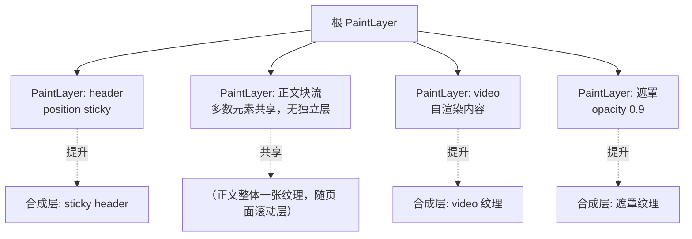

# 分层：PaintLayer、合成层与层爆炸

> [← 第八阶段导览](01-导览.md) · 时间线 ⑮。布局算完几何（03 册）还不够：像素最终要按正确的顺序画出来、还希望「能自己动的东西」不必每帧牵动全局。这两件事分别由**两级分层**解决：PaintLayer 管绘制顺序与叠加上下文，合成层（composited layer）管独立纹理。这一册讲两级各自为什么存在、提升合成层的完整条件表、will-change 的真实代价，以及层爆炸的诊断与治理——DevTools Layers 面板全程实测。

## 1. 为什么需要「两级」层

「层」这个词在浏览器语境里指两个不同的东西，先分清：

```text
PaintLayer（绘制层）
  解决：绘制顺序问题 —— z-index、透明度、裁剪、混合按什么次序画
  形态：一棵与 LayoutObject 部分重叠的树（只在需要处创建）
  位置：主线程，绘制管线的组织单位

合成层（composited layer，cc 侧）
  解决：性能问题 —— 某块内容要有独立纹理，可以不动其他内容而单独变换/滚动
  形态：合成器里的纹理单元（cc::Layer）
  位置：主线程创建描述，合成线程持有（06 册）
```

| 问题类型 | 需要谁 | 典型场景 |
|---|---|---|
| 谁盖住谁（顺序） | PaintLayer | 弹窗遮罩、下拉菜单、负 margin 交叠 |
| 独立动画/滚动（性能） | 合成层 | transform 动画、页面滚动、video 播放 |
| 两者都要 | 先 PaintLayer 后提升 | 透明动画元素：既需要正确叠放（PaintLayer）又需要独立纹理（合成层） |

PaintLayer 是**必要条件**：元素先有 PaintLayer，才有机会被提升为合成层。两者数量关系：LayoutObject ≥ PaintLayer ≥ 合成层（通常递减得很陡）。

为什么顺序问题不能靠「按 z-index 排个数组画一遍」解决？因为绘制顺序是**递归嵌套**的：一个 stacking context 内部的整套顺序规则，对它的父上下文而言是「原子一步」——内部怎么排不影响外部排序，外部也不能插入其间。这种「整体原子、内部递归」的结构只有树能表达，PaintLayer 树就是它。这也是 z-index 失效问题的总病根：**你以为在兄弟间比大小，实际是在不同上下文间被原子排序**（§7 误区 6）。

## 2. PaintLayer：绘制顺序的载体

PaintLayer 只在「默认绘制顺序不够用」时创建。创建条件归纳表（Chromium 语义，写代码时对照）：

| # | 条件 | 例 |
|---|---|---|
| 1 | 根元素 | `<html>` |
| 2 | 定位元素（position ≠ static） | relative/absolute/fixed/sticky |
| 3 | 有变换/透明/过滤 | transform、opacity < 1、filter、backdrop-filter、mask、clip-path |
| 4 | 混合/隔离 | mix-blend-mode ≠ normal、isolation: isolate |
| 5 | 显式 z-index 生效者 | 定位元素或 flex/grid 子项设置 z-index |
| 6 | 滚动容器 | overflow: scroll/auto（滚动内容需独立组织） |
| 7 | will-change 指向层相关属性 | will-change: transform/opacity/filter… |
| 8 | 特殊内容 | video、canvas 等自带 PaintLayer |

PaintLayer 的核心职责是**确定绘制顺序**——同层内按规则画、层与层按叠放上下文画。叠放上下文（stacking context）是 CSS 概念，PaintLayer 是它的实现载体；创建 stacking context 的属性表与 z-index 的详解属于样式层知识（第七阶段），这里只记一句：**z-index 只在 stacking context 内比大小，PaintLayer 之间按「同一上下文内 z-index 排序、上下文之间原子排序」**。

两级树在页面上的嵌套关系（示意）：



读法：**没有提升条件的兄弟们挤在「共享层」里**，只有一个提层条件的才单飞。层树远比 LayoutObject 树矮——这正是设计的意图：分层是按需的，不是按元素的。

### 2.5 同层内画什么、按什么顺序画

PaintLayer 内部还会细分成多个绘制阶段（CSS 2.1 附录 E 的简化版）：

```text
1. 层背景与边框
2. 负 z-index 的后代层
3. 块级后代（block backgrounds/borders）
4. 浮动后代
5. 行内后代（文本）
6. z-index: auto/0 的定位后代层
7. 正 z-index 的后代层（升序）
```

这个顺序解释了很多「为什么我的元素被盖住」：负 z-index 的层画在父层背景之上、但普通块内容之下；浮动画在同级行内内容之前……不用背全表，记住「**先背景后内容、浮动在行内前、z-index 有序、层是原子**」即可应对九成现场。

从这张表还能读出两条工程纪律：

1. **负 z-index 不是「压到最底」**：它压到的是「父层背景与普通内容之间」——想让内容露出父层背景之外的元素盖在下面，负 z-index 恰好是工具；想盖住一切，它做不到；
2. **同层内容共担重绘**：阶段 3~5 的普通内容没有层隔离，任何一个的重绘失效都会波及同层其他内容——「普通元素互相牵连重绘、提层后各自隔离」就是 04 册收益表里「失效范围隔离」的实现原理（05 册的 Paint 粒度由它决定）。

## 3. 合成层：独立纹理与提升条件全表

合成层 = 这块内容被画进一张**独立的位图纹理**，交给合成器（06 册）单独搬运。提升条件按「动机」分四类（Chromium 主干归纳，版本间有增删，以 DevTools 显示的 compositing reasons 为准）：

| 类别 | 条件 | 动机 |
|---|---|---|
| **自渲染内容** | video（含poster）、canvas/WebGL、iframe（跨进程） | 内容自己更新，不该牵动页面 |
| **声明式** | will-change: transform/opacity/filter/scroll-position…；translateZ(0)/translate3d 等 3D transform | 开发者预告「这块要动」 |
| **动画驱动** | transform/opacity/filter/backdrop-filter 处于合成器可驱动的动画中 | 动画逐帧只变纹理变换/透明度 |
| **结构性** | position:fixed（滚动页面的固定内容）、滚动容器的滚动内容层、backdrop-filter、提供遮罩/混合的层 | 每帧相对视口独立 |
| **兜底** | **重叠提升（overlap）**：与已提升层相交的兄弟内容可能被连带提升 | 让提升层能整体移动而不露底 |

overlap 那一条是层爆炸最常见的暗坑：页面上一个 video 或 3D transform 元素，它后面的兄弟内容可能整块被连带提升——**你没写任何提升代码，层数却涨了**。DevTools Layers 面板的 compositing reasons 会写明 "overlaps other layer" 之类的字样。

### 3.1 代价：显存怎么算

独立纹理不是免费的，显存占用的算术要会：

```text
纹理显存 ≈ 宽(px) × 高(px) × 4 字节（RGBA8）   ← CSS 像素还要乘 DPR
```

| 层 | CSS 尺寸 | DPR | 实际像素 | 显存 |
|---|---|---|---|---|
| 全屏层（iPhone 13 Pro 级） | 390×844 | 3 | 1170×2532 | **≈ 11.3 MB** |
| 半屏浮层 | 390×422 | 3 | 1170×1266 | ≈ 5.6 MB |
| 200×50 小徽章 | 200×50 | 3 | 600×150 | ≈ 0.34 MB |

三个推论：

1. **尺寸是大头**：一个全屏层的显存 ≈ 十几个 MB 量级（上表，示意）——「随手给大区域加 will-change」的代价一目了然；
2. **DPR 是平方级放大**：DPR 3 的纹理面积是 DPR 1 的 9 倍——「开发机 DPR 2 没事、真机 DPR 3 爆内存」的经典翻车；
3. **层数 × 单层显存 = 总账**：列表 100 项每项一张纹理，哪怕每张只有 0.5MB，总量也是 50MB 量级——这还没算纹理上传与合成时间。

提升决策的完整心智模型（把收益与代价放进同一次判断）：

```text
要不要提层？三个问题：
  1. 它每帧真的独立变化吗？（不变化 → 提层是纯支出）
  2. 变化的是变换/透明度，还是内容？（内容也变 → 提层后仍要重栅格，收益打折）
  3. 包围盒能压多小？（面积 × 4B × DPR² = 常驻成本）
三个答案都理想 → 提层；有一个不理想 → 先修那个不理想，再谈提层。
```

| 收益 | 代价 |
|---|---|
| transform/opacity 动画只动合成器（06 册），主线程零参与 | 常驻显存 + 纹理上传 |
| 滚动不重绘（滚动层只是平移） | 合成时间随层数增长 |
| 失效范围隔离（重绘只影响本层，05 册） | 内存水位上升，低端机换页风险 |

### 3.5 提层的时机：提升发生在什么时候

提升不是「样式一生效就立即发生」，而是发生在**渲染准备阶段**（paint 之前的 prepaint/合成检查）：

```text
样式/布局更新
  → 引擎扫描哪些 PaintLayer 满足提升条件（含 overlap 检测）
  → 层树重建（attach）：新提层的创建、不再符合条件的层回收
  → 受影响的层重新栅格化（05 册）
```

两个工程推论：

1. **「突然提层」本身有成本**：动画第一帧从无到有建纹理 = 现场栅格化整个层——这正是 will-change 预提升要填的坑（§4）；
2. **提升条件是逐帧重新评估的**：动画结束、元素移出视口、overlap 关系变化，都可能让层被回收——层的数量是**动态水位**，不是静态属性，诊断要抓「运行中的峰值」而不是加载完成后的静态快照。

## 4. will-change：提前声明的代价

`will-change` 的语义是「**我马上要改这个属性**，引擎请提前准备」——不是性能开关，是**预告**。引擎收到预告后做的事：

| 引擎动作 | 收益 | 代价 |
|---|---|---|
| 预创建/提升合成层 | 动画启动无「突然提层」的卡顿（提层本身要重栅格化） | 常驻显存（§3.1 公式） |
| 预分配相关资源 | 首帧动画更顺 | 层存活的维护成本 |

**用法纪律**（违反任一条都是负优化）：

1. **加在「即将变化」的元素上，变化结束后移除**——JS 控制：动画开始前 `el.style.willChange='transform'`，`animationend`/transition 结束后改回 `auto`；
2. **别一次给太多元素**：列表 100 项全加 will-change = 100 张常驻纹理 = 层爆炸（§5）；
3. **写具体属性**：`will-change: transform` 优于 `will-change: all/auto`——引擎按属性做针对性准备；
4. **别当缓存用**：「加了会更快的迷信」来自早期 3D transform hack（translateZ(0) 强提层）；现代引擎按需提层已经足够聪明，无脑预提层是给内存上税；
5. **验证收益**：加之前后各录一次 trace，对比动画首帧有没有「Raster + 提层」尖峰——没有尖峰收益就别留代价。

## 5. 层爆炸：成因、症状与诊断

**层爆炸（layer explosion）**= 合成层总数与总面积失控。典型成因清单：

| 成因 | 例 |
|---|---|
| 循环内批量预提升 | `v-for` 里每项加 `will-change: transform` |
| 动画残留 | 无限循环的 transform 动画让提升层永不释放 |
| overlap 连带 | 大面积已提升层下方的内容整块被提升 |
| fixed 元素泛滥 | 多个 position:fixed 元素各自成层 |
| 大尺寸层叠加 | 全屏遮罩 ×2 + 全屏背景图 ×1 各自独立纹理 |
| 复杂遮罩/圆角裁剪 | border-radius + overflow:hidden 触发遮罩层（ masks 需要额外纹理） |

**症状**（按出现频率排序）：

1. 内存水位异常（DevTools Memory 或系统内存面板）；
2. 滚动/动画初期卡顿——纹理上传挤占带宽；
3. 低端设备换页抖动、截图/弱机崩溃率上升；
4. Performance 面板合成段时长随页面上元素数量不成比例地增长。

### 5.5 DevTools Layers 面板实测

打开：DevTools 右上 ⋮ → **More tools → Layers**；或 ⌘⇧P 打开命令菜单输入 "Show Layers"。

| 面板要素 | 读什么 |
|---|---|
| 层树 | 层级与父子关系（嵌套层的裁剪关系一目了然） |
| 选中层的宽高与位置 | 找出「 unexpectedly 大」的层 |
| **Memory estimate** | 该层显存估算（对照 §3.1 公式心算校验） |
| **Compositing reasons** | 为什么被提升（will-change / overlap / fixed / animated…）——治理的第一线索 |
| Paint count / paint time | 重绘次数与耗时（05 册衔接） |

配套工具（Rendering 面板，⌘⇧P → "Show Rendering"）：

| 开关 | 作用 | 颜色语义 |
|---|---|---|
| Paint flashing | 重绘区域绿色闪烁 | 绿闪 = 重绘发生（05 册实验主用） |
| Layout Shift Regions | 布局偏移区域高亮（09 阶段 CLS 用） | 蓝色区域 |
| Layer borders | 层与瓦片边界 | 层边框橙/橄榄色，瓦片边框青色 |

治理顺序建议：先用 Layers 面板按内存排序找最大层 → 读 compositing reasons 归因 → 按成因对症。对症手册：

| 归因（compositing reasons 显示） | 对症 |
|---|---|
| will-change 残留 | 播完移除（JS 在 animationend 改回 auto） |
| overlaps other layer | 治理目标是**它上方那个提升层**：缩小面积、降低提层必要性 |
| position:fixed | 数量控制；能合并的角标合并成一个容器层 |
| animated transform/opacity 常驻 | 无限循环动画改有限次数；或元素不可见时暂停 |
| 遮罩/裁剪（mask） | 圆角 + overflow:hidden 能否换实现（背景图自带圆角/裁剪在图片内完成） |
| 尺寸过大 | will-change 元素缩小包围盒（提层面积 = 包围盒，不是内容实际像素） |

治理的前后对照要有**同一把尺子**：Layers 面板的总内存估算 + 总层数，治理前后各记录一次。没有基线的治理（「感觉快了」）在本阶段不算完成——导览实践任务 1 要的就是这组前后数字。

「包围盒」那条值得单独强调：给一个 100px 高的图标加 will-change，若它在布局上占据整行（块级、宽度撑满），提层面积就是整行宽 × 行高——**纹理按包围盒算，不按内容算**。缩小包围盒（inline-block、定宽）有时比去除 will-change 更有效。

### 5.6 滚动容器的层：合成器滚动的物理载体

滚动容器在分层体系里的身份常被忽略：**滚动页面的内容区是一张（或几张）大纹理**，滚动 = 合成器平移这张纹理的显示偏移（06 册展开机制）。三个推论：

1. 滚动本身不产生重绘——Paint flashing 在纯滚动时不应闪烁（闪烁 = 有元素在每帧重绘，常见于滚动监听里改样式）；
2. 滚出视口的内容纹理还在（或被引擎按需丢弃/重建，05 册的瓦片机制）——「无限长列表」的内存不是 DOM 问题，是层/瓦片问题，虚拟列表（09 阶段）同时治两头；
3. 滚动容器内部的 will-change 会与滚动层产生**嵌套层**——Layers 面板里滚动层下面挂着子层树，内存账要按「滚动层 × 子层」一起算。

## 6. 实验

1. **基线盘点**：打开一个长列表页，Layers 面板记录总层数与内存估算总量（数据存档，量级因机器/版本而异，记相对变化即可）。
2. **will-change 加压**：给列表 100 项全部加 `will-change: transform`，重新盘点——层数与内存应显著上涨；滚动观察首轮滚动是否有「现栅格化」的顿挫（纹理首次上传）。
3. **overlap 归因**：页面上放一个 `translateZ(0)` 的元素压在大段文本上，Layers 面板看文本块的 compositing reasons 是否出现 "overlaps"——没写任何提升代码的层，被连带提升的实证。
4. **fixed 层观察**：滚动页面上放 3 个 position:fixed 的角标，Layers 面板确认它们各自独立成层；滚动页面时 Paint flashing 不闪（固定内容不重绘，只是被合成器按视口固定）。
5. **圆角遮罩成本**：对比「直角卡片」与「border-radius + overflow:hidden 卡片」的层数差异——遮罩触发额外纹理（若出现提升/遮罩 reason 即复现）。
6. **动画残留**：无限 transform 动画结束后（动画移除）vs 一直播着（提升层常驻），对比内存——验证「播完要收」的纪律。
7. **包围盒实验**：给一个块级（撑满整行）的图标加 will-change，Layers 面板读层尺寸；改 inline-block 并定宽后重读——提层面积随包围盒收缩的变化直接可见（§5.5 对症手册「尺寸过大」行的实证）。

## 7. 常见误区

1. **「层越多性能越好」**：层是空间换时间——只对「真正每帧独立变化的内容」划算；静态内容提层是纯支出（显存 + 合成）。
2. **「transform 一定会提合成层」**：静态 2D transform 只保证 PaintLayer（绘制顺序），不必然合成；**动画中的 transform / will-change / 3D transform** 才进入提升名单——分清「PaintLayer」与「合成层」两级。
3. **「will-change 是免费的优化开关」**：它是「预付纹理租金」——收益只在「避免动画启动时的突然提层」，代价是常驻显存。播完不收 = 白付租金。
4. **「opacity 动画和 transform 动画不一样贵」**：两者都是合成器可驱动属性（06 册），量级相同；贵的组合是「opacity < 1 的元素上再做布局属性动画」——提层 + 每帧重绘。
5. **「我没写 will-change 就不会有层爆炸」**：overlap 连带提升、结构性提升（fixed/滚动）、自渲染内容（video/canvas）都不经你的手——诊断以 Layers 面板的 compositing reasons 为准，别靠代码搜索。
6. **「z-index 大就盖在最后」**：z-index 只在本 stacking context 内有效；跨上下文时「父上下文整体原子排序」——9999 的子元素也盖不过高阶上下文之外的兄弟（根因在 PaintLayer/上下文层级，不在数字）。
7. **「DPR 只影响清晰度」**：纹理尺寸按物理像素算，DPR 3 是平方级显存放大——「开发机好好的，低端安卓机爆内存」最常见的技术根因之一。

### 7.5 常见问答

**Q：合成层数量多少算「爆炸」？**
没有绝对数——算的是**总显存**与**每帧合成时间**。经验警戒线（示意）：页面纹理总量超过几十 MB、或 Layers 面板层数达到三位数，就值得治理。低端机的换页阈值更低，同一数字在高内存设备无感、在 2GB 设备上就是崩溃率。

**Q：把整页提成一个合成层，是不是就再也没有重绘了？**
是的，但也消灭了「局部重绘」的能力：改任何一行字 = 整层重栅格化 = 全屏重绘（05 册讲栅格化的粒度）。分层设计的本质是**重绘粒度的优化**——层切得对，改动落在小层上；一刀切整页，改动落回全屏。

**Q：怎么判断「这个动画值不值得提层」？**
两个问题：动画属性是不是 transform/opacity/filter（合成器可驱动）？元素面积是不是足够小（或包围盒可缩小）？两者都满足 → 提层收益明确；属性是 top/left → 先改成 transform 再谈提层，否则提层了每帧还是重绘整层。

**Q：为什么「窗口失焦再回来」有时会看到层重新出现的一瞬卡顿？**
§3.5 说过层是动态水位：不可见/后台时部分层被回收省内存，回来时重建 + 重栅格化——「切回标签页闪一下」常是层的重建成本。常驻大层（如全屏 canvas）在后台场景要注意这类重建抖动，或用 `document.visibilityState` 暂停/恢复时提前安排。

## 8. 自测题

1. PaintLayer 与合成层各解决什么问题？「顺序问题用前者、性能问题用后者」这句怎么落到弹窗/滚动/video 三个场景？
2. 列出至少 5 类 PaintLayer 创建条件。PaintLayer 与 stacking context 是什么关系？
3. 提升合成层的条件按动机分四类，每类举一例。overlap 提升为什么是「你没写代码也会发生」的？
4. 全屏层在 DPR 3 下的显存估算公式与数值（390×844 CSS 像素）？为什么「DPR 平方放大」？
5. will-change 的正确生命周期是什么（何时加、何时删）？「will-change 当性能开关」错在哪？
6. 层爆炸的五个典型成因与四个症状？DevTools Layers 面板里治理的第一线索是哪个字段？
7. 同一个动画，「首次播放卡、后续顺」的提层解释是什么？will-change 怎么消除首播卡顿、代价是什么？
8. Paint flashing 与 Layer borders 分别观测什么？绿色闪烁意味着管线哪一站发生了？
9. position:fixed 元素滚动时为什么不重绘？它被提升的结构性动机是什么？
10. border-radius + overflow:hidden 为什么可能增加纹理成本？给出验证方法。
11. 「突然提层」的成本发生在动画的第几帧？will-change 预提升填的是哪个坑、代价是什么？
12. 滚动为什么属于合成层体系？纯滚动时 Paint flashing 不闪说明了什么？什么情况下滚动会闪（提示：滚动监听改样式，衔接 07 册）？
13. 「要不要提层」的三个判断问题是什么？三个答案分别是「是/变换与透明度/能压小」时，提层的收益与成本账怎么算？
14. 为什么绘制顺序必须用树表达、「按 z-index 排数组」不行？从「整体原子、内部递归」怎么推出 z-index 失效的病根？
15. 窗口后台再切回时偶发的一瞬卡顿可能是什么成本？和层的什么特性有关（§3.5）？

## 9. 自查清单

| # | 检查 | 工具 | 异常指向 |
|---|---|---|---|
| 1 | 列表类组件有没有批量 will-change？ | 代码审查 + Layers 面板 | 层数随列表长度线性增长 = 爆炸前兆 |
| 2 | 动画元素的 will-change 播完有没有收？ | 代码审查 + 内存面板 | 常驻纹理白付租金 |
| 3 | 页面总层数与内存估算基线？ | Layers 面板盘点 | 无基线 = 无法判断「变多」还是「本来就多」 |
| 4 | 大层的 compositing reasons 归因？ | Layers 面板选中层 | "overlaps" = 治理目标是它上面那个提升层 |
| 5 | DPR 3 真机内存表现？ | 真机内存面板 | 开发机正常、真机爆 = 纹理按物理像素算的账没算 |
| 6 | fixed 元素数量是否可控？ | Layers 面板 | 每个 fixed 都是一张独立纹理 |
| 7 | 治理前后有没有同一把尺子的数字？ | Layers 总内存 + 总层数记录 | 无基线 = 「感觉快了」不算完成 |
| 8 | will-change 用的是具体属性还是宽泛值？ | 代码审查 | will-change: all/auto = 引擎无法针对性准备（§4 纪律 3） |

## 10. 延伸

- 下一册：[05-绘制与栅格化-display list-瓦片与Skia](<05-绘制与栅格化-display list-瓦片与Skia.md>)——层定下来了，每层「画什么」被记录成 display list，栅格化把它变成瓦片位图；Skia 在主线程记录与 GPU 执行之间怎么分工。
- 显存与进程模型背景：[第一阶段 03 册](../01-第一阶段/03-浏览器组成-进程线程与站点隔离.md)；度量工具入门：[第一阶段 04 册](../01-第一阶段/04-度量基础-Network与Performance面板入门.md)。
- 合成线程怎么消费这些纹理：06 册；一次改动的失效分诊（该提层还是该重绘）：07 册。
