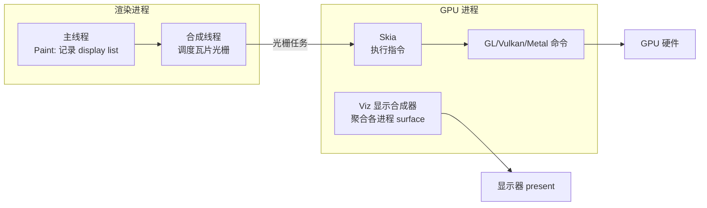
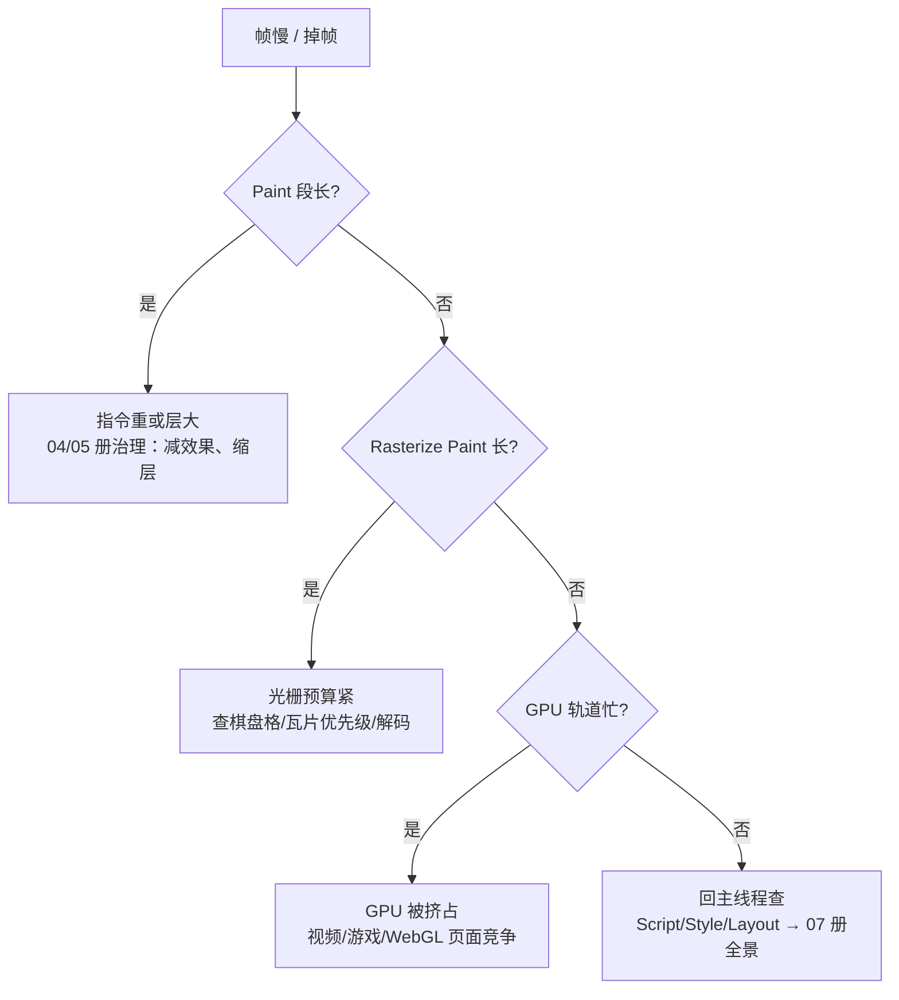

# 绘制与栅格化：display list、瓦片与 Skia

> [← 第八阶段导览](01-导览.md) · 时间线 ⑮。分层的账算完了（04 册），这一册讲「层里的像素从哪来」：主线程把「画什么」记录成 display list（绘制指令列表），栅格化把指令执行成瓦片位图——**记录与执行分离**是理解局部重绘的钥匙。瓦片是栅格化的工作单元，Skia 是执行指令的图形库，软件与 GPU 两条光栅路径各有分工。着色器与图形学细节归 `webgl/` 站，本册讲到 Skia/GPU 进程协作为止。

## 1. 指令与执行分离：绘制管线的设计核心

旧式立即模式（immediate mode）图形系统「画一个就是一个」，改一个像素就得从头再画。浏览器选择了**记录-回放模式**：

```text
Paint 阶段（主线程）：
  遍历 PaintLayer 树 → 产出 display list（有序绘制指令序列）
  指令形如：「在 (x,y) 画矩形 w×h，颜色 c」「以字体 F 在基线 b 画文本 t」
  记录完成 = 主线程的绘制工作结束，立刻可以干别的

Raster 阶段（合成线程/GPU 进程）：
  取 display list → 执行指令 → 产出位图（瓦片）
  执行慢不慢都不阻塞主线程——它已经去忙下一帧了
```

| 收益 | 机制 |
|---|---|
| **局部重绘** | 改动只让受影响的层**重新记录**，未动的层复用旧 display list；栅格化只执行受影响的瓦片 |
| **主线程与光栅解耦** | 记录（主线程）与执行（光栅线程/GPU）异步 |
| **指令可优化** | 记录时可做裁剪合并、不可见指令剔除 |
| **可重放** | 同一份 display list 可以按不同分辨率/变换多次执行（DPR 缩放、动画重栅格化） |

与 `gui/` 站对照：自绘框架「renderObject.paint(canvas)」正是同一模式的简化版——浏览器把「记录」和「执行」拆到了不同线程与进程，这是教学框架没有的复杂度。

### 1.5 记录发生在帧内的什么位置

把本册放进一次完整的帧（07 册全景，这里先记本册两站的坐标）：

```text
同一帧内（主线程）：
  rAF 回调 → 样式计算 → 布局 → prepaint → 【Paint：本册上半场】 → commit
随后（合成线程/GPU 进程）：
  光栅调度 → 【Raster：本册下半场】 → 激活 → draw → 上屏
```

关键坐标：Paint 是主线程在**该帧渲染阶段的末端**做的事；Raster 发生在 commit 之后的合成线程侧——**跨线程的交接点就是 commit**。所以「Paint 段很长」是主线程问题（挤占本帧预算），「Raster 段很长」是合成线程/光栅问题（可能顺延到下一帧才激活）——归因时先看段落在哪条轨道。

## 2. display list 走读

Blink 的 display list 落地为 cc（Chromium compositor）的 PaintOp 缓冲。常见指令类型速查：

| 指令 | 画什么 | 例 |
|---|---|---|
| DrawRect / DrawRRect | 矩形/圆角矩形 | 背景、按钮底色 |
| DrawTextBlob | 文本串 | 页面文字（字体形状已由字体栅格化缓存） |
| DrawImage / DrawImageRect | 位图 | ``、border-image |
| DrawPath | 任意路径 | 边框曲线、SVG 形状 |
| DrawLine | 线 | 分隔线、下划线 |
| ClipRect / ClipRRect | 裁剪 | overflow 裁剪、圆角裁剪 |
| SaveLayer / Restore | 离屏层 | 透明度、混合模式、滤镜的包围层 |
| DrawShadow / DrawLooper | 阴影类效果 | box-shadow |

三个要点：

1. **记录粒度是 PaintLayer**：一个层一份有序指令列表，层内的 z 顺序、裁剪关系编码在指令顺序与 Clip 指令里；
2. **失效只重记录受影响的层**：改一个按钮的颜色，只有它所在 PaintLayer 重新记录；页面上其他层的老 display list 原样复用——「重绘范围是整页还是所在层」的答案就是**所在层**（连带祖先裁剪关系变化时可能扩大）；
3. **display list 是内容描述，不是几何描述**：指令里的坐标是层的本地坐标；层在页面上的位置、缩放、旋转由合成器按属性树（06 册）施加——所以移动一个层不需要重记录，只改它的变换属性。

### 2.5 Paint Profiler：看一次绘制到底记录了什么

DevTools Performance 录制后放大一个绿色的 Paint 事件 → 详情里选 **Paint Profiler**：能看到这次记录的指令统计（多少 Draw/Clip/SaveLayer、绘制的元素树片段）。用它回答「这个组件重绘为什么贵」：指令条数多（复杂阴影/多层混合）比面积大常常更致命。

### 2.6 遮挡剔除：看不见的就不记录

记录阶段还有一个减量机制：**遮挡剔除（occlusion culling）**。被其他不透明内容完全盖住的元素，其绘制指令可以在记录或栅格化阶段被剔除——视口外的、被上层完全不透明矩形覆盖的内容，不产生实际绘制工作。

| 剔除类型 | 触发条件 | 收益 |
|---|---|---|
| 视口剔除 | 元素整体在视口外（除非有提层等例外） | 不为看不见的内容记录/栅格化 |
| 遮挡剔除 | 被不透明兄弟/祖先完全覆盖 | 长页面下滚时被盖住的部分跳过 |
| 瓦片级裁剪 | 指令与目标瓦片不相交 | 只执行与该瓦片相交的指令 |

推论：长页面滚到中部时，底部内容不会被完整栅格化——「页面 10 万像素高」不等于「10 万像素高都要画」。但剔除不改变失效传播：改一个视口外的元素样式，失效照记，只是绘制范围按可见性收缩（07 册）。

## 3. 瓦片化：栅格化的工作单元

合成层的纹理不是一次性整块栅格化的，而是切成**瓦片（tile）**按需栅格化：

```text
合成层（如 390×8000 的长页面内容）
  └─ 瓦片矩阵：256×256 量级的块（尺寸随平台/模式有差异，示意）
      └─ 每个瓦片独立栅格化、独立上传、独立复用/丢弃
```

瓦片的生命周期：

| 阶段 | 发生什么 |
|---|---|
| 建立 | 层被提升/内容变化时，按包围盒规划瓦片矩阵 |
| 排队 | 按优先级进入光栅队列（视口内最高，向外按距离衰减） |
| 栅格化 | 执行 display list 的对应部分 → 瓦片位图 |
| 使用 | 合成帧引用活跃瓦片拼出画面 |
| 复用/丢弃 | 内容不变复用；滚远/被替换的瓦片回收 |

**光栅优先级**是瓦片化的灵魂：

1. 视口内的瓦片最先栅格化（用户正看着）；
2. 视口外按「距离 + 滚动方向预测」排队预光栅（提前准备即将滚入的）；
3. 资源不足时远瓦片直接不栅格化——滚动过快时新瓦片来不及做，出现**棋盘格（checkerboarding）**：画面上灰白格纹或白块，就是「纹理还没做出来，先占位」。

棋盘格是诊断「光栅跟不上」的信号：正常滚动偶发属正常；频繁满屏棋盘格说明栅格化预算不足（层太大/指令太重/解码太慢，见 §5.5）。

### 3.5 一次快速滚动的瓦片活动时间线

把「向下甩一屏」拆成瓦片视角的时间线（各步时长示意，看相对关系）：

| 时刻 | 合成线程活动 | 用户可见 |
|---|---|---|
| t0 | 手势更新滚动偏移 → 新视口位置确定 | 画面立即按已有瓦片平移 |
| t0+ | 为新视口排瓦片光栅任务（视口内高优） | 边缘开始出现棋盘格 |
| t0~t1 | 光栅线程/GPU 执行新瓦片 | 逐块补齐 |
| t1 | 新瓦片激活（activate）拼入合成帧 | 画面完整 |
| t1+ | 旧视口瓦片降级/回收 | 内存回落 |

两个细节值得注意：滚动是**先用旧瓦片顶着**（画面立刻动，哪怕部分区域是占位格），新瓦片异步补齐——「滚动跟手」与「内容完整」是两个独立目标，合成器优先保前者；瓦片补齐发生在滚动进行中，所以「滚动中途截屏」可能拍到棋盘格，这是正常现象不是 bug。

## 4. Skia 与 GPU 进程协作

**Skia** 是 Google 的 2D 图形库（Chrome、Android、Flutter 共用），浏览器绘制指令的最终执行者。它有两个后端：

| 后端 | 执行位置 | 产出 |
|---|---|---|
| CPU（软件光栅） | 渲染进程的光栅线程 | CPU 内存里的位图 → 共享内存 → 上传 GPU |
| GPU（硬件光栅） | GPU 进程（经 Skia GPU 后端） | 生成 GL/Vulkan/Metal 命令 → GPU 显存里的位图 |

协作链路全景（OOP-D：显示合成器 Viz 运行在 GPU 进程）：



分界线：本站讲到「Skia 收到指令、生成图形 API 命令、在 GPU 进程执行」为止；命令之后的事——GPU 管线、着色器、纹理采样、图形学原理——归 `webgl/` 站。前端只需要知道：**栅格化慢可能是 Skia 指令重（复杂效果）也可能是 GPU 忙（游戏页挤占）**，两个病因在 trace 上位置不同（§6）。

### 4.5 一条指令的旅程

跟一条 DrawRect 指令从头走到尾，把本册所有角色串起来：

```text
1. 主线程 Paint 阶段：div 的背景 → 记录为一条 DrawRect（层本地坐标）
2. display list 存在该 PaintLayer 上 → commit 交给合成线程
3. 光栅调度：该矩形落入哪几块瓦片 → 指令子集进入对应瓦片的光栅任务
4. Skia 执行：
   - GPU 光栅：Skia GPU 后端把 DrawRect 翻译成顶点+着色器调用 → GL/Vulkan/Metal
   - 软件光栅：Skia CPU 后端按扫描线把矩形写进瓦片位图
5. 瓦片位图成为纹理 → 合成帧引用它 → Viz 聚合 → 显示器
```

每个环节都有独立的失败模式：1 重（记录慢）、3 排队久（优先级低）、4 重（Skia 慢）、5 被挤占（GPU 忙）——trace 归因就是判断卡在哪一环。

## 5. 软件 vs GPU 光栅：两条路径的分工

| 维度 | 软件光栅 | GPU 光栅 |
|---|---|---|
| 执行者 | 渲染进程光栅线程（CPU） | GPU 进程（Skia GPU 后端） |
| 位图内存 | CPU 内存 → 上传 | 直接驻留显存 |
| 上传开销 | 每次栅格化后要拷贝 | 无上传（已就位） |
| CPU 占用 | 吃渲染进程 CPU | 吃 GPU |
| 适用 | 无 GPU 环境、headless、部分内容回退 | 默认路径（桌面/移动正常环境） |

判断要点：

1. **GPU 光栅是默认**，软件路径主要服务特殊环境（无 GPU 的 CI 截图、远程桌面、GPU 黑名单设备）与个别内容回退；
2. 两者的 trace 形态不同：软件光栅的耗时算在渲染进程的 Raster 线程；GPU 光栅的任务提交快，真正耗时在 GPU 进程侧（Performance 的 GPU 轨道）——「Raster 段很短但帧还是慢」要去看 GPU 轨道；
3. **图片解码不是栅格化**：JPEG/PNG/WebP 的解码（压缩格式 → 像素）是独立步骤，发生在栅格化需要它之前——大图的解码成本单独记在 ImageDecodeTask 类事件里。

### 5.5 大图解码：栅格化身边的隐藏税

| 场景 | 成本落点 | 治理 |
|---|---|---|
| 一张 4000×3000 的原图直接 `` 缩到 200px 显示 | 解码全尺寸 + 光栅采样，内存 ≈ 4000×3000×4 ≈ 45MB（算术账） | 服务端出小图 / srcset 按需分辨率 |
| 滚动进入一屏全是未解码大图 | 一批 ImageDecodeTask 挤占光栅预算 → 棋盘格 | decoding="async"、渐进式 JPEG、预解码 |
| 动图逐帧解码 | 每帧解码成本持续占用 | 视频替代 GIF（硬件解码路径） |

45MB 那笔账值得记：**解码后的位图 = 宽 × 高 × 4 字节**，与 04 册的纹理公式同源——「原图直出」的内存代价经常超过整页所有层之和。

## 6. 光栅化在 trace 里的位置

Performance 面板里与本册相关的轨道与事件：

| 轨道/事件 | 归属 | 看什么 |
|---|---|---|
| Main 轨道的 **Paint**（绿色） | 主线程 | display list 记录的时长；后面跟着 Commit |
| **Rasterize Paint / Raster** 轨道 | 渲染进程光栅线程 | 软件光栅的执行耗时 |
| **GPU** 轨道 | GPU 进程 | GPU 光栅与最终合成的执行（Draw/提交） |
| ImageDecodeTask | 光栅调度 | 大图解码是否挤占帧预算 |

判读决策：Paint（记录）长 → 指令太多/层太复杂（回 04 册治理）；Rasterize Paint 长 → 光栅预算紧（看瓦片优先级与棋盘格）；GPU 轨道忙 → GPU 被谁挤占（视频/游戏/其他进程）；ImageDecodeTask 密集 → 大图问题（§5.5）。

### 6.5 归因决策树



## 7. 实验

1. **Paint flashing 建立直觉**：Rendering 面板开 Paint flashing，滚动纯内容页——不应闪；再开一个带「滚动监听改样式」的页面（下面给出），绿色跟随滚动闪烁——重绘范围直接可视化（这就是 03 册说的滚动抖动）。

```html
<!-- 实验用最小页面：滚动监听里改样式 → 每帧重绘 -->
<div style="height:4000px">
  <div id="bar" style="position:fixed;top:0;background:#36c;color:#fff">0</div>
</div>
<script>
  // 非 passive（第九阶段 05 册展开），这里先只观测重绘
  addEventListener('scroll', () => {
    document.getElementById('bar').textContent = scrollY;
  });
</script>
```

2. **局部重绘验证**：页面放两个独立区块（中间隔一段内容），开 Paint flashing，改其中一个区块的按钮颜色——只有该区块绿闪，另一块不闪（重绘粒度 = 所在层而非整页）。
3. **Paint Profiler 读指令**：对一个带 box-shadow + 渐变 + 大圆角的卡片触发重绘，Performance 里找 Paint 事件 → Paint Profiler，数指令条数；去掉阴影再测——指令统计的变化就是「复杂效果贵在哪」的直接证据。
4. **棋盘格复现**：DevTools Setting 里把 CPU 节流拉到 6x（或录制低性能设备），快速甩动一个长页面，观察偶发灰白块（或用 Rendering 面板的 Frame Rendering Stats 辅助）；停止甩动后瓦片补齐、画面恢复——「现做瓦片」机制的行为证据。
5. **大图解码成本**：页面放一张 4000×3000 原图（本地生成即可），Performance 录制首次滚动到它，找 ImageDecodeTask 与其时长；换成 400px 缩略图重录对比。算一遍 §5.5 的内存账并记录。
6. **GPU vs 软件轨道对照**：正常模式下录一次滚动（GPU 光栅，Raster 线程轻、GPU 轨道忙）；若环境允许（headless/软件渲染开关）录一次软件光栅对照——两条路径的耗时落点差异就是 §5 的表。
7. **剔除观察**：长页面下半部放一个「被全屏不透明遮罩盖住」的区域，开 Paint flashing，触发遮罩下内容的样式改动——被完全盖住的区域不闪绿（剔除生效），露出边缘的部分闪——剔除按可见性收缩绘制范围的实证。

## 8. 常见误区

1. **「display list 就是 DOM 的镜像」**：指令是**绘制动作**序列（裁剪、离屏层、阴影层层嵌套），与 DOM 结构不是一一对应；一个元素可能贡献多条指令，一个指令可能画多个元素（合批）。
2. **「重绘 = 整页重新画」**：重记录的范围是 PaintLayer（粒度可到子序列），重栅格的范围是**瓦片**——两者都比「整页」细得多。Paint flashing 闪的就是这个范围。
3. **「GPU 光栅一定比软件快」**：单看「执行指令」GPU 通常占优，但整体收益还取决于上传路径与并发（软件光栅多线程、GPU 受显存带宽约束）。工程上记结论：默认 GPU、特殊环境软件——不要人为干预路径。
4. **「图片 decode 和 paint 是一回事」**：解码是压缩格式 → 像素（在栅格化前），栅格化是像素 → 瓦片位图（执行指令）。大页面卡顿归因时先分清卡在哪个事件。
5. **「瓦片尺寸是固定的 256」**：量级示意（平台/内容/模式都有变体）——记机制（按需、按优先级、可丢弃），别记死数字。
6. **「阴影、模糊是浏览器顺带画的」**：它们是 SaveLayer 包裹的离屏合成，指令成本显著高于普通矩形——设计稿里「到处都是柔和阴影」是 Paint 段变长的常见原因。
7. **「Skia 是 Chrome 私有的渲染器」**：Skia 是通用 2D 图形库（Android/Flutter 共用）——它是「执行者」，不是「合成器」；合成（层怎么拼上屏）归 06 册的 cc/Viz。

### 8.5 常见问答

**Q：为什么我的页面什么都没改，Paint flashing 还在闪？**
找「每帧都在变的来源」：进行中的 CSS 动画作用在非合成属性（top/left/背景色）、跑在主线程的 JS 动画（rAF 里改样式）、闪烁的 caret（输入框）、以及滚动监听改样式。flashing 的闪烁区域形状会提示来源——整页闪多半是全局动画，小块闪是局部元素。

**Q：改透明度（opacity）会重绘吗？**
已提升的合成层：opacity 由合成器按效果树调节，通常不重记录不重栅格（06 册的 effect 树）；未提升的元素：改 opacity 触发所在层重绘。这也是「动画前先提层（04 册 will-change）」的机制理由之一。

**Q：box-shadow 很贵，那我完全不能用阴影吗？**
能，但要分层级看：小面积、低频更新的阴影成本可忽略；大面积、每帧动画中的阴影（动画 box-shadow）每帧重绘重栅格——换成伪元素阴影配 opacity 动画，或用 filter: drop-shadow 提层方案。原则不是「禁用」而是「别让贵效果进动画循环」。

**Q：滚动到页面底部，顶部的瓦片还在内存里吗？**
引擎按需管理：滚远的瓦片会被降级/丢弃，滚回来再栅格化（display list 还在，重执行即可）——所以「滚回顶部」可能伴随轻微光栅活动。display list 常驻内存（比位图小得多），位图按可见性进出——这就是「指令小、像素贵」的又一例证。

**Q：用 CSS 动画移动元素和用 JS 改 left，光栅层面差在哪？**
CSS transform 动画：纹理不动、属性树更新，光栅几乎不参与（除非需要重栅格变清晰）；JS 改 left：每帧布局 + 重记录 + 受影响瓦片重栅格——光栅预算被持续抽税。这就是 07 册分诊表「composite-only vs 全链」在光栅侧的表现。

## 9. 自测题

1. 「记录与执行分离」的完整含义？给局部重绘、主线程解耦、指令优化各带来什么？
2. display list 的记录粒度是什么？改一个按钮的颜色，重记录与重栅格的范围分别是什么？
3. 常见 PaintOp 类型至少说出 6 种；SaveLayer 包裹的是什么类型的效果、为什么贵？
4. 瓦片的生命周期五阶段？光栅优先级怎么排？棋盘格是什么、出现说明什么？
5. Skia 的两个后端各自在哪执行、产出什么？OOP-D 后显示合成器（Viz）在哪个进程？
6. 软件光栅与 GPU 光栅的 trace 落点差异？「Raster 段很短但帧慢」下一步看哪条轨道？
7. 大图解码的内存公式？一张 4000×3000 原图直出的解码内存约多少？三种治理手段？
8. Paint（主线程）与 Rasterize Paint（光栅线程）在 trace 上怎么区分？各对应流水线哪一段？
9. 为什么「移动一个层不需要重记录 display list」？（提示：指令是本地坐标 + 层变换在合成器。）
10. 纯滚动时 Paint flashing 不闪的机制解释？什么情况会闪、分别归哪一册的病灶？
11. 遮挡剔除与失效传播是什么关系？「视口外的元素改样式」失效记不记、画不画？
12. 一条 DrawRect 指令从记录到上屏经过哪五站？每站各自的失败模式是什么？
13. 「CSS transform 动画」与「JS 改 left」在光栅侧的成本差异是什么？分别对应 07 册分诊表的哪一行？

## 10. 自查清单

| # | 检查 | 工具 | 异常指向 |
|---|---|---|---|
| 1 | 滚动时 Paint flashing 闪不闪？ | Rendering 面板 | 闪 = 滚动期重绘，回 03/07 册找滚动监听改样式 |
| 2 | 重绘范围是所在区块还是整页？ | Paint flashing | 整页闪 = 层结构有问题（04 册） |
| 3 | 复杂效果的 Paint 时长占比？ | Performance Paint 事件 + Paint Profiler | 阴影/滤镜多 = 指令重，设计层治理 |
| 4 | 大图有没有直出？ | Performance ImageDecodeTask | 密集解码 = srcset/缩略图治理 |
| 5 | 快速滚动有没有棋盘格？ | 低端节流 + 目测 | 频繁出现 = 光栅预算不足 |
| 6 | Paint 长还是 GPU 忙？ | Main 轨道 vs GPU 轨道 | 归因错轨道，药方就错 |
| 7 | 动画属性里有没有 box-shadow/filter？ | 代码审查 | 贵效果进动画循环 = 每帧重绘重栅格 |
| 8 | 解码与栅格化是否分清？ | ImageDecodeTask vs Raster 事件 | 归因混淆会开错药 |

## 11. 延伸

- 下一册：[06-合成-合成线程-GPU与vsync](06-合成-合成线程-GPU与vsync.md)——瓦片位图备好了，合成线程怎么把它们拼成合成帧、怎么踩着 vsync 节拍上屏，以及滚动与 transform 动画为什么完全不经过主线程。
- 层从哪来（提升条件与显存账）：[04-分层-PaintLayer-合成层与层爆炸](04-分层-PaintLayer-合成层与层爆炸.md)；度量工具入门：[第一阶段 04 册](../01-第一阶段/04-度量基础-Network与Performance面板入门.md)。
- GPU 管线与着色器原理，`webgl/` 站；自绘框架的 paint 管线对照，`gui/` 站。
