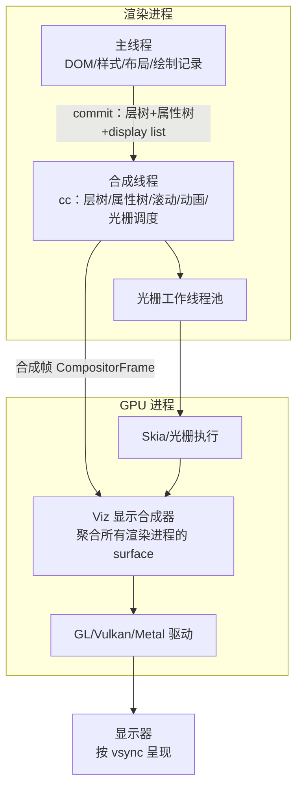
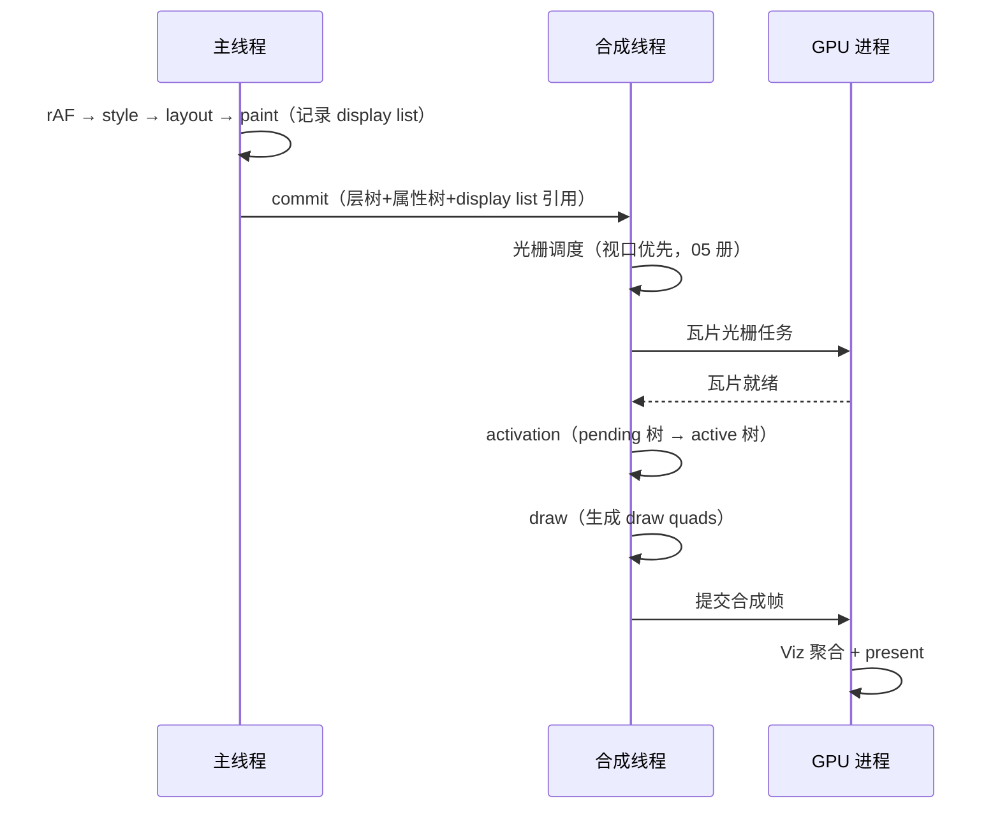

# 合成：合成线程、GPU 与 vsync

> [← 第八阶段导览](01-导览.md) · 时间线 ⑮。display list 记好了、瓦片备好了（05 册），最后一步是把所有层的纹理拼成画面、踩着显示器的节拍送上屏幕——这就是**合成（compositing）**。这一册讲渲染进程的合成线程架构、属性树与合成帧的数据形态、vsync 节拍机制，以及本阶段最重要的性能结论：**滚动与 transform/opacity 动画为什么完全不经过主线程**——主线程死循环时页面为什么还能滚、动画为什么还在跑。

## 1. 合成器架构：线程与进程地图

先把角色摆到地图上（与[第一阶段 03 册](../01-第一阶段/03-浏览器组成-进程线程与站点隔离.md)的进程模型衔接）：



| 角色 | 职责 | 关键点 |
|---|---|---|
| 主线程 | 跑 JS、样式、布局、记录 display list | 卡死不影响合成线程（本册核心结论） |
| 合成线程（impl） | 持有层树副本与属性树；调度光栅；处理滚动/合成器动画；生成合成帧 | 渲染进程内独立于主线程 |
| 光栅线程池 | 执行瓦片光栅（软件路径）/提交 GPU 光栅任务 | 多个，视口优先 |
| GPU 进程 Skia | 执行光栅指令 | 05 册 |
| Viz 显示合成器 | 把**每个渲染进程**（站点隔离下多进程）的合成帧聚合成一帧 | OOP-D 后的架构 |
| 显示器 | 按自身刷新率呈现 | vsync 的最终节拍器 |

要点：**合成线程在渲染进程里，GPU 进程另有显示合成器**——「合成」这个词横跨两层：渲染进程内的 cc 合成（管理层与瓦片）与 GPU 进程的 Viz 合成（跨进程拼帧）。前端语境说「合成线程」指前者。

## 2. 属性树：合成帧的数据骨架

合成器怎么知道「每个层此刻应该出现在哪、裁剪成什么样、透明多少」？靠**属性树（property trees）**——四棵树共享所有层的空间状态：

| 属性树 | 管什么 | 例 |
|---|---|---|
| Transform tree | 平移/缩放/旋转 | transform 动画、滚动偏移 |
| Clip tree | 裁剪矩形 | overflow 裁剪、圆角裁剪 |
| Effect tree | 透明度/滤镜/混合 | opacity 动画、backdrop-filter |
| Scroll tree | 滚动偏移与滚动边界 | 页面滚动、滚动容器嵌套 |

设计动机：一个「页面滚动」状态影响全页所有层——如果每个层各自存一份偏移，滚动就要改 N 个层的属性；挂在**树的一个节点**上，改一处全体生效。transform/opacity 动画同理：动画只更新属性树的一个节点值，引用该节点的所有层自动跟着动。

```text
层（纹理）+ 引用的属性树节点集合 → draw quad（这一块纹理按这些变换/裁剪/效果画出来）
合成帧 = 一组 draw quad 的有序列表 + 引用的属性树状态
```

这就是「移动一个层不需要重记录 display list」（05 册）的完整答案：**层的内容（纹理）与空间状态（属性树）分离**——改状态只动树，改内容才动纹理。

### 2.5 一个嵌套裁剪的例子

属性树最直观的用法是表达「变换叠加 + 裁剪嵌套」——不需要任何层重画：

```html
<div style="transform: scale(0.5); overflow: hidden">   <!-- 外：变换节点 + 裁剪节点 -->
  <div style="transform: translateX(50px)">              <!-- 内：变换节点 -->
                                        <!-- 层：引用内变换 → 外变换 → 外裁剪 -->
  </div>
</div>
```

```text
img 层的 draw quad 引用链（示意）：
  clip(外层 overflow) ← transform(内 translateX 50) ← transform(外 scale 0.5)
  四棵树各取所需组合出「半大、右移、被裁剪」的最终呈现
```

改外层 scale 或内层 translate 都只更新对应树节点——img 纹理一个字节不动。这就是 04 册「缩小包围盒」与 07 册「改 transform 只走合成」的机制底座。

## 3. 一帧的合成路径：从 commit 到 present

主线程与合成线程的交接发生在 **commit**：



| 阶段 | 在谁身上 | 干什么 | 卡了会怎样 |
|---|---|---|---|
| commit | 主线程 → 合成线程 | 提交新状态（层数据/属性树/dl 引用） | 主线程慢 = 新内容晚到 |
| 光栅调度+执行 | 合成线程/光栅线程/GPU | 把指令变成瓦片位图 | 棋盘格（05 册） |
| activation | 合成线程 | 把光栅好的新树切换为「正在用」的树 | 内容更新整体生效的同步点 |
| draw | 合成线程 | 按属性树生成 draw quads | 极快（纯计算），通常不卡 |
| 提交+Viz 聚合 | GPU 进程 | 跨进程拼帧、present | GPU 忙 = 掉帧但主线程无辜 |

三个工程推论：

1. **主线程只负责「产出新状态」**：状态没变化时主线程可以完全不参与帧循环——静态页面挂机时主线程几乎空转，合成线程只在必要时工作；
2. **双缓冲语义**：activation 保证「要么用旧树、要么用新树」，不会出现半新半旧的撕裂——光栅没做完就继续用旧树；
3. **卡顿归属可分**：主线程超支、光栅超支、GPU 超支是三种不同的病（07 册诊断树），地图清楚了才能归因。

### 3.5 一个纯滚动帧的最小路径

「滚动中、无任何 JS 改动」的一帧，主线程全程缺席：

```text
手势/滚轮事件 → 合成线程更新 scroll tree 偏移
  → 按新视口检查瓦片：命中（05 册已光栅） / 缺失（排队光栅）
  → draw：按新偏移生成 quads
  → 提交合成帧 → Viz → present
主线程：无 commit（没有新状态可提交），甚至完全没被唤醒
```

对照「有 JS 改动的一帧」（07 册全景）：多出主线程的 rAF→style→layout→paint→commit 五站。两条路径在 trace 上的区别一目了然——**主线程轨道有没戏份**就是最粗的分诊线。

## 4. vsync：帧的节拍器

屏幕以固定节拍刷新：60Hz = 每 16.6ms 一拍，120Hz = 每 8.3ms 一拍（高刷屏；ProMotion 类自适应刷新率另说）。**vsync（vertical synchronization）**就是这个节拍，浏览器以它为帧调度的时间基准：

```text
每个 vsync 信号（BeginFrame）：
  ├─ 输入事件分发（先处理这帧的输入）
  ├─ 主线程：rAF 回调 → style → layout → paint → commit
  └─ 合成线程：光栅收尾 → activation → draw → 提交 → present
  若 16.6ms 内没走完 → 这一拍用上一帧的画面 = 掉一帧
```

| 概念 | 含义 |
|---|---|
| BeginFrame | 浏览器内部对 vsync 节拍的抽象，驱动整个帧调度 |
| 帧预算 | 16.6ms@60Hz（8.3ms@120Hz）——该帧所有工作的时间上限 |
| 掉帧（dropped frame） | 预算内没完成，屏幕多显示一帧旧画面 |
| 帧流水线并行 | 主线程算第 N+1 帧时，合成线程可以仍在光栅第 N 帧——不是所有工作串行挤在一个 16.6ms 里 |

与事件循环的衔接：第七阶段讲过「事件循环跑完宏任务与微任务后，判断『该渲染吗』」——判断的依据就是 vsync 节拍：**不是每轮循环都渲染，而是渲染对齐到 vsync**。rAF 回调被安排在每个 BeginFrame 的最前面，正是「下一帧要画什么，现在告诉我」的接口。

### 4.5 帧调度：不是每个 vsync 都真的渲染

BeginFrame 是节拍，但浏览器会按需省电：

| 情形 | 调度行为 |
|---|---|
| 页面无任何失效（静态挂机） | 不跑主线程渲染段，合成线程按需出帧 |
| 窗口被完全遮挡 / 最小化 | 帧生产大幅节流甚至暂停 |
| 后台标签页 | rAF 与渲染节流到低频（定时器同样被限流，第七阶段 07 册） |
| 掉帧后 | 下一拍要么补算「上一帧的活」，要么直接放弃旧任务用新输入——避免「永远在追上一帧」 |

最后一行是帧调度器最重要的品格：**宁可显示旧画面，也不把过时的任务串成雪崩**。对应到工程：长任务把主线程占满时，渲染阶段会被一次次顺延（07 册的「掉帧分类」），浏览器不会把两个帧的工作塞进一个 16.6ms 里硬挤。

## 5. 滚动为何不经主线程

本册核心问题的完整答案，链条是三句话：

1. **滚动状态住在合成线程**：滚动偏移是 scroll tree 的一个节点值——改它 = 合成线程改一个数字；
2. **层的内容不用重画**：滚动只是「纹理在属性树里平移」，display list、瓦片全部复用（05 册）；
3. **合成线程有自己的帧循环**：不必等主线程——它可以独立完成「取新偏移 → 生成 quads → 提交 → present」的整条链。

于是得到结论：**主线程死循环（如 `while(1){}`）时，页面照常滚动、CSS transform/opacity 动画照常播放**——它们由合成线程与 GPU 驱动，不依赖主线程。此时会死的：JS 动画（rAF 回调饿死）、hover 效果（主线程算样式）、文本选中、点击跳转——「页面活着但交互死了」正是合成器架构的边界演示。

两个重要的例外（滚动**不是**永远不经主线程）：

| 例外 | 机制 |
|---|---|
| 非 fast-scrollable 区域 | 元素挂了 scroll/touch 监听（非 passive）时，引擎必须把该区域的滚动手势交给主线程确认（可能 preventDefault）——该区域滚动被主线程健康度绑架 |
| passive: true | 「我保证不阻止滚动」的承诺 → 合成器立刻滚动，事件异步再给主线程 |

输入链路的完整细节（hit test、事件路由、passive 语义）在第九阶段 05 册展开；这里先建立坐标：**「滚动卡不卡」首先问「手势区域是不是 fast-scrollable」，其次才是主线程忙不忙**。

### 5.5 主线程死亡实验

```html
<div style="height:5000px">长内容</div>
<div id="box" style="width:100px;height:100px;background:#36c;
     animation: spin 1s linear infinite"></div>
<style>@keyframes spin { to { transform: rotate(360deg); } }</style>
<script>
  // 控制组：注释掉死循环，一切正常
  // 实验组：打开死循环
  // while (true) {}
</script>
```

预期：死循环开启后——方块旋转照常（合成器动画）、页面照常滚动（合成器滚动）、但 hover 无效、点击无响应、`requestAnimationFrame` 不再触发。这是 06 册所有结论的 30 秒验证实验。

## 6. 合成器动画：transform/opacity 的特权

CSS transform/opacity 动画可以由**合成线程驱动**（impl-side animation）：动画的每一帧只是更新属性树节点（transform tree / effect tree），不需要主线程重算任何东西。

| 动画写法 | 谁驱动 | 主线程死了还动吗 |
|---|---|---|
| CSS transition/animation 作用于 transform/opacity | 合成器 | 动 |
| CSS 动画作用于 top/left/width/color | 主线程（每帧 style→layout→paint） | 不动 |
| JS rAF 驱动（改任何属性） | 主线程 | 不动 |
| Web Animations API（transform/opacity） | 可合成器驱动（视实现与条件） | 视情况 |

两个边界要记清：

1. **启动仍要主线程**：创建 CSS 动画、匹配选择器、确定初始值，都需要主线程算一次样式——「启动时主线程卡，动画迟迟开不了」合理；「启动后主线程卡，动画照跑」也合理——一次启动、逐帧免主线程，正是合成器动画的价值；
2. **主线程断供的更新**：如果 JS 在动画中途改了元素类名/内容，主线程参与的那一次更新要等主线程空闲——合成器动画管「从 A 到 B 的插值」，管不了「A/B 本身变了」。

`gui/` 站对照：自绘框架把动画跑在主线程（帧循环 + tick 回调），因为教学框架没有独立的合成线程——这正是「浏览器为什么要合成器而框架不需要」的结构性答案（导览自测题 7 的落点）。

### 6.5 动画 API 的驱动归属速查

| API | 驱动方 | 主线程死亡时 |
|---|---|---|
| CSS `transition`（transform/opacity/filter） | 合成器 | 继续动 |
| CSS `@keyframes`（transform/opacity/filter） | 合成器 | 继续动 |
| CSS 动画（top/left/width/color…） | 主线程 | 停在当前帧 |
| Web Animations API（可合成属性） | 合成器（满足条件时） | 继续动 |
| `requestAnimationFrame` 回调 | 主线程 | 不再触发 |
| JS 改样式实现动画 | 主线程 | 停 |
| video 播放（自渲染内容） | 媒体管线+合成器 | 继续放（无 JS 参与时） |

表格里的分界线只有一条：**逐帧插值需不需要主线程算**。需要 → 主线程死了就停；不需要 → 合成器/GPU 独立完成。

## 7. 实验

1. **主线程死亡实验**：§5.5 的最小页面，逐一验证「旋转/滚动活着、hover/rAF 死了」。Performance 面板同步录制：主线程一条长任务贯穿始终，合成线程轨道照常出帧——两轨道对比就是本册架构图的行为版。
2. **FPS 观测**：Rendering 面板开 Frame Rendering Stats（或 FPS meter），分别在 60Hz 与高刷屏（若有）上读帧率与帧耗时——vsync 节拍的直接观测。
3. **掉帧定位**：录一段包含明显卡顿的滚动/动画，切到 Performance 的 Frames 轨道，找出红色/黄色的掉帧块，放大对应时间点看主线程与合成线程各在干什么（07 册把这套流程标准化）。
4. **合成器动画 vs 主线程动画对照**：同一元素分别做 `transform: translate` 动画与 `top` 动画，录 trace 对比 Main 轨道负载——前者主线程几乎无声，后者每帧 style+layout+paint 的锯齿。

```html
<!-- 对照组 A：transform（合成器路径） -->
<div id="a" style="width:100px;height:100px;background:#36c;
     animation: slide 2s linear infinite alternate"></div>
<style>@keyframes slide { to { transform: translateX(300px); } }</style>
<!-- 实验组 B：top（主线程路径），动画期间录 trace 对比 Main 轨道 -->
<div id="b" style="position:relative;width:100px;height:100px;background:#c63;
     animation: slideTop 2s linear infinite alternate"></div>
<style>@keyframes slideTop { to { top: 300px; } }</style>
```
5. **非 passive 监听阻塞滚动**：在页面上给大区域挂 `addEventListener('wheel', e => { /* 空函数 */ })`（默认非 passive），先在 handler 里造 200ms 延迟同步块，滚动该区域——手感明显迟滞（滚动等主线程）；改 `passive: true` 后恢复跟手。这就是 fast-scrollable 边界的可复现实验。
6. **静态页面的主线程水位**：打开一个无动画、无脚本的静态页，录 5 秒 trace——主线程近乎空转、帧照常呈现（合成线程按需工作）。「渲染 ≠ 每帧都有主线程工作」的实证。

## 8. 常见误区

1. **「合成线程不干活，GPU 才干活」**：合成线程干重活——光栅调度、滚动/动画状态更新、生成 quads；GPU 进程执行光栅与拼帧。两者分工（§1 地图），不是谁包办。
2. **「掉帧 = 主线程卡」**：光栅超支（棋盘格顺延）、GPU 超支、主线程超支是三种病；主线程空闲时照样可能掉帧（05 册的归因树）。
3. **「transform 动画永不碰主线程」**：启动要主线程（样式计算 + 动画创建）；JS rAF 驱动的「transform 动画」每帧都要主线程——只有 **CSS/WAAPI 驱动的合成器动画**才享受特权。
4. **「vsync 是浏览器的软件定时器」**：它来自显示器刷新（硬件节拍），浏览器只是把帧调度对齐到它——改浏览器设置不会改变 60Hz 屏幕的 16.6ms。
5. **「合成器动画 = 白嫖性能」**：它省的是主线程与重绘，不是零成本——属性树更新、quads 生成、GPU 合成照跑；大面积全屏 transform 动画照样可能压垮光栅/GPU 预算。
5. **「滚动流畅 = 性能好」**：主线程死锁时滚动照样流畅（§5）——滚动只证明合成器健康；交互响应（INP）要另测（09 阶段），两者是独立的健康指标。
6. **「commit 每帧都会发生」**：主线程没有新状态（无 JS 改动、无样式失效）时不必 commit；合成器可继续用既有属性树做动画/滚动——「只有合成器在动」的帧没有主线程戏份。
7. **「passive 只是优化建议」**：它是**行为契约**——声明了就不可能 preventDefault 滚动，违反意图的代码（想阻止滚动却标了 passive）直接失效；语义优先于性能。

### 8.5 常见问答

**Q：主线程卡 500ms，这 500ms 里合成线程出了多少帧？**
取决于有没有合成器可干的活：有进行中的合成器动画/滚动 → 按 vsync 节拍持续出帧（Frames 轨道照常）；什么都没有 → 不必出帧，屏幕维持旧画面。所以「主线程卡顿期间画面定格」与「动画依旧流畅」都可能出现——取决于那一时刻有没有合成器任务。

**Q：rAF 回调里读 offsetHeight 会怎样？**
回调执行时布局还是干净的（上一帧算过），读得便宜；但如果回调**先写样式再读**，读就强制布局——rAF 不是 thrashing 的豁免区，读写分离纪律在 rAF 里同样适用（03 册 §8.5 第一问的展开）。

**Q：为什么有的动画掉帧、有的动画只是「延迟开始」？**
启动延迟 = 主线程忙（创建动画要样式计算）；运行掉帧 = 光栅/GPU/合成预算不足。trace 上前者是「动画事件迟迟不出现」，后者是「动画事件有、帧块标黄/红」——两种病因两种药。

## 9. 自测题

1. 画出渲染进程与 GPU 进程的合成架构图，标出 commit、光栅、activation、draw、present 各站的位置。
2. 属性树有哪四棵？「页面滚动影响全页所有层」为什么只改一个节点？层与属性树怎么组合成 draw quad？
3. commit 与 activation 分别解决什么问题？双缓冲语义指什么？
4. 16.6ms 帧预算怎么算？120Hz 时呢？掉帧的定义？「主线程算下一帧、合成线程光栅上一帧」说明帧流水线的什么性质？
5. 完整说出「滚动不经主线程」的三句话链条。哪两个例外会让滚动被主线程绑架？
6. 主线程死循环时什么活着、什么死了？逐项说明归谁管（§5.5 实验）。
7. 合成器动画的启动与运行分别在哪？为什么 rAF 驱动的 transform 动画不享受特权？
8. vsync 与事件循环的「该渲染吗」判断怎么衔接？rAF 为什么排在 BeginFrame 最前面？
9. Viz 显示合成器在哪个进程、聚合什么？站点隔离下「一帧」由几份 surface 组成？
10. 「只有合成器在动的帧」主线程有戏份吗？commit 的触发条件是什么？
11. BeginFrame 在哪些情形下被节流或暂停？掉帧后调度器的两个选择（补算/放弃）各自的取向？
12. 用属性树解释「给祖先加 scale(0.5)，子元素纹理为什么不重画」？这与 04 册「包围盒缩小」是什么关系？

## 10. 自查清单

| # | 检查 | 工具 | 异常指向 |
|---|---|---|---|
| 1 | 滚动手势区域是否 fast-scrollable？ | Rendering/trace：滚动时主线程是否被迫参与 | 非 passive 监听 = 滚动被绑（09 阶段治理） |
| 2 | 动画是否走 CSS/WAAPI 合成器路径？ | trace：Main 轨道有无每帧锯齿 | rAF 改样式 = 主线程动画，换 CSS 动画 |
| 3 | 掉帧归因到了哪条轨道？ | Performance Frames + Main/GPU 轨道 | 没归因就优化 = 盲开药方 |
| 4 | 常驻无限动画有没有？ | 代码审查 + Layers 面板 | 合成器动画也是功耗（纹理常驻），不可见时暂停 |
| 5 | 高刷屏（120Hz）下预算减半的应对？ | Frame Rendering Stats | 60Hz 调好的动画 8.3ms 预算下重测 |
| 6 | 页面不可见时有没有停掉常驻动画？ | document.visibilityState + 代码审查 | 后台标签烧电 = 用户不可见还在跑 |
| 7 | 死循环场景的预期行为是否验证过？ | §5.5 实验 | 「页面活着但交互死了」的边界要亲眼见过 |

## 11. 延伸

- 下一册：[07-一帧的完整生命周期-失效传播与帧预算](07-一帧的完整生命周期-失效传播与帧预算.md)——把前五册的各站拼成一帧的全景：一次 JS 修改到像素的失效传播分诊表、16.6ms 预算的分配、trace 逐段对照。
- 事件循环中渲染的位置与 rAF 的确切坐标：[第七阶段导览](../07-第七阶段/01-导览.md)；输入事件链路与 passive 的完整语义：第九阶段（05 册，[阶段入口](../09-第九阶段/01-导览.md)）。
- 光栅与瓦片细节：[05-绘制与栅格化-display list-瓦片与Skia](<05-绘制与栅格化-display list-瓦片与Skia.md>)；进程线程背景：[第一阶段 03 册](../01-第一阶段/03-浏览器组成-进程线程与站点隔离.md)。
