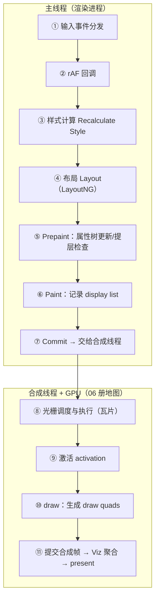
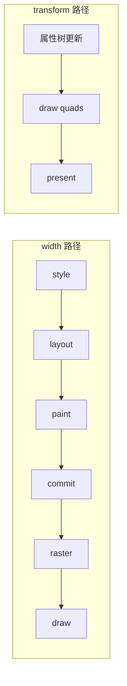
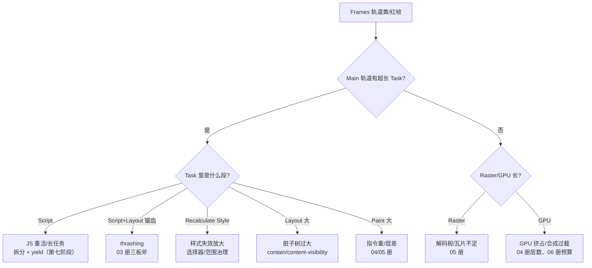

# 一帧的完整生命周期：失效传播与帧预算

> [← 第八阶段导览](01-导览.md) · 时间线 ⑮。前五册把管线各站拆开讲了，这一册把它们拼回一帧：一次 JS 修改出发，失效怎么沿「样式 → 布局 → 绘制 → 合成」分诊与传播；16.6ms 帧预算怎么切分、超支了谁买单；Performance trace 的每个事件名怎么对照到流水线的每一站。读完本册，「对着 trace 把一帧从 JS 改动到像素的每一站指出来」（导览阶段目标 6）应当是肌肉记忆。

## 1. 全景流水线：一帧的两条生产线



| 站 | 产物 | 展开册 |
|---|---|---|
| ①② 输入与 rAF | 本帧要做的回调清单 | 第七阶段（事件循环）；输入链路在第九阶段 05 册 |
| ③ 样式计算 | ComputedStyle（增量） | 第七阶段 05 册 |
| ④ 布局 | fragment 树（脏子树增量） | 02/03 册 |
| ⑤ Prepaint | 属性树快照、提层决定 | 04 册 |
| ⑥ Paint | display list（受影响层） | 05 册 |
| ⑦~⑪ 合成段 | 瓦片位图 → 合成帧 → 上屏 | 05/06 册 |

**两条生产线的并行**：主线程可以已经在算下一帧（①~⑦），合成线程还在光栅上一帧（⑧~⑪）——帧预算的讨论（§4）必须建立在「不是所有站串行挤一个 16.6ms」这个前提上。

### 1.5 为什么要拆成两条生产线

如果整条管线都在主线程：JS 卡 = 滚动卡 = 动画卡 = 一切卡，用户对「卡」的唯一体验就是「整个页面死了」。拆出合成线程（06 册）后，**「内容更新慢」与「画面运动流畅」解耦**：主线程慢只影响前者，滚动/合成器动画照跑。这个解耦是浏览器渲染架构最重要的一条工程决策，也是本阶段所有「为什么快/为什么还动」问题的总答案。

## 2. 失效传播：一次 JS 修改的分诊

JS 改 DOM/样式后，浏览器做的第一件事是**分诊**：这次改动牵连管线哪几站？分诊表（对应社区维护的 CSS Triggers 类资料，属性归属以引擎实现为准，取向一致）：

| 改动 | 样式 | 布局 | 绘制 | 合成 | 传播链 |
|---|---|---|---|---|---|
| width / height / font-size / padding | 是 | **是** | 是 | 是 | 全链 |
| top / left（非 fixed） | 是 | 是 | 是 | 是 | 全链（这正是动画用几何属性的代价） |
| color / background-color | 是 | 否 | 是 | 是 | 到绘制止 |
| box-shadow / border-radius / 背景 | 是 | 否 | 是 | 是 | 到绘制止 |
| background-image（新图） | 是 | 否 | 是 + 解码 | 是 | 绘制 + 解解码税（05 册） |
| transform（已提升） | 是 | 否 | 否 | **是** | 只到合成（属性树） |
| opacity（已提升） | 是 | 否 | 否 | **是** | 只到合成 |
| transform（未提升） | 是 | 否 | 该层重绘 | 是 | 半程 |
| visibility / display | 是 | **可能全链重建**（02 册） | 是 | 是 | 视情形 |

分诊的记忆法：**「改了几何 → 布局跑不了；改了颜色/背景 → 布局免了；只改 transform/opacity（且已提升）→ 布局绘制全免」**。优化的本质是**把改动降级到更便宜的失效类型**：能用 transform 就不用 top/left，能只改颜色就别动尺寸。

### 2.5 失效范围：即使进布局，也不一定全页

分诊表回答「走哪几站」，**范围**回答「每站重算多少」：

| 站 | 失效范围的粒度 | 缩小范围的手段 |
|---|---|---|
| 样式 | 受影响节点的集合（规则匹配反推，可能因后代/兄弟选择器放大） | 选择器写窄（第七阶段 05 册）；@scope（09 阶段） |
| 布局 | 脏子树（布局根以下） | contain: layout；content-visibility: auto（09 阶段 06 册） |
| 绘制 | 受影响 PaintLayer（05 册） | contain: paint；合理分层（04 册） |
| 合成 | 属性树节点/受影响 quads | 已经是最细粒度 |

| 粒度反例 | 说明 |
|---|---|
| 改根节点 font-size | 样式失效 + 布局失效传播全树 ≈ 全量 |
| 改 body 类名触发全局主题 | 样式重算范围 = 匹配该选择器的所有节点 |
| 移动祖先的 transform | 只更新属性树一个节点（不进布局）——同样是「祖先级改动」，失效类型天差地别 |

「祖先级改动」不是天然贵：改祖先的**几何**贵（布局沿子孙传播），改祖先的**变换/透明度**便宜（属性树一个节点）。给容器动画做选型时优先问「这个属性挂在属性树哪棵上」。

三个手段一以贯之：**把失效钉死在小范围里**。thrashing（03 册）治理的是频率，本节治理的是范围，分诊表治理的是类型——频率 × 范围 × 类型三个轴共同决定一帧的成本。

### 2.6 失效的登记与合并：一帧只算一次账

失效不是「改一次算一次」，而是**登记 → 合并 → 统一结算**：

```text
JS 在同一帧里改了 10 个节点的样式
  → 10 次失效登记（节点脏位 + 哪类失效的位掩码）
  → 渲染阶段到来：把所有登记合并成一次 style → layout → paint
  → 一帧只算一笔总账
```

两个推论：

1. **多次改动天然合并**：同一帧改 width 再改 color，结算时按「需要布局 + 需要绘制」的最高需求走一遍——不需要两遍；真正贵的是**跨帧**的反复改动（动画语义）与**帧内读写交错**（thrashing，强制把合并好的账提前结算 N 次）；
2. **位掩码分诊**：每个节点记录的是「self/layout/paint/…脏」的位组合，结算时按最高失效位走管线——这就是分诊表在引擎内的实现形态。

## 3. 三条路径对照：同一个「变大」的三种走法

让一个元素变大，三种写法走完全不同的管线：

| 写法 | 每帧经过 | 主线程成本 | 合成/GPU 成本 |
|---|---|---|---|
| JS rAF 改 `width` | style → layout → paint → commit → 光栅 | 高（全链，且 thrashing 风险） | 高（重栅格） |
| CSS transition `width` | 同上（每帧由引擎改 width） | 高 | 高 |
| CSS transition `transform: scale` | 更新属性树 → draw quads | 几乎为零 | 低（纹理缩放） |



注：transform 的 scale 会拉伸已有纹理（模糊感知）——要「重画得更清晰」需要重栅格化，引擎会在动画稳定后处理；**动与清晰是两个目标**，动画期间优先动。

还有一个隐藏差异：width 变化会**牵连布局邻居**（父级、兄弟、行内的文本环绕都要跟着算），scale 变化的牵连是零——「改动影响别人吗」也是分诊的一部分，width 的传播链贵就贵在这份牵连上。

再补一层 API 级的差异：「JS rAF 改 width」比「CSS transition width」多一份人为风险——rAF 回调是主线程任务，回调里读写交错就是 thrashing（03 册），CSS 动画的引擎侧插值至少避开了这个坑。能用 CSS 表达的动画别用 JS 表达，这是分诊表在 API 选择上的推论。

## 4. 16.6ms 帧预算

60Hz 屏幕：1000ms ÷ 60 ≈ **16.6ms/帧**（120Hz：8.3ms）。预算的意义：这一帧所有工作（含 JS）必须在此完成，否则掉帧。一个交互帧的预算切分（示意量级，用 Performance 实测校准你的页面）：

| 段 | 预算（示意） | 超支的典型原因 |
|---|---|---|
| 输入分发 + rAF 回调 | ≤ 5ms（长任务红线 50ms 的零头） | 回调里做重活、读写交错 |
| 样式计算 | 1~2ms | 全量重算（选择器放大） |
| 布局 | 2~4ms | 大脏子树、复杂 FC（Grid 迭代） |
| Prepaint + Paint | 2~4ms | 指令重（阴影/滤镜）、层结构差 |
| commit | < 1ms | 层数巨大时上升 |
| 光栅（并行） | 与主线程并行，视口优先 | 大图解码、棋盘格顺延 |
| draw + 提交 | 1~2ms | 层多 quads 多 |

四个必记的推论：

1. **JS 与渲染共享同一个预算**：rAF 回调吃掉 12ms，渲染只剩 4ms——「JS 快不快」从来不是独立指标，是帧预算的分配问题；
2. **超支是顺延不是压缩**：本帧没算完，下一帧用旧画面（掉帧），浏览器不会把两帧的活硬塞进一个预算（06 册 §4.5）；
3. **掉一帧难感知，连续掉帧才叫卡**：60Hz 下偶尔 20ms 的帧用户无感；连续 3~4 帧超支（>66ms 量级）才进入「能看见」的区间——优化目标不是每帧 16ms 完美，而是**消灭连续超支**；
4. **预算归属可分**：主线程超支（Script/Style/Layout/Paint 段长）、光栅超支（Raster 长/棋盘格）、GPU 超支（GPU 轨道忙）三种病三种药（§6）。

### 4.5 长任务与预算的关系

第七阶段的长任务判定（>50ms）在本册的坐标：**一个长任务 ≈ 跨掉 3 帧**（50/16.6 量级）——它不只是「慢」，是直接把这几帧的渲染机会全部挤掉。拆分手段（yield 模式、scheduler.postTask、把重活挪 worker）不是「让代码更快」，是**把工作切碎，给每帧的渲染段留出预算**。目标帧率越高（120Hz），对长任务越敏感：8.3ms 预算下，>25ms 的任务就跨 3 帧。

## 5. trace 逐段对照：事件名 ↔ 流水线站

Performance 面板（Main 轨道 + 各线程轨道）的事件名与流水线站的对照表——事件名随版本略有差异，语义稳定：

| trace 事件 | 流水线站 | 轨道 |
|---|---|---|
| Task（含 Script） | ①② JS 执行（含 rAF 回调） | Main |
| Recalculate Style | ③ 样式计算 | Main |
| Layout | ④ 布局（详情含受影响对象数） | Main |
| Prepaint / Update Layer Tree（旧名） | ⑤ 属性树与提层 | Main |
| Paint（+ Paint Profiler） | ⑥ display list 记录 | Main |
| Commit | ⑦ 主线程→合成线程交接 | Main/合成线程 |
| Rasterize Paint / Raster | ⑧ 瓦片光栅 | Raster 线程 / GPU |
| Activate Layers | ⑨ 激活 | 合成线程 |
| draw / Composite Layers（旧名） | ⑩ 生成 quads | 合成线程 |
| GPU 轨道各项 | ⑪ Skia/Viz 执行与 present | GPU 进程 |
| ImageDecodeTask | 光栅前的图片解码 | Raster/GPU |
| Frames 轨道帧块 | 每帧的边界与状态 | 专用轨道 |

**Frames 轨道的读法**：帧块颜色指示状态（绿/浅色 = 正常；黄 = 帧耗时偏高；红 = 掉帧）——黄红帧就是本册的「案发现场」，放大后按 §5 的表逐站找占大头的事件。

现场指纹速查表（看到什么 → 指向什么）：

| trace 现场 | 指纹 | 归属 |
|---|---|---|
| 强制同步布局 | 一行 Task 里 Script 与紫色 Layout 锯齿交替；Bottom-Up 里 Layout 的调用方是 Script | 03 册 |
| 长任务 | Main 轨道 >50ms 的 Task 块（红色角标） | 第七阶段 yield 模式 |
| 掉帧 | Frames 轨道黄/红块；对应时刻主线程或 GPU 有超长段 | 本册 §6.5 |
| 棋盘格顺延 | Raster 段后帧内容延迟更新、Raster 线程排队深 | 05 册 |
| GPU 超支 | GPU 轨道连续繁忙、Main 空闲 | 04 册层数 / 06 册预算 |
| 样式失效放大 | Recalculate Style 时长与节点数远超改动范围 | 第七阶段 05 册选择器治理 |

## 6. 一次点击到像素的完整走查（案例）

场景：点击按钮，把卡片宽度从 200px 改到 400px（transition width 300ms）。

| 时刻（示意） | 发生什么 | trace 事件 |
|---|---|---|
| t=0 | 点击事件入队，等待主线程 | Task |
| t=0~1ms | click 回调执行，改 class | Task（Script） |
| t=1~3ms | 样式失效重算（按钮 + 卡片子树） | Recalculate Style |
| t=3~6ms | 布局重算（卡片 + 受影响兄弟/父级） | Layout |
| t=6~8ms | 属性树/提层检查 + 记录受影响层 | Prepaint + Paint |
| t=8ms | commit 给合成线程 | Commit |
| t=8~15ms | 新尺寸卡片栅格化（视口优先） | Rasterize Paint |
| t≈16ms | 激活 + draw + 提交 → present | Activate/draw/GPU |
| 后续 299ms | 每帧重复 3~9ms 各段（transition 逐帧插值 width） | 同上循环 |

同场景换 `transform: scaleX`：t=0~1ms 后直接 commit 属性树变化，每帧只有合成段——这就是分诊表（§2）的行为化。**同一个 UI 目标，两条 trace 的形状天差地别**，对比录制一遍胜过十遍口诀。

### 6.5 长帧诊断决策树



### 6.6 交互帧与滚动帧的对照收束

把 06 册的「纯滚动帧」与本册的「交互帧」并排放——两条路径的分界是本阶段的总图：

| 维度 | 纯滚动帧 | 交互帧（点击改 width） |
|---|---|---|
| 主线程 | 通常缺席（除非滚动区域非 fast-scrollable） | 必须（Script→Style→Layout→Paint→Commit） |
| 合成线程 | 更新 scroll 树 → draw → 提交 | commit 接力 + 光栅 + 激活 + draw |
| 瓦片 | 复用为主，缺了现做 | 改动区域重栅格 |
| 可并行性 | 全程不依赖主线程 | 主线程段完成后合成段才能接力 |
| 指标影响 | 滚动流畅度（FPS） | INP 三段中的「处理 + 呈现延迟」（09 阶段） |

`gui/` 站的对照收束：自绘框架有「脏控件 + 局部重绘 + 帧循环」（同构于 ②~⑦ 的失效模型），但**没有合成线程**——它的输入、布局、绘制、提交全在一个线程里，主线程卡死时框架渲染全停。浏览器多出来的合成线程与 GPU 进程，正是「平台级」与「框架级」渲染调度的结构性差异。

## 7. 实验

1. **录一帧、命名每一站**：做一个点击改宽度的页面（§6 案例），Performance 录制单次点击后 100ms，放大首个帧块，把 ①~⑪ 各站的事件名逐个指出来——本册的验收实验。
2. **三条路径对照**：`width` / `transform: scaleX` / JS rAF 改 width 三版各录一次，对齐帧块对比 Main 轨道形状——分诊表的肌肉记忆版。
3. **掉帧归因**：人为造一个 80ms 的 Script 长任务叠在动画上，Frames 轨道找红帧，按 §6.5 决策树走到叶节点，写下「病因段 + 归属册」。
4. **强制布局指纹**：03 册的 thrashing 代码在本册 trace 上复看——Task 内 Script/Layout 锯齿；再用批量读写改造版对照。
5. **解码税观测**：滚动进大图页面，找 ImageDecodeTask 与同帧 Raster 时长的关系——「光栅超支」的现场。
6. **Frame Rendering Stats 常开**：日常开发开着这个 HUD（帧耗时数字），任何改动后瞄一眼峰值——把帧预算意识变成习惯。
7. **失效合并验证**：一个任务里连续改 3 个不同节点的 3 个属性（同帧），录 trace——渲染段只有一组 Style/Layout；再改成「每改一个就读一次 offsetHeight」，对比布局次数——失效合并被读写交错打碎的现场。
8. **预算下限验证**：把动画元素从 1 个复制到 50 个（都是 transform 动画），录 trace 对比 draw/GPU 段——合成器动画「免费」是相对主线程说的，quads 数量增长的真实成本在这里现形。

## 8. 常见误区

1. **「rAF 里改样式，当帧像素一定上屏」**：rAF 的改动会在**紧接着的渲染阶段**处理（③~⑦），但 ⑧~⑪ 若超出本帧预算，像素顺延到下一拍才出现——rAF 保证「不跳帧地安排工作」，不保证「当帧完工」。
2. **「掉帧 = 卡顿 = 必须修」**：孤立的单帧超支几乎无感；要修的是**连续**超支与其背后的长任务/大失效——先量化连续性再谈优化。
3. **「优化 = 每段都更快」**：顺序错了。先**降级失效类型**（分诊表）、再**缩小失效范围**（contain/分层）、最后才是单段加速——方向反了会花大力气换小收益。
4. **「transform 动画永远零主线程」**：启动、中途改内容、JS 驱动都要主线程；未提升的元素改 transform 还会带重绘——「零主线程」是已提升 + CSS/WAAPI 驱动 + 内容不变三个条件的组合。
5. **「16.6ms 是给 JS 的预算」**：是给整条管线（含 JS）的预算——JS 独大时渲染段被挤压，JS 全免时合成段也可能超支（GPU 忙）。预算意识必须覆盖两条生产线。
6. **「trace 事件名与教科书一致」**：事件名随版本变化（Update Layer Tree → Prepaint、Composite Layers → draw），**按语义对照流水线站**，别背事件名。
7. **「样式计算只在页面加载时发生」**：任何类名/属性变化都触发增量样式计算——它是每帧渲染的第一站，不是一次性成本（第七阶段 05 册的工程优化全为它服务）。

### 8.5 常见问答

**Q：帧预算超了，浏览器会砍掉哪些工作来救帧？**
优先级从低到高大致是：远视口瓦片的光栅（直接不做了，棋盘格）、低优先级光栅任务顺延、再到主线程段（没算完就整体顺延到下一帧——不会砍一半样式留着半旧半新）。也就是说主线程的渲染段是原子的：要么本帧完整走完 ①~⑦，要么整段顺延——这也是「掉帧往往成串出现」的原因。

**Q：为什么有时 trace 里同一帧出现两次 Layout？**
两次布局 = 两次「布局脏 → 被读/被 commit 触发结算」：典型是 rAF 里先写样式、又读了几何 API（强制布局），渲染阶段又结算一次。看到双 Layout 先查帧内读写交错，而不是怀疑引擎。

**Q：浏览器怎么知道「我该开始渲染了」？**
失效登记 + vsync 节拍双条件：有失效 → 这一拍「该渲染」成立；没失效 → 这一拍不跑渲染段（06 册 §4.5）。所以空转页面既没有 Recalculate Style 也没有 Layout——trace 干净是正常的，不是引擎「漏了」。

**Q：怎么确认我的优化「真的改变了失效类型」？**
优化前后各录一段同操作的 trace，对照分诊表看缺了哪些事件：从全链变到无 Layout = 类型降级成功；从无变化到无变化 = 白改。**用事件消失验证降级**，比看总时长更直接。

**Q：一帧里 rAF、样式、布局的顺序可以调换吗？**
不可以——顺序由数据依赖决定：样式算完才知道布局的输入，布局算完才有几何可画。能调的是「把工作挪出这条链」：重 JS 挪 worker、低优先级挪 idle 回调、渲染无关计算节流——改顺序不行，改工作分布可以。

## 9. 自测题

1. 画出一条帧的两条生产线（主线程 ①~⑦、合成段 ⑧~⑪），每站写产物名与对应册。
2. 分诊表的记忆法是什么？「改 width」与「改 color」的传播链差在哪几站？「改已提升元素的 transform」走到哪站为止？
3. 失效的「类型、范围、频率」三个轴各由什么治理手段压缩？thrashing 治理的是哪个轴？
4. 16.6ms 预算的四个推论？为什么「每帧完美 16ms」不是优化目标？
5. trace 事件与流水线站的对照：Recalculate Style/Layout/Prepaint/Paint/Commit/Rasterize Paint/Activate 各对应哪站？Events 轨道里 ImageDecodeTask 说明什么？
6. Frames 轨道黄帧与红帧的含义？拿到一个红帧后的第一步是什么？
7. 复述 §6 案例：点击改 width 的一帧按时间顺序发生了什么（至少 8 步，带 trace 事件名）？换成 transform 后哪几步消失了？
8. 强制同步布局在 trace 上的指纹？它与「渲染阶段的正常布局」在时序上的本质区别？
9. 为什么「transform 动画零主线程」有三个前提条件？缺一个各会发生什么？
10. 两条生产线的并行意味着什么？「主线程在算下一帧、合成线程在光栅上一帧」对帧预算讨论为什么重要？
11. 本阶段与 `gui/` 站的对照总结：脏标记+局部重绘的同构与「浏览器为什么需要合成器」的结构性差异？（导览自测题 10 的收束。）
12. 失效「登记→合并→结算」模型下，同一帧改 3 个节点的样式为什么只算一笔账？什么行为会把它打碎成 N 笔？
13. 「祖先级改动天然贵」错在哪？改祖先几何与改祖先变换的失效链差在哪？
14. 帧预算超支时浏览器按什么优先级砍/顺延工作？为什么「掉帧往往成串出现」？

## 10. 自查清单

| # | 检查 | 工具 | 异常指向 |
|---|---|---|---|
| 1 | 高频改动的属性处于分诊表哪一行？ | 代码审查 + 本册表 | 全链行 = 先降级到 transform/opacity |
| 2 | 连续超支的帧在哪里？ | Frames 轨道 | 黄/红连续块 = 定位案发现场 |
| 3 | 超支段的归属（Main/Raster/GPU）？ | §6.5 决策树 | 没走决策树就优化 = 盲目 |
| 4 | 一帧能完整说出 ①~⑪ 吗？ | 本册验收实验 | 说不出 = 回前五册补对应站 |
| 5 | 长任务（>50ms）有没有拆分计划？ | Performance 长任务角标 | 第七阶段 yield 模式 |
| 6 | 动画启动是否也有主线程成本意识？ | trace 动画事件起点 | 启动尖峰 = 提层/样式成本（04 册） |
| 7 | 优化效果用「事件消失」验证了吗？ | 优化前后 trace 对照 | 只看总时长 = 可能只是机器快慢差异 |
| 8 | 主题/根字号类祖先级改动是否限频？ | 代码审查 | 全树失效要节流合并（§2.6） |
| 9 | 动画是否全部能用 CSS 表达？ | 代码审查 | rAF 手写插值 = 多一份 thrashing 风险（§3） |
| 10 | 本阶段六册的知识有没有串成一条帧链？ | 本册 §1 全景 + 各册自查清单 | 有一站说不清 = 回那一册补 |

## 11. 延伸

- 下一阶段：[第九阶段导览](../09-第九阶段/01-导览.md)——从「能渲染」到「渲染得好」：关键渲染路径与首屏（02 册）、指标测量原理（03 册）、输入交互链路（05 册：本册 ① 输入站的完整展开）、content-visibility 与 contain 的管线级裁剪（06 册，本册 §2.5 的续篇）。
- 本阶段回顾：[02 册四棵树](02-渲染树与LayoutNG-fragment树.md) · [03 册布局与抖动](03-布局-盒模型-格式化上下文与布局抖动.md) · [04 册分层](04-分层-PaintLayer-合成层与层爆炸.md) · [05 册绘制栅格化](<05-绘制与栅格化-display list-瓦片与Skia.md>) · [06 册合成与 vsync](06-合成-合成线程-GPU与vsync.md)。
- 渲染类案例复盘（抖动治理、层爆炸、INP 定位）在第十阶段 04 册；`gui/` 站：脏标记与帧循环的亲手版。
