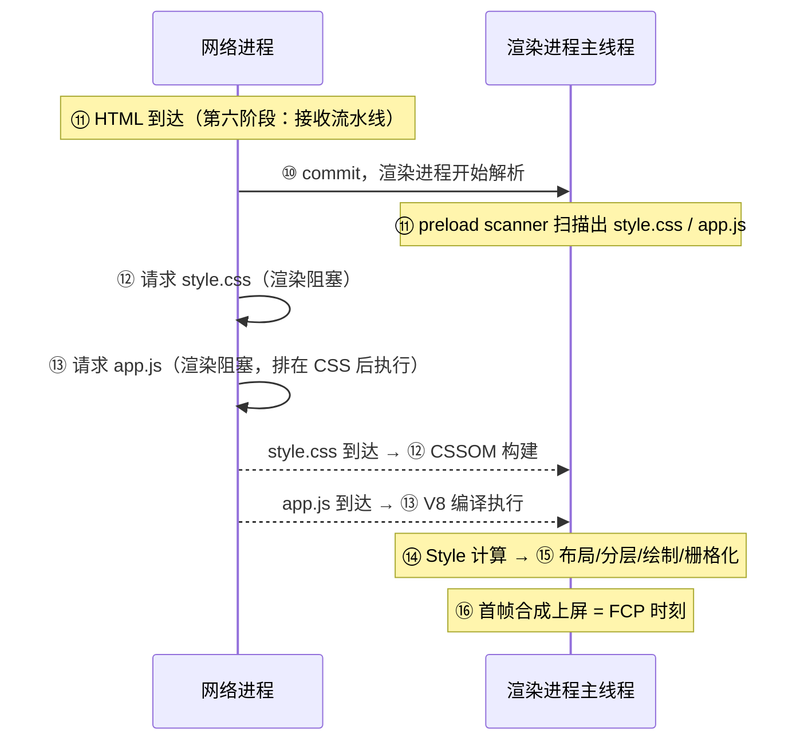

# 关键渲染路径与首屏呈现

> [← 第九阶段导览](01-导览.md) · 时间线 ⑯。⑪~⑮ 把字节变成了像素能力，但「第一次真正画上屏幕」还差最后一道门：DOM、CSSOM、阻塞脚本三者必须同时就绪。这道门什么时候开，就是白屏的时长；门开之后先画什么，决定了 FCP/LCP。这一册把关键渲染路径（CRP）给出精确定义，解剖白屏/FOUC/字体闪烁三类经典现场，然后给出「关键 CSS 内联」与 font-display 这两件最常用的武器。

## 1. CRP 的精确定义：首帧渲染的前置条件

「关键渲染路径」（Critical Rendering Path, CRP）不是玄学口号，它有可操作的判定条件。浏览器**第一次非空绘制**（first non-empty paint）发生前，下面三件事必须全部完成：

| 前置条件 | 精确含义 | 谁拖慢它 |
|---|---|---|
| **DOM 就绪** | 至少视口内内容解析完成；被同步 JS 阻塞的部分在 JS 执行完前不可用 | 同步 `<script>`（第七阶段 03 册的解析阻塞） |
| **CSSOM 就绪** | 所有**渲染阻塞 CSS**（非 `media` 排除、非 disabled 的样式表）下载并解析完 | head 里的慢 CSS |
| **阻塞脚本执行完** | 同步 JS 在其执行点前所有 CSS 就绪后执行；defer/module 不在此列但执行也计入首次渲染前 | head 同步脚本、大体积 bundle |

三个条件的措辞都有讲究：

1. **「CSS 阻塞渲染」而非「CSS 阻塞 DOM 解析」**——CSS 不挡 HTML 解析（preload scanner 与解析器照常走），挡的是**渲染**。例外：`<script>` 若同步执行，会反过来等它前面的 CSS 就绪（脚本可能查询样式）——「CSS 在前、JS 在后」的经典规则根源在这里。
2. **「media 属性可以豁免」**——`<link rel=stylesheet media="print">` 不参与首屏渲染阻塞（打印时才生效），但仍然会下载。
3. **「不是整个 DOM」**——规范语义上首次渲染需要的是首帧所需的渲染树；实践中「视口内 DOM + 全部渲染阻塞 CSS」是安全近似。

一句话总结：**首屏时间 = max(关键 CSS 到位, 首个阻塞脚本执行完)，再叠加其后一帧渲染的固定开销**。三者谁晚到谁说了算——这是所有首屏优化的第一性原理。

### 1.5 首屏瀑布复盘：⑪→⑯ 的完整账目

把第七、八阶段的账并到一张时间线里（量级示意，RTT=50ms、带宽充裕的本地环境；弱网各段乘上真实的网络延迟）：



对应到 DevTools Performance 面板的读法：

| 面板现象 | 对应的账目段 |
|---|---|
| Network 轨道里 CSS/JS 的长条横跨整个加载期 | 渲染阻塞资源的下载时段 |
| 主线程 D（DOM 构建）与 Parse HTML 交替出现 | ⑪⑬（同步脚本打断解析） |
| `F CP` / `L` 标记（Timings 轨道） | ⑯ 的时刻戳 |
| 主线程在标记前的长任务 | 阻塞脚本执行（⑬） |

## 2. 白屏解剖：三类阻塞的时序叠加

「白屏」是三个渲染阻塞源叠加的结果，逐类拆开看：

### 2.1 第一类：渲染阻塞 CSS（防 FOUC 的代价）

为什么浏览器宁可白屏也要等 CSS？反例实验：让浏览器不等 CSS 直接渲染，页面先以无样式状态闪现（裸 HTML 的衬线字体、全宽列表），样式到达后跳变成设计态——这个闪烁叫 **FOUC**（Flash of Unstyled Content）。浏览器选择了「等」：**首次渲染前 CSSOM 必须就绪**，宁可白屏也不画一个错的布局。

代价是：head 里一条 200KB 的 CSS 走在 100ms RTT 的链路上，用户就盯着白屏付完整的一笔「下载+解析」账。这是第 4 节「关键 CSS 内联」要解的题。

### 2.2 第二类：同步 JS 阻塞解析（第七阶段的债，首屏清算）

同步 `<script>` 的两段阻塞在首屏语境下合并成一个大数：

| 阻塞段 | 机制 | 首屏语境 |
|---|---|---|
| 下载阻塞 | 解析器停在 `<script src>` 处等待（除非 defer/async） | HTML 后半部分不进 DOM |
| 执行阻塞 | 下载完还要编译+执行（⑬） | CPU 时间直接加在首帧前 |

关键联动：**同步脚本执行前，它前面的所有 CSS 必须就绪**。所以「head 里的同步脚本」实际阻塞时长 = max(CSS 尚未就绪的时间) + 下载 + 执行——CSS 和 JS 的账在这里串行叠加。defer/module 不阻塞解析，但默认在首帧渲染前执行（DOMContentLoaded 前），大 bundle 照样把首帧拖后——「JS 放尾部」只解决了「不挡 DOM」，没解决「挡首帧」。

六种脚本加载模型在首屏语境下的完整对照（机制细节在[第六阶段 06 册](../06-第六阶段/06-脚本加载模型-阻塞-defer-async与module.md)）：

| 加载姿势 | 挡 DOM 解析？ | 挡首帧渲染？ | 执行时机 | 首屏结论 |
|---|---|---|---|---|
| `<script src>`（同步，head） | 是 | 是 | 就绪即执行 | 首屏禁区 |
| `<script src>`（同步，body 尾） | 否 | 是（执行在首帧前） | 就绪即执行 | 只解解析阻塞，不解首帧 |
| `defer` | 否 | 多数情况是（首帧前执行） | DOMContentLoaded 前 | 仍计入首帧前 CPU |
| `async` | 否 | 不保证（时机随机） | 就绪即执行 | 不适合首屏依赖链 |
| `type="module"` | 否 | 默认同 defer | 文档解析完 | 默认 OK，加 `async` 变即到即跑 |
| 动态 import() | 否 | 否（默认懒） | 调用时 | 首屏非必需代码的正确归宿 |

读表结论：首屏前真正可控的 CPU 段是「defer/module 脚本的执行」与「同步脚本的下载+执行」——前者靠分包瘦身，后者靠清零；两段之外的下载不阻塞首帧，但会抢关键资源的带宽（第 04 册的优先级话题）。

### 2.3 第三类：字体 FOIT（文本上屏了但看不见）

CSS/JS 都就绪、首帧也画了——但文本区域是**空白**的，因为自定义字体还没下载完，浏览器在「不可见期」内用不可见字形占位。这就是 FOIT（Flash of Invisible Text），第 5 节展开。白屏的广义口径里它最阴险：Performance 面板上有 FCP 标记（确实画了），但用户眼里的「首屏」还没到。

### 2.4 三类阻塞的叠加时序

```text
t0   HTML 首字节到达（⑩ commit）
t1   解析到 <link rel=stylesheet> → CSS 开始下载（渲染阻塞）
t2   解析到 <script src>（同步）→ preload scanner 已提前下载
t3   CSS 就绪 → 同步脚本执行（⑬，可能很长）
t4   脚本执行完 → DOM 补全 → ⑭ Style → ⑮ Layout/Paint/Raster
t5   ⑯ 首帧上屏（FCP）
t6   字体下载完成 → 文本重绘 ← 之前的文本一直是 FOIT 空白
```

白屏 = t5 - t0；「用户感知的白屏」可能延伸到 t6。三个 t（t3、t5、t6）各有一件对应的优化武器（preload/关键 CSS/font-display），第 4~5 节逐个拆。

## 3. FOUC 案例：另一头的错误

FOUC 是白屏的对偶错误——不是等太久，而是**画太早**。现代浏览器对「渲染阻塞 CSS」的强制等待已经让经典 FOUC 几乎绝迹，但三个变体仍活跃：

| 变体 | 现场 | 根因 |
|---|---|---|
| **无样式闪现** | CSS 由 JS 动态注入（如 CSS-in-JS 首帧后才注入样式表） | 违反了「CSS 先行」的原则——JS 拿着样式权 |
| **字体闪替（FOUT）** | 后备字体先上屏、自定义字体到了再换 | `font-display: swap` 的设计行为（第 5 节） |
| **骨架屏跳变** | 骨架屏占位尺寸与真实内容不一致，内容到达后整体跳动 | 骨架屏没做好尺寸占位（与 CLS 同源，下一册） |

工程结论：**白屏与 FOUC 是一个天平的两端**——渲染阻塞越多越久（白屏风险），越少越快（FOUC 风险）。所有首屏策略都是在给这个天平找平衡点：内联关键 CSS（关键路径缩短但不为零阻塞）、font-display 选 swap/optional（明确选 FOUC 或短 FOIT）。

## 4. 关键 CSS 内联：把首屏路径砍到最短

### 4.1 手法本体

把首屏（above the fold）实际用到的 CSS 提取出来，**内联进 HTML 的 `<style>`**；全量 CSS 用非阻塞方式加载：

```html
<head>
  <!-- ① 首屏关键样式内联：0 网络往返，CSSOM 立即可建 -->
  <style>
    header { display: flex; }
    .hero { min-height: 40vh; }
    .hero img { width: 100%; aspect-ratio: 16 / 9; }
  </style>

  <!-- ② 全量 CSS 非阻塞加载：下载但不阻塞首帧渲染 -->
  <link rel="preload" href="full.css" as="style" onload="this.rel='stylesheet'">
  <noscript><link rel="stylesheet" href="full.css"></noscript>
</head>
```

原理对照 §1 的三条件：内联消掉了「CSS 下载」这一整段（⑫ 的网络往返），`onload` 换 rel 的写法让全量 CSS 变成非渲染阻塞——首帧只等 DOM 与 JS。

### 4.2 收益账

| 场景 | 不内联 | 内联关键 CSS |
|---|---|---|
| CSS 100KB / RTT 100ms | 首帧前多付 ≥1 RTT + 解析 | 首帧前 0 CSS 网络往返 |
| 弱网 3G（RTT 300ms） | 白屏多 300ms 起 | 近乎消除该段 |

### 4.3 陷阱（每条都见过生产事故）

1. **体积失控**：关键 CSS 提取工具（Penthouse/Critters 类）提出来 80KB——超过 ~14KB（量级口径：一条 RTT 里的首个拥塞窗口，衔接第三阶段慢启动）反而更慢。纪律：**关键 CSS 是预算制的，超预算先修设计**。
2. **双份下载**：内联 + 全量 CSS 里同一段样式出现两次——HTML 不能长缓存（第六阶段 03 册），内联的部分每次导航都要重付。所以只内联「真·首屏必需」，别贪。
3. **缓存失效风暴**：样式改动 → HTML 变 → 全部关键 CSS 重下。版本化策略要想清楚（build 时注入而非手写）。
4. **onload 换 rel 的竞态**：脚本执行顺序不当会让全量 CSS 迟迟不生效——测试时清缓存走一遍完整流程。
5. **FOUC 换了个马甲**：全量 CSS 迟到时，非首屏区域可能裸奔。抽检第二屏的样式是否依赖全量 CSS。

### 4.4 什么时候不该内联

| 场景 | 建议 |
|---|---|
| 首屏样式极小（<5KB） | 内联，收益确定 |
| 首屏样式很大（>14KB 量级） | 先做设计侧瘦身；或改用 preload 提前（第 04 册） |
| 页面有大量多语言/主题切换 | 内联固化了单一主题，慎用 |
| SSR/流式 HTML | 可在流头部内联（第五阶段 04 册的流式 SSR 衔接） |

### 4.5 与 103 Early Hints 的联动：把 hint 提前到 HTML 之前

关键 CSS 内联解决的是「HTML 里不再有阻塞 CSS 请求」；反过来，当 CSS **无法**内联（超大样式、多主题）时，服务端的 **103 Early Hints** 能把 `preload`/`preconnect` 提前到 HTML 响应头阶段发出——HTML 还在生成，浏览器已经开始拉 CSS：

```text
[响应1] 103 Early Hints: Link: </full.css>; rel=preload   ← HTML 未生成时就发
[响应2] 200 OK: <!DOCTYPE html> ...                        ← HTML 生成完才来
```

两者的组合逻辑：**能内联的内联（省一整个往返）；不能内联的用 Early Hints 把下载起点前移**。注意 Early Hints 是服务端/CDN 能力（CDN 冒险提前发 hint，HTML 变化时可能发错——第五阶段 02 册的取舍），前端侧只需保证「hint 里的 URL 与页面实际引用一致」，否则又回到 §4.3 的双下载陷阱。

## 5. 字体：FOIT 与 FOT 的完整决策表

自定义字体是首屏文本的最后一道阻塞。浏览器加载字体的默认行为分三个时期（CSS Fonts 规范定义）：

| 时期 | 期间的行为 |
|---|---|
| **block period（阻塞期）** | 字体未就绪：以「不可见字形」渲染文本——布局占位、内容看不见（FOIT） |
| **swap period（交换期）** | 继续等：若这期间字体到达，换上真字体（否则继续后备字体，FOUT） |
| **failure period（失败期）** | 字体彻底失败：永久使用后备字体 |

`font-display` 的五个值就是给三个时期设置时长：

| font-display | 阻塞期 | 交换期 | 现场症状 | 适用 |
|---|---|---|---|---|
| `auto` | 浏览器默认（Chrome 量级 ~3s） | ~3s | 接近 FOIT | 交给浏览器 |
| `block` | 很长（规范建议 3s） | 0 | 长 FOIT——文本区域空白 | 明确宁可空白不闪替 |
| `swap` | **0** | 无限 | FOUT——后备字体闪换真字体 | 内容为先（博客/文档站） |
| `fallback` | ~100ms | ~3s | 短 FOIT + 若超时则 FOUT | 折中通用 |
| `optional` | ~100ms | **0** | 超时则**整次访问都不用**自定义字体 | 品牌字体可选时 |

三个值得咀嚼的细节：

1. **`optional` 的激进**：阻塞期一过直接放弃本次访问的自定义字体（缓存住，下次访问用）——它把「字体不可是首屏阻塞」做成了铁律，代价是首次访问的品牌一致性。副产品：`optional` 几乎不会引起 CLS（文本要么不换字体，要么在 100ms 内换完，位移发生在首帧附近）。
2. **FOIT 的度量盲区**：FOIT 期间 FCP 已经发生（不可见文本也算绘制了内容）——「指标绿了用户仍觉白屏」的经典案例，第 03 册 LCP 的文本判定会再碰到。
3. **swap 的 CLS 代价**：后备字体与真字体的度量差异（宽度/行高）会导致文本重排——连接字距微调（`size-adjust`/`ascent-override` 等 font metric override）可以压制这个位移。

### 5.5 字体加载的时序工具箱

```html
<!-- 提前建连（字体常在第三方域） -->
<link rel="preconnect" href="https://fonts.example.com" crossorigin>

<!-- 提前下载首屏字体（第 04 册展开） -->
<link rel="preload" href="/fonts/headline.woff2" as="font" type="font/woff2" crossorigin>
```

```css
@font-face {
  font-family: Headline;
  src: url(/fonts/headline.woff2) format('woff2');
  font-display: optional;          /* 本站立场：首屏字体不阻塞不闪替 */
  unicode-range: U+0000-00FF;      /* 按字符集分包，拉丁与 CJK 各自按需加载 */
}
```

CJK 站点专属账：中文字体动辄数 MB，全量加载等于自杀。**unicode-range 分包**（浏览器按页面实际用到的码点只取对应子集）是 CJK 字体上线的准入门槛，不是优化项。

### 5.6 font-display 与指标的联动账

font-display 的选择不只影响「文本什么时候可见」，还牵动两个核心指标的判定：

| font-display | 对 FCP/感知白屏 | 对 LCP | 对 CLS |
|---|---|---|---|
| `block`/`auto` | FOIT 期间 FCP 已上报（盲区，§2.3） | 文本块候选以**不可见字形占位绘制**——LCP 时刻提前但视觉未达成 | 字体到达后换字体（尺寸占位已定，位移小） |
| `swap` | 无白屏 | 后备文本先上屏 → 真字体到达后**重新渲染**，LCP 可能被刷新 | FOUT 引发文本重排（度量差 → 位移） |
| `fallback` | 100ms 白屏，可接受 | 折中 | 折中 |
| `optional` | 近零 | 若字体 100ms 内到则参与 LCP；否则整次访问用后备字体，LCP 稳定 | 位移被压在首帧附近，几乎无害 |

读表结论：`optional` 是「指标最稳」的选择（这也是它被推荐给非品牌关键字体的原因），`swap` 是「内容最稳」的选择——两者牺牲的科目不同。preload 字体（上一节代码）能把字体的到达时刻挤进 `optional` 的 100ms 阻塞期或 `fallback` 的短阻塞期，让选择更接近「两头都要」。另外两个易踩的坑：preload 的字体 URL 必须与 `@font-face` 里的 `src` **逐字一致**（否则双下载，第 04 册陷阱表）；`crossorigin` 属性漏写（字体请求总是匿名 CORS 模式）= preload 与实际请求带不同的凭据模式，照样双下载。

## 6. 首屏瀑布复盘：一份可抄的检查表

把本册武器与时间线段落对上号（手法细节在第 04 册展开，此处给归因）：

| 阻塞源 | 时间线段 | 武器 | 指标收益 |
|---|---|---|---|
| 渲染阻塞 CSS 的下载 | ⑫ | 关键 CSS 内联 + 非阻塞全量 | FCP 前移一个网络往返 |
| 同步脚本（下载+执行） | ⑪⑬ | defer/module、按路由分包、首屏不必要脚本延后 | 首帧前的主线程时间缩短 |
| 字体 FOIT | ⑯ 后 | font-display: optional/swap + preload + unicode-range | 感知白屏缩短；CLS 风险用 metric override 压制 |
| 首屏大图 | ⑪⑯ | preload + fetchpriority=high（第 04 册） | LCP 前移 |
| 骨架屏尺寸不符 | ⑯ 后 | aspect-ratio 占位（下一册 CLS） | CLS 不劣化 |
| 首屏第三方脚本（埋点/挂件） | ⑪⑬ | 逐个过「首屏必要吗」审计；非必要的 defer/延迟注入 | 首帧前主线程与带宽双释放 |
| Early Hints 缺失（CSS 无法内联时） | ⑫ 前移 | 服务端/CDN 开启 103（§4.5） | 阻塞 CSS 下载起点提前 |

判优先级的实践顺序：先在 Performance 面板找出**首帧前最长的那个阻塞段**（而不是按清单顺序修）——三条件里「谁晚到谁说了算」，修非瓶颈项收益为零。

## 7. 实验

1. **白屏时序复现**：写一个页面：head 放大 CSS（服务端加 2s 延迟）+ 同步脚本（2s 延迟）+ `font-display: block` 的字体（2s）。录 Performance，逐段指认 §2.4 的 t0~t6；再把 CSS 内联、脚本改 defer、字体改 optional，对比三条 Timings 标记（FCP/LCP）位置。
2. **FOUC 反证**：用 `<link rel=stylesheet media="print">` 加载主样式（豁免渲染阻塞），观察无样式闪现——浏览器为什么必须等 CSS 的反面教材。
3. **关键 CSS 提取演练**：给本站（Docusaurus 产物）手动抽首屏样式内联，Network 面板对比首帧前 CSS 请求是否消失；观察 FCP 前移量并记录（示例量级，以你的实测为准）。
4. **font-display 五连测**：同一页面分别用 auto/block/swap/fallback/optional，配合 2s 字体延迟，逐个记录文本首次可见的形态（空白/闪替/后备字体固化）。
5. **Coverage 面板**：DevTools → Coverage 录一次加载，看首屏 CSS/JS 的「未使用字节」占比——关键 CSS 提取与代码分割（下一册）的数据依据。
6. **弱网复测**：Network throttling 切 Slow 4G，验证内联收益在 RTT 变大时放大（§4.2 的账）。
7. **Early Hints 观察**：对开启了 103 的站点（或本地 Node 模拟一次 103 响应）用 `curl -v` 看两个响应（103 + 200）的先后；Network 面板里对比 CSS 请求的起点是否早于 HTML 完成时刻。
8. **六种加载模型逐个验**：§2.2 表里的六种 script 姿势各写一个，配 2s 延迟脚本，逐个记录 FCP 时刻与 DOMContentLoaded 顺序——表格的亲手验证版。

## 8. 常见误区

1. **「CSS 阻塞 DOM 解析」**：CSS 阻塞的是渲染；解析照常进行（preload scanner 也在跑）。阻塞解析的是同步脚本。
2. **「JS 放 body 尾就万事大吉」**：defer 化只解除解析阻塞；首帧前的执行（⑬）照样把首帧拖后——「尾部大 bundle」依然是首屏债务，只是换了记账科目。
3. **「白屏一定是 JS 的错」**：三类阻塞各有份；先看 Performance 面板的 Timings 标记前最长的是什么，再定罪名。
4. **「关键 CSS 内联越多越保险」**：预算制——超量的内联把 HTML 变成不可缓存的胖包，每次导航都重付，净收益转负。
5. **「font-display: swap 就没有字体问题了」**：swap 只是把 FOIT 换成 FOUT——闪替本身是视觉问题 + CLS 风险，度量差异要用 size-adjust 处理。
6. **「FCP 绿了 = 用户看到首屏了」**：FOIT 期间 FCP 照样上报（不可见文本也是绘制）——指标与感知的裂缝，靠 LCP + 自查文本渲染补。

### 8.5 常见问答

**Q：为什么内联了关键 CSS，Lighthouse 还报「render-blocking resources」？**
两种常见残余：①全量 CSS 的 `onload` 换 rel 方案没配 `noscript` 回退，审计器按「link 在 head 且非 media 豁免」记账；②还有别处的阻塞资源（head 里的同步脚本、其他样式表）没清干净。Lighthouse 报告的「潜在节省」是模拟值——真正的验证还是 Performance 面板的 FCP 位置。

**Q：`font-display: optional` 之后，第二次访问能用上自定义字体吗？**
能——`optional` 语义是「本次访问不等」，字体下载通常已在后台完成并进入缓存，下次访问从缓存读、阻塞期 100ms 内直接生效。所以 optional 的体验模型是「首访系统字体、复访品牌字体」，产品侧要接受这个两段式。

**Q：骨架屏算不算「白屏修复」？**
治标不治本的白屏——骨架屏把「白」换成「假内容」，FCP 提前了，但主内容（LCP）的账一分没少；且骨架尺寸不准会引入 CLS（下一册）。骨架屏的正确定位是「感知优化」，与 CRP 缩短（真正减少首帧前的等待）是两个科目，别互相替代。

**Q：SPA（CSR）没有 SSR，CRP 分析还适用吗？**
适用且更残酷——CSR 的「HTML」只是一小段壳，DOM 要等 JS 下载执行完才构建：三条件全被 ⑬ 垄断，FCP 天然晚。CSR 的首屏优化本质是把「⑬ 的执行」拆小、把数据请求与渲染并行（预取、骨架屏、部分预渲染等），CRP 三条件的「谁晚到谁说了算」判定框架原样可用。

## 9. 自测题

1. CRP 的三个前置条件精确是什么？「CSS 阻塞渲染、JS 阻塞解析」这句话里两个「阻塞」各挡什么？
2. 为什么同步脚本执行前浏览器要等它前面的 CSS 就绪？这解释了哪条老经验？
3. 画 §2.4 的 t0~t6 时序图，标注每个 t 对应的性能武器。
4. FOUC 与白屏在天平的两端——「渲染阻塞 CSS 越多」偏向哪端？`media="print"` 为什么豁免？
5. 关键 CSS 内联的体积预算是多少量级？依据什么网络机制？超预算时应该先做什么？
6. `font-display` 五个值各自的阻塞期/交换期是什么？`optional` 的「整次访问不用自定义字体」发生在什么条件下？
7. 为什么 FOIT 期间 FCP 已经上报但用户仍觉得白屏？这个裂缝怎么补？
8. CJK 站点为什么必须 unicode-range 分包？不做分包的账怎么算？
9. 「内联 + 全量双份」的缓存代价是什么？为什么 HTML 不适合承载可缓存的大样式？
10. 你的页面首帧前有 CSS(1 RTT)+JS(执行 400ms) 两段阻塞，RTT 100ms——先修哪个？为什么？

## 10. 自查清单

| # | 检查 | 工具 | 异常指向 |
|---|---|---|---|
| 1 | 首帧前有没有渲染阻塞 CSS？ | Network 面板筛 CSS + FCP 位置 | head 慢 CSS = 白屏主犯 |
| 2 | 同步脚本还有几个？ | Network 面板（无 defer/async 的 script） | 逐个问：首屏真的需要吗 |
| 3 | 关键 CSS 内联体积在预算内？ | HTML 体积 / Coverage | >14KB 量级先修设计 |
| 4 | 字体 font-display 是什么？ | Computed 面板 / CSS 源码 | block/auto + 无 preload = FOIT 高危 |
| 5 | CJK 字体分包了吗？ | Network 面板看字体请求数与体积 | 单个 >500KB 的 woff2 = 未分包 |
| 6 | FCP 后文本有没有延迟可见？ | 录屏 + Performance 逐帧 | FOIT 通道漏检 |
| 7 | 非首屏区域在首帧后 1s 内成形？ | 录屏对比 | 全量 CSS 迟到 = 换马甲的 FOUC |

## 11. 延伸

- 下一册：[03-性能指标深潜-FCP-LCP-CLS-INP测量原理](03-性能指标深潜-FCP-LCP-CLS-INP测量原理.md)——本册的 FCP/LCP 只是名字，下一册给出它们的精确计算规则（候选元素、剔除规则、session window）。
- 解析阻塞的完整机制在[第七阶段 03 册](../07-第七阶段/03-HTML解析器-状态机-容错与DOM构建.md)；脚本加载模型六种姿势在[第六阶段 06 册](../06-第六阶段/06-脚本加载模型-阻塞-defer-async与module.md)；流式 SSR 的服务端视角在[第五阶段 04 册](../05-第五阶段/04-服务端如何生成HTML-模板-SSR与流式.md)。
- 白屏排查的完整案例复盘在[第十阶段 03 册](../10-第十阶段/03-案例复盘集-加载类.md)。
