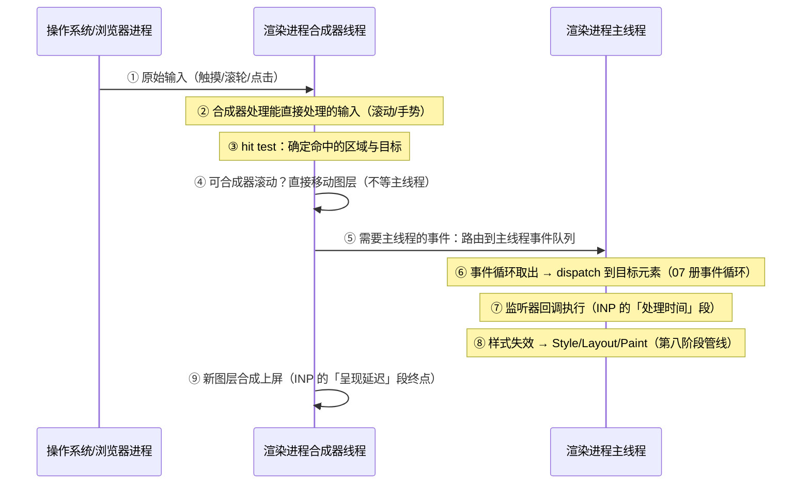

# 输入事件链路与交互渲染

> [← 第九阶段导览](01-导览.md) · 时间线 ⑰。加载完成只算了半场账——用户用页面的每一秒都在走「输入 → 处理 → 重渲染」的循环，这就是 INP 的物理底座。这一册从合成器接住输入讲起：为什么滚动不需要 JS、hit test 在哪一层做、事件什么时候才到达主线程、passive listener 改变了哪个承诺，最后把「点一下之后屏幕更新」的全链路走一遍——每一站都对应上一册 INP 三段中的一段。

## 1. 交互的全链路：先立地图

一次点击/触摸到屏幕更新，中间横跨浏览器进程、渲染进程合成器线程、主线程三个角色：



三段与 INP 的对应（上一册 §5 的落地）：

| INP 段 | 链路位置 | 本册展开 |
|---|---|---|
| 输入延迟 | ①→⑥（等主线程空出来） | §4 事件路由 |
| 处理时间 | ⑦ | §5 回调与被动监听 |
| 呈现延迟 | ⑧⑨ | §6 交互后重渲染 |

## 2. 合成器直接处理的输入：为什么滚动不需要 JS

页面流畅滚动的秘密是：**绝大多数滚动根本不经过 JavaScript**。

| 输入类型 | 谁处理 | 机制 |
|---|---|---|
| 滚轮/触摸滚动 | **合成器线程直接处理** | 滚动的是合成层（第八阶段 04 册的合成层树），主线程忙死页面照样跟手滚动 |
| 捏合缩放 | 合成器线程 | 同上 |
| 过界回弹（rubber-band） | 合成器线程 | 平台手势逻辑 |
| 点击/按键/长按 | **必须主线程**（有监听器时） | 要执行 JS 才有语义 |

这个设计的收益是结构性的：滚动是「移动已光栅化的图层」——纯合成器侧操作，与主线程的 JS 长任务完全并行。你可以在主线程塞一个 500ms 的 while 循环，然后发现**滚动依然流畅**（但点击会卡到怀疑人生）——这就是「合成器输入」与「主线程输入」的分界实证。

### 2.5 两种滚动形态的对照表

把「合成器滚动」与「被拖回主线程的滚动」放进一张表，排障时先对号：

| 维度 | 合成器滚动（健康形态） | 主线程参与的滚动（退化形态） |
|---|---|---|
| 滚动决策者 | 合成器线程 | 合成器等主线程「许可」后 |
| 主线程忙时 | 照常流畅 | **滚动冻结** |
| 触发条件 | 无监听器 / passive 监听器 / touch-action 未接管 | 非 passive 的 touchmove/wheel 监听器 |
| 常见来源 | — | 埋点脚本、无限滚动库、自定义手势组件 |
| 修复方向 | — | 加 passive；或改 touch-action 声明手势归属 |

注意一个容易混淆的点：**scroll 事件本身**（合成器滚完之后发给主线程的通知）始终要主线程处理——但它不影响滚动流畅度，只影响你的监听器回调何时跑。「scroll 回调慢」与「滚动卡」是两个问题，别在 Performance 面板里混为一谈（§5）。

两个边界条件会把这个美好设计打破：

1. **滚动容器不在合成层**（罕见，或层爆炸时的层降级）——滚动退化为主线程参与；
2. **主线程注册了非 passive 的滚动相关监听器**——合成器不敢先滚（见 §4）。

## 3. hit test：输入的坐标变成目标

合成器拿到输入坐标后第一件事是 **hit test（命中测试）**：这份输入落在哪个元素/图层上？

### 3.1 两级 hit test

```text
输入坐标 (x, y)
  │
  ├─ 合成器级 hit test（cc 层）：基于图层树 + 瓦片，判断
  │    ① 命中哪个合成层
  │    ② 该区域是否可合成器滚动（ScrollableRegion）
  │    ③ 是否命中「主线程参与区域」（注册过非 passive 监听的图层）
  │
  └─ 主线程级 hit test：精确到 DOM 节点（考虑 CSS 命中规则：
       pointer-events、透明度、伪元素、overflow 裁剪……）
       —— 事件 dispatch 之前完成
```

### 3.2 hit test 的性能账

主线程 hit test 在**每次需要精确目标的输入**（点击、mousemove 事件分发）时发生，复杂页面上的成本不可忽略（量级示意：深层 DOM + 大量重叠层时从微秒到毫秒级）：

| 因素 | 影响 |
|---|---|
| DOM 深度/兄弟数量 | 命中测试要走的树更深 |
| `pointer-events: none` | 命中测试跳过该元素树——大覆盖层（模态背景）常用的正确姿势 |
| 层叠上下文复杂度 | 合成器级测试变慢 |

mousemove 这类**高频输入**每个坐标都要 hit test + dispatch——页面卡顿的隐形大户（大量 mousemove 监听器 + 节流缺失是经典案例）。

## 4. 事件到达主线程：路由、队列与「阻塞滚动」的真相

### 4.1 路由规则：合成器先「试」着处理

对触摸/滚轮输入，合成器的决策树（示意）：

```text
触摸/滚轮事件到来
  ├─ 命中区域「可能 preventDefault」？
  │    └─ 是 → 合成器等待主线程执行监听器后决定（阻塞滚动！）
  │        └─ 监听器没调 preventDefault → 主线程发回「可以滚」→ 才开始滚
  │              （用户感知：滚动延迟 = 主线程忙的时长）
  └─ 无相关监听器 / passive 监听器？
       └─ 合成器直接滚动，事件照常异步发主线程（仅作通知）
```

这就是「滚动卡顿」的完整机制：**不是滚动本身慢，是合成器在等主线程的「许可」**——注册了非 passive 监听器等于告诉浏览器「我可能要取消这次滚动」，浏览器只能谨慎地等。

### 4.2 passive listener：一个提前给出的承诺

```js
// 反模式：合成器滚动前必须等这段 JS
el.addEventListener('touchstart', handler);

// 正确姿势：承诺「绝不 preventDefault」→ 合成器立即滚动
el.addEventListener('touchstart', handler, { passive: true });
```

| 维度 | 非 passive | passive: true |
|---|---|---|
| 合成器行为 | 等主线程听完监听器再决定滚不滚 | 直接滚，不等 |
| preventDefault | 可调用（取消滚动） | **调用无效**：console 警告，行为按未调用处理 |
| 典型场景 | 真要接管手势（自定义滑动删除） | 埋点、跟踪、高精度监听 |

浏览器已把 `window`/`document`/`body` 上的 `touchstart`/`touchmove`（Chrome 56 起）与 document 级 `wheel`（Chrome 73 起）监听器**默认 passive**——所以「在 document 上不加 options 写 wheel 监听」调用 preventDefault 会静默失败，console 有警告。两种翻车现场：

1. 老代码在 document 级 wheel 监听器里 preventDefault 想拦截滚动——升级浏览器后失效（默认 passive）；
2. 反过来，自定义手势组件忘了把监听器声明为非 passive——合成器不等它，手势与原生滚动打架。

### 4.3 touch-action 与 overscroll-behavior：CSS 侧的输入协议

JS 之外，CSS 提供了声明式的输入处理协议——能用 CSS 表达就不要写监听器（合成器永远读得到 CSS，永远要等 JS）：

| 属性 | 作用 | 对应链路位置 |
|---|---|---|
| `touch-action: none` | 该元素上的触摸不再触发合成器滚动/缩放——事件完整交给 JS | §4.1 决策树的上游：直接宣告「合成器别碰」 |
| `touch-action: pan-y` | 只允许垂直滚动（水平手势交给 JS） | 水平轮播/滑动组件的标准配置 |
| `overscroll-behavior: contain` | 阻止滚动链（滚到边界不再传导给父级/页面）与下拉刷新 | 嵌套滚动容器防「页滚动了」 |
| `overscroll-behavior: none` | 同上且阻止浏览器默认回弹 | 弹层内的滚动区域 |

分工总结：**touch-action 管「这个方向的手势归谁」，passive 管「监听器会不会拖延合成器」，overscroll 管「滚动到边界往哪去」**——三者合起来才是完整的输入处理协议，单用 passive 治不了所有滚动问题。

### 4.4 监听器注册检查表（抄进 code review）

| # | 检查 | 反例 → 正解 |
|---|---|---|
| 1 | touchstart/touchmove/wheel 监听器是否需要 preventDefault？ | 不需要 → `{passive: true}`（或依赖文档级默认 passive） |
| 2 | 真要接管手势的，是不是在**元素级**注册且配了 touch-action？ | 文档级非 passive 全局监听 → 收窄到具体元素 + `touch-action: none` 圈定接管范围 |
| 3 | 滚动拦截用 CSS 还是 JS？ | 能 touch-action 表达的绝不写监听器 |
| 4 | scroll 回调是否只记录不计算？ | 每次回调做布局计算 → 记录坐标，rAF 合帧 |
| 5 | 高频输入（pointermove）有合帧吗？ | 直接触发 setState/样式 → 合帧或节流 |
| 6 | 长列表容器有 overscroll-behavior？ | 弹层滚动带动页面 → `overscroll-behavior: contain` |

## 5. 回调执行：主线程上的「处理时间」段

事件到达主线程后，事件循环（第七阶段 07 册）把它作为普通任务 dispatch。这段的纪律清单：

| 纪律 | 原理 | 后果 |
|---|---|---|
| 单次回调 < 一帧预算（~16.7ms，长任务线 50ms） | INP 处理时间直接累加 | 回调里的大循环同步计算 = INP 超标 |
| 拆长任务：`scheduler.postTask` / `setTimeout` 分片 | 让出主线程，输入插队 | 上一册实验 5 的复测手段 |
| 回调内**读写分离**，避免强制同步布局 | 读布局（getBoundingClientRect）→ 写样式 → 再读 = 布局抖动（第八阶段 03 册） | 呈现延迟段被布局重算拖长 |
| 高频输入（scroll/mousemove/pointermove）只记录不计算 | 合成器已保证滚动流畅，回调计算用 rAF 合帧 | 高频回调占满主线程 = 后续点击延迟 |
| `requestAnimationFrame` 里做视觉更新 | 与渲染帧对齐，避免「写了样式这帧却没画」 | 更新割裂成两帧 |

一个高频陷阱值得展开：scroll 事件本身**不可取消**（合成器已经滚完了才通知你）——所以在 scroll 监听器里 preventDefault 是无意义的（passive 与否都一样）；要拦截滚动行为，正确的位置是 touchmove/wheel（非 passive）或 CSS touch-action。把「scroll 监听器」「touchmove 监听器」「合成器滚动」三层职责分清，是滚动相关排障的地基。

### 5.5 长任务拆分的三种姿势

处理时间段的直接病灶是长任务（>50ms）。三种拆法按优先级排：

```js
// ① 调度器 API（首选：带优先级，不卡渲染）
scheduler.postTask(() => doChunk(), { priority: 'background' });

// ② 经典让位（兼容面最广）
setTimeout(doChunk, 0);        // 让出主线程，输入任务可插队

// ③ 专为渲染对齐：视觉更新放 rAF，计算放回调外
requestAnimationFrame(() => applyVisualUpdate());
```

| 姿势 | 优点 | 注意 |
|---|---|---|
| `scheduler.postTask` | 优先级语义清晰（user-visible/background） | 较新 API，需能力检测 |
| `setTimeout(0)` | 无处不在 | 有最小延迟钳制（嵌套超 4 层后 ~4ms，量级口径） |
| rAF | 与帧对齐 | 只适合视觉写入，别塞计算 |

拆分的检验标准不是「代码好看了」，是 Performance 面板里长任务消失、INP 处理段变短（上一册实验 5 的复测闭环）。另注意：拆分不是免费的——任务切换本身有开销，粒度过碎反而增加调度成本，「50ms 以内」就是够用的线。

## 6. 交互后重渲染：⑧⑨ 站的全链路

回调改了 DOM/样式之后，直到新像素上屏，走的正是第八阶段的渲染管线——这里按「交互语境」重新串一遍，标注与 INP 呈现延迟的关系：

```text
回调结束
  ① 样式失效：改了什么就失效什么（第八阶段 07 册的失效传播）
  ② Style 计算：受影响子树重算（改 :root 或 body = 全页失效）
  ③ Layout：几何变化触发布局（第八阶段 02/03 册）
  ④ Paint/栅格化：失效区域重绘重栅格（第八阶段 05 册）
  ⑤ 合成：合成器合并新瓦片上屏（第八阶段 06 册）
下一帧 vsync 对齐上屏 ← INP 的终点
```

呈现延迟段的两个放大器：

1. **失效范围**：回调改了 `body` 的 class = 全页样式重算——改局部就别惊动全局（scope 化的 class/`contain` 隔离，下一册 §5）；
2. **强制同步布局**：回调里「读布局→写→再读」循环，把一次布局变成 N 次（布局抖动，第八阶段 03 册）——INP 呈现延迟的惯犯。

优化收益表（交互语境下「哪条管线通道最快」）：

| 更新方式 | 走的管线阶段 | 相对成本 |
|---|---|---|
| transform/opacity 动画（合成器接管） | ⑤（合成） | 最低——不失效布局与绘制 |
| 背景色/颜色变化 | ②④ | 中 |
| 尺寸/位置变化 | ②③④⑤ | 最高——全管线重走 |

这与上一册「transform 免罚 CLS」合流成同一条纪律：**视觉变化尽量落在合成器通道**。

### 6.1 交互后失效范围的对照（改哪、失效到哪）

呈现延迟段的第一变量是**失效范围**。同一处交互，改动的属性不同，失效的子树与管线阶段完全不同：

| 回调里的改动 | 失效范围（示意） | 重走的管线 |
|---|---|---|
| 改 `html`/`body` 的 class（如主题切换） | 全页 | Style 全量 → 视影响 Layout/Paint |
| 改组件根节点的 class | 该组件子树 | 子树 Style → 视影响 Layout/Paint |
| 改 `width/height/top` | 该子树 + 受影响邻居 | Layout 起，全管线 |
| 改 `color/background` | 该子树 | Paint（跳过 Layout） |
| 改 `transform/opacity` | 该元素 | 仅合成（§7 通道表） |

推论直接可用：**交互回调里的一切样式写入都要「贴着目标元素走」**——通过全局祖先 class 传导（`.page--busy .btn {...}` 这类）是呈现延迟的隐形放大器。配合下一册的 `contain` 把失效边界固定住，范围问题就从「写代码的自觉」变成「结构保证」。

## 7. 实验

1. **合成器滚动实证**：页面主线程放 500ms while 循环（点击触发），依次体验：滚动（流畅）→ 点击（卡 500ms）——§2 分界的体感实验；DevTools Performance 里看滚动期间主线程忙但滚动条照走。
2. **非 passive 阻塞滚动复现**：document 上注册非 passive touchmove 监听器（空函数），主线程同时被长任务占用——触摸滚动明显迟滞；改 `{passive: true}` 后滚动恢复跟手（示例对比，以实测为准）。
3. **passive 默认值验证**：document 级 wheel 监听器内调 preventDefault()，看 console 警告「Unable to preventDefault inside passive event listener」。
4. **touch-action 实验**：水平轮播容器分别用 `touch-action: pan-y` 与不设，手机模拟器/真机体验水平滑动的手势冲突；`overscroll-behavior: contain` 加在弹层滚动区，验证滚到边界不再带动页面。
5. **hit test 成本观察**：Performance 面板录一段快速划过大量元素的 mousemove，看主线程的 hit test/事件分发占比；给遮罩层加 `pointer-events: none` 后对比。
6. **INP 全链路标注**：录一次点击（含 100ms 回调 + 强制同步布局），在 Performance 面板把 §1 时序图的 ①~⑨ 逐站指认出来——本册的毕业动作。
7. **呈现延迟优化**：同一交互分别用「改 top/left」与「改 transform」实现位移，对比两版的 Layout/Paint 轨道长度与帧时长。
8. **失效范围对照**：同一交互做两版——一版改全局祖先 class、一版直接改目标元素——对比 Performance 面板里 Recalculate Style 的作用范围（绿色条长度）。
9. **Event Timing 三段实测**：用上一册 §5.2 的脚本记录点击交互的 interactionId 与三段耗时，与 Performance 面板交互轨道并排对照——API 数字与面板图形对上号。

## 8. 常见误区

1. **「页面卡是因为 JS 慢」**：滚动卡与点击卡是两套机制——滚动由合成器负责（JS 不参与也能流畅），点击必须主线程。定位卡顿先分类输入类型。
2. **「scroll 监听器里可以 preventDefault」**：scroll 事件不可取消且是「事后通知」；要拦截滚动去 touchmove/wheel 或 touch-action。
3. **「passive: true 只是性能小优化」**：它改变的是**滚动是否被阻塞**的架构行为——非 passive 监听器在主线程忙时让全页滚动停摆。
4. **「touchstart 默认可 preventDefault」**：window/document/body 级的 touch 系与 document 级 wheel 已默认 passive——老代码的 preventDefault 会静默失效，console 警告是唯一线索。
5. **「高频输入的回调随便写」**：mousemove/scroll 每次都 hit test + dispatch；回调应只记录坐标，计算合并进 rAF。
6. **「回调快 = 交互快」**：呈现延迟段（样式重算 + 布局 + 绘制）不在回调里——INP 超标只优化回调常常治不好。
7. **「hit test 不花钱」**：深层 DOM + 高频 mousemove 下命中测试是隐形成本；`pointer-events: none` 是免费的优化。

### 8.5 常见问答

**Q：passive: true 会不会丢掉滚动相关的功能？**
只要你的监听器确实没调 preventDefault（绝大多数埋点/跟随类监听器），行为完全一致——它只是把「我不取消」提前声明给合成器。会改变行为的是那些**真要**拦截滚动的代码：自定义下拉刷新、滑动抽屉之类，它们应保持非 passive 并用 `touch-action` 收窄接管范围（§4.4 检查表第 2 条）。

**Q：addEventListener 第三参数写 `true`/`false`（布尔）与 `{passive}` 对象混着用，到底是什么？**
布尔形式是老 API（`true` = capture），对象形式是 `AddEventListenerOptions`（capture/passive/once）。注意默认值差异：元素级监听器默认非 passive；window/document/body 的 touch 系与 document 级 wheel 在 Chrome 里默认 passive——「同一个写法在不同元素上行为不同」正是排障时的坑，显式写 options 是消除歧义的最便宜手段。

**Q：为什么我的点击偶尔延迟一秒才响应，但 Performance 里回调只有几毫秒？**
延迟发生在回调之前——输入延迟段。典型元凶：点击时主线程正被别的长任务占据（定时器任务、其他输入的高频回调、水合任务）。在 Performance 录制里找「输入标记」到监听器执行之间的空隙，空隙里是谁在跑，谁就是元凶。呈现延迟段同理看「回调结束到帧绘制」之间。

**Q：合成器直接处理滚动，那 scroll 驱动的懒加载在主线程忙时会失效吗？**
懒加载的「触发判定」浏览器有合成器侧的辅助优化，但「执行加载」终究要主线程。主线程忙时，懒加载的触发会推迟到主线程空出来——这正是「滚动流畅 ≠ 交互可用」的又一例：视觉在动，主线程队列里的活还在排队。

## 9. 自测题

1. 哪些输入由合成器直接处理？为什么主线程死循环时滚动仍流畅？
2. 画出合成器对触摸事件的决策树（含非 passive 场景的等待路径）；「滚动卡顿」在这张图上的位置？
3. passive: true 给了浏览器什么承诺？哪些监听位置已默认 passive？默认 passive 后 preventDefault 的行为？
4. 两级 hit test 各解决什么问题？`pointer-events: none` 影响哪一级？
5. touch-action、overscroll-behavior、passive 三者各管什么？「弹层滚动不带动页面」该用哪个？
6. INP 三段与本册链路 ①~⑨ 的对应关系？呈现延迟段的两个放大器是什么？
7. 为什么「读布局→写→再读」会拖长 INP？正确的读写组织顺序？
8. 一次视觉更新「走合成通道」与「走全管线」的成本差异？分别对应改哪些属性？
9. 你的页面点击偶尔卡顿，如何用 DevTools 判定是输入延迟段还是处理段还是呈现段的问题？
10. 自定义水平滑动组件的完整输入协议配置（touch-action + passive + rAF 合帧）怎么写？

## 10. 自查清单

| # | 检查 | 工具 | 异常指向 |
|---|---|---|---|
| 1 | 滚动相关监听器全部 passive（除非真要接管手势）？ | 代码搜索 addEventListener | 文档级非 passive = 全页滚动可被卡 |
| 2 | preventDefault 调用处都有效？ | console 警告 | passive 默认化后静默失效的老代码 |
| 3 | 高频输入回调只记录、rAF 合帧？ | Performance 录制 | 每帧都跑重计算 = 隐形 INP |
| 4 | 交互回调 < 50ms（长任务线）？ | Performance 交互轨道 | 回调长任务 = 处理段超标 |
| 5 | 回调无强制同步布局？ | Performance 的 Layout 频率 | 读写交错 = 呈现延迟放大 |
| 6 | 视觉更新尽量走 transform/opacity？ | 代码审查 top/left 动画 | 全管线更新 = 呈现延迟放大 |
| 7 | 弹层滚动区有 overscroll-behavior？ | 真机体验 | 滚动链传导 = 体验硬伤 |
| 8 | 遮罩/大覆盖层 pointer-events: none？ | Elements | mousemove hit test 白花钱 |

## 11. 延伸

- 下一册：[06-水合与下一代渲染架构](06-水合与下一代渲染架构.md)——交互链路的成本大头在框架 JS：水合谱系与管线级新原语收束本阶段。
- 事件循环与任务调度（输入任务何时被执行）在[第七阶段 07 册](../07-第七阶段/07-事件循环与任务调度-渲染在哪里发生.md)；合成线程与 vsync 在[第八阶段 06 册](../08-第八阶段/06-合成-合成线程-GPU与vsync.md)；一帧生命周期与失效传播在[第八阶段 07 册](../08-第八阶段/07-一帧的完整生命周期-失效传播与帧预算.md)。
- INP 劣化的定位案例在[第十阶段 04 册](../10-第十阶段/04-案例复盘集-渲染类.md)；Performance 全轨道的深挖在[第十阶段 02 册](../10-第十阶段/02-DevTools深潜-Performance全轨道解剖.md)。
