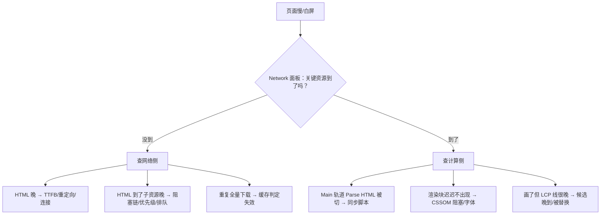

# 案例复盘集（一）：加载类

> [← 第十阶段导览](01-导览.md) · 全链路收束。本册收拢第二至六阶段（导航决策、DNS/连接、HTTP 语义、服务端回程、缓存与接收）加上 [02 册](02-DevTools深潜-Performance全轨道解剖.md)的轨道读法，装进四个加载事故：白屏、缓存雪崩、第三方拖慢 LCP、重定向链。每个案例按「现象→定位→根因→修复→预防」五段式走完——现象必须可量化、定位必须落到轨道、根因必须落到机制、修复必须给预期、预防必须留卡口。**案例中的数字均为示意**（用于展示复盘形态），机制与阈值为实。

## 1. 复盘方法论：五段式与排查总纲

### 1.1 五段式模板

| 段 | 要回答的问题 | 产出物 |
|---|---|---|
| 现象 | 慢/坏在哪？**量化**了吗（指标 + 环境）？ | 一句话现象 + 指标基线 |
| 定位 | 用哪个面板哪条轨道，把范围缩小到哪一步？ | trace/截图 + 排查路径记录 |
| 根因 | 时间线哪一段的哪个机制出了问题？ | 归因到 ⑪~⑮ 段 + 链路知识点 |
| 修复 | 改了什么？预期收益多少？实际多少？ | 优化动作 + 前后对照 |
| 预防 | 怎么让同类问题不再发生？ | 卡口（CI/评审规则/监控） |

五段缺一不可：缺「定位」的复盘是猜谜，缺「根因」的修复是碰运气，缺「预防」的修复会以每季度一次的频率重来。

### 1.2 加载类排查总树

所有加载类问题的第一分叉：**资源「没到」还是「到了没画」**——先 Network 后 Main，方向别反：



四案分别落在这棵树的不同枝上：案例一在 D1+D2、案例二在 C3、案例三在 C2+D3、案例四在 C1。排查时**沿着树走，不跳步**——跳步是「凭感觉优化」的入口。

## 2. 案例一：白屏 2.4 秒——被同步链拖死的渲染

### 2.1 现象

内部报表站改版上线后，用户反馈「白屏两秒多，然后内容一次性砸出来」。实验室固定环境复现（4x CPU + Fast 4G，数字示意）：

| 指标 | 改版前 | 改版后 |
|---|---|---|
| 白屏（体感） | ~0.8s | ~2.4s |
| FCP | 0.9s | 2.5s |
| DCL | 1.0s | 2.3s |
| HTML 主文档 | 200，~90ms 完成 | 200，~90ms 完成 |

反常点：**HTML 本身和改版前一样快**——慢的不是网络段，是「到了没画」。

### 2.2 定位

排查树第一步：Network 面板确认 HTML 90ms 完成 → 走「到了没画」枝 → 打开 Performance 录制。三条轨道的证据：

1. **Network 轨道**：CSS 完成于 ~1.1s——点开发现是 `style.css → theme.css → tokens.css` 的 **@import 三连**（三个文件串行，各付一个 RTT）；`app.js`（head 里同步脚本，480KB）完成于 ~2.1s；
2. **Main 轨道**：Parse HTML 的小块只推进到 head 就停住，等 `app.js` 下载完才出现一大段黄色 Script 与后续 Parse——**同步脚本阻塞 DOM 构建**的教科书形态（第七阶段 03 册）；
3. **Timings 轨道**：DCL 2.3s 与 app.js 完成时间吻合；FCP 2.5s 出现在「最后一个 CSS + app.js 都就绪」之后——渲染被 CSS 阻塞（第九阶段 02 册的关键渲染路径）。

### 2.3 根因

三层阻塞叠加，把关键渲染路径拉成了串行长链：

| 层 | 机制 | 链路知识点 |
|---|---|---|
| 同步脚本 | head 里 `<script src>` 下载+执行双重阻塞：解析器停、DOM 停（下载由 preload scanner 并行） | 第七阶段 03 册；第六阶段 06 册（脚本加载模型） |
| @import 串行 | @import 要等宿主 CSS 下载解析完才知道要再请求下一个——逐个 RTT 排队 | 第七阶段 04 册（CSSOM） |
| 渲染阻塞 CSS | CSSOM 未就绪不允许首帧渲染（防 FOUC），三连 CSS 把 ⑫ 拉长 3 个 RTT | 第九阶段 02 册（CRP：DOM+CSSOM+阻塞 JS 谁晚谁说了算） |

三者叠加：FCP 下界 = HTML RTT + 3 个 CSS RTT + JS 下载执行——每层单独看都「不算病」，叠加后白屏 2.4s。

### 2.4 修复

按「先解除脚本阻塞、再拍平 CSS 链、再内联关键 CSS」顺序动手（预期收益在改前用账本估算，均示意）：

| 动作 | 精修哪段 | 做法 | 实测（示意） |
|---|---|---|---|
| app.js 加 `defer` | ⑪ 解析不再被切，脚本并行下载、DOM 就绪后执行 | head 里 `<script defer src>` | 白屏 -0.9s |
| 拍平 @import | ⑫ 三个 CSS 并行下载 | 3 个 `<link>` 替代 1 个 @import 链 | 再 -0.4s |
| 关键 CSS 内联 | ⑫ 归零（首帧不再等外部 CSS） | 抽视口内规则 ~8KB 内联，其余 preload | 再 -0.2s |
| LCP 图 preload | ⑪ 的提前量 | hero 图 `<link rel=preload>` + fetchpriority | LCP 提前 ~0.3s |

修复后复测：白屏 0.9s、FCP 1.0s、DCL 1.1s（示意）。每项收益都能在账本上指认到被压缩的段——这就是「先量后刀」。

### 2.5 预防

1. **head 审查规则**：head 里同步 script 一律禁止（lint 规则 + 评审卡口）；CSS 只允许 `<link>`，@import 出现即报错；
2. **CI 加 Lighthouse 卡口**：FCP/LCP 预算超标即失败（审计项与链路段的对应见 [02 册 §13](02-DevTools深潜-Performance全轨道解剖.md)）；
3. **改版走查清单**：凡动 head 结构，必录一次固定环境的基线 trace 与旧版对比。

## 3. 案例二：ETag 失效风暴——一次发版引发的缓存雪崩

### 3.1 现象

每次发版后的 10 分钟（示意）：静态资源回源流量 ×8；CDN 命中率从 92% 跌到 47%；用户工单集中出现「发版后第一次刷新特别慢」。发版动作本身只是「把构建产物覆盖到 web 服务器目录」。

### 3.2 定位

1. **Network 面板（普通用户视角，不勾 Disable cache）**：发版前刷新，静态资源多为磁盘缓存（Size 列显示 `(disk cache)`）或 304；发版后刷新，全部变成 **200 全量下载**——304 协商整体失效；
2. **响应头对比**：发版前后同一份 `app.js`（内容未变）的响应头：`ETag: W/"67a1f-18a3c-62f9d1c0"`（Nginx 默认形态：size + mtime，格式示意）——**内容没变，ETag 变了**；`Cache-Control: no-cache` ——每次都必须走协商验证；
3. **CDN 侧**：边缘节点对 `no-cache` 资源回源校验，源站 ETag 全变 → 校验失败 → 全量回源（CDN 回源机制见[第五阶段 02 册](../05-第五阶段/02-CDN-边缘-回源与调度.md)）。

### 3.3 根因

**验证器选错了基准**。这条事故链的每一环都是机制必然（不是 bug）：

```text
发版 = 覆盖整个产物目录
  → 所有文件 mtime 统一改写（哪怕内容一个字节没变）
    → 基于 mtime 的 ETag 全部变化
      → If-None-Match 全部不匹配 → 304 机制整体失效 → 全量 200
        → 强缓存又没配（no-cache 每次必协商）→ 每个用户每个资源全量重下
          → CDN 边缘也校验失败 → 回源风暴
```

- 为什么 304 没发挥作用：304 的前提是**验证器不变**（条件请求机制见[第四阶段 05 册](../04-第四阶段/05-请求语义-协商-Cookie-条件请求与Range.md)）；
- 为什么 Last-Modified 救不了场：它和 mtime-based ETag 同一个病根，发版照样全变；
- 判定流程的完整展开见第六阶段 03-HTTP缓存体系全解 册（本站正文写作中，先指路[第六阶段导览](../06-第六阶段/01-导览.md)）——「no-cache ≠ 不缓存，而是每次强制协商」是本案的关键判定。

### 3.4 修复

按「内容寻址 + 分层缓存策略」重做（修复后数字示意）：

| 动作 | 对象 | 做法 | 效果 |
|---|---|---|---|
| 文件名加内容哈希 | JS/CSS/图片 | `app.9f2c8d.js`；构建产物随内容变化才换名 | 内容不变 → 文件名不变 → URL 级命中 |
| 配强缓存 | 哈希命名资源 | `Cache-Control: max-age=31536000, immutable` | 二次访问**零请求**（immutable 免除重新验证） |
| HTML 用 no-cache + 内容 ETag | HTML | `no-cache` + 基于内容哈希的强 ETag（不用 mtime） | HTML 永远新鲜，协商开销只剩一个小请求 |
| 发版新旧并存 | 全部 | 保留上一版哈希文件一段时间（滚动发布窗口） | 在途用户的旧引用不 404 |

复测：发版后用户刷新，静态资源直接磁盘命中（0 网络请求），回源流量回落到基线（示意：命中率回到 95%）。**根因消失了，而不是被缓解了**——「文件变了名字才会变」把验证器失效问题从机制上消灭。

### 3.5 预防

1. **缓存策略矩阵**写进部署文档（HTML=协商、无哈希资源=短 max-age、哈希资源=immutable 长缓存），任何资源上线前对号入座；
2. **发版评审**加入一问：「这次部署改写了哪些文件属性？影响哪些缓存判定？」；
3. **监控卡口**：304 比率、CDN 命中率、回源带宽三指标，发版后 15 分钟内越界即告警——同类风暴在 10 分钟内被叫停而不是第二天被工单发现。

## 4. 案例三：第三方脚本拖慢 LCP——Event Initiator 归因实录

### 4.1 现象

接入某营销/统计 SDK 后（数字示意）：LCP p75 从 2.0s 升到 3.4s；TBT 从 300ms 升到 780ms；Lighthouse 报告出现「第三方使用导致的阻塞时间」条目。站内自己的代码**零变更**——归因必须从「谁引来的」开始。

### 4.2 定位

1. **Network 面板 Initiator 列**（[02 册 §12](02-DevTools深潜-Performance全轨道解剖.md) 的动线）：SDK 主脚本 `sdk.js` 的 Initiator 是 `parser`（head 里的同步标签）；它后续的 `track.gif`、`banner.jpg` 的 Initiator 链根都指向 `sdk.js`——**整条第三方请求树由这一个标签引来**；
2. **Main 轨道**：head 解析后一段 ~250ms 的黄色长任务，函数栈根是 SDK 的初始化（示意）——主线程被第三方脚本占据，hero 图的解码与绘制排队；
3. **Network + Timings 轨道**：`banner.jpg`（SDK 注入的促销横幅）晚于 hero 图到达，且**渲染尺寸更大**；Timings 轨道出现两条 LCP 标记——第一条指向 hero（被刷掉），第二条指向 banner（最终候选）；
4. **Network 轨道的排队段**：hero 图与同域多个资源一起付 h1 六连接限制的排队（第六阶段 05 册优先级；连接限制机制见[第四阶段 02 册](../04-第四阶段/02-HTTP1.1-报文语义与连接管理.md)）。

### 4.3 根因

第三方脚本的三件套代价，全部落在账本的不同段：

| 代价 | 时间线段 | 机制 |
|---|---|---|
| 同步执行长任务 | ⑬⑰ | head 同步脚本阻塞解析 + 占住主线程，LCP 绘制排队 |
| 改变 LCP 候选 | ⑯ | 注入的更大元素刷新候选（第九阶段 03 册候选规则：更大的新候选出现就替换） |
| 连接与带宽抢占 | ⑥⑧ | h1 连接池竞争 + 体积；若 SDK 域还在 h1，额外付满连接税（第四阶段 02 册） |

本案的教训是：**第三方的代价 ≠ 它自己的下载耗时**。它改变的是「整个页面最后的绘制内容与时机」——只看 Network 面板里 SDK 那几行的耗时，会得出「才 80KB，无伤大雅」的错误结论。

### 4.4 修复

| 动作 | 消除哪笔代价 | 做法 |
|---|---|---|
| SDK 标签改 `async` + 延迟到 idle 加载 | 长任务占主线程 | `requestIdleCallback`/事件后再注入；埋点请求不阻塞首屏 |
| banner 占位 + 降优先级 | LCP 候选被刷新 | 固定 `width/height` 容器 + `fetchpriority="low"`；hero 加 `fetchpriority="high"` + preload |
| facade 模式 | 连接与执行前移 | 首屏只渲染假的播放器/组件壳，用户交互后才加载真 SDK |
| 与供应商谈判 | 执行开销 | 服务端出数据、客户端轻量渲染；或换「点击触发的按需加载」方案 |

复测（示意）：LCP p75 3.4s → 2.1s，TBT 780ms → 310ms。最大单项收益来自「不再让 banner 顶替 LCP 候选」——LCP 是**候选规则**的产物，治理它要按规则下手，不是笼统「给页面提速」。

### 4.5 预防

1. **第三方接入清单**：每个 SDK 登记「引入方式（sync/async/facade）、注入内容、影响面、负责人」，接入评审签字；
2. **季度审计**：Lighthouse third-party 报告 + Initiator 关系图（02 册 §12.2 动线），清理没人认领的脚本；
3. **门禁规则**：营销/统计脚本必须 async + 延迟加载；head 里的同步第三方标签直接打回；
4. **LCP 候选监控**：field 数据里 LCP 元素类型分布（img/text）突变即告警——候选被悄悄替换是第三方注入的典型指纹。

## 5. 案例四：重定向链——把三跳 RTT 藏在 30x 里

### 5.1 现象

某地区用户反馈移动端首页「比同事的慢半秒」；不同入口测速差异巨大。Network 面板里 HTML 主文档不是一个请求，而是**三个连续请求**：`301 → 302 → 200`（每跳额外 ~180ms，弱网示意）。

### 5.2 定位

1. **curl -IL 数链**：`http://m.example.cn` → 301 → `https://m.example.cn` → 302 → `https://m.example.cn/home?geo=cn-01` → 200 → `https://www.example.cn/home`——三跳，两个 host；
2. **逐跳看 Timing**：第二、三跳各自带完整的 DNS + Connect + SSL 段——**跨 host 跳转等于一切从零开始**：m.example.cn 与 www.example.cn 是不同域名，DNS 与握手不能复用（DNS 链路见[第三阶段 02 册](../03-第三阶段/02-DNS解析全链路.md)）；
3. **对账**：三跳 = 3 次 TTFB + 2 次跨 host 连接重建 ≈ 600ms 额外（弱网示意），正好对上「慢半秒」的反馈。

### 5.3 根因

三跳各有历史原因，合起来是账本上 ②⑩ 段（导航决策与 commit）的重复付费：

| 跳 | 历史原因 | 机制问题 |
|---|---|---|
| ① http→https | 运维「图省事」在应用层做跳转 | 没配 HSTS——浏览器无法在导航决策期直接升级（第二阶段 03 册），白付一次完整 http 往返 |
| ② → /home?geo=… | 服务端读 cookie/地区再转发 | 一次 TTFB 换一个参数；geo 完全可以在边缘完成 |
| ③ m. → www. | SEO canonical 归一 | 跨 host 跳转重付 DNS+握手全套（第三阶段） |

每跳都是一次「commit 未遂」：响应头到了、页面没来，接着再来一轮 ③④⑤⑥⑦⑧（重定向机制见[第五阶段 06 册](../05-第五阶段/06-错误-重定向与失败模式.md)）。重定向链在账本上的形态是：**把最贵的段（连接 + TTFB）重复 N 遍**。

### 5.4 修复

| 动作 | 消掉哪跳 | 做法 |
|---|---|---|
| HSTS + preload | 消掉 ① | 首次响应带 `Strict-Transport-Security`，之后浏览器在导航决策期直接内部升级，http 那一跳消失 |
| 网关一次归一 | 消掉 ②③ | 负载均衡/网关层按 Host + 协议 + 地区一次算出最终 URL，单条 301 直达 |
| geo 移到边缘 | 消掉 ② 的服务端往返 | CDN 边缘按请求特征注入地区参数（第五阶段 02 册的调度能力） |
| 禁客户端跳 | 防新增 | JS `location.replace` 再跳一层的模式禁用 |

复测（示意）：链长 3 → 0（HSTS 生效 + 网关直达），弱网下首屏提前 ~600ms。修复后的验证方式就是 `curl -IL`：**Location 链长 = 0~1**。

### 5.5 预防

1. **重定向预算**：CI 里对全站入口 URL 跑 `curl -IL`，链长 >1 即失败；
2. **域名/协议变更评审**：凡新增域名、新增跳转，必须给出「为什么不直接返回最终 URL」的理由；
3. **监控 redirectCount**：Navigation Timing 的重定向计数按入口/地区分维度上报，链长回归第一时间可见；
4. 记住账本的结论：重定向的每一跳都落在**用户感知最贵的段**上——它是所有「低成本偷懒」里用户代价最高的一种。

## 6. 四案共性：加载类问题的三种病根

四个案例的根因收敛到三种病根——复用这张表，遇到新问题先对号：

| 病根 | 案例 | 机制一句话 | 通用修复思路 |
|---|---|---|---|
| 该缓存的不缓存 | 案例二 | 验证器/缓存头让「没变的东西」被当「变了」处理 | 内容寻址 + 分层缓存策略矩阵 |
| 该短路的不短路 | 案例一、四 | 本可并行/直达的路径被串行链、跳转链拉长 | defer/拍平/内联（计算侧）、HSTS/一次归一（网络侧） |
| 该让路的不让路 | 案例三 | 第三方抢占连接、主线程与 LCP 候选 | async/延迟/facade + 优先级声明（fetchpriority/preload） |

以及一条元规律：**四案的定位动线都是同一棵排查树（§1.2）**——「没到还是没画 → 哪段账本 → 哪个机制」。工具会换代、面板会改版，这棵树不变。

### 6.1 四案五段式产出物总表（复盘留档的对账单）

每案复盘结束，五段各留下什么——拿这张表检查自己有没有漏：

| 案例 | 现象（量化物） | 定位（凭证） | 根因（归因点） | 修复（动作数） | 预防（卡口） |
|---|---|---|---|---|---|
| 一 白屏 | FCP/DCL 前后对照 | Network 瀑布 + Main 轨道截图 | ⑪⑫ 三个阻塞叠加 | 4（defer/拍平/内联/preload） | lint + CI 预算 |
| 二 ETag 风暴 | 304 比率 / 命中率 | 响应头前后对比 | 验证器基准错误 | 4（哈希命名/immutable/内容 ETag/并存） | 缓存矩阵 + 监控告警 |
| 三 第三方拖慢 LCP | LCP p75 / TBT | Initiator 链 + Interactions 无关、Main 长任务 | 三件套代价 | 4（async/占位/facade/谈判） | 接入清单 + 门禁 |
| 四 重定向链 | 链长与逐跳耗时 | curl -IL + Timing 表 | 三跳三历史 | 3（HSTS/一次归一/边缘 geo） | 链长 CI 卡口 + redirectCount 监控 |

用法：给自己的新案例填同样一行，填不满的格子就是复盘没做完的地方。

### 6.2 加载类速查表：症状 → 第一工具 → 高频根因

下次遇到加载问题，先用这张表选工具（30 秒定方向，再进排查树细查）：

| 症状 | 第一工具 | 高频根因（对应案例） |
|---|---|---|
| 白屏且 Network 面板 HTML 正常 | Performance Main 轨道 | 同步脚本 / CSS 阻塞链（案例一） |
| 首访快、刷新反而重新全量下载 | Network 面板状态列 + Response Headers | 协商验证器失效 / 强缓存缺失（案例二） |
| 发版后集中变慢 | CDN 后台命中率 + 304 比率 | 部署改写文件属性引发的风暴（案例二） |
| 没改代码但某天起变慢 | Network Initiator 链 | 第三方脚本接入/更新（案例三） |
| LCP 元素和设计稿不一致 | Timings 双标记 + Elements | 候选被晚到大元素替换（案例三） |
| 只有部分地区/入口慢 | curl -IL 数跳数 + 分地区 Timing | 重定向链 / DNS 分区解析（案例四） |
| 二次访问忽快忽慢 | BFCache/SW 判定（第二阶段 03 册） | 缓存捷径命中不稳定 |
| 一切正常但 field 数据差 | 口径核对（设备/网络/缓存） | lab 口径与真实用户分布不同（05 册 §6.3） |

## 7. 常见误区

1. **「白屏就该先查 JS 报错」**：先走排查树分叉——「没到」与「到了没画」是两个世界；JS 报错只覆盖一小枝。
2. **「304 比强缓存更省」**：304 还是要发请求、付 RTT 与验证开销；强缓存命中是零请求。能 immutable 的资源走协商是浪费。
3. **「ETag 总是基于内容」**：不少服务器默认实现基于文件属性（mtime+size）——「ETag 变了」不等于「内容变了」；升级/迁移部署方式时必须确认验证器基准。
4. **「第三方脚本很小所以没影响」**：它的下载体积与执行开销只是代价的一部分——连接抢占、主线程占用、LCP 候选替换都是间接账，要用 Initiator 链 + trace 归因。
5. **「重定向只是多一次请求，很快」**：一跳 = 一次完整 ③④⑤⑥⑦ 循环；跨 host 还要重建连接。弱网下每跳几百毫秒，「很快」只在开发机成立。
6. **「优化完看一眼分数就收工」**：修复必须配复测账本与误差说明（lab vs field、缓存状态）——五段式里缺了复测，收益就是自我报告而非证据。

## 8. 自测题

1. 复述加载类排查总树的第一分叉，并说明为什么「先 Network 后 Main」的方向不能反。
2. 案例一里，为什么 app.js 的下载与 Parse HTML 的暂停可以同时存在？（提示：preload scanner 与主解析器的分工。）
3. 画出案例一修复后的 head 结构，并逐项说明每项对应的关键渲染路径变化。
4. 案例二的事故链有五环，写出完整链条；指出哪一环是「配置错误」、哪些环是「机制必然」。
5. 为什么 Last-Modified 在案例二里救不了场？什么样的验证器在同样场景下能保住 304？
6. `no-cache` 与 `no-store` 在案例二的语境下分别意味着什么？站点配的是哪种？
7. 案例三里 LCP 被刷新的判定依据是什么？LCP 候选的更新与停止规则是什么（第九阶段知识）？
8. 用 Event Initiator 追一个陌生站点的第三方脚本：说出从「发现可疑请求」到「找到链根」的完整操作序列。
9. 案例四的三跳里，为什么第 2、3 跳要重付 DNS 与握手？什么样的跳转可以不付？
10. HSTS 消掉第一跳的机制是什么？为什么它必须配合 preload 才能让首次访问也受益？
11. §6 的三种病根各再举一个四案之外的新例子（自己构造场景并归因到时间线段）。
12. 五段式里「预防」为什么不可省？给案例一设计一条能进 CI 的卡口规则。

## 9. 自查清单

| # | 检查 | 工具/入口 | 异常指向 |
|---|---|---|---|
| 1 | 排查树的第一分叉走了吗 | Network 面板先看资源到没到 | 跳步 = 凭感觉修 |
| 2 | head 里还有同步 script / @import 吗 | view-source + lint | 案例一同款隐患 |
| 3 | 缓存策略按「HTML/无哈希/哈希」分层了吗 | Response Headers | 一刀切 no-cache = 风暴温床 |
| 4 | ETag 基准是什么（mtime 还是内容） | 服务器配置确认 | mtime 基准 + 覆盖式部署 = 案例二 |
| 5 | immutable 配在哈希资源上了吗 | Response Headers | 缺 = 白付协商 RTT |
| 6 | 第三方 SDK 全部 async/延迟了吗 | view-source + Initiator 链 | head 同步第三方 = 案例三 |
| 7 | LCP 候选元素稳定吗（不被晚到大图替换） | Timings 双标记 + field 监控 | 候选漂移 = LCP 不可控 |
| 8 | 全站入口重定向链长 ≤1 吗 | curl -IL | 链长 >1 = 每用户白付数个 RTT |
| 9 | HSTS 配置了吗 | curl -I 看 STS 头 | 缺 = http 首跳永远白付 |
| 10 | 304 比率 / CDN 命中率有监控吗 | 服务端与 CDN 后台 | 无监控 = 风暴靠工单发现 |
| 11 | 每次修复都有前后对照账本吗 | labs/ 记录 | 无对照 = 收益是自我报告 |
| 12 | 案例的预防卡口进 CI/评审了吗 | CI 配置 | 没进卡口 = 季度复发 |

## 10. 延伸

- 渲染侧四案（布局抖动、层爆炸、长任务、INP）在[04-案例复盘集-渲染类](04-案例复盘集-渲染类.md)——同一套五段式，轨道换到 Main/Compositor/Interactions。
- 缓存判定的完整机制在第六阶段 03 册（写作中，入口：[第六阶段导览](../06-第六阶段/01-导览.md)）；条件请求语义在[第四阶段 05 册](../04-第四阶段/05-请求语义-协商-Cookie-条件请求与Range.md)。
- 本册案例的定位手法全部来自[02-DevTools深潜](02-DevTools深潜-Performance全轨道解剖.md)；毕业项目将把这套复盘升级成完整报告（[05 册](05-毕业项目-全链路测量与优化报告.md)）。
