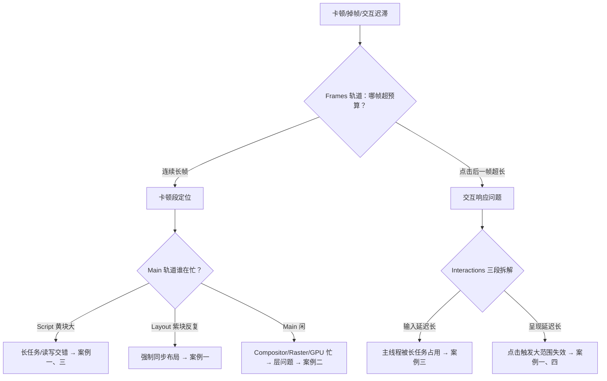

# 案例复盘集（二）：渲染类

> [← 第十阶段导览](01-导览.md) · 全链路收束。本册收拢第七阶段（解析/样式计算/事件循环）、第八阶段（布局、分层、合成、帧预算）与第九阶段（指标、输入链路）的渲染侧知识，加上 [02 册](02-DevTools深潜-Performance全轨道解剖.md)的轨道读法，装进四个渲染事故：布局抖动、层爆炸、长任务、INP 劣化。与[加载类案例册](03-案例复盘集-加载类.md)同一套「现象→定位→根因→修复→预防」五段式。**案例中的数字均为示意**（用于展示复盘形态），机制与阈值为实。

## 1. 渲染类复盘的统一视角：16.6ms 帧预算账本

加载类问题用 17 步账本归因，渲染类问题用**帧预算账本**归因：60Hz 下每帧 16.6ms（120Hz 是 8.3ms，机制见[第八阶段 06 册](../08-第八阶段/06-合成-合成线程-GPU与vsync.md)），一帧内主线程与合成线程的活必须在这个预算里跑完，否则掉帧。

### 1.1 一帧的预算拆分（主线程视角）

| 帧内活动 | trace 块名 | 典型预算占比 | 超预算的指纹 |
|---|---|---|---|
| 事件回调 | Script（黄） | 视交互而定 | 长任务、读写交错 |
| rAF 回调 | Script | ≤2~3ms | 回调里做测量/布局 |
| 样式 | Recalculate Style（紫） | ≤2ms | 失效范围失控 |
| 布局 | Layout（紫） | ≤3ms | 强制同步布局、全页重排 |
| 绘制指令 | PrePaint/Paint（绿） | ≤3ms | 大范围重绘 |
| 分层更新 | Update Layer Tree | ≤1ms | 层频繁增删 |
| 合成提交 | Composite Layers + commit | ≤2ms | 层太多 |

（占比是量级参考不是硬性规定；预算表的意义是「哪块异常大，哪块就是刀口」。）

### 1.2 失效类型三档表（改什么 → 失效到哪）

[第八阶段 07 册](../08-第八阶段/07-一帧的完整生命周期-失效传播与帧预算.md)的失效传播，决定每帧的工作量下限：

| 改动 | 失效链 | 帧工作量 | 代价档位 |
|---|---|---|---|
| transform / opacity | 只合成 | draw | 低 |
| 颜色类属性 | 重绘 | Paint + 栅格 | 中 |
| 几何类属性（width/height/top） | 布局 → 重绘 | Layout + Paint + 栅格 | 高 |

**渲染类优化的第一公式：把高频改动往低档位移**。四个案例的修复全部体现这个公式。

### 1.3 渲染类排查总树



## 2. 案例一：布局抖动治理——无限滚动的锯齿

### 2.1 现象

后台管理系统的无限滚动列表：滚动到几百行后帧率从 60 掉到 20（示意）；每加载一批新行（20 条），页面整体卡一下；用户体感「越滚越卡」。

### 2.2 定位

1. **Frames 轨道**：滚动区间连续红帧，帧长 40~55ms（示意）；
2. **Main 轨道**：标志性的**锯齿**——黄色 Script 块与紫色 Layout 块高频交替（[02 册 §8.2](02-DevTools深潜-Performance全轨道解剖.md) 的视觉签名）；
3. **下钻**：点紫色 Layout 小块 → Bottom-Up → `measureRow()` 的聚合 Self Time 最大，调用栈根是 scroll handler；Event Log 确认每次都在 scroll 回调里；
4. **看代码**：新行插入后，对每行循环执行「读 `offsetHeight` → 写 `style.top`」来手工排版。

### 2.3 根因

**读写交错的强制同步布局**（layout thrashing，机制详解在[第八阶段 03 册](../08-第八阶段/03-布局-盒模型-格式化上下文与布局抖动.md)）：

```text
写一行 style → 布局树标记脏
  → 读下一行 offsetHeight → 脏标记必须立即清掉才能给答案 → 强制同步布局
    → 写 → 读 → 又一次布局 ……（20 行 = 20 次布局）
```

- 「强制同步」的含义：布局本该在帧尾的渲染阶段统一算（第七阶段 05-样式计算 册里 getComputedStyle 与几何读取的第一现场）；几何属性读值是**同步 API**，它必须当场给出正确答案，于是把脏标记立刻冲掉；
- 每次布局即使只算脏子树，20 次叠加也远超 16.6ms 预算——这不是「布局算法慢」，是**布局次数错误**。

### 2.4 修复

按「批量读写 → 缓存测量 → 失效降级」三步走：

| 动作 | 机制 | 效果 |
|---|---|---|
| 批量读写分离 | 帧内先**集中读完**所有需要的几何值，再**集中写**所有样式（手写双循环或 FastDOM 类工具） | 布局次数 n → 1 |
| 缓存测量 | 行高只依赖内容与视口宽度——resize 时重测一次，滚动期间读缓存 | 测量次数 n → 偶发 |
| 失效降级 | 用 `transform: translateY` 定位替代 `style.top` 写入 | 布局失效 → 只合成（§1.2 公式） |
| 管线裁剪 | 视口外行 `content-visibility: auto` | 离屏行跳过布局与绘制（第九阶段 06 册原语） |

复测（示意）：每批滚动帧内布局次数 20 → 1；帧长 48ms → 7ms；帧率回到 60。

```js
// 修复形态示意：先读后写，两个循环绝不交错
const tops = [];
for (const row of rows) tops.push(row.offsetHeight);   // 读循环
rows.forEach((row, i) => row.style.transform = `translateY(${tops[i]}px)`); // 写循环
```

### 2.5 预防

1. **评审规则**：交互回调（scroll/input/resize/rAF）里禁止「读几何 → 写样式」交错出现，抽成读写分离的两个函数；
2. **封装守卫**：提供 onlyRead/onlyWrite 批量 API，把纪律固化进工具而不是靠记忆；
3. **回归卡口**：关键页面录「标准滚动 trace」，CI 比对帧内 Layout 次数——次数回归即失败；
4. 记住指纹：锯齿 = 读写交错，看到即查，不用等用户报卡。

## 3. 案例二：层爆炸内存暴涨——will-change 满天飞的账单

### 3.1 现象

移动端商品列表页为「滚动更顺滑」给**每个列表项**加了 `will-change: transform`。之后（数字示意）：进程内存 120MB 涨到 800MB；低端安卓机 tab 直接崩溃；滚动反而比改动前更卡——掉帧从偶发变持续。

### 3.2 定位

1. **Memory 面板**：JS 堆只有 ~60MB——**内存暴涨不在 JS 堆里**，排除泄漏常规路线；
2. **Performance 录制**：Main 轨道不重；Compositor 与 Raster 轨道持续排队——合成侧忙（[02 册 §9](02-DevTools深潜-Performance全轨道解剖.md) 的第二分叉）；
3. **Layers 面板**（More tools → Layers）：合成层数量 2400+（示意）——每个列表项独立成层；点任一层看到纹理尺寸与内存；
4. **估算显存**：纹理内存 ≈ 宽 × 高 × 4 字节：1000 项 × 400×200px × 4B ≈ **320MB**（示意），量级与 Memory 面板的缺口吻合。

### 3.3 根因

**把 will-change 当成无代价的优化开关**（提升条件与代价全表见[第八阶段 04 册](../08-第八阶段/04-分层-PaintLayer-合成层与层爆炸.md)）：

1. `will-change: transform` 是「此元素即将变换」的**承诺**，浏览器据此把它提升为合成层、预分配独立纹理——承诺本身没有换来任何流畅，因为这些元素根本没在动；
2. 每层纹理常驻显存，面积越大、层数越多，显存越大——层爆炸的账单公式就是 Σ(宽×高×4B)；
3. 层还有管理成本：层树更新（Update Layer Tree）、合成提交都要遍历层——层太多让**每一帧**的固定开销变大，滚动反而更卡；
4. 低端设备显存有限，OS 的进程回收/显存压力直接把 tab 打死。

### 3.4 修复

| 动作 | 机制 | 效果 |
|---|---|---|
| 移除静态 will-change | 不动的元素不配拥有层 | 层数 2400 → 20（示意） |
| 「动画期间才提升」 | JS 在动画开始前加类、`transitionend`/`animationend` 后移除 | 提升只在需要时存在 |
| 只提升真正常动的元素 | 悬浮按钮、下拉抽屉 | 层预算花在刀刃上 |
| 长列表用 content-visibility: auto | 视口外跳过布局/绘制/层参与（第九阶段 06 册） | 滚动帧成本与列表长度解耦 |

复测（示意）：内存 800MB → 150MB；滚动帧率恢复；Layers 面板层数回落到两位数。**修复的本质是撤销一个不该存在的承诺**，而不是加新的优化。

### 3.5 预防

1. 规范一句话写进团队文档：**will-change 是通知，不是优化开关**——只对「下一刻真的要动」的元素使用，且用完即撤；
2. 性能验收加入 Layers 巡检：层数量与层总面积超过预算（如视口面积 × 常数）即打回；
3. 排查口诀：JS 堆不高但内存高 → 先怀疑层与纹理，Layers 面板一步到位；
4. 对「给 X 加 will-change 就快了」这类民间偏方，要求先录 trace 前后对照再合入。

## 4. 案例三：长任务拆分——把 250ms 切成不卡手的块

### 4.1 现象

数据看板页点击「应用筛选」后，按钮有 ~300ms 视觉无响应（示意）；field 数据 INP p75 达 420ms——超过「良好 ≤200ms」阈值（INP 阈值见第九阶段 03-性能指标深潜 册）。

### 4.2 定位

1. **Interactions 轨道**：click 交互条总长 320ms，条内三段拆解（[02 册 §11.1](02-DevTools深潜-Performance全轨道解剖.md)）：**输入延迟 210ms / 处理 45ms / 呈现延迟 65ms**（示意）；
2. **输入延迟为什么 210ms**：Main 轨道显示点击到达前，主线程正被一个 **250ms 的黄色长任务**占着（JSON.parse + 数据聚合）；输入事件只能排队等任务结束——任务不可中断（任务调度机制见第七阶段 07-事件循环 册）；
3. **处理 45ms**：回调本身不重——真正的病在「点击前的长任务」；
4. **呈现延迟 65ms**：点击后的表格重排（Style + Layout ~30ms）+ 绘制，超出预期但不是主矛盾。

### 4.3 根因

**单个 250ms 长任务**（>50ms 长任务阈值）。它堵的不只是自己的 250ms：所有在它执行期间到达的输入（点击、按键）全部顺延——这就是输入延迟段的来源，也是 TBT 指标计量超额部分的口径（FCP 后每个长任务的 (时长−50ms) 之和）。本案任务的具体构成：2.8MB 的筛选响应一次性解析 + 同步聚合全部行（示意）。

### 4.4 修复

| 动作 | 消除的段 | 做法 |
|---|---|---|
| 任务拆分 | 输入延迟 210ms → ~15ms | 切 chunk，每块 ≤20ms，块间让出主线程 |
| 计算进 Worker | 长任务整体消失 | JSON 解析 + 聚合与 UI 无关，纯计算天然适合 Worker |
| 呈现段瘦身 | 65ms → ~25ms | 表格首帧只渲染视口行（content-visibility），全量行延后 |

```js
// 拆分形态示意：小步快跑，块间让路
async function processInChunks(items) {
  const CHUNK = 200;
  for (let i = 0; i < items.length; i += CHUNK) {
    aggregate(items.slice(i, i + CHUNK));   // 每块 ≤ 20ms（示意）
    await yieldToMain();                     // 关键：让输入有机会被派发
  }
}
function yieldToMain() {
  return 'scheduler' in window
    ? new Promise(r => scheduler.postTask(r, { priority: 'user-visible' }))
    : new Promise(r => setTimeout(r, 0));
}
```

让出主线程不只是「礼貌」：宏任务之间是浏览器派发输入、跑微任务、判断渲染的间隙（第七阶段 07 册的事件循环步骤）——**不 yield，输入永远插不进来**。

复测（示意）：INP p75 420ms → 180ms；输入延迟 210ms → 15ms；总处理时长几乎不变（拆分不省总功，省的是**响应性**）。

### 4.5 预防

1. **长任务预算**：Main 轨道 >50ms 任务数清零作为性能门禁（trace 断言）；
2. **线上监控**：PerformanceObserver 的 longtask 上报，按任务来源（脚本 URL）聚合；
3. **规范**：>100KB 的 JSON 解析默认进 Worker；同步聚合超过 ~30 行的循环必须有分块论证；
4. 复盘口径：INP 的「处理时间」段正常不代表交互健康——**输入延迟段查的是点击之前发生的事**，这是新手最容易漏的归因方向。

## 5. 案例四：INP 劣化定位——三段拆解的连环追凶

### 5.1 现象

发版后 CrUX 的 INP p75 从 160ms 升到 380ms（示意）。实验室单次跑分**一切正常**——INP 取全部交互的高百分位（~98 分位，第九阶段 03 册），依赖真实用户的交互分布，单点测试天然测不出来。

### 5.2 定位

field 侧归因先行（纯前端归因用 web-vitals 库的 attribution 数据）：

1. **交互类型分布**：劣化集中在「滚动后立即点击」（示意占劣化样本 62%）——先复现**这个交互模式**，而不是随便点两下；
2. **lab 复现录制**：滚动 + 立即点击，Interactions 轨道该交互 380ms，三段拆解：**输入延迟 180ms / 处理 60ms / 呈现延迟 140ms**（示意）；
3. **输入延迟 180ms**：滚动过程中的 scroll 监听里有一个偶发 180ms 的过滤计算长任务——点击撞上它；
4. **呈现延迟 140ms**：点击展开行（expandRow）后触发**全列表 Layout**——点开紫色块，调用栈里又是「读 offsetHeight → 写 style」的读写交错（案例一同款病根，藏在展开逻辑里）；
5. **附加发现**：touchmove 监听没加 passive——合成器滚动要等主线程确认才能继续（输入链路机制见第九阶段 05-输入事件链路 册），滚动场景整体迟滞。

### 5.3 根因

INP 是**多个病根的最大公约数**——三段延迟各挂一个独立病根：

| 段 | 病根 | 与前案的关系 |
|---|---|---|
| 输入延迟 180ms | scroll 回调里的偶发长任务 | 案例三同款 |
| 呈现延迟 140ms | 展开行的读写交错强制同步布局 | 案例一同款 |
| 滚动迟滞（背景） | 非 passive touchmove 监听 | 输入链路纪律 |

只修任何一段，p75 都下不来；三段全修才回到 160ms 以内——这是 INP 复盘与其他指标最大的不同：**它逼你把交互链路的三段各自归零**。

### 5.4 修复

| 动作 | 精修段 | 做法 |
|---|---|---|
| scroll/touchmove 加 `passive: true` | 滚动即响应 | 回调承诺不 preventDefault；过滤逻辑移出监听器、用 rAF 节流 |
| 滚动过滤计算拆块 | 输入延迟 | 案例三的 chunk + yield 手法 |
| expandRow 改「先读后写」+ CSS 过渡 | 呈现延迟 | 用 `grid-template-rows` 过渡替代 JS 测量行高；必须测量时走批量读写 |
| 归因监控常驻 | 预防 | web-vitals attribution 按交互类型 + 三段时长上报 |

复测（示意）：INP p75 380ms → 190ms；「滚动后点击」分布回归正常；CrUX 下个数据周期确认（field 数据有延迟，别拿实验室数字当终局）。

### 5.5 预防

1. **INP 分段归因常驻监控**：只报总分不报分段，等于盲修（总分只告诉你「坏了」，分段才告诉你「哪坏」）；
2. **关键交互回归脚本**：对核心路径（展开/筛选/提交）录 trace，断言交互后无 Layout 或 Layout ≤ 预算；
3. **passive 默认化**：新增 scroll/touch/wheel 监听必须显式声明 passive 或给出 preventDefault 理由（lint 规则）；
4. **复现要按 field 分布来**：实验室脚本的用户模拟必须对齐真实交互模式（滚了再点、点了再滚），否则永远测不出 p75 的病。

## 6. 四案共性：失效类型决定修复方案

渲染类修复的统一决策表——遇到问题先给失效「定档」，再选手法：

| 病根类型 | trace 指纹 | 修复方向 | 对应案例 |
|---|---|---|---|
| 布局次数错误 | 锯齿（S/L 交替） | 批读写、缓存测量、失效降级 | 案例一、四 |
| 层与纹理滥用 | Main 闲、Compositor/Raster 忙、Layers 层数大 | 撤销静态提升、动画期提升、content-visibility | 案例二 |
| 调度错误（长任务） | Interactions 输入延迟段长、Main 巨型黄块 | chunk + yield、Worker | 案例三、四 |
| 失效范围失控 | 点击后全页 Layout | 定域（contain）、管线裁剪、按需更新 | 案例四 |

与[加载类案例册 §6](03-案例复盘集-加载类.md) 的三种病根合起来，就是全站十大病根表：加载类病根在「资源什么时候到」，渲染类病根在「到了之后每帧怎么花预算」——两本账合订，就是[毕业项目](05-毕业项目-全链路测量与优化报告.md)要交的完整答卷。

## 7. 常见误区

1. **「卡顿就加 will-change」**：will-change 有显存与管理成本（案例二）；盲目提升是把布局的账换成合成的账，往往更贵。
2. **「布局抖动是布局算法慢」**：病根是**布局次数**不是单次耗时；批量读写把 n 次变 1 次的收益远大于微调选择器。
3. **「长任务只影响它自己那 250ms」**：它顺延期间到达的所有输入——INP 的输入延迟段就是长任务的账记到了交互头上。
4. **「INP 用实验室跑一下就行」**：INP 取高百分位、依赖真实交互分布；单点跑分正常 ≠ 用户没病，field 分布先行。
5. **「修复后本地帧率正常就结案」**：field 数据（CrUX）有数天延迟且口径不同（真实设备/网络/交互），结案要等下个数据周期确认。
6. **「Worker 能治一切卡顿」**：Worker 只救「与 UI 无关的纯计算」；DOM 操作、样式计算留在主线程，病根在失效范围时 Worker 无能为力。
7. **「呈现延迟是浏览器的事」**：呈现延迟长通常是你触发了大范围失效（全列表重排）——它是开发可控段，不是黑盒。

## 8. 自测题

1. 默写帧预算账本表：一帧内主线程的六类活动、各自的 trace 块名与异常指纹。
2. 复述失效类型三档表，并用它解释「为什么 transform 动画流畅而 top 动画卡」。
3. 画出渲染类排查总树：Frames 长帧后的两个分叉，各自的下一步是什么？
4. 强制同步布局为什么「同步」？写出「写 → 读」序列在脏标记机制下的完整时序。
5. 案例一的修复为什么「先读后写」两个循环能省掉 n−1 次布局？如果先写后读呢？
6. `content-visibility: auto` 在案例一与案例二里分别裁掉了管线的哪些站？它对 scrollHeight 的影响是什么？
7. 案例二里为什么 Memory 面板的 JS 堆数据会误导排查？正确的显存估算公式是什么？
8. will-change 的正确用法三要素是什么？「动画期间才提升」的实现要点是什么？
9. 案例三里，输入延迟 210ms 与长任务 250ms 是什么关系？为什么拆分后总处理时长几乎不变但 INP 大幅改善？
10. `yieldToMain` 为什么用 scheduler.postTask/setTimeout 而不是把任务放进微任务队列？（提示：微任务在宏任务内清空，不让出主线程。）
11. INP 三段各自的最常见病根与定位轨道是什么？「处理时间正常但 INP 差」可能吗？为什么？
12. 非 passive 的 touchmove 监听对合成器滚动意味着什么？passive: true 承诺了什么？
13. 把案例四的三段病根分别映射到案例一/三的同款病根——这说明 INP 复盘的正确姿势是什么？

## 9. 自查清单

| # | 检查 | 工具/入口 | 异常指向 |
|---|---|---|---|
| 1 | 交互回调里无「读几何 → 写样式」交错吗 | 代码评审 + trace 锯齿 | 案例一同款 |
| 2 | 帧内 Layout 次数在预算内吗 | trace 断言 | 次数回归 = 抖动复发 |
| 3 | will-change 只在动画期间存在吗 | 代码检索 + Layers 面板 | 静态 will-change = 案例二 |
| 4 | 合成层数量与总面积有预算吗 | Layers 面板 | 超预算 = 低端机崩溃风险 |
| 5 | Main 轨道 >50ms 任务清零了吗 | trace / longtask 监控 | 残留长任务 = INP 输入延迟 |
| 6 | 大 JSON 解析进 Worker 了吗 | 代码评审 | 主线程解析 = 案例三 |
| 7 | scroll/touch/wheel 监听 passive 了吗 | 代码检索 | 非 passive = 滚动迟滞 |
| 8 | INP 监控带三段归因吗 | web-vitals attribution | 只报总分 = 盲修 |
| 9 | 关键交互有 trace 回归断言吗 | CI 配置 | 无断言 = 渲染回归无卡口 |
| 10 | 修复结案等 field 数据周期了吗 | CrUX / RUM | 只看 lab = 收益存疑 |
| 11 | 帧率问题先分叉（主线程/合成侧）了吗 | Frames + Compositor 轨道 | 只查 Main = 漏层问题 |
| 12 | 层提升的「撤销路径」写了吗 | 动画结束移除类名 | 只加不减 = 层数只增不减 |

## 10. 延伸

- 加载侧四案在[03-案例复盘集-加载类](03-案例复盘集-加载类.md)——排查总树、五段式、病根表与本案配套。
- 布局与抖动机制精修在[第八阶段 03 册](../08-第八阶段/03-布局-盒模型-格式化上下文与布局抖动.md)；层与显存账单在[第八阶段 04 册](../08-第八阶段/04-分层-PaintLayer-合成层与层爆炸.md)。
- 事件循环与任务让位的机制在第七阶段 07 册（入口：[第七阶段导览](../07-第七阶段/01-导览.md)）；INP/CLS 测量原理在第九阶段 03 册（入口：[第九阶段导览](../09-第九阶段/01-导览.md)）。
- 下一册：[05-毕业项目-全链路测量与优化报告](05-毕业项目-全链路测量与优化报告.md)——把两本案例册的复盘能力升级为一份可交付的全链路报告。
