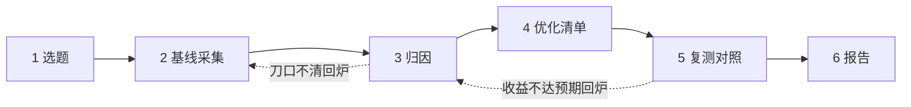

# 毕业项目：全链路测量与优化报告

> [← 第十阶段导览](01-导览.md) · 全链路收束。这一册是全站的终点站：把第一阶段立的 17 步账本、第二至五阶段的连接与协议、第六阶段的缓存、第七阶段的解析执行、第八阶段的渲染管线、第九阶段的指标，以及 [02 册](02-DevTools深潜-Performance全轨道解剖.md)的轨道读法与[03/04 两册](03-案例复盘集-加载类.md)的复盘方法，全部装进一份**可交付、可复现、可答辩**的优化报告。完成它，17 步主线才算走完一圈。

## 1. 毕业什么：从「学过」到「能交付」

九个阶段的能力，在毕业项目里各就各位：

| 阶段能力 | 在毕业项目哪一步用 |
|---|---|
| 17 步账本与记账方法（[第一阶段 02 册](../01-第一阶段/02-从URL到首屏全景时间线与耗时账本.md)） | 基线采集的骨架（§4） |
| 面板度量基础（[第一阶段 04 册](../01-第一阶段/04-度量基础-Network与Performance面板入门.md)） | 全程工具 |
| 导航决策与缓存捷径（第二阶段） | 解释「为什么二次访问快/慢」 |
| DNS/连接/协议（第三、四阶段） | 归因 ③~⑧ 段，设计 preconnect/协议类优化 |
| 服务端与回程（第五阶段） | 归因 TTFB，与后端协作的谈判语言 |
| 缓存判定（第六阶段） | 静态资源策略审计 |
| 解析与执行（第七阶段） | 归因 ⑪~⑬，设计 defer/分割类优化 |
| 渲染管线（[第八阶段](../08-第八阶段/01-导览.md)） | 归因 ⑭⑮⑰，设计失效降级类优化 |
| 指标与交互（[第九阶段](../09-第九阶段/01-导览.md)） | 前后对照的五个指标与阈值 |
| 轨道读法与复盘五段式（本阶段 02/03/04 册） | 全程方法论 |

**毕业的判定不是「学完了」，而是「能交付一份别人照着就能复现、能审查、能落地的报告」**——报告模板与验收标准见 §7、§8。

## 2. 项目总览与三条纪律

### 2.1 流程六步



### 2.2 交付物清单

| 交付物 | 形态 | 验收口径 |
|---|---|---|
| 环境卡 | 报告 §1 | 五要素齐全（§3.2） |
| 基线账本 | 报告 §2 | 17 步逐段有实测值或 n/a+原因 |
| trace 原始凭证 | `labs/` 目录 | 文件名带日期与环境，可回溯 |
| 优化动作清单 | 报告 §3 | 每项归因到账本段 + 预期收益 |
| 前后对照 | 报告 §4 | 五指标 + 复测账本 |
| 误差分析 | 报告 §5 | 每项偏差有解释 |
| 遗留问题 | 报告 §6 | 有优先级与负责人（自己） |

### 2.3 三条纪律（第一阶段立下，毕业时最后核验一次）

1. **固定环境**：CPU 节流、网络节流、缓存状态、浏览器版本全程一致——前后对比才成立；
2. **记原始凭证**：所有账本数字能回溯到 `labs/` 里的 trace/截图；
3. **写差异原因**：预期与实际不一致的地方必须写「为什么」——误差分析是报告里最值钱的部分。

## 3. 第一步：选题与固定环境

### 3.1 选题约束

| 约束 | 理由 |
|---|---|
| 真实站点（公司站/开源站/自己的站均可） | 要有第三方脚本、真实缓存策略等「病」，玩具页面练不出诊断力 |
| 你能改它（或能提出 PR/工单） | 优化动作必须真的落地，纸面优化不算毕业 |
| 页面含可交互元素（按钮/筛选/展开） | INP/长任务才有测量对象 |
| 公开可达或有可复现的本地环境 | 验收者要能复跑你的基线 |

### 3.2 环境卡（固定环境五要素）

| 要素 | 本项目取值（示例） | 说明 |
|---|---|---|
| 设备/浏览器 | MacBook / Chrome 稳定版（版本号） | 写清具体版本 |
| CPU 节流 | 4x slowdown（DevTools 内置） | 全程一致 |
| 网络节流 | Fast 4G（内置档位，约下行 1.6Mbps / RTT 150ms） | 弱网口径，网络段才显形 |
| 缓存状态 | 冷启动（隐身窗 + Disable cache）为主，另记一份热缓存对照 | 两本账分开记，绝不混用 |
| 录制方式 | Start profiling and reload，每配置录 3 次取中位 | 单次 trace 会抖 |

## 4. 第二步：基线采集——DNS→LCP 全时间线拆解

### 4.1 测量来源对账表

每一段的值从哪里抄，先背下这张表（操作细节温习[第一阶段 02 册 §5](../01-第一阶段/02-从URL到首屏全景时间线与耗时账本.md)与[02 册 §5](02-DevTools深潜-Performance全轨道解剖.md)）：

| 账本段 | 主来源 | 交叉验证 |
|---|---|---|
| ③ DNS / ④ TCP / ⑤ TLS | Network 面板 → HTML 主文档 → Timing 标签 | 抓包（第三阶段 06 册）或 Timing 段消失即复用连接 |
| ⑥⑦⑧ | 同上 Timing 标签（Request sent / Waiting(TTFB) / Content Download） | Performance 的 Network 轨道 |
| ⑨⑩ | Network 轨道响应头到达点 → Main 轨道首个 Parse HTML 块 | 几乎不可见，n/a 合法 |
| ⑪⑫⑬ | Main 轨道：Parse HTML / Recalculate Style 前的 CSS 等待 / Script 大块 | Network 轨道的 CSS/JS 完成时间 |
| ⑭⑮ | Main 轨道 Recalculate Style / Layout / Paint + Raster/GPU 轨道 | Frames 轨道首帧 |
| ⑯ | Timings 轨道 FCP/LCP 竖线（确认 LCP 最终候选） | Lighthouse 诊断项 |
| ⑰ | Interactions 轨道三段拆解 + Main 轨道长任务 | field 数据（若有 CrUX/RUM） |

### 4.2 基线账本样例（示意数字，展示形态）

对象：某电商首页（SSR），环境卡同 §3.2，冷启动，录 3 次取中位：

| 段 | 实测 | 归因备注 |
|---|---|---|
| ①② 输入+决策 | ~5ms | 无 SW，无缓存捷径 |
| ③ DNS | 180ms | 全冷；主域 + 2 个第三方域各查一次 |
| ④ TCP | 110ms | ≈1 RTT |
| ⑤ TLS | 105ms | TLS 1.3，无会话恢复 |
| ⑥ 发送 | ~10ms | Cookie 1.2KB（略胖，记下） |
| ⑦ 服务端 | 420ms | CDN MISS 回源 + SSR 计算 |
| ⑧ HTML 回程 | 90ms | 45KB 压缩后 |
| ⑨⑩ 接收+commit | <10ms | 进程预热，正常 |
| ⑪ HTML→DOM | 60ms | head 里同步 app.js 把解析切成两段 |
| ⑫ CSS→CSSOM | 130ms | 2 个阻塞 CSS，其中一个带 @import |
| ⑬ JS 编译执行 | 610ms | 单 bundle 380KB，未分割 |
| ⑭ Style | 25ms | 正常 |
| ⑮ 渲染管线 | 45ms | hero 图解码占一半 |
| ⑯ FCP / LCP | 1.9s / 2.9s | hero 图未 preload，晚于文字上屏 |

### 4.3 五指标基线（对照阈值）

| 指标 | 基线 | 「好」阈值 | 判定 |
|---|---|---|---|
| TTFB | ~640ms（⑥~⑦ 代理） | <800ms | 边缘 |
| FCP | 1.9s | ≤1.8s | 差一口气 |
| LCP | 2.9s | ≤2.5s | ❌ 差 |
| CLS | 0.21 | ≤0.1 | ❌ 差（banner 无尺寸占位） |
| INP p75 | 380ms | ≤200ms | ❌ 差（筛选长任务） |

三个 ❌ 加两个边缘——刀口清单会从这里长出来。

## 5. 第三步：归因与优化清单

### 5.1 归因：每个指标指认上游段落

账本思维的核心动作：**指标是结果，段落是原因**。三个 ❌ 的归因：

```text
LCP 2.9s
  ← ⑬ 同步 bundle 610ms（阻塞渲染？否，但阻塞了 LCP 图的解码排队段）
  ← hero 未 preload（⑪ 的提前量缺失，图要等 CSS+JS 就绪后才被发现）
  ← ③ DNS 180ms 中有第三方域（与主文档串行抢连接）
CLS 0.21
  ← banner 无宽高占位，晚到撑开布局（⑯ 侧的位移）
INP 380ms
  ← ⑰ 筛选回调前的 250ms 长任务（输入延迟段）
  ← 展开行的读写交错（呈现延迟段，渲染类案例一同款病根）
```

### 5.2 优化清单：收益 × 成本排序

| 优化动作 | 精修段 | 预期收益 | 成本/风险 | 优先级 |
|---|---|---|---|---|
| A. 静态资源内容哈希 + immutable；第三方域 preconnect | ③④⑤ + 复访全免 | 首访 -100ms；复访近乎全免 | 低（构建配置） | P0 |
| B. app.js 加 defer；拍平 @import；hero 图 preload + fetchpriority | ⑪⑫⑯ | LCP -0.6s 预期 | 低（head 改动） | P0 |
| C. bundle 分割：首屏 380KB → 140KB；筛选计算拆块 + Worker | ⑬⑰ | FCP -0.3s；INP -150ms 预期 | 中（构建与代码改造） | P1 |
| D. banner 加 aspect-ratio 占位 | CLS | 0.21 → ~0.02 | 极低 | P0 |
| E. 与后端谈 SSR 缓存（页面级 60s 微缓存） | ⑦ | TTFB -300ms（命中时） | 中（服务端） | P2，本期不动 |

**每期只做三个动作**（A/B/D 合并为第一期，C 第二期）——全做完不是毕业要求，**每个动作闭环（预期→实际→误差）才是**。

### 5.3 优化动作卡（每个动作一张）

| 字段 | 动作 B 示例 |
|---|---|
| 名称 | 关键渲染路径缩短 |
| 精修段落 | ⑪⑫⑯ |
| 链路原理 | 同步脚本阻塞 DOM 构建（第七阶段 03 册）；CSS 串行链拉长 CSSOM（07/04 册）；LCP 候选需 preload 提前发现 |
| 具体改动 | `<script defer>`；@import → 3 个 link；hero preload + fetchpriority=high |
| 预期收益 | LCP 2.9 → 2.3s（账本逐段估算：⑬ 不再切 ⑪、⑫ -100ms、图提前 ~0.5s） |
| 风险 | defer 后依赖 DOM 就绪的初始化代码时序（回归测试覆盖） |
| 实际收益 | LCP 2.9 → 2.2s（§6 复测） |
| 误差说明 | 与预期差 0.1s：预解析扫描器比估算更早发现了 CSS，⑫ 段实际只降 60ms |

## 6. 第四步：复测与前后对照

### 6.1 五指标对照表（本期全部动作完成后的示意形态）

| 指标 | 基线 | 优化后 | 变化 | 阈值判定 |
|---|---|---|---|---|
| TTFB | ~640ms | ~630ms | 持平 | 本期未动服务端（动作 E 未做）——**没变也要写为什么** |
| FCP | 1.9s | 1.2s | -0.7s | ✅ |
| LCP | 2.9s | 1.8s | -1.1s | ✅ |
| CLS | 0.21 | 0.02 | -0.19 | ✅ |
| INP p75 | 380ms | 190ms | -190ms | ✅ |

### 6.2 复测账本（只列变化的段）

| 段 | 基线 | 复测 | 变化原因 |
|---|---|---|---|
| ③ DNS | 180ms | 90ms | preconnect 让第三方域提前（动作 A） |
| ⑪ | 60ms | 25ms | 同步脚本改 defer，解析不再被切（动作 B） |
| ⑫ | 130ms | 70ms | @import 拍平，CSS 并行（动作 B） |
| ⑬ | 610ms | 240ms | bundle 分割（动作 C） |
| ⑯ | FCP 1.9 / LCP 2.9 | 1.2 / 1.8 | 上游段缩短的合计 |
| ⑰ | 380ms | 190ms | 长任务拆分 + 批读写（动作 C） |

### 6.3 误差分析：三个必答题

1. **预期 vs 实际差在哪**：每个动作卡的「误差说明」栏逐项填——差正负 10% 内正常，之外必须给出机制解释；
2. **lab 与 field 的落差**：本地 LCP 从 4.2s 降到 2.1s 但 CrUX 几乎没变的三种典型解释——①CrUX 是真实用户设备/网络（中低端安卓 + 真弱网），你的 lab 口径远优于用户；②field 有数天延迟，数据周期未到；③优化只救了冷启动，而真实用户多数命中缓存场景（两本账不同）。三种解释的排除方法分别是：用低端真机+真弱网复测、核对数据周期、补一份热缓存对照账本；
3. **没变的指标也写结论**：TTFB 持平是因为本期没动 ⑦——「没变」是控制变量成立的证据，不是空白。

## 7. 报告模板（直接抄的骨架）

```markdown
# 「站点名」全链路测量与优化报告

> 测量人 / 日期 / 报告版本（v1 基线，v2 优化后）

## 1. 环境卡

| 要素 | 取值 |
|---|---|
| 设备/浏览器 | （具体型号 + 版本号） |
| CPU 节流 | （4x / 6x / 不节流） |
| 网络节流 | （Fast 4G / Slow 4G / 不节流） |
| 缓存状态 | （冷启动 / 热缓存 / 两种分开记） |
| 录制方式 | （重新加载并录制，N 次取中位） |

## 2. 基线账本（DNS→LCP 全时间线）

| 段 | 实测 ms | 测量来源 | 归因备注 |
|---|---|---|---|
| ①② 输入+导航决策 | | | |
| ③ DNS | | Network Timing | |
| ④ TCP 握手 | | Network Timing | |
| ⑤ TLS 握手 | | Network Timing | |
| ⑥ 发送请求 | | Network Timing | |
| ⑦ 服务端处理 | | TTFB 减连接段 | |
| ⑧ HTML 回程 | | Content Download | |
| ⑨⑩ 接收+commit | | （n/a 合法，注原因） | |
| ⑪ HTML→DOM | | Main 轨道 Parse HTML | |
| ⑫ CSS→CSSOM | | Main + Network CSS 完成 | |
| ⑬ JS 编译执行 | | Main 轨道 Script | |
| ⑭ Style 计算 | | Recalculate Style | |
| ⑮ 渲染管线首遍 | | Layout/Paint/Raster | |
| ⑯ 首帧上屏 | | FCP/LCP 竖线 | |

### 2.1 五指标基线

| 指标 | 基线 | 阈值判定 | 指向的上游段 |
|---|---|---|---|
| TTFB | | | ⑥⑦ |
| FCP | | | ⑪⑫⑬⑮ |
| LCP | | | ③~⑬ + LCP 元素时序 |
| CLS | | | ⑯ 侧位移源 |
| INP p75 | | | ⑰ 三段拆解 |

## 3. 优化清单（每动作一张卡）

### 动作 A/B/C…：名称

| 字段 | 内容 |
|---|---|
| 精修段落 | （账本段号） |
| 链路原理 | （哪册哪个机制） |
| 具体改动 | （diff 级描述） |
| 预期收益 | （逐段估算 → 指标预期） |
| 风险 | （回归面） |
| 实际收益 | （复测填） |
| 误差说明 | （为什么与预期有差） |

## 4. 前后对照

| 指标 | 基线 | 优化后 | 变化 | 判定 |
|---|---|---|---|---|
| TTFB | | | | |
| FCP | | | | |
| LCP | | | | |
| CLS | | | | |
| INP p75 | | | | |

### 4.1 复测账本（只列变化的段）

| 段 | 基线 | 复测 | 变化原因（对应动作） |
|---|---|---|---|
| | | | |

## 5. 误差分析

| 偏差点 | 数值 | 机制解释 | 后续动作 |
|---|---|---|---|
| （如 lab LCP -1.1s 但 CrUX 持平） | | | |

## 6. 遗留问题与下一步

| 问题 | 优先级 | 计划动作 | 涉及段落 |
|---|---|---|---|
| | | | |

## 附录

- trace 原始文件：labs/ 文件清单（带日期与环境后缀）
- 关键截图：Timing 标签 / Timings 轨道 / Interactions 三段 / Layers 面板
```

模板使用的三条纪律：**没量到的段写 n/a + 原因**（不许留空）；**没变的指标也要写一行**（「为什么没变」是控制变量的证据）；**每张动作卡必须有误差说明**（哪怕写「与预期一致」）。

## 8. 验收清单：报告答辩表

自评 + 互评都用这张表，**全过才算毕业**：

| # | 验收项 | 通过标准 |
|---|---|---|
| 1 | 账本完整性 | 17 步逐段有实测值或 n/a+原因；来源可回溯到 labs/ 凭证 |
| 2 | 段落可解释 | 验收者任指一段，你能不查资料说出「它是什么、谁干的、为什么是这个数」 |
| 3 | 环境可控 | 环境卡五要素齐全；验收者按环境卡能复现出 ±15% 内的基线 |
| 4 | 归因有据 | 每个指标能指出上游段落；归因链里至少用到 3 个不同阶段的知识点 |
| 5 | 动作闭环 | 每个优化：精修段 + 预期收益 + 实际收益 + 误差说明，四项齐全 |
| 6 | 误差诚实 | 预期与实际偏差 >10% 的项都有机制解释，没有「差不多就行」 |
| 7 | 账本不混用 | 冷/热缓存、lab/field 的数字分开放，没有跨口径对比 |
| 8 | 预防有卡口 | 至少一条优化进 CI/评审规则/监控（不只是「改了」） |
| 9 | 遗留有计划 | 未做项有优先级与下一步，说明「为什么不现在做」 |
| 10 | 复现可行 | 换一个人按报告操作，能独立走完基线→复测全流程 |

## 9. 常见误区

1. **「优化清单越长越毕业」**：验收看的是**闭环数**不是动作数；三个动作全闭环 > 十个动作全「应该有效」。
2. **「只报变好的指标」**：TTFB 持平、CLS 只降一半这些「不完美」恰是报告可信度所在——挑好听的写等于自毁账本。
3. **「lab 优化完就宣布胜利」**：field（CrUX/RUM）有延迟、设备分布不同；结案必须写 lab/field 落差分析（§6.3 第二问）。
4. **「账本一次成型」**：归因发现刀口不清就要回炉重量（§2.1 的回环箭头）；一次画完的账本多半是想象。
5. **「误差 = 测量不准」**：误差首先是**机制差异**（缓存状态、预解析器的提前量、field 口径）——先问「为什么」，再问「是不是量错了」。
6. **「毕业项目做完就扔」**：它应该是可复跑的基线——下次改版，环境卡 + 基线账本直接是回归测试的输入。

## 10. 自测题

1. 说出毕业项目六步流程与两个回炉条件；回炉回的是哪一步、为什么？
2. 环境卡五要素是什么？少了「缓存状态」会发生什么？
3. 基线账本里 ⑥⑦⑧ 各自的测量来源是什么？TTFB 与 ⑦ 的关系怎么换算？
4. 为什么热缓存的账本要单独记？举一个「冷热混用导致结论反转」的例子。
5. LCP 指标的「指向的上游段」为什么要写成「③~⑬ + LCP 元素时序」而不是单一某段？
6. 优化动作卡的八个字段里，哪三个是答辩时被追问最多的？分别检验什么能力？
7. 本地 LCP 大降但 CrUX 没变的三种解释与各自的排除方法是什么？
8. 验收表第 2 条「段落可解释」在检验什么？与第 5 条「动作闭环」的区别是什么？
9. 「没变的指标也要写一行」——用控制变量的语言解释这条纪律。
10. 把你目标站点的账本按 §4.2 的形态填出来；三个最大刀口各精修哪段、预期多少？
11. 误差分析里「先问为什么，再问是不是量错了」——为什么顺序不能反？
12. 毕业报告与第三阶段抓包复测表、第一阶段账本模板是什么关系？（提示：同一方法论的三个成熟度。）

## 11. 自查清单

| # | 检查 | 异常指向 |
|---|---|---|
| 1 | 环境卡五要素齐全且全程未变 | 对比不可信 |
| 2 | 17 步账本无空格（有值或 n/a+原因） | 账本不完整 |
| 3 | 每个数字能回溯到 labs/ 凭证 | 数字无据 |
| 4 | 冷/热、lab/field 账本分开 | 口径混用 |
| 5 | 每个 ❌ 指标有归因链 | 刀口无据 |
| 6 | 优化动作有预期收益的逐段估算 | 预期是拍的 |
| 7 | 每张动作卡四项闭环齐全 | 只做不验 |
| 8 | 误差 >10% 项有机制解释 | 归因缺失 |
| 9 | 至少一条预防进了卡口 | 修而不防 |
| 10 | 遗留问题有优先级与理由 | 报告没有边界 |
| 11 | 他人可按报告复现全流程 | 报告不可交付 |
| 12 | 报告存档且版本号清晰 | 凭证丢失 |

## 12. 延伸：毕业之后

- **回看第一阶段**：重读[第一阶段 02 册](../01-第一阶段/02-从URL到首屏全景时间线与耗时账本.md)——现在你能给 17 步每一段补上「典型慢的三个原因 + 对应面板」，这是全站循环闭合的标志。
- **方法论的迁移**：「拆段 → 记账 → 核账 → 归因 → 复测」不只在浏览器里成立——接口耗时、构建耗时、CI 时长，同一套账本思维直接搬走。
- **继续深挖的方向**：单用户度量学到此完整；线上成千上万用户的采集、聚合与告警归 `observability/` 站；协议攻防与安全头归 `security/` 站；框架层的水合与渲染调度归各框架站——本站给的是它们共同的底座。
- **最后一句话**：协议会演进、引擎会重构、面板会改版，但「沿时间线拆解、逐段归因、闭环验证」的方法不会过期。这份报告就是你带走的全部。
