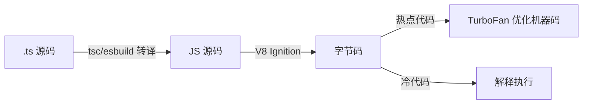

---
references:
  - 02-编译器是什么
  - 03-前端工具链对照定位
  - 04-形式语言基础
  - 05-工程约定与实践-搭建工程骨架
---

# 第一阶段导览：编译器全局观与语言基础

> [返回：编译原理学习大纲](../编译原理学习大纲.md)
> 本文是第一阶段的入口：阶段目标、分册索引、知识点地图、实践任务清单与阶段自测；建议开阶段时读一遍定计划，收阶段时再读一遍查漏。

**建议时长**：2 周（每天 1~2 小时）。本阶段不动手写大量代码，重点是把"编译器全景地图"装进脑子，并搭好贯穿全程的 mini 语言工程骨架。

## 分册索引

| 分册 | 对应大纲条目 | 一句话说明 |
|---|---|---|
| [02-编译器是什么](02-编译器是什么.md) | 第 1 条 | 编译器/解释器/转译器分野、六段流水线数据形态、前端中端后端与 pass、自举 |
| [03-前端工具链对照定位](03-前端工具链对照定位.md) | 第 2 条 | Babel / tsc / esbuild / SWC / V8 各负责哪一段，V8 分层编译，一行代码的旅程 |
| [04-形式语言基础](04-形式语言基础.md) | 第 3 条 | 文法四元组、BNF/EBNF、乔姆斯基谱系、二义性消解，mini v0.1 文法定稿 |
| [05-工程约定与实践-搭建工程骨架](05-工程约定与实践-搭建工程骨架.md) | 第 4 条 + 实践 | monorepo 布局、快照测试与基准约定、v0.1 合法/非法语料集与验收清单 |

## 阶段目标

学完本阶段，你应该能不查资料做到这些事：

1. 画出经典编译流水线（词法 → 语法 → 语义 → IR → 优化 → 代码生成），说清每一段的输入/输出是什么形态的数据。
2. 给 Babel、TypeScript、esbuild、SWC、V8 各自"定位"：它们分别实现了流水线的哪几段、哪些段被省略或合并。
3. 写出 mini 语言 v0.1 的 EBNF 文法，并指出它属于乔姆斯基谱系的哪一型。
4. 解释悬空 else 二义性为什么会发生、两种消解策略（规定优先级 / 改写文法）分别怎么做。
5. 搭好 compiler 工程：monorepo 包结构、快照测试跑通、bench 命令可用。

## 知识点地图

### 1. 编译器是什么

- **编译器 vs 解释器 vs 转译器**：产出目标代码 vs 直接执行产出；转译器（Babel）是"源到源"的编译器。三者边界正在模糊：V8 是"编译器 + 解释器"混合，esbuild 是"转译器 + 打包器"。
- **AOT vs JIT**：提前编译（C/Rust/Go）与运行时编译（JVM/V8/JSC）的取舍——启动速度 vs 峰值性能 vs 可移植性。
- **前端 / 中端 / 后端**：前端面向语言（词法/语法/语义），中端面向优化（IR 上的 pass），后端面向平台（指令选择、寄存器分配）。这个划分决定了后续每阶段的归属。
- **pass 的概念**：一次对全量 IR 的遍历与变换；优化 = 一串 pass 的组合。
- **自举**：Go 1.5 用 C 写的 Go 编译器编译出 Go 写的编译器；理解"鸡生蛋"问题的工程解法。交叉编译与增量编译是自举的现代变体。

### 2. 前端工具链对照定位

- Babel：只做"语法翻译"（新语法 → 旧语法），不做类型检查、不优化——纯前端 + 最小后端。
- TypeScript：tsc = 完整前端 + 类型检查器 + 转译后端；类型信息在 emit 时被擦除。
- esbuild / SWC：转译 + 打包，极致工程化的"前端 + 后端"，砍掉语义分析换取速度。
- V8 分层：Ignition（字节码解释器）→ Sparkplug（基线 JIT）→ Maglev → TurboFan（优化 JIT，sea of nodes IR）。第八阶段会回来看这张图。

### 3. 形式语言基础

- 文法四元组 G = (N, T, P, S)：非终结符、终结符、产生式、开始符号；BNF 与 EBNF 的写法与互换（`()` 分组、`*` 重复、`|` 选择）。
- 乔姆斯基谱系：3 型（正则）⊂ 2 型（上下文无关）⊂ 1 型（上下文有关）⊂ 0 型（无限制）。关键结论：**词法用正则就够（token 无嵌套），语法必须上下文无关（括号嵌套）**——"括号配对不是正则语言"是本节的证明题。
- 二义性：悬空 else（`if a then if b then x else y` 的 else 归谁）、`a - b - c` 结合性。两种消解：给文法规定优先级声明（yacc 风格）或分层改写文法（expr → term → factor 风格）。

### 4. 学习工程约定

- monorepo 布局：`packages/lexer|parser|checker|ir|vm|cli`，依赖单向（lexer ← parser ← checker ← ir ← vm ← cli）。
- 快照测试：`源码 → AST/字节码` 的黄金文件比对，重构 parser/编译器时的安全网；错误用例集单独目录。
- bench 约定：tinybench 跑递归 fib、字符串拼接等标准负载，第七阶段优化前后要用同一组数据。

## 与 mini 语言项目的关系

本阶段产出 mini 语言 v0.1 文法定稿。它决定后面七个阶段的一切输入：lexer 的 token 种类、parser 的产生式、checker 的类型规则。**文法写错一格，后面全程返工**——所以本阶段要花足够时间打磨文法，宁可保守（功能少而清晰）。

## 实践任务清单

"看懂"不算数，跑起来才算（与大纲用法一致；每完成一项回大纲勾选）。

- [ ] 任务 0（环境）：compiler 工程 monorepo 初始化，六个 package 空壳 + 单向依赖声明 + CI 跑通。
- [ ] 任务 1：手绘（或 mermaid）流水线全景图，标注 Babel / tsc / esbuild / V8 各自覆盖的区段。
- [ ] 任务 2：写出 mini 语言 v0.1 EBNF，覆盖：变量声明、四则运算、比较、if/else、while、fn 定义与调用。
- [ ] 任务 3：为文法写出 10 个"合法 / 非法"样例程序各一组，作为后续 lexer/parser 的测试语料。
- [ ] 任务 4：证明或说服自己"括号配对不是正则语言"（泵引理的直觉版即可）。
- [ ] 选做：找到 V8 博客《Sparkplug》与《Maglev》文章通读，只为建地图不求细节。

## 阶段自测

- [ ] 能白板画出六段流水线并说出每段的数据形态（字符流/token 流/AST/带标注 AST/IR/目标代码）。
- [ ] 能说清"为什么 esbuild 不做类型检查反而更快"背后的流水线取舍。
- [ ] 能把 `1 + 2 * 3` 分别按"优先级文法"和"朴素文法 + 运行时判断"两种思路推导一遍。
- [ ] mini v0.1 文法通过自查：无二义、无左递归（或已消除）、每个产生式都有测试样例覆盖。
