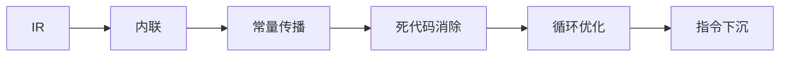

# 编译器是什么：流水线全景

> [返回：第一阶段导览](01-导览.md)
> 对应大纲第 1 条。本册建立全程的"地图"：一次编译经过哪几段、每段的数据形态是什么、哪些工具各自负责哪一段。后面七个阶段都是在放大这张地图的局部。

## 三种"翻译程序"：编译器、解释器、转译器

把"高级语言 → 机器可执行"的方式分三类：

| | 编译器（Compiler） | 解释器（Interpreter） | 转译器（Transpiler） |
|---|---|---|---|
| 产出 | 目标代码（机器码/字节码） | 无独立产物，边译边执行 | 另一种源码 |
| 执行时机 | 编译后，可反复执行 | 即时，逐句 | 再交给编译器/解释器 |
| 性能 | 峰值高（可深度优化） | 启动快、峰值低 | 取决于下游 |
| 例子 | GCC、rustc、tsc（emit） | CPython、早期 Ruby、你的 mini VM | Babel、CoffeeScript |

边界的模糊是常态：**V8 是"编译器 + 解释器"混合体**（先把 JS 编译成字节码再解释执行，热点代码再 JIT 成机器码）；**esbuild 是"转译器 + 打包器"**（输出仍是 JS）；**tsc 既是类型检查器又是转译器**（类型信息在输出中被擦除）。分类只是视角，不是阵营。

## 经典流水线：六段全景

每一段的输入/输出与核心问题：

| 段 | 输入 → 输出 | 核心问题 | mini 语言对应 |
|---|---|---|---|
| 词法 | 字符流 → token 流 | 怎么切词？错误字符怎么办 | 第二阶段 |
| 语法 | token 流 → AST | 这串 token 合不合文法？怎么表达结构 | 第三阶段 |
| 语义 | AST → 带标注 AST | 变量声明了吗？类型说得通吗 | 第四阶段 |
| IR 生成 | 带标注 AST → IR | 用什么形态承载后续变换 | 第五阶段前半 |
| 优化 | IR → IR | 哪些计算可以删掉/提前/合并 | 第七阶段 |
| 生成 | IR → 字节码/机器码 | 映射到目标平台的指令 | 第五阶段后半 + 第八阶段 WASM |

一个贯穿全程的直觉：**编译 = 反复变换数据的形态**。源码、token、AST、IR、字节码都是同一程序的不同表示，每一段都"读一种表示、写另一种表示"。理解了这一点，编译器就不再神秘——它是一串纯函数。

## 前端、中端、后端

按"面向什么"划分三块：

- **前端**（front end）：面向**语言**——词法、语法、语义。C 的前端和 Rust 的前端毫无共性。
- **中端**（middle end）：面向**优化**——IR 上的 pass 流水线。与语言无关、与平台无关。
- **后端**（back end）：面向**平台**——指令选择、寄存器分配、指令调度。x64 后端和 wasm 后端毫无共性。

这个划分的工程红利是解耦：**m 种语言 × n 种平台本需要 m×n 个编译器，插入统一 IR 后只需要 m 个前端 + n 个后端**。LLVM IR 是这个策略的最大受益者（Clang/Swift/Rust 前端共享 x86/ARM/RISC-V/wasm 后端）；GCC 的 GIMPLE/RTL、V8 的 sea of nodes 同理。

## pass：优化的基本单位

**pass = 一次对全量 IR 的遍历与变换**。优化器不是一个大函数，而是一串小 pass 的流水线：

每个 pass 只做一件事、可独立测试、可按需开关（rustc/LLVM 都支持 `-O` 级别选择 pass 组合）。第七阶段你将给自己的字节码写三个 pass，并体会"pass 之间有依赖顺序"（常量传播的产物要等死代码消除来收拾）。

## 自举、交叉编译与增量编译

- **自举（bootstrapping）**：编译器编译自己。Go 1.5 的经典案例——此前 Go 编译器用 C 写，1.5 用 C 版编译器编译出 Go 版编译器，之后 C 代码删除。自举的门槛：语言要能写系统级工具（内存布局可控、无 GC 依赖也行……Go 有 GC 也自举了，关键是运行时自包含）。
- **交叉编译**：在平台 A 上生成平台 B 的目标代码。编译器本身跑在 A（host），产出面向 B（target）。"编译器是 host 程序、代码是 target 产物"的分离让交叉编译成为纯工程问题。
- **增量编译**：只重编译受改动影响的部分。tsc 的 `.tsbuildinfo` 缓存类型图状态；esbuild 的发展方向之一也是增量 API。词法/语法阶段天然易增量（按行缓存），语义阶段难（类型是全局图）。

## 小结

- 编译器 = 一串表示变换；流水线六段各有明确的数据形态。
- 前端/中端/后端的划分用 IR 换来了 m+n 而不是 m×n。
- 优化 = pass 流水线；pass 是可组合的最小单位。
- 自举/交叉/增量是编译器作为"自产自销软件"的三个特殊工程问题。

## 自测

1. `1 + 2` 这段源码，在六段流水线中各是什么形态？（提示：字符流 → 三个 token → BinaryExpression → `number × number → number` 标注 → `t1 = 1 + 2` → `CONST 3` 或直接折叠）
2. 为什么 esbuild 砍掉类型检查能快一个数量级？它省掉的流水线段对应多少工作量？
3. Rust 编译到 wasm：哪个部分是前端、哪个是后端？换编译到 ARM 呢？
