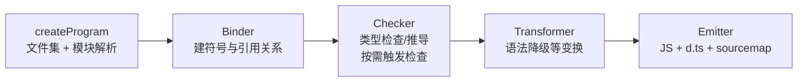
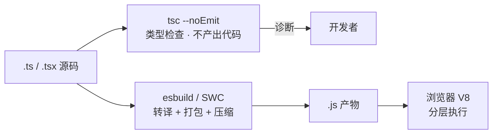
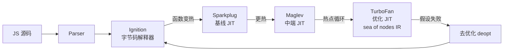

# 前端工具链对照定位：Babel、TypeScript、esbuild、SWC、V8

> [返回：第一阶段导览](01-导览.md)
> 对应大纲第 2 条。本册用第一册的流水线地图给前端工具"定位"，并展开 V8 的分层编译——第八阶段实战的对照对象在这里先挂个号。

## 按"负责哪一段"给工具分类

| 工具 | 词法/语法 | 语义（类型） | IR 与优化 | 代码生成 | 打包 |
|---|---|---|---|---|---|
| Babel | ✅（acorn fork） | ❌ | ❌（只做语法变换） | ✅（输出 JS） | ❌（交 webpack） |
| tsc | ✅ | ✅（Checker） | 少量（TS 层面） | ✅（输出 JS + d.ts） | ❌ |
| esbuild | ✅ | ❌（显式不支持） | 极简（无 IR pass） | ✅ | ✅ |
| SWC | ✅ | ❌（类型检查另配） | 部分 | ✅ | 配合打包器 |
| V8 | ✅ | ❌（动态类型） | ✅（字节码 + TurFan IR） | ✅（机器码 JIT） | — |

结论先行：**前端工具链里没有"完整编译器"，只有 V8**。其余都是流水线的"截取"——这正是它们快的原因，也是边界的由来（esbuild 不做类型检查、Babel 不做优化）。

### 截取的经济学：每家少做哪一段，为什么反而是优势

把"截取"从贬义词变成设计词。每家工具少做一段，都对应一条明确的经济学：

| 工具 | 砍掉的段 | 换来的 | 砍段的理由 |
|---|---|---|---|
| Babel | 语义 + 优化 | 插件生态的灵活变换 | 语法级变换（降级、埋点、codemod）不需要类型；优化该交给下游引擎 |
| tsc | 深度机器级优化 | 保留完整类型图 | 目标是 JS——JS 引擎自己会优化，tsc 再优化一遍是重复劳动 |
| esbuild / SWC | 语义 + 优化 | 并行与单遍的实现自由 | 类型检查是全局串行图，与"文件级并行"正面冲突 |
| V8 | （无，全都要） | 运行时闭环 | 不砍，但用**分层**把成本摊到"值得的代码"上 |

读法：**流水线不是"越全越好"，每一段都要在负载里挣自己的位置**。tsc 的 emit 目标是 JS 而不是机器码，所以中端优化在它体内萎缩成上表的"少量"——第一张表里的每格 ❌ 都是一条架构决策，不是功能缺口。后文每个工具的小节，都可以回看这张表问一句："它砍掉的段，被谁接走了？"

## Babel：纯转译器

```
源码 → @babel/parser → AST → @babel/traverse（plugin 的 visitor 遍历）→ @babel/generator → 新 JS
```

- 职责单一：**新语法 → 旧语法**（如箭头函数 → function、可选链 → 三元）。
- 不做类型检查（不做语义分析）、不做优化（生成的代码往往更啰嗦）——这是设计选择：Babel 把变换交给插件生态（preset-env 按目标浏览器挑选语法降级规则）。
- 第八阶段你将写的 Babel 插件，就插在 traverse 这一步。

### Babel 的五件套与一次降级的旅程

```
@babel/core      总调度：配置解析、插件/预设装配、缓存
@babel/parser    词法 + 语法 → AST（acorn 的 fork，带全部提案语法的开关位）
@babel/traverse  visitor 遍历器：插件以访问者函数挂进来
@babel/types     AST 节点的构造、校验与工具函数（造节点的标准库）
@babel/generator AST → 代码文本（含 sourcemap 标注）
```

一次箭头函数降级的完整旅程：

1. parser 读入 `const f = (x) => x + 1;`，产出 `ArrowFunctionExpression` 节点；
2. traverse 深度优先遍历，进入箭头函数节点时，**所有注册了对该节点类型的 visitor 依次被调**——preset-env 的降级插件、埋点插件、lint 类插件同台工作；
3. 降级插件把节点替换为 `FunctionExpression`：`function (x) { return x + 1; }`。`this` 语义的差异由插件补齐（箭头函数不绑定 `this`，普通函数绑定——经典实现是体前插入 `_this` 类绑定）；
4. generator 把改完的树打印成文本——**打印的是新树的格式信息，不是原始源码**（注释、空格的保留是 generator 的工程难点，第八阶段亲手做一遍就明白）。

### visitor 与 Path：变换为什么给"节点 + 上下文"

Babel 的 visitor 给插件的不是裸节点，是 **Path**——节点加上它在树中的位置、父节点、兄弟、作用域的包装。这是变换工程的刚需：

```js
const plugin = () => ({
  visitor: {
    Identifier(path) {
      if (path.node.name === 'arguments') {
        path.scope.rename('arguments', '_args');   // 沿作用域安全改名
      }
    },
  },
});
```

- **scope.rename 做捕获避免的 α-改名**：改名前查目标名是否在作用域内撞车，撞了就换 fresh 名——λ 演算册的 `subst` 处理的是同一个问题（见[09-演练场-Lambda演算归约器](../09-演练场/05-Lambda演算归约器.md)）；
- **replaceWith / remove / insertBefore**：结构性操作由 traverse 维护的 Path 图完成——插件从不手工"找父改子"；
- **递归风险**：visitor 里新造的节点会**再次被遍历**——插件死循环的经典来源，实现里用遍历标记挡住。

### preset-env 与目标浏览器：按需降级的装配线

preset-env 不是一张固定的降级清单，而是按**目标浏览器集合**动态装配：配置里声明"要兼容到哪些环境"，preset-env 只启用那些目标不支持的语法降级规则。目标声明由 browserslist 一类配置承载，同一个代码库在"现代浏览器"与"兼容旧浏览器"两种目标下产出的代码量级不同。**降级规则按需装配 = 转译成本与目标集成正比**——这也是为什么"升级目标浏览器"常常是最便宜的构建提速手段（定性：省掉的是整段插件的遍历，不是小优化）。

### Babel 的成本边界

用 JS 写、单线程遍历、每个插件一趟（或几趟）全树 visitor 调度——Babel 的慢是**架构性**的：插件数 × 遍历趟数，加上 JS 对象图对 CPU 缓存不友好。第八阶段会看到工程对策（插件合并遍历、缓存命中），但架构上限摆在那里——这也是 esbuild/SWC 用原生语言重写同一条流水线的动机。**同一张流水线图，实现语言与遍历策略决定量级差**（定性；具体倍数随负载变化，选型时以自己的负载实测为准，见第八阶段选型册）。

## TypeScript：编译器 + 类型检查器

tsc 内部（第八阶段详拆）：

```
createProgram（文件集 + 引用图）→ Checker（类型检查/推导）→ Transformer（语法降级）→ Emitter（JS + d.ts + sourcemap）
```

- 类型信息**只存在于编译期**：emit 时擦除（uniform representation 的泛型实现）。运行时没有任何类型。
- `isolatedModules` 约束的根源也在定位里：单文件转译器（esbuild/SWC）没有全程序类型图，所以依赖跨文件类型信息的语法（`const enum` 内联）被禁。

### tsc 的五站流水线

第八阶段的详拆先在这里立骨架：



- **Binder 与 Checker 分家**是 tsc 架构的核心决定：先建全量符号与引用关系（便宜、一次成型），再做类型计算（昂贵、按需触发）——对照第四阶段 mini checker 的 resolve/check 双遍，完全同构；
- **d.ts 是类型信息的"搬家"**：emit 时类型从源码擦除，但搬进声明文件供下游消费——类型没有消失，是换了存放层（源码 → 声明文件）；
- **sourcemap 在 Emitter 生成**：转译前后位置的双向地图，调试器断点、报错定位的还原全靠它——第一册"位置信息跨段流传"的终局。

### 类型擦除的三个证据

"运行时没有类型"不是口号，是可验证的 emit 行为：

| 写法 | emit 后 | 说明 |
|---|---|---|
| `interface Foo { … }` | 消失 | 纯类型声明，零运行时痕迹 |
| `let x: number` | `let x` | 标注被剥掉 |
| `enum Color { R, G }` | **保留**（一个对象常量） | enum 是少数带运行时表示的类型语法 |
| `const enum Color` | 成员被内联 | 依赖"全程序可见"的激进内联——所以被 isolatedModules 禁 |

读法：TS 的"类型"其实混着两族东西——**纯标注**（interface、类型别名、标注，编译期知识）与**带运行时表示的语法**（enum、参数属性、命名空间）。擦除只作用于前者。分不清这两族，是"为什么我的 interface 影响了运行时/为什么没影响"一类困惑的根源。

### isolatedModules：为单文件转译器立的规矩

`const enum` 的跨文件内联、依赖上下文的 import 省略……这些依赖**全程序类型图**的语法，在单文件转译器眼里是不可见的高级信息。`isolatedModules` 的本质：**声明"我的每个文件都能被独立转译"**——把语言子集裁剪到"单文件可见信息足够"的程度。esbuild/SWC 不检查这个约束（它们没有类型图），靠 tsc `--noEmit` 兜底——**约束的受益者与执行者在工具链里是两拨**，这是组合拳能成立的隐含前提。

## esbuild / SWC：极致工程化的转译 + 打包

两者的性能手段高度一致：

1. **原生语言**（Go / Rust）：无 GC 压力的 AST 内存布局、无 JIT 预热。
2. **并行**：文件级并行词法/解析/转换（Go 协程 / Rust rayon）。
3. **单遍设计**：解析与转换合并，不做独立 IR pass，不反复遍历 AST。
4. **低内存 AST**：指针紧排、字符串驻留，cache 友好。

代价也一致：**砍掉语义分析与优化段**。类型检查需要另挂 tsc（`tsc --noEmit` + esbuild build 的组合是标准姿势）。

### 四板斧各自在省什么

| 手段 | 省掉的成本 | 对应传统工具的痛点 |
|---|---|---|
| 原生语言（Go/Rust） | JS 运行时的对象分配、GC 压力、JIT 预热 | JS 工具冷启动要先热身自己 |
| 文件级并行 | 串行遍历的墙钟时间 | 文件间本就独立（单文件转译不需要跨文件信息）——**并行是被"砍掉语义段"解锁的** |
| 单遍设计 | 多遍 AST 遍历的缓存失效 | Babel 的遍历趟数 × 插件数 |
| 紧凑 AST | 指针追逐、缓存未命中 | JS 对象图 = 指针的海洋 |

读法：四条手段**互相成就**——砍掉语义段才有文件级并行，原生语言才养得起紧凑 AST。"快是架构的结果，不是局部优化的结果"——第一册质量属性表里"编译速度 ↔ 架构"那一行在这里兑现。注意"单遍"指**单个文件内部**解析+转换+打印一次完成；打包层（bundle 模式）仍要建模块依赖图做 tree-shaking——那是另一层的工作，与单遍转译不冲突。

### SWC 与框架的合流

SWC（Rust）与 esbuild（Go）手段一致、生态位互补：SWC 被主流框架（如 Next.js）用作默认转译层，esbuild 常被用作打包/压缩层——**框架把"转译"与"打包"分别采购，tsc 继续负责类型**。选型细节（含基准测试口径的坑）在第八阶段 [06-esbuild-SWC与工具链选型](../08-第八阶段/06-esbuild-SWC与工具链选型.md) 展开；这里只立一条原则：**先问负载（转译量、类型需求、插件生态依赖），再问倍数**。

### 前端的典型组合拳

把三家拼成一条现代前端构建线：



三条分工守则：

1. **类型检查与构建并行**：`tsc --noEmit` 与转译打包互不阻塞——CI 里各跑各的；
2. **约束靠 tsc 执行**：isolatedModules 违规、类型错误由 tsc 报；转译器遇到类型非法的代码照样转译（它没有类型图可查）；
3. **特殊变换才上 Babel**：插件生态不可替代时才引入（成本见上文），否则让位给原生链。

## V8 分层编译：JIT 的完整形态

V8 是前端世界里唯一的"完整编译器"，而且是运行时的：



- **Ignition**：把 AST 编译成字节码并解释执行——你的第五阶段产物与它同构（栈式机）。
- **Sparkplug**：字节码逐条翻译为机器码的"基线层"，不做优化，只去掉解释分派开销。
- **Maglev**：中端 JIT，带轻量优化，填补 Sparkplug 到 TurboFan 之间的编译时延空档。
- **TurboFan**：基于 sea of nodes IR 的优化编译器，激进假设（类型反馈："这个 + 一直两边都是 number"）+ 机器码 + 失败即**去优化**（deopt）回 Ignition。

分层的原因是经济学：冷代码用便宜的层（编译快、执行慢），热代码才配昂贵的层（编译慢、执行快）。JIT 的所有激进优化都建立在"错了能回退"之上——第七阶段 JIT 视角一节会回到这里。

### 四层逐个看：各层在买什么、卖什么

| 层 | 干什么 | 编译成本 | 执行速度 | 关键机制 |
|---|---|---|---|---|
| Ignition | 字节码解释执行 | 低 | 低 | 紧凑字节码；解释期间顺手收集类型反馈 |
| Sparkplug | 基线 JIT：字节码近 1:1 翻译成机器码 | 很低 | 中 | 不做优化，只消掉解释分派的开销 |
| Maglev | 中层 JIT：轻量优化 | 中 | 中高 | 用类型反馈做有限的推测优化 |
| TurboFan | 优化 JIT：深度优化的机器码 | 高 | 高 | sea of nodes IR；激进的类型推测 + 去优化兜底 |

- **类型反馈（feedback）是分层的粘合剂**：Ignition 执行时记录"这个 `+` 的两个操作数至今都是 number""这个属性访问每次都命中同一个对象形状"——TurboFan 按这些记录做**推测性优化**（按历史赌未来）；
- **去优化（deopt）是赌输的保险**：运行中发现假设不成立（忽然来了个 string），机器码作废、回退 Ignition 重收集反馈，之后可能再优化——**"错了能回退"是激进优化的前提**，第一册质量属性表"正确性 > 产物质量"在运行时的形态；
- **同一段代码可能多次往返**：反复 deopt 再优化（deopt loop）是真实的病态模式——推测优化的边界不在编译器，在负载的稳定性。

### Ignition 为什么选字节码，而不是直接生成机器码

既然要执行，为什么不一步编译到机器码？三个理由：

1. **紧凑**：字节码比等价机器码小得多——网页脚本动辄数百个函数，多数只执行一两次，为它们付机器码的内存代价不划算；
2. **可移植**：字节码与具体 CPU 解耦，同一份 Ignition 架构跑遍 x64/ARM——跨架构是浏览器的硬需求；
3. **反馈的天然收集点**：解释循环逐指令执行，正好在每条运算处顺手记录操作数的类型历史——TurboFan 的推测原料由此而来。

第 2、3 条合起来回答了一个更深的问题：**字节码不只是"慢的机器码"，是运行时的中间表示**——第五阶段 mini VM 的字节码就是它的微缩版（形态对照见 [05-第五阶段-字节码设计](../05-第五阶段/03-字节码设计.md)）。

### 隐藏类与内联缓存：动态类型怎么"快"起来

JS 对象没有静态类型声明，V8 用**隐藏类（hidden class / shape）+ 内联缓存（IC）**把动态属性查找变成模式化快路径：同"形状"的对象共享布局描述，属性访问的机器码按形状缓存，形状不变则直达字段偏移。两点联动：

- **形状抖动 = 性能悬崖**：乱序添加属性、动态删除属性都会改变隐藏类链，让缓存失效——"为什么同样的对象字面量换个写法就慢了"的机制解释；
- **它是 TurboFan 推测的数据来源**：反馈向量里记录的正是形状与类型的历史——"这个属性访问一直命中同一个形状"才敢编成直取偏移的机器码。

对象模型全貌在第六阶段 [02-运行时对象模型](../06-第六阶段/02-运行时对象模型.md)；这些布局如何被 GC 消费，[10-GC算法专题](../10-GC算法专题/01-导览.md) 有整册专题。

把一次属性访问 `obj.x` 的两条路径并排看（IC 的快慢分野）：

| | 快路径（单态命中） | 慢路径（多态/超多态） |
|---|---|---|
| 前提 | 反馈里只见过一种形状 | 反馈里挤进多种形状（上限超出后退化为通用查找） |
| 机器码形态 | 校验形状 + 直取偏移 | 沿隐藏类链/字典查找 |
| 教训 | 保持对象形状稳定 | 热点代码里避免"同一个调用点喂不同形状" |

**单态（monomorphic）快、多态（polymorphic）慢、超多态（megamorphic）退化到通用路径**——这组词汇是读懂一切 JIT 性能建议的钥匙，第七阶段 JIT 视角会反复引用。

## 一行代码的旅程

```ts
const answer: number = 20 + 22;
```

1. **tsc（或 IDE 内嵌 tsserver）**：Parser → Checker 确认 `20 + 22` 是 `number`、与标注相容；Transformer 删除类型标注，Emitter 输出 `const answer = 20 + 22;`（含 sourcemap）。
2. **bundler（esbuild/webpack）**：词法/语法再解析一次，模块图解析，tree-shaking（第七阶段）判定 `answer` 是否被引用，minify 可能直接折叠成 `42`（窥孔级常量折叠——20 + 22 = 42；tsc 不做这一步，压缩器做）。
3. **V8**：Parser → Ignition 生成字节码 `LdaSmi [42]`——折叠在字节码生成器就做完了（实跑收据见下节），随后 `Star0` 存入 answer 槽位；热点循环才轮到 Sparkplug/Maglev/TurboFan 接管。

同一行代码被"编译"了至少三次——每次的流水线截取不同、目的不同。

### 三次"编译"各关心什么

| 次序 | 谁 | 关心 | 不关心 |
|---|---|---|---|
| 1 | tsc / tsserver | 类型对不对（诊断）、emit 的降级语法 | 运行速度、产物体积 |
| 2 | bundler | 模块依赖图、tree-shaking、体积、sourcemap 拼接 | 类型（已擦除）、运行性能 |
| 3 | V8 | 执行速度（按热度分层）、内存布局 | 类型正确性（已擦除） |

三家的关注点几乎**互不重叠**——这不是巧合，是流水线分工的本质：每一段消费上一段的形态、产出下一段关心的形态。回看第一册六段表"每段的输入/输出与核心问题"，在真实工具链里同样成立。

### 现场取证：擦除表与三次"编译"的实跑收据

"类型擦除的三个证据"与"一行代码的旅程"两张表都是可实跑的断言。tsc 5.9.3、`--target es2020`，输入四个代表（擦除表每行一个，外加一行类型别名）：

```ts
interface Foo { a: number }        // 纯类型声明
let withType: number = 1;          // 带标注
enum Color { R, G }                // 带运行时表示
const enum Fast { R, G }           // 全程序内联
const pick = Fast.R;
type Unused = string;
```

emit 的真实输出：

```js
let withType = 1;                  // interface 与 type 整体消失、标注剥掉
var Color;
(function (Color) {
    Color[Color["R"] = 0] = "R";   // enum 是唯一的幸存者：双向映射对象
    Color[Color["G"] = 1] = "G";
})(Color || (Color = {}));
const pick = 0 /* Fast.R */;       // const enum：使用点直接内联成 0
console.log(Color.G, pick, withType);
```

四行对号（对照"类型擦除的三个证据"表）：interface/type 在输出里**没有对应行**——纯编译期知识，Emitter 直接跳过；标注剥除是擦除的主体；enum 编成 IIFE 双向映射（`Color[0] === "R"` 能工作的原因：数字与名字都存）；const enum 内联成 `0 /* Fast.R */`——**内联依赖"全程序可见"**：Fast 定义在另一个文件时，单文件转译器拿不到枚举定义就无法内联，这就是 isolatedModules 禁它的机制现场（见上文"isolatedModules"一节，两处对照读）。

V8 一侧的收据（Node v24 `--print-bytecode`，`const answer = 20 + 22; console.log(answer);` 的顶层脚本，节选）：

```text
@  0 : LdaSmi [42]                     ← 20 + 22 已折叠：字节码生成阶段顺手做掉
@  2 : Star0                           ← 42 存入 answer 的槽位（寄存器 r0）
@  3 : LdaGlobal [0], [0]              ← 取 console
@  7 : GetNamedProperty r2, [1], [2]   ← 取 .log（槽 [2] 记形状反馈）
@ 12 : CallProperty1 r1, r2, r0, [4]   ← console.log(answer)
@ 17 : LdaUndefined
@ 18 : Return
```

三条收据合起来，把本册最容易背错的三个细节钉死：

1. **tsc 不做常量折叠**：emit 原样保留 `20 + 22`（实跑验证）——"少量优化"那一格里连窥孔折叠都没有，反正目标要交给下游引擎；
2. **V8 的折叠不在 TurboFan**：容易背错的版本是"TurboFan 最终可能折叠成常量"——实跑证伪，`LdaSmi [42]` 在 Ignition 字节码层就已成型。TurboFan 的工作是把热路径编译成更快的机器码，不是捡字节码漏下的常量；
3. **槽位模型跨站通用**：`Star0` 的 r0 就是 answer 的槽位——mini checker 的 `Symbol.index`（第四阶段）、第五阶段 VM 的局部变量表、Ignition 的寄存器，是同一个概念在不同段的现身。

## 选型视角

- 要**类型检查** → tsc 必须在链上（`--noEmit`），哪怕 build 用 esbuild。
- 只要**转译 + 打包的速度** → esbuild / SWC。
- 要**深度 AST 定制**（埋点、codemod、宏） → Babel（生态最厚）。
- 新项目决策树：vite（内含 esbuild）起步；类型检查独立跑 `tsc --noEmit`；特殊变换再插 Babel/SWC 插件——各段用各自最强的工具，而不是找一个"全能编译器"。

把决策树展开成问答链（每问淘汰一批候选）：

1. **要类型检查吗？** 要 → tsc 在链上（怎么与构建并行见上文组合拳）；不要（纯 JS 项目）→ 跳到 3；
2. **类型检查与转译要不要一体？** 一般不要——拆开才能各自用最强的工具；
3. **有特殊语法变换吗？**（提案语法、框架宏、codemod）有 → 该环节上 Babel 插件；没有 → 原生链到底；
4. **构建瓶颈在哪？** 开发回路慢 → 优先转译/打包层的原生工具；CI 类型检查慢 → project references 切分检查边界（第一册增量编译一节）。

## 工具链环节与课程阶段的对照表

| 工具环节 | 对应课程产出 | 分册 |
|---|---|---|
| Babel 的 parser / traverse / generator | mini 的 lexer / parser / 代码生成 | 第二、三、五阶段；[08-第八阶段-Babel深度剖析](../08-第八阶段/02-Babel深度剖析.md) |
| tsc 的 Binder / Checker | mini 的 resolve + check 双遍 | 第四阶段；[08-第八阶段-TypeScript编译器架构](../08-第八阶段/05-TypeScript编译器架构.md) |
| tsserver 的 hover / 跳转 / 重命名 | 符号表 + resolvedTo 引用边 | [04-第四阶段-符号表与作用域](../04-第四阶段/02-符号表与作用域.md) |
| esbuild 的单遍转译 | mini 流水线的融合版 | [08-第八阶段-esbuild-SWC与工具链选型](../08-第八阶段/06-esbuild-SWC与工具链选型.md) |
| V8 Ignition 的字节码 | mini 的栈式字节码 VM | [05-第五阶段-字节码设计](../05-第五阶段/03-字节码设计.md)、[04-解释器实现](../05-第五阶段/04-解释器实现.md) |
| V8 的 GC | mini VM 的内存管理 | 第六阶段；[10-GC算法专题](../10-GC算法专题/01-导览.md) |
| V8 的 JIT 优化 | mini 的优化 pass + JIT 视角 | [07-第七阶段-JIT视角](../07-第七阶段/05-JIT视角.md) |
| sourcemap / 诊断 | mini 的 span 与诊断体系 | [03-第三阶段-AST设计与错误恢复](../03-第三阶段/05-AST设计与错误恢复.md) |

读法：这张表是第一册"目录的目录"在工具链维度的投影——**你在课程里写的每个部件，都在这张表的某个工业产品里上班**。学习路径上建议：先写 mini 部件（低成本试错），再读对应工业实现（高成本理解），顺序不要反。

## 工具链的三个时代：流水线截取的变迁

本册的五家工具不是同时出现的，它们的位置变迁本身就是一部"流水线经济学"演化史（定性分期，不精确到年份）：

| 时代 | 主角 | 流水线形态 | 驱动问题 |
|---|---|---|---|
| 1. 直接执行时代 | 浏览器内建引擎 + 简单压缩 | 源码 → 压缩混淆 → 浏览器 | 没有新语法要降级，模块化还没普及 |
| 2. 转译 + 打包时代 | Babel + webpack 生态 | 源码 → 转译 → 打包 → 压缩 → 浏览器，全 JS 实现 | 语言标准快速演进（ES2015+）、模块化爆发——**新语法与旧引擎的时差需要转译器填** |
| 3. 原生工具链时代 | esbuild/SWC（转译打包）+ tsc（类型）+ V8 分层 | 同上，但重活换原生实现、类型检查独立成站 | 项目规模膨胀，开发回路的墙钟时间成为第一痛点 |

三个观察：

- **每次变迁都换主角，没换流水线**——六段骨架三十年未动，变的是"每段用什么实现、谁负责"；
- **tsc 的位置一直没动**：类型检查是唯一无法用"砍语义段"提速的环节，所以它在任何时代都是独立一站——这个稳定位置反过来印证了第一册"语义段的增量性是架构第一约束"的判断；
- **时代的收尾不是"更快"而是"分工更细"**：转译、打包、类型、执行四个环节各自找到最优实现——与第一册"m+n 组合律"同构，工具链也在做减法组合而非全能堆料。

## 自测

1. 为什么"esbuild 快"不是优化的胜利，而是流水线取舍的胜利？它砍了哪两段？
2. V8 为什么要四个执行层而不是一个？冷代码和热代码各自走什么路径？
3. `const enum` 为什么过不了 isolatedModules？用"单文件转译器看不到什么数据"回答。
4. Babel 的 visitor 为什么给插件 Path 而不是裸节点？用"作用域安全改名"说明 Path 上哪些信息是变换必需的。
5. esbuild 遇到类型非法的代码会报错吗？谁负责报——用"约束的受益者与执行者是两拨"回答。
6. 用"类型反馈 + 推测优化 + 去优化"三个词解释：为什么 V8 跑同一段代码，冷启动慢、跑久了快？
7. tsc 的 Binder 与 Checker 为什么分两站？对照 mini checker 的 resolve/check 双遍说出同构点。
8. `const x: number = 1;` 在三次"编译"（tsc、bundler、V8）里各变成什么？哪些信息被谁擦除、谁补回？
9. 用六段对账表回答：把一个项目的 Babel 链路整体换成 SWC，流水线上哪一段变了、哪一段没变？"换了更快"的预期收益该按哪一段重估？

## 常见误区

- **"esbuild 快就是因为 Go 比 JS 快"**：语言只是四板斧之一，架构贡献更大（砍语义段 → 文件级并行、单遍设计）——同样的架构决策在别的实现里同样有效，Go 是锦上添花；
- **"tsc 慢是实现不行"**：tsc 的慢主要来自类型图的**全局性**（跨文件依赖、全量 Binder 先行）——这是它的职责决定的；项目级对策是 project references 切分检查边界，而不是等一个"快版 tsc"；
- **"V8 的四层是开关，越高越好"**：分层是**经济模型**（冷代码不值得付优化编译的成本），不是能力阶梯；短命函数一辈子停在 Ignition 不是失败，是设计；
- **"deopt 是 bug"**：deopt 是推测优化的**正常保险机制**；异常的是 deopt loop（反复赌输反复优化）——那才是要查的负载不稳定信号；
- **"Babel 落伍了，全换 SWC"**：Babel 的插件生态（codemod、自定义变换、框架编译器）不可替代；正确读法是"默认原生链、特殊变换按需插 Babel"（选型视角一节）；
- **"类型检查可以 build 完再补"**：`tsc --noEmit` 与构建**并行**可以，"先 build 再说"不行——擦除之后类型错误只剩运行时炸雷（any 洞、调用错位），检查是发布前的最后一道闸；
- **"前端工具链 = 编译原理黑魔法"**：全部六个工具都是第一册六段流水线的截取组合——课程里你已手写过大半部件，剩下的只是规模与工程化差距；
- **"工具选型要看 benchmark 排名"**：先对照六段对账表问"它砍了哪段、保了哪段"——取舍与你的项目不匹配，跑分再高也白搭；匹配了，跑分只是验证（上一册"你的一天"表 + 本册对账表联合使用）；
- **"monorepo 里换个 bundler 就能解决构建慢"**：构建慢常常是依赖图太深（全局性），不是 bundler 太慢——先用依赖分析把"每段吃多少"量出来，再决定换工具还是拆包（project references / 分包）。

收尾一张对账表——五家工具各自"砍/保哪一段"，是本册所有对照的浓缩（段号沿用第一册六段流水线）：

| 工具 | 砍掉的段 | 保留并做重的段 | 一句话定位 |
|---|---|---|---|
| Babel | 语义、优化、生成（只产出 AST 变换后交下游） | 解析、变换 | 语法层的可编程变换站 |
| tsc | ——（全保） | 语义（Binder+Checker） | 唯一全保流水线的"类型站" |
| esbuild | 语义、优化 | 解析、打包、生成 | 单遍转译打包，"快"来自砍段 |
| SWC | 同 esbuild | 同 esbuild | 同取舍的原生另一实现 |
| V8 | ——（执行引擎不吃源码流水线） | 解释、JIT 优化、运行时 | 语义与优化的"兑现处" |
| ESLint / Prettier | 语义、优化、机器码段 | 解析、AST 变换、（诊断/格式化）输出 | 前三段的轻量消费者，"一打编译器"的日常两位 |

读这张表的方法：**列二（砍什么）解释速度，列三（重什么）解释职责**。面试里被问"为什么 X 快"，答案永远在第二列；被问"X 能不能替代 Y"，答案在第三列的差集。
