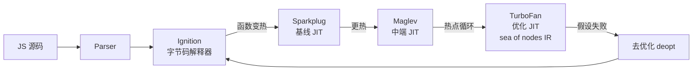

# 前端工具链对照定位：Babel、TypeScript、esbuild、SWC、V8

> [返回：第一阶段导览](01-导览.md)
> 对应大纲第 2 条。本册用第一册的流水线地图给前端工具"定位"，并展开 V8 的分层编译——第八阶段实战的对照对象在这里先挂个号。

## 按"负责哪一段"给工具分类

| 工具 | 词法/语法 | 语义（类型） | IR 与优化 | 代码生成 | 打包 |
|---|---|---|---|---|---|
| Babel | ✅（acorn fork） | ❌ | ❌（只做语法变换） | ✅（输出 JS） | ❌（交 webpack） |
| tsc | ✅ | ✅（Checker） | 少量（TS 层面） | ✅（输出 JS + d.ts） | ❌ |
| esbuild | ✅ | ❌（显式不支持） | 极简（无 IR pass） | ✅ | ✅ |
| SWC | ✅ | ❌（类型检查另配） | 部分 | ✅ | 配合打包器 |
| V8 | ✅ | ❌（动态类型） | ✅（字节码 + TurFan IR） | ✅（机器码 JIT） | — |

结论先行：**前端工具链里没有"完整编译器"，只有 V8**。其余都是流水线的"截取"——这正是它们快的原因，也是边界的由来（esbuild 不做类型检查、Babel 不做优化）。

## Babel：纯转译器

```
源码 → @babel/parser → AST → @babel/traverse（plugin 的 visitor 遍历）→ @babel/generator → 新 JS
```

- 职责单一：**新语法 → 旧语法**（如箭头函数 → function、可选链 → 三元）。
- 不做类型检查（不做语义分析）、不做优化（生成的代码往往更啰嗦）——这是设计选择：Babel 把变换交给插件生态（preset-env 按目标浏览器挑选语法降级规则）。
- 第八阶段你将写的 Babel 插件，就插在 traverse 这一步。

## TypeScript：编译器 + 类型检查器

tsc 内部（第八阶段详拆）：

```
createProgram（文件集 + 引用图）→ Checker（类型检查/推导）→ Transformer（语法降级）→ Emitter（JS + d.ts + sourcemap）
```

- 类型信息**只存在于编译期**：emit 时擦除（uniform representation 的泛型实现）。运行时没有任何类型。
- `isolatedModules` 约束的根源也在定位里：单文件转译器（esbuild/SWC）没有全程序类型图，所以依赖跨文件类型信息的语法（`const enum` 内联）被禁。

## esbuild / SWC：极致工程化的转译 + 打包

两者的性能手段高度一致：

1. **原生语言**（Go / Rust）：无 GC 压力的 AST 内存布局、无 JIT 预热。
2. **并行**：文件级并行词法/解析/转换（Go 协程 / Rust rayon）。
3. **单遍设计**：解析与转换合并，不做独立 IR pass，不反复遍历 AST。
4. **低内存 AST**：指针紧排、字符串驻留，cache 友好。

代价也一致：**砍掉语义分析与优化段**。类型检查需要另挂 tsc（`tsc --noEmit` + esbuild build 的组合是标准姿势）。

## V8 分层编译：JIT 的完整形态

V8 是前端世界里唯一的"完整编译器"，而且是运行时的：



- **Ignition**：把 AST 编译成字节码并解释执行——你的第五阶段产物与它同构（栈式机）。
- **Sparkplug**：字节码逐条翻译为机器码的"基线层"，不做优化，只去掉解释分派开销。
- **Maglev**：中端 JIT，带轻量优化，填补 Sparkplug 到 TurboFan 之间的编译时延空档。
- **TurboFan**：基于 sea of nodes IR 的优化编译器，激进假设（类型反馈："这个 + 一直两边都是 number"）+ 机器码 + 失败即**去优化**（deopt）回 Ignition。

分层的原因是经济学：冷代码用便宜的层（编译快、执行慢），热代码才配昂贵的层（编译慢、执行快）。JIT 的所有激进优化都建立在"错了能回退"之上——第七阶段 JIT 视角一节会回到这里。

## 一行代码的旅程

```ts
const answer: number = 20 + 22;
```

1. **tsc（或 IDE 内嵌 tsserver）**：Parser → Checker 确认 `20 + 22` 是 `number`、与标注相容；Transformer 删除类型标注，Emitter 输出 `const answer = 20 + 22;`（含 sourcemap）。
2. **bundler（esbuild/webpack）**：词法/语法再解析一次，模块图解析，tree-shaking（第七阶段）判定 `answer` 是否被引用，minify 可能直接折叠成 `22`（窥孔级常量折叠）。
3. **V8**：Parser → Ignition 生成字节码 `LdaSmi 20; Add 22; Star answer`。若该函数变热，Sparkplug/Maglev 接管，TurboFan 最终可能折叠成常量。

同一行代码被"编译"了至少三次——每次的流水线截取不同、目的不同。

## 选型视角

- 要**类型检查** → tsc 必须在链上（`--noEmit`），哪怕 build 用 esbuild。
- 只要**转译 + 打包的速度** → esbuild / SWC。
- 要**深度 AST 定制**（埋点、codemod、宏） → Babel（生态最厚）。
- 新项目决策树：vite（内含 esbuild）起步；类型检查独立跑 `tsc --noEmit`；特殊变换再插 Babel/SWC 插件——各段用各自最强的工具，而不是找一个"全能编译器"。

## 自测

1. 为什么"esbuild 快"不是优化的胜利，而是流水线取舍的胜利？它砍了哪两段？
2. V8 为什么要四个执行层而不是一个？冷代码和热代码各自走什么路径？
3. `const enum` 为什么过不了 isolatedModules？用"单文件转译器看不到什么数据"回答。
