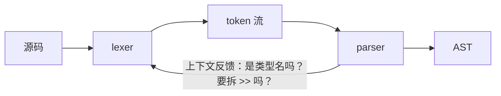

# 形式语言基础：文法与乔姆斯基谱系

> [返回：第一阶段导览](01-导览.md)
> 对应大纲第 3 条。本册是理论地基：文法怎么写、语言怎么分类、词法与语法的分界线为什么画在那里。最终产出 mini 语言 v0.1 的 EBNF 文法。

## 形式化的起点：字母表、串、语言

- **字母表 Σ**：符号的有限集合。mini 语言的字母表 ≈ 全体 Unicode 字符。
- **串（string）**：字母表符号的有穷序列。ε 表示空串。
- **语言（language）**：Σ 上串的**集合**——"所有合法 mini 程序"就是一个语言。

形式化的价值：把"什么是合法程序"从直觉变成数学对象。"合法的标识符"= 某个正则表达式的语言；"合法的程序"= 某个上下文无关文法的语言。**编译器前端的前进方向就是不断逼近"用机器可判定的方式刻画这些集合"。**

### 语言上的三种运算

串上的运算抬升到语言（集合）上有三条，它们是后面一切"文法组合能力"的源头：

| 运算 | 记号 | 定义 | 算例（L₁ = {a, ab}，L₂ = {b, ε}） |
|---|---|---|---|
| 连接（concatenation） | L₁·L₂ | {xy \| x ∈ L₁, y ∈ L₂} | {a·b, a·ε, ab·b, ab·ε} = {ab, a, abb} |
| 并（union） | L₁ ∪ L₂ | 集合并 | {a, ab, b, ε} |
| 克林星（Kleene star） | L* | L 与自身任意次连接的并（含 0 次） | {ε, a, ab, aa, aab, abab, ……} |

对照一眼就能认出来：正则表达式的 `|`、邻接书写、`*` 就是这三条运算的记法；EBNF 的 `(a | b)`、邻接、`X*` 同样一一对应。**文法不是神秘的规则书，是"语言代数"的表达式**——后面的乔姆斯基谱系，分的正是"这种表达式能表达到什么程度"。

## 文法：用产生式刻画语言

文法是四元组 **G = (N, T, P, S)**：

| 分量 | 含义 | mini 例子 |
|---|---|---|
| N | 非终结符（语法范畴） | `expr`、`stmt`、`fnDecl` |
| T | 终结符（词法后的 token） | `if`、`+`、`ident`、`number` |
| P | 产生式（N → (N ∪ T)\*） | `expr → expr + term` |
| S | 开始符号 | `program` |

**推导（derivation）**：从 S 出发反复把非终结符替换为产生式右部，直到全是终结符。`expr ⇒ expr + term ⇒ term + term ⇒ number + term ⇒ 20 + 22`——这个推导序列就是"一次语法分析"的数学本质（第三阶段：自顶向下分析构造推导，自底向上分析构造推导的逆过程）。

### 推导、语法树与最左推导

同一个串可以有多条推导路径，但它们可能共享同一棵**语法树**（推导的树形快照：根是 S，每步替换画一层）。树才是语义的载体——第三阶段要构造的目标就是它，推导只是构造过程的线性记录。

用二义性一节的"分层文法"把 `20 + 22 * 2` 做一次最左推导（每步替换最左非终结符；EBNF 的重复记号按等价 BNF 递归形式展开）：

```text
expr ⇒ expr + term                  （expr → expr + term）
     ⇒ term + term                  （最左的 expr → term）
     ⇒ factor + term                （term → factor）
     ⇒ number + term                （factor → number，落位 20）
     ⇒ number + term * factor       （剩下的 term 取乘法分支）
     ⇒ number + factor * factor     （term → factor）
     ⇒ number + number * number     （22 与 2 落位）
```

七步推导对应一棵树：`*` 在最深的层、`+` 在中层——优先级写进了树形。**最左推导 = 每次展开最左非终结符**，这正是递归下降解析器的工作方式（每次函数调用处理当前最左的待定结构）；而**最右推导的逆序列**恰是自底向上（LR）分析的"移进-归约"记录——两条分析路线是同一文法的正向展开与逆向收缩（第三阶段两册分别展开）。

## BNF 与 EBNF

BNF（Backus-Naur Form）只用递归产生式；EBNF 加了三个缩写记法：

| EBNF 记法 | 含义 | 等价 BNF |
|---|---|---|
| `X*` | 重复 0 次以上 | `Xs → X Xs \| ε` |
| `X+` | 重复 1 次以上 | `Xs → X Xs \| X` |
| `(a \| b)` | 分组选择 | 新增非终结符 |
| `X?` | 可选 | `Xopt → X \| ε` |

例子（函数调用实参）：

```ebnf
(* BNF 风格 *)
args    → argList | ε
argList → expr | argList "," expr

(* EBNF 风格：一行顶四行 *)
args → ( expr ("," expr)* )?
```

EBNF 的价值不只是短——它**消灭了一批只为语法而存在的非终结符**，文法与代码（第三阶段的解析函数）对应更直接。

### EBNF 记法与解析代码的机械对应

EBNF 的每条记法都对应一段固定的递归下降代码骨架——这张表是第三阶段"机械翻译"的对照底稿：

| EBNF 记法 | 递归下降骨架 | 依赖的判定 |
|---|---|---|
| `A → B C` | `parseA() { parseB(); parseC(); }` | 顺序调用 |
| `A → B \| C` | `if (匹配 FIRST(B)) parseB(); else parseC();` | FIRST 集：候选能以哪些 token 开头 |
| `X*` | `while (匹配 FIRST(X)) parseX();` | 循环继续条件 |
| `X?` | `if (匹配 FIRST(X)) parseX();` | 可选分支条件 |

"FIRST 集"这里只需要直觉：**候选产生式右部的开头 token 集合**。若同一位置两个候选的 FIRST 集相交，"看一个 token 定分支"就失效——这是文法的 LL(1) 问题（第三阶段系统展开）。设计 mini 文法时刻意让各分支 FIRST 不相交，就是为了让上面这张表逐行机械翻译时不出现"要多看几个 token 才敢定分支"的死角。

## 乔姆斯基谱系

按产生式约束从松到紧分四级，**每级对应一种自动机**（识别装置）：

| 型 | 名称 | 产生式约束 | 对应自动机 | 语言例子 |
|---|---|---|---|---|
| 0 | 无限制文法 | 左部含非终结符即可 | 图灵机 | 一切可计算语言 |
| 1 | 上下文有关 | 左部不长于右部 | 线性有界自动机 | `a^n b^n c^n` |
| 2 | 上下文无关（CFG） | 左部是单个非终结符 | 下推自动机（栈） | `a^n b^n`、括号配对、多数程序语言语法 |
| 3 | 正则 | `A → aB` / `A → a` 形态 | 有限自动机（DFA/NFA） | 标识符、数字字面量、注释 |

**谱系是包含关系**：正则 ⊂ CFG ⊂ CSG ⊂ 递归可枚举。前端只用到最下两层：词法用 3 型（有限状态足够），语法用 2 型（需要栈来数括号）。

### 谱系逐级判定小例

"某语言属于第几型"的判定方法两句话：**构造出该级文法 ⇒ 至少该级（上界）；证明低一级文法不存在 ⇒ 恰好该级（下界）**。上界靠构造，下界靠反证（泵引理族）——构造永远比证明容易，这个不对称贯穿整门理论。拿三个语言走完整判定：

**L₁ = { aⁿbⁿ \| n ≥ 0 }**（`ab`、`aabb`、`aaabbb`……）：

| 步 | 论证 |
|---|---|
| 1 构造 2 型文法 | `S → aSb \| ε`——三步推导 `S ⇒ aSb ⇒ aaSbb ⇒ aabb` |
| 2 证明不是 3 型 | 泵引理反证（下一节括号配对的论证把 `(`/`)` 换成 `a`/`b` 逐字成立） |
| 3 结论 | 恰好 2 型。识别需要栈：读 a 压栈、读 b 弹栈，栈空且输入尽则接受 |

**L₂ = { aⁿbⁿcⁿ \| n ≥ 0 }**（`abc`、`aabbcc`……）：

| 步 | 论证 |
|---|---|
| 1 构造 1 型文法 | `S → aSBC \| aBC`，配三条落定规则 `aB → ab`、`bB → bb`、`bC → bc`（产生式左部含终结符但仍满足"左部不长于右部"，正是 1 型的形状） |
| 2 手推 abc | `S ⇒ aBC ⇒ abC ⇒ abc`（先落 B 再落 C） |
| 3 手推 aabbcc | `S ⇒ aSBC ⇒ aaBCBC ⇒ aaBBCC（CB→BC 换序类规则的等价效果）⇒ aabBCC ⇒ aabbCC ⇒ aabbcC ⇒ aabbcc` |
| 4 证明不是 2 型 | 下推自动机只有一个栈：数完 a-b 栈已空，再验 b-c 时"b 有几个"的信息已经丢失——两个独立计数需要两台栈（或一条可读不可写的带子，即线性有界自动机） |
| 5 结论 | 恰好 1 型 |

**L₃ = "一切会停机的图灵机的编码"**——0 型（递归可枚举）：不存在更紧的刻画，它就是"可计算"的边界。0 型与 1 型之间的鸿沟是停机问题级别的：1 型语言的成员判定保证停机，0 型不保证。

判定结论的工程翻译：**谱系等级 = 识别装置的记忆量级**（无记忆 / 栈 / 带子 / 不保证停）。编译器前端停在 2/3 型不是"懒得动用高级装置"，而是**成本曲线在那里拐弯**——每升一级，实现复杂度上一个数量级，而程序语言的语法结构恰好用不到更高一级（真的用到的部分见后面的工业对照）。

## 词法为什么正则就够，语法为什么必须 CFG

核心差异是**计数能力**：

- token 的结构是**扁平**的：标识符是"字母开头、后跟字母数字"，数字是"数字开头、后跟数字/点/指数"——没有嵌套，不需要"记住开了几个括号"，有限状态够用。
- 语法的结构是**嵌套**的：`(1 + (2 * (3 - 4)))` 可以任意深。识别它必须"数左括号"，而有限状态只有有限个状态、栈可以无限深。

**括号配对不是正则语言的直觉证明**（泵引理的口语版）：假设有个有限状态的识别器能接受所有 `(^n)^n`。它状态有限（设 k 个），读 `(^m`（m > k）时必然两次经过同一状态——这个"圈"可以泵入任意次，也就是说它也会接受 `(^m')^m`（m' ≠ m）这种不配对的串。矛盾。而带栈的自动机每个 `(` 压栈、`)` 弹栈，恰好计数。

这条分界线就是第二/三阶段的分界线：**lexer 不配对括号，parser 配对**。你永远不该在 lexer 里数括号（JS 的模板字符串 `${}` 嵌套是著名反例——它逼得词法器和语法器回退成协同工作的状态机）。

### 正则就够的一线走查：标识符 DFA 与最长匹配

标识符的 DFA（字母/下划线进 S1，之后字母/数字/下划线自环）：

```text
→ S0 --字母或下划线--> S1 --字母/数字/下划线--> S1（自环）
```

手走两个串：

| 输入 | 状态迁移 | 结果 |
|---|---|---|
| `_foo1` | S0 →( _ ) S1 →( f ) S1 →( o ) S1 →( o ) S1 →( 1 ) S1 | 接受，类别 = 标识符 |
| `1foo` | S0 读 `1`：无迁移可走 | 拒绝（数字开头违反产生式） |

两个工程细节值得提前知道（第二阶段全面展开）：

- **最长匹配（maximal munch）**：`>=` 与 `>` 的冲突靠"能吃多长吃多长"消解——先按两字符的 `>=` 尝试，失败回退一个字符发 `>`。这是有限自动机上的标准贪婪策略；
- **关键字不需要专用状态机**：标识符 DFA 照样接受 `if`，接受之后查**关键字表**决定类别——命中是关键字、未命中是普通标识符。加一个关键字不用动状态机，只改一张表。

这两条解释了"词法为什么敢用正则"的另一半：不但语言层面正则够用，实现层面还有"最长匹配 + 查表"两个标准补丁，覆盖几乎全部工程摩擦。

## 二义性文法

**二义（ambiguity）**：存在一个串有兩棵不同语法树。两个经典案例：

**悬空 else**：

```ebnf
stmt → "if" expr "then" stmt
     | "if" expr "then" stmt "else" stmt
     | ...
```

`if a then if b then x else y` 的 `else` 归内层还是外层？两棵树都合法。消解两法：

1. **规定优先级**：else 与最近的 then 配对（大多数语言的选择，LL 分析天然就近）。
2. **改写文法**：把语句分成 matched（无悬空 else）与 unmatched 两个非终结符，让 else 只能挂进 matched——机械但正确。

**表达式优先级**：朴素文法

```ebnf
expr → expr "+" expr | expr "*" expr | number
```

对 `20 + 22 * 2` 有两棵树（先加后乘/先乘后加），且 `a - b - c` 左右结合不定。解法是**分层改写**：

```ebnf
expr   → term (("+" | "-") term)*      (* 低优先级 *)
term   → factor (("*" | "/") factor)*  (* 高优先级 *)
factor → number | "(" expr ")" | "-" factor
```

每层一个非终结符 = 每个优先级一层结构；同层循环 `*` 重复 = 左结合。这坨文法正是第三阶段递归下降/Pratt 代码的直接蓝本（Pratt 用绑定力数值把"层数"压成一张表，但数学本质相同）。

### 歧义小例推演：一个串的两棵树、两个值

朴素文法下，`20 + 22 * 2` 有两条**不同的最左推导**（二义的正式定义：存在不止一棵语法树；等价说法：存在不止一条最左推导）。

推导一（顶层取 `+`，乘法沉入右子树）：

```text
expr ⇒ expr + expr ⇒ number + expr ⇒ 20 + expr * expr
     ⇒ 20 + number * expr ⇒ 20 + 22 * expr ⇒ 20 + 22 * 2
```

树形 `20 + (22 * 2)`，求值 64。

推导二（顶层取 `*`，加法沉入左子树）：

```text
expr ⇒ expr * expr ⇒ expr + expr * expr
     ⇒ number + number * expr ⇒ 20 + 22 * 2
```

树形 `(20 + 22) * 2`，求值 84。

两条推导都从 `expr` 出发、每步都是合法替换——**文法没有说谎，是文法本身给了两个真相**。这说明二义性不只是"画树困难"：语法树的形状直接决定求值顺序，**语法二义 = 语义二义**（除非语义层刻意无视形状，那等于把优先级从编译期踢成运行期约定）。分层改写后，推导二不再可能——`+` 所在的层根本见不到 `*`，62 与 84 之争在文法层裁决完毕。

悬空 else 同理，`if a then if b then x else y` 的两棵树：

```text
树一（else 归外层）：if a then (if b then x) else y
树二（else 归内层）：if a then (if b then x else y)
```

区别是**执行语义**：条件 a 为假时，树一会执行 `y`，树二什么都不做——不是排版之争，是控制流之争。这也解释了为什么几乎所有语言都选"就近配对"：它既是 LL 分析的自然结果，也是多数作者书写时的直觉预期。

## mini 语言 EBNF v0.1

第一阶段的定稿产物（词法级 token 以 `〖〗` 标注）：

```ebnf
program    → decl* EOF

decl       → fnDecl | stmt
fnDecl     → "fn" ident "(" params? ")" retType? block
params     → ident typeAnn ("," ident typeAnn)*
retType    → "->" type
type       → "number" | "string" | "bool" | "unit"

stmt       → letDecl | ifStmt | whileStmt | block | exprStmt | "return" expr? ";"
letDecl    → "let" ident typeAnn? "=" expr ";"
ifStmt     → "if" expr block ("else" (ifStmt | block))?
whileStmt  → "while" expr block
block      → "{" decl* "}"
exprStmt   → expr ";"
typeAnn    → ":" type

expr       → assignment
assignment → logicOr ("=" assignment)?
logicOr    → logicAnd ("||" logicAnd)*
logicAnd   → equality ("&&" equality)*
equality   → comparison (("==" | "!=") comparison)*
comparison → term (("<" | ">" | "<=" | ">=") term)*
term       → factor (("+" | "-") factor)*
factor     → unary (("*" | "/") unary)*
unary      → ("!" | "-") unary | call
call       → primary ("(" args? ")")*
primary    → number | string | "true" | "false" | ident | "(" expr ")"
```

设计决策备注：

- 表达式按优先级**分层到底**（不依赖优先级声明），LL(1) 友好，递归下降可直接机械翻译。
- `assignment` 右结合（`a = b = c` 合法）；其余二元运算全部左结合。
- 类型标注可选（`let x = 1;` 可推导）——为第四阶段的推导留接口。
- v0.1 **刻意不含**：数组、字符串方法、class、模块。它们分别在第五、六、八阶段随能力生长（见大纲的"生长路线表"）。

### 定稿自查：这份文法为什么没有二义

v0.1 定稿前按四条自查，每条都能指到具体产生式：

| 自查项 | 产生式证据 | 若失败的形态 |
|---|---|---|
| 无左递归 | 递归只出现在右部末尾或 `*` 循环展开（`unary → ("!" \| "-") unary` 是右递归） | 左递归让递归下降无限自调——LL 家族全灭 |
| 分支 FIRST 不相交 | `stmt` 的候选按开头 token 分家：`let` / `if` / `while` / `{` / 表达式开头 / `return` / `fn` | 一个 token 定不了分支，解析函数要多向前看 |
| 悬空 else 消灭 | `("else" (ifStmt \| block))?` 挂在最近的 if 产生式里 | "就近配对"从规定变成结构，无需额外声明 |
| 结合性明确 | `assignment → logicOr ("=" assignment)?` 右递归即右结合；其余二元层用 `*` 循环即左结合 | `a = b = c` 或 `a - b - c` 的树形不定 |

自查的价值在于**可重复**：v0.1 生长（加数组、加字符串模板）之后重跑这张表，新引入的二义当场现形。文法不是一次性的作文，是随语言演化的活文档——下一册的语料集就是它的配套回归网。

## 工业对照：真实语言的文法都比 CFG 多一点

教科书把"程序语言语法 = CFG"当结论，工业现实是"**CFG 骨架 + 少量上下文反馈**"。几个著名的洞：

| 语言 | 超出纯 CFG/正则的部分 | 工业处理 |
|---|---|---|
| C | `typedef int T; T x;`——`T` 是类型名还是变量名，取决于前面的声明（上下文敏感） | lexer 与符号表协同：扫到 `T` 时查符号表，决定发 TYPE_NAME 还是 IDENTIFIER |
| JS | `/` 是除法还是正则字面量开头（`a / b` 对 `a /re/g`），token 层无法独立判定 | lexer 依上一个 token 类别做启发式，或 parser 回退重扫 |
| TS | 泛型闭合 `Array<Array<number>>` 的 `>>` 与右移运算符 `>>` 撞车 | 某一端（词法或解析）吞下 `>>`、另一端需要时拆开，实现内自洽即可 |
| Python | 缩进即语法（offside rule），二维布局进不了一维 token 流 | lexer 生成 INDENT/DEDENT 假 token，把布局翻译回 CFG 可吃的形状 |
| JS | ASI（自动分号插入） | parser 层的错误恢复规则，不是文法规则 |
| Rust | 宏在解析中途展开新语法 | 解析增量进行：宏调用点暂停，展开后续析——文法不再是闭集 |



统一解释：完整的 1 型分析代价不可接受，于是工程选择停在甜点区——**CFG 骨架负责绝大部分结构，剩下的洞用"查表反馈 + 局部重扫"补**。逐级判定小例说"程序语言语法恰好用不到 1 型"，这张表补上后半句：**但都偷偷借了一点上下文**。第二阶段的 lexer 协同与第三阶段的 parser 细节会反复回到这张表。

## 常见误区

- **"正则很弱，词法迟早要升级"**：3 型能力有限，但 token 的扁平结构恰好用不满它。模板字符串的嵌套是"越权结构"，用词法/语法协同解决，不是把整个词法升级成 CFG；
- **"二义文法绝不能进编译器"**：yacc/bison 系长期接受二义文法，用优先级/结合性声明在分析表层消歧——文法更短、分析表更小。分层文法与"二义 + 声明"是两条都成立的工程路线（第三阶段 LR 册对照）；
- **"谱系是考试用的分类学"**：等级直接对应识别装置的记忆成本与实现复杂度——词法/语法分段、递归下降能写多简单，全是谱系等级的工程投影；
- **"EBNF 只是 BNF 的缩写糖"**：它消灭了一批纯语法非终结符，改变文法的形状本身，直接影响解析函数的组织方式；
- **"文法定稿就不会动"**：语言一定生长。本册的自查清单 + 下一册的语料集合起来才是"演化安全网"——只定稿不设防的文法，第一次加特性就可能破坏 LL(1)；
- **"推导 = 语法树"**：推导是线性记录，树是二维结构；同一棵树可以对应多条推导（先展开谁都可以），而二义性的本质恰恰是"树不唯一"。树才是语义的载体。

## 与后续各册的连接

- 正则 → 自动机的完整构造（RE/NFA/DFA 与子集法）：[02-从正则到自动机](../02-第二阶段/02-从正则到自动机.md)；
- 手写 lexer 与最长匹配的工程细节：[03-手写lexer](../02-第二阶段/03-手写lexer.md)；
- LL(1)、FIRST/FOLLOW 与递归下降的系统化：[02-自顶向下LL族](../03-第三阶段/02-自顶向下LL族.md)；
- 优先级文法的另一条路线（绑定力数值表）：[03-Pratt解析](../03-第三阶段/03-Pratt解析.md)；
- 自底向上分析与二义文法的工程消歧：[04-自底向上LR族](../03-第三阶段/04-自底向上LR族.md)；
- 文法落成工程（语料集与验收清单）：[05-工程约定与实践-搭建工程骨架](05-工程约定与实践-搭建工程骨架.md)。

## 小结

- 语言 = 串的集合；文法是刻画集合的产生式系统；BNF/EBNF 是记法，乔姆斯基谱系是能力分级。
- 词法停在 3 型（扁平、无计数），语法需要 2 型（嵌套、要栈）；泵引理负责证明"低一级不够用"。
- 二义性 = 一个串多棵树 = 多个语义；分层文法把优先级与结合性焊进结构。
- 真实语言 = CFG 骨架 + 上下文反馈的工程甜点区；mini v0.1 的分层 EBNF 是逐条可自查的定稿。

## 自测

1. 把 `fn add(a: number, b: number) -> number { return a + b; }` 从 `program` 开始推导一遍，写出推导序列。
2. 用分层文法画出 `20 + 22 * 2 == 44` 的语法树，验证乘法在底层、加法中层、比较顶层。
3. 为什么模板字符串的 `${}` 让"词法用正则"的结论失效？词法器需要什么额外能力？
4. 乔姆斯基 1 型文法对应什么语言（举一例）？为什么前端用不到它？

（1~4 为原题；5~10 为扩写增补题，答不出就回到对应推演。）

5. 泵引理论证里"圈"出现在哪一步？若识别器恰好有 k 个状态，读多少个 `(` 之后必然两次经过同一状态？这个"圈"被泵入一次后，多出来的串长什么样？
6. 用 `S → aSb | ε` 手推 `aaabbb` 的完整推导序列，并画出语法树；指出下推自动机处理这串时栈深的最大值。
7. `aaabbbccc` 为什么一个栈不够？描述栈内容在处理到第二个 `b` 时进退两难的具体状态。
8. 用 mini 的 `assignment` 产生式画出 `a = b = c` 的语法树形状；若把它改写成左递归 `assignment → assignment "=" logicOr`，`a = b = c` 的树会变成什么样、赋值语义会出什么问题？
9. C 的 typedef 问题为什么不能靠"更大的正则"或"更大的 CFG"解决？它需要识别器额外具备什么能力？
10. 给 EBNF 产生式 `args → ( expr ("," expr)* )?` 写出对应的递归下降函数骨架（伪码），并指出每段代码对应表里的哪条记法。
