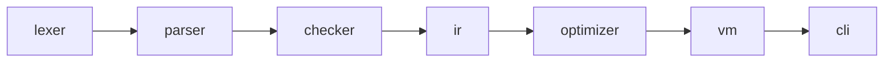
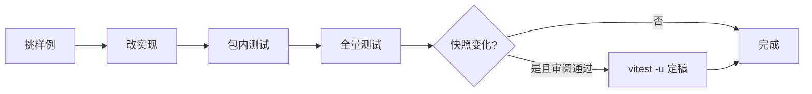

# 实践：搭建工程骨架与文法定稿

> [返回：第一阶段导览](01-导览.md)
> 对应大纲第 4 条与实践任务。本册把前两册的理论落成工程：monorepo 布局、测试与基准的约定，以及 v0.1 文法的"合法/非法"语料集。产物是后面七个阶段的安全网。

## monorepo 布局

```
mini/
├── package.json            # workspaces: ["packages/*"]
├── tsconfig.base.json      # strict、ESM、NodeNext 共享配置
└── packages/
    ├── lexer/              # 第二阶段：字符流 → token 流
    ├── parser/             # 第三阶段：token 流 → AST
    ├── checker/            # 第四阶段：AST → 诊断 + 符号表
    ├── ir/                 # 第五阶段：AST → 字节码
    ├── vm/                 # 第五、六阶段：字节码 → 执行
    ├── optimizer/          # 第七阶段：字节码 → 字节码
    └── cli/                # 汇总：mini run/build/repl
```

依赖**严格单向**：



规则：任何包只 import 图中右侧的包。反过来（lexer 引 parser）= 循环依赖 = 推倒重写。`cli` 是唯一知道全部包的地方——库包之间永远通过数据结构（Token/AST/Bytecode）解耦，这正是"编译 = 表示变换"在工程上的兑现：**每个包的公开接口就是一个纯函数 + 一个数据类型**。

### 依赖单向的三道保险

约定写下来只是纸面，工程上要让它**可执行**：

| 保险 | 做法 | 拦截时机 |
|---|---|---|
| 声明层 | 每个包的 package.json 只声明右侧依赖 | 装依赖时左侧包根本装不进来 |
| 检查层 | `madge --circular`（或 dependency-cruiser 规则）扫 import 图 | CI 里跑，出现回边即红 |
| 规则层 | ESLint `no-restricted-imports` 按包名限制 | 编辑器内划红线，保存即见 |

三道保险对应"依赖图是资产"的三个消费时点：声明层保证**能装**，检查层保证**能测**，规则层保证**写着写着不越界**。最便宜的一层是规则层——在写代码的当下就报错，比 CI 阶段回滚便宜一个数量级。第七阶段的 optimizer 会插到 ir 与 vm 之间，第五阶段的 repl（挂在 cli 下）要同时吃 ir 和 vm——这两个未来改动都**不违反**单向规则，验收清单里的依赖方向检查要能证明这一点。

### 一个特性穿过六个包：改动路径预演

以"给 mini 加位运算符 `&`"为例，从上游到下游走一遍改动路径（文法层归入 parser，token 归入 lexer）：

| 包 | 要动什么 | 新增测试 |
|---|---|---|
| lexer | token 种类加 `amp` + 识别规则 | 1 个切词用例（含位置） |
| parser | 表达式层插入一层 bitAnd 产生式 | AST 快照 1 例（验证优先级层位） |
| checker | 规则表加一行（number × number → number） | 合法 + 非法各 1 例 |
| ir | 指令集加一条 AND | 字节码快照 1 例 |
| vm | 分派循环加一个 case | 执行结果 1 例 |
| cli | 无改动（纯透传） | — |

两个观察：**物理改动自上游而下**（token → 文法 → 规则 → 指令），但**设计决策自下游而上**——指令选型、类型规则先定，lexer/parser 忠实执行；**改动波及面可以机械预测**——改到哪一层，右侧全部包重跑测试，左侧一个不用动。monorepo 的单向依赖买的就是这个"波及面可预测"；等价物写进验收清单：加 `&` 这类小特性，预估改动文件数，实测对账。

## 包骨架约定

每个包最小三件套（以 lexer 为例）：

```ts
// packages/lexer/src/index.ts —— 对外只有纯函数
export interface Token { /* 第二阶段定义 */ }
export function tokenize(source: string): Token[] { /* ... */ }
```

- `tsconfig.base.json` 关键项：`"strict": true`、`"module": "NodeNext"`、`"exactOptionalPropertyTypes": true`——AST 与诊断对象从第一天起就靠判别联合精确窄化，后期的类型红利巨大。
- 每包 `vitest` 直配（`vitest.config.ts` 继承 base），无需 monorepo 级统一 runner。

### 严格开关的取舍清单

base 配置里每个严格项都不是免费的——它们用一类书写负担换一类 bug 的根除：

| 开关 | 拦什么 | 代价 | 本课程的取舍 |
|---|---|---|---|
| strict 家族 | null/undefined 逃逸、隐式 any、this 悬空 | 处处面对"可能没有"的收窄要求 | 全开：AST/符号表代码最怕空引用逃逸 |
| exactOptionalPropertyTypes | 区分 `?:` 与 `\| undefined` | 赋值前要想清"有还是没有这个键" | 开：诊断对象的 hints 可选字段全靠它 |
| noUncheckedIndexedAccess | 下标访问自动加 undefined | 每个数组下标都要收窄 | 开：token 流按下标取值的地方多，值得 |
| declarations / composite | 供项目引用与增量构建 | 配置耦合进构建链 | 不作纪律项，工具链需要时再加 |

前三行是"写编译器的人给自己上最严的类型检查"——**用静态语义工具检查静态语义工具**，是全程的工程姿态；第八阶段读 tsc 源码时会看到同一条姿态的工业版。

## 命名与代码风格约定

约定优先于记忆，且全部落在**可 grep 的形状**上：

| 对象 | 约定 | 例子 |
|---|---|---|
| 判别联合的判别字段 | AST 节点用 `type`，类型/符号用 `kind` | `{ type: 'BinaryExpr' }`、`{ kind: 'number' }` |
| AST 节点名 | PascalCase，声明带 Decl 后缀、表达式带 Expr 后缀 | FnDecl、LetDecl、CallExpr |
| 遍历与检查函数 | 前缀表明方向 | walkDecl（建表用）、synthExpr（综合）、checkStmt（检查） |
| 错误码段位 | 阶段号 × 两位序号 | E010x 词法、E030x 语法、E040x 语义 |
| fixture 编号 | 三位数 + 短横线描述 | 001-arith、101-unclosed-paren |

判别字段恒名的红利在 switch：`switch (node.type)` 与 `switch (t.kind)` 全仓库形状一致，写惯一个包就能盲写另一个包；错误码段位让"这条诊断属于哪个阶段"直接从 code 读出（第四阶段 checker 的 E0401~E0404 就是这条约定的首个兑现）。约定越早统一，后面读工业编译器时的迁移成本越低——ESTree 的 `type`、Babel 的节点命名、swc 的 `Kind` 都是同一套形状的变体。

## 包间数据契约的演化纪律

Token、AST、Diagnostic、Bytecode 是包间的**公共契约**，契约演化要有纪律：

| 契约动作 | 规则 | 例子 |
|---|---|---|
| 加字段 | 只许加可选字段，且不破坏既有快照 | Diagnostic 加 `relatedLocations?: ...` |
| 加变体 | 判别联合加一个 kind，全仓库非穷尽 switch 编译期爆红处逐个补 | AST 加一种新表达式节点 |
| 改语义 | 不允许——语义变更等于新契约，全部下游用例重审 | Token 的 start 含义从"字符偏移"改成别的东西 |
| 删字段 | 分两步：先标 deprecated 过一个阶段，再真删 | — |

"加 kind 全仓库爆红"依赖的不是纪律而是类型系统（第四阶段 ADT 册的穷尽性检查），这是 monorepo + strict 组合的复利：**契约演化从"靠 review 盯"变成"编译器盯"**。快照库在这里第二次发挥安全网作用——契约一动，黄金文件先变，审阅 diff 就是契约变更的变更日志。

## 错误是数据：Diagnostic 约定的原型

编译器工程的元约定：**错误不是异常，是数据**。tokenize/parse/check 全都"带着错误返回"：

```ts
interface Diagnostic {
  readonly code: string;        // E0401 形状：阶段段位 + 序号
  readonly message: string;     // 给人读的主句
  readonly start: number;       // 源码偏移，渲染层再换算行列
  readonly end: number;
  readonly hints?: readonly string[];   // 行动建议（可选）
}
```

三条理由写进约定：

- **一次跑完所有检查**：异常模型在第一个错误就中断，用户被迫"一次只修一个错"；数据模型让 checker 报完十类错误继续跑，诊断密度直接决定体验；
- **错误可测试**：数组可以快照、可以 diff、可以按 code 断言——异常无法进黄金文件；
- **错误可传递**：CLI 打印、编辑器 LSP、CI 注解三种出口消费同一份数据，格式化只是出口各自的事。

Node 生态的 error-first 回调与 Rust 的 `Result<T, E>` 是同一思想的两个工业版本——mini 取"返回诊断数组"的最简形态，但**思想开场就要立住**：第二阶段的词法错误恢复、第三阶段的 parse 错误恢复、第四阶段的诊断工程，全是这个约定的逐阶段兑现。

## 从骨架到接缝：样例 001 的六段数据形态

把"每个包的公开接口就是一个纯函数 + 一个数据类型"落实到 `001-arith.mini`（`let x = 20 + 22 * 2;`），六个接缝上它各是什么形状（第五阶段起才真正实现，此处先立"接缝数据长什么样"的预期）：

| 接缝 | 输入 → 输出 | 001 在这里的形态（示意） |
|---|---|---|
| lexer | 源码 → Token[] | `LET IDENT(x) EQ NUM(20) PLUS NUM(22) STAR NUM(2) SEMI`（各带位置） |
| parser | Token[] → Program | LetDecl{ init: BinaryExpr(+, 20, BinaryExpr(*, 22, 2)) } |
| checker | Program → 标注 AST + 诊断 + 符号表 | x 挂 Symbol(#0, number)，表达式标注 number，0 诊断 |
| ir | 标注 AST → 字节码 | `PUSH 22; PUSH 2; MUL; PUSH 20; ADD; STORE 0` 形状 |
| optimizer | 字节码 → 字节码 | `PUSH 44; STORE 0`（常量折叠 + 冗余指令清理） |
| vm / cli | 字节码 → 执行结果 | 程序无输出，静默结束 |

这张表是 02 册"一个例子的六段旅程"在工程侧的孪生：那边讲流水线段，这边讲**包边界**——同一条数据流、两种切分视角。验收时拿它当接口文档用：任何包的输出形状偏离表格，接缝就裂了。它也是"cli 是唯一知道全部包的包"的具象化——cli 把六行串成一条管道，库包彼此的实现一无所知。

两点提前说明，防止第五阶段落空：其一，表里的字节码是**示意**，真实指令集（栈式设计、槽位编号）以第五阶段的字节码设计册为准；其二，checker 接缝的输出里"符号表 + 标注 AST"两个东西要一起交付——第五阶段的 ir 只吃标注后的 AST（Identifier 上挂着 resolvedTo），不会回头重跑 resolve。**接缝上的数据完整性约定，比实现提前两个阶段锁定**，这就是骨架的意义。

## 快照测试：编译器的安全网

编译器重构频繁（parser 写三遍很正常），快照测试是回归的底线。约定两级：

**AST/字节码级快照**（黄金文件比对）：

```
packages/parser/__fixtures__/
├── legal/
│   ├── 001-arith.mini          # 源码
│   ├── 001-arith.ast.snap      # 手工确认后冻结的 AST JSON
│   └── 002-if-else.mini ...
└── errors/
    ├── 101-unclosed-paren.mini
    └── 101-unclosed-paren.diag.snap   # 期望的诊断数组
```

```ts
// packages/parser/src/__tests__/snapshot.test.ts
import { test, expect } from 'vitest';
import { readdirSync, readFileSync } from 'node:fs';

for (const file of readdirSync('__fixtures__/legal')) {
  if (!file.endsWith('.mini')) continue;
  test(file, () => {
    const src = readFileSync(`__fixtures__/legal/${file}`, 'utf8');
    const ast = parse(tokenize(src));
    expect(JSON.stringify(ast, null, 2)).toMatchFileSnapshot(
      `__fixtures__/legal/${file.replace('.mini', '.ast.snap')}`);
  });
}
```

流程纪律：**快照只允许"人工审阅后"更新**（`vitest -u` 之前必须 diff 过变更）——它是行为文档，不是自动生成的垃圾场。

**错误用例集**：每个阶段新增的诊断至少配 3 个用例（触发、不误触发、信息可读）。错误是编译器的一半产品，测试面不能只覆盖 happy path。

### 快照的粒度清单：各层冻结各层的产物

AST 快照只是其一，每层流水线产物都可以有对应快照，粒度对齐该层的输出：

| 粒度 | 冻结什么 | 检出哪类错误 | 用例 |
|---|---|---|---|
| token 快照 | tokenize 的输出数组 | 切词边界、类别、位置丢失 | `a>=b` 与 `a >= b` 应同构 |
| AST 快照 | parse 的输出 JSON | 树形/字段/优先级错误 | `20+22*2` 的嵌套形状 |
| 诊断快照 | 诊断数组（code/位置/message） | 误报、漏报、信息退化 | 101-unclosed-paren |
| 端到端快照 | 源码 → 执行输出 | 全链路回归 | fib(10) 的 stdout |

纪律只有一条：**每个快照文件都是被人工审阅过的黄金文件**。`vitest -u` 不是提交按钮——正确流程是"跑测试 → diff 变更 → 判断新输出是否更正确 → 才允许 -u"。反例是一次重构后顺手 `-u`，几百个快照静默变化，安全网变成遮羞布。

工业对照：rustc 的 UI 测试（黄金 `.stderr` 文件）、tree-sitter 的语料库（corpus）测试同属一族——**编译器测试的主流范式就是黄金文件比对**，断言式单元测试反而次要。差别只在审阅流程的严格程度。

## 基准测试约定

第七阶段要量化优化收益，基准从第五阶段起就要冻结负载：

```ts
// packages/cli/bench/fib.bench.ts
import { bench, run } from 'tinybench';

bench('fib(25) 字节码执行', () => {
  miniRun(`fn fib(n) { if (n < 2) { return n; } return fib(n-1) + fib(n-2); } fib(25);`);
});

await run();
```

三组标准负载：**递归 fib(25)**（调用栈压力）、**字符串拼接 ×1000**（分配/GC 压力）、**map/filter 高阶函数**（闭包 + 内建库）。第七阶段前后对比用同一份数据，"优化了多少"才有意义。

### 微基准的三个陷阱

bench 数字只有在躲开三个经典陷阱后才有资格比较：

1. **预热（warmup）**：宿主是分层编译的（第二阶段导览的 V8 分层图），前若干次迭代跑的是慢路径——负载要先空转再计时，否则测的是解释执行而不是编译产物；
2. **死代码消除**：被测函数没有可观测副作用时，宿主 JIT 可能把它整体优化掉——结果要么每次消费，要么累加后落盘，不能只调用不消费；
3. **噪声与口径**：单次运行毫秒级抖动，取**中位数**而非平均数（抗离群点），同一台机器、同一负载对比；成熟基准库已内置预热与统计。

写进约定的推论：**第七阶段的优化报告只引用"同机同负载的中位数对比"**——绝对值换台机器就作废，相对降幅才有信息量。这也顺手回答了"bench 为什么从第五阶段就冻结"：比较的前提是"除了优化，什么都不变"——基线必须在改动之前立好。

## mini v0.1 文法验收语料

文法（见 [04-形式语言基础](04-形式语言基础.md)）配 20 个样例，先手推再入库。法定样例节选：

```ebnf
(* 001-arith.mini *)      let x = 20 + 22 * 2;
(* 003-shadow.mini *)     let x = 1; { let x = "s"; print(x); }
(* 005-fib.mini *)        fn fib(n: number) -> number {
                             if (n < 2) { return n; }
                             return fib(n - 1) + fib(n - 2);
                           }
```

非法样例节选（每个对应一条文法拒绝规则）：

```
(* 101 *) let = 1;            # let 后必须有 ident
(* 103 *) if (x { }           # 括号不配对（parser 报，不是 lexer）
(* 106 *) 20 +* 22;           # 连续运算符
(* 109 *) fn f(a,) {}         # 尾逗号 v0.1 不支持
```

### 语料的组织约定与手推入库流程

| 约定 | 内容 | 理由 |
|---|---|---|
| 编号分段 | legal 用 001~099，errors 用 101 起（10x 文法、20x 预留语义） | 一个编号一类问题，审阅时可按段扫 |
| 一文件一事 | 每个样例只针对一条产生式或一条拒绝规则 | 快照 diff 可归因到单条改动 |
| 文件头注释 | 第一行注释写"考察点" | 半年后还能说清每个文件为什么存在 |
| 配对 .snap | 手推结果先写成期望快照，再跑测试对账 | "手推入库"成为可执行的验收动作 |

手推入库流程四步：**写样例 → 按文法手推语法树 → 把手推结果写成期望快照 → 跑测试对账**。对不上时有两种可能：实现错，或手推错——先查文法再查树，先别改快照。这套对账在第二阶段 lexer 语料与第四阶段诊断用例上原样复用（第四阶段的规则覆盖表更进一步：给每条用例标注命中的规则行）。

005-fib 是必做的手推样本：它同时触发 fnDecl、params、ifStmt、block、递归调用五类产生式。手推一遍的收获是暴露文法盲区——比如"第一个 return 之后，parser 还会继续解析吗？"（答案：解析层不管可达性，return 后面的代码照样解析；可达性属于语义与优化阶段的管辖）。

## 验收清单

- [ ] monorepo 可 `npm test` 一键跑通（空测试也算通）。
- [ ] 六个库包依赖方向检查（`madge --circular` 或人工）通过。
- [ ] v0.1 EBNF 定稿入库（`docs/grammar-v0.1.ebnf`），20 个样例文件就位。
- [ ] 每个样例都能口述它的语法树/它违反哪条产生式。
- [ ] bench 命令 `npm run bench` 可执行（负载待第五阶段填充）。

做完本册，第一阶段收工——地图有了、地基有了，第二阶段开始真的写代码。

## CI 与守门：让约定自动执行

约定不进 CI 就会退化成备忘录。任务 0 的"CI 跑通"落地为三条门：

1. **测试门**：`npm test` 全绿（第一阶段允许空测试，但目录结构要在位）——vitest 一键；
2. **依赖门**：`madge --circular` 扫 import 图，出现回边即红——单向依赖从约定升级为断言；
3. **快照门**：CI 里跑 vitest 时不带 `-u`，快照不一致即红——黄金文件只能经人工审阅更新，CI 里的任何"顺手更新"都不允许。

覆盖率**不设门槛**：编译器测试的有效性看"诊断用例是否命中规则行"（第四阶段的规则覆盖表），不是行覆盖百分数——行覆盖高而规则行没对齐的套子照样漏检。三条门的共同哲学：**能机器判定的纪律就不要靠人记**——这条哲学到第七阶段还会回来（pass 顺序约束写成断言，不写进文档了事）。

## 开发回路：一次改动的完整循环

日常循环四步，顺序固定、方向自下游向上：

1. **选样本**：从语料集挑最能复现问题的样例（或新增一个一文件一事的样例）；
2. **跑最小包测试**：vitest 只跑受影响的包——monorepo 的红利，包边界即测试边界；
3. **全量对账**：`npm test` + 依赖方向检查，确认没有跨包回归；
4. **收尾**：快照变化则审阅后 `-u` 定稿；触碰解释器/优化路径则补跑 bench；
5. **记录**：若这条样例暴露了文法/契约缺口，回填到自查清单或契约表——漏洞要变成文档，不能只变成一次修复。



反模式是"改一圈再跑全量"——错误归因必须在**最小的包边界**上做，全量测试只能当最后对账。vitest 的 watch 模式把第 2~3 步压到秒级；第五阶段起再加 REPL 回路（改动后立刻在 REPL 里喂样例验证），开发体感与 tsc `--watch`、esbuild serve 同构——**工具链追求的"快"，最终服务的都是这个回路的长短**。

还有一个与回路配套的粒度约定：**一次循环只解决一个语料问题**。修 103（括号不配对）的循环里顺手"优化"别的代码，是快照回归后最难归因的反模式——diff 里出现与样例无关的改动，审阅人就要全量重推每一张黄金文件。小循环、可归因、随时可停，是快照安全网能兜住你的前提。

## 常见误区

- **"先写代码再补测试"**：编译器领域测试是规格的执行形态——手推本来就做，顺手落成快照几乎零成本；后补的成本极高且容易漏；
- **"monorepo 是过度设计，一个大包也行"**：单向依赖的价值第四阶段起爆发（checker 要复用 parser 的 AST 类型时，没有包边界就只能复制类型定义）；七个小包的维护成本远低于一个不断膨胀的单包；
- **"快照测试就是无脑 `-u`"**：黄金文件的全部价值在审阅流程；`-u` 是"审阅后的确认动作"，不是"让测试变绿的按钮"；
- **"bench 等第七阶段再搭"**：负载冻结必须发生在优化之前——先优化后立基线，对比失去意义；
- **"语料集越多越好"**：一文件一事胜过数量堆叠；几百个混杂样例不如几十个可归因样例；
- **"验收清单是走形式"**：每一条都对应一个可执行命令或一次口述——过不了就是没做完，没有"差不多"；
- **"约定可以边写边定"**：判别字段名、错误码段位、fixture 编号这类约定，第一次偏离的纠正成本是 1，第十次的纠正成本是 30——开工前一小时敲定，胜过中途三次返工；
- **"TS 的类型系统会替我守住一切"**：类型守的是"形状"，守不住"语义"（Token 的 start 到底指什么、快照是否审阅过）——语义类纪律只能靠清单与 review；
- **"watch 模式 = 不用写测试了"**：watch 只是压缩回路，不改变对账纪律——回路越快，越要守住"一次循环一个问题"的粒度，否则回归来得同样快。

## 与后续各册的连接

- lexer 实践复用本册语料目录结构：[05-实践-mini语言lexer](../02-第二阶段/05-实践-mini语言lexer.md)；
- parser 实践与 AST 快照：[06-实践-mini语言parser](../03-第三阶段/06-实践-mini语言parser.md)；
- checker 实践（诊断快照的用武之地）：[05-检查器工程化与实践](../04-第四阶段/05-检查器工程化与实践.md)；
- VM 与 REPL 实践（bench 负载的填充点）：[05-实践-编译器VM与REPL](../05-第五阶段/05-实践-编译器VM与REPL.md)；
- bench 对账（优化收益引用本册口径）：[07-实践-优化pass与收益分析](../07-第七阶段/07-实践-优化pass与收益分析.md)；
- pass 顺序约束写成断言（守门哲学的回响）：[04-经典优化pass](../07-第七阶段/04-经典优化pass.md)。

## 自测

1. 为什么 `cli` 是唯一知道全部包的包？如果 checker 直接 import vm 的类型，单向依赖被破坏在哪里、会引发什么连锁？
2. 快照测试与断言式单元测试各擅长什么？为什么编译器领域的主流是黄金文件比对？
3. `vitest -u` 的正确使用流程是哪几步？哪一步最容易被省略，省略的后果是什么？
4. bench 预热为什么必要？用"分层编译"的语言解释：不做预热时测到的到底是什么路径的性能？
5. 一个非法样例（如 101-unclosed-paren）从手推到入库要经过哪四步？对不上账时的排查顺序是什么？
6. 给 mini 加 `break;` 语句，六个包各要动什么？哪些包完全不动？先写预估再动手，做完对账。
7. `exactOptionalPropertyTypes` 开启后，`hints?: string[]` 与 `hints: string[] | undefined` 的差别是什么？这个开关为什么对诊断对象设计重要？
8. 三条 CI 门分别拦截什么时点的违规？为什么覆盖率不设门槛？
9. 判别字段"AST 用 type、类型用 kind"是纯口味吗？说出两条全仓库统一的实际红利。
10. 包间契约"加变体"时，哪个机制替你找出所有需要补的 switch？它来自哪一门配置与哪一类类型写法的组合？
11. "错误是数据"的三条理由里，哪一条直接决定了快照测试能覆盖错误用例？如果用异常模型，错误用例集会退化成什么样？
12. 用"接缝表"复述：`let x = 20 + 22 * 2;` 在 optimizer 的入口与出口各是什么形态？这中间少掉的指令对应哪个经典 pass？
