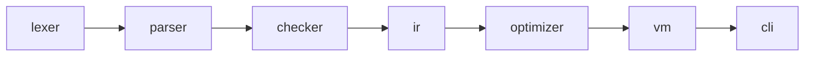

# 实践：搭建工程骨架与文法定稿

> [返回：第一阶段导览](01-导览.md)
> 对应大纲第 4 条与实践任务。本册把前两册的理论落成工程：monorepo 布局、测试与基准的约定，以及 v0.1 文法的"合法/非法"语料集。产物是后面七个阶段的安全网。

## monorepo 布局

```
mini/
├── package.json            # workspaces: ["packages/*"]
├── tsconfig.base.json      # strict、ESM、NodeNext 共享配置
└── packages/
    ├── lexer/              # 第二阶段：字符流 → token 流
    ├── parser/             # 第三阶段：token 流 → AST
    ├── checker/            # 第四阶段：AST → 诊断 + 符号表
    ├── ir/                 # 第五阶段：AST → 字节码
    ├── vm/                 # 第五、六阶段：字节码 → 执行
    ├── optimizer/          # 第七阶段：字节码 → 字节码
    └── cli/                # 汇总：mini run/build/repl
```

依赖**严格单向**：



规则：任何包只 import 图中右侧的包。反过来（lexer 引 parser）= 循环依赖 = 推倒重写。`cli` 是唯一知道全部包的地方——库包之间永远通过数据结构（Token/AST/Bytecode）解耦，这正是"编译 = 表示变换"在工程上的兑现：**每个包的公开接口就是一个纯函数 + 一个数据类型**。

## 包骨架约定

每个包最小三件套（以 lexer 为例）：

```ts
// packages/lexer/src/index.ts —— 对外只有纯函数
export interface Token { /* 第二阶段定义 */ }
export function tokenize(source: string): Token[] { /* ... */ }
```

- `tsconfig.base.json` 关键项：`"strict": true`、`"module": "NodeNext"`、`"exactOptionalPropertyTypes": true`——AST 与诊断对象从第一天起就靠判别联合精确窄化，后期的类型红利巨大。
- 每包 `vitest` 直配（`vitest.config.ts` 继承 base），无需 monorepo 级统一 runner。

## 快照测试：编译器的安全网

编译器重构频繁（parser 写三遍很正常），快照测试是回归的底线。约定两级：

**AST/字节码级快照**（黄金文件比对）：

```
packages/parser/__fixtures__/
├── legal/
│   ├── 001-arith.mini          # 源码
│   ├── 001-arith.ast.snap      # 手工确认后冻结的 AST JSON
│   └── 002-if-else.mini ...
└── errors/
    ├── 101-unclosed-paren.mini
    └── 101-unclosed-paren.diag.snap   # 期望的诊断数组
```

```ts
// packages/parser/src/__tests__/snapshot.test.ts
import { test, expect } from 'vitest';
import { readdirSync, readFileSync } from 'node:fs';

for (const file of readdirSync('__fixtures__/legal')) {
  if (!file.endsWith('.mini')) continue;
  test(file, () => {
    const src = readFileSync(`__fixtures__/legal/${file}`, 'utf8');
    const ast = parse(tokenize(src));
    expect(JSON.stringify(ast, null, 2)).toMatchFileSnapshot(
      `__fixtures__/legal/${file.replace('.mini', '.ast.snap')}`);
  });
}
```

流程纪律：**快照只允许"人工审阅后"更新**（`vitest -u` 之前必须 diff 过变更）——它是行为文档，不是自动生成的垃圾场。

**错误用例集**：每个阶段新增的诊断至少配 3 个用例（触发、不误触发、信息可读）。错误是编译器的一半产品，测试面不能只覆盖 happy path。

## 基准测试约定

第七阶段要量化优化收益，基准从第五阶段起就要冻结负载：

```ts
// packages/cli/bench/fib.bench.ts
import { bench, run } from 'tinybench';

bench('fib(25) 字节码执行', () => {
  miniRun(`fn fib(n) { if (n < 2) { return n; } return fib(n-1) + fib(n-2); } fib(25);`);
});

await run();
```

三组标准负载：**递归 fib(25)**（调用栈压力）、**字符串拼接 ×1000**（分配/GC 压力）、**map/filter 高阶函数**（闭包 + 内建库）。第七阶段前后对比用同一份数据，"优化了多少"才有意义。

## mini v0.1 文法验收语料

文法（见 [04-形式语言基础](04-形式语言基础.md)）配 20 个样例，先手推再入库。法定样例节选：

```ebnf
(* 001-arith.mini *)      let x = 20 + 22 * 2;
(* 003-shadow.mini *)     let x = 1; { let x = "s"; print(x); }
(* 005-fib.mini *)        fn fib(n: number) -> number {
                             if (n < 2) { return n; }
                             return fib(n - 1) + fib(n - 2);
                           }
```

非法样例节选（每个对应一条文法拒绝规则）：

```
(* 101 *) let = 1;            # let 后必须有 ident
(* 103 *) if (x { }           # 括号不配对（parser 报，不是 lexer）
(* 106 *) 20 +* 22;           # 连续运算符
(* 109 *) fn f(a,) {}         # 尾逗号 v0.1 不支持
```

## 验收清单

- [ ] monorepo 可 `npm test` 一键跑通（空测试也算通）。
- [ ] 六个库包依赖方向检查（`madge --circular` 或人工）通过。
- [ ] v0.1 EBNF 定稿入库（`docs/grammar-v0.1.ebnf`），20 个样例文件就位。
- [ ] 每个样例都能口述它的语法树/它违反哪条产生式。
- [ ] bench 命令 `npm run bench` 可执行（负载待第五阶段填充）。

做完本册，第一阶段收工——地图有了、地基有了，第二阶段开始真的写代码。
