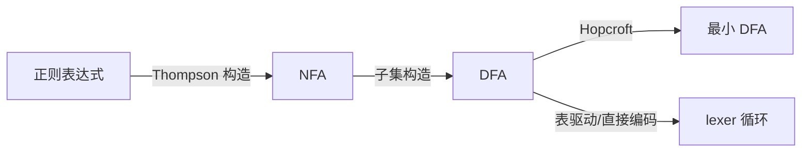

# 第二阶段导览：词法分析

> [返回：编译原理学习大纲](../编译原理学习大纲.md)
> 本文是第二阶段的入口：阶段目标、知识点地图、实践任务清单与阶段自测。

**建议时长**：2 周（每天 1~2 小时）。本阶段交付 mini 语言的第一个真实组件：lexer。理论部分（自动机）理解即可，工程部分（手写 lexer）必须跑起来。

## 阶段目标

学完本阶段，你应该能不查资料做到这些事：

1. 说清正则 → NFA → DFA 的完整转换链条（Thompson 构造、子集构造），并解释为什么这条链条证明正则语言可被有限状态机识别。
2. 手写一个生产可用级的 lexer：最长匹配、位置追踪、错误恢复、多行字符串、数值进制。
3. 解释"为什么 lexer 用正则就够、parser 必须上下文无关"并给出证明思路。
4. 对照 JS 的 ASI 与 Python 的缩进敏感词法，说明词法器如何参与语言语义。

## 知识点地图

### 1. 理论：从正则到自动机

- **正则的形式化语义**：ε-空串、并/连接/星三种运算递归定义；正则表达式 = 描述正则语言的紧凑记法。
- **Thompson 构造**：对正则语法树逐节点构造 NFA 片段——每条边只消费一个字符或 ε。这是 `grep`/`lex` 的算法底座。
- **子集构造（subset construction）**：NFA 的"状态集合"当作 DFA 的一个状态，ε-closure 求闭包。最坏指数爆炸，实际语言很少触发。
- **DFA 最小化**：Hopcroft 算法一瞥——等价状态合并，理解思想即可。
- **边界结论**：token 无嵌套结构（标识符、数字、运算符都是"扁平"串），所以正则够用；`a^n b^n`（括号配对）需要计数能力，正则没有——这是 lexer 与 parser 的分界线。

### 2. 手写 lexer 工程实现

- **token 结构**：`{ kind, lexeme, literal?, start, end }`——kind 是枚举，lexeme 是原始文本，literal 是解析后的值（`"3.14"` → `3.14`），start/end 是源码偏移（换算 行:列）。
- **主循环写法**：`while (peek()) { switch (peek()) { ... } }`——字符分类先行（isDigit/isAlpha/isWhitespace），每类一个消费函数。
- **最长匹配**：`>=` 不能扫成 `>` + `=`；实现上"贪心消费"：先把可能的运算符一次吃满再查表。
- **关键字表**：先按标识符扫完整个词，再查保留字哈希表——比在状态机里区分关键字简单得多。
- **字符串字面量**：转义序列（`\n` `\"` `\\`）、未闭合检测；多行字符串（三引号）是状态机的一个独立状态。
- **注释**：单行 `//`（消费到换行）与块注释 `/* */`（嵌套与否是设计决策）；注释产生 token 还是直接跳过——大多数语言直接跳过，但 IDE 需要 trivia 信息。
- **换行与 ASI/缩进**：JS 词法器在"下一个 token 无法接续"时插入分号；Python 词法器维护缩进栈产出 INDENT/DEDENT token。两者都是"词法器参与语法"的范例。
- **Unicode**：标识符不只是 `[a-zA-Z_]`（`\p{ID_Start}` / `\p{ID_Continue}`）；源码按 UTF-8 解码，JS 字符串 API 是 UTF-16（代理对坑）。

### 3. 错误处理与生成器对照

- 错误恢复策略：遇到非法字符——报错、跳过、继续（不能停）；未闭合字符串——消费到行尾或 EOF，报错并造一个"残缺 token"。
- lex/flex（表驱动生成器）与 re2c（生成直接编码的代码）；现代手写回归的原因：错误信息质量、增量词法（IDE 场景）、与 parser 的深度耦合需求。

## 与 mini 语言项目的关系

本阶段交付 `packages/lexer`，产出物是 token 流。第三阶段 parser 的接口契约在本阶段定型：`tokenize(source: string): Token[]`（或 lazy 迭代器版本）。**位置信息（start/end）从 token 一路带到 AST 节点**，后面所有报错、sourcemap 都靠它。

## 实践任务清单

- [ ] 任务 0：实现 token 类型枚举与 Token 结构，先写 5 个手算样例（源码 → 期望 token 序列）。
- [ ] 任务 1：实现标识符、关键字、整型/浮点/十六进制字面量、单双目运算符。
- [ ] 任务 2：实现字符串（含转义）与多行字符串；错误用例：未闭合、非法转义。
- [ ] 任务 3：行:列 换算（用偏移量查预计算的行首表），报错信息格式对齐 `file:line:col`。
- [ ] 任务 4：快照测试集——正常 20 例 + 错误 10 例，全部通过且错误信息可读。
- [ ] 选做：用 Thompson + 子集构造实现一个 mini 正则引擎，只支持 `| () *` 与字符类，验证 `a(b|c)*d`。

## 阶段自测

- [ ] 能白板推演 `x1 >= 3.14e2  // comment` 的完整 token 序列（含位置）。
- [ ] 能解释 NFA/DFA 区别，以及子集构造为什么正确（一个 DFA 状态 = "NFA 可能处于的状态集合"）。
- [ ] 你的 lexer 对 `1..2`、`"unclosed`、`$` 的行为都有明确定义与测试。
- [ ] 能说出 JS ASI 的三条规则，并解释为什么 `return\nvalue` 是经典坑。
