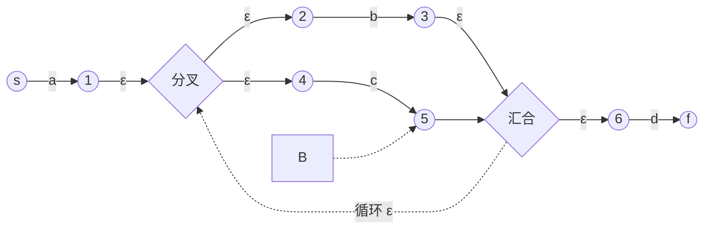

# 从正则到自动机：词法的理论基础

> [返回：第二阶段导览](01-导览.md)
> 对应大纲第 1 条。本册走通"正则 → NFA → DFA → lexer"的理论链条。结论会被工程直接消费：手写 lexer 的每个"字符分类 + 循环"都是这条链的隐式产物；理解它，才能解释"为什么 lexer 这样写是对的"。

## 正则表达式的形式化语义

正则语言按**归纳定义**构造（这是"正则表达式描述正则语言"的数学根基）：

1. **基础**：空集 ∅、{ε}、{a}（单个符号）都是正则语言。
2. **归纳**：若 L₁、L₂ 正则，则
   - **并** L₁ ∪ L₂（记 `r₁|r₂`）
   - **连接** L₁L₂（记 `r₁r₂`）
   - **克林闭包** L₁\*（记 `r*`，重复 0 次以上）
   也是正则语言。
3. **封闭**：只有有限次应用上述规则得到的语言才是正则语言。

`r+` 是 `rr*` 的缩写、`r?` 是 `(r|ε)` 的缩写——一切"现代正则"的语法糖都还原到这三个原子运算。注意 **反向引用（`\1`）不属于正则**——它是上下文有关的，所以 `/(a+)\1/` 匹配"平方串"的能力超出了本册的自动机模型（那是"正则引擎"与"正则语言"分家的地方，Perl/JS 的 regex 库是超集）。

## Thompson 构造：正则 → NFA

**NFA（非确定有限自动机）**：状态转移可以一对多，且可以"不读字符就跳"（ε 转移）。Thompson 构造按正则的语法树逐节点拼装 NFA 片段——每个片段恰好**一个入口、一个出口**：

| 正则节点 | NFA 片段（ε 为空跳） |
|---|---|
| 单符号 `a` | `→(s)─a→(f)` |
| 并 `r₁\|r₂` | 新入口 ε 分叉进两个片段，两个出口 ε 汇入新出口 |
| 连接 `r₁r₂` | r₁ 的出口 ε 接 r₂ 的入口 |
| 闭包 `r*` | 新入口 ε 直达新出口 **并** ε 进 r₁，r₁ 出口 ε 回 r₁ 入口 **并** ε 到新出口 |

以 `a(b|c)*d` 为例（示意）：



工程意义：**片段可组合 = 正则可组合**。grep、lex 的实现核心就是这棵片段树；你若做选做任务（mini 正则引擎），就是把这张表逐行翻译成代码（约 60 行）。

## 子集构造：NFA → DFA

**DFA（确定有限自动机）**：每个 (状态，字符) 恰好一个转移，无 ε。执行时不需要"猜"——这是它能直接当 lexer 引擎的原因。

子集构造的核心思想一句话：**DFA 的一个状态 = "NFA 此刻可能处于的状态集合"**。

两个工具函数：

- **ε-closure(S)**：从状态集 S 只走 ε 边能到的所有状态（含 S 自身）。
- **move(S, a)**：S 中所有状态读字符 a 能到达的状态集。

算法（从 NFA 构造 DFA）：

```ts
const start = epsClosure({ nfaStart });        // DFA 的初态
const worklist = [start];
while (worklist.length) {
  const S = worklist.pop();
  for (const a of alphabet) {                  // 每个可能输入
    const T = epsClosure(move(S, a));          //一步的完整后继
    if (T.isEmpty) continue;
    if (!states.has(T)) { states.add(T); worklist.push(T); }
    trans.set(key(S, a), T);                   // δ(S, a) = T
  }
}
```

正确性直觉：NFA 的"并行宇宙"（同时处于多个状态）被压成 DFA 的一个状态记录；DFA 走一步 = NFA 所有宇宙各走一步再合并。最坏状态数 2^n（幂集爆炸），但真实语言的词法规则很少触发——标识符、数字、注释的 DFA 都是几个状态的小机器。

## DFA 最小化：Hopcroft 一瞥

等价状态（对所有输入行为完全一致）可以合并。Hopcroft 算法按"可区分性"反向分割状态集（O(n log n)），把"结构冗余"的 DFA 压到最简。工程上少用（lex 生成的表不在乎多几个状态），但**同一个正则的最小 DFA 唯一**是个漂亮的结论——它是"自动机同构检测"的基础。

## 从 DFA 到 lexer：两种消费方式

1. **表驱动**（lex/flex 风格）：`state = table[state][char]` 的二维数组循环。优点：规则改动只改表；缺点：每字符一次数组跳转，缓存不友好。
2. **直接编码**（re2c/手写风格）：把 DFA 展开成 `switch`/`if` 嵌套的控制流，状态变成"代码位置"。优点：分支预测友好、可手工特化；缺点：规则变化要重排代码。

现代手写 lexer 全是路线 2——下一册的"循环 + switch"骨架就是它的具象化。**你在写代码时其实是在"人肉执行 Thompson → 子集构造 → 直接编码"的等价物**：每个 `case` 分支对应 DFA 的一个转移组。

## 边界：为什么词法到此为止

回到分界线（见第一阶段 [04-形式语言基础](../01-第一阶段/04-形式语言基础.md)）：DFA/NFA 无栈，数不了括号——词法规则（token）全部扁平、无嵌套，所以够用；语法有任意深嵌套，必须升级到带栈的下推自动机（CFG，第三阶段）。**模板字符串 `${}` 是唯一需要"词法借用语法栈"的常见特例**，工程解法是 lexer 保留一个模式栈（template/brace），进出 `${}` 时切换扫描模式。

## 自测

1. 手算：画出 `ab|c` 的 Thompson NFA，再跑子集构造求出 DFA 状态表（答案：3 个 DFA 状态足够）。
2. ε-closure 为什么必须包含 S 自身？"ε 闭包"漏算自身会发生什么？
3. `(a|b)*abb` 的 DFA 接受 `aababb` 吗？手工模拟转移序列。
4. 为什么"现代手写 lexer 回归直接编码"与"分支预测友好"有关？
