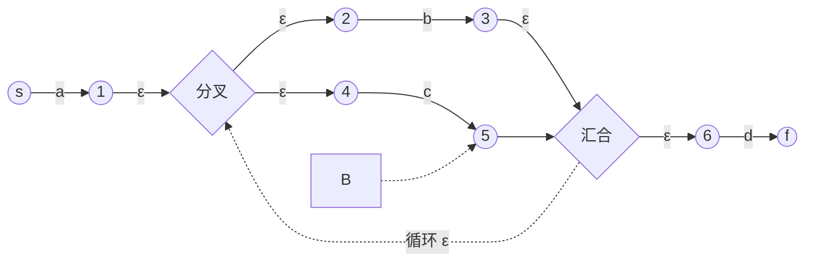
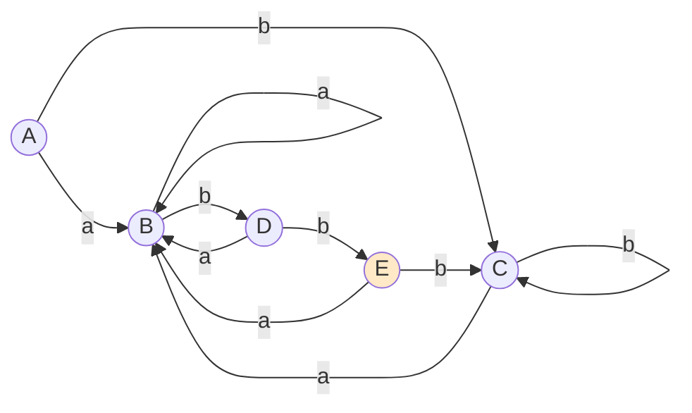

# 从正则到自动机：词法的理论基础

> [返回：第二阶段导览](01-导览.md)
> 对应大纲第 1 条。本册走通"正则 → NFA → DFA → lexer"的理论链条。结论会被工程直接消费：手写 lexer 的每个"字符分类 + 循环"都是这条链的隐式产物；理解它，才能解释"为什么 lexer 这样写是对的"。

## 正则表达式的形式化语义

正则语言按**归纳定义**构造（这是"正则表达式描述正则语言"的数学根基）：

1. **基础**：空集 ∅、{ε}、{a}（单个符号）都是正则语言。
2. **归纳**：若 L₁、L₂ 正则，则
   - **并** L₁ ∪ L₂（记 `r₁|r₂`）
   - **连接** L₁L₂（记 `r₁r₂`）
   - **克林闭包** L₁\*（记 `r*`，重复 0 次以上）
   也是正则语言。
3. **封闭**：只有有限次应用上述规则得到的语言才是正则语言。

`r+` 是 `rr*` 的缩写、`r?` 是 `(r|ε)` 的缩写——一切"现代正则"的语法糖都还原到这三个原子运算。注意 **反向引用（`\1`）不属于正则**——它是上下文有关的，所以 `/(a+)\1/` 匹配"平方串"的能力超出了本册的自动机模型（那是"正则引擎"与"正则语言"分家的地方，Perl/JS 的 regex 库是超集）。

### 三种运算的代数律：化简从哪来

这三个运算还有一套恒等式（对任何正则 r、s、t 成立），它们是所有正则引擎"树化简"的依据：

| 恒等式 | 含义 | 工程用途 |
|---|---|---|
| `r\|r = r` | 幂等 | 相同分支合并去重 |
| `r\|ε = r?` | 可选即"或空" | `?` 的定义式 |
| `rr* = r*` 与 `r*r = r*` | 星与连接互换 | 把 `r+` 还原成 `rr*` |
| `(r*)* = (r+)* = r*` | 嵌套星坍缩 | 防用户写出叠层星 |
| `r(s\|t) = rs\|rt` | 连接对并分配 | 提取公共前缀、分支折叠 |
| `(rs)t = r(st)` | 连接结合律 | 长连接链折叠成一段 |

运算还约定**优先级**：`*` 最紧、连接次之、`\|` 最松——所以 `ab|c` 永远指 `(ab)|c`。给 mini 正则引擎写解析器时，这张优先级表直接就是一张递归下降分层文法（第三阶段的预演）：`alt → concat ('|' concat)*`、`concat → repeat*`、`repeat → atom ('*' | '+' | '?')?`。**正则表达式自己就是一门小语言，解析它用的正是本站讲的这套技术**——这是"分层无处不在"的第一处现场。

### 封闭性：token 规则为什么可以随便拼

正则语言对**并、连接、星、补、交**全部封闭：L 与 M 正则，则 L∪M、LM、L\*、Σ\*−L、L∩M 都正则。前三个是定义直接给的；补与交靠"正则 ⇔ 存在 DFA"间接保证（DFA 把接受态与非接受态一换就是补语言）。工程意义有三条：

- **"除 X 以外的一切"是合法规则**：字符串字面量的字符规则写成 `[^"\\]`（补运算的字符类形式），不必枚举"所有合法字符"——枚举式写法会随语言演进而漏（新的 Unicode 符号永远补不齐）；
- **规则可以组合而不破坏正则性**：`标识符 = 字母 字母数字*`、`数字 = 非零数字 数字*`、`字符串 = '"' 转义或非引号 * '"'`——每一块都是正则，拼起来还是正则。词法规则文件里几十条 token 规则共存的前提就是这个封闭性；
- **反向引用破坏封闭性**：`\1` 需要"记住第一组匹配了什么再比对"，这超出了有限状态的记忆能力——所以纯自动机引擎（本册后面会对照的 RE2/Go/rust 路线）干脆不支持它。**这不是实现偷懒，是数学边界**。

### mini 语言的词法规则：四条正则

把第二阶段 mini 语言（[05-实践-mini语言lexer](05-实践-mini语言lexer.md)）的 token 规则写成纯正则，只有四条骨架：

| token | 正则 | 备注 |
|---|---|---|
| 标识符/关键字 | `[a-zA-Z_][a-zA-Z0-9_]*` | 关键字靠**事后查表**区分，不靠正则 |
| 数字 | `[0-9]+` | mini 只做整数；小数/指数是纯扩展 |
| 字符串 | `"(\\.\|[^"\\])*"` | 转义字符与普通字符两个分支 |
| 空白与注释 | `[ \t\n]+`、`//[^\n]*`、块注释 | 识别后丢弃，不进 token 流 |

注意"关键字"这一行：正则**分不出** `if` 和 `ifUser`——两者都匹配标识符规则。工程做法是两步走："标识符 DFA 接受 → 查关键字表"，命中关键字才换类型。这条经验会写进 [03-手写lexer](03-手写lexer.md) 的实现骨架。再看体量：标识符规则 2 个状态、数字规则 2 个状态、字符串规则 3 个状态——**每条 token 规则本身就是一个小自动机**，只是小到可以内联进一个 switch。

## Thompson 构造：正则 → NFA

**NFA（非确定有限自动机）**：状态转移可以一对多，且可以"不读字符就跳"（ε 转移）。Thompson 构造按正则的语法树逐节点拼装 NFA 片段——每个片段恰好**一个入口、一个出口**：

| 正则节点 | NFA 片段（ε 为空跳） |
|---|---|
| 单符号 `a` | `→(s)─a→(f)` |
| 并 `r₁\|r₂` | 新入口 ε 分叉进两个片段，两个出口 ε 汇入新出口 |
| 连接 `r₁r₂` | r₁ 的出口 ε 接 r₂ 的入口 |
| 闭包 `r*` | 新入口 ε 直达新出口 **并** ε 进 r₁，r₁ 出口 ε 回 r₁ 入口 **并** ε 到新出口 |

以 `a(b|c)*d` 为例（示意）：



工程意义：**片段可组合 = 正则可组合**。grep、lex 的实现核心就是这棵片段树；你若做选做任务（mini 正则引擎），就是把这张表逐行翻译成代码（约 60 行）。

### 片段拼装：把 `a(b|c)*d` 逐节点搭出来

把上图当成拼装说明书，按语法树**自底向上**重放一遍（编号对应图中节点）：

| 步骤 | 语法树节点 | 动作 | 得到的片段 |
|---|---|---|---|
| 1 | 叶子 `a` | 新入口 `s`、新出口 `1`，中间一条 a 边 | `s ─a→ 1` |
| 2 | 叶子 `b`、`c` | 各造一个两状态片段 | `2 ─b→ 3`、`4 ─c→ 5` |
| 3 | 并 `b\|c` | 新入口分叉 ε 进两个片段，出口 `3`、`5` ε 汇入新节点 `G` | 分叉→汇合成形 |
| 4 | 闭包 `(b\|c)*` | 入口 ε 直达汇合（零次），汇合 ε 回入口（循环） | 星形回路闭合 |
| 5 | 连接 `a · (b\|c)*` | 片段 1 的出口 ε 接星形片段的入口 | 前半段合体 |
| 6 | 连接 `… · d` | 汇合点 ε 接新出口，`6 ─d→ f` | 整机完工 |

六步下来，图中那些圆圈（s、1~6、分叉、汇合、f）就是片段逐步生长的痕迹。两个值得盯住的不变式：

- **每一步都保持"单入口单出口"**——这是片段法能机械化的全部秘密。若某步把出口接岔了，后续所有拼装都会"漏电"（ε 边泄漏到不该到达的状态，识别结果静默出错）；
- **状态数上界线性**：每个符号节点贡献 2 个状态，每个运算节点至多再贡献 2 个（并/闭包的分叉与汇合），所以 Thompson NFA 的大小是 O(正则长度)。这是下一节敢用 worklist 循环的前提——NFA 本身不会失控，风险全在"幂集"那一步。

顺带补全表中没有的两行糖：`r+` 的片段是"新入口 ε 进 r₁，r₁ 出口 ε 直达新出口并 **ε 回到 r₁ 的入口**"（没有零次直达边，至少一次）；`r?` 是"新入口 ε 分叉进 r₁ 与一条直连新出口的空边"（至多一次）。三个糖都还原为上表四条原语——**实现引擎时只写四条原语，糖在语法层脱掉**。

### 一段历史：grep 的祖先

Thompson 构造出自 Ken Thompson 1968 年的 CACM 论文《Regular Expression Search Algorithm》——他当时把正则编译成 IBM 7094 的汇编代码做文本搜索，随后这套机制长进 QED 编辑器，再经 Unix 的 ed 演化出 grep。今天你在终端敲 `grep -E`，血管里流的仍是 1968 年那套"片段拼装 + 状态模拟"。**"把声明式规则编译成执行机器"这一思想，在第三阶段的 yacc/bison 与本站的 mini 语言工程里还会两次重演**。

## 子集构造：NFA → DFA

**DFA（确定有限自动机）**：每个 (状态，字符) 恰好一个转移，无 ε。执行时不需要"猜"——这是它能直接当 lexer 引擎的原因。

子集构造的核心思想一句话：**DFA 的一个状态 = "NFA 此刻可能处于的状态集合"**。

两个工具函数：

- **ε-closure(S)**：从状态集 S 只走 ε 边能到的所有状态（含 S 自身）。
- **move(S, a)**：S 中所有状态读字符 a 能到达的状态集。

算法（从 NFA 构造 DFA）：

```ts
const start = epsClosure({ nfaStart });        // DFA 的初态
const worklist = [start];
while (worklist.length) {
  const S = worklist.pop();
  for (const a of alphabet) {                  // 每个可能输入
    const T = epsClosure(move(S, a));          //一步的完整后继
    if (T.isEmpty) continue;
    if (!states.has(T)) { states.add(T); worklist.push(T); }
    trans.set(key(S, a), T);                   // δ(S, a) = T
  }
}
```

正确性直觉：NFA 的"并行宇宙"（同时处于多个状态）被压成 DFA 的一个状态记录；DFA 走一步 = NFA 所有宇宙各走一步再合并。最坏状态数 2^n（幂集爆炸），但真实语言的词法规则很少触发——标识符、数字、注释的 DFA 都是几个状态的小机器。

### 手工演算：`(a|b)*abb` 的子集构造

用课本经典 `(a|b)*abb`（识别"以 abb 结尾的 a/b 串"）把算法走一遍。先按 Thompson 片段法给出它的 NFA（0 为起点、10 为接受态；前半段是 `(a|b)*` 的星形回路，后半段是 `a-b-b` 直线）：

```
0: ε→1, ε→7        1: ε→2, ε→4        2: a→3     3: ε→6
4: b→5             5: ε→6             6: ε→1, ε→7
7: a→8             8: b→9             9: b→10    （10 接受）
```

worklist 从初态出发，每行"取出一个集合 → 对每个字符算后继"：

| # | 取出 | 读 a → ε-closure | 读 b → ε-closure |
|---|---|---|---|
| A | {0,1,2,4,7}（初态） | {3,8}+closure = **B**（新） | {5}+closure = **C**（新） |
| B | {1,2,3,4,6,7,8} | {3,8}+closure = B（已有） | {5,9}+closure = **D**（新） |
| C | {1,2,4,5,6,7} | {3,8}+closure = B | {5}+closure = C（自环） |
| D | {1,2,4,5,6,7,9} | {3,8}+closure = B | {5,10}+closure = **E**（新，含接受态 10） |
| E | {1,2,4,5,6,7,10} | {3,8}+closure = B | {5}+closure = C |

以第 2 行为例完整展开：`move(B, a)` = B 中有 a 边的状态（2: a→3，7: a→8）= {3,8}；`ε-closure({3,8})` = {3,8} ∪ {6,1,7,2,4}（3 ε→6，6 ε→1、7，1 ε→2、4，8 无 ε 出边）= {1,2,3,4,6,7,8} = B——命中"已有"直接复用，不建新状态。循环到没有新集合产生即收敛：**5 个 DFA 状态 A~E，接受态 E**。

三个值得停下来看的细节：

- **废字符把进度"清零"是编译进转移表的**：C 读到 a 回到 B、E 读到 b 回到 C——"已经积累的 abb 后缀匹配被废掉多少"由目标集合自动算出，DFA 因此不需要回退输入流；
- **集合判等是正确性的关键**：D 与 E 只差一个 10 号状态，一个字符之差决定"是否刚好吃到 abb"。实现时把集合排序后拼成字符串/元组做哈希 key，千万别用数组引用判等——初学最常见的 bug 就是"每步都新建集合、worklist 永不清空"；
- **这个 5 态 DFA 还有冗余**（A 与 C 对所有输入行为一致），下一节用 Hopcroft 压到 4 态——**子集构造负责"正确"，最小化负责"最简"**，两步各有各的活。

画成图（底色节点为接受态 E；注意 a 边全部汇入 B）：



### 另一条路：不建表，边走边算

子集构造把所有状态集合**提前**算全；另一条路是**边扫边算**——每读一个字符，对"当前可能状态集"原地做一次 move+closure，集合用完即弃：

```ts
let S = epsClosure({ nfaStart });
for (const ch of input) {
  S = epsClosure(move(S, ch));   // 不存表，每步现算
  if (S.has(nfaAccept)) lastAccept = cursor;   // 记最长匹配，同前
  if (S.isEmpty) break;
}
```

两种策略的对照：**预构造**一次付费、每字符一次查表（O(1) 转移）；**现算**零构造成本、每字符一次集合运算（O(n) 状态数）。词法场景规则固定、输入海量，预构造划算；**模式频繁变化的场景**（用户随手输入的搜索正则）现算反而省——构造整个 DFA 可能比扫描本身还贵。工业上的甜点位是**惰性构造**：第一次遇到某个状态集合才把它算出来缓存，既是"现算"的省启动，又逐步长出"预构造"的快表——RE2 与 rust regex 的 lazy DFA 就是这条中间路线。你会发现这与子集构造的 worklist 循环是同一段代码：**把"何时算"从编译期挪到运行期，算法本体不变**。

## DFA 最小化：Hopcroft 一瞥

等价状态（对所有输入行为完全一致）可以合并。Hopcroft 算法按"可区分性"反向分割状态集（O(n log n)），把"结构冗余"的 DFA 压到最简。工程上少用（lex 生成的表不在乎多几个状态），但**同一个正则的最小 DFA 唯一**是个漂亮的结论——它是"自动机同构检测"的基础。

### 手工演算：把上一节的 5 态压到 4 态

沿用 `(a|b)*abb` 的 5 态 DFA（A~E，E 接受）。分割-精化循环的手工版：

**第 0 刀**：按接受性劈开——{ A, B, C, D } vs { E }。

**逐状态比对"每个字符的转移落在哪个块里"**：

| 状态 | a 落块 | b 落块 | 签名 |
|---|---|---|---|
| A | B | C | (B, C) |
| B | B | D | (B, D) |
| C | B | C | (B, C) |
| D | B | **E** | (B, E) |
| E | B | C | —（单独一块，跳过） |

D 的 b 落在接受块，与 A/B/C 不同 → {A,B,C,D} 劈成 {A,B,C} + {D}。

**第二轮**：{A,B,C} 内部再比——A 签名 (B, C)、C 签名 (B, C)、B 签名 (B, **D**) → B 单飞，剩 {A, C}。

**第三轮**：{A, C}：两者 a、b 的落块已全部同组（a→B，b→同组）→ 无法再劈，**合并**。

最终 4 块：{A,C}、{B}、{D}、{E}。把 {A,C} 当一个状态看转移：a→{B}、b→自身——恰好是"已匹配 abb 的最长后缀长度"直觉下的标准四档机（ε / a / ab / abb）。**A 与 C 能合并的本质**：A 里的 0 号状态是"起点标记"，没有任何入边之外的职责，对未来的输入毫无影响——"等价 = 对所有输入行为一致"在这里兑现成一次合并。

理论地基是 **Myhill–Nerode 定理**：把所有前缀按"未来行为是否可区分"分等价类，等价类数 = 最小 DFA 的状态数，且这个数不随构造路径改变——这就是"最小 DFA 唯一"四个字的严格含义（唯一到同构）。工程收尾：lex/flex 大多跳过最小化（表小到不值得）；只有"表要当数据分发"的场景——正则服务、嵌入受限环境的识别器——状态数才是实打实的内存与启动成本。

## 从 DFA 到 lexer：两种消费方式

1. **表驱动**（lex/flex 风格）：`state = table[state][char]` 的二维数组循环。优点：规则改动只改表；缺点：每字符一次数组跳转，缓存不友好。
2. **直接编码**（re2c/手写风格）：把 DFA 展开成 `switch`/`if` 嵌套的控制流，状态变成"代码位置"。优点：分支预测友好、可手工特化；缺点：规则变化要重排代码。

现代手写 lexer 全是路线 2——下一册的"循环 + switch"骨架就是它的具象化。**你在写代码时其实是在"人肉执行 Thompson → 子集构造 → 直接编码"的等价物**：每个 `case` 分支对应 DFA 的一个转移组。

### 消费循环：最长匹配与最后接受态

无论表驱动还是直接编码，模拟 DFA 的循环是同一副骨架：

```ts
let state = startState;
let lastAccept: TokenType | null = null;
let lastPos = cursor;
while (state !== DEAD) {
  if (accepting.has(state)) { lastAccept = state; lastPos = cursor; } // 记住最后吃到嘴的
  const ch = input[cursor++];
  state = trans[state]?.[ch] ?? DEAD;
}
// 循环退出（撞死路 / 输入尽）：cursor 回退到 lastPos，按 lastAccept 发 token
```

三个设计点：

- **最长匹配（maximal munch）**：扫到 `a` 时已是接受态，但不急着发 token——继续吃 `1` 还能走更远。token 的分界不是"第一次到达接受态"，而是"最后一次"，回退指针 `lastPos` 为此存在；
- **回退量有界**：最多退"最后接受态之后多吃的字符数"，上限由最长 token 规则决定——所以词法回退只要一个指针。语法层的回溯要栈、词法的回退只要指针，这是两个层次的分野（第三阶段会再遇到）；
- **撞死路 ≠ 错误**：`a1+` 的扫描在 `+` 处撞死路，但 `lastAccept` 已记下标识符——发 token、重置 DFA、从 `+` 重新起跑。真正的词法错误是"从起点就走不动"（如 mini 语言里的 `@`），那才进诊断队列（[04-词法错误处理与生成器对照](04-词法错误处理与生成器对照.md)）。

用 `let a1 = 42` 的 `a1` 段走一遍：初态读 `a` → 进入"标识符进行中"接受态（lastAccept=ident）；读 `1` → 仍是接受态（lastAccept 更新、lastPos 前移）；读空格 → 撞死路退出；cursor 回退到空格前，发出 ident `a1`——**`a1` 成为一个 token 而不是 `a` + `1`，靠的就是"最长匹配 + 最后接受态"八个字**。练习册的 lexer 里没有显式 DFA 表，但"内层 while 吃满字母数字"这个循环就是它（[05-实践-mini语言lexer](05-实践-mini语言lexer.md)）。

### 工业对照：正则引擎的两种架构

把视角从 lexer 拉高到"所有用正则的地方"——同一套理论在两类引擎里分道扬镳：

| 引擎 | 架构 | 时间行为 | 付出的代价 |
|---|---|---|---|
| RE2（C++）/ Go `regexp` | NFA 模拟 / 惰性 DFA | 与输入长度线性 | 砍掉反向引用与回溯语义 |
| rust `regex` crate | 有穷自动机 + 惰性 DFA | 线性 | 同样不支持 `\1`、环视 |
| V8 irregexp | 正则编译为字节码/机器码，**回溯**执行 | 最坏指数（灾难性回溯） | 换取 JS 全语法兼容（含 `\1`） |
| lex/flex、re2c | DFA 表 / 直接编码 | 线性 | 只服务词法层 |

Go 的 `regexp` 是 RE2 思想的直系后代，设计动机正是"服务端不能被一条恶意正则打到 CPU 100%"。灾难性回溯的经典形状：`(a+)+b` 配 `aaaa…b` 输入——回溯引擎对每组 `a+` 都要反复重试展开，最坏指数；自动机引擎每字符恒定转移一次，天然免疫。V8 的 irregexp 走另一极端：把正则编译成机器码换取单步最快，但保留回溯以支持 JS 规范要求的反向引用——**语言规范（要不要 `\1`）决定了引擎架构**，这是本册开篇"正则引擎 ≠ 正则语言"的工业注脚。

### 手写 lexer 为什么"敢"绕开表

V8（`src/parsing/scanner.cc`）、rustc（rustc_lexer）、tsc（scanner.ts）、Go（go/scanner）全部手写扫描循环，没有一个查二维表。但这不是抛弃理论——手写的 `switch` 链就是**直接编码的 DFA**：`case 'a'...'z':` 分支组 = DFA 的转移集合，循环位置 = 隐式状态。理论的价值不在"生成表"，在三件事：

1. **正确性论证**：为什么识别 `a1` 不需要回溯、为什么 `if` 和 `ifx` 能共用同一套分支——子集构造的正确性直觉直接背书这些代码形状；
2. **性能直觉**：直接编码的分支局部性好、可被 CPU 分支预测；表驱动的间接跳转在扫描这种纳秒级热路径上是纯开销——"分支预测友好"不是玄学，是缓存与流水线的物理；
3. **能力边界**：知道"词法 = 正则"才敢把剩下的复杂度推给语法层，而不是在 lexer 里偷偷维护任意深的栈——那已经是第三阶段的活了。

### 从 2 态 DFA 到 switch：直接编码的具象

把标识符规则 `[a-zA-Z_][a-zA-Z0-9_]*` 的 2 态 DFA 当样本，看"直接编码"怎么展开它：

| DFA | 内容 | 转移 |
|---|---|---|
| 状态 0（初态，非接受） | 尚未吃到任何标识符字符 | 字母/下划线 → 状态 1；其余 → 死路 |
| 状态 1（接受） | 已进入标识符 | 字母/数字/下划线 → 自身；其余 → 停 |

```ts
function scanIdent(src: string, pos: number): number {
  let i = pos;
  if (!isIdentStart(src[i])) return pos;        // 状态 0 的死路：原地不动
  i++;
  while (isIdentPart(src[i])) i++;              // 状态 1 的自环
  return i;                                     // 停在"最后接受位置"之后一格
}
```

逐行对号：`isIdentStart` 分支 = 状态 0 的转移组；`while (isIdentPart)` = 状态 1 的自环；函数返回点 = "最后接受态之后"——最长匹配的回退在函数返回值里已经完成（调用者从返回的 i 继续，等于自动回退到位）。**两张表、五行代码、一一对应**。字符串、数字规则的 DFA 稍大（3 态、2 态），展开后就是练习册 lexer 里的另外两个函数——所谓"手写 lexer"，就是这组小 DFA 的手工展开集合。

## 边界：为什么词法到此为止

回到分界线（见第一阶段 [04-形式语言基础](../01-第一阶段/04-形式语言基础.md)）：DFA/NFA 无栈，数不了括号——词法规则（token）全部扁平、无嵌套，所以够用；语法有任意深嵌套，必须升级到带栈的下推自动机（CFG，第三阶段）。**模板字符串 `${}` 是唯一需要"词法借用语法栈"的常见特例**，工程解法是 lexer 保留一个模式栈（template/brace），进出 `${}` 时切换扫描模式。

### 模式栈的工业样本

- **flex 的 start conditions**：`%x STRING` 声明一个互斥模式，规则前缀 `<STRING>"` 规定"只在字符串模式里生效"，`BEGIN(INITIAL)` 切换回去——"模式栈"思想 1970 年代就产品化了。嵌套 C 风格注释在 flex 里则要在模式之外配一个深度计数器：状态管"在哪种模式里"，计数器管"叠了几层"；
- **JS 模板字符串（V8 scanner）**：进入反引号压模板模式、遇 `${` 压 brace 模式并切回代码扫描、配对 `}` 弹栈回到模板、收尾反引号弹栈结束。嵌套 `` `${ `${x}` }` `` 就是栈上叠两个帧——lexer 借的是"括号深度"这个受限的栈，不是任意数据栈；
- **Python 3.12 的 f-string（PEP 701）**：3.12 之前 f-string 的切词规则在词法层硬编码（同引号嵌套、嵌套 f-string 都受限）；3.12 把 f-string 的内部结构交给 parser 协同处理，同一对引号可以嵌套。这个改动的本质是**承认词法/语法边界不是天然的，在个别语法上把栈借出去**。

### 词法陷阱速查：最长匹配的两副面孔

| 陷阱 | 表现 | 根源 |
|---|---|---|
| C++ 的 `a+++b` | 切成 `a++ + b` 而非 `a + ++b` | 最长匹配（maximal munch）规则 |
| JS 的 `1.toString()` | 语法错误（要写 `1..toString()` 或 `(1).toString()`） | 数字词法先"贪"走 `1.`，后面的 `.toString` 接不上 |
| 老标准 C++ 的 `Vector<Vector<int>>` | `>>` 被切成一个右移 token | 最长匹配与语法需求打架，C++11 起由 parser 特判 |
| 模板字符串 `${}` | 边界内外两层字符规则不同 | 模式栈（本节主题） |

四个陷阱同源：**词法按"最长匹配"机械执行，而语法有时希望"短一点"**。仲裁方式三选一：改词法规则（Python 3.12）、语法层特判（C++11 的 `>>`）、用户加括号（`(1).toString()`）。读任何语言的规范时，"lexical grammar"一章大半篇幅都在处理这些缝隙——这张表就是它的目录。

## 常见误区

- **"正则引擎支持什么，正则语言就是什么"**：Perl/JS 的"正则"是超集（反向引用、环视），数学正则是子集。后果真实存在：回溯引擎会被 `(a+)+b` 这类**不含反向引用的纯正则**打到指数爆炸（ReDoS），线性引擎（RE2/Go/rust）免疫——支持得越多，安全面越大；
- **"NFA 一定比 DFA 慢"**：混淆了两个"NFA"。模型里的 NFA 用子集构造压成 DFA 或逐集合模拟，与输入长度线性；正则库文档里的"NFA 引擎"指的是**回溯执行**（把 NFA 的选择当成分支栈上的回退点），慢的是那个。模型 NFA 不慢，慢的是把"非确定"翻译成"试了不行再倒回来"的实现策略；
- **"子集构造最坏 2^n，所以没人敢用"**：最坏情形需要状态集彼此纠缠的病态正则，真实语言的 token 规则全是几个状态的小机器（本册两个手工演算分别 5 态、4 态）。工程上还有惰性构造兜底（DFA 状态用到才建，RE2 的 lazy DFA 就是这个思路），把最坏情形摊到运行时；
- **"最小化是必经步骤"**：识别能力与最小化无关，不最小化的 DFA 照样正确。lex/flex 常跳过它；只有"状态数即成本"的场景才值得跑 Hopcroft——把"正确"与"最简"当成两个独立目标，才能各自取舍；
- **"ε 边是浪费，能省则省"**：ε 边是 Thompson 片段可组合的关键（单入口单出口不变式靠它维持）。省 ε 的构造确实存在（Glushkov/位置自动机，状态数不超过符号数加一），但正确性论证更绕——教学与快速实现选 Thompson，库实现选优化构造，都是自觉的取舍；
- **"手写 lexer = 放弃自动机理论"**：手写 switch 是直接编码的 DFA（见消费方式一节）。真正的分界不在"手写还是生成"，在"作者是否知道自己的循环等价于一个 DFA"——知道的人才会把 `default:` 分支当成死路的正确处理，而不是随手 `break`；
- **"词法与语法的边界是语言与生俱来的"**：边界是设计决定——模板字符串借栈、Python 3.12 的 f-string 重划界都是案例。读新语言规范时留意 lexical grammar 与 syntax grammar 怎么分家、哪些语法"借栈"，比记住任何一条具体规则都有用。

## 自测

1. 手算：画出 `ab|c` 的 Thompson NFA，再跑子集构造求出 DFA 状态表（答案：3 个 DFA 状态足够）。
2. ε-closure 为什么必须包含 S 自身？"ε 闭包"漏算自身会发生什么？
3. `(a|b)*abb` 的 DFA 接受 `aababb` 吗？手工模拟转移序列。
4. 为什么"现代手写 lexer 回归直接编码"与"分支预测友好"有关？

（5~10 为扩写增补题；1~3 的演算方法在正文"手工演算"两节有完整示范。）

5. 对自测 1 得到的 3 个 DFA 状态跑一遍可区分性检查：两个接受态等价吗？若等价，最小 DFA 只剩几个状态？"3 个状态足够"与"3 个状态最小"差在哪一步？
6. 用封闭性论证：`[^"\\]` 字符类为什么"合法"、`(a+)\1` 为什么"非法"？各自对应封闭性的哪一半？
7. RE2/Go/rust 的正则引擎为什么砍掉反向引用？从"语言规范 ↔ 引擎架构"的关系解释，并说明 V8 为什么反着选。
8. `(a+)+b` 对输入 `aaaaaaaaab`：定性描述回溯引擎与自动机引擎各自的时间行为差异（不需要实测数字）。
9. 给 mini 语言加"可诊断未闭合"的块注释支持：描述需要的模式与计数器，说明"未闭合注释"在哪一步被发现（对照 05 册的实现）。
10. 手写 lexer 的 switch 里漏写了某个字符的分支，等价的 DFA 图里少了什么？运行时的症状是什么？
