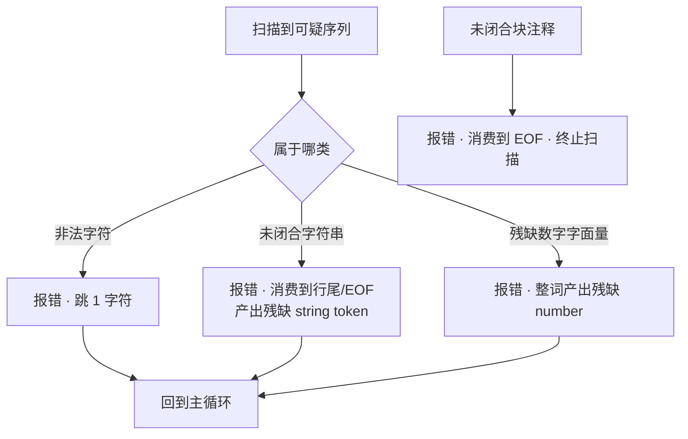

# 词法错误处理与生成器对照

> [返回：第二阶段导览](01-导览.md)
> 对应大纲第 3 条。错误处理是词法器的"另一半产品"：用户第一次碰你的语言，看到的往往不是成功编译，而是一条报错。本册把恢复策略、诊断对象、行列换算做完整，再对照生成器流派收尾。

## 错误恢复：带着伤继续扫

词法错误的三类与对策：

| 错误 | 恢复策略 | 后续影响 |
|---|---|---|
| 非法字符（如 `$`、`#`） | 报错 → 跳 1 字符 → 继续 | 几乎无 |
| 未闭合字符串 | 报错 → 消费到行尾/EOF → 产出"残缺 string token" | parser 可用同步点恢复 |
| 残缺字面量（`1e`、`1.2.3`） | 报错 → 按最长合法前缀截断（`1e` 产出 number `1` + 标识符 `e`？**不**——整词报错跳过） | 避免把一个错拆成连环错 |

核心原则：**一个错误最多产生一条诊断**。反面教材是"残缺字面量硬拆"：`1.2.3` 若拆成 `1.2`、`.`、`3`，parser 会在错误的 token 序列上再报两三条假错——错误级联（error cascade）是诊断体验的头号杀手。

"残缺即整词跳过"的实现：

```ts
function number_(): Token {
  const start = pos;
  while (pos < src.length && /[0-9.eExXa-fA-F]/.test(src[pos])) pos++;
  const text = src.slice(start, pos);
  if (!/^(\d+\.?\d*|\d*\.\d+)([eE][+-]?\d+)?$|^0[xX][0-9a-fA-F]+$/.test(text)) {
    report(start, pos, `非法的数字字面量 '${text}'`);
    return { type: 'number', lexeme: text, start, end: pos };  // 残缺 token 继续走
  }
  return { type: 'number', lexeme: text, literal: Number(text), start, end: pos };
}
```

残缺 token 照常产出（parser 对它最多再记一次"不期待"，配合同步点恢复不会级联）——**词法层恢复保证 token 流的结构完整，语法层恢复负责结构重同步**，两层各管一段。

### 恢复决策的流程图

三类错误的处理汇成一张判定图（`break` 指终止整轮扫描）：



四个出口共享同一条纪律：**报错、定边界、产出或终止、继续**。前三类回到主循环（token 流继续生长），第四类终止（后续内容大概率本就在注释里）。把这张图对照 05 册实现的分支结构，可以看到实现与图的逐块对应——错误处理的代码不复杂，复杂的是**每个出口的边界都定对了**。

### 逐 token 演算：一条"带伤"输入的完整恢复

输入（一行内塞进三类错误）：

```
abc $ let s = "un
1.2.3;
```

主循环逐段处理（记号：⟦⟧ 内是产出 token，⚠ 是诊断）：

| 步 | pos 指向 | 处理 | 产出 | 诊断 |
|---|---|---|---|---|
| 1 | `abc` | 正常标识符 | ⟦ident abc⟧ | 无 |
| 2 | `$` | 双/单字符表都 miss | ⟦（跳过）⟧ | ⚠ E0101 意外字符 '$' |
| 3 | `let` | 关键字表命中 | ⟦let⟧ | 无 |
| 4 | `s`、`=` | 正常 | ⟦ident s⟧ ⟦=⟧ | 无 |
| 5 | `"un` | 吃到换行，未遇闭引号 | ⟦string un（残缺）⟧ | ⚠ 未闭合的字符串（起始 …） |
| 6 | `1.2.3` | 整词扫描到 `;` 停，NUM_RE 校验失败 | ⟦number 1.2.3（残缺）⟧ | ⚠ 非法数字字面量 '1.2.3' |
| 7 | `;` | 正常 | ⟦;⟧ | 无 |

三次报错、token 流七枚依旧结构完整（每个位置都有 start/end，eof 正常收尾）。对照反面：第 6 步若按"最长合法前缀"硬拆成 `1.2` + `.` + `3`，token 流多出两枚碎片，parser 在其上会再报"不期待的 `.`""不期待的 `3`"级别的假错——**3 条真错膨胀成 5+ 条**。逐 token 演算的价值在于让"一条错误一条诊断"从口号变成可核对的事实。

### 恢复的两难：跳多与跳少

跳过是恢复的基本动作，但跳多少是个真正的两难：

- **跳太少**（只跳 1 字符）：`@#$%` 连发四个字符就是四条诊断——用户视角是一个错误（"这里粘了一坨乱码"）；
- **跳太多**（跳到行尾）：错误后面同行的合法代码全部陪葬，parser 拿到的流缺一截，可能在别处再报假错。

mini 的裁决表（本册开头那张）本质上是**按"错误的边界在哪"决定跳多远**：非法字符的边界就是它自己（跳 1）；未闭合字符串的边界是行尾/EOF（消费到那里）；残缺字面量的边界是"下一个明显不是数字的字符"（整词）。**恢复策略 = 对错误边界长度的估计**——这个视角到了语法层会被复用成"同步点选在哪"（[05-AST设计与错误恢复](../03-第三阶段/05-AST设计与错误恢复.md) 的 panic mode），只是边界的粒度从字符升到语句。

一个特例能说明"边界估计"的微妙：**未闭合块注释**。它的错误边界理论上也是 EOF（注释本可以延伸到文件尾），mini 的实现选择消费到 EOF 后 `break` 直接终止扫描——后续不再有 token。这是合理的：注释后的代码大概率本就是被注释的一部分，硬扫出来的 token 只会制造更多假错。对照未闭合字符串之所以选择"停在行尾继续"，是因为单行字符串的错误边界小、后续代码大概率无辜——**同类错误、不同边界，源于 token 规则的物理跨度不同**。

### 词法恢复为什么没有 panic mode

语法层的恢复有个正式名字叫 panic mode：报错后丢 token 直到同步点。词法层没有对应物——不是命名遗漏，是**结构缺失**：

| | 词法层 | 语法层 |
|---|---|---|
| 错误的对象 | 单个字符/词 | 结构（语句、表达式） |
| "恢复"的含义 | 判定错误边界、产出合法形状的 token | 重同步到语句边界 |
| 可用的锚点 | 物理边界（换行、引号、分隔符） | 逻辑边界（`;`、`}`、语句关键字） |
| 级联风险 | 低（锚点是物理的） | 高（锚点选错就吞掉合法代码） |

词法的"同步点"是物理边界，语法的是逻辑边界。所以词法恢复的本质是**错误分类 + 定边界**，语法恢复的本质是**跳过 + 重同步**——两者机制上不可互相替代。残缺 token 是两层之间唯一的交接物：词法保证它有合法形状与区间，语法保证见到它时只补一条诊断。

### 残缺 token：产出还是丢弃

带伤 token 有两种处理哲学：

| 哲学 | 做法 | 后果 |
|---|---|---|
| 丢弃（只报诊断） | token 流缺位，位置由下一个合法 token 补 | parser 的结构期待落空，报错位置漂移 |
| 产出残缺 token（mini） | 类型照旧、区间照旧、literal 可能缺 | parser 对得上"这里确实有个东西"，只补一条诊断 |

丢弃派的问题一个场景就能看清：某词法错误恰好吃掉了 `let` 后面的标识符 `s`，丢弃派让 parser 在 `=` 处报"期待标识符"——**报错位置离真实病因隔了一个 token**。产出派流里保留那个残缺物，parser 指着它报"这个位置有问题"，位置精准。**带伤产出让错误有病历可查**——这也是 06 册错误用例能把断言写到"每个错误 ≤ 真实 + 1"的前提。

## 诊断对象：错误也是 API

```ts
export interface Diagnostic {
  readonly code: 'E0001' | 'E0002' | /* ... */;
  readonly severity: 'error' | 'warning';
  readonly message: string;          // 人话，含词面原文
  readonly start: number;
  readonly end: number;
  readonly hint?: string;            // "是否想用 'let'？"
}

export function report(start: number, end: number, message: string): void {
  diagnostics.push({ code: nextCode(message), severity: 'error',
                     message, start, end });
}
```

约定（第四阶段沿用并扩展）：

- **错误码稳定**：`E00xx` 分段编号（词法 01-09、语法 10-39、语义 40+），工具与测试用码引用错误，文案可以随便改。
- **message 带原文**：`意外字符 '$'` 优于 `非法字符`——用户不想去数列。
- **hint 给动作**：`未闭合的字符串（起始 3:12）`，直接告诉用户去哪修。
- **lexer 从不 throw**：throw 只会得到"第一条错误"，诊断数组才能一次编译报全部问题。

### 错误码分段：一次设计、全流水线对齐

`E00xx` 的分段编号不是装饰，它是**跨阶段的寻址系统**：

| 码段 | 归属 | 本站实例 |
|---|---|---|
| E01xx | 词法 | 05 册的 `E0101`（意外字符/未闭合/非法字面量） |
| E03xx | 语法 | 06 册的 `E0301`（期待 X，看到 Y） |
| E04xx+ | 语义 | 第四阶段 checker 沿同一约定扩展 |

分段带来的工程收益有三条：**测试用码不用文案**（快照里断言 `d.code === 'E0101'`，改措辞不破测试）；**文档按码检索**（"E0101 是什么"可以直接索引到本册）；**阶段边界可审计**（一个错误被报成 E03xx 却出自 lexer，立刻暴露分层破了）。反过来也要守纪律：码一旦发布就**不许改义**——它是 API 的一部分，改措辞可以，改编号不行。

### hint 的设计：从"报错"到"改法"

`hint` 字段把诊断从"陈述事实"升级为"给出动作"：

| 级别 | 示例 | 用户要做什么 |
|---|---|---|
| 只陈述 | `非法的数字字面量 '1.2.3'` | 自己琢磨 |
| 带定位 | `未闭合的字符串（起始 3:12）` | 跳回去看 |
| 带动作 | `是否想用 'let'？`、`是否少了收尾符号？` | 按提示改 |

hint 的生成本质是**错误分类学**：每类错误都要问"用户最可能想写什么"。词法层能安全给出 hint 的场景有限（拼写接近关键字、引号没配对）；更聪明的"你是不是想写 X"（编辑距离建议）要到有符号表之后才做得起——第四阶段会把 hint 再抬一级。**诊断的迭代方向永远是"更多上下文"，而不是"更多错误"**。

### 一条诊断的生命周期

从产生到消费，一条诊断走完四站：

1. **产生**：扫描循环里调用 `report(start, end, message)`，码与区间当场定死（此后不可变）；
2. **聚合**：诊断数组随 `LexResult` 一起返回——与 token 流平级，不是副作用日志；
3. **渲染**：CLI/IDE 用行首表换算行列、拼码帧（前文），按 `start` 排序即得阅读顺序；
4. **消费**：测试按码断言、CI 按数量门禁（新增诊断即红）、用户按 hint 修码。

关键设计在第 2 站：诊断与 token **平级返回**，意味着词法器是纯函数（输入 src、输出 `{tokens, diagnostics}`），测试与上层工具不需要任何全局状态就能拿到全部信息。第三阶段 parser 会复制这套形状（诊断与 AST 平级返回），第八阶段的 lint/插件继续复用——**"诊断是产品"落到工程上，就是"诊断有独立的数据通道"**。

## 行:列换算：行首表

偏移量 → 行列的 O(1) 换算，靠**预计算的行首偏移表**：

```ts
function buildLineStarts(src: string): number[] {
  const starts = [0];
  for (let i = 0; i < src.length; i++)
    if (src[i] === '\n') starts.push(i + 1);
  return starts;
}

function lineCol(starts: number[], offset: number): [number, number] {
  // 二分找"最后一个 <= offset 的行首"
  let lo = 0, hi = starts.length - 1;
  while (lo < hi) {
    const mid = (lo + hi + 1) >> 1;
    if (starts[mid] <= offset) lo = mid; else hi = mid - 1;
  }
  return [lo + 1, offset - starts[lo] + 1];   // 1-based 行:列
}
```

格式化输出对齐主流工具：`文件:行:列 · E0002 · 未闭合的字符串（起始 3:12）`。第三阶段 AST 节点携带的 `start/end` 偏移，最终都经这张表变成人类可读坐标——**一次构建、全程复用**，成本 O(n) + O(log n)/次。

### 手工演算：行首表的二分查询

用行首表 `starts = [0, 10, 24]`（三行文本，第 1 行 0~9 列、第 2 行 10~23 列）查 `offset = 17`，把二分循环逐步展开：

| 轮 | lo | hi | mid = (lo+hi+1)>>1 | starts[mid] 与 17 比较 | 走向 |
|---|---|---|---|---|---|
| 初 | 0 | 2 | 1 | 10 ≤ 17 | lo = 1 |
| 2 | 1 | 2 | 2 | 24 > 17 | hi = 1 |
| 终 | 1 | 1 | — | lo == hi，退出 | — |

结论：行 = lo + 1 = **2**，列 = 17 − starts[1] + 1 = **8**——与自测第 2 题的答案一致。两个实现细节值得盯死：**`mid` 向上取整**（`(lo+hi+1)>>1`）让区间在"只剩两个候选"时也向右侧收敛，配合 `starts[mid] <= offset → lo = mid` 恰好是在找"最后一个 ≤ offset 的行首"（上取整二分的标准形状）；**若用下取整 mid 会死循环**（lo=0,hi=1 时 mid=0，`lo=mid` 不动）——初学者在这段代码上最常踩的就是这格。查表 O(log 行数)、构建 O(n)，诊断是低频路径，这个成本结构永远够用。

### 行列换算的三个角落

- **CRLF**：行首表只认 `\n`，`\r` 会留在上一行的列计数里。工程惯例是**在读入边界归一化**（整个流水线只处理一种换行约定），而不是让换算函数认识两种换行——约定收敛在一处，比逻辑散在处处便宜；
- **BOM**：文件头的 U+FEFF 是"文件是 UTF-8"的标记不是内容——在读入边界剥掉首个 BOM，其余位置出现的 U+FEFF 一律按非法字符报错。两个位置两种待遇，约定要写进文档；
- **制表符**：列是"字符数"不是"显示宽度"——`\t` 记 1 列，编辑器显示几格是显示层的事。行业里两种口径都存在（编译器多按字符，编辑器多按显示格），mini 跟编译器口径，但要知道差异存在，否则"用户说第 5 列、工具说第 8 列"的工单没法定位；
- **文件尾**：`offset === src.length` 是 eof token 的合法位置，换算函数要能接住它（行 = 最后一行，列 = 末行长度 + 1）——报"期待 `;`，但看到文件末尾"时行列别算崩。

### 诊断的呈现：码帧（code frame）

行首表不止喂 `文件:行:列` 头部——终端里带源码摘录与指示箭头的**码帧**是现代工具的标配形态：

````
demo.mini:1:5 · E0101 · 意外字符 '$'
  |
1 | abc $ let s = "un
  |     ^
  |
````

用行首表拼装码帧只要三步：头部行列（二分查询）→ 摘录行原文（`src.slice(starts[line-1], starts[line])`）→ 指示行按列数补空格画 `^`（跨区间的错误可画 `^~~~^`）。词法层现在只产出偏移，码帧的拼装属于"渲染层"（CLI 或 IDE 插件，第八阶段才做）——但**偏移坐标系选对了，渲染层就是纯函数**：不需要回读 lexer、不需要重新分词。rustc 的诊断之所以能"箭头 + 多区间标注"任意组合，底座正是这套"偏移 + 行首表"的极简契约。

## 生成器对照：lex/flex 与 re2c

**lex/flex**（表驱动流派）：规则 = 正则 + 动作，生成 DFA 表 + 驱动循环：

```lex
/* flex 规则示例 */
[0-9]+(\.[0-9]+)?  { return NUMBER; }
[a-zA-Z_][a-zA-Z0-9_]* { return IDENT; }
"=="               { return EQ; }
"="                { return ASSIGN; }
[ \t]+             { /* skip */ }
.                  { return ERROR; }
```

flex 内部就是上一册的完整链条：正则集 → Thompson NFA → 子集构造 DFA → 压缩转移表。**最长匹配由 DFA 一致地实现**（走到不能再走，回退到最后一个接收状态——这解释了为什么 `>=` 自动优先于 `>`，不需要规则排序技巧）。

**re2c**（直接编码流派）：同样的正则，生成"展开的控制流"代码（switch/if 嵌套），状态即代码位置。零表查询开销，分支预测友好。

### flex 的两条裁决规则：最长匹配优先、先声明者优先

上面那份规则文件能工作，靠的是 flex 的两条**固定裁决序**：

1. **最长匹配胜出**：`>=` 与 `>` 都能匹配时，取更长的 `>=`——这正是上一册"最后接受态"机制的直接产物，与规则书写顺序无关；
2. **等长时先声明者胜出**：两条规则匹配同一长度（如 `"=="` 与 `.` 都匹配两个字符里前者），排在前面的规则赢。

由此推出两条书写纪律：**兜底规则 `.` 必须放最后**（放前面会吃掉一切）；**更具体的规则写在更一般的之前**。样例里 `.` 在末尾、`"=="` 在 `"="` 之前——次序错了整个 lexer 静默变脸。手工 lexer 里对应物是**分支次序**（03 册主循环的判定序），两边的教训同源：**词法的正确性不仅依赖规则内容，还依赖规则的排列**。另外注意 flex 规则集整体仍是一条 DFA（自动编译成一个识别器），但"哪条规则赢"的裁决发生在接受之后——规则标签（action）是 DFA 接受态上的附注，不影响扫描轨迹。

### re2c 生成的代码形状

re2c 的产物概念上长这样（简化示意）：

```c
/* re2c 风格的生成物骨架（示意，非完整代码） */
for (;;) {
    yych = *cursor;
    switch (yych) {                 // 状态 = 代码位置
    case '0': ... goto yy_number;   // 字符 → 标签跳转
    case '"': ... goto yy_string;
    case '>': ... goto yy_gt_or_ge; // 接受后再判下一字符定 >= 或 >
    ...
    }
}
```

它与手写 switch 的血缘一眼可见——**re2c 就是把"直接编码"自动化**：你手写 `case 'a'...'z':` 链所做的事，它从正则集机械生成。这解释了为什么"手写派"的代码看起来不像理论教材：不是脱离了 DFA，而是 DFA 被编译成了控制流（上一册"从 DFA 到 lexer：两种消费方式"的路线 2 的机器版）。所以"生成器 vs 手写"的真实光谱是：**表生成（flex）— 控制流生成（re2c）— 控制流手写（mini、V8）**，三个刻度共享同一套理论，差异只在"谁来写这层机械翻译"。

### 今天的生成器活在哪里

生成器没有消失，只是撤离了主力编译器：

- **tree-sitter**：编辑器基础设施（GitHub 语法高亮的底座），每语言一份 lexer/parser，token 规则以正则声明、复杂 token 允许外部手写 C scanner——"声明式为主、手写逃生口"的混合形态；
- **bison 生态的语言**：bash、Ruby 的 parser 至今由 yacc 文法生成（parse.y），它们的词法层同样长期由生成器或薄手写层服务——文法稳定的项目里，生成器的"规则即代码"红利持续兑现（对照 [04-自底向上LR族](../03-第三阶段/04-自底向上LR族.md) 的"大项目里的 Yacc 往事"）；
- **DSL 与配置格式**：几十条规则的小语言，写 flex/re2c 规则文件比手写子程序快一个量级——生成器的主场从来不是 V8，是"文法小而稳"的地方。

读法：**手写回归是"主力语言编译器"这个特定负载的选择**，不是生成器的失败判决。选型问题与 04 册 LR 部分的路线决策表同构——先问文法多稳、错误要多好、多久迭代一次，再谈工具。

## 为什么现代项目回归手写

| | 生成器 | 手写 |
|---|---|---|
| 开发速度 | 规则即代码，立等可取 | 慢（每类 token 一个子程序） |
| 错误信息 | 模板化（"非法输入"级别） | 完全定制（带词面、位置、hint） |
| 增量词法 | 表驱动可做但别扭 | IDE 逐行重扫天然顺手 |
| 与语法协同 | 只能靠 token 约定 | 模式栈、 lookahead、ASI 想加就加 |
| 性能 | 表驱动中等 | 直接编码最快 |

决定性的是中间三条：**报错质量、增量、语法协同**——它们都要求词法器"理解上下文"，而生成器的价值恰恰在于不理解上下文。V8、acorn、swc、rustc、TypeScript 全部手写，不是性能焦虑，是**控制力**。（GNU 家族和 Yacc 时代的 C 编译器则是生成器黄金年代的标本。）

mini 的选择：手写（本课程主线），但建议你用 flex 或 re2c 各写一个 20 行的玩具对照——**用生成器写一遍，才知道手写时你在替它做哪些事**。

### 20 行玩具对照的具体步骤

把建议展开成可执行的三步：

1. **flex 版**：把 03 册的 mini 规则抄成 flex 规则文件（约 20 行：四类 token + 空白 + 兜底 `.`），对 `let a=1;` 跑一遍，核对 token 序列与手写版一致；再喂 `a>=b`，验证"最长匹配优先"自动生效、与规则书写顺序无关；
2. **re2c 版**：同一规则集重写，生成控制流代码后打开产物，找 `>=` 的接受态——你会看到"先吃 `>`、再判下一字符定 `>=` 或 `>`"的结构，与手工双字符表一一对应；
3. **对照记录**：把"换一条规则要改哪里"（生成器：改规则文件；手写：改代码）与"报错时能拿到什么"（生成器：模板化；手写：任意）记进笔记——这张表就是"手写回归"四个字的第一手证据。

实验的价值不在 flex 好不好用，在**亲眼看一次"规则 → DFA → 代码"的自动化**：看完之后再读手写 lexer，每个分支都会自动浮现它对应的规则与自动机状态。

### "控制力"拆开是四件具体的事

表里"与语法协同"一行容易读成口号，拆成四个可指认的场景：

1. **`/` 的两读性**（03 册）：需要 `prevToken`——词法器要一个跨 token 的状态变量，生成器的"规则 + 动作"模型里塞这个很别扭；
2. **模式栈**（三引号、JS 模板串 `${}`）：进出模式是词法状态机的**切换**，flex 的 start conditions 能做但把语言语义绑进了生成器方言；
3. **ASI**：插入分号的裁决要"下一行开头能否接续"，这是语法知识——词法器与 parser 的实时握手，生成器的批处理模型（扫完再给流）接不住；
4. **增量重扫**：IDE 改一行只重扫一行，手写的子程序边界（`number_()`、`string_()`）天然是增量单位，表驱动的全局 DFA 找不到"从哪切开"。

四件事的共同点：**词法器需要知道"我在扫什么语言"，而不只是"这串字符匹配哪条规则"**。生成器的价值主张（规则声明式、与上下文无关）在这个需求面前恰好反号——这就是"决定性的是中间三条"的含义。

### mini 诊断体验的三个验收动作

把本册约定落到测试上，验收的不是"有报错"而是报错**质量**：

- **快照断言码与区间**：每条诊断断言 `code`、`start`、`end` 与文案（文案变了快照重录，码变了就是事故）；
- **错误数恒等式**：错误样例每条恰好一条诊断（05 册验收标准），合法样例诊断为空——防"顺手多报一条 warning"式的污染；
- **报错可自解释**：拿快照里的 message 单独读一遍，不看源码能知道错在哪、怎么改——做不到就回去补 message 的原文与 hint。

这三条会在第三阶段被原样复用到语法诊断（06 册的错误用例集是同一套纪律的升级版），第二阶段把它们定型，是给全流水线立规矩。

## 常见误区

- **"错误恢复就是吞掉错误继续跑"**：恢复是**结构保持**——token 流的完整性、区间的正确性在带伤状态下依旧成立。吞错不产出残缺 token，parser 少了同步锚点，才是级联的真正起点；
- **"跳过 1 字符永远安全"**：对非法字符安全，对未闭合字符串是灾难——跳 1 字符等于把引号错误复制到每一个后续 token。跳多远取决于"错误的边界"，不同错误类不同策略（本册开头表格的三行就是三种答案）；
- **"诊断信息给开发者看，简单点没关系"**：诊断的第一读者常是**工具**（测试断言、IDE 跳转、CI 报告），第二读者才是人。码与区间是给工具的，message/hint 是给人的——两类读者都不能得罪；
- **"行首表应该在报错时现算"**：功能对，但行首表本质是"源码的另一个视图"，构建一次全程共享（parser、checker、sourcemap 都要换算）。报错时现算意味着每个诊断点付一次 O(n)，且各处口径可能不一致；
- **"生成器的错误信息差是本质缺陷"**：是**当前形态**的缺陷——表里压缩掉的是文法/规则结构，不是不可恢复的损失。Menhir 这类新代生成器在错误解释上已经追回来一截（04 册"现代 LR 生成器一瞥"）；手写的优势是"默认就好"，不是"永远更好"；
- **"词法错误不会级联，因为词法是扁平的"**：级联的主要来源恰是词法错误对 token 流的**破坏**——一个未闭合字符串吞掉半页代码的 token。防级联的第一道闸在词法层（残缺 token 照常产出），第二道才在语法层（同步点）；
- **"错误信息越详细越好，字段堆满"**：诊断的读者在赶时间。一条好诊断 = 码 + 位置 + 一句人话 + 至多一个 hint；信息堆砌会让主信息淹没。工业长报错的"详细"是**分层展开**（主信息一句话，note/help 各司其职），不是单条塞满。

## 自测

1. `1.2.3` 若被拆成三个 token，后续 parser 会在哪几个位置报什么假错？设计整词跳过后还剩几条诊断？
2. 行首表 `[0, 10, 24]`，offset 17 的行列是多少？（答：2 行 8 列）
3. flex 的"走到不能再走、回退最后接收态"如何统一实现最长匹配？为什么手写时要靠"双字符表优先"手工模拟它？
4. 你的 lexer 抛过异常吗？把所有 throw 路径改成诊断数组后，测试用例要补什么？

（5~10 为扩写增补题；2 的演算过程在"行首表的二分查询"一节有逐步展开。）

5. 输入 `abc $ let s = "un` 的逐 token 演算表里，第 5 步产出"残缺 string"后，主循环从哪里继续？若字符串未闭合发生在文件最后一行（无换行符可依），恢复的边界应取什么？
6. `@#$%` 四个连发非法字符：mini 的策略会产生几条诊断？若想收敛为一条"乱码区间"诊断，跳过逻辑要按什么单位聚合？这样改会牺牲什么？
7. 行首表 `starts = [0, 10, 24]`：offset 24 与 offset 23 各换算成什么行列？两者相差 1 个偏移却跨行——这揭示了半开区间与行首表配合的什么性质？
8. flex 两条裁决规则下，规则文件若把 `.`（兜底）写到 `"=="` 之前，`a==b` 会被切成什么 token 序列？用两条裁决序推演。
9. 错误码分段（E01xx/E03xx/E04xx）里，"未闭合的字符串"与"字符串里的非法转义"该不该同码？从"测试用码引用错误"的角度给出判据。
10. "hint 的生成本质是错误分类学"：为 `1.2.3`、`0x`、`1e` 三种非法数字各写一条 message + hint（含原文与建议动作），并说明哪一条在词法层给不出好 hint、为什么。
