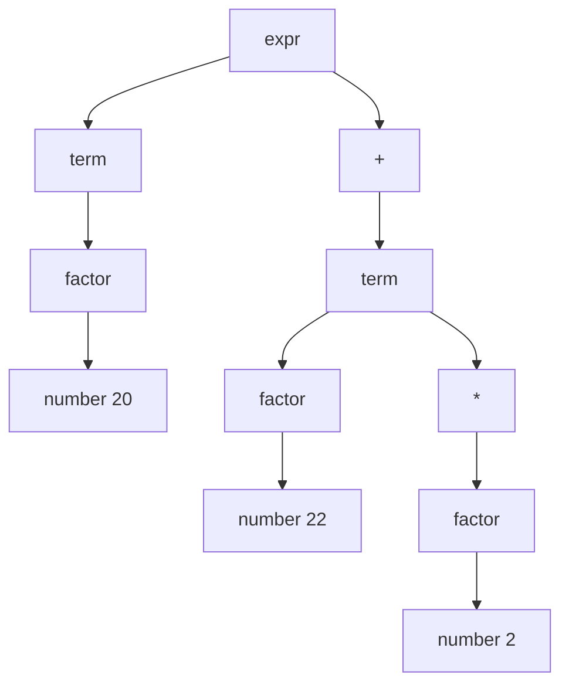

# 自顶向下分析：LL 族与递归下降

> [返回：第三阶段导览](01-导览.md)
> 对应大纲第 1 条。自顶向下 = 从开始符号出发"长"出输入串。本册把文法到代码的机械翻译讲透（递归下降），补上 FIRST/FOLLOW 的判定工具，并处理左递归与回溯两大障碍。

## 推导与归约：两种方向的同一棵树

对输入 `20 + 22 * 2`：

- **自顶向下**：从 `expr` 出发，反复**展开**非终结符，直到长出整个串——这是**最左推导**（每次展开最左边的非终结符）：`expr ⇒ term ⇒ factor ⇒ number(20)`……
- **自底向上**：从 token 出发，反复**归约**（把右部替换回左部），最终归约回 `expr`——这是最右推导的**逆过程**。

两者构造同一棵语法树，方向相反：



自顶向下 = 从树根 E 往下长（LL）；自底向上 = 从叶子 N1/N2/N3 往上归（LR，见 04 册）。**LL 的 L：从左到右读输入、最左推导；第二个 L 是前瞻 lookahead 数**（LL(1) = 看 1 个 token）。

### 最左推导逐步演算：`20 + 22 * 2`

"从 expr 长出输入"不是比喻，是一串可逐行核对的替换。用四则骨架文法（`expr → expr + term | term`、`term → term * factor | factor`、`factor → number`）做最左推导，每步**只展开最左边的非终结符**：

| 步 | 句型 | 本步动作 |
|---|---|---|
| 0 | `expr` | 起点 |
| 1 | `expr + term` | 展开最左的 expr（取 `expr + term` 分支） |
| 2 | `term + term` | 展开最左的 expr（取 `term` 分支） |
| 3 | `term * factor + term` | 展开最左的 term（取 `term * factor` 分支） |
| 4 | `factor * factor + term` | 展开最左的 term |
| 5 | `number * factor + term` | 展开最左的 factor |
| 6 | `20 * factor + term` | 展开最左的 factor（这里即 number 的词面） |
| 7 | `20 * 22 + term` | 同上 |
| 8 | `20 * 22 + factor` | 展开最左的 term |
| 9 | `20 * 22 + number` | 展开最左的 factor |
| 10 | `20 * 22 + 2` | 全部终结符，推导完成 |

三个观察值得钉住：**每一步句型的前缀都是"已确定"的**（最左推导保证前缀单调延长——这是 LL 能流式消费 token 的原因）；**树的结构在替换中已定型**（第 1 步就决定了"整体是个加法"）；**结合性藏在展开顺序里**（若输入是 `1 + 2 + 3`，第 1 步展开成 `expr + term` 后，左边那个 expr 还会继续吞 `1 + 2`——左结合自动成立）。自底向上的 LR 做的是同一棵树、方向相反的归约（[04-自底向上LR族](04-自底向上LR族.md) 的 trace 与本表逐行互为镜像）。

### LL(1) 的名字与家族

`LL(1)` 两个字母一个数字各管一件事：**第一个 L** = 从左到右扫描输入（Left-to-right）；**第二个 L** = 最左推导（Leftmost derivation）；**数字** = 每步决策向前看的 token 数。家族按 k 展开：

| 成员 | 决策依据 | 现实地位 |
|---|---|---|
| LL(1) | 看 1 个 token | 教学与手写的主流；本册主角 |
| LL(k)，k>1 | 看 k 个 token | 理论存在，工程少用（表随 k 指数膨胀） |
| LL(*) / adaptive | 前瞻深度按需扩展 | ANTLR 4 的路数——回溯的受控形态 |

工程上"LL 族"几乎默认指 LL(1)，因为手写递归下降天然只有 1 个 token 的视野（`peek()`）——**语言限制成了设计约束，反而逼出了"文法必须可判定"的纪律**。下一册的 Pratt 会打破"只能看 1 个"的表面印象：它同样只 peek 一个 token，但用绑定力表把"看完所有可能性"压缩成一次数值比较。

## 递归下降：函数即非终结符

把文法逐条翻译成函数，**产生式右部 = 函数体顺序**：

```ebnf
letDecl → "let" ident typeAnn? "=" expr ";"
typeAnn → ":" type
```

```ts
function letDecl(): LetDecl {
  const kw = consume('let');                 // 终结符 → consume
  const name = consume('ident');
  const typeAnn_ = match(':') ? typeAnn() : undefined;   // 可选 → try/match
  consume('=');
  const init = expr();                       // 非终结符 → 递归调用
  consume(';');
  return { type: 'LetDecl', name, typeAnn: typeAnn_, init,
           start: kw.start, end: prev().end };
}
```

五条翻译规则（文法 → 代码的全部秘密）：

| EBNF 构件 | 代码形态 |
|---|---|
| 终结符 `"let"` | `consume('let')`（不吃就报错） |
| 非终结符 `expr` | `expr()` 递归调用 |
| 连接 `A B` | 顺序语句 |
| 选择 `A \| B` | 按**前瞻 token** 分派（switch/if） |
| 重复 `A*` | `while (检查 A 的开头) A()` |

递归下降的优点全在这张表里：**代码与文法逐行对应**，调试时看着产生式就能找到函数；缺点是"分派靠前瞻"——选择分支一多就需要文法本身可判定（LL(1)），这正是 FIRST/FOLLOW 的用武之地。

### 五条规则的第二遍演练：`fnDecl` 与 `block`

把五条规则在两个更大的产生式上再走一遍（mini v0.1 语句层）：

```ebnf
fnDecl → "fn" ident "(" params? ")" typeAnn? block
block  → "{" stmt* "}"
```

```ts
function fnDecl(): FnDecl {
  const kw = consume('fn');
  const name = consume('ident', '期待函数名');
  consume('(', "函数名后期待 '('");
  const params = match(')') ? [] : paramsList();     // 可选段 → match 试探
  consume(')');
  const retType = match('->') ? typeRef() : undefined;
  const body = block();                              // 非终结符 → 递归调用
  return { type: 'FnDecl', name, params, retType, body, ... };
}

function block(): Block {
  consume('{');
  const body: Stmt[] = [];
  while (!check('}') && !check('eof')) body.push(declaration());  // 重复 → while
  consume('}', "块未闭合");
  return { type: 'Block', body, ... };
}
```

`stmt*` 的循环条件 `!check('}')` 正是"重复 → while 检查开头"：**什么 token 能开启一条语句**（`fn/let/if/while/{/return` + 表达式开头集合）决定了循环继续还是退出——这个"开头集合"就是 FIRST 的第一课。`params?` 的 `match(')')` 试探则是"可选 → match"的直接翻译。06 册的完整实现（[06-实践-mini语言parser](06-实践-mini语言parser.md)）与这里的骨架逐行同构，只是多了错误恢复。

### 对应是双向的：从代码反读文法

五条规则的反方向同样重要——**给一段递归下降代码，能反推出它实现的文法**：

- 函数名 → 非终结符；`consume(t)` 序列 → 右部的终结符串；
- `if/switch` 分支 → 选择产生式，**分支条件 = 各产生式的 FIRST**；
- `while` 循环 → 星号重复，循环条件 = 重复体的 FIRST。

工程收益在调试现场：parser 报"期待 `)`"却总在错的位置，**把报错函数名翻译回产生式**，立刻知道是哪条右部的哪个位置出了岔子——"文法在我脑中、代码在我手中"（04 册 LR 一册的结语）在 LL 这里的含义就是这条双向通道。反过来，代码与文法一旦失同步（改了文法没改函数），这个调试通道就断了——所以 mini 把文法修订记录在同一份 EBNF 文件里，改文法必过函数。

## FIRST / FOLLOW 与 LL(1) 判定

- **FIRST(α)**：α 能打头推出的终结符集合。`FIRST(expr) = {number, string, ident, (, !, -}`。
- **FOLLOW(A)**：某句型中 A 之后可能紧跟的终结符集合。`FOLLOW(expr) ⊇ {;, ), ,, }...}`——表达式结束后的"落脚点"。

**LL(1) 判定**：非终结符 A 的多条产生式分支，FIRST 集两两不相交；若某分支可推出 ε，则其 FIRST 与 FOLLOW(A) 也不相交。——直觉：**看一个 token 就能无歧义地选分支**，不需要回头。

计算 FIRST/FOLLOW 的不动点算法本身很简单（反复传播直到集合不变），本册不展开——手算 mini 文法够用。验证 v0.1 文法：分层表达式文法天然 LL(1)（`+` 只属于 term 层的延续），语句层的分派 token 是 `fn/let/if/while/{/return` + 表达式开头集合，也两两分离。**你的 parser 无回溯**，这是后面错误恢复能"一次报多个错"的前提。

### 手工演算：mini 表达式骨架的 FIRST

mini v0.1 的表达式分层骨架（优先级从低到高，`&&`/`||` 与比较层中间还有两级，推导方法完全一致，表里从略）：

```ebnf
expr    → additive
additive→ multiplicative (("+" | "-") multiplicative)*
multipli→ unary (("*" | "/" | "%") unary)*
unary   → ("!" | "-") unary | call
call    → primary ("(" args? ")")*
primary → number | string | "true" | "false" | ident | "(" expr ")"
```

逐层算 FIRST（从最底层往上，规则的第二条：非终结符的 FIRST = 各分支 FIRST 的并集）：

| 非终结符 | FIRST | 推导 |
|---|---|---|
| primary | {number, string, true, false, ident, (} | 六个分支各贡献自己的开头 token |
| call | 同 primary | call 的重复段以 `(` 打头，但 call 本身从 primary 起步 |
| unary | {! , -} ∪ FIRST(call) | 分支 1 贡献 `!`/`-`，分支 2 贡献 FIRST(call) |
| multipli / additive / expr | FIRST(unary) | 循环体在"后面"不在"开头"，不影响 FIRST |

最终 `FIRST(expr) = {number, string, ident, (, !, -}`——与本册开头给的集合一致（`true/false` 并入字面量类）。注意**整条分层链的 FIRST 全部同值**：分层的意义不在 FIRST，在每层的**延续运算符**——那正是 FOLLOW 的领域。

### 手工演算：FOLLOW 的两条传播规则

FOLLOW 只有三条来源（规则熟记后手算就是逐产生式扫描）：

1. **句尾继承**：产生式 `A → … α`（α 在右部末尾）→ FOLLOW(A) ⊆ FOLLOW(α)；
2. **后随注入**：产生式 `A → α B β` 且 β 不能推出 ε → FIRST(β) ⊆ FOLLOW(B)；
3. **穿透**：上条的 β 若可推出 ε，则 FOLLOW(A) 也 ⊆ FOLLOW(B)。

对 mini 骨架逐条扫（关注表达式各层）：

| 非终结符 | FOLLOW | 依据（产生式） |
|---|---|---|
| expr | {;) , ,, }…} | letDecl 尾、if/while 的 `)`、args 的 `,`、exprStmt 尾 |
| additive | FOLLOW(expr) | `expr → additive`（句尾继承） |
| multipli | FOLLOW(additive) ∪ {+ , -} | additive 的循环体里 multipli 后随 `+/-` |
| unary | FOLLOW(multipli) ∪ {*, /, %} | multipli 的循环体里 unary 后随乘除 |
| call / primary | FOLLOW(unary) | `unary → call`（句尾继承） |

**分层文法 FOLLOW 的形状 = 每层把上一层 FOLLOW 加上自己的延续运算符**——"延续运算符决定这层何时交还控制权"，与 Pratt 的 minBp（下一册）说的是同一件事的两种记法。

### LL(1) 判定的逐点核对

判定条件："同一非终结符的多个分支 FIRST 两两不相交"。mini 全文只有两处多分支，逐点核对：

| 分派点 | 分支与 FIRST | 相交？ |
|---|---|---|
| `unary → ("!"\|"-") unary \| call` | {!, -} 对 FIRST(call) | 不相交 ✓ |
| `primary` 六分支 | 六个开头 token 互异 | 不相交 ✓ |
| 语句层 `declaration()` | fn/let/if/while/{/return 对表达式开头集 | 不相交 ✓ |

外加 ε 分支的补充检查（`additive` 的循环以"遇 `+/-` 继续、否则退出"实现，天然看 FOLLOW 之外的实时 token）——mini v0.1 全文 LL(1)。**这个核对清单应当在你写 parser 之前完成**：先证明无回溯，再动手写代码，错误恢复的设计（05 册）才有"确定性能回到同步点"的地基。

## 左递归消除

```ebnf
expr → expr "+" term | expr "-" term | term
```

按机械翻译写代码：`expr()` 第一件事调 `expr()`——**无限递归**，连一个 token 都没消费。两种解法：

1. **改写文法**（机械公式）：

```ebnf
expr  → term expr'
expr' → ("+" | "-") term expr' | ε        (* 右递归 *)
```

2. **改写代码**（保留原文法的心智）：把右递归的 ε 翻译成**循环**：

```ts
function expr(): Expr {
  let left = term();
  while (peek().type === '+' || peek().type === '-') {
    const op = advance();
    left = { type: 'BinaryExpr', op, left, right: term(), ... };
  }
  return left;
}
```

`expr'` 这种"只为消除左递归而生"的非终结符，在代码里就是一个 `while` 循环——**EBNF 的 `X*` 记法与循环的同构**在这里体现得最清楚。实践普遍用解法 2（可读性），文法层面写 `term (("+"|"-") term)*`。

### 为什么左递归对 LL 是死刑：零消费递归

`expr → expr + term` 按机械翻译写代码，第一行就调 `expr()`——此时**一个 token 都没消费**。栈帧长这样：expr() → expr() → expr() → …，每次调用看到的 `peek()` 一模一样（都还是 `20`），没有任何信息能让递归停下来。对比右递归 `unary → "-" unary`：每次递归**先吃掉一个 `-`**，输入长度有限所以递归必停。

| | 左递归 | 右递归 |
|---|---|---|
| 每层递归消费的 token | 0 个 | ≥ 1 个 |
| 终止条件 | 永不满足 → 栈溢出 | 输入耗尽 |
| LL 的态度 | **禁止**（先展开才读输入） | 天然允许（读完右部才归约的 LR 也允许） |

"先展开、后消费"是自顶向下的宿命，左递归与之正面冲突——这就是"LL 文法不能含左递归"的机理，不是工具限制而是算法结构。LR 恰好镜像：它"先读、后归约"，左递归无害、**右递归**反而要小心（LR 文法里右递归会撑高栈，工程上同样是"改循环"的口味问题）。

### 间接左递归：藏一层的循环

左递归可以隔着产生式藏起来：

```ebnf
A → B "a"
B → A "b"     (* A ⇒ B a ⇒ A b a ⇒ … 死循环 *)
```

单看任何一条产生式都没有"左边是自己"，展开两步才现形。判定方法：对每个非终结符算"可达集"（A 能经过若干步展开回到 A 自己），可达即间接左递归。机械消法与直接版同理（代入展开后套公式），但**实践中不推荐修文法修到这一步**——间接左递归通常意味着文法的分层设计有问题（两个非终结符互相定义），重构分层比机械消除更治本。mini v0.1 全文无直接也无间接左递归——分层文法的附带红利。

### 消除之后，左结合去哪了

一个必须诚实面对的细节：**文法层消除左递归后，推导树右倾了**。用消去后的文法推 `1 + 2 + 3`：

```
expr ⇒ term expr' ⇒ 1 expr' ⇒ 1 + term expr' ⇒ 1 + 2 expr' ⇒ 1 + 2 + term expr' ⇒ 1 + 2 + 3
```

按这棵推导树直接建 AST 会得到右结合的 `1 + (2 + 3)`——**文法消除了左递归，却把左结合的责任转交给了翻译方案**。两种找回方式：

- **循环折叠**（本节解法 2 的代码）：`while` 每圈把新右操作数并进**既有** left，树往左长——手写派的标准答案；
- **继承属性/累加参数**（表驱动派的答案）：给 `expr'` 传一个"到目前为止的左操作数"参数，归约时用累加值建节点。

第三阶段的 mini 用循环折叠（06 册实现）；第四册 LR 的"归约序建树"则是第三种自然左结合的机制（[04-自底向上LR族](04-自底向上LR族.md) 的"从归约序看语法树"）。同一个"左结合"，三种实现坐标——**结合性是语义承诺，不是文法属性**，这句区分值得记牢。

## 提取公因子与回溯

**公共前缀**：`stmt → "if" ... | "if" ... "else" ...` 的两个分支都以 `if` 打头，前瞻无法分派。解法：提取左公因子 `stmt → "if" expr stmt tail`、`tail → "else" stmt | ε`——把决策推迟到读到 `}`/`else` 时。

**回溯下降**：如果既不分派也不提因子，就"试错"——猜一个分支，失败则**回退 token 位置**试下一个。可行但危险：副作用要全部撤销、指数级最坏复杂度、错误信息模糊（"所有分支都失败了"）。**packrat/PEG** 用记忆化（每个 (非终结符, 位置) 只算一次）消除指数爆炸，代价是 O(输入长度 × 文法大小) 的内存。TS/JS 生态的 parser combinator 库多属此流派。

mini v0.1 **不需要回溯**（文法已是 LL(1)），但 `if/else` 的 `tail` 结构（else 挂内层还是外层）就是提取公因子的实战案例——与第一阶段"悬空 else"的两种消解对上了号。

### 提取公因子的代码形态：tail 函数

`stmt → "if" expr stmt tail`、`tail → "else" stmt | ε` 翻译成代码：

```ts
function ifStmt(): Stmt {
  consume('if'); consume('(');
  const cond = expr();
  consume(')');
  const then = statement();
  const els = tail();                 // 公因子提出后的"尾巴"
  return { type: 'IfStmt', cond, then, els, ... };
}

function tail(): Stmt | undefined {
  if (match('else')) {
    if (check('if')) { advance(); return ifStmt(); }  // else if 链
    return block();
  }
  return undefined;                   // ε 分支：不消费任何 token
}
```

`tail` 的 ε 分支就是"决策推迟"的落点：读到 `else` 与否之前，两个分支共用同一段前缀代码。**提取公因子把"分支选择"从 tokens[0] 推迟到 tokens[n]**——代价是多一个函数，收益是前瞻需求从 k 个降回 1 个。对比 06 册 mini 的内联写法（`ifStmt` 里直接 `match('else')`）：结构等价，只是 mini 的 else 本就可选、无需独立函数——**公因子提取到什么程度，由文法需要的前瞻深度决定**。

## LL(1) 分析表与推栈演算

递归下降把分析栈**藏在函数调用栈里**；把它显式化，就得到表驱动的 LL(1) 分析器：**一个符号栈 + 一张预测表**。这张表是本册全部理论（FIRST/FOLLOW/LL(1) 判定）的汇总产物，也是理解"表驱动 parser"的最低成本入口。

**第一步：文法**。把 mini 表达式骨架裁到四则 + 括号（token 简记 `n` = number），套用左递归消去的标准形：

```
(1) expr   → term expr'
(2) expr'  → "+" term expr' | "-" term expr' | ε
(3) term   → factor term'
(4) term'  → "*" factor term' | "/" factor term' | ε
(5) factor → "(" expr ")" | n
```

**第二步：FIRST / FOLLOW**（手工演算方法见前两节，这里列结果）：

| 集合 | 结果 | 关键依据 |
|---|---|---|
| FIRST(term) = FIRST(factor) | {n, (} | 链条末端只剩 `n` 与 `( expr )` 两个起点 |
| FIRST(expr') | {+, -, ε} | 三分支 |
| FIRST(term') | {*, /, ε} | 三分支 |
| FOLLOW(expr), FOLLOW(expr') | {), $} | expr 只出现在句尾与 `( expr )` 内 |
| FOLLOW(term), FOLLOW(term') | {+, -, ), $} | term 后可跟加减或结束 |
| FOLLOW(factor) | {+, -, *, /, ), $} | factor 后可跟乘除或任一层延续 |

**第三步：填预测表 M[A, a]**。规则一句话：产生式 `A → α` 填进 M[A, b]（b ∈ FIRST(α)）；若 α 可推出 ε，则填进所有 b ∈ FOLLOW(A)。ε 分支**必须**借 FOLLOW 落座——这是 FOLLOW 的用武之地，也是 LL(1) 冲突的来源（两个产生式争同一格即冲突）。

| M | n | + | - | * | / | ( | ) | $ |
|---|---|---|---|---|---|---|---|---|
| **expr** | → term expr' | | | | | → term expr' | | |
| **expr'** | | → + term expr' | → - term expr' | | | | → ε | → ε |
| **term** | → factor term' | | | | | → factor term' | | |
| **term'** | | → ε | → ε | → * factor term' | → / factor term' | | → ε | → ε |
| **factor** | → n | | | | | → ( expr ) | | |

表内无一格冲突——这张表的存在本身就是"文法是 LL(1)"的机器证明（与前面的逐点核对结论互验）。空格 = 语法错误槽位：查到空格就走 panic mode（[05-AST设计与错误恢复](05-AST设计与错误恢复.md) 的同步点策略）。

**第四步：推栈演算**。分析 `2 + 3 * 4`（记 `n`），约定**栈顶写在左边**、`$` 是栈底与输入尾哨兵：

| 步 | 分析栈（顶在左） | 剩余输入 | 动作 |
|---|---|---|---|
| 1 | expr $ | n + n * n $ | M[expr, n]：展开 expr → term expr' |
| 2 | term expr' $ | n + n * n $ | M[term, n]：展开 term → factor term' |
| 3 | factor term' expr' $ | n + n * n $ | M[factor, n]：展开 factor → n |
| 4 | n term' expr' $ | n + n * n $ | **匹配 n**：弹栈、输入前进 |
| 5 | term' expr' $ | + n * n $ | M[term', +]：term' → ε（弹栈即可） |
| 6 | expr' $ | + n * n $ | M[expr', +]：展开 expr' → + term expr' |
| 7 | + term expr' $ | + n * n $ | **匹配 +** |
| 8 | term expr' $ | n * n $ | M[term, n]：展开 term → factor term' |
| 9 | factor term' expr' $ | n * n $ | M[factor, n]：展开 factor → n |
| 10 | n term' expr' $ | n * n $ | **匹配 n** |
| 11 | term' expr' $ | * n $ | M[term', *]：展开 term' → * factor term' |
| 12 | * factor term' expr' $ | * n $ | **匹配 \*** |
| 13 | factor term' expr' $ | n $ | M[factor, n]：展开 factor → n |
| 14 | n term' expr' $ | n $ | **匹配 n** |
| 15 | term' expr' $ | $ | M[term', $]：term' → ε |
| 16 | expr' $ | $ | M[expr', $]：expr' → ε |
| 17 | $ | $ | **接受** |

三个关键时刻值得用笔圈出来：**步 5** 是 ε 分支的实况——`term'` 面对来犯 `+`，表里查到 ε，弹栈放行（"+"不属于乘除层，乘除层就此交权）；**步 11** 是优先级的实况——`term'` 面对 `*` 继续展开，`3 * 4` 在 term' 层内闭合，**加法层（步 6~8 之间）对乘法毫不知情**；**步 16** 是收尾——所有层逐个 ε 退场，只剩 `$` 对 `$`。把这张表与 04 册 LR 的移进-归约 trace 并排看：**同一输入、同一文法家族的祖先与后裔，一个从上往下长树、一个从下往上缩树**。

### 表驱动与递归下降是同一个算法

推栈演算的每一步都能在递归下降里找到对应物：

| 表驱动 LL(1) | 递归下降 |
|---|---|
| 符号栈压入非终结符 | 调用该非终结符的函数 |
| 查 M[A, a] 选产生式 | 函数体内的 if/switch 分派 |
| 匹配终结符（弹栈 + 前进） | `consume(t)` |
| ε 展开（弹栈） | 函数直接 return |
| 分析栈溢出/查空格 | 语法错误 → 恢复流程 |

区别只在**栈的管理者**：一个是你手写的显式数组，一个是语言运行时的调用栈。递归下降赢在"栈帧里能放任意代码"（建 AST、报错、恢复），表驱动赢在"表是数据"（可由工具从文法生成、可离线验证无冲突）。**LL(1) 表在教学里的真正作用**：它是"FIRST/FOLLOW 不是两张废纸，而是预测表的原料"的兑现现场——算过一遍，后面 Pratt（下一册）与 LR（04 册）的"表"就都有了参照物。

## 常见误区

- **"LL(1) 弱所以不值得学"**：手写 parser 的主力形态（语句层递归下降）就是 LL(1) 判定在管着；Pratt 表达式层同样建立在"看一个 token + 一张表"上。LL(1) 的"弱"只在与 LR 比文法覆盖面时成立，而工程上我们从不硬喂 LR 才能处理的文法——改写它比上重型工具便宜；
- **"FIRST/FOLLOW 是背出来的"**：它们是**算出来的**（逐产生式扫描 + 三条 FOLLOW 传播规则）。背不出的，手算两遍 mini 骨架就有肌肉记忆；算过再去看 06 册的 parser，每个 `while (!check('}'))` 都会自动浮现"这是 FOLLOW 在当循环条件"；
- **"左递归消除了，结合性也跟着没了"**：结合性从来不是文法属性而是**翻译方案属性**。文法只负责"结构可判定"，左结合靠循环折叠（手写）或继承属性（表驱动）找回——把两者混为一谈，就会写出"文法对了、树却反了"的 bug；
- **"回溯是 LL 的通用备胎"**：回溯可用但昂贵（副作用撤销、指数最坏），且错误信息模糊。工程次序是：先提公因子、再改写文法，回溯留给"文法真无法 LL(1) 化"的角落（TS 的 `f<T>(x)` 试探是工业实例，见 03 册 Pratt 的边界一节）；
- **"ε 产生式是文法写坏了"**：ε 是可选项的标准表达（`expr' → ε`、`tail → ε`），表驱动里它就是"弹栈放行"。真正要警惕的是 ε 分支与同非终结符其他分支的 FIRST/FOLLOW 相交——那是 LL(1) 冲突，不是 ε 本身的错；
- **"递归深度是个隐患，要尽早换成表驱动"**：mini 语句层的递归深度 = 嵌套块/表达式的深度，几百层的嵌套才需要担心栈——届时问题也早被"强制块结构"限制住了。表驱动换掉的是**栈的管理成本**，付出的是代码可读性；手写派的选择是明确的；
- **"LL(1) 判定要等写完 parser 再验证"**：次序反了。先算 FIRST/FOLLOW、先核对判定条件，再写代码——判定义务前置于实现义务，这是"无回溯"承诺能兑现的唯一方式。

## 自测

1. 把 `whileStmt → "while" expr block` 翻译成递归下降函数（5 行）。
2. 手算 `FIRST(unary)` 与 `FIRST(call)`（v0.1 文法）——它们相交吗？这意味着什么？
3. `expr → expr "+" term` 为什么不能直接翻译？改成循环后，左结合是怎么保住的？
4. 回溯下降"副作用要撤销"——如果 parser 在试探分支时已经 emit 了一条诊断，回退后会发生什么？

（5~10 为扩写增补题；1~3 的素材在正文"手工演算"各节、4 对应 tail 函数一节。）

5. 用四则骨架文法对 `1 + 2 + 3` 重做最左推导逐步演算——指出"第 1 步决定整体是加法"与"左边 expr 继续吞 1 + 2"分别落在哪几步，左结合在哪一步显现。
6. 对推栈演算的同一文法手算 `2 * (3 + 4)`：括号把优先级关系翻转了——写出步 5 对应位置上 `term'` 面对来犯 `+` 时的查表结果，并解释为什么括号内的 `+` 不会被 ε 放行。
7. 推栈演算第 11 步若表里 M[term', *] 是空的，分析器此刻应报什么错、错误位置在哪？对照 05 册 panic mode 说明恢复的第一动作。
8. 把比较层（`< > <= >=`）插进四则骨架文法：写出插入后的两条新产生式、新非终结符的 FIRST/FOLLOW，并核对不破坏 LL(1)。
9. `unary → ("!" | "-") unary | call` 里若把 `+` 也加进前缀（`+x`），判定表会怎样？这算不算左递归？（提示：每层消费一个 token。）
10. "结合性是语义承诺"——用循环折叠与继承属性两种方案分别说明 `1 - 2 - 3` 如何建成 `(1-2)-3`，并指出哪种方案与 06 册的实现一致。

学完下一册 [03-Pratt解析](03-Pratt解析.md) 回来看：递归下降是 Pratt 的载体，Pratt 是"表达式层递归下降"的参数化形态——本册的分层函数到那册会坍缩成一个带 minBp 的循环。
