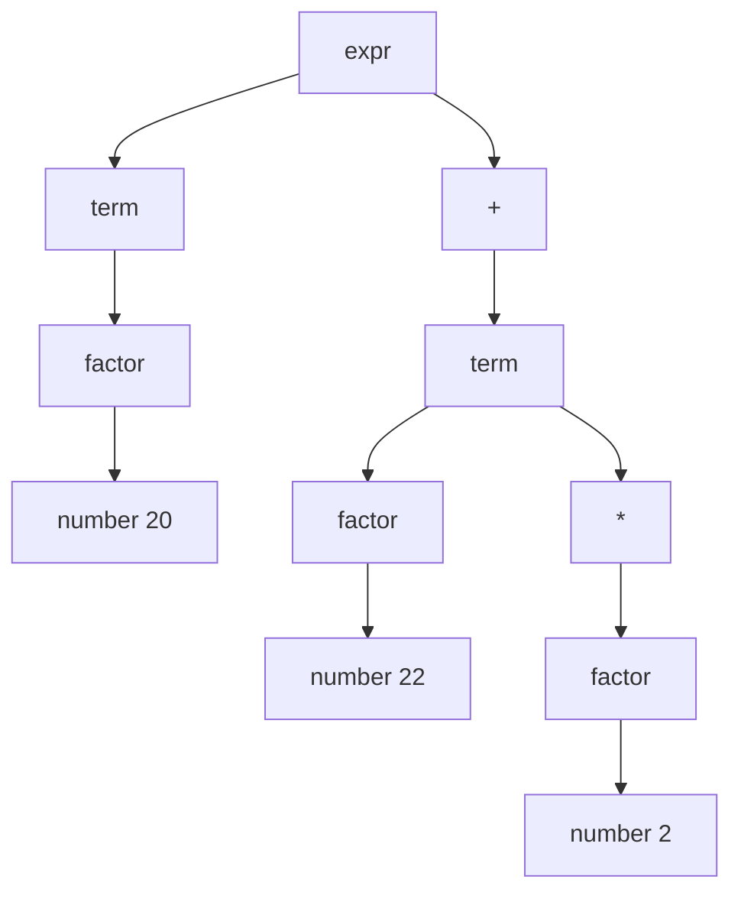

# 自顶向下分析：LL 族与递归下降

> [返回：第三阶段导览](01-导览.md)
> 对应大纲第 1 条。自顶向下 = 从开始符号出发"长"出输入串。本册把文法到代码的机械翻译讲透（递归下降），补上 FIRST/FOLLOW 的判定工具，并处理左递归与回溯两大障碍。

## 推导与归约：两种方向的同一棵树

对输入 `20 + 22 * 2`：

- **自顶向下**：从 `expr` 出发，反复**展开**非终结符，直到长出整个串——这是**最左推导**（每次展开最左边的非终结符）：`expr ⇒ term ⇒ factor ⇒ number(20)`……
- **自底向上**：从 token 出发，反复**归约**（把右部替换回左部），最终归约回 `expr`——这是最右推导的**逆过程**。

两者构造同一棵语法树，方向相反：



自顶向下 = 从树根 E 往下长（LL）；自底向上 = 从叶子 N1/N2/N3 往上归（LR，见 04 册）。**LL 的 L：从左到右读输入、最左推导；第二个 L 是前瞻 lookahead 数**（LL(1) = 看 1 个 token）。

## 递归下降：函数即非终结符

把文法逐条翻译成函数，**产生式右部 = 函数体顺序**：

```ebnf
letDecl → "let" ident typeAnn? "=" expr ";"
typeAnn → ":" type
```

```ts
function letDecl(): LetDecl {
  const kw = consume('let');                 // 终结符 → consume
  const name = consume('ident');
  const typeAnn_ = match(':') ? typeAnn() : undefined;   // 可选 → try/match
  consume('=');
  const init = expr();                       // 非终结符 → 递归调用
  consume(';');
  return { type: 'LetDecl', name, typeAnn: typeAnn_, init,
           start: kw.start, end: prev().end };
}
```

五条翻译规则（文法 → 代码的全部秘密）：

| EBNF 构件 | 代码形态 |
|---|---|
| 终结符 `"let"` | `consume('let')`（不吃就报错） |
| 非终结符 `expr` | `expr()` 递归调用 |
| 连接 `A B` | 顺序语句 |
| 选择 `A \| B` | 按**前瞻 token** 分派（switch/if） |
| 重复 `A*` | `while (检查 A 的开头) A()` |

递归下降的优点全在这张表里：**代码与文法逐行对应**，调试时看着产生式就能找到函数；缺点是"分派靠前瞻"——选择分支一多就需要文法本身可判定（LL(1)），这正是 FIRST/FOLLOW 的用武之地。

## FIRST / FOLLOW 与 LL(1) 判定

- **FIRST(α)**：α 能打头推出的终结符集合。`FIRST(expr) = {number, string, ident, (, !, -}`。
- **FOLLOW(A)**：某句型中 A 之后可能紧跟的终结符集合。`FOLLOW(expr) ⊇ {;, ), ,, }...}`——表达式结束后的"落脚点"。

**LL(1) 判定**：非终结符 A 的多条产生式分支，FIRST 集两两不相交；若某分支可推出 ε，则其 FIRST 与 FOLLOW(A) 也不相交。——直觉：**看一个 token 就能无歧义地选分支**，不需要回头。

计算 FIRST/FOLLOW 的不动点算法本身很简单（反复传播直到集合不变），本册不展开——手算 mini 文法够用。验证 v0.1 文法：分层表达式文法天然 LL(1)（`+` 只属于 term 层的延续），语句层的分派 token 是 `fn/let/if/while/{/return` + 表达式开头集合，也两两分离。**你的 parser 无回溯**，这是后面错误恢复能"一次报多个错"的前提。

## 左递归消除

```ebnf
expr → expr "+" term | expr "-" term | term
```

按机械翻译写代码：`expr()` 第一件事调 `expr()`——**无限递归**，连一个 token 都没消费。两种解法：

1. **改写文法**（机械公式）：

```ebnf
expr  → term expr'
expr' → ("+" | "-") term expr' | ε        (* 右递归 *)
```

2. **改写代码**（保留原文法的心智）：把右递归的 ε 翻译成**循环**：

```ts
function expr(): Expr {
  let left = term();
  while (peek().type === '+' || peek().type === '-') {
    const op = advance();
    left = { type: 'BinaryExpr', op, left, right: term(), ... };
  }
  return left;
}
```

`expr'` 这种"只为消除左递归而生"的非终结符，在代码里就是一个 `while` 循环——**EBNF 的 `X*` 记法与循环的同构**在这里体现得最清楚。实践普遍用解法 2（可读性），文法层面写 `term (("+"|"-") term)*`。

## 提取公因子与回溯

**公共前缀**：`stmt → "if" ... | "if" ... "else" ...` 的两个分支都以 `if` 打头，前瞻无法分派。解法：提取左公因子 `stmt → "if" expr stmt tail`、`tail → "else" stmt | ε`——把决策推迟到读到 `}`/`else` 时。

**回溯下降**：如果既不分派也不提因子，就"试错"——猜一个分支，失败则**回退 token 位置**试下一个。可行但危险：副作用要全部撤销、指数级最坏复杂度、错误信息模糊（"所有分支都失败了"）。**packrat/PEG** 用记忆化（每个 (非终结符, 位置) 只算一次）消除指数爆炸，代价是 O(输入长度 × 文法大小) 的内存。TS/JS 生态的 parser combinator 库多属此流派。

mini v0.1 **不需要回溯**（文法已是 LL(1)），但 `if/else` 的 `tail` 结构（else 挂内层还是外层）就是提取公因子的实战案例——与第一阶段"悬空 else"的两种消解对上了号。

## 自测

1. 把 `whileStmt → "while" expr block` 翻译成递归下降函数（5 行）。
2. 手算 `FIRST(unary)` 与 `FIRST(call)`（v0.1 文法）——它们相交吗？这意味着什么？
3. `expr → expr "+" term` 为什么不能直接翻译？改成循环后，左结合是怎么保住的？
4. 回溯下降"副作用要撤销"——如果 parser 在试探分支时已经 emit 了一条诊断，回退后会发生什么？
