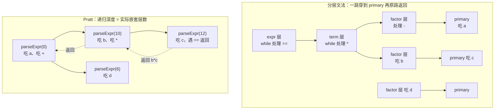

# Pratt 解析：运算符优先级的统一模型

> [返回：第三阶段导览](01-导览.md)
> 对应大纲第 2 条（本阶段重点）。分层文法到八级优先级就是八层函数；Pratt 把"层数"压成一张**绑定力数值表**，前缀/中缀/后缀统一处理。acorn、swc、rustc、TypeScript 的表达式解析全是它的变体。

## 分层文法的痛

上一册的分层文法（expr → term → factor → unary → call → primary）每加一个优先级就加一层函数、每层函数结构雷同：

```ts
function expr()   { let l = term();   while (op('+'|'-'))  l = bin(l, term());   return l; }
function term()   { let l = factor(); while (op('*'|'/'))  l = bin(l, factor()); return l; }
function factor() { let l = unary();  while (op('*'|'/'))  /* 抄错一个就出 bug */ }
```

六个优先级 = 六个几乎相同的函数；改优先级顺序要在多个函数间搬代码；右结合（`=`、`**`）还得单独写递归变体。**优先级是数据，不是控制流**——这就是 Pratt 的出发点。

### 痛的工业化样本：给 JS 加一个 `??`

这不是教学虚构。JS 的运算符优先级表（MDN）排了十几行，从逗号一路到函数调用。2020 年 `??`（空值合并）进规范时，分层文法视角下的问题是：插进哪一层？与相邻的 `&&`/`||` 怎么处理混用（`a ?? b || c` 语义有歧义，JS 规范干脆规定不加括号混用直接语法错误）。而在 Pratt 视角下答案是：绑定力表加一行数值、相邻运算符核对两个比较——**同一处语言演进，两种模型的维护成本完全不同**。"优先级是数据"这句话的实际分量就在这：数据好改，控制流难改。

还有一个隐蔽的痛：分层文法里**每个中间层函数都要被穿透**。`a || b && c` 要从 expr 层一路递归到 factor 层再原路返回，每层栈帧都只为"转发"存在；Pratt 的递归深度只与**实际嵌套的优先级层数**成正比，`a + b + c + d` 这种同级长链在主循环里一圈圈叠，栈深恒定——这也是"性能与可维护性兼得"的另一半来源。

### 穿透的代价：`a + b * c == d` 的调用深度对照

同一个表达式，两种模型的栈帧形状（`==` 优先级最低、`*` 最高）：



分层文法里每个二元链的每个操作数都要**重新穿过所有中间层**才能落到 primary；Pratt 的递归只在"优先级真正嵌套"时发生（`+` 右侧嵌套了 `*` 才下一层）。代价与收益都来自同一个结构事实：**分层文法的层级是文法的属性，Pratt 的递归深度是表达式的属性**。

## 绑定力模型

给每个运算符一对数值 **(leftBp, rightBp)**（binding power）。解析表达式的主循环只有一条规则：

> 循环看下一个中缀运算符：若它的 **leftBp < 当前允许的最小绑定力 minBp**，就返回（把控制权交回调用者）；否则吃掉它，**用它的 rightBp 作为新的 minBp** 递归解析右操作数。

```ts
function parseExpr(minBp = 0): Expr {
  let left = parsePrefix();                    // 先解析一个前缀表达式
  for (;;) {
    const t = peek();
    const bp = infixBp(t.type);                // 中缀绑定力（无则 0）
    if (bp.left < minBp) return left;          // 归还控制权
    advance();
    const right = parseExpr(bp.right);         // 关键：用右绑定力递归
    left = { type: 'BinaryExpr', op: t.type, left, right,
             start: left.start, end: right.end };
  }
}
```

只看这一条规则，三种结合性全部涌现：

| 运算符 | (leftBp, rightBp) | 效果 | 例子 |
|---|---|---|---|
| `+` `-` | (1, 2) | left < right → **左结合** | `a-b-c` = `(a-b)-c` |
| `=` | (9, 8) | left > right → **右结合** | `a=b=c` = `a=(b=c)` |
| `==` | (5, 6) | 高于 `\|\|` 低于 `*` | 优先级即数值大小 |

**左结合的机理**：递归用 rightBp=2，下一层遇到同级的 `-`（leftBp=1 < 2）会返回，于是回到外层循环把它并进**外层**的左操作数——树往左长。**右结合相反**：递归用 rightBp=8，同级 `=`（leftBp=9 ≥ 8）继续被吃——树往右长。没有特判、没有分层，两张数字定生死。

### 逐 token 推演一：`a + b * c == d`

光看规则不够，把 mini 表（后文给全）里用到的行摘出来：`+`=(9,10)、`*`=(11,12)、`==`=(5,6)。token 流：`a` `+` `b` `*` `c` `==` `d` `EOF`。主循环 `parseExpr(0)` 的完整轨迹：

| 步 | 当前层 minBp | 已吃 left | peek | 判定 | 动作 |
|---|---|---|---|---|---|
| 1 | 0 | — | `a` | 前缀 | parsePrefix 吃 `a`，left=`a` |
| 2 | 0 | `a` | `+` | 9 ≥ 0 | 吃 `+`，进 parseExpr(**10**) 解析右操作数 |
| 3 | **10** | — | `b` | 前缀 | 吃 `b`，left=`b` |
| 4 | **10** | `b` | `*` | 11 ≥ 10 | 吃 `*`，进 parseExpr(**12**) |
| 5 | **12** | — | `c` | 前缀 | 吃 `c`，left=`c` |
| 6 | **12** | `c` | `==` | 5 < 12 | **返回 `c`**（控制权交回步 4 那层） |
| 7 | 10 | `b` | 回到循环 | — | left=`b*c`；再 peek `==`：5 < 10 → **返回 `b*c`** |
| 8 | 0 | `a` | `==` | 5 ≥ 0 | 吃 `==`，进 parseExpr(**6**) |
| 9 | **6** | — | `d` | 前缀 | 吃 `d`，left=`d` |
| 10 | **6** | `d` | `EOF` | 0 < 6 | 返回 `d` |
| 11 | 0 | `a` | 回到循环 | — | left=`(a + b*c) == d`；peek `EOF`：0 < 0 不成立但有"查表 miss"闸 → 返回 |

最终 AST：`(a + (b * c)) == d`。两个关键时刻值得钉死：

- **步 6** 是"优先级"的全部秘密：`==`(5) 想抢 `c` 当左操作数，但当前层 minBp=12 不放人——`*` 先算完，`==` 只能等。**优先级不是"两个运算符互相比"，是"来犯者的 leftBp"对"当前层的 minBp"**——单一数值、单一比较；
- **步 8** 是"归还"的时刻：minBp 沿递归返回一路弹回 0，`==`(5) ≥ 0 才得以出手。

再从 AST 视角回看同一轨迹——**树是从"left 槽位"逐次长成的**：

| 时点 | 事件 | 当前的 left 形状 |
|---|---|---|
| 步 1 | 吃 `a` | `a` |
| 步 2~3 | 吃 `+`，右层吃 `b` | `a + b`（右层还没返回，先记着） |
| 步 4~5 | 右层吃 `*`，右右层吃 `c` | 右层内 left = `b * c` |
| 步 6~7 | `c`、`b*c` 相继返回 | 外层拼出 `a + (b * c)` |
| 步 8~10 | 吃 `==`，右层吃 `d` 返回 | `(a + (b * c)) == d` |

每个二元节点的**左儿子在吃掉运算符那一刻就定型了**（已就绪的 left），右儿子等递归返回才补上——这就是为什么"归还是不是正确的那棵子树"完全由 minBp 决定：返回得早 = 当了别人的右儿子，返回得晚 = 自己当爹继续吃。

### 逐 token 推演二：结合性的两个短例

**左结合 `a - b - c`**（`-`=(9,10)）：第 1 层 minBp=0 吃 `a`、吃 `-`，进 parseExpr(10)；该层吃 `b` 后 peek `-`：leftBp 9 < 10 → **返回 `b`**。回到外层：left=`a-b`，循环再 peek `-`：9 ≥ 0 → 吃掉、递归吃 `c`，并进**外层**的 left。AST：`(a-b)-c`——同级运算符的第二次出现被"弹回"外层，树自然往左长。

**右结合 `a = b = c`**（`=`=(15,14)）：外层 minBp=0 吃 `a`、吃 `=`，进 parseExpr(**14**)；该层吃 `b` 后 peek `=`：leftBp **15 ≥ 14** → 不返回，继续吃！AST：`a=(b=c)`。**左右绑定力只差 1、方向一反，树的生长方向就翻转**——回看上表 (1,2) 与 (9,8) 的对比，机理一致。

### 左结合没有左递归：主循环就是"消去后的左递归"

对照 [02-自顶向下LL族](02-自顶向下LL族.md) 的结论：LL 不能处理左递归（`expr → expr + term` 会无限展开自己）。分层文法的递归下降实现里，左结合靠的是**把左递归手工改成 while 循环**（`while (op('+')) left = bin(left, term())`）——文法教材称之为"左递归消去"。Pratt 的主循环正是这个 while 的**参数化版本**：`for(;;)` 循环叠 left，递归只发生在右操作数上（右递归天然安全）。所以更准确地说：**Pratt = 把"每层一个 while"合并成"一个参数化的 while"**——左结合能力不是新发明的，是从每层函数里收编回来的。

推论也顺手记下：Pratt 的递归深度 = 表达式的**右嵌套**深度。`(1+2)*(3+4)` 深度 2；`((((1))))` 深度 4（括号是前缀，递归在 parsePrefix 里）。深度与表达式长度无关——深链恐惧在这里不成立。

### 这套算法的名字：Pratt 解析 = 优先级爬升

文献里你会同时看到两个名字：**Pratt 解析**（TDOP，Top Down Operator Precedence，Vaughan Pratt 1973）与**优先级爬升**（precedence climbing）——业界普遍认为两者描述同一算法，差异只在叙述方式（Pratt 原始讲法用 nud/led 分派，爬升讲法用 minBp 参数）。让它出圈的两步：Crockford 2007 年用 TDOP 重写 JSLint 的解析器，把"运算符表驱动"推给 JS 社区；此后 acorn、Babel、swc 相继采用。名字认哪个都行，**机理就是前两张推演表**。

## 前缀、后缀、"超高中缀"

**前缀**（`!`、`-`、`(...)`、字面量、标识符）由 `parsePrefix()` 处理：读一个 token，按类型分派——一元负号给个右绑定力（如 7，高于 `*`）递归右操作数；`(` 则 `parseExpr(0)` 后 `consume(')')`。

**后缀与"调用"**：`f(1)(2)`、`a[i].b` 是**左结合的中缀**，绑定力设为最高（如 (11, 11)），右操作数为空——即"循环体里特殊处理"：

```ts
if (t.type === '(') {
  advance();
  const args = parseArgs();
  left = { type: 'CallExpr', callee: left, args, ... };
  continue;                                    // 不走 parseExpr，绑定力无穷大
}
```

**三元 `?:`** 也可以编码为 (4, 4) 的中缀 + 内部再 `parseExpr(0)` 解析 else 支——一切"特殊语法"都尽量压进绑定力表，表之外的特例越少，parser 越可维护。

### 前缀的绑定力：一元不是铁板一块

mini 表把一元统一压到 13（高于 `*`、低于后缀调用），但真实语言里**前缀运算符彼此的绑定力也不同**，这是新手最容易忽略的一格：

| JS 片段 | 解析结果 | 说明 |
|---|---|---|
| `-a * b` | `(-a) * b` | 一元 `-` 的右绑定力高于 `*` 的 leftBp |
| `typeof a * b` | `(typeof a) * b` | `typeof` 的右绑定力**低于** `*` |
| `await a + b` | `(await a) + b` | `await` 同样"松" |
| `!a == b` | `(!a) == b` | `!` 紧 |

`typeof` 若也设成 13，`typeof a * b` 就会被解析成 `typeof (a * b)`——**语义全变**。所以工业实现的前缀表是一张"运算符 → 右绑定力"的映射而非单一常量（mini 用统一值 13 是最小化的教学选择；给 mini 加 `typeof` 式运算符时，第一件事就是把 `PREFIX_BP` 从常量改成映射）。Pratt 原始论文把前缀/字面量分派叫 **nud**（null denotation，"左边没东西"时的动作），中缀/后缀叫 **led**（left denotation，"左边有东西"时的动作）——读 acorn、rustc 源码的注释会碰到这对古董词，它们与本册 parsePrefix / 中缀循环的分派一一对应。

顺带把本节开头"一元负号给个右绑定力（如 7）"与 mini 表的 13 对上：**绑定力数值只有相对序有意义**——那是两张不同大小的表，各自的相对序一致（一元高于乘除、低于后缀），绝对数值互不可比。

### 伪中缀补遗：`?:` 的可执行形状

把上一段的三元编码展开成可运行的分支：

```ts
if (t.type === '?') {
  advance();                                  // 吃掉 ?
  const consequent = parseExpr(0);            // `:` 不在中缀表，循环停在那里
  consume(':');
  const alternate = parseExpr(3);             // else 支允许同级 ?: 递归 → 右结合
  left = { type: 'Conditional', test: left, consequent, alternate, ... };
  continue;
}
```

两个值得玩的细节：consequent 用 `parseExpr(0)`——`:` 是三元的专属停靠点，中间段由"查表 miss 即返回"的闸兜住，不会被别的运算符拐跑；else 支传 3（比本运算符的 leftBp 4 低一档），让 `a ? b : c ? d : e` 长成右结合链（JS 规范正是右结合）。箭头函数体、`as` 类型断言之类"右侧语法特殊"的运算符走同一条路：**中缀外观 + led 里接管右操作数解析**。特例没有消失，但被收拢到一格，主循环五行不变。

## mini 语言的绑定力表

```ts
const INFIX: Partial<Record<TokenType, [number, number]>> = {
  '||': [1, 2], '&&': [3, 4],
  '==': [5, 6], '!=': [5, 6],
  '<': [7, 8], '>': [7, 8], '<=': [7, 8], '>=': [7, 8],
  '+': [9, 10], '-': [9, 10],
  '*': [11, 12], '/': [11, 12], '%': [11, 12],
  '=': [15, 14],                               // 右结合：left > right
};
const PREFIX_BP = { '!': 13, '-': 13 };        // 一元：高于 */，低于后缀
// 调用 '(' = 超高中缀（特判），括号 '(' = 前缀（特判）
```

加一个运算符 = 加一行表项。把优先级从 12 层文法压缩成 14 个数字，这就是"为什么 acorn、swc、rustc 都用它"的全部理由——**可维护性与性能兼得**（主循环零递归开销地处理二元链，`a+b+c+d` 不再每次过 4 层函数）。

### 双重身份：`-` 既是前缀又是中缀

`-` 在 mini 语言里有两个身份：前缀负号（parsePrefix 里）与二元减法（INFIX 里 (9,10)）。Pratt 的分派规则天然化解：**进 parseExpr 先 parsePrefix（nud），循环里才查 INFIX（led）**——token 的身份由"它出现时左边有没有已就绪的操作数"决定。`a - b` 的 `-` 出现在循环里（左边已有 `a`）→ 中缀；`-a` 的 `-` 出现在 parsePrefix 里（左边没有）→ 前缀。对比分层文法怎么处理：`unary → '-' unary | call` 与 `term → term '-' factor` 分居两层函数——**同一个 token 的两种身份被文法结构硬拆开，Pratt 把拆分藏进分派时序里**。

### 为 `**` 设计绑定力对（自测 3 的展开）

要求：右结合、优先级介于一元与乘法之间（类似 JS/Python）。给设计 `(14, 13)` 逐条验证（PREFIX_BP=13）：

| 输入 | 推演 | 结果 | 达标？ |
|---|---|---|---|
| `a ** b ** c` | 外层吃 `a`、`**`，进 parseExpr(13)；该层吃 `b` 后 peek `**`：14 ≥ 13 继续吃 | `a ** (b ** c)` | 右结合 ✓ |
| `a * b ** c` | `a` 吃 `*` 进 parseExpr(10)；吃 `b`，peek `**`：14 ≥ 10 吃 | `a * (b ** c)` | 高于 `*` ✓ |
| `a ** b * c` | `a` 吃 `**` 进 parseExpr(13)；吃 `b`，peek `*`：11 < 13 返回 | `(a ** b) * c` | 低于一元 ✓ |
| `-a ** b` | parsePrefix `-` 进 parseExpr(13)；吃 `a`，peek `**`：14 ≥ 13 吃 | `-(a ** b)` | 与 Python 一致 |
| `a ** -b` | `**` 的右层 parseExpr(13) 先 parsePrefix 吃 `-`（前缀不查 minBp） | `a ** (-b)` | ✓ |

倒数第二行暴露关键设计点：**前缀的右绑定力与 `**` 的 leftBp 谁高，决定 `-a ** b` 归谁**——这里 prefix(13) < `**`.left(14)，一元负号"让"了。JS 走得更绝：`-a ** 2` 直接**语法错误**（规范要求指数运算符左侧不能是一元表达式），强制用户加括号消歧；Python 的选择是上表的 `-(a ** b)`。同一需求三种答案（改表 / 报错 / 让用户加括号），Pratt 下都只是一行数值或一条校验——**表驱动的可维护性在"语言规范打架"的时刻最显价值**。

### 加运算符核对清单

改一行表项之前过五问（每问都能用推演法在纸上验证）：

1. **数值落在哪两个邻居之间**？找出它必须高于/低于的运算符，各写一个"结果必须如此"的样例；
2. **左右差值的方向**：左结合 right = left + 1，右结合反过来；(13.5, 13.5) 式的非对称对（如 `**`）什么时候需要？
3. **是否与某个前缀撞名**（`-`、`+`、`!` 都有双重身份）？撞名要同时改 PREFIX 侧；
4. **有无语法特殊的右操作数**（`?:`、`=>`、`as`）？有则 led 里特判接管；
5. **回归样例**：至少一对"只差优先级就变结果"的表达式（`a + b * c` vs `(a + b) * c`）进测试集。

### 14 个数字的出处：从"层级"自动生成绑定力对

上面那张 mini 表的 14 个数字不是手拍的——它们可以由"层级 + 结合性"声明**机械生成**：

```ts
// 只声明：运算符组、层级、结合性（level 越大越紧）
const LEVELS: [TokenType[], number, 'L' | 'R'][] = [
  [['||'],               1,   'L'],
  [['&&'],               2,   'L'],
  [['==', '!='],         3,   'L'],
  [['<', '>', '<=', '>='], 4, 'L'],
  [['+', '-'],           5,   'L'],
  [['*', '/', '%'],      6,   'L'],
  [['='],                7.5, 'R'],
];
// level p：左结合 → (2p-1, 2p)；右结合 → (2p, 2p-1)
```

逐行核对生成的数值：p=1 → `||` (1,2) ✓；p=2 → `&&` (3,4) ✓；……p=6 → `*` (11,12) ✓；p=7.5 右结合 → `=` (15,14) ✓——**与本节的 INFIX 表逐项一致**。三个发现：

- **"左结合 right = left + 1"的惯例有出处**：相邻层级各占一对奇偶数，层与层之间天然错开 2，中间永远插得进新层级；
- **PREFIX_BP=13 = 2×7−1**：一元定在"第 7 级"，恰在乘除（6 级）之上、`=`（7.5 级）之下——半级就是为右结合的 `=` 留的位置；
- **这与 bison 的 `%left`/`%right` 声明同构**：yacc 只接受"层级 + 结合性"，绑定力对由生成器算出（第四册会正面遇到）。**声明式层级 → 数值表 → Pratt 循环**，三段链条在生成器与手写实现里是同一条。

## 与递归下降的配合

mini parser 的分工（05、06 册落地）：

- **语句层**：递归下降（`fn/let/if/while/{/return` 的分派是天然 LL(1)）
- **表达式层**：Pratt（绑定力表驱动）

这不是发明——acorn 的 `parseStatement` 与 `parseExpr` 正是同样分工；rustc 的表达式解析在 2020 年前后也从分层改为 Pratt（rust-lang PR #70545，动机就是消除优先级分层的样板代码）。**两个技术各打各的最强区**：语句结构低频且分支稳定（LL 直观），表达式高频且优先级密集（表驱动）。

### 混合 parser 的三处接缝

语句层（LL）与表达式层（Pratt）的交界处有三个经典陷阱，mini parser（[06-实践-mini语言parser](06-实践-mini语言parser.md)）都踩过并写进了实现：

- **语句可以以表达式开头**：`a = b;`、`a - b;`、`f(x);` 都是合法语句，所以语句层分派表要有一条"兜底：表达式语句"——它调用的是 `parseExpr(0)`（完整绑定力表），**不是**某个写死的 `parseAdditive()`。写死层级是初学混合 parser 最常见的错误：兜底分支一旦写死，`a = b` 就会解析失败；
- **赋值目标的校验**：`=` 在表里是 (15,14) 的普通中缀，`1 = 2` 会被顺利解析成赋值节点——**语法上合法、语义上非法**。校验时机两种：解析完整表达式后回查左儿子是不是标识符/成员访问（简单），或吃 `=` 之前先试探（复杂但错误信息更准）。工业实现（acorn 报 "Invalid left-hand side in assignment"）多选后者，mini 选前者——差异只是诊断质量，不是对错；
- **错误恢复的同步点**：Pratt 循环里的报错（"期待操作数，看到 `;`"）发生后，要一路向上跳到语句边界才能恢复——异常机制负责"跨层跳出"，见 [05-AST设计与错误恢复](05-AST设计与错误恢复.md)。**表达式层的恢复单位是"整个表达式"，语句层才是"下一个 `;`"**——两层粒度不同，接缝处要显式转换。

### 工业实现的绑定力表：四家一瞥

| 实现 | 表达式解析 | 表的形态 |
|---|---|---|
| acorn | Pratt | `precedence` 对象：token 类型 → 数值；中缀查表 miss 即返回 |
| Babel | Pratt（acorn 血统） | fork 起家，二元运算走绑定力循环 |
| swc | Pratt | 类似映射表 + 每运算符处理函数 |
| rustc | Pratt（2020 重构） | 运算符关联结构 + precedence 方法，重构动机即消除分层样板 |
| tsc（TypeScript） | 递归下降 + 优先级参数 | `parseBinaryExpression(precedence)` 的参数爬升——Pratt 的近亲写法 |

五家的共同点：**表达式解析都是"一张数值表 + 一个循环"**，分歧只在表的编码方式（对象/枚举/参数）。给学习者的启示：读懂本册那两张推演表，这几家的源码就成了"找表 → 对数值"的读物——**看懂一个 Pratt 循环，等于拿到了五个 parser 的门票**。

### 为什么语句层留给 LL(1)：一张分派表

反过来问：既然 Pratt 这么好，语句层为什么不也用它？看 mini 语言的语句分派表（06 册的 `declaration()`）：

| 语句 | 开头 token | 分派 |
|---|---|---|
| 函数声明 | `fn` | `consume('fn')` 顺序消费 |
| 变量声明 | `let` | 同上 |
| if / while / 块 / return | `if` / `while` / `{` / `return` | 各自独立入口 |
| 表达式语句 | `ident`、`number`、`(`、`!`、`-`… | **兜底：parseExpr(0)** |

语句的分支由**开头 token 唯一确定**（LL(1) 的甜点位）：看到 `let` 就是声明，没有歧义，switch 一下就分派完。而表达式的所有分支共享开头 token——`a` 可能是标识符、二元链的开头、赋值目标、调用的 callee……**开头 token 分不出分支，只能靠绑定力把所有可能"一口气"吃完**。这就是分工的判据：**能用开头 token 分派的用 switch（LL），开头 token 分派不了、要按"结合能力"继续吃的用 Pratt**。两者不是新旧关系，是对两类分派问题的两种正确工具。

两层的对照一览（实现细节全部见 06 册）：

| 维度 | 语句层（LL） | 表达式层（Pratt） |
|---|---|---|
| 分派依据 | 开头 token（switch） | 绑定力表 + minBp |
| 循环/递归形态 | 顺序消费 + 少量递归 | for(;;) 主循环 + 右操作数递归 |
| 典型错误 | "期待 `;`"（结构性缺失） | "期待操作数"（操作数缺失） |
| 恢复粒度 | 下一个 `;` / `}`（语句边界） | 整个表达式作废 |
| 修改频率 | 低（语句种类稳定） | 高（运算符随语言演进） |

### Pratt 的边界：需要上下文的地方

绑定力表只看"左右邻居是谁"，纯 Pratt 处理不了**需要更远上下文**的语法，工业实现都在 led/nud 里加"逃逸口"：

- **C 的类型转换**：`(T)(x)` 是 cast、`(x)(y)` 是调用——`(expr)(expr)` 的两读性需要"查符号表看 T 是不是类型"，parser 在此处回退重解析；
- **TypeScript 的 `f<T>(x)`**：可能是泛型调用也可能是两个比较，tsc 先按泛型试解析、失败再回退成比较表达式（试探 + 回退，Pratt 循环外的一次预演）；
- **Rust 的闭包返回类型**：`|x| -> i32 x + 1` 的返回类型要等类型检查器才知道，parser 把"这里要推导"的洞留给后续 pass——**语法树的"未完成节点"是 parser 与 checker 之间的合同**。

共同模式：**Pratt 管"结构与优先级"，上下文问题交给表之外的机制**（回退、预演、延迟节点）。识别出哪些语法"表装不下"，与"把多少语法压进表"同样重要——表装得越多越可维护，但硬塞上下文敏感语法会让主循环腐化。

## 常见误区

- **"Pratt 与递归下降是两种竞争范式"**：Pratt 就是递归下降——带一个 minBp 参数、分派查表的递归下降。两者是"特化与一般"的关系；mini parser 的混合结构（语句 LL + 表达式 Pratt）恰恰说明它们是分工不是竞争；
- **"优先级由 leftBp 决定"**：来犯者贡献 leftBp，**当前层贡献 minBp**，缺一不可。推演一的步 6 里 `==`(5) 敢不敢动手，取决于它面对的 minBp 是 12 还是 0——同一个运算符在不同层的命运完全不同。把绑定力理解成"每个运算符自带一个数"，`a + b * c == d` 就推不动；
- **"一元运算符总是绑定最紧"**：`typeof a * b` = `(typeof a) * b`、`await a + b` = `(await a) + b`——前缀的右绑定力是每运算符独立的参数。mini 用统一 13 是最小化的教学选择，不是普遍规律；
- **"非中缀 token 的 bp=0，循环会误吃它"**：细看主循环，`bp.left < minBp` 在 minBp=0 时挡不住 bp=0 的普通 token——工业实现都在比较前加一道"查表 miss 即返回"的闸（acorn 查 precedence 对象 miss 即 return；06 册实现先判 `INFIX` 有无表项）。教学版代码省略这道闸是为了突出主比较，照抄实现时要补上；
- **"表驱动之后错误信息必然变差"**：报错质量与分派机制正交——Pratt 循环照样知道"在哪个 token、期待什么"（06 册的 `error()` 统一话术）。表驱动 LR 报错难是因为状态表压缩掉了文法结构，而 Pratt 的表只有数值、结构还在递归栈里；
- **"调用、下标、成员访问要写进绑定力表"**：它们要么配 (11,11) 式"最高对"、要么在 led 里特判——但**绝不能给"普通"绑定力**：`f(1) + 2` 若 `(` 的 leftBp 低于 `+`，`f` 会先和 `+` 结合，语义崩坏。后缀/调用一族永远最强绑定；
- **"绑定力表定下来就不用再动了"**：语言在演进（本册开头 `??` 的例子），表是活的——核对清单 + 回归样例就是为"表会再改"准备的工具链。

## 动手清单

（都基于 [06-实践-mini语言parser](06-实践-mini语言parser.md) 的代码，每条 20 行以内。）

1. 在 `INFIX` 表加 `**` 的 (14,13)，检查 `2 ** 3 ** 2` 的 AST 是 `2**(3**2)`（右结合）、`-2 ** 2` 是 `-(2**2)`，各写一条断言；
2. 把 `=` 的绑定力改成 (14,15)（左结合），观察 `a = b = c` 的 AST 变化再改回——亲手体验"左右差值方向"一节；
3. 给 parsePrefix 加 `print` 运算符（右绑定力设 8，低于 `+`）：验证 `print 1 + 2` 解析为 `(print 1) + 2`；
4. 按"伪中缀补遗"实现三元 `?:`，测试 `a ? b : c ? d : e` 的右结合形状；
5. 实现"赋值目标校验"（解析后回查左儿子），`1 = 2` 的诊断信息格式对齐 06 册的 E0301 风格；
6. 把 `LEVELS` 声明式生成器（"14 个数字的出处"一节）接进 parser，替换手写 INFIX 表，跑全量回归测试确认输出不变。

## 自测

1. 用绑定力表手动模拟 `a = b || c && d` 的解析过程（写出每层 minBp 与返回点），验证 `&&` 先于 `||`、`=` 最后。
2. `-a * b` 为什么是 `(-a) * b` 而不是 `-(a*b)`？PREFIX_BP=13 与 `*` 的 (11,12) 谁决定了这一点？
3. 给 `**`（右结合、优先级介于一元与乘法之间，类似 JS）设计绑定力对，并解释选择。
4. 把 `f(1)(2)` 的两次调用画成 AST——调用为什么天然左结合？

（1~4 为原题；5~10 为扩写增补题，答不出就回到对应推演表。）

5. 逐步推演 `a + b == c * d`：写出每层 minBp 的变化与"谁在等谁"（对照推演一的步 6、步 8）。
6. `!a == b` 与 `!(a == b)` 的 AST 差异由哪两个数值的比较决定？写出比较式。
7. `a ? b : c` 的 b 位置为什么不会被 `+` 抢走？从"parseExpr(0) + 查表 miss 即返回"两道机制推演 b 之后遇到 `:` 时发生了什么。
8. 给 `?.`（可选链）设计在表里的身份：配什么绑定力对？`a?.b.c` 与 `(a?.b).c` 的 AST 一样吗？
9. tsc 用"优先级参数"、acorn 用"查表"——给 `??` 定优先级这个任务在两种编码下分别要改几处？
10. 语句层兜底分支若写死 `parseAdditive()`，`a = b;` 会发生什么？从 minBp 语义出发推演失败点。
11. 把 `? :` 编码为 (4,4) 的中缀后，`a ? b : c == d` 会解析成什么？想清楚再画 AST——三元内部的 `parseExpr(0)` 会把 `==` 吃进 consequent 吗？
12. `typeof a * b` 与 `-a * b` 的解析结果为什么不同？用"前缀表是映射不是常量"重述一遍原因。

学完下一册 [04-自底向上LR族](04-自底向上LR族.md) 回来看：bison 的 `%left '+'` 优先级声明与本册 LEVELS 表是同一套"层级 + 结合性"声明——两种解析架构，共享同一张优先级世界观。
