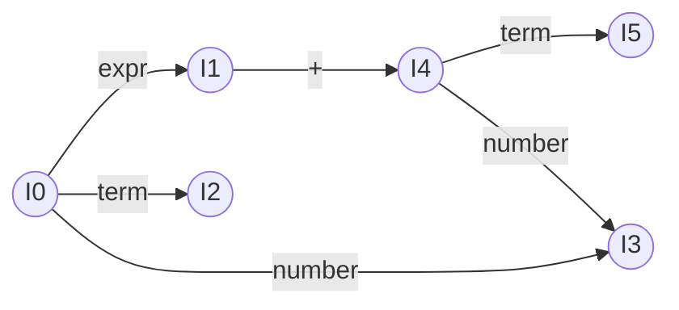

# 自底向上分析：LR 族

> [返回：第三阶段导览](01-导览.md)
> 对应大纲第 3 条。LR 是编译原理课本的正统主角（yacc/bison 生成 LALR），工程上被手写递归下降/Pratt 取代，但**优化器的数据流分析、语法树的自动构造思想**都与它同源。本册目标：理解移进-归约模型、能看懂冲突报告、明白 LR 家族四兄弟的取舍——不实现完整构造器。

## 移进-归约模型

LR 分析器 = **一个符号栈 + 输入流 + 动作表**。每步三选一：

- **移进（shift）**：把下一个 token 压栈。
- **归约（reduce）**：栈顶若干符号恰好匹配某产生式右部，把它们弹出、压入左部非终结符。
- **接受（accept）/ 报错**。

以 `expr → expr + term | term`、`term → number` 归约 `20 + 22`：

```
栈                 动作
[]                 移进 20
[20]               归约 term → number
[term]             归约 expr → term
[expr]             移进 +
[expr +]           移进 22
[expr + 22]        归约 term → number
[expr + term]      归约 expr → expr + term     ← 句柄在栈顶出现
[expr]             接受
```

**句柄（handle）**：每一步"栈顶恰好该归约的那串符号"。LR 分析的全部难点 = 怎么知道当前栈顶是不是句柄、该按哪条产生式归约——答案靠**状态机记录上下文**（栈里不只是符号，还有状态）。

主循环的全貌画成状态机——每轮就是一次四选一：

```mermaid
flowchart TD
    LOOK[查 ACTION[栈顶状态, 来犯 token]] --> S1{动作类型}
    S1 -->|移进| SH[压 token + 压新状态<br>读下一个 token]
    S1 -->|归约| RD[弹出右部 k 个符号<br>GOTO 查旧状态 + 左部<br>压左部 + 新状态]
    S1 -->|接受| OK[分析结束<br>栈里只剩开始符号]
    S1 -->|空槽| ERR[词法/语法诊断<br>进入恢复流程]
    SH --> LOOK
    RD --> LOOK
```

移进与归约共用同一个"查表 → 动作 → 回到查表"的环——**分析器的运行时没有智慧，智慧全在 ACTION/GOTO 两张表里**。表的构造（下一节）才是 LR 的全部难度所在。

与自顶向下的镜像关系：递归下降**预测**（还没读就决定展开谁），LR**确认**（读完右部才归约）——确认天然更强，所以 LR 能处理的文法严格包含 LL。

### 栈里为什么要有状态：给上面的 trace 装上表

细看上节 trace，"何时归约、按哪条归约"的决策只看栈顶符号是不够的——同样的 `[expr]` 栈顶、同样的来犯 `+`，在不同语境下决策可能不同。**判断句柄需要"这一段是怎么来的"**：纯符号栈记不住来历。所以工程实现里每个符号下面还压一个**状态号**，把"我怎么走到这"显式记下来（状态号是下一节要手工构造的项集编号）：

| 步 | 符号栈 | 状态栈 | 剩余输入 | 动作 | 依据 |
|---|---|---|---|---|---|
| 1 | — | [0] | `20 + 22 $` | 移进 `20` | 状态 0 遇 number |
| 2 | `20` | [0, 3] | `+ 22 $` | 归约 `term → number` | 状态 3：点在末尾 |
| 3 | `term` | [0, 2] | `+ 22 $` | 归约 `expr → term` | 状态 2 |
| 4 | `expr` | [0, 1] | `+ 22 $` | 移进 `+` | 状态 1 遇 `+` |
| 5 | `expr +` | [0, 1, 4] | `22 $` | 移进 `22` | 状态 4 遇 number |
| 6 | `expr + 22` | [0, 1, 4, 3] | `$` | 归约 `term → number` | 状态 3 |
| 7 | `expr + term` | [0, 1, 4, 5] | `$` | 归约 `expr → expr + term` | 状态 5，`$` ∈ 前瞻 |
| 8 | `expr` | [0, 1] | `$` | 接受 | 状态 1 遇 `$` |

每步的机械流程：查 ACTION[栈顶状态, 来犯 token] → 移进则压 token + 新状态，归约则**弹出 k 个符号（k = 产生式右部长度）**、暴露下面的旧状态、查 GOTO[旧状态, 左部] 压新状态。全程查表、没有任何"看情况"——**聪明全部在离线的表构造里，运行时只是一个确定性自动机**。这就是"LR 分析器 = 自动机"的含义。

镜像关系还可以再精确一步：递归下降的调用栈与 LR 的状态栈**内容不同、角色对偶**——前者的栈帧记录"我正在展开谁、还期待什么"（预测未来），后者的栈帧记录"我已经看见了什么前缀"（确认过去）。所以 LR 能等读完右部再决定（左递归友好），LL 必须先展开（左递归致命，见 [02-自顶向下LL族](02-自顶向下LL族.md)）。

### 从归约序看语法树：自底向上的组装

把上一节 trace 的归约序与 [02-自顶向下LL族](02-自顶向下LL族.md) 的推导序摆在一起，同一棵树、两个生长方向：

| 视角 | 顺序 | 对 `20 + 22` 的体现 |
|---|---|---|
| 自顶向下（LL） | 最左推导：从 `expr` 出发**长**出输入 | 先决定"这是 expr + term"，再展开两端 |
| 自底向上（LR） | 最右推导的**逆**：从输入**缩**回 `expr` | 先归约 `20` 成 term/expr，`22` 同理，最后归约整体 |

每个"归约"动作恰好对应树上**一次子树挂接**：`term → number` 挂叶子、`expr → expr + term` 挂中间节点。所以 LR 的分析过程就是**语法树的后序组装**——叶子先进树、父节点后进，与手写 parser 里"递归返回时造节点"完全同型。两种家族最终造出**同一棵树**，只是组装的遍历方向相反。

## LR(0)、SLR、LR(1)、LALR：四兄弟

差异全在"什么时候允许归约"（如何利用前瞻 token）：

| 分析器 | 归约时机 | 状态数 | 能力 | 代表 |
|---|---|---|---|---|
| **LR(0)** | 完全不看前瞻 | 最少 | 最弱，实用文法几乎都有冲突 | 教学起点 |
| **SLR(1)** | 前瞻 ∈ FOLLOW(左部) 才归约 | 同 LR(0) | 实用一些 | — |
| **LR(1)** | 每个项目自带精确前瞻集 | 可能指数爆炸 | 最强（含前瞻的实用极限） | — |
| **LALR(1)** | 合并"同核心"的 LR(1) 状态 | 回到 SLR 量级 | 略弱于 LR(1) | **yacc/bison** |

读法建议：只需要建立三个印象——

1. **LR(0) 的冲突**是常态：`expr → expr • + term`（点后是 +，等着移进）和 `expr → expr + term •`（点在末尾，随时可归约）同现一栈状态，不看前瞻无从选择。
2. **SLR 用 FOLLOW 收窄**：`+ term •` 若 `+` ∉ FOLLOW(expr) 就不许此刻归约——廉价但粗糙（FOLLOW 是全句型的并集，不是当前语境的实况）。
3. **LR(1) 给每个项目配"精确前瞻"**（在哪个字符前该归约），代价是状态爆炸；**LALR 把只差前瞻集的同核状态合并**，规模与能力都折中——bison 选它纯属工程权衡。

### 手工构造：六状态小文法全流程

把上面的印象落到一张真表上。文法 G（三条产生式 + 增广，与上一节 trace 用的同一套）：

```
(0) S' → expr            ← 增广：唯一的开始符号，归约它即"接受"
(1) expr → expr + term
(2) expr → term
(3) term → number
```

**第一步：FIRST / FOLLOW**（算法见 [02-自顶向下LL族](02-自顶向下LL族.md)，这里列结果与依据）：

| 集合 | 结果 | 依据 |
|---|---|---|
| FIRST(expr) | {number} | expr 只能从 term → number 起步 |
| FIRST(term) | {number} | 同上 |
| FOLLOW(expr) | {+, $} | (1) 中 expr 后跟 `+`；(0) 中 expr 后是文件尾 `$` |
| FOLLOW(term) | {+, $} | (1)(2) 中 term 都在产生式末尾 → 继承 FOLLOW(expr) |

**第二步：项集与转移**。项（item）= 产生式中加一个点，点表示"右部读到哪了"；**项集 = DFA 状态**。从 I0 = closure({S'→·expr}) 出发，对每个文法符号算 GOTO（读符号、点右移、再求闭包）：

| 项集 | 内容 | GOTO |
|---|---|---|
| I0 | `S'→·expr`，`expr→·expr+term`，`expr→·term`，`term→·number` | expr→I1，term→I2，number→I3 |
| I1 | `S'→expr·`，`expr→expr·+term` | +→I4 |
| I2 | `expr→term·` | （无移进项） |
| I3 | `term→number·` | （无移进项） |
| I4 | `expr→expr+·term`，`term→·number` | term→I5，number→I3 |
| I5 | `expr→expr+term·` | （无移进项） |



眼熟吗？**这套"闭包 + GOTO"就是第二阶段子集构造的文法版**：项对应 NFA 状态（"产生式读到哪"的微观状态），项集对应 DFA 状态——LR 项集构造与 NFA→DFA 是同一算法的两次现身（见 [02-从正则到自动机](../02-第二阶段/02-从正则到自动机.md)）。

顺带观察这个文法的 LR(1) 形态：给每个项补上前瞻后——`term→·number` 在 I0 里带 {+, $}、在 I4 里只带 `$`，但两个项集的核不同，不构成"同核分裂"——**没有任何一个核需要按前瞻复制成两个状态，LR(1) 项集数恰好仍为 6**。对比下面 SLR 误放行的经典文法（同核项因语境不同被迫按前瞻分裂），你可以直观看到"状态爆炸"的触发条件：**同一个项集核在不同语境下带着不同的前瞻集**。四兄弟的构造成本与状态规模一目了然：

| 构造 | 项集规模 | 构造成本 | 前瞻精度 |
|---|---|---|---|
| LR(0) | 最少 | 最低（本册手工版） | 无 |
| SLR(1) | 同 LR(0) | 最低 + 一张 FOLLOW 表 | 全局 FOLLOW（粗） |
| LR(1) | 视前瞻分裂，最坏指数 | 高 | 每项精确（细） |
| LALR(1) | 同 LR(0) 量级 | 高（先 LR(1) 再合并）或直接合并构造 | 合并后的并集（中） |

**第三步：成表**。ACTION[状态, 终结符] 与 GOTO[状态, 非终结符]：

| 状态 | number | + | $ | 归约许可 |
|---|---|---|---|---|
| 0 | 移进→3 | — | — | — |
| 1 | — | 移进→4 | 接受 | **LR(0)：`S'→expr·` 处处归约 → 与移进 + 冲突** |
| 2 | — | — | — | 归约 (2)（LR(0) 处处；SLR 收窄到 FOLLOW(expr)） |
| 3 | — | — | — | 归约 (3) |
| 4 | 移进→3 | — | — | — |
| 5 | — | — | — | 归约 (1) |

**第四步：观察冲突与升级**。唯一冲突点在 I1：不看前瞻时 `S'→expr·` 要求处处归约，与移进 `+` 打架。SLR 用 FOLLOW(S') = {$} 把归约收窄到 `$`——冲突消失，**SLR(1) 通过**。I2/I5 的归约同样收窄到 FOLLOW(expr) = {+, $}，但它们本来就没有移进项，收窄不改变行为。这张 6 状态小表正是上一节 trace 里状态号的出处——**上下两节是同一台机器的"构造视图"与"运行视图"**。

### SLR 误放行的经典文法

SLR 的 FOLLOW 收窄用的是"全句型的并集"而非"当下语境"，有它拦不住的冲突。课本经典（Dragon Book 用于区分 SLR 与 LALR 的那个例子）：

```
(0) S' → S
(1) S → L = R
(2) S → R
(3) L → * R
(4) L → id
(5) R → L
```

关注状态 I2 = { `S→L·=R`，`R→L·` }：移进项要 `=`，归约项 `R→L·` 按 SLR 查 FOLLOW(R) = {=, $}——**`=` 也在归约许可里**，移进/归约冲突。但语义上，能走到这个状态的语境只有 `S → L · = R` 已经展开这一种（L 后面必然是 `=`），此刻见 `=` 必然该移进；`R→L·` 的归约只可能在 `$` 前发生。**LR(1) 给每个项自带前瞻**：I2 里的 `R→L·` 前瞻只有 `$`，冲突不存在——这个文法是 LALR(1)/LR(1) 而非 SLR(1)。**FOLLOW 太粗，精细前瞻才够**；LALR 的"合并同核"则在 LR(1) 的精细与 SLR 的规模之间取中。

### 本册术语速查

| 术语 | 一句话定义 | 在哪出现 |
|---|---|---|
| 项（item） | 产生式加一个点："右部读到哪了" | 项集内容 |
| 项集（item set） | 项的集合 = 分析自动机的一个状态 | I0~I5 |
| 核（core） | 项集里"忽略前瞻后相同的项"的公共部分 | LALR 合并的依据 |
| 前瞻（lookahead） | 归约许可的判定 token | SLR 用 FOLLOW、LR(1) 每项自带 |
| 句柄（handle） | 栈顶"恰好该归约的那串符号" | 移进-归约模型 |
| 增广（augmentation） | 加 `S' → S` 使"接受"成为一次普通归约 | 手工构造第 0 条 |
| GOTO / ACTION | 转移表 / 动作表 | 六状态小文法的两张表 |

读完正文再回看这张表，每个术语都应有"我在哪个例子里算过它"的实感——没有实感的术语，回到对应小节重走一遍。

## 冲突与消解

bison 报告的两类冲突：

**移进/归约冲突**（悬空 else 的标准形态）：

```
stmt → "if" expr stmt •          （此刻可归约：else 归外层）
stmt → "if" expr stmt • "else" stmt   （此刻可移进：else 归内层）
```

消解：**默认移进**（`%expect` 声明接受）= else 就近配对；或用**优先级声明**——bison 的 `%left '+'` / `%left '*'` 按声明顺序定优先级，后者高；`%prec` 给产生式标优先级。

### 悬空 else：从栈的视角重放一次

把冲突样例落到具体输入 `if a if b x else y`（简化记号）。关键时刻的栈：

| 步 | 栈（简化） | 来犯 | 状态里的项 | 决策 |
|---|---|---|---|---|
| … | `if a stmt(if b x)` | `else` | `stmt→"if" expr stmt •`（可归约）**与** `stmt→"if" expr stmt • "else" stmt`（可移进）同现 | **移进**（默认规则） |
| … | `if a stmt else stmt` | `;` | 归约 `stmt → "if" expr stmt else stmt` | else 归**内层** if |

移进 `else` 的效果是把 else 挂到**尚未归约的内层 if 语句**上——栈里 `if b x` 还没归约成完整 stmt，它"活着"等待 else；**就近配对是栈结构的自然结果**，不是额外规则。若此处选择归约，`if b x` 先归约成 stmt、外层 if 随之闭合，else 反而悬空——语义错位。这两个项同现于一个状态，正是"LR(0) 冲突是常态"的具体化身。

**归约/归约冲突**：两条产生式同时可归约。这几乎一定是**文法 bug**（不是优先级能救的），必须改文法。真例子：表达式文法里 `call → ident "(" args ")"` 与 `exprStmt → expr ";"` 在某状态撞车，通常意味着文法有二义（回到第一阶段：改文法，别硬压）。

**运算符优先级声明消解冲突的原理**：遇到 `expr + term •` 遇上 `*`（移进）还是归约 `+`？比较**待移进 token 的优先级 vs 待归约产生式的优先级**：token 高 → 移进（先算 `*`）；产生式高 → 归约（先算 `+`）；相等看结合性（左结合归约、右结合移进）。——看到了吗？这就是 Pratt 绑定力的**表驱动亲戚**，只是作用在产生式上而不是解析函数上。

### 优先级消解逐步推演：`1 + 2 * 3`

用声明 `%left '+' '-'`、`%left '*' '/'`（后者优先级高）推演四个决策点：

| 栈顶（已归约形态） | 来犯 token | 决策 | 比较的是谁 |
|---|---|---|---|
| `expr + expr •` | `*` | **移进** | token `*`（第 2 级）> 产生式的 `+`（第 1 级） |
| `expr * expr •` | `+` | **归约** | 产生式的 `*`（第 2 级）> token `+`（第 1 级） |
| `expr + expr •` | `+` | **归约** | 同级 → 左结合 → 归约 |
| `expr = expr •` | `=` | **移进**（若声明 `%right '='`） | 同级 → 右结合 → 移进 |

第一行是 `1 + 2 * 3` 在 `expr + expr •` 状态的瞬间——`*` 来了，产生式的 `+` 不够硬，让位先移进；第三行是 `1 + 2 + 3`——同级 `+` 且左结合，把栈顶的 `1+2` 先归约掉再吃第二个 `+`。对照 [03-Pratt解析](03-Pratt解析.md) 的绑定力：**产生式优先级 ↔ leftBp，"token vs 产生式"的比较 ↔ "来犯 leftBp vs 当前 minBp"**——同一套"数值比大小"，一个作用在递归参数上、一个作用在栈顶产生式上。理解了 Pratt，bison 的优先级声明就是换个坐标系的旧知识。

### 冲突报告怎么读

bison 输出里冲突以计数出现（形如 `conflicts: 1 shift/reduce`），配合 `-v` 生成的 `.output` 文件能看到每个状态里的完整项集。固定读法：

1. 按报告找到冲突状态号 → 在 `.output` 里搜 `state N`；
2. 看该状态的两类项：点不在末尾的（移进候选）与点在末尾的（归约候选），以及它们对冲突 token 各自主张什么；
3. 判断性质：**真二义**（文法本身决定不了，改文法或用优先级/结合性声明裁决）还是 **LALR 合并伪冲突**（LR(1) 下不存在、合并同核后冒出来的）；
4. 每次消解后重跑，冲突计数应单调下降——**声明了 `%expect` 而冲突数没变，说明没修到它**。

最后一条是工程纪律：`%expect N` 的本意是"我审过这 N 个冲突，确认无害"，不是"把警告闭嘴"的按钮——未经审查的 expect 是埋进构建的定时炸弹（文法演进后冲突变了，expect 还在放行）。

## 生成器时代与手写回归

```yacc
/* bison 迷你样例：计算器 */
%token NUMBER
%left '+' '-'
%left '*' '/'
%%
expr : expr '+' expr   { $$ = $1 + $3; }
     | expr '-' expr   { $$ = $1 - $3; }
     | expr '*' expr   { $$ = $1 * $3; }
     | expr '/' expr   { $$ = $1 / $3; }
     | NUMBER          { $$ = $1; }
     ;
```

每条产生式挂一段动作（`$$` 是左部值、`$n` 是右部第 n 个符号值），bison 生成完整 LALR 表——1970~2000 年代的语言实现标配（C、SQL、PHP 早期……）。

动作代码的执行时机值得单独说清：**`$$`/`$n` 在归约瞬间求值**——栈顶弹出产生式右部的 k 个符号值、左部值随之计算压回。用本册六状态文法给动作挂上（`expr : expr '+' term { $$ = Bin('+', $1, $3) }`），归约 `20 + 22` 的第 7 步（`expr → expr + term`）才执行 `Bin('+', …)`——**AST 节点不是"解析完再统一建"，是每步归约顺手建一层**。这就是"语法树自动构造思想与 LR 同源"的含义：归约序 = AST 自底向上的组装序，与第三阶段手写 parser 里"递归返回时造节点"互为镜像（见 [05-AST设计与错误恢复](05-AST设计与错误恢复.md)）。

手写回归的原因（与词法生成器同理，但更尖锐）：

1. **错误信息**：表驱动报错只能说"当前状态不认识这个 token"；手写能说"这里期待表达式，你给的是 `;`——前面是否少了操作数？"。
2. **错误恢复**：LALR 表的恢复要么靠 error 产生式（晦涩），要么重同步到固定 token 集合；手写对每类语句定制同步点。
3. **渐进增强**：JS 的可选链、装饰器等语法靠 parser 内部开关与回填；文法级生成的表无法"局部打补丁"。
4. **增量解析**：IDE 重解析一行，表驱动难以局部复用；递归下降的函数边界天然对应可复用的语法单元。

GCC 从 bison 时代的手写 C parser（2004 年 C++ 前端弃用 bison 转手写递归下降）、rustc/swc/acorn/TypeScript 全手写——**生成器没有死**（grammatica、tree-sitter、Lark 活在 DSL 与工具生态里），只是主力语言实现回到了"文法在我脑中、代码在我手中"。

### 现代 LR 生成器一瞥

生成器家族并没有停在 1979 年的 yacc：

| 工具 | 算法 | 定位 |
|---|---|---|
| bison | LALR(1) 为主，`%glr` 可切 GLR | Unix 世界标配；GLR 对付 LALR 搞不定的二义文法 |
| Menhir | LR(1) | OCaml 生态；增量式 API、冲突解释友好 |
| tree-sitter | GLR 变体 | 编辑器与代码工具的增量、容错解析（GitHub 语法高亮的底座） |
| Lark | Earley（另一族） | Python 生态的通用 CFG 解析，不限 LR |

三个工具三条路线值得对照：**bison** 把 LALR 的规模优势用在 DSL/配置语言里（几十条产生式的文法手写不值）；**tree-sitter** 解决的是"用户代码永远不完整"——编辑器里的代码时刻处于语法错误状态，GLR 的多分支并行恰好提供容错，且解析树支持增量重算（改一行只重解析局部）；**Menhir** 证明"表驱动也可以有好错误信息"——增量 API 与冲突报告是对手写派三大理由的正面回应。**选型的分界不在新旧，在"文法稳定 + 规模大"还是"文法演进 + 错误友好"**。

### 大项目里的 Yacc 往事

从生成器到手写的迁移是行业级模式，两个方向的样本都有：

- **Go 编译器**：早期前端 parser 由 Yacc 文法（go.y）生成，后来整体重写为手写递归下降——官方理由即本节那几条：错误信息、与类型检查的耦合、可演进性；
- **反例：bash 与 Ruby**——bash 的 parser 至今由 yacc 文法（parse.y）生成，Ruby 同样以 bison 文法（parse.y）起家至今。shell 与脚本语言的"文法相对稳定 + 单文件实现传统"让生成器一直划算。

看完这节，"LR 是不是过时了"应该反转为三个问题：**我的文法有多稳？错误信息要多好？语法多久迭代一次？**——三问定路线，而不是追新或守旧。

### 路线决策表

把本册与 [02-自顶向下LL族](02-自顶向下LL族.md)、[03-Pratt解析](03-Pratt解析.md) 的结论合成一张选型表：

| 场景 | 推荐路线 | 理由 |
|---|---|---|
| 主力语言编译器/工具链 | 手写递归下降 + Pratt | 错误信息、增量、演进速度三项全要 |
| 稳定文法的 DSL / 配置格式 | LALR 生成器（bison/Menhir） | 文法几十条、迭代少，生成器省人力 |
| 编辑器与代码索引 | tree-sitter（GLR + 增量） | 输入不完整、必须容错、改动要局部重算 |
| 教学与研究原型 | 手算 LR(0)/SLR 或 Earley | 透明、可推演，规模不重要 |
| 二义不可避免的老文法 | bison GLR / 手写消歧 | 多分支并行解析再择优 |

读法：**没有一行是"LR 赢了"或"LL 赢了"**——赢法由负载决定。这张表与 [10-GC算法专题/04-工业回收器解剖](../10-GC算法专题/04-工业回收器解剖.md) 的"四变量坐标系"是同一种决策纪律：先立坐标，再谈取舍。

## 常见误区

- **"LR 表必须由工具生成"**：表是数据，6 状态的表手工算完全可行（本册就手工算了一张）。工具的价值在大文法的规模与冲突搜索，不在"手算不可能"；
- **"LALR 合并只是空间优化、语义无损"**：合并同核状态可能**引入 LR(1) 不存在的冲突**——两个 LR(1) 状态各自前瞻集不同、互不打架，合并后前瞻集并在一起就可能冲突。所以"LALR 略弱于 LR(1)"不是模糊说法，有具体机理；
- **"有冲突就加优先级声明"**：移进/归约冲突若源于真二义（悬空 else、表达式文法），声明是合法裁决；归约/归约冲突加声明**通常只是压住警告**，正确性已破——两类冲突分开处理（正文已强调：归约/归约几乎一定是文法 bug）；
- **"LR 能力强所以优先选 LR"**：能力（文法覆盖面）只是选型一维。错误诊断、增量解析、实现与演进成本都在天平上——本站主线选手写递归下降 + Pratt，是三维权衡的结果，不是"LR 不好"；
- **"分析栈就是语法树"**：分析栈是**状态与符号的交替序列**，内容是"识别进度"不是树——树靠动作代码在归约瞬间拼装。把两者混为一谈，就读不懂 bison 的 `$$` 何时执行；
- **"冲突数 0 的文法就是好文法"**：无冲突只说明"无二义可走"，过度分层、冗余产生式的文法照样 0 冲突但难维护。文法质量要连同可读性、与语言规范的一致性一起评；
- **"tree-sitter 是新的 bison"**：目标完全不同——bison 造编译器前端，tree-sitter 造编辑器基础设施（增量、容错、每语言一份预编译 parser）。拿一个的文法当另一个用，会撞上设计初衷的墙。

## 动手清单

（无需安装 bison 也能做；装了 bison 的加做第 5 条。）

1. 把六状态小文法扩成 `expr → expr + term | term`、`term → term * factor | factor`、`factor → number`（5 条产生式），手工重算 FIRST/FOLLOW 与全部项集——体会状态数从 6 涨到 9；
2. 对第 1 题的文法检查 I2（`expr→term·` 与 `term→term·*factor` 同状态）与对应的新状态：LR(0) 视角下 `*` 移进与归约 (2) 打架吗？SLR 视角呢？（提示：比较 FOLLOW(expr) 与 `*`。）
3. 用 `E → E + E | n`（真二义）手工构造项集，找出同时含 `E→E+E·` 与 `E→E·+E` 的冲突状态，分别按左结合/右结合两种裁决推出两棵不同的树；
4. 打开 tree-sitter 任一语言 parser 的 parser.c，只看文件头部的状态数与转移表规模——建立"工业文法的表有多大"的直觉；
5. （有 bison）把六状态文法写成 .y 文件，`bison -v` 后读 .output 的 state 1，确认正文 I1 冲突的描述。

## 自测

1. 用移进-归约手动跑 `1 * 2 + 3`（文法用本册的 expr/term/number），写出完整栈序列——注意乘法先归约的那个时刻。
2. 为什么 LR 能处理左递归而 LL 不能？（提示：LR 到读完全部右部才决定，不需要"先展开谁"。）
3. SLR 与 LR(1) 对 `A → a •` 的归约许可分别怎么判定？举一个 SLR 误放行、LR(1) 拒绝的场景。
4. `%left` 声明的结合性在"token 优先级 == 产生式优先级"时如何决定移进/归约？左结合选哪个，为什么？

（1~4 为原题；5~10 为扩写增补题，5~6 直接建立在本册手工构造之上。）

5. 对六状态小文法补一条 `term → "(" expr ")"`：重算 FOLLOW(term)，哪些状态会新增项？项集总数还是 6 吗？
6. 按"弹 k 个符号、查 GOTO、压新状态"的机械流程手跑 `number + number + number`（六状态文法），验证两次归约 (1) 的弹栈长度都是 3、两次 GOTO 都落到状态 1。
7. SLR 在 I1 用 FOLLOW(S') 收窄归约——若某个文法的 FOLLOW(expr) 恰好包含 `+`，SLR 会在哪些状态误放行归约？结合"SLR 误放行的经典文法"回答。
8. LALR 合并为什么可能引入 LR(1) 没有的冲突？用"前瞻集取并集"一句话推出机理，并据此指出"合并是空间优化、语义无损"错在哪。
9. 优先级声明消解与 Pratt 绑定力同构——写出"同级左结合"决策上两者的对应（bison 哪个动作 ↔ Pratt 哪个比较）。
10. tree-sitter 为什么选 GLR 而不是 LALR？（提示：编辑器场景的两个约束——输入永远不完整、解析必须容错。）
11. bison 动作 `$$ = Bin('+', $1, $3)` 在哪一步执行？为什么说"归约序 = AST 自底向上的组装序"？
