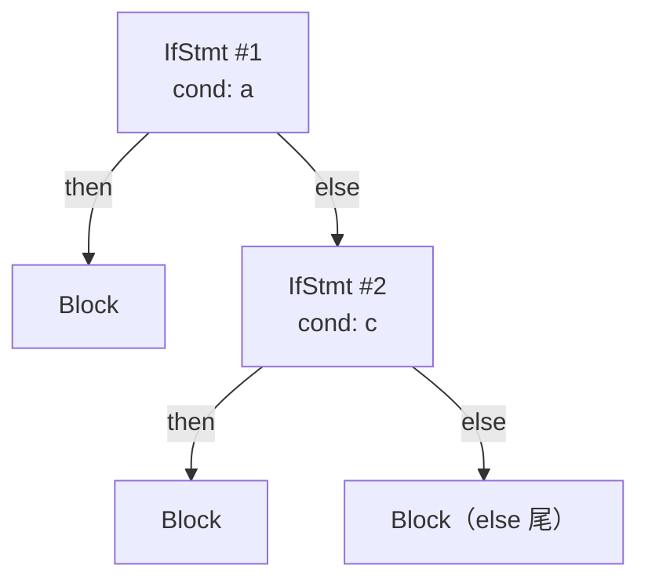

# AST 设计与错误恢复

> [返回：第三阶段导览](01-导览.md)
> 对应大纲第 4 条。AST 是前三阶段的最终产物、后四阶段的核心输入——它的类型设计决定 checker/ir/optimizer 的编写体验。本册定稿 mini AST 类型体系，并解决"一次报多个错"的错误恢复。

## 节点体系：三大 union + 判别字段

mini AST 与 ESTree 同构（节点名对齐、字段对齐），分三大类：

```ts
// ---------- 表达式 ----------
export type Expr =
  | NumberLiteral | StringLiteral | BoolLiteral
  | Identifier
  | UnaryExpr | BinaryExpr | LogicalExpr      // Logical 单列：短路求值（第五阶段要特判）
  | AssignExpr | CallExpr;

export interface BinaryExpr {
  readonly type: 'BinaryExpr';
  readonly op: '+' | '-' | '*' | '/' | '%' | '<' | '>' | '<=' | '>=' | '==' | '!=';
  readonly left: Expr; readonly right: Expr;
  readonly start: number; readonly end: number;
}
// NumberLiteral: { type, value: number, start, end } ……全族同构，略

// ---------- 语句 ----------
export type Stmt =
  | ExprStmt | LetDecl | IfStmt | WhileStmt | Block | ReturnStmt;

export interface IfStmt {
  readonly type: 'IfStmt';
  readonly cond: Expr;
  readonly then: Block;                 // 强制块：没有"单语句裸奔"，AST 少一个变体
  readonly else?: IfStmt | Block;       // else-if 链：else 直接挂下一个 IfStmt
  readonly start: number; readonly end: number;
}

// ---------- 声明与程序 ----------
export type Decl = FnDecl | Stmt;

export interface FnDecl {
  readonly type: 'FnDecl';
  readonly name: string;
  readonly params: readonly { name: string; typeAnn?: TypeAnn }[];
  readonly retType?: TypeRef;
  readonly body: Block;
  readonly start: number; readonly end: number;
}

export interface Program {
  readonly type: 'Program';
  readonly body: readonly Decl[];
  readonly start: number; readonly end: number;
}
```

四条设计决策的理由：

1. **discriminated union**：每个节点第一个字段 `type` 是字面量类型——TypeScript 的 `switch (n.type)` 自动窄化，checker/optimizer 里零类型断言。这是 TS 写编译器的最大红利。（这其实是**代数数据类型（ADT）**的手工实现：节点体系 = sum of products，`type` 字段就是代数意义上的 tag——展开见[第四阶段补充分册：代数数据类型与模式匹配](../04-第四阶段/06-代数数据类型与模式匹配.md)。）
2. **Logical 单列于 Binary**：`&&`/`||` 的求值是短路的（第五阶段 lowering 不同、第四阶段类型规则不同），与普通二元分开在前面每个阶段都少一次 `if (isLogical)`。
3. **`else?: IfStmt | Block`**：`else if` 不是特殊语法，就是 else 分支挂了个 IfStmt——树高但统一，遍历代码零特判。
4. **强制块**：`if (c) singleStmt` 直接非法。少一个 AST 变体、少一类风格争论——语言设计的"减法"直接变成编译器的"减法"。

### 判别字段的两条纪律

discriminated union 的可靠性建立在两条纪律上，破一条全部窄化失效：

1. **`type` 必须是字面量类型**（`type: 'BinaryExpr'` 而非 `type: string`）——TS 的 `switch (n.type)` 窄化只认字面量。手滑写成 `string`，checker 里到处补断言，等于白设计；
2. **字段一律 `readonly`**——AST 在本站是**不可变数据**：checker 读它、第七阶段生成新树而不是原地改。可变 AST 的坑（遍历中修改导致漏访问）在 Babel 的 `path.replaceWith` 时代才值得引入，本站三阶段内只读。

纪律之外的一个顺手收益：`satisfies Expr` / `as const` 断言可以把"构造点字段拼错"提前到编译期——06 册的节点构造全部走对象字面量，字段名错了 TS 直接红。**类型体系替测试跑了一半单测**，这是选 TS 写编译器的最大红利。

与 ESTree 的差异仅两处：`IfStmt`（ESTree 叫 IfStatement）与保留 `start/end` 数字偏移（ESTree 是对象 `{start, end}`——数字在 TS 里更顺手，且与 Token 一致）。**同构的价值**在第八阶段兑现：你写 Babel 插件时的肌肉记忆直接迁移。

### else-if 链的树形：零特判的代价与收益

`if (a) {…} else if (c) {…} else {…}` 在 mini 里的落树形状——else 分支直接挂下一个 IfStmt：



遍历代码里没有任何 `elseIf` 分支——处理 IfStmt 的函数对 #2 的出现位置一视同仁（它只是别人的 else 孩子）。代价是**树偏深**：n 连 else-if 深度 n，极端的千行 else-if 链会顶到递归深度；收益是**变体为零**。对照专门设计 ElseIf 节点的方案：树扁、但每种遍历/变换/统计都要多写一个 case。本册的裁决（统一、树高）与"强制块"同一条价值观：**变体是编译器的永久税，深度是一次性的**。

### Expr 家族逐节点盘点

`Expr` union 的九个成员，字段与 ESTree 对应关系一张表看完（字段名以 06 册实现为准）：

| 节点 | 字段 | ESTree 对应 | 备注 |
|---|---|---|---|
| NumberLiteral | value | Literal | literal 在词法层已解码 |
| StringLiteral | value | Literal | raw 词面在 Token.lexeme 里 |
| BoolLiteral | value | Literal | mini 不做 `true`→`1` 折叠，保留节点 |
| Identifier | name | Identifier | 引用与声明的判别留给 checker |
| UnaryExpr | op, operand | UnaryExpression | op ∈ {!, -} |
| BinaryExpr | op, left, right | BinaryExpression | 纯算术与比较 |
| LogicalExpr | op, left, right | LogicalExpression | `&&`/`\|\|` 单列：短路语义 |
| AssignExpr | left, right(经 op `=`) | AssignmentExpression | 左值校验在 checker |
| CallExpr | callee, args | CallExpression | `f(1)(2)` 靠循环左折叠 |

盘点暴露一个设计节律：**字段越少、语义越靠后端**——`Identifier` 只带 name，"它是声明还是引用"是第四阶段符号表的事；`AssignExpr` 不带"是否合法左值"标志，那是类型规则的事。AST 是**句法事实**的记录，不是语义判断的容器——这条分寸让 06 册的 parser 短小，也让 checker 的诊断有据可查。

### 三大 union 的边界：`Decl = FnDecl | Stmt`

为什么函数声明与语句同属一个 union（`Program.body: Decl[]`）？因为 mini 的顶层与块内共用"逐条解析"的循环：`declaration()` 在顶层处理 `fn`，在块内拒绝它——**同一分派函数、两种合法集**，union 取并集是对实现结构的忠实。ESTree 走了另一条路（`Program.body: Statement[]`，函数声明算一种 Statement）——两种切法都自洽，关键是**全站只用一种**。mini 的切法让第四阶段 checker 多一条规则（"`fn` 不得出现在块内"，06 册的 `block()` 早在语法层就拦了，这条规则实际由 parser 兑现）——把语言合法性在语法层拦截，是 mini 的"减法"设计（同"强制块"一脉）。

### Stmt 家族逐节点盘点

六个语句成员的结构与要点（`Decl = FnDecl | Stmt` 已在上面讨论）：

| 节点 | 关键字段 | 要点 |
|---|---|---|
| ExprStmt | expr | 表达式作语句的兜底形态；`f(x);` 的主载体 |
| LetDecl | name, typeAnn?, init | init 可选——`let x;` 合法（checker 定默认值语义） |
| IfStmt | cond, then, else? | 强制块 + else 挂 IfStmt（else-if 链） |
| WhileStmt | cond, body | body: Block，与 IfStmt 同款强制 |
| Block | body: Stmt[] | 块即作用域边界的句法标记（第四阶段符号表从这里开帧） |
| ReturnStmt | value? | `return;` 与 `return expr;` 两态；在构造器外非法是 checker 的事 |

盘点里两次出现"这是 checker 的事"——不是推卸，是**分层合同**：parser 保证句法事实完整（该有的字段都在、区间都对），语义判断留给下一阶段。第五阶段 lowering 会感谢这个分工：它读 AST 时不需要再判"这个 IfStmt 的 then 是不是块"——强制块让它永远是。

## source span 与合成节点

- 每个节点带 `start/end`（UTF-16 偏移，与 Token 一致）。**构造节点时用子节点的区间并集**—— parser 工具函数统一处理，见 06 册的 `span()`。
- **合成节点**（synthetic）：语法糖脱糖、宏展开产生的节点没有真实源码区间，约定 `start === end`（空区间）。第四阶段的诊断与 sourcemap 对空区间"跳过定位"——现在花一行约定，将来少一类诡异 bug。

### span 的维护纪律：区间 = 子节点的并集

06 册的 `span(start)` 工具把规则压成一行（`end: this.prev().end`——刚消费的最后一个 token 的终点）。规则本身值得单独说清：

| 节点 | 区间 | 来源 |
|---|---|---|
| BinaryExpr `a + b` | a.start … b.end | 左儿子 start 到右儿子 end |
| UnaryExpr `!a` | 运算符 start … operand.end | 前缀从运算符起 |
| CallExpr `f(x)` | callee.start … `)` end | 整个调用式 |
| LetDecl 声明 | `let` start … `;` end | 含结尾分号（语句级 span 含分隔符是惯例） |

**区间并集的两条推论**：父区间 ⊇ 任一子区间（检查器可断言 `child.start >= parent.start && child.end <= parent.end`，做成全量不变量测试能逮住 span 计算 bug）；兄弟区间只可能相切不重叠（重叠即 parser 消费顺序出错）。这两条推论写成两个测试，比任何 code review 都可靠——**span 正确性不靠人眼，靠不变量**。

### 合成节点的两个来源与两个约定

- **来源一：脱糖**。第五阶段把 `for` 循环降级成 `while`（若 mini 加糖）、第八阶段宏展开——生成的节点没有源码位置；
- **来源二：错误恢复**。05 册 errorStmt 类占位节点的区间取"触发错误的 token"（有位置但语义残缺），与合成节点走同一套下游宽容逻辑。

两个约定：**空区间（start === end）标记合成**；**下游见空区间跳过定位**（诊断不指向虚空，sourcemap 不映射空段）。约定只值一行代码，缺了它，第五阶段起每个 pass 都要各自发明"没位置怎么办"——设计一次、全流水线受益，与行首表同款思路。

### 一个留给读者的校对点：Program 的区间

06 册的 `parse()` 构造 `{ type: 'Program', body, start: 0, end: tokens.length }`——拿"token 的个数"填了偏移字段。对照 Token 坐标系自查两问：eof token 的 `end` 是多少（它等于源码长度）？`Program.end` 与它相等吗？若不等，用行首表换算 `Program.end` 的行列会发生什么？——发现答案后，把修正写进你的实现（`end: tokens[tokens.length - 1].end`），并在 AST 快照里钉住它。**校对点是本册留给你的第一个"审代码"练习**：区间体系的错误不在定义里，在使用处的笔误里。

## 遍历：visitor 不急着上

前三阶段用**手写递归函数**遍历（`checkExpr/checkStmt` 各自 switch）；等第七、八阶段出现"同一棵树多种变换"，再抽 visitor。提前抽象的代价：类型窄化被回调打散、调用栈变深、调试跳来跳去。Babel 的 visitor（`path` 抽象）要到第八阶段才真正需要——**按需演进**。

### 遍历顺序与消费方的对齐

手写递归遍历有两个可选顺序，各自的消费方不同：

| 顺序 | 动作时机 | 典型消费方 |
|---|---|---|
| 先序（父 → 子） | 进入节点时做事 | 作用域建立（先登记声明再查引用）、AST 打印 |
| 后序（子 → 父） | 子节点返回后做事 | 类型推导（先知道操作数类型才算表达式类型）、常量折叠 |

第四阶段 checker 两种都会用到：声明登记走先序（`checkStmt` 进入 `LetDecl` 先入符号表），类型计算走后序（`checkExpr` 在子表达式返回后合成类型）。**顺序是"信息依赖方向"的选择**：谁的结论依赖谁，谁就后算。这个判断现在记住，第四阶段会直接兑现。

## 错误恢复：同步点与防级联

目标：**一次编译报出全部独立错误**。策略三层：

**1. 语句级同步（panic mode）**：解析一条语句失败 → 报错 → **丢弃 token 直到同步点**（`;`、`}`，或下一个语句开头关键字 `fn/let/if/while`）→ 继续解析下一条语句：

```ts
function synchronize(): void {
  while (!atEnd()) {
    if (prev().type === ';') { advance(); return; }
    switch (peek().type) {
      case '}': case 'fn': case 'let': case 'if': case 'while': case 'return':
        return;                        // 同步点：新语句的开头
      default: advance();
    }
  }
}

function declaration(): Decl {
  try {
    if (match('fn')) return fnDecl();
    return statement();
  } catch (e) {
    if (e instanceof ParseError) {     // ParseError：携带位置的诊断已入列
      synchronize();                   // 跳到安全点，继续
      return errorStmt(e);             // 占位节点：保持 AST 形状完整（可带下游跑出更多错）
    }
    throw e;                           // 非 parse 错误（bug）不吞
  }
}
```

**2. 块级同步**：块内语句恢复后，`}` 永远是硬同步点——绝不能把 `}` 丢掉，否则外层块跟着塌（级联的常见来源）。

**3. 防级联的量化验收**：错误用例的断言不是"报了错"而是"**报错数 ≤ 真实错误数 + 1**"。误报的根源通常两个：恢复点选太远（吞掉了合法语句）、占位节点缺失（下游在残缺 AST 上崩）。

### 异常与诊断的双通道

synchronize/declaration 的协作依赖两条独立通道，各司其职：

| 通道 | 载体 | 何时写入 | 丢了会怎样 |
|---|---|---|---|
| 诊断通道 | `diagnostics` 数组 | `error()` 被调用的瞬间（构造 ParseError 时） | 用户看不到报错 |
| 控制通道 | 抛出的 ParseError | 抛给最近的 `declaration` catch | 恢复失控、误吞 bug |

设计的关键：**诊断在 error() 里入列，而不是在 catch 里**——异常即使被吞（或被 bug 中断），诊断已经落袋。反过来，非 ParseError 的异常（真正的代码 bug，如 TypeError）在 catch 里**原样重抛**——恢复机制绝不消化自己的错误，否则 parser 崩了还装作"一切正常，0 条诊断"。这两条合起来是错误处理的元纪律：**产品错误与实现 bug 分流**，前者走诊断通道保持体面，后者走异常通道尽快暴露。

### panic mode 逐 token 演算一：少分号（同步点"不消费"的一面）

输入 `let a = 1 if (a) { print(a); }`（let 后少了 `;`），token 编号从 0 计。先看恢复前的一步：`letDecl` 在 `consume(';')` 处失败（来犯 `if`）→ 诊断入列 → 异常抛到 `declaration` 的 catch → `synchronize()` 启动。此刻 `at=4`（指向 `if`）、`prev = 1`：

| 时刻 | at 指向 | prev | synchronize 的动作 | 说明 |
|---|---|---|---|---|
| 进入 | `if` | `1` | prev ≠ `;`，查 peek：`if` 命中同步点集合 | **立即返回，不消费 `if`** |
| 返回后 | `if` | `1` | 交给下一轮 `declaration()` | 从干净位置重新分派 |

恢复后 `declaration()` 重新走 `statement()`：`match('if')` 成功 → `ifStmt()` 完整解析出 `IfStmt`（条件 `a`、块内 `print(a);` 的 `ExprStmt`）→ 全程零新诊断。最终：**恰好 1 条诊断**，AST 的 body = [占位节点（第一条语句的残骸）， IfStmt[Block[…]]]——后面的 if 语句完好无损。这条演算演示了同步点的"保守面"：**peek 命中同步点集合时一个 token 都不吃**，因为那是下一条合法语句的开头，吃了它才是级联。

### panic mode 逐 token 演算二：连环错（203 号用例）

输入 `let = 1; let y = ;`（06 册错误用例 203，断言恰好 2 条诊断）。两个错误、两轮恢复：

**第一轮**：`letDecl` 在 `consume('ident')` 处失败（来犯 `=`）→ 诊断 #1"期待变量名，但看到 '='"。`synchronize()` 此刻 at=1（指向 `=`）、prev=`let`：

| 时刻 | at 指向 | prev | 动作 | 说明 |
|---|---|---|---|---|
| 1 | `=` | `let` | prev ≠ `;`，peek `=` 非同步点 → 丢弃 | advance |
| 2 | `1` | `=` | 同上 | advance |
| 3 | `;` | `1` | peek `;` 非同步点 → 丢弃 | advance，prev 变 `;` |
| 4 | `let` | `;` | **prev === `;` → advance() 后返回** | 分号被消费，从 `let` 起步 |

"丢弃直到 `;`、再前进一格"是语句级恢复的标准形状：**分号本身吃掉**，下一条语句从真正的新起点开始。恢复后第二轮 `letDecl` 启动：`let`/`y`/`=` 依次消费成功，`parseExpr(0)` 进入 `prefix()`——注意 prefix 的第一行是 `advance()`（先消费再判类型），所以抛出诊断 #2"期待表达式，但看到 ';'"时，**prev 已经是 `;`**、at 指向 eof。

**第二轮 synchronize**：`while (!atEnd())` 的闸门先生效——peek 已是 eof，循环体不执行，原样返回。主循环 `check('eof')` 成立，解析结束。**恰好 2 条诊断**，与 06 册 203 的断言严丝合缝。这条演算的收获：eof 是最后一道闸（丢弃循环绝不吃 eof），prefix"先消费后判型"的写法决定了抛错时 prev 的位置——恢复逻辑的正确性依赖这些微小约定，逐 token 演算就是把约定暴露出来的唯一方法。

### 防级联用例怎么设计

201~205 号用例各盯一类失败模式，新增用例时按同一分类学扩展：

| 用例型 | 输入形态 | 断言 | 盯的是什么 |
|---|---|---|---|
| 结构缺失 | `let x = 1  print(x);` | 1 条 + 后续语句存活 | 同步点选择 |
| 括号不配对 | `if (a { b(); }` | 1 条 + 恢复成功 | 消费边界的扩张方向 |
| 连环错 | `let = 1; let y = ;` | 恰好 2 条 | 多轮恢复互不污染 |
| eof 边界 | `(((((1)` | 1 条 + eof 话术 | eof 闸门与提示 |
| 假错误陷阱 | 合法输入 | **0 条** | 误报回归 |

最后一条最容易被忽视：**合法输入的 0 诊断断言是恢复逻辑的回归网**——每次调整 synchronize 的同步点集合，先跑一遍全部合法语料，0 条不变才有资格谈"恢复更好"。用例设计的原则一句话：**每个用例只验证一种恢复行为，合法语料守住"不无中生有"**。

## AST 快照与打印：给树装一面镜子

parser 的测试面与 lexer 同构：**快照管形状、不变量管正确性**。快照的原料是一台 20 行的树形打印机（先序递归、缩进即深度）：

```text
// print(parse(tokenize('let x = 20 + 22 * 2;'))) 的输出形态
Program
└─ LetDecl
   ├─ name: x
   └─ init: BinaryExpr(+)
      ├─ left: NumberLiteral(20)
      └─ right: BinaryExpr(*)
         ├─ left: NumberLiteral(22)
         └─ right: NumberLiteral(2)
```

这面镜子的三重用途：

1. **快照测试**：`expect(print(program)).toMatchFileSnapshot(...)`——AST 结构变化的 diff 一目了然，比 JSON 快照可读一个数量级（这也是六册验收标准里"AST 快照过"的实现载体）；
2. **手工验算**：02 册 Pratt 推演表的"最终 AST"列，就是用这台打印机核对——优先级/结合性学没学对，打出来看一眼；
3. **调试现场**：恢复逻辑改坏了树形，快照 diff 直接指认哪个节点失踪、哪个区间漂移。

写打印机时顺手兑现一条纪律：**打印输出必须是确定性的**（同输入恒同输出）——字段遍历顺序固定、不输出内存地址。它会被第七阶段优化 pass 复用（pass 前后各打一次、diff 即"优化改了什么"），不确定性的打印机在那个场景直接报废。

## 对照 acorn：两个工程样本

**ASI 的实现**：acorn 的 `semicolon()`——期待 `;` 时若当前 token 在行首或 `}`/EOF，**视为隐式分号**（记录 `start` 供 sourcemap），否则报错。词法/语法协同：分号插入发生在 parser 而非 lexer（因为需要"行首"这个语法上下文）。

**宽松模式（sloppy mode）**：acorn 大量 `if (this.inFunction) ...`、`if (this.options.ecmaVersion >= N) ...` 的分支——文法不再是静态的纯函数，而是**带状态的文法**。这就是"文法在我脑中、代码在我手中"的代价与自由：同一个函数体里装下 30 年的语言演化。

### acorn 的错误恢复速写

acorn 的恢复与 mini 的 synchronize 同族，两处差异值得记下：

- **占位节点的形态**：acorn 在缺失处补 `Identifier('#<synthetic>')` 一类的合成节点（名字带标记、位置空区间）——本册"合成节点"约定在错误恢复场景的实战版。mini 的 errorStmt 是语句级占位，acorn 细到表达式级，粒度差异来自"恢复后还要不要继续跑 checker"的目标差异；
- **raise 与恢复的分层**：acorn 的 `raise`/`raiseRecoverable` 把"可恢复"与"致命"分开——类型不支持的语法直接 fatal、位置类错误可恢复继续扫。mini v0.1 不分（全部 E0301 可恢复），因为 mini 没有需要 fatal 的场景；等第四阶段 checker 上线，"这种错误继续跑没意义"的判断会出现，届时再分层。

读法：**第三阶段的手写 parser 与 acorn 的差距不在技术，在"错误路径的工程化年限"**——本册把骨架（同步点、占位、防级联量化）立住，剩下的都是往这套骨架里填案例。

### 带状态的文法：状态都藏在哪些字段里

acorn 的 `this.inFunction`、`this.options.ecmaVersion` 不是孤例，它们代表四类常见的 parser 状态：

| 状态 | 回答的问题 | mini 的对应 |
|---|---|---|
| 位置状态（inFunction/inClass） | "我在什么结构里" | 无——mini 没有 class，函数体就是 Block |
| 模式状态（strict/sloppy） | "按哪套规范解析" | 无——v0.1 只有一种模式 |
| 版本状态（ecmaVersion） | "语法特性开到哪年" | 无——v0.1 冻结 |
| 目标状态（inArgs/inTemplate） | "这个位置特殊在哪" | 无——三引号在词法层解决 |

mini 的零状态是**语言规模的红利**，不是设计优越：每加一条语言特性（class、生成器、模块），上表就要添行。看清这张表的价值在第八阶段——读 acorn/babel 源码时，那些看似杂乱的布尔字段其实是"文法带状态的账本"，每笔账都对应一条语言规则的边界。

顺带把本册与 06 册的分工口径钉一遍：**本册定"是什么"（类型、约定、恢复策略），06 册定"怎么落"（代码、测试、验收）**——两册冲突时以本册的类型定义为准、以 06 册的实测为准；两册都没写的，就是还没设计，先补设计再补代码。

## 常见误区

## 常见误区

- **"AST 字段多一点没关系，先都放上"**：每个字段都是对下游的承诺。`BinaryExpr` 若提前塞上 `typeOf`/`isPure` 这类推断字段，checker 就会"顺手"依赖它们，优化 pass 又会绕开——字段的增减从此都变成跨阶段协商。**句法事实进 AST，语义判断进 checker**，边界早定早省事；
- **"错误恢复就是 try/catch 到处加"**：try/catch 只在 `declaration()` 一处——异常负责**跳出深度**，synchronize 负责**落点选择**，两者职责分开。到处 catch 会让恢复点散落，级联反而更难审计；
- **"同步点越多越安全"**：同步点是"丢弃的终点"，加得太多意味着错误后的丢弃窗口变小——看起来报错位置更近了，但停下的位置可能不是合法语句的开头（比如把 `,` 设为同步点，arglist 恢复到一半又开始解析，连环假错）。**同步点集合 = 语句分派的开头集合**，与 LL(1) 判定用的是同一份数据（02 册）；
- **"占位节点可省，报完错直接跳过这条语句"**：跳过省了占位类型，但 body 的语句序列与源码**错位**——下游按位置做诊断/sourcemap 时全乱。占位节点是"错误也要保持形状"原则的兑现；
- **"报错数 ≤ 真实 + 1 是宽松标准"**：它是**防级联的下界设计**——"+1"容忍的是"一个错误偶尔带出一条位置漂移的伴生报错"，不是豁免多报。真实目标是每条独立错误恰好一条诊断（06 册 203 类用例的"恰好"断言）；
- **"span 精度是锦上添花，最后再补"**：span 从 Token 一路流到 AST，**重构 span 等于重写 parser 的每个 return**。第一版就把 span() 工具做对（区间 = 子节点并集），比后期"补精度"便宜一个数量级；
- **"else-if 链应该有专门的 ElseIf 节点"**：`else?: IfStmt | Block` 已经覆盖——专门的节点类型让遍历多一个 case、让深度统计多一类特判，换来的是零能力。"树高但统一"与"树扁但多变体"之争，编译器这边永远选统一。

## 自测

1. 画出 `if (a) { b(); } else if (c) { d(); } else { e(); }` 的 IfStmt 树——`else-if` 链为什么"零特判"？
2. `LogicalExpr` 与 `BinaryExpr` 分开的两阶段理由分别是什么？（第四/第五阶段各一个）
3. `synchronize` 为什么把 `}` 设为"不消费的同步点"，而 `;` 要消费掉？
4. 给"错误数 ≤ 真实 + 1"设计一个反例输入，让你的初版 parser 超标——然后修它。

（5~10 为扩写增补题；1~3 的素材在正文节点盘点与 span 两节，4 对应演算二。）

5. 演算一里若把 `if` 从同步点集合中去掉，synchronize 会丢弃哪些 token？后续 AST 会损失什么？由此说明"同步点集合 = 语句分派开头集合"的理由。
6. 演算二第二轮里 `prefix()` 先 `advance()` 再抛错——若改成先判型后消费，synchronize 第二轮的 prev 会是什么？恢复行为有何不同？
7. 对 `BinaryExpr` 写出两条 span 不变量（父子包含、兄弟相切）的具体断言代码，并各举一个能被它逮住的 parser bug。
8. `AssignExpr` 为什么不带"左值是否合法"字段？若 parser 顺手带了，第四阶段 checker 与第八阶段 lint 各会遇到什么麻烦？
9. 合成节点约定 `start === end`：脱糖产生的一个 `while` 展开节点会被 sourcemap"跳过定位"——用户在编辑器里点它时应该看到什么？给出你的设计并对照"跳过定位"约定。
10. 对照 acorn 的 `raiseRecoverable`：给 mini 设计两条"应当 fatal 而非 recoverable"的语法错误场景，说明为什么继续恢复只会产出噪声。

学完下一册 [06-实践-mini语言parser](06-实践-mini语言parser.md) 回来看：本册的 synchronize 与 errorStmt 在那册的 declaration() 里合体——错误恢复不是独立模块，是 parser 骨架里的两根钢筋。
