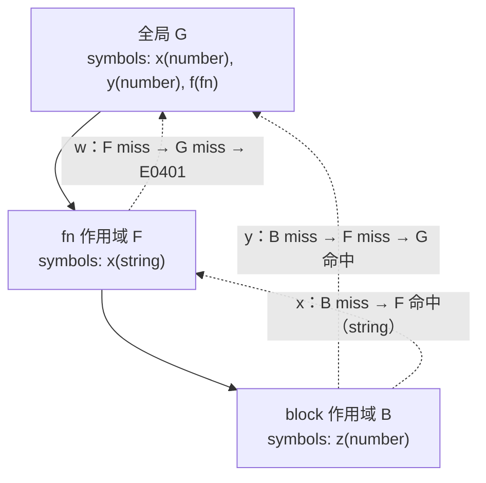
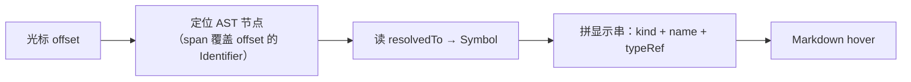

# 符号表与作用域

> [返回：第四阶段导览](01-导览.md)
> 对应大纲第 1 条。语法管"长得对不对"，语义管"说得通不通"。本册解决语义分析的第一块地基：名字。变量在哪声明、被谁引用、谁遮蔽谁——全部由作用域树 + 符号表回答。

## 静态语义 vs 动态语义

| | 静态语义 | 动态语义 |
|---|---|---|
| 判定时机 | 编译期（不运行程序） | 运行期 |
| 例子 | 未声明变量、类型不匹配、重复声明、return 在函数外 | 除零、数组越界、死循环、栈溢出 |
| 负责 | **checker（本阶段）** | VM（第五、六阶段） |

分界的哲学：**编译器只对"看一眼源码就能确定"的错误负责**。"下标越界"要跑起来才知道值是多少，静态不背这个锅（除非做抽象解释——超出课程范围）。checker 的全部工作 = 在 AST 上做**静态可判定**的检查。

### 分界线的再审视：工业编译器把多少"动态错误"拉回了静态

这条线不是自古就划好的——语言设计者一直在把"运行期才知道"的错误往编译期搬，每搬一条就多一类静态检查：

| 原本炸在运行期的错误 | 拉回编译期的机制 | 后果 |
|---|---|---|
| 未声明变量 | 本册：作用域树 + 符号表 | JS 的 `ReferenceError` 变成 mini 的 E0401 |
| 对 null 调方法（空指针） | Kotlin 可空类型 `String?`、TS `strictNullChecks` | 空引用从运行异常变成类型错误 |
| 类型不一致的字节码 | **JVM class 文件校验器（verifier）**：链接阶段静态验证操作数栈与局部变量类型 | 一批类型错误被拦在"运行第一条指令"之前 |
| 使用已释放的内存 | rustc 的 borrow checker（生命周期分析以作用域为原材料） | 悬垂指针从段错误变成编译错误 |
| 越界访问 | Rust/Zig 让 `get` 返回 Option——越界时"没有值可给" | 强迫调用方处理"不存在"分支 |

两点钉死：**JVM 校验器是最经典的"静态语义检查器"样本**——它检查的对象不是源码而是字节码，但查的内容（未定义的局部变量槽、类型不合的操作数栈）正是本册 + 下一册那套，只是载荷从 AST 换成指令流；rustc 的 borrow checker 则说明**作用域树不只是查名字的**——"值的存活范围不超过声明它的作用域"这句话把内存安全也接到了同一棵树上。[第七阶段的数据流分析](../07-第七阶段/02-数据流分析.md)是这条路线的下一站：能用沿 CFG 传播的事实证明的错误，就不留给运行时。

## 作用域树：嵌套的 Map

词法作用域（lexical scope）的教科书实现——**每个块一个作用域节点，parent 指向外层**：

```ts
export interface Symbol {
  readonly name: string;
  readonly kind: 'let' | 'fn' | 'param';
  readonly declNode: Identifier | FnDecl;   // 声明处（诊断"声明在这里"要指回去）
  readonly index: number;                   // 局部变量槽位——第五阶段 VM 直接消费
  typeRef?: TypeRef;                        // 第四阶段后半填充
}

export class Scope {
  private readonly symbols = new Map<string, Symbol>();
  constructor(readonly parent: Scope | undefined,
              readonly kind: 'global' | 'fn' | 'block') {}

  define(sym: Symbol): boolean {            // false = 同层重定义
    if (this.symbols.has(sym.name)) return false;
    this.symbols.set(sym.name, sym);
    return true;
  }
  lookup(name: string): Symbol | undefined { // 沿 parent 链上溯
    return this.symbols.get(name) ?? this.parent?.lookup(name);
  }
  lookupLocal(name: string): Symbol | undefined {  // 只看本层（查重用）
    return this.symbols.get(name);
  }
}
```

构建过程与 AST 同构：进入 `Block`/`FnDecl` 时 new Scope，离开时丢弃（或挂在 AST 上）。**词法作用域的结构在编译期完全确定**——这正是"词法"的含义（也叫静态作用域）；对照的动态作用域（Elisp/部分 shell）在**调用时**才决定名字归属，实现是运行时沿调用栈查环境——两种语义对应两套完全不同的实现。

### 作用域链查找：一次完整的逐步演算

把 `lookup` 在一段三层嵌套的程序上跑一遍——每一步只做一件事：**查本层 Map，miss 则沿 parent 上浮，链尽报未声明**：

```ebnf
let x = 1;            # 全局 G
let y = 10;           # 全局 G
fn f() {              # fn 作用域 F（parent = G）
  let x = "fn-x";     # 同层定义 F.x，遮蔽 G.x
  {                   # block 作用域 B（parent = F）
    let z = y;        # 引用 ①
    print(z);         # 引用 ②
    print(x);         # 引用 ③
  }
  print(w);           # 引用 ④
}
```

先建作用域树（`define` 全部完成后的形状），再逐个引用演算：



四个引用点的查找轨迹表：

| 引用 | 步 | 当前层 | 查到？ | 动作 |
|---|---|---|---|---|
| ① `y` | 1 | B | miss | 沿 parent → F |
| | 2 | F | miss（F 只有 x） | 沿 parent → G |
| | 3 | G | **命中** | 返回全局 `y`（number） |
| ② `z` | 1 | B | **命中** | 一步命中——局部热名字最便宜 |
| ③ `x` | 1 | B | miss | 沿 parent → F |
| | 2 | F | **命中** | 返回 **F 的 string x**，不是全局的 number x |
| ④ `w` | 1 | B | miss | → F |
| | 2 | F | miss | → G |
| | 3 | G | miss | **链尽** → E0401 未声明 |

引用 ③ 就是遮蔽的查找语义：**从内向外第一个命中即停**——F 的 `x` 对 F 及其全部子作用域"接管"了 G 的 `x`，哪怕两者类型不同（string vs number）也互不干扰：每个引用 resolve 到唯一 Symbol，类型检查（下一册）在这张"引用 → 声明"的边上做。演算的另一个收获是复杂度直觉：**离命中层越近越便宜**——最深层的局部变量恰好也是访问最频繁的名字，嵌套 Map 的设计让热名字天然廉价。

### 复杂度与工程化：真实编译器怎么管名字

mini 的链式查找是 **O(引用所在深度) 次哈希查询**。工业编译器在这条基线上各有一套升级：

| 实现 | 名字管理 | 关键设计 |
|---|---|---|
| rustc | `rustc_resolve`：解析期把每个名字绑定到 `DefId` | 后续所有 pass（类型检查、借用检查）只拿 DefId，不再查名字——**resolve 做一次，全编译器受益** |
| tsc | binder 建 Symbol 表，同名声明**合并**（declaration merging） | 符号带标志位区分种类；TS 的 interface 声明合并、重载合并都是这张表上的操作 |
| Python（CPython） | 编译期 `symtable` 给每个函数算出局部/全局/自由三类名字 | 局部名编译成**数组槽位**（帧对象按序号取），自由名编译成 cell 槽——运行时零字典查找 |
| V8 | 解析期做作用域分析，变量标记为栈槽或 context 槽 | 被闭包捕获的变量"提升"进堆上的 Context 对象，其余留栈帧 |

共同结论与 [05-检查器工程化与实践](05-检查器工程化与实践.md) 的双遍架构呼应：**名字解析是"做一次、处处复用"的 pass**——第五阶段 VM 拿槽位号、工具链拿引用边，都不再回头查 Map。

### 词法 vs 动态作用域：同一个程序，两种答案

上一段说的"两种语义"值得亲手算一遍。看这段伪代码（两种语义下**语法相同**）：

```ebnf
let x = "outer";
fn greet() { print(x); }
fn caller() { let x = "inner"; greet(); }
caller();       # 打印什么？
```

| 语义 | `greet` 里 `x` 绑定到谁 | 依据 | 输出 |
|---|---|---|---|
| **词法作用域**（mini / JS / Rust） | 全局 `"outer"` | 绑定看**定义处**的作用域链——`greet` 定义在全局，parent 链不含 `caller` | outer |
| **动态作用域**（Elisp 传统模式、shell 变量） | `caller` 的 `"inner"` | 绑定看**调用时**的运行时环境——`caller` 调用 `greet`，inner 已压进调用栈环境 | inner |

实现层一句话：**词法作用域的"链"建在编译期（`Scope.parent`），动态作用域的链是调用栈本身**——查名字从"沿编译期指针上溯"变成"沿运行时栈帧向外翻"。动态作用域实现更省事，代价却致命：`greet` 的行为取决于调用者是谁，读函数体无法确定 `x` 是什么——下一册的整套类型检查（先知道引用的是谁，才能查它的类型）根本无从谈起。这也是现代语言清一色选词法作用域的根本原因；Elisp 至今保留逐文件的 `lexical-binding` 开关——一份活化石，正好当反面教材。

## 遮蔽、重定义与声明顺序

**遮蔽（shadowing）合法**：

```ebnf
let x = 1;
{ let x = "s"; print(x); }   # 内层 x 遮蔽外层——lookup 从内向外第一个命中即返回
print(x);                     # 仍是 number 1
```

**重定义非法**：`define` 返回 false 即报错——注意**只在同层判**（`lookupLocal`），用 `lookup` 查重会把合法遮蔽误杀。这是新手 checker 的第一大 bug。

**声明顺序**：`let x = x + 1;` 里右值的 `x` 引用的是谁？三种语言策略：

| 策略 | 行为 | 代表 |
|---|---|---|
| 先声明后初始化（宽松） | 右值 x = 外层同名或报未定义 | C 的块作用域 |
| **TDZ**（本阶段实现） | "已声明未初始化"区间引用 → 报错 | JS let/const |
| 声明提升（hoisting） | 同层后声明也算已定义 | JS var、函数声明 |

**TDZ 的静态判定**：resolve 时记录每个符号的"声明表达式位置"，引用位置若在**同一作用域内、声明初始化完成之前**即报错——纯位置比较，静态可判。JS 引擎实际做运行时检查（语义上更复杂的场景），mini 取静态版足够。

### resolve 一遍的手推：声明、引用与诊断的时间线

把 [05-检查器工程化与实践](05-检查器工程化与实践.md) 的 resolve 骨架放在 6 行程序上走一遍——每行语句做哪些动作、符号表何时变化、诊断在哪一步产生：

```ebnf
1  fn f() { return g(); }   # g 声明在后
2  fn g() { return 1; }
3  let a = 1;
4  let a = a + 1;           # 同层重定义 + TDZ
5  { let a = "s"; print(a); }  # 合法遮蔽
6  print(b);                # 未声明
```

| 步 | 语句 | 动作 | 全局表 | 诊断 |
|---|---|---|---|---|
| 0 | 预收集 | 顶层 fn 声明**先全部入表**（mini 的 fn 提升策略） | f, g | — |
| 1 | 行 1 | 走函数体：`g` 沿链命中预收集的符号 | — | 无：**前向引用靠预收集** |
| 2 | 行 2 | 走函数体 | — | — |
| 3 | 行 3 | 走右值 `1` → define `a` | a | — |
| 4 | 行 4 | 走右值 `a + 1`：右值 a 的引用 offset 早于本层声明完成 offset → **E0404 TDZ**；随后 define 返回 false | a（保持第一个绑定） | E0404 + E0402，一次报两条 |
| 5 | 行 5 | 进块作用域 → define 块内 a → `print(a)` 命中**块内** a | — | 无：合法遮蔽 |
| 6 | 行 6 | 查全局链：a、f、g 都有，b **链尽 miss** | — | E0401 未声明 + hint"是否想用 'a'？" |

第 4 行值得多看一眼：**报错但不中断**——符号表保持第一个绑定，遍历继续，行 5 的遮蔽照常工作。checker 的纪律与第三阶段错误恢复一脉相承：一次尽量多报，用户不必改一处编译一次。

行 4 也正是"静态可判定"的现场：JS 对 `let a = a + 1` 抛 ReferenceError（"Cannot access 'a' before initialization"，引擎话术），mini 用"引用 offset 早于声明完成 offset"的静态比较给出同一类错误——**两条实现路线在同一个例子上汇合**。哪条路线覆盖哪些 TDZ 形态（同层先引用后声明、自引用初始化），差异属于实现取舍，判定的判据始终是那两个 offset。

### 诊断地图：本册错误码一览

| 错误码 | 含义 | 本册对应机制 |
|---|---|---|
| E0401 | 未声明的变量（附相似名建议） | 链尽 miss——查找轨迹表第 ④ 行 |
| E0402 | 同层重定义 | `define` 返回 false（`lookupLocal` 判定） |
| E0404 | TDZ：引用先于初始化完成 | 两个 offset 的位置比较 |
| E0403 | 类型不匹配 | 不在本册——下一册的规则表拒绝时产生 |

名字类错误（E0401/E0402/E0404）全部由 resolve 产出，E0403 留给 check——05 册"诊断按错误类别分层输出"的分层依据就是这张表。

### 提升的工业对照：三份语言，三种"已定义"的时刻

| 语言 | 函数声明 | 变量声明 | 判定时机 |
|---|---|---|---|
| JS | 函数声明整体提升（可前向调用） | `var` 提升且初始化为 undefined；`let/const` 提升但保持未初始化（TDZ 由运行时拦截） | 名字归引擎运行时环境管，引用先于初始化 → ReferenceError |
| mini（本站） | fn 预收集（resolve 第 0 步） | define 在走完右值后执行；TDZ 靠声明完成 offset 的位置比较 | **全部编译期** |
| Python | `def` 不提升（执行到才绑定） | 编译期规则：函数内**任何位置**赋值过 ⇒ 整个函数视为局部名；提前引用 → 运行时 UnboundLocalError | 分类在编译期，报错在运行期 |

Python 那行最值得咀嚼：**分类静态、检查动态**——`def f(): print(x); x = 1` 里的 x 在编译期就被定为局部（所以打印不了全局 x），但"何时算已绑定"留给运行时，错误变成跑一次才炸。mini 把最后一步也拉进编译期（位置比较），JS 把两步都留在运行时——三种排列在同一条光谱上，越靠编译期，错误暴露越早、修复越便宜。

## 自由变量与绑定变量：闭包的伏笔

对每个函数体：

- **绑定变量**：函数内声明的（参数、let）——生命周期 = 函数调用。
- **自由变量**：引用了但不在本函数声明的——**必须从定义时的环境捕获**。

```ts
function makeCounter(): FnSymbol {
  // resolve makeCounter 体时：
  //   count → 绑定（本层 let）
  //   makeCounter 自身 → 自由（外层 fn）……
  //   内层闭包 () => count：count 对它是自由变量
}
```

resolve 的副产品：给每个 `Identifier` 节点记 `resolvedTo: Symbol`——**引用到声明的边**。这张边表免费供给两个下游：第五阶段算闭包捕获列表（自由变量 = 需捕获的集合），第八阶段 LSP 的"查找引用/重命名"（沿边表双向遍历）。符号表是整个工具链的复用冠军。

### 捕获集的手推：从引用边到 upvalue 表

捕获集 = 每个函数的**自由变量集合**。手推一段两层嵌套（第五阶段闭包编译会原样遇到它）：

```ebnf
let x = 1;
fn outer() {
  let y = 2;
  fn inner() {
    print(x + y);        # x、y 都不是 inner 本层声明的
  }
  inner();
}
```

逐 Identifier 分类（resolve 已挂好 `resolvedTo`，分类只是顺着边查归属）：

| 函数 | 引用 | 声明在 | 相对关系 | 分类 | 进捕获集？ |
|---|---|---|---|---|---|
| inner | `x` | 全局 | 跨两层 | 自由变量 | 是 |
| inner | `y` | outer（直接外层） | 跨一层 | 自由变量 | 是 |
| inner | `print` | 内建 | — | 全局内建 | 依实现（mini 把内建当全局符号处理） |
| outer | `y` | outer 自己 | 本层 | **绑定变量** | 否（outer 自己的局部槽） |
| outer | `inner` | outer 自己 | 本层 | 绑定变量 | 否 |
| outer | `x` | 全局 | 跨一层 | 自由变量 | 是 |

第五阶段 `FnProto.upvalueDesc`（`{ name, isLocal, index }`）直接由这张表生成：`isLocal = true` 表示"捕获的是直接外层的局部槽"（inner 捕 outer 的 y），`false` 表示"转手捕获 outer 自己的捕获"——**中间层转发**是嵌套闭包的经典一跳（inner 捕全局 x 时，若 outer 也捕了 x，inner 拿到的就是转手的那份）。第八阶段的 rename 同样消费这张边表：改 `y` 的名字 = 找到 Symbol、反向遍历所有指向它的 Identifier、批量改写。

### 捕获的物理形态：值复制、共享格子与提升到堆

捕获集回答"捕获谁"，实现还要回答"捕获什么"：

| 方案 | 语义 | 代表 |
|---|---|---|
| 按值复制 | 闭包存定义时的快照；之后外层变量再变，闭包看不见 | C++ `[=]`（显式选择） |
| 共享格子（cell） | 变量装进盒子，闭包与外层持**同一个盒子** | Python 的 cell 对象、Lua 的 upvalue |
| 提升到堆 | 被捕获的变量直接分配到堆上的环境对象 | JS 引擎（V8 的 context allocation：被捕获才进 Context，其余留栈槽） |

方案差异直接变成用户可见的语义。Python 的经典陷阱：

```python
fs = []
for i in range(3):
    fs.append(lambda: i)      # 三个 lambda 共享同一个 cell
print([f() for f in fs])      # [2, 2, 2]，不是 [0, 1, 2]
```

lambda 捕获的是变量 `i` 的 cell 而非循环当时的值——循环结束时 cell 里是 2。要快照得写 `lambda i=i: i`（默认参数在定义时求值，Python 官方的"复制值"出口）。JS 的 `var i` + 闭包给出同款陷阱（`var` 在函数级共享一个槽）；`let i` 每轮迭代创建新词法绑定才治好——**捕获"变量"还是"值"，是作用域语义的决定，不是运行时灵机一动**。第五阶段把"捕获什么"落成机器表示（upvalue 指向栈还是堆、何时关闭）时，会再遇到这张表。

## LSP 视角：为什么 IDE 比编译器更依赖符号表

- **hover**：光标处 Identifier → `resolvedTo` → 显示 `let count: number`。
- **补全**：光标所在 Scope 沿 parent 链收集全部 symbols + kind 过滤。
- **跳转定义**：Identifier → resolvedTo.declNode 的 span。
- **重命名**：符号的所有引用边反向遍历，批量改文本。

这些功能的正确性要求与编译完全一致——**tsserver 本质就是不开 emit 的 tsc**。checker 写得好，IDE 功能是顺手的副产品；checker 写得糊（比如 lookup 有 bug），编译勉强能骗过去，IDE 会当场出卖你。

### 一次 hover 的数据通路：从光标到符号



每个箭头都是一次纯查询：定位消费第三阶段记下的 span，查符号是本册的 `lookup`，拼串读 `Symbol` 的 kind 与 typeRef——**全链路没有新的"理解代码"逻辑，全是 checker 数据结构的读取**。补全（completion）把起点换成"补全触发点 + 所在 Scope"，中间两步原样：沿 parent 链枚举 symbols、按 kind 过滤。这就是"tsserver 是不开 emit 的 tsc"在数据流上的含义——功能差异只在通路的两端，中段是同一套符号表。

## 常见误区

- **"查重用 `lookup` 就行，还能顺便报遮蔽"**——方向反了：`lookup` 沿链命中外层会把**合法遮蔽**误判成重定义（本册第一大 bug，正文已点过一次，这里给足理由）。查重只允许 `lookupLocal`——"是否重复"是同层性质，"能否引用"才是链式性质，两个问题两个函数；
- **"作用域树就是调用树"**——前者由**定义位置**决定（编译期定死），后者由**调用关系**决定（运行期千变万化）。"词法 vs 动态作用域"一节里 `greet` 的 parent 永远是全局，跟谁调它无关；高阶函数与递归能把调用树堆到任意深，作用域树纹丝不动；
- **"一个编译器只有一张符号表"**——lexer 有关键字表，checker 有作用域符号表，字节码层还有自己的常量池（JVM class 文件的常量池就是一张独立的全局符号表）。说"符号表"先问一句：**哪个 pass 的、哪一层**；
- **"TDZ 是 JS 运行时的事，静态语言不用管"**——Python 的 UnboundLocalError 就是没做静态 TDZ 判定的代价：错误从编译期挪到运行期，从"改一行"变成"跑一次才炸"。静态可判的错误在编译期拦截永远更便宜；
- **"自由变量要到运行时才知道"**——自由/绑定是纯语法归属问题（引用是否在本函数声明），resolve 一遍全算完。运行时才知道的是**捕获的值**，不是**捕获的名单**。

## 与主线对照

| 本册概念 | 主线位置 |
|---|---|
| 槽位 index、nLocals | [05-第五阶段字节码设计](../05-第五阶段/03-字节码设计.md)：checker 分配的槽位就是 VM 的局部变量表 |
| 捕获集 → upvalue 表 | [05-第五阶段实践](../05-第五阶段/05-实践-编译器VM与REPL.md)：闭包编译消费本册产出 |
| resolve/check 双遍 | [05-检查器工程化与实践](05-检查器工程化与实践.md)：本册机制的工程化落地与验收标准 |
| 引用边 resolvedTo | [08-第八阶段 Babel 深度剖析](../08-第八阶段/02-Babel深度剖析.md)：AST 语义标注是工具链的通用玩法 |
| "名字"的下一半 | [03-类型系统](03-类型系统.md)：本册答"引用的是谁"，下册答"它是什么类型" |
| 静态检查的下一站 | [07-第七阶段数据流分析](../07-第七阶段/02-数据流分析.md)：沿 CFG 传播事实，拦截更多"运行期才知道"的错误 |

## 动手清单

（基于 [05-检查器工程化与实践](05-检查器工程化与实践.md) 的 checker 代码，每条 30 行以内。）

1. 给 `Scope` 加 `dump(depth)` 缩进打印，对"作用域链查找"的样例程序手核符号表形状；
2. 写"块内先引用后声明"的 TDZ 用例，诊断格式对齐 05 册的 E0404 风格（行列 + hint）；
3. 把"捕获集的手推"里 inner/outer 的捕获集写成断言，跑 resolve 验证与手推一致；
4. 在 Node 里各写一个 `var` 与 `let` 的循环闭包，输出差异对照"捕获的物理形态"一节；
5. 给诊断加"相似名建议"（编辑距离 ≤ 2 的同链符号），`prnit` → `print`；
6. （选做）用 Python 的 `symtable` 模块打印一个含自由变量函数的符号分类，与本册捕获表对照。

## 自测

1. 画出 `{ let a = 1; { let b = a; let a = "s"; } }` 的作用域树；`b = a` 的 `a` resolve 到哪个 Symbol？内层 `let a` 会不会让它变心？
2. `define` 为什么用 Map 而不是数组线性查？`lookup` 的最坏复杂度与什么成正比？
3. TDZ 静态判定的两个位置（引用位置、声明位置）分别取 AST 哪个字段？"初始化完成之前"用哪个 offset 比？
4. `fn f() { return g(); } fn g() { return 1; }`——`g` 对 `f` 是自由变量吗？如果 JS 函数声明有提升，mini 的 fn 需要什么策略才等价？

（1~4 为原题；5~10 为扩写增补题，答不出就回到对应演算表。）

5. 把"作用域链查找"样例里 F 层的 `let x = "fn-x"` 删掉：引用 ③（x）的轨迹变成几步、命中层是哪一层？引用 ①（y）受影响吗？
6. 用"编译期分类 + 运行期绑定"两句话拆解 Python `def f(): print(x); x = 1` 抛 UnboundLocalError 的原因，并指出 mini 在哪一步把它拦截。
7. `fs` 循环闭包陷阱里，`var i` 与 `let i` 的修复差异对应"捕获的物理形态"表里哪两格？各自为什么？
8. 对 `fn makeAcc() { let n = 0; fn acc() { n = n + 1; return n; } return acc; }` 手推 acc 的捕获集；说明 n 为什么必须分配到堆上——栈分配会在哪一步出错？
9. hover 数据通路的四步里，哪几步在"查找引用"（find references）场景被替换、哪几步原样保留？被替换的那步消费边表的哪个方向？
10. JVM 校验器检查的对象不是源码而是字节码：列出它与本册作用域检查至少两项同构之处，并各举一个"过了校验器仍会在运行期炸"的错误类别。
