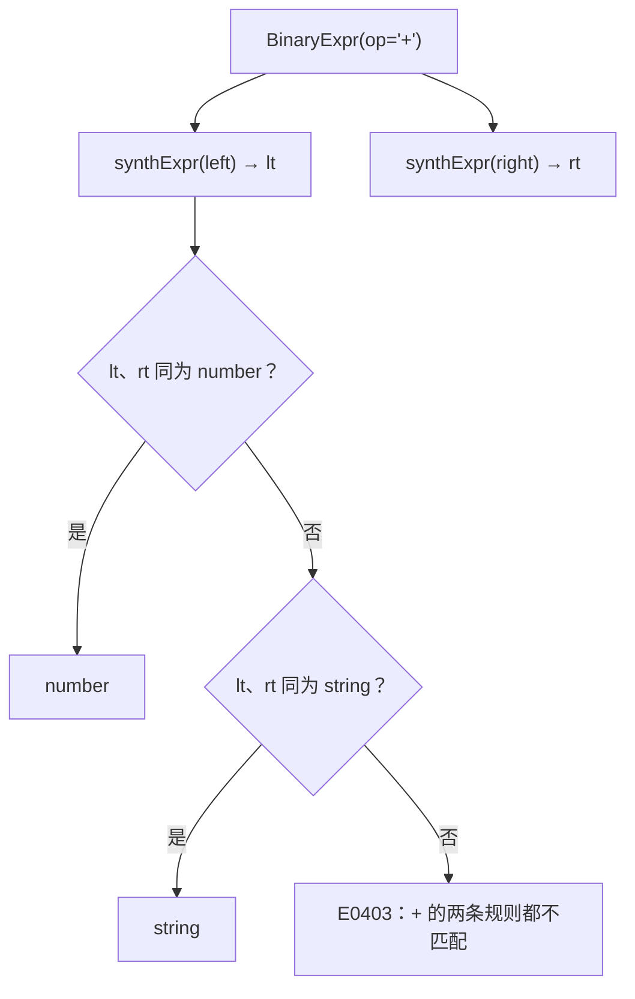
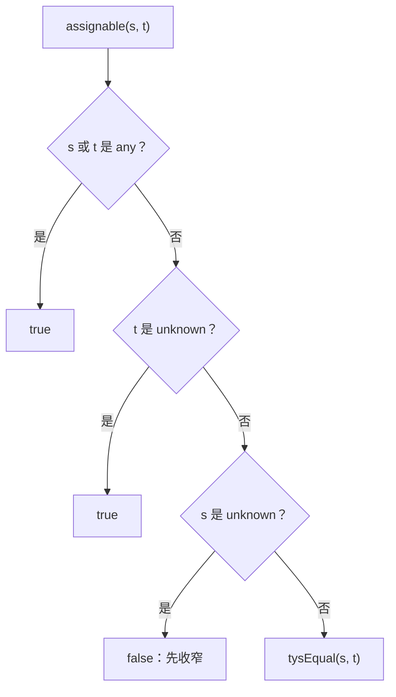

# 类型系统：规则、检查与相容

> [返回：第四阶段导览](01-导览.md)
> 对应大纲第 2 条。类型系统 = 一组"什么类型可以出现在什么位置"的规则集。本册定义 mini 的类型代数、写出检查算法主干（自底向上综合），并说清结构化/名义化与 any/unknown 的分野。

## 类型的代数

```ts
export type Type =
  | { kind: 'number' } | { kind: 'string' } | { kind: 'bool' } | { kind: 'unit' }
  | { kind: 'fn'; params: readonly Type[]; ret: Type }
  | { kind: 'typeVar'; name: string };        // 类型变量（下一册推导用）
```

四条设计说明：

- **`unit` 而非 `void`**：`return;` 的类型是 unit（"有一个值，它没有信息"），与"没有值"（never/底部类型）区分。`print(x)` 返回 unit，可以写 `let u = print(1);` 但不能 `1 + print(1)`。
- **函数是一等类型**：`(number, number) -> number` 与 `number` 平起平坐——可作参数、返回值、变量类型。这是第五阶段"高阶函数 map/filter"的类型地基。
- **没有隐式转换**（v0.1）：`"a" + 1` 直接报错。每条隐式转换规则都是类型系统的"暗门"，第一版语言宁严勿松。
- **类型相等 = 结构递归相等**：`tysEqual(a, b)` 递归比较——对 mini 的类型代数，这既是结构化也等价名义化（没有两个名字指向同构类型）。真正的分野见下节。

### tysEqual 的实现：结构递归的终止条件

```ts
function tysEqual(a: Type, b: Type): boolean {
  if (a.kind !== b.kind) return false;          // kind 不同：一步否决
  switch (a.kind) {
    case 'fn':                                  // 函数类型：参数逐位 + 返回值递归
      return a.params.length === b.params.length
          && a.params.every((p, i) => tysEqual(p, b.params[i]))
          && tysEqual(a.ret, b.ret);
    case 'typeVar': return a.name === b.name;   // v0.1：同名即同变量
    default: return true;                       // 基础类型：kind 相同即相等
  }
}
```

三个观察：**递归只在 `fn` 分支发生**——mini 的复合类型只有函数一种，比较深度就是函数嵌套层数；基础类型走到 default 一步判完；`typeVar` 的"同名即同变量"在下一册会被**替换表**取代——那时相等性不再看名字，而看"代入已知解之后是否同构"。这个细节是两册之间真正的接口：**相容判定的实现方式变了，规则表一个字不用改**。

### 为什么 v0.1 敢不做隐式转换

对照 JS 的 `+` 就明白"严"的理由。JS 的 `+` 是重载加强转的混合体：一边是 string 就拼接，否则走数值加法，操作数先过 ToPrimitive——`1 + "2"` 得 `"12"`，`[] + {}` 得 `"[object Object]"`。放进规则表意味着 `+` 至少四种签名，且结果类型依赖**值的运行时种类**而非静态类型——规则表从"一张能背下来的表"退化成"一个小型解释器"。Java 的隐式数值加宽（int + long → long）好歹还能静态列出；TS 为兼容宿主语义放行了 `"a" + 1`（结果类型 string），mini 作为教学语言直接拒绝——**同一表达式在两个结构化阵营成员里的命运不同，差别不在结构化与否，在要不要忠实模拟宿主运行时**。宁严勿松的另一面是：v0.1 的规则表恰好一屏放得下，考试与实现共用同一张表。

## 结构化 vs 名义化

| | 结构化（structural） | 名义化（nominal） |
|---|---|---|
| 判等依据 | **形状**：字段名与类型逐一匹配 | **名字**：声明时的类型标识 |
| `{x: 1}` 能赋给 `{x: number}` 吗 | 能 | 不能（除非显式 extends） |
| 代表 | TypeScript、Go 接口、OCaml | Java、Kotlin（class）、Rust |

结构化的代价与红利：红利是"鸭子类型的静态版"——模块 A 的 `Logger` 与模块 B 的 `Logger` 形状相同即互通，生态组合零胶水；代价是**错误信息的天堂变地狱**（两个 500 字的类型不相容时，diff 哪个字段错了很折磨）、声明合并与循环引用的复杂度。名义化相反：判等 O(1)、错误清晰，但"接口适配器"模式遍布代码库。

mini v0.1 没有记录类型（object），所以这场战争暂未开打——但函数类型的判等已经用了结构规则（参数逐位、返回值递归）。**你在用 TS 写 mini 的 checker，同时 mini 的类型系统被 TS 的 checker 检查——双层结构化系统的互文**，第八阶段读 tsc 时会再次遇到。

### tsc 的结构化判定手推：一次赋值检查的路径

结构化不是口号，tsc 对每条赋值真实执行这套判定。看三个样本：

```ts
interface Logger { level: string; log(msg: string): void }

const impl = { level: "info", log: (m: string) => {}, extra: true };
const a: Logger = impl;                                      // ① 接受

const b: Logger = { level: "info", log: (m) => {}, who: 1 }; // ② 报错：对象字面量多余属性
const c: Logger = { log: (m: string) => {} };                // ③ 报错：缺 level
```

tsc 的判定步骤（对 ①）：

| 步 | 检查 | 结果 |
|---|---|---|
| 1 | target（Logger）的每个属性，source（impl）里有没有同名属性 | level ✓、log ✓ |
| 2 | 逐属性**深入比较类型**：level 是 string 对 string；log 的参数/返回值按函数类型规则递归 | ✓ |
| 3 | source 多出的属性（extra）要不要管 | **变量赋值：不管**——结构化只要求"target 要的都有" |
| 4 | 结论：impl ≤ Logger，赋值合法 | — |

①② 的差别暴露一条独立规则：② 里 `who: 1` 是**多余属性**却报错——这是**新鲜度（freshness）检查**：直接写对象字面量赋给标注类型时，多余属性视为拼写嫌疑（多半是字段名写错或放错位置）；经由变量转手的赋值不做此查。同是结构化，"字面量从严、变量从宽"——规则为抓真实 bug 服务，不为教条服务。两处工业细节留个钩子：tsc 给 assignability 关系做了缓存，避免深结构反复比较；方法签名与函数类型属性的参数方向规则不同（后者在 `strictFunctionTypes` 开启后才收紧），方向问题本册末尾的反例推演正面处理。

### 名义化的一线工程：newtype 与 trait impl

名义系统里"想互通必须显式连接"，这恰好是一种能力：Rust 的 newtype 惯用法 `struct Meters(f64)`——与 `f64` 同构却名义独立，混用直接编译错；要参与某个抽象（如 Display）就得显式 `impl`。Java/Kotlin 的两个同构 class 互不相认，想互通只有 interface 一条路。对照结构化世界"形状一样就互通"，两种世界观没有对错：**名义化给"语义包装"自由**（单位、状态标签、防呆的强类型 ID），**结构化给"生态拼装"自由**（两个互不知晓的模块形状对上就能接）。TS 社区想要名义化的语义包装时用的手段是**品牌字段**（`type Meters = number & { __brand: 'm' }`）——在结构系统里手工造名字，两个阵营在此握手。

### 错误信息对照：两种范式的诊断形状

范式之争最终落到用户眼前的诊断上。名义化的错误天然短——类型名即身份，一行说完：

```text
// 名义化（Java）：类型名即身份
error: incompatible types: Cat cannot be converted to Dog
```

结构化的错误必须**指出深到哪一层、哪个字段/参数不对**，否则用户面对两坨长类型无从下手：

```text
// 结构化（tsc）：diff 要一路点到参数
Type '(m: string) => number' is not assignable to type '(m: number) => number'.
  Types of parameters 'm' are incompatible.
    Type 'number' is not assignable to type 'string'.
```

"错误信息的天堂变地狱"（本册开头语）的具体形状就是上面两段的对比。mini 取结构规则但函数类型很小（只有参数与返回值），diff 压得进一行，格式沿用 05 册的约定：

```text
example.mini:7:5 · E0403 · 第 1 个参数：期待 number，实给 string（'"s"' 的类型从这里推导）
```

**错误信息的长度预算也是复杂度预算的一部分**——规则越少，诊断越短，这条红利在选"教学语言规则集"时就要计入。

## 检查算法：自底向上综合

**综合（synthesis）**：表达式类型 = 子表达式类型的函数。`checkExpr` 返回 Type：

```ts
function synthExpr(e: Expr, scope: Scope): Type {
  switch (e.type) {
    case 'NumberLiteral': return { kind: 'number' };
    case 'StringLiteral': return { kind: 'string' };
    case 'Identifier': {
      const sym = scope.lookup(e.name) ?? err(e, `未声明的变量 '${e.name}'`);
      return sym.typeRef!.type;               // resolve 遍已填充
    }
    case 'BinaryExpr': {
      const lt = synthExpr(e.left), rt = synthExpr(e.right);
      if (e.op === '+' && lt.kind === 'number' && rt.kind === 'number') return { kind: 'number' };
      if (e.op === '+' && lt.kind === 'string' && rt.kind === 'string') return { kind: 'string' };
      // 比较/逻辑各查表……完整规则表见下
    }
    case 'LogicalExpr': {
      const lt = synthExpr(e.left);
      requireBool(lt, e.left, '&& / || 要求布尔操作数');
      requireBool(synthExpr(e.right), e.right, '&& / || 要求布尔操作数');
      return { kind: 'bool' };                 // mini 不做真相保留（对比 TS）
    }
    case 'CallExpr': {
      const callee = synthExpr(e.callee);
      if (callee.kind !== 'fn') return err(e.callee, '只能调用函数');
      if (callee.params.length !== e.args.length)
        return err(e, `期待 ${callee.params.length} 个参数，实给 ${e.args.length}`);
      e.args.forEach((a, i) => requireAssignable(synthExpr(a), callee.params[i], a, `第 ${i+1} 个参数`));
      return callee.ret;
    }
    /* ... */
  }
}
```

mini 的类型规则表（一张表 = 全部规则，考试与实现都以它为准）：

| 表达式 | 规则 |
|---|---|
| `number/string/bool` 字面量 | 各自基础类型 |
| `+ - * / %` | number × number → number |
| `+`（字符串） | string × string → string |
| `< > <= >= == !=` | number × number → bool；string × string → bool |
| `!` | bool → bool |
| `-`（一元） | number → number |
| `&& \|\|` | bool × bool → bool |
| `=`（赋值） | 左值类型 T，右值类型 S，S ≤ T（相容），结果 T |
| 调用 | 函数类型逐参相容，结果 = 返回类型 |

**检查（checking）模式**：与综合相对——上下文**自顶向下**给一个"期待类型"，用于字面量与 lambda 的歧义消解（TS 的 `f((x) => x.length)` 推出 x: string 靠它）。mini v0.1 无 lambda 字面量，checking 模式暂不需要；双向检查（bidirectional）在第八册 tsc 阅读时展开。

### 综合的手推：一行表达式怎么走过规则表

`(1 + 2) * 3` 逐节点演算（自底向上，子先父后）：

| 步 | 节点 | 子结果 | 规则行 | 结果 |
|---|---|---|---|---|
| 1 | `1` | — | 字面量行 | number |
| 2 | `2` | — | 字面量行 | number |
| 3 | `1 + 2` | number, number | `+ - * / %` 行 | number |
| 4 | `3` | — | 字面量行 | number |
| 5 | `(1+2) * 3` | number, number | `+ - * / %` 行 | number |

综合的形状一目了然：**每个节点只看自己的规则行 + 子节点结果**——没有回溯、没有跨节点全局状态。对照下一册的推导：同一棵树上会多出"方程"与"替换表"两样全局状态，那是综合管不了未知类型时补上的机器。

### 报错路径的手推：`print(1) + 2`

失败案例更能看出算法的纪律。自测第 1 题让你自己写报错路径，这里先演示一条：

| 步 | 节点 | 推进 | 结果 |
|---|---|---|---|
| 1 | `print(1)` | 调用规则：print 的类型 (number) → unit，实参 1 相容 | **unit** |
| 2 | `2` | 字面量 | number |
| 3 | `print(1) + 2` | `+ - * / %` 行要求左操作数 number，实给 unit | **E0403**：期待 number，实给 unit |

注意诊断的落点：错误报在 `+` 节点，但 hint 指向 `print(1)`——"unit 从哪里推出来的"。错误链（诊断引用推导来源位置）在这里第一次显出价值：**类型检查器的每条拒绝都该能回答"这个类型是谁给你的"**，05 册的诊断工程把这条纪律做成了输出格式。



### 短路的类型：mini 的 bool × bool 与 TS 的 A | B

mini 的 `&&`/`||` 强制两个操作数为 bool、结果 bool——规则表一行写死。TS 做不到这么"狠"：JS 的条件判断接受任意真值，`a || b` 短路取 a、否则取 b，**两个都可能成为结果**，类型只能诚实地给 `A | B`（阶段导览自测里那句"`a || b` 的类型是 `A | B`"说的就是它）；`a && b` 更绕——a 的假值部分会透传，比如 `a: number` 时 `a && b` 的类型是 `number | typeof b`（0 会穿过）。代价是 TS 的规则表没法一行化：`&&` 的结果类型本身是个小推导器；收益是 `const x = flag && getValue()` 这类惯用法类型正确。mini 舍便利换规则表的一行化——**教学语言的规则数就是复杂度预算**。

### 数组缺席的深意：规则表的一行有多贵

导览的知识点地图里写过"复合类型（数组 `A[]`、记录 `{x: A}`）"，规则表却没有数组行——这是 v0.1 的刻意留白。给 mini 补上 `let a: number[]` 与下标 `a[i]`，至少要同时付四笔账：

| 增量 | 内容 | 牵连 |
|---|---|---|
| 类型代数 | `{ kind: 'array'; elem: Type }` | tysEqual 递归加一个分支（elem 递归比较） |
| 表达式规则 | `a[i]`：a 是 array、i 是 number → elem | 规则表加一行；越界仍是动态错误（本册开头的分界线） |
| 字面量规则 | `[1, 2, 3]` 的类型怎么定 | 无标注时逐元素求并？有标注时走 checking 模式——"暂不需要"的双向检查立刻用上 |
| 第五阶段 | 指令集要能取/存元素 | 跨阶段合同，定得越晚改动越大 |

一张表牵出四个包——这就是"宁严勿松"的完整含义：**每条规则不是一行字，是一条跨 pass 的合同**。把数组（或字符串索引、记录类型）按这张清单补进 mini，是把本册知识串成整体的最短练习路径。

### 规则表的三重身份：文档、测试与实现

同一张规则表在工程里要用三次：

| 身份 | 形态 | 落点 |
|---|---|---|
| 文档 | 上面那张 markdown 表 | 语言规格的唯一出处——"考试与实现都以它为准" |
| 测试 | 每行规则 ↔ 至少一条合法 + 一条非法用例 | 05 册"15+ 语义错误用例"清单的来源 |
| 实现 | synthExpr 的 switch 分支 | 每个分支对应一行，漏一行 = 漏一类错误 |

三方的一致性可以机械检查：给每条用例打上规则行标签，跑一张"规则覆盖表"——哪一行没有非法用例立刻显形。工业编译器的测试体系里同样能认出"规则 ↔ 用例"的对账结构。**"一张表 = 全部规则"不是修辞，是让文档、测试、实现互为对账单的工程选择。**

## 类型相容与 any/unknown

**相容（assignability）S ≤ T**：比"相等"宽——直觉是"S 的值交给期待 T 的位置不会出错"。mini v0.1 中相容 = 相等；真实语言会引入：

- **子类型**：`"literal" ≤ string`、`never ≤ 任何`。
- **any**：**任何 ≤ any 且 any ≤ 任何**——双向全通，拓扑上的"万能洞"。它的危险不是"不检查"，而是**错误穿过它继续传播**：`let x: any = f(); x.y.z.w` 全静默，炸在运行时。
- **unknown**：**任何 ≤ unknown 单向**（顶类型）。从 unknown 取值必须**收窄**（typeof 判别/相等比较）——错误被拦在收窄处。

实现上的分野一句话：any 是 `assignable(a, b)` 恒真；unknown 是 `assignable(x, unknown)` 真且 `assignable(unknown, x)` 假——**两个方向的不等式**，不是两个数据结构。

### 子类型的定义、宽度与第一个反例

**子类型 S ≤ T** 的直觉定义："S 的值交给期待 T 的位置不会出错"（"不会出错"的严格化各有流派，本册取最朴素的"没有字段/调用缺失"）。最小子类型系统从**宽度子类型**起步：记录 S ≤ T 当且仅当 T 的每个字段 S 都有、且对应字段类型满足 S_field ≤ T_field（深度递归）。多余字段无害——S 的值携带的信息是 T 要求的超集。

真正埋雷的是**可变字段的深度方向**。设 `Point = {x: number}`、`Point3D = {x: number, z: number}`，宽度上 `Point3D ≤ Point`。给它们套一层盒子 `Box<T> = { inner: T }`，走一遍推演：

| 步 | 语句 | 推演 |
|---|---|---|
| 1 | `let b3: Box<Point3D> = { inner: { x: 1, z: 2 } };` | 合法 |
| 2 | `let b1: Box<Point> = b3;` | 若 `Box` 的字段按协变判定：`Point3D ≤ Point` ⇒ `Box<Point3D> ≤ Box<Point>`，放行 |
| 3 | `b1.inner = { x: 9 };` | `Box<Point>.inner` 期待 Point，赋 Point 合法——但写穿到了 b3 的同一块存储 |
| 4 | `b3.inner.z` | 静态上 z: number；运行时 inner 已被换成 `{x: 9}`——**类型说谎了** |

漏洞在步 2 与步 3 的合谋：**读**字段的通道要求协变（拿出来的东西至少是 Point），**写**字段的通道要求逆变（塞进去的任何 Point 都得能当 Point3D 用）——两条通道共用一个存储位置，单向放宽必出洞。唯一安全的收紧是**不变（invariance）**：可变字段的类型必须严格相等。TS 的现实选择是仍按协变判定字段（上表步 2 在 tsc 里真实放行，步 4 真实说谎——这是官方文档承认的不健全点），换取生态兼容与实现简单；`readonly` 标注的字段才享受协变的安全版。**子类型规则每放宽一格，都要问一句"写的通道在哪里"**——这句话是本节全部推演的压缩包。

### 现场取证：Box 反例在 tsc 与 node 里的真实下场

上表"步 2 真实放行、步 4 真实说谎"是可实跑的断言。tsc 5.9.3、`--strict` 全开：

```ts
interface Point { x: number }
interface Point3D { x: number; z: number }
interface Box<T> { inner: T }

const b3: Box<Point3D> = { inner: { x: 1, z: 2 } };
const b1: Box<Point> = b3;        // 步 2：协变判定
b1.inner = { x: 9 };              // 步 3：写通道
console.log(typeof b3.inner.z, b3.inner.z);   // 步 4：静态说 number
```

两行收据：

```text
$ tsc --noEmit --strict c2-box.ts && echo 放行
放行                                   ← exit 0，零诊断
$ node c2-box.ts
undefined undefined                    ← typeof 是 "undefined"：连 number 的影子都没有
```

推演表与实跑的对号：**步 2 → exit 0**（strict 全开也拦不住——洞不在严格性开关里，在协变判定里）；**步 4 → `undefined undefined`**（静态的 `number` 在运行时连影子都没有——"类型说谎"的现场就是这一行输出）。

补刀实验回答"那怎么办"：把 `inner` 标成 `readonly inner: T` 再跑——步 2 的赋值**照样放行**（只读字段的协变是安全版：只读不造写通道），步 3 立刻变红：

```text
error TS2540: Cannot assign to 'inner' because it is a read-only property.
```

这条收据把正文那句压缩包展开成可操作的判据：**编译器管不住"放行"，管得住"写"**——洞需要"协变读 + 写同一格存储"合谋，readonly 单独关掉写通道，协变就从不健全变回健全。TS 对可变字段保留协变是生态兼容的现实选择，代价由步 4 的 `undefined` 兜底支付；给字段标 readonly 是开发者一侧最便宜的一行修复——两个动作各花一行，代价差一个运行时炸雷。

### 参数方向的反例：为什么逆变才安全

函数类型是"读写通道"最纯粹的样本：返回值只被**往外拿**，参数只被**往里放**：

| 函数类型位置 | 方向 | 理由 |
|---|---|---|
| 返回值 | **协变**（与子类型同向） | 结果只会被读：Dog ≤ Animal ⇒ `(x)=>Dog` 可当 `(x)=>Animal` 用 |
| 参数 | **逆变**（与子类型反向） | 参数只会被写（调用方塞进来），能接受超集才安全 |
| 可变字段 | **不变** | 读写共用一条通道（上一节的反例） |

参数方向的反例推演：`type Handler = (a: Animal) => void`、`type DogHandler = (d: Dog) => void`。若允许 `DogHandler ≤ Handler`（参数协变），调用方把 `DogHandler` 当 `Handler` 用、传入一只 Cat——合同说"能处理任何 Animal"，实际处理函数却对它调 `bark()`，运行时炸。反过来的 `Handler ≤ DogHandler` 是安全的：Handler 能处理任何 Animal，当然覆盖 Dog。**能塞进来的只会更多，处理能力必须覆盖超集**——这就是逆变。TS 对**方法签名**历史上取双变（兼顾子类重写的兼容），对**函数类型属性**在 `strictFunctionTypes` 开启后取逆变——教科书规则与工业兼容的折中样本。

### any / unknown 之外：各语言的"洞"谱系

| 语言 | 全放行的洞 | 收窄的顶类型 |
|---|---|---|
| TypeScript | `any`（两个方向的不等式恒真） | `unknown`（收窄靠 typeof/instanceof 判别） |
| Java | raw type（`List` 不带类型参数，绕过泛型检查） | `Object`（取出来必须手写强转——收窄无保护） |
| Kotlin | 平台类型（来自 Java 的值，可空性未知） | `Any?` + 智能转换 |
| C# | `dynamic`（成员检查全部推迟到运行时） | `object` + 模式匹配 |

共同模式两条：洞要**显式标记**（类型上可辨认，不能伪装成普通类型）；收窄要有**语言级出口**（判别、转换、模式匹配）。mini v0.1 两样都没有：没有洞（宁严勿松），于是也不需要收窄出口——**没有 any 的类型系统里，相容关系只剩"相等"一条边**，整个 assignability 退化成 tysEqual。

### requireAssignable：相容规则的实现插槽

规则表赋值行写着"S ≤ T（相容）"——实现上它是**一个函数调用点**，未来的所有子类型规则都长在这个插槽里：

```ts
function requireAssignable(s: Type, t: Type, node: Node, what: string): void {
  if (assignable(s, t)) return;
  err(node, `${what}：期待 ${show(t)}，实给 ${show(s)}`);
}

function assignable(s: Type, t: Type): boolean {
  // v0.1：整个相容系统就是最后一行。any/unknown、子类型都从这里长出来
  return tysEqual(s, t);
}
```

插槽的第一次扩容就是上两节的 any/unknown——两个方向不等式各写成一个短路分支：

```ts
function assignable(s: Type, t: Type): boolean {
  if (s.kind === 'any' || t.kind === 'any') return true;   // any：双向全通
  if (t.kind === 'unknown') return true;                    // 任何 ≤ unknown
  if (s.kind === 'unknown') return false;                   // unknown ≤ 任何：先收窄
  return tysEqual(s, t);                                    // v0.1 其余 = 相等
}
```



分支顺序即语义：**"任何 ≤ unknown"的 true 必须写在"unknown ≤ 任何"的 false 之前**——同是 unknown 时取前者（unknown 赋给 unknown 合法），先收窄的纪律才不会误伤自赋值。mini v0.1 的 Type 代数里没有 any/unknown 这两个 kind，上面的扩容是"如果要加"的演练；但插槽本身（requireAssignable 调用点）在 05 册的实现里已就位——**加规则不动调用侧**，这就是把"相容"做成函数而非散落比较的意义。

## 运行时对照：V8 拿静态类型信息做什么

mini 的 checker 给每个表达式标 `inferredType`，信息随编译结束消费完毕。JS 没有这层静态信息，V8 只能**运行时现测**——隐藏类与类型反馈由此而来：

- **隐藏类（hidden class）**：对象按"属性添加顺序 + 形状"分派隐藏类，同形状对象共享布局描述，属性访问从哈希查找变成"核对隐藏类 + 偏移量直取"。字面量 `{x: 1, y: 2}` 与 `{y: 2, x: 1}` 走不同迁移链——**静态类型系统用一条记录类型说清的事，运行时要用观测与迁移链重新发现**；
- **类型反馈（type feedback）**：每个加法/调用点带一个反馈槽，解释器记录"这个位置见过的操作数种类"；优化编译器按反馈推测生成快路径，推测失手触发去优化——**快是有条件的：永远背着"猜错就重来"的保险**。

对照读法：hidden class 在回答"这个值的形状是什么"——与 tsc 的对象类型同题，只是时间从编译期挪到运行期、成本从"编译变慢"变成"峰值波动"；类型反馈则是数据流分析的运行时变体。第三、四阶段做完静态这一半，[07-第七阶段 JIT 视角](../07-第七阶段/05-JIT视角.md) 会把运行时那一半正面展开——两册合起来才是类型信息的完整生命周期。

## 常见误区

- **"类型检查就是提前运行程序"**——checker 从不执行语义，只沿规则表推理。`while (true)` 是否停机、除数是否为零，静态不可判（停机问题挡着）；类型系统回答的是"**所有可能执行里类型是否一致**"，不回答"这一次执行发生什么"；
- **"结构化 = 慢，名义化 = 快"**——判等成本是实现属性不是范式属性：tsc 用缓存压制深比较的成本，Java 编译器同样要做重载解析与泛型推断。选范式的真实理由是错误信息形态与生态组合方式；
- **"TS 是健全（sound）的类型系统"**——"子类型的定义"一节的 Box 反例就是官方承认的不健全点，`any`、`as`、方法参数双变都是豁免口。TS 的立场是"可靠够用、健全是方向不是终点"——读懂这一点才能理解它为什么有那么多"看似矛盾"的规则；
- **"子类型 = 继承"**——子类型是**类型之间的关系**，继承是**实现复用的机制**。TS 没有类继承却有丰富的子类型（对象字面量、函数）；Java 里继承必然产生子类型，但 `List<Dog>` 与 `List<Animal>` 既无继承关系也不是子类型（泛型不变）。两个词常一起出现，答的不是同一件事；
- **"unit、void、null 是一回事"**——unit 是**类型**（恰好一个无信息值）；null/undefined 是**值**（TS 用 `strictNullChecks` 把它们关进类型笼子）。`print(1)` 的返回值是 unit 的唯一值——"有没有值"与"值有没有用"是两个维度。

## 与主线对照

| 本册概念 | 主线位置 |
|---|---|
| 综合算法 + 规则表 | [05-检查器工程化与实践](05-检查器工程化与实践.md)：三类语句级检查在此之上叠加成完整 checker |
| 函数类型的递归判等 | [06-代数数据类型与模式匹配](06-代数数据类型与模式匹配.md)：递归结构与 ADT 的递归定义同构 |
| 可变性 × 子类型的反例 | [07-第七阶段数据流分析](../07-第七阶段/02-数据流分析.md)：读写通道的区分在数据流里走得更远 |
| V8 隐藏类与类型反馈 | [07-第七阶段 JIT 视角](../07-第七阶段/05-JIT视角.md)：运行时重建形状信息的另一半 |
| 擦除的类型 | [08-第八阶段 TypeScript 编译器架构](../08-第八阶段/05-TypeScript编译器架构.md)：tsc 是本册规则的工业化极限版 |
| any/unknown 的方向不等式 | [04-类型推导](04-类型推导.md)：unknown 的收窄是推导器消费未知信息的出口 |

## 自测

1. 写出 `"a" + 1`、`1 < "2"`、`print(1) + 2` 在 mini 规则表下的报错路径（哪条规则拒绝）。
2. 结构化判等下，`fn (a: {x: number}) -> number` 与 `fn (a: {x: number, y: string}) -> number` 相等吗？名义化下呢？谁的错误信息更好写？
3. `let u: unit = print(1);` 合法吗？`1 + (print(1) as any)` 呢——any 把哪一步检查短路了？
4. 为 `==` 设计规则时，`number == string` 该报错还是允许（返回 false）？两种设计的语言各举一例（JS vs mini/TS 严格模式）。

（1~4 为原题；5~10 为扩写增补题，答不出就回到对应推演。）

5. 用"宽度 + 深度"判定 `{a: {v: number}}` 与 `{a: {v: number, w: string}}`：前者 ≤ 后者吗？把两个字段都改成可变再判一次，结论变了哪个字？
6. 复述 Box<Point3D> → Box<Point> 的反例推演：漏洞在第几步引爆？若给 `Box` 的 inner 标 `readonly`，哪一步从"放行"变成"拒绝"，为什么？
7. Handler / DogHandler 的方向演算：`Handler ≤ DogHandler` 需要哪条不等式成立？用"往外拿 / 往里放"各复述一次。
8. `print(1) + 2` 的报错走了三步。若规则表加一条"unit 参与算术按 JS 的 undefined 语义处理"，第 3 步变成什么？写出这条规则的两条代价。
9. tsc 对"新鲜字面量"查多余属性、对"变量"不查——设计动机是什么？若反过来（只查变量），会误伤哪些合法代码？
10. mini 强制 `&&` 操作数为 bool、TS 允许任意类型：分别写出两种规则下 `x > 0 && x < 9` 与 `x && x.length`（x: string | number）的类型结果，体会"规则表一行化"的代价与收益。
