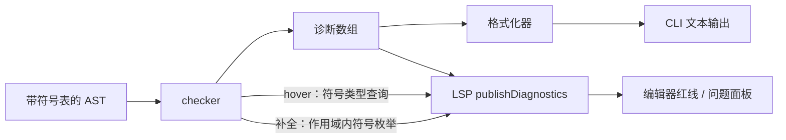

# 检查器工程化与实践：resolve + check 双遍

> [返回：第四阶段导览](01-导览.md)
> 对应大纲第 4 条与实践任务。本册把前三册的部件组装成 `packages/checker`：双遍架构、诊断工程、以及与 ESLint 风格对齐的输出。结束时代码量约 400 行——checker 是 mini 各包里"密度最高"的一个。

## 双遍架构：为什么先 resolve 再 check

```
Program ──pass 1: resolve──▶ 带符号表的 AST（每个 Identifier.resolvedTo 有值）
        ──pass 2: check ──▶ 诊断数组 + 类型注记（每个表达式节点 .inferredType）
```

一遍混写也可行（边建作用域边检查），但双遍有三个工程红利：

1. **前向引用**：`fn a() { return b(); } fn b() { return 1; }`——check b 时 a 的调用点还没建符号？resolve 先把**全部声明**收进符号表，check 再看引用，天然支持"函数间互相调用"。
2. **诊断顺序稳定**：resolve 的错误（未声明/重定义）集中报完，再报 check 的（类型不匹配）——输出按"错误类别分层"，用户修完一类再修下一类。
3. **增量友好**：文件级符号表可缓存（tsc 的 .tsbuildinfo 本质），改一个函数只 re-check 依赖它的部分——单遍架构很难切分。

### 双遍的谱系：两遍是教学下限，工业编译器更多遍

| 编译器 | 语义相关遍 | 遍间数据 |
|---|---|---|
| mini | resolve → check | 符号表与引用边挂在 AST 上（resolvedTo） |
| tsc | binder（建符号）→ checker（查类型） | Symbol 对象 + Checker 内部缓存 |
| rustc | resolve → 降级到 HIR → typeck | 侧表（side table）：节点 id → 语义数据 |
| javac | enter → 补充 enter → 标注 → 多轮 | 编译单元上下文（Env）链 |

遍数变多不是架构洁癖，是两个压力：**检查需要的信息越来越全局**（类型要跨文件、泛型要跨函数），**诊断顺序与增量粒度要按遍切分**。mini 的两遍是这条谱系的最小完整样本——**遍 = 一次全 AST 的走 + 一份独立产出的数据**，这个形状在 rustc 里原样放大。注意"挂 AST"与"侧表"两种存放风格：mini 与 tsc 把语义数据挂节点字段，rustc 用独立表（AST 保持只读、并发友好）——第五阶段起 mini 的 `inferredType` 也会考虑改侧表，为 ir 阶段的并行降级留路。

### 一遍混写什么时候反而对

双遍不是教条，三类场景一遍（甚至零遍）更优：

- **语言强制前向声明**（C 的函数原型）：声明先于引用由程序员保证，一遍顺流而下即可；
- **linter 类工具**：ESLint 的多数规则不需要符号表，一遍 visitor 就够——规则粒度细、偶尔误报可容忍；
- **单遍融合**（esbuild）：解析与转译合一遍，名字解析极简——"未声明变量"这类语义错误干脆留给运行时。

mini 选双遍的判定依据是三条件**同时成立**：有前向引用、要稳定的诊断顺序、要增量缓存。写 linter 时不必照搬——第六阶段的 mini-lint 就会退回一遍 visitor。

还有一条容易被漏掉的判据：**双遍让"符号解析"成为可独立测试的单元**。resolve 的测试只看符号表与引用边（不给类型），check 的测试只看类型诊断（假定引用已绑定）——两个单测各管一半，出问题时先跑 resolve 的用例集就能切分责任。单遍架构的测试永远面对"混在一起的全量行为"，归因成本高得多；这是第一阶段"包边界即测试边界"在 checker 内部的再应用——**遍边界也是测试边界**。

## pass 1：resolve 实现

```ts
export function resolve(program: Program): { global: Scope; diagnostics: Diagnostic[] } {
  const diags: Diagnostic[] = [];
  const global = new Scope(undefined, 'global');
  let slot = 0;                                        // 全局变量槽位分配器

  const walkDecl = (d: Decl, scope: Scope): void => {
    if (d.type === 'FnDecl') {
      if (!scope.define({ name: d.name.name, kind: 'fn', declNode: d,
                          index: -1, slotHint: -1 }))
        diags.push(dupDecl(d.name, scope));
      const fnScope = new Scope(scope, 'fn');
      d.params.forEach((p, i) => fnScope.define({ /* index: i 槽位=参数位 */ }));
      d.body.body.forEach(s => walkStmt(s, fnScope));
    } else walkStmt(d, scope);
  };

  const walkStmt = (s: Stmt, scope: Scope): void => {
    switch (s.type) {
      case 'LetDecl': {
        const sym = { name: s.name, kind: 'let' as const, index: slot++,
                      declEnd: s.init.end, /* TDZ 界 */, declNode: s };
        s.init && walkExpr(s.init, scope);            // 先走右值！TDZ 判定依赖顺序
        if (!scope.define(sym)) diags.push(dupDecl(s, scope));
        return;
      }
      case 'Block': {
        const inner = new Scope(scope, 'block');
        s.body.forEach(x => walkStmt(x, inner));
        return;
      }
      /* if/while 只走子树（条件与分支共用本层 scope 的外围）…… */
    }
  };

  const walkExpr = (e: Expr, scope: Scope): void => {
    if (e.type === 'Identifier') {
      const sym = scope.lookup(e.name);
      if (!sym) { diags.push(undeclared(e)); e.resolvedTo = undefined; return; }
      if (sym.kind === 'let' && e.start < sym.declEnd && sameScopeChain(scope, sym))
        diags.push(tdz(e, sym));                      // 引用在初始化完成之前
      e.resolvedTo = sym;                             // ★ 引用边：LSP/闭包捕获都靠它
      return;
    }
    /* 递归子表达式…… */
  };

  program.body.forEach(d => walkDecl(d, global));
  return { global, diagnostics: diags };
}
```

三个细节：**先走右值再 define**（TDZ 需要"引用点早于声明完成"的偏移比较）；**槽位 index 从这里分配**（第五阶段 VM 的局部变量表直接用，编译器包之间又一次零成本交接）；**resolvedTo 挂在 Identifier 节点**（AST 被注入语义信息——"带标注 AST"的实体化）。

### resolve 手推：三层样例的符号表与引用边

样例（003-shadow 加一个函数声明）：

```mini
let x = 1;
{
  let x = "s";
  print(x);
}
fn f(n: number) -> number { return n + x; }
```

walkDecl/walkStmt/walkExpr 的执行序列：

| 步 | 事件 | 作用域动作 | 产出 |
|---|---|---|---|
| 1 | `let x = 1`：先走右值 `1` | 无引用 | — |
| 2 | define x | global 层登记，slot 0 | Symbol(x, let, #0) |
| 3 | 进入 block | 新建 block 作用域（parent = global） | 作用域节点 B1 |
| 4 | `let x = "s"`：先走右值 | 无引用 | — |
| 5 | define x | B1 层登记，slot 1 | Symbol(x, let, #1)——**不同层，合法遮蔽** |
| 6 | `print(x)` 的实参 x | 沿 B1 命中本层 slot 1 | Identifier.resolvedTo = #1 |
| 7 | fnDecl f | global 层登记函数符号 | Symbol(f, fn) |
| 8 | 建 fnScope，登记参数 n | fn 层，index = 参数位 | Symbol(n, param) |
| 9 | `return n + x` 的 n、x | n 命中 fn 层；x 沿链命中 global #0 | 两条引用边——**自由变量在此显形** |

三个验证点：第 5 步与第 2 步**不在同一层**，define 返回 true——重定义只在同层判，误把跨层当同层就会把合法遮蔽报成错误（02 册的高频 bug）；第 9 步的 x 是 f 的自由变量，第五阶段闭包捕获列表直接从这类引用边算出；把第 6 步的 `print(x)` 挪到 B1 的 `let` 之前，TDZ 判定当场触发——同一棵作用域树，声明顺序决定引用生死。

### TDZ 判定的位置比较手推

`let x = x + 1;` 设整条语句在源码里的字符偏移：`let x = ` 占 0..7，右值 `x + 1` 从 8 开始，声明结束 `;` 在 13。resolve 的顺序是先走右值（walkExpr 记录 Identifier 节点 start = 8），再 define（sym.declEnd = 13）。判定 `8 < 13` 且引用与符号在同一作用域链 ⇒ TDZ 诊断。偏移数字是示例，机制是真实机制，三种位置关系各验一遍：

| 引用位置 | 关系 | 判定 |
|---|---|---|
| `let x = 1; print(x);` 里的 x | start > declEnd | 放行 |
| `let x = x + 1;` 右值里的 x | start < declEnd | 报 TDZ |
| `let x = 1; { print(x); }` 块内引用 | start > declEnd 且跨层 | 放行（不同链，不误伤） |

TDZ 静态化的全部成本就是这一场位置比较——**词法作用域让"先后"变成数字可比**。这是 02 册"位置信息从词法段就要保留"在语义段的第一次兑现；JS 选择运行时兜底（每次读 let 绑定前查初始化标志）是因为它的词法环境可以在运行时重建，不是"静态做不了"。

## pass 2：check 实现

上一册的 `synthExpr` 骨架 + 本册的规则表即主体，补三类语句级检查：

```ts
const checkStmt = (s: Stmt, scope: Scope): void => {
  switch (s.type) {
    case 'ReturnStmt': {
      const expected = currentFn.retType ?? { kind: 'unit' };
      if (!s.value && expected.kind !== 'unit')
        diag(s, `函数声明返回 ${show(expected)}，但 return 没有值`);
      if (s.value) requireAssignable(synthExpr(s.value), expected, s.value, '返回值');
      return;
    }
    case 'IfStmt':
      requireBool(synthExpr(s.cond), s.cond, 'if 条件');       // 条件必须 bool（mini 不做真值转换）
      checkBlock(s.then); if (s.else) /* ... */;
      return;
    /* while 同 if；LetDecl：右值相容于标注（有标注时） */
  }
};
```

**返回值推导**：`fn f() { return 1; }`（无 retType 标注）——先扫函数体收集全部 return 表达式类型，全部 unit → 推 unit；否则合一非 unit 者作为返回类型（矛盾则报"返回类型不一致"）。这是 mini 里唯一的"反向推导"，也是 `synthExpr` 综合方向的一个例外样本。

### 返回值推导手推：一个矛盾样本

```mini
fn f() {
  if (true) { return 1; }
  return "s";
}
```

推导过程：checkStmt 遇到 FnDecl 时先收集函数体全部 ReturnStmt 的值类型——第一支 `number`、第二支 `string`。合并策略：全部 unit → unit；存在非 unit → 以首个非 unit 为准，后续 return 逐个与它做相容检查——`string` 对 `number` 不相容 ⇒ E0404（返回类型不一致），诊断指到第二处 return，hint 里引第一处的推导来源（错误链再次出场）。

两个边界要说清：**函数体没有任何 return** → 推 unit（过程式函数）；**if 条件恒真所以第二支不可达**？可达性分析不属本阶段——checker 只收集句法上出现的 return，"true 恒真"不做常量折叠（那是第七阶段优化 pass 的事）。静态语义的分界（02 册）在这里再次生效。还有一条诊断顺序的细节：收集与相容检查**按源码顺序推进**，矛盾报在第二处而不是第一处——"新引入的冲突才是要修的那行"，这是诊断落点纪律（span 最小化）在语句级的延伸。

### checkStmt 与 synthExpr 的分工线

| 检查 | 归属 | 原因 |
|---|---|---|
| `+` 的操作数类型 | synthExpr（表达式规则表） | 信息全在子树内，自底向上综合 |
| if/while 条件必须 bool | checkStmt | 语句级约束，与表达式的值无关 |
| return 相容于函数返回类型 | checkStmt | 需要外围函数上下文——表达式综合没有"当前函数"这个输入 |
| 调用实参相容 | synthExpr 的 CallExpr 分支 | 全部信息在子树内 |

分工线的判据一句话：**检查所需信息是否超出该表达式子树**。超出的归语句级（需要环境参数），不超出的归表达式级（纯综合）。第五阶段 ir 的 walk 沿用同一条线——表达式内联成指令序列，语句保留块结构控制流。

## 诊断工程：错误码、hint 与格式化

```ts
export interface Diagnostic {
  readonly code: 'E0401' | 'E0402' | 'E0403' | 'E0404';   // 40 段 = 语义
  readonly severity: 'error' | 'warning';
  readonly message: string;
  readonly start: number; readonly end: number;
  readonly hints?: readonly string[];
}
```

输出格式对齐 ESLint（`file:line:col · code · message`）：

```
example.mini:3:9 · E0401 · 未声明的变量 'y'（是否想用 'x'？2:9 有同名声明）
example.mini:5:5 · E0403 · 类型不匹配：期待 number，实给 string（'"s"' 的类型从这里推导）
```

两条设计纪律：

- **hint 给"行动"而不是"解释"**：`是否想用 'x'？`（相似度最高的候选名——编辑距离 ≤ 2 的符号）比 `该名字未定义` 有用十倍。
- **错误链**：类型不匹配报"实给类型从哪推的"——诊断能互相引用（第二条引用了推导来源位置），修错不再靠猜。

### 相似名建议：编辑距离的最小实现

`prnit` → `print` 的建议来自**编辑距离**（Levenshtein：单字符插入/删除/替换的最少次数）。递推一行：

```
d[i][j] = min( d[i-1][j] + 1,  d[i][j-1] + 1,  d[i-1][j-1] + (s[i] == t[j] ? 0 : 1) )
```

完整 DP 表留给自测手工填；这里只验证结论：`prnit` 与 `print` 差一次相邻字符交换（编辑距离按定义计 2 次），d = 2 ≤ 阈值 2 ⇒ 入选建议。工程纪律三条：

- **阈值收紧（≤ 2）**：候选列表宁缺勿滥——给出三个以上候选等于没有建议；
- **只在可达作用域链内搜**：对全局符号表全量搜会给出跨语义的荒谬建议；
- **大小写先归一再比**：首字母大小写笔误是最常见的碰瓷，归一后距离 1 的候选优先展示。

### 诊断数量与去重：克制的纪律

- **code 稳定是契约**：E0401 永远是"未声明"，编辑器插件与 CI 脚本按 code 编程——改 message 随意，改 code 等于 break API；
- **span 取最小封闭表达式**：报类型不匹配时指到出错子表达式，而不是整条语句——用户盯着最小红线就能修；
- **同 span 去重**：多个检查命中同一错误时只保留最具体的一条——同一条红线报三种说法是噪声加倍；
- **数量上限**：单文件诊断超过上限（如 100 条）后停止报新错并提示"先修前面的"——雪崩式误报会淹没根因。

### 诊断用例的对账：规则覆盖表

15+ 错误用例不是凑数，要与 03 册的规则表逐行对账——**每条规则至少一条合法 + 一条非法用例**：

| 规则行（03 册） | 合法用例 | 非法用例 | 期望 code |
|---|---|---|---|
| `+ - * / %` | `1 + 2` | `"a" + 1` | E0403 |
| `+`（字符串） | `"a" + "b"` | `"a" + 1`（同上用例复用） | E0403 |
| `< > <= >=` | `1 < 2` | `"a" < "b"` 之外的混合 | E0403 |
| `&& \|\|` | `true && false` | `1 && true` | E0403 |
| 调用 | `fib(3)` | `fib(1, 2)` | E0403（参数个数） |
| 赋值/声明相容 | `let x: number = 1;` | `let x: number = "s";` | E0403 |
| return 相容 | `fn f() -> number { return 1; }` | 两支 return 类型不一致 | E0404 |
| 名字解析 | 引用已声明变量 | 未声明 / 同层重定义 / TDZ | E0401 / E0402 / E0401 |

给每条用例打上规则行标签、跑一张覆盖表，哪一行没有非法用例当场显形——这张表与第一阶段语料的"每条拒绝规则配一个样例"是同一纪律在语义段的复刻。工业编译器的测试体系里同样能认出"规则 ↔ 用例"的对账结构（rustc 的 UI 测试目录按检查类别分目录）；03 册"规则表的三重身份"（文档/测试/实现）在 checker 落地的最后一环就是它。

## 错误恢复：一个错误不该压死一百个诊断

语义段最怕**连锁误报**：一个根因错误污染下游，用户面对满屏噪声。机制是**毒化类型（error type）传播**：

```ts
const errorType = { kind: 'error' };               // 毒值：表示"这里已经报过错了"

function assignable(s: Type, t: Type): boolean {
  if (s.kind === 'error' || t.kind === 'error') return true;   // 毒值与任何类型相容
  return tysEqual(s, t);
}
```

`let y = z + 1;`（z 未声明）两种机制的对照推演：

| 步 | 事件 | 无毒化机制 | 有毒化机制 |
|---|---|---|---|
| 1 | z 查不到 | 报 E0401；z 的类型成为悬案 | 报 E0401；z 的类型 = error |
| 2 | `z + 1` 综合 | 悬案强行当 number 或再报一条 | error × number → **error**（规则表对毒值放行） |
| 3 | let y 相容检查 | 可能二次报错 | error ≤ number 放行，不报 |
| 合计 | | 2~3 条诊断，根因被淹没 | **恰好 1 条** |

毒化与 03 册 `any` 的对比要分清：any 是"用户要的洞"（双向全通且静默），error 是"检查器自己造的止血点"（放行下游检查但**不静默**——已报的 E0401 保留在诊断列表里）。rustc 与 tsc 内部都有对应的 error 类型。**错误恢复的正确形态不是"报错后跳过检查"，是"报错后让毒值流过管道"**——本册验收里的"15+ 语义错误用例"能全绿，一半要归功于毒化让根因诊断保持唯一。

## 对照工业：诊断从 checker 到编辑器的旅程

mini 的 `check()` 返回诊断数组，终点是编辑器里的红线。工业链路（LSP 协议）：



同一份 checker 产出、两种消费形态：**CLI 走格式化器**（本册的 `file:line:col · code · message`），**编辑器走 LSP**（只传 code/range/message，渲染归编辑器）。而 hover、补全、重命名三类 IDE 功能的全部原材料，checker 在这两遍里已经产完：resolvedTo 是 hover 的数据源，作用域树是补全的候选集，引用边是重命名的遍历范围。第八阶段读 tsc 架构时会看到同一条链的工业化版本——checker 写完的那一刻，IDE 智能已经"免费"到手，这正是 01 册"API 友好度"质量属性的兑现。

注意链路上的一个分野：诊断数组是**批次语义**（一次 check 全量产出），LSP 的 publishDiagnostics 是**文档语义**（按文件 URI 推送、文件未开就不推）——格式化器与 LSP 适配器因此各自维护"过滤哪些"的策略，checker 本体不关心消费者。**语义产出与呈现分离**是诊断工程能给 LSP 免费供数的根本原因：检查器只管"什么错了"，"给谁看、怎么显示"全部留在出口。

## 验收标准

- [ ] resolve + check 双遍跑通；合法语料（10 例 + 新增类型样例）0 诊断。
- [ ] 15+ 语义错误用例：未声明、重定义、TDZ、类型不匹配（四则/比较/逻辑/调用）、参数个数、返回值不一致、return 位置——每类至少 2 例。
- [ ] 诊断格式化器：全部输出带 行:列 + 错误码 + 至少一条 hint。
- [ ] 相似名建议（编辑距离）对 `prnit` 给出 `print`。
- [ ] 导出 API：`check(program) → { diagnostics, globalScope }`——第五阶段 ir 从 globalScope 拿槽位表、从 Identifier.resolvedTo 拿捕获集。
- [ ] 毒化机制就位：`let y = z + 1;`（z 未声明）恰好产出 1 条诊断。

## 常见误区

- **"双遍 = 慢一倍"**：遍的代价是一次 AST 遍历——流水线里最便宜的环节。真正的成本在符号表与类型缓存的数据结构上；为架构红利多走一遍，稳赚；
- **"诊断越多越负责"**：毒化机制的存在本身就承认"多数诊断是噪声"——**每条多余诊断都在稀释根因的可信度**，检查器的克制是美德；
- **"hint 只是好看的文案"**：hint 是数据（候选名、来源位置、编辑距离），不是模板字符串——没有相似名搜索就没有 `是否想用 'x'?`；
- **"check 要等 resolve 零错误才开始"**：两遍的顺序是架构而非依赖——resolve 报了错，带毒的符号表照样喂给 check，产出依然稳定（毒化机制的另一个名字是"降级不中断"）；
- **"TDZ 是 JS 运行时专属"**：位置比较十行代码——JS 用运行时兜底是语言历史的选择，不是静态不可行；
- **"错误码先随便编，以后再统一"**：code 是工具链契约（第一条纪律），上线后改名等于 break 所有按 code 编程的下游——段位约定（第一阶段命名约定）开工就定死。

## 与主线对照

| 本册概念 | 主线位置 |
|---|---|
| 作用域树与 Symbol | [02-符号表与作用域](02-符号表与作用域.md)——resolve 的数据结构出处 |
| 规则表与综合算法 | [03-类型系统](03-类型系统.md)——check 遍的表达式主干 |
| 毒化 error 类型 | [06-代数数据类型与模式匹配](06-代数数据类型与模式匹配.md)——Type 代数又一个 kind，穷尽性检查护住每个分支 |
| 返回值反向推导 | [04-类型推导](04-类型推导.md)——合成管不了时的第一台"反向机器"，HM 是它的完全体 |
| 诊断 → LSP 链路 | [05-TypeScript编译器架构](../08-第八阶段/05-TypeScript编译器架构.md)——binder/checker 双遍的工业化极限 |
| 槽位表与 resolvedTo | [03-字节码设计](../05-第五阶段/03-字节码设计.md)——第五阶段直接消费本册产出 |

## 阶段收官：mini 有了"理解力"

| 输入 | 第三阶段末 | 本阶段末 |
|---|---|---|
| `"a" + 1` | 合法 AST（结构无懈可击） | **E0403 拦截** |
| `print(x)`（x 未声明） | 合法 AST | **E0401 拦截 + 建议 'x'** |
| AST 节点 | 只有结构 | 带 resolvedTo / inferredType / 槽位 |

前端三件套（lexer/parser/checker）至此完整。下一阶段把这棵"全副武装"的树降级成字节码——`resolvedTo` 决定指令的操作数，`inferredType` 决定指令的选型（比如字符串 `+` 与数值 `+` 是两条指令）。

## 自测

1. 手推本册 resolve 手推样例的作用域树；把 `print(x)` 挪到 B1 的 `let` 之前，哪一步判定翻车、翻成什么诊断？
2. `fn a() { return b(); } fn b() { return 1; }` 若用一遍混写，check 到 a 的函数体时符号表里缺什么？双遍如何救回？
3. 写出 `let s = "a" + 1;` 在 check 遍的完整推进：E0403 的 span 落在哪个子表达式、hint 引到哪里。
4. 毒化 error 类型为什么设计成"相容于一切"而不是"不相容于一切"？反过来会多出哪几条诊断、根因还剩几条？
5. `prnit` 对 `print` 的编辑距离 DP 表（6 列 × 6 行）手工填一遍，验证 d = 2；再算 `prnit` 对 `printf`，它该不该出现在候选里？
6. 返回值推导样本里若两支分别 return 1 与 return 2（同为 number），推导结果是什么？全部改成 `return;`（无值）呢？
7. 为什么"同 span 去重"要在诊断层统一做，而不是要求每个检查自己克制？用毒化机制解释一个"天然重复报错"的场景。
8. hover 显示变量类型需要哪个数据结构？补全候选枚举呢？重命名呢——三者分别取自 resolve 还是 check 的产出？
9. 规则覆盖表里，`&&` 行的非法用例若只写了 `1 && true`（左操作数错），还漏了哪个方向？补出它并写出期望诊断的 span 位置。
10. 把本册的双遍扩成三遍：如果要在 check 之前加一遍"常量折叠标注"（为 if 条件的恒真检测服务），这一遍的输入输出各是什么？它应该放在 resolve 前还是后，为什么？
