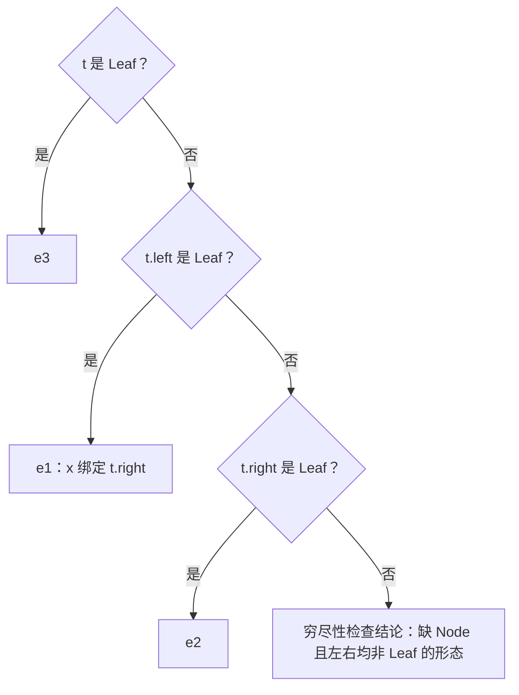

# 代数数据类型（ADT）与模式匹配

> [返回：第四阶段导览](01-导览.md)
> 补充分册，承接 [03-类型系统](03-类型系统.md)的"类型的代数"一节。类型不只是检查用的标签——**类型上可以做代数**：和（sum）与积（product）两个组合子加递归，足以表达几乎所有数据形状；模式匹配是消费这类数据的对偶操作。本册讲清代数本身、TypeScript 的 discriminated union 实践、穷尽性检查的原理与实现，再回扣第三阶段的 AST 与演练场的 Church 编码。

## 先澄清：两个 ADT

| | 抽象数据类型（Abstract Data Type） | 代数数据类型（Algebraic Data Type） |
|---|---|---|
| 关注点 | **隐藏表示**：只暴露操作集（栈的 push/pop，不管怎么存） | **组合表示**：类型上的和/积运算 |
| 关键词 | 封装、不变量、interface | sum、product、递归、模式匹配 |
| 后代 | ML module、Rust trait、面向对象的接口 | ML `datatype`、Haskell `data`、Rust `enum`、TS discriminated union |
| 出现场景 | 数据结构课的"ADT"指它 | 编译器/类型系统语境的"ADT"几乎都指它 |

一个管"看不见"，一个管"怎么拼"。本文讲后者——它在编译器里无处不在：**AST 本身就是全站最大的一棵 ADT**。

## 类型的代数：和与积

两种组合子，各配一条基数（可能的值有多少个）算术：

- **积类型 `A × B`**：同时持有一个 A 和一个 B。`|A × B| = |A| · |B|`。TS 的元组 `[A, B]`、记录 `{ x: A, y: B }`，Rust 的 `struct`。
- **和类型 `A + B`**：持有 A **或** B，且带一个标记说明是哪个。`|A + B| = |A| + |B|`。带 payload 的 tagged union。

两个特殊值域把代数封口：

- **unit = 1**：恰好一个值的类型（`()`；上一册里 `print` 的返回值——"有值，但零信息"）。
- **never/底类型 = 0**：没有值的类型。

于是基础类型也能用代数读出来：`Bool = 1 + 1 = 2`（两个无 payload 的构造子）；字面量类型 `"a" | "b" | "c"` 是 3；`Option<A> = None | Some(A)` 的基数是 `1 + |A|`——`Option<number>` 永远比 `number` 多一个（那个 `null`/`undefined` 的坑被类型系统显式计价了）。

**泛型是类型上的函数**：`Option: Type → Type`。**递归 ADT 是类型的不动点方程**：

```text
List<A> = Nil | Cons(A, List<A>)        // |L| = 1 + |A|·|L|
Tree<A> = Leaf | Node(Tree<A>, A, Tree<A>)   // 二叉树：|T| = 1 + |T|²·|A|
```

链表、二叉树、JSON 值、AST——全是这几条方程的实例。最后两条代数定律解释了一个"理所当然"的形状：

```text
A × 1 ≅ A          // { value: A, _: unit } 就是 A
A × (B + C) ≅ A×B + A×C   // 分配律：{"kind": tag, "payload": B或C} 拆成两种带 kind 的记录
```

分配律右边正是 discriminated union 的形状——**每个节点一个 `kind` 字段加各自字段集**不是工程巧合，是标准型（canonical form）。

### 基数代数算例：把类型当数算

代数不是修辞——**基数真的满足算术**。全部用最小零件手推（unit = 1、Bool = 2，字面量并集逐个成员相加）：

| 类型 | 展开 | 算式 | 结果 |
|---|---|---|---|
| `Bool` | true / false 两个空构造子 | 1 + 1 | 2 |
| `[Bool, Bool]`（元组） | 积 | 2 × 2 | 4 |
| `Bool \| Bool` | 和 | 2 + 2 | 4 |
| `Either<unit, Bool>` | 和 | 1 + 2 | 3 |
| `Option<Bool>` | `None \| Some(Bool)` | 1 + 2 | 3——恰比 `Bool` 多一个"空" |
| `Bool × (unit + Bool)` | 分配律左边 | 2 × (1 + 2) | 6 |
| `(Bool × unit) + (Bool × Bool)` | 分配律右边 | 2 + 4 | **6，两边相等 ✓** |

分配律第一次用数字验证了：同一批值，"平铺的积集合"与"带 tag 的两种记录"一一对应——**tag 不改变信息量，只是给每个值佩戴身份牌**。discriminated union 那个看似"多余"的 `kind` 字段，在基数上是零成本的。

再算一对"基数相同但类型不同"的样本：`Either<unit, unit>`（基数 2）与 `Bool`（基数 2）。成员个数一样，前者是"左右选一"、后者是"真假选一"——**基数相等 ≠ 类型相等**：代数只对值域大小负责，语义身份写在 tag 的名字里。这条缝隙正是 03 册结构化/名义化之争的另一个投影。

### 指数类型：函数类型的基数

代数还差一种运算：函数。`A → B` 的基数是 **|B|^|A|**——A 的每个取值位置独立选一个 B 的值：

| 函数类型 | 算式 | 结果 | 全体成员 |
|---|---|---|---|
| `Bool → Bool` | 2² | 4 | 恒等、取反、恒真、恒假 |
| `unit → Bool` | 2¹ | 2 | 恒真、恒假（参数是摆设） |
| `Bool → unit` | 1² | 1 | 全部折成同一个"丢弃输入"的函数 |

两条"零化律"顺手浮出：`unit → B ≅ B`（参数零信息，去掉参数不损失任何成员）、`A → unit ≅ unit`（结果零信息，所有函数同化为一）。它们解释了一类工程直觉："带一个没人读的参数的函数"与"无参常量"在实践中可互换。

至此类型代数配齐四种运算：**和（+）、积（×）、指数（→）、常数（unit = 1、never = 0）**。柯里-霍华德对应会说这套代数同时是命题逻辑的代数（和 = 析取、积 = 合取、指数 = 蕴涵）——那条线索通向证明论，超出本课程，知道存在即可；本课程拿它建模 AST 与诊断数据，够用且处处对得上。

## TypeScript 的 sum type：discriminated union

JS 运行时没有和类型，只有对象。TS 的办法：给每个分支一个**字面量判别字段**当标记：

```ts
type Shape =
  | { kind: 'circle'; r: number }
  | { kind: 'rect'; w: number; h: number }
  | { kind: 'point' };

function area(s: Shape): number {
  switch (s.kind) {
    case 'circle': return Math.PI * s.r ** 2;   // s 窄化到 circle 分支
    case 'rect':   return s.w * s.h;
    case 'point':  return 0;
    default: {
      const _exhaustive: never = s;             // 穷尽性检查的落点
      throw new Error(_exhaustive);
    }
  }
}
```

`switch (s.kind)` 后每个分支里 `s` 被窄化——第三阶段说"TS 写编译器的最大红利"，机制就在这里：**控制流分析沿着判别字段收窄类型**。

`default` 里的 `never` 赋值是穷尽性检查：若三个 case 覆盖了全部 `kind`，default 分支里 `s` 的类型被收窄到 never，赋值合法；**哪天给 `Shape` 加了 `kind: 'tri'`，这行立即编译报错**——所有写了这套检查的 switch 同时标红。数据结构的演化被转化成编译期的回归测试。

各语言对照：

| 语言 | sum type | 穷尽性 |
|---|---|---|
| Rust | `enum`（带 payload，本尊） | `match` 强制穷尽 |
| Haskell / OCaml | `data` / `variant` | 同上，外加冗余分支检测 |
| TypeScript | discriminated union（手工约定判别字段） | `never` 收窄（手工 assertNever） |
| Java 17+ | `sealed interface` + `record` | `switch` 模式匹配（封闭层级） |

注意 TS 的 `enum` 反而**不是** sum type——它只是命名常量，装不下 payload。

### assertNever 穷尽性推演：tsc 一步一步在想什么

`default` 里 `const _exhaustive: never = s` 这行模板，按检查顺序逐步拆开：

| 步 | tsc 的动作 | 状态 |
|---|---|---|
| 1 | 进入 `case 'circle'`：判别字段 s.kind 与字面量 'circle' 相等 ⇒ 控制流窄化 | 分支内 s: { kind: 'circle'; r: number } |
| 2 | case 'rect'、case 'point' 同理各自窄化 | 三个分支互不干扰 |
| 3 | 进 default：tsc 做**剩余类型计算**——Shape 全集减去已覆盖的三个 kind | s: **never**（剩余为空） |
| 4 | `never = s` 的赋值判定：只有 never 能赋给 never，而 s 已是 never | 合法，编译通过 |
| 5 | 现在 Shape 新增 `{ kind: 'tri'; base: number; h: number }` | 步 3 的剩余类型 = tri 分支（非 never）⇒ **编译报错：该类型不能赋给 never** |

步 3 是全部机制的核心：**穷尽时剩余类型恰好是 never**——"减到一无所有"在类型系统里有精确的名字。这让"漏一个 case"从运行时陷阱变成编译错误，且报错位置在每一个写了模板的 switch 处而非数据定义处——数据定义处的一行注释（"加分支会爆"）就是发给全部消费者的回归通告。

推演还有第二个方向：**故意写一个不可能的 case**（比如全集没有 tri 却写了 `case 'tri'`）——tsc 在该 case 处报类型无重叠/不可达。穷尽性检查是双向的：**漏分支 → default 处报错；多分支 → case 处报错**。漏与多都有编译期出口，ADT 演化才真正被锁死。

三个工程变体，同一机制不同模板：

| 变体 | 写法 | 适用 |
|---|---|---|
| assertNever 函数 | `function assertNever(x: never): never { throw new Error(x); }` | 多处复用，错误信息可带值 |
| 返回值兜底 | 函数声明返回 number，default 分支 `return assertNever(s);` | 顺带让返回类型参与检查 |
| 不写 default | 函数声明了返回类型，缺分支时控制流分析发现"路径走到底没有返回值"报错 | 全函数穷尽，不限 switch |

## 模式匹配：ADT 的对偶

构造与析构对偶：积的"析构"是解构（`const { w, h } = s`），和的"析构"是分派（`switch`）。模式匹配把两者统一成一种语法，典型文法：

```text
pattern ::= 字面量 | 变量绑定 | _ | 构造子(pattern, ...) | pattern if guard
```

编译器怎么编译 `match`：

1. **顶层判别**：对 tag 做整数/字符串比较，可成跳转表；
2. **嵌套模式展开**：`Node(Leaf, x, _)` 这类嵌套拆成多次判别，通常组织成**决策树**（Haskell/Rust 的做法），避免同一判别重复执行；
3. **穷尽性检查**：收集各分支覆盖的构造子集合，与全集做差——差集非空且无通配分支则报"不穷尽"；某分支被先前分支完全覆盖则报"冗余"。

tsc 的版本就是你在 TS 里天天用的：`typeof x === 'string'` 收窄是判别，`never` 是"剩余类型为空"。TS 的 `switch` 只是**一维**模式匹配（判别字段 + 绑定）；嵌套模式与守卫要等 TC39 的 pattern matching 提案。

**visitor 是模式匹配在面向对象世界的模拟**——用双重分派代替对 sum 的分派。两种设计对应经典的 **Expression Problem**：

| | 加一种新类型 | 加一个新操作 |
|---|---|---|
| OO + visitor（类型是接口，操作是方法/visitor） | 顺手：新增子类 | 痛苦：改所有 visitor 接口 |
| ADT + 模式匹配（类型是 enum，操作是函数） | 痛苦：改 enum 定义，所有 match 标红 | 顺手：新写一个函数 match 一遍 |

编译器是"**节点种类趋于稳定、pass 层出不穷**"的领域——所以 rustc、swc、rolldown 全用 Rust `enum` + `match` 写 AST，而 Babel（跑在 JS 上、要开放插件生态）选了 visitor。两种选择都正确，分歧点就在这张表。

### 决策树编译手推：三个模式怎么变成代码

拿树形数据的 match 样例（scrutinee 是二叉树）：

```text
match t {
  Node(Leaf, x, _)  => e1,      // 左孩子是叶子：绑定右信息
  Node(_, _, Leaf)  => e2,      // 右孩子是叶子
  Leaf              => e3,
}
```

按"嵌套模式展开成决策树"编译——**列优先**：先判顶层构造子，再在同类构造子里判嵌套位置：



三个要点：其一，`_` 通配让判别被跳过——e1 直接绑定 `t.right`，不再追问它是什么；决策树的结构只由模式的**必须判别位置**决定。其二，FAIL 分支画的是穷尽性检查的结论而非运行时行为：三个模式没覆盖"Node 且左右都非 Leaf"的形态，检查报缺。其三，列优先有优化红利：同一列的判别只执行一次（本例 `t.left` 只判一次）；这套编译的形式化是匹配矩阵/决策树算法（OCaml 与 rustc 的 match 编译的基础）。mini 的落地只处理一维 tag——第五阶段脱糖成"tag 比较跳转链"，教学语言够用，但嵌套版的完整形状你已经见过。

顺手补上第 3 步的另一半——**冗余分支检测**：若 `_` 通配 arm 排在具体构造子 arm 之前，后面那些 arm 永远不可达，编译器报"unreachable pattern"。缺与冗余是同一份做差的两个方向：covered 与全集之差 = 缺；被先前分支完全覆盖 = 冗余。rustc 对两者都按错误处理（不只是警告），因为冗余分支几乎总是排序失误的信号——语义上它可能默默吞掉本该执行的分支。

## AST 就是最大的 ADT

回扣第三阶段：ESTree 的 `Expression` 是几十个 variant 的 sum，每个节点（`{ type, ...fields, start, end }`）是一个积——`type` 字段就是代数意义上的 tag，`fields` 就是分配律拆出来的 payload。当时的 discriminated union 是"手工展开的 ADT"，现在你知道了它成立的代数根据。

自举视角更有意思：**编译器自己用 ADT 写，语言的类型系统就成了编译器开发的静态保障**。给 AST 加一种节点（比如可选链 `OptionalChain`），全仓库每个非穷尽的 switch 编译期爆红，一个个补齐——这在动态语言里要靠测试覆盖率碰运气。

### JSON 值：一条递归方程的完整落地

把"递归 ADT 是不动点方程"落到最常用的数据形状上：

```ts
type Json =
  | null                       // 基数 1
  | boolean                    // 基数 2
  | number | string            // 原子：代数上按"一个整体"处理
  | Json[]                     // List<Json> = 1 + Json × List<Json>
  | { [key: string]: Json };   // string → Json 的有限函数：Json^Str 的有限子集
```

消费它的函数与数据方程同构——**函数的递归形状抄数据的递归形状**：

```ts
function depth(j: Json): number {
  if (j === null) return 0;
  if (typeof j === 'boolean' || typeof j === 'number' || typeof j === 'string') return 0;
  if (Array.isArray(j)) return 1 + Math.max(0, ...j.map(depth));
  return 1 + Math.max(0, ...Object.values(j).map(depth));
}
```

三层观察：每一层 `typeof` / `Array.isArray` 都是一次对 sum 的分派；递归调用对应方程里 `List<Json>` 的递归出现；但对这个类型 TS 的窄化已经吃紧——数组与对象之间没有字面量判别字段，never 收窄帮不上忙。**API 设计的实用结论：自产数据一律带 tag**（`{ kind: 'arr' }` / `{ kind: 'obj' }`），discriminated union 的全部红利（窄化、穷尽、自文档）才能重新上线。JSON 解析器的输出没有这个自由——格式是既定的，分支完备性只能靠人眼或单测兜底，这正是本册开头"AST 是全站最大 ADT"的反面注脚：**ADT 的红利从来不是白来的，它要求类型是你自己设计的**。

### class 层级也能拼出 sum：编译器为什么不选

"基类 + 子类"在 TS/Java 里同样能拼出 Shape 的形状（sealed 层级里穷尽性甚至可查）——那 discriminated union 赢在哪：

| 维度 | class 层级 | discriminated union |
|---|---|---|
| 声明成本 | 每分支一个类/接口声明 | 一个 type 一行列完 |
| 模式绑定 | visitor/instanceof 两段式 | 解构一步到位 |
| 穷尽性 | 需 sealed（Java 17+）才封闭层级 | switch + never 即得 |
| 序列化 | 类信息不进 JSON，恢复要另配注册表 | kind 字段天生可序列化 |

编译器数据的特征是"**跨进程、要落盘、要打印**"：AST 快照、sourcemap、LSP 传输全在序列化这条路上，kind 字段是免费的通行证；class 层级的类型信息在运行时蒸发，恢复全靠注册表。这解释了为什么编译器前端的语境里几乎见不到"用 class 层级建模 AST"的实现——不是 OO 不能表达 sum，是表达出来的 sum 不便携带。

mini 语言此刻的 `Type` 也是 ADT（`kind` 判别 + 递归的 `fn` 分支），只是还没有**用户可声明**的和类型。补上它：

## mini 落地：sum type 声明与 match

目标：`type Shape = Circle(number) | Rect(number, number);` + `match` 表达式。checker 的核心增量约 40 行：

```ts
// 类型代数扩一个分支：用户声明的和类型
type Type = /* ...原有分支... */
  | { kind: 'adt'; name: string; ctors: Map<string, readonly Type[]> };

function checkMatch(m: MatchExpr, scope: Scope): Type {
  const t = synthExpr(m.scrutinee, scope);
  if (t.kind !== 'adt') return err(m.scrutinee, 'match 只能作用于和类型');
  const covered = new Set<string>();
  let armType: Type | null = null;
  for (const arm of m.arms) {
    const fields = t.ctors.get(arm.pattern.name);
    if (!fields) return err(arm.pattern, `未知构造子 '${arm.pattern.name}'`);
    if (covered.has(arm.pattern.name)) return err(arm.pattern, `重复覆盖 '${arm.pattern.name}'`);
    covered.add(arm.pattern.name);
    const inner = scope.child();                       // 模式绑定进新作用域
    arm.pattern.bindings.forEach((b, i) => inner.declare(b, fields[i]));
    const bt = synthExpr(arm.body, inner);
    armType = armType ? { kind: 'union', of: [armType, bt] } : bt;  // 各分支类型求并
  }
  const missing = [...t.ctors.keys()].filter((c) => !covered.has(c));
  if (missing.length && !m.hasWildcard)
    return err(m, `match 不穷尽：缺少 ${missing.join(', ')}`);
  return armType!;                                     // match 表达式的类型 = 分支类型之并
}
```

三个设计点：**模式绑定开子作用域**（不污染外层）；**穷尽性 = 覆盖集与构造子全集做差**（上一节原理的直接落地）；**match 的类型是各分支之并**——sum 类型从"用户声明"走向"系统推导"，正是 TS 字面量联合的雏形。`match` 的代码生成无需新机制：脱糖到第五阶段的 tag 比较跳转链即可。

### checkMatch 手推：一个不穷尽样例的全过程

样例（故意漏掉 Point 分支）：

```mini
type Shape = Circle(number) | Rect(number, number) | Point;
fn area(s: Shape) -> number {
  match s {
    Circle(r) => 3 * r * r,
    Rect(w, h) => w * h,
  };
}
```

对照 checkMatch 的循环逐轮推：

| 轮 | arm.pattern.name | ctors.get 结果 | covered 变化 | inner 作用域 | 分支类型 |
|---|---|---|---|---|---|
| 1 | Circle | [number] ✓ | {Circle} | {r: number} | number |
| 2 | Rect | [number, number] ✓ | {Circle, Rect} | {w, h: number} | number，armType 并 = number |
| 收尾 | missing = keys − covered = {Point}；hasWildcard = false | — | — | — | **err：match 不穷尽，缺少 Point** |

再推两个变体把机制推满：加第三条 `Point => 0`——covered 与构造子全集相等，missing 为空，match 的类型 = number；把第二条换成 `_ => 0`——hasWildcard = true，missing 非空也放行（通配兜底，穷尽性检查让位，但"不逐分支处理"的意图在 arm 集合里显式表态了）。

注意 armType 求并那行冒出来的 `{ kind: 'union', of: [...] }`——Type 代数长出了新 kind。这正是 03 册插槽纪律的重演：synthExpr 一字不改，assignable/tysEqual 各补一个分支即可；也预告了第五阶段的指令选型要按 union 逐个成员展开。覆盖集做差这个动作有两处消费者：检查期（本函数）与代码生成期（第五阶段的跳转链）——同一份数学，两个出口。

## λ 演算视角：Church 编码即 ADT

演练场里无中生有的那些编码，在代数视角下全部对号入座：

- `PAIR = λa b f. f a b`——**积**的函数表示（存两个，由 f 选择投影）；
- `TRUE/FALSE`——二元 **sum**（`1 + 1`，Bool 的原型）；
- Church 数——`Option`/链表的递归套路（"把 f 施加 n 次"的折叠表示）。

这不是巧合：**ADT 完全可以用纯函数表示**（Boehm–Berarducci 编码系统化了这件事），λ 演算不缺数据结构，只缺语法糖。反过来说，ADT 也不是语法糖，而是与函数同级的语义原语——[演练场](https://yidafu.github.io/tech-learning/compiler/playground/lambda)里每个"数据"都在提醒这一点。

## 常见误区

- **"TS 的 enum 是 sum type"**：它只是命名常量，装不下 payload；拿 enum 建模 AST 会错失穷尽性检查的全部红利——真正的 sum 是 discriminated union；
- **"模式匹配是 switch 的语法糖"**：方向反了——match 有绑定、嵌套、守卫、穷尽性四样 switch 没有的能力；TS 的 switch 是"一维 match"（判别字段 + 绑定），TC39 的 pattern matching 提案要补的正是嵌套与守卫；
- **"穷尽性检查要装库"**：never 收窄就是机制本身，编译器自带；lint 规则只是给没写模板的存量代码补提醒；
- **"基数代数是数学趣味"**：它是 API 决策的速算器——`Option<T>` 比 `T` 多一个值 = "每个 T 位置都要想空怎么办"；分配律告诉你 tag 化记录是标准型；指数律告诉你"回调多一个参数，可能的实现数量翻倍"；
- **"ADT 与 OO 是阵营之争"**：Expression Problem 表说的是**扩展方向的取舍**，不是立场——Rust 也有 trait（对操作开放），TS 也有 class；编译器选 ADT + match 只因它的扩展轴恰好是操作不是类型；
- **"Church 编码说明 ADT 是多余的糖"**：能编码 ≠ 该编码——纯函数编码的代价是类型推理与诊断全面退化；ADT 是把编码"语义化打包"，打包的价值在可读的诊断与机器可查的穷尽性。

## 与主线对照

| 本册概念 | 主线位置 |
|---|---|
| discriminated union AST = 手工 ADT | [第三阶段 AST 设计](../03-第三阶段/05-AST设计与错误恢复.md)——当时按下未表的"为什么"，本册补齐 |
| 判别收窄 + never 穷尽 | tsc 的 control-flow narrowing；也是第七阶段数据流分析的类型化版本 |
| match 脱糖到 tag 比较跳转 | 第五阶段 if/短路 lowering 的直接复用 |
| visitor vs match | 第八阶段 Babel visitor 与 Rust 系编译器的路线分歧 |
| Church 编码 = ADT 的函数表示 | 演练场 [λ 演算归约器](../09-演练场/05-Lambda演算归约器.md) |

## 自测

1. 写出 `Either<string, boolean>`、`Option<boolean>` 的基数公式；`Tree<A>` 的不动点方程展开两层是什么形状？
2. 把 `Shape` 加上 `kind: 'tri'; base: number; h: number` 后，哪些代码会编译期失败？为什么说这是"数据演化的回归测试"？
3. `assertNever` 的 default 分支里，tsc 把 `s` 的类型收窄成了什么？三个 case 齐全时为什么是 never？
4. 用 Expression Problem 表解释：为什么 rustc 用 `enum + match` 写 AST，而 Babel 用 visitor？如果给 Babel 换成 ADT 会失去什么？
5. 一句话说清 `PAIR` 如何同时体现积类型（保存两个值）与它的消去操作（`f` 决定投影哪一个）。

（1~5 为原题；6~11 为扩写增补题，答不出就回到对应推演。）

6. 手算 `Either<Bool, unit>` 与 `Option<Either<Bool, unit>>` 的基数；后者为什么恰好比前者多 1？把这个"多出来的 1"翻译成工程直觉。
7. `Bool → Either<unit, unit>` 有 4 个成员，全部写出来（用恒等/取反/常量式命名），并验证指数公式 2² = 4。
8. 全集没有 tri 却写了 `case 'tri'`，tsc 在哪里报什么？结合"漏分支报在 default、多分支报在 case"，复述穷尽性检查的双向出口。
9. 决策树手推：给本册的树匹配样例加第四个模式 `Node(Node(_, _, _), _, Leaf)`，决策树最深几层？哪些判别被多个模式共享（列优先的红利）？
10. checkMatch 手推：三条 arm 且最后一条是 `_ => 0` 时，missing 非空还报错吗？covered 集合的最终形状是什么？match 的类型是多少？
11. 给 mini 的 type 声明加递归（`type List = Nil | Cons(number, List);`）：构造子集合仍是有限的吗？covered 做差还有效吗？顺带说出"按值穷尽"（枚举所有值）为什么永远不可能。
