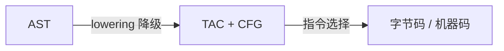

---
references:
  - 02-中间表示家族
  - 03-字节码设计
  - 04-解释器实现
  - 05-实践-编译器VM与REPL
---

# 第五阶段导览：中间表示与字节码虚拟机

> [返回：编译原理学习大纲](../编译原理学习大纲.md)
> 本文是第五阶段的入口：阶段目标、分册索引、知识点地图、实践任务清单与阶段自测。

**建议时长**：3~4 周（每天 1~2 小时）。这是 mini 语言的"点亮时刻"——本阶段结束时，`fib(25)` 能在你的 VM 里跑出来。全程手写字节码与栈式解释器，对照对象是 JVM、早期 V8 与 Lua。

## 分册索引

| 分册 | 对应大纲条目 | 一句话说明 |
|---|---|---|
| [02-中间表示家族](02-中间表示家族.md) | 第 1 条 | m+n 解耦、AST/TAC/CFG/SSA/数据流图五形态（max 函数贯穿）、降级与短路求值展开 |
| [03-字节码设计](03-字节码设计.md) | 第 2 条 | 栈式 vs 寄存器机、FnProto/常量池/槽位、mini 34 条指令集定稿、反汇编器 |
| [04-解释器实现](04-解释器实现.md) | 第 3 条 | 解释循环、栈帧与调用约定、闭包两种 upvalue 方案（Lua 拆盒详解）、内建函数 |
| [05-实践-编译器VM与REPL](05-实践-编译器VM与REPL.md) | 实践任务 | emit 与跳转回填、两条栈不变式、REPL 续行与全局持久、三件套验收 |

## 阶段目标

学完本阶段，你应该能不查资料做到这些事：

1. 说清 AST / 三地址码 / CFG / SSA 各自的形态与适用场景，解释 IR 为什么解耦 m 前端 × n 后端。
2. 设计一套栈式字节码指令集（操作码、操作数、常量池、栈帧布局），并写出反汇编器。
3. 实现完整的 switch 解释循环：运算、比较、跳转、调用、返回。
4. 实现闭包：函数值 = 代码 + 捕获环境；两种 upvalue 方案（环境链 / 拆盒）都能讲清。
5. 跑通递归、高阶函数、字符串与数组内建库，并配上 REPL。

## 知识点地图

### 1. 中间表示家族

- **组合爆炸问题**：m 种语言 × n 种平台 = m×n 个编译器；插入统一 IR 后 = m + n。这是"中间端"存在的根本理由——LLVM IR 是最大受益者。
- **三地址码（TAC）**：每条指令最多一个运算、两个操作数：`t1 = a + b`。表达式树被"拍平"成线性序列，天然贴近寄存器机。
- **控制流图（CFG）**：基本块（内部无跳转）+ 块间有向边。while 循环 = 条件块 + 体块 + 回边。CFG 是第七阶段数据流分析的载体。
- **SSA**：每个变量只赋值一次，分支汇合处插 φ 函数。第七阶段详细展开，本阶段只需认得。
- **表达式降级（lowering）**：`a && b` 降为"求 a，假则跳过"；`while (c) body` 降为"循环头：求 c，假则跳出；体；跳回循环头"。AST 的结构化控制流从此变成"跳转 + 标签"。

### 2. 字节码设计

- **栈式 vs 寄存器机**：栈式指令短（操作数隐式在栈顶：`ADD`）、编译器简单但指令数多；寄存器机（Lua 5、Dalvik）指令少但需要寄存器分配。JVM、早期 V8（Ignition）、CPython 都是栈式。
- **指令集内容**：常量加载（`CONST index`）、算术逻辑（`ADD/SUB/LT/NOT`）、局部变量（`GET/SET_LOCAL slot`）、跳转（`JMP/JMP_IF_FALSE offset`）、调用与返回（`CALL argc` / `RETURN`）。mini 语言 30 条指令以内足够。
- **常量池与局部变量槽**：字面量去重存表、指令里只存索引；函数局部变量（含参数）在栈帧里按槽位编号——第四阶段符号表已经给了编号。
- **反汇编器**：字节码 → 可读文本。它是本阶段最重要的调试工具——"编译器以为它生成了什么"与"VM 实际执行了什么"的对照镜。

### 3. 解释器实现

- **解释循环**：`while (true) switch (code[ip++])`——取指、译码、执行、推进。这个循环的形态从 JVM 到 CPython 到你的 VM 都一样。
- **栈帧（frame）**：`{ code, ip, locals, stackBase, closure? }`；调用 = 压帧 + 跳转，返回 = 弹帧 + 把返回值写回调用者栈顶。参数传递 = 调用前压栈，被调帧初始化时搬到 locals。
- **闭包 = code + 环境**：函数值不再是裸 code 指针，还要带上"定义时作用域的变量环境"。捕获列表就是第四阶段算出的自由变量。
- **upvalue 两种方案**：
  - 环境链（环境模型）：闭包持有父环境引用链，访问自由变量沿链上溯——简单但访问慢。
  - 拆盒（Lua 方案）：被捕获变量搬到堆上的"盒子"，open（还在栈上）时 upvalue 指向栈槽，栈帧弹出时 close（拷到盒子）——快但要维护 open→closed 迁移。
- **内建库**：print、clock、字符串拼接与长度、数组 push/map/filter（filter 回到 VM 跑闭包——这是"运行时调用编译产物"的第一案例）。
- **REPL**：逐行 read → parse → check → compile → run；REPL 的难点是"上一行定义的变量要留存"——全局环境跨求值持久。

## 与 mini 语言项目的关系

交付 `packages/ir`（lowering + 字节码生成）与 `packages/vm`（解释器 + 内建库 + REPL）。mini 语言至此"活"了：函数一等公民、递归、闭包、字符串数组全通。第六阶段给 VM 装上 GC，第七阶段给字节码加优化 pass。

## 实践任务清单

- [ ] 任务 0：定义 OpCode 枚举与 Chunk 结构（code + constants + 行号表）；手写两段"源码 → 期望字节码"样例。
- [ ] 任务 1：lowering——表达式与语句到字节码；短路求值与 while 的跳转结构先画 CFG 再写。
- [ ] 任务 2：解释循环 + 栈帧；算术、比较、局部变量、if/while 全通。
- [ ] 任务 3：函数调用与返回；`fib(25)` 跑通并验证结果。
- [ ] 任务 4：闭包与 upvalue（任选一种方案实现，另一种写伪码对照）；闭包计数器 demo。
- [ ] 任务 5：内建库（print/clock/字符串/数组）；高阶函数 `map` `filter` demo。
- [ ] 任务 6：反汇编器 + REPL（`mini repl` 进入交互环境）。
- [ ] 选做：给字节码加行号表，运行时错误栈回溯打印源码行。

## 阶段自测

- [ ] 能手写 `1 + 2 * 3` 与 `if (a) { b } else { c }` 的字节码序列（栈式）。
- [ ] 能画出 `fib(3)` 执行时的栈帧压入/弹出序列。
- [ ] 能解释拆盒方案里 open upvalue 为什么要维护"指向栈槽"的链表，以及在什么时刻 close。
- [ ] 能说清栈式机一条 `ADD` 对应寄存器机的什么形态，以及两种设计指令密度的差异。
