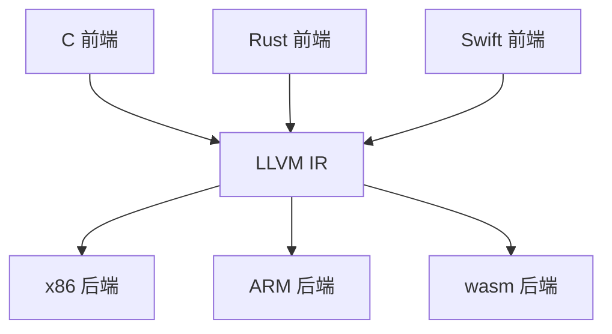
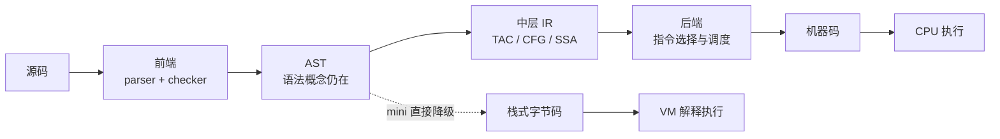
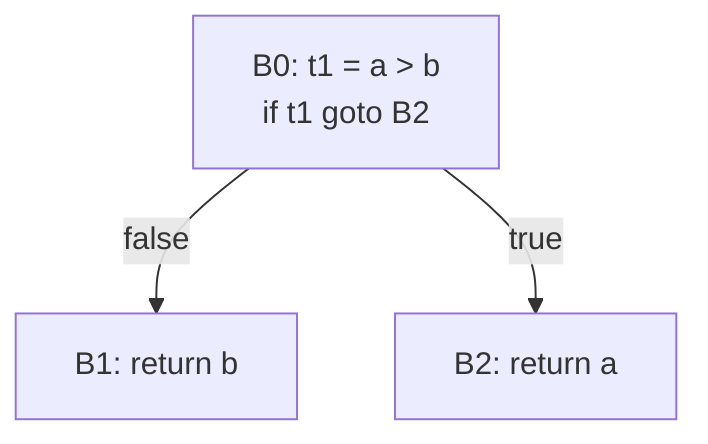

# 中间表示家族：从 AST 到可执行形态

> [返回：第五阶段导览](01-导览.md)
> 对应大纲第 1 条。同一程序的一千种表示：AST、三地址码、CFG、SSA、数据流图。本册用一个函数贯穿全部形态，讲透「降级（lowering）」，并说清 mini 为什么选栈式字节码。

## 为什么需要 IR：m + n 而不是 m × n

m 种语言前端 × n 种目标后端，直接编译需要 **m×n 个完整编译器**；插入统一中间表示后只需要 **m 个前端 + n 个后端**：



LLVM 是这个策略的极致（Clang/rustc/Swift 共享全部后端）；GCC 的 GIMPLE/RTL、V8 的 sea of nodes、JVM 字节码同理。对 mini 而言 IR 还有一层本地价值：**优化（第七阶段）需要一个"贴近机器、可线性遍历、可重写"的形态**——AST 层做优化处处掣肘（树形嵌套、控制流隐式）。

> "m 前端 + n 后端"的 mini 版在 [Wasm 专题](../11-Wasm专题/01-导览.md) 兑现：同一个前端，第二个后端（wasm）。

### IR 的四条设计准则

不是"随便找一种中间形态"都配叫 IR。工程上衡量一种 IR 好不好，常用四条准则：

| 准则 | 含义 | 反例 |
|---|---|---|
| **可线性遍历** | 优化 pass 能按顺序扫一遍指令流而不需要回溯 | AST：子树遍历天然递归，pass 之间互相踩 |
| **可重写** | 局部模式（几条指令）能被安全替换成另几条 | 控制流隐含在树形里：替换一个子树可能改语义 |
| **贴机但不贴死** | 足够贴近目标机（指令、槽位），又不绑死某个具体后端 | 直接生成 x86 指令：换 ARM 全部重来 |
| **带位置信息** | 出错能回溯到源码（诊断、栈回溯都要吃） | 丢了位置的 IR：运行时报错无法定位 |

mini 的栈式字节码四条全占：线性（指令流）、可重写（第七阶段的 pass 在上面做）、贴机（栈 + 槽位）、带位置（`FnProto.start`）。AST 只稳占最后一条——这就是"优化不放在 AST 层做"的完整理由。

### 真实编译器的 IR 阶梯

mini 的管线把"中层"压扁了（AST 直接降级到字节码）；大型编译器里三层是分开的：



| 系统 | 前端产物 | 中间层 | 底层形态 |
|---|---|---|---|
| LLVM（Clang / rustc / Swift） | AST | LLVM IR（SSA 形式） | 机器码 |
| GCC | AST | GIMPLE（SSA 化）→ RTL | 机器码 |
| JVM | javac 的 AST | class 文件字节码（栈式） | 解释器 / JIT 机器码 |
| CPython | AST | code 对象字节码（栈式） | ceval.c 解释循环 |
| V8 | AST | Ignition 字节码 → TurboFan 的 sea of nodes | 机器码 |
| Cranelift（Wasmtime 生态） | — | SSA 形式的中间 IR | 机器码 |
| mini | AST（checker 注记） | ——（直接降级） | 栈式字节码 → 解释循环 |

两个观察：

- **动态语言一路栈式到底**（CPython：解释器即终点）；**追求峰值性能的引擎都要过一道 SSA 或图形态的中层**（LLVM、TurboFan）——中层形态决定优化上限，这正是本册五种表示的价值排序；
- **字节码分"公开契约"与"内部形态"**：JVM 字节码、wasm、.NET CIL 是跨语言、跨设备的公开契约（第三方语言把"m 前端 + 1 个后端"跑成了现实）；LLVM IR、sea of nodes 是编译器私有形态，随版本演化不承诺稳定。设计 IR 的第一个问题：**它是给外人看的，还是给自己看的**。

## 一个函数的五种表示

```ebnf
fn max(a: number, b: number) -> number {
  if (a > b) { return a; }
  return b;
}
```

**① AST**：结构忠实于语法，控制流是"树的形状"（IfStmt 包着 ReturnStmt）。

AST 本身也是一种 IR——"源码级 IR"：parser 的产物、checker 的注记载体（`inferredType` / `resolvedTo` 都写回 AST 节点）。它的强项是**忠实**（诊断、重构工具吃它），弱项是**控制流隐式**：执行顺序藏在树的嵌套里，没有"下一步"的概念。第五阶段起的每个 pass 都在逐步剥掉这层语法性——直到 IR 层只剩值、运算、跳转。

**② 三地址码（TAC）**：表达式拍平，每条指令至多一个运算、隐式临时变量：

```
t1 = a > b
if t1 goto L1
t2 = b
return t2
L1:
t3 = a
return t3
```

把一个表达式先拍平试试——`a + b * c` 的 TAC：

```
t1 = b * c
t2 = a + t1
```

两条指令、两个隐式临时变量。TAC 指令的家谱很小，一张表装得下：

| 类别 | 形态 | 例子 |
|---|---|---|
| 二元运算 | `x = y op z` | `t1 = b * c` |
| 一元运算 | `x = op y` | `t1 = -a` |
| 拷贝 | `x = y` | `t2 = b` |
| 无条件跳转 | `goto L` | `goto L1` |
| 条件跳转 | `if t goto L` / `iffalse t goto L` | `if t1 goto L1` |
| 参数与调用 | `param x` / `y = call f, n` | `param n` |
| 返回 | `return x` | `return t2` |

max 函数的 TAC 里四类全齐（运算、拷贝、条件跳转、返回）。mini 的字节码就是这张表的"栈化变体"：`t2 = b` 变成 `GET_LOCAL 1`，`t1 = a > b` 变成 `GET_LOCAL 0; GET_LOCAL 1; GT`——临时变量从"命名的槽"变成"栈顶的瞬间"。

**③ 控制流图（CFG）**：按跳转目标切基本块（块内无跳转），块间有向边：



B0/B1/B2 是基本块，边 = 可能的执行路径。**while 的回边**在 CFG 里就是一个环——第七阶段数据流分析的迭代就沿这些边传播。Dominator（必经节点）等图论概念全部定义在 CFG 上。

基本块怎么切？三条 leaders（块首）规则，逐条套在 max 的 TAC 上：

1. **程序的第一条指令**是 leader → `t1 = a > b`（B0 开头）；
2. **跳转指令的目标**是 leader → `L1:` 处（B2 开头）；
3. **跳转指令的下一条**是 leader → `t2 = b`（B1 开头）。

三个块自然浮出，块边界恰好落在控制流的"关节"上。值得动手再切一次：给 max 加一个 `if (a == b) { return 0; }`，重切——"比较指令的下一条"会把原有块一分为二。**块数只由跳转结构决定，与源码行数无关**；这也是为什么"字节码里数跳转"能反推 CFG 规模。

**④ SSA**：每个名字只赋值一次，分支汇合插 φ：

```
t1 = a > b
if t1 goto L_else
  r1 = a
  goto L_join
L_else:
  r2 = b
L_join:
  r3 = φ(r1, r2)      ← 按来路取值
return r3
```

return 只剩一条（φ 把两条路"接回一条"），无数优化在 SSA 上变成局部模式匹配（第七阶段展开）。

一个带循环的小例把 SSA 的味道做实——源码：

```ebnf
let i = 0;
let s = 0;
while (i < 3) { s = s + i; i = i + 1; }
```

每个变量在汇合点都有"多条来路"，φ 负责按来路挑：

```
i1 = 0
s1 = 0
L_head:
  i2 = φ(i1, i3)          ← 入口来 i1，回边来 i3
  s2 = φ(s1, s3)
  t1 = i2 < 3
  iffalse t1 goto L_exit
L_body:
  s3 = s2 + i2
  i3 = i2 + 1
  goto L_head
L_exit:
  …
```

注意两件事：**每个名字只赋值一次**（原来的 `i` 裂成 i1/i2/i3），以及 φ 站在循环头——入口带来的 i1 与回边带来的 i3 在这里"对表"。这个形态把"变量的第几次赋值"变成了名字本身，use-def 链唯一，第七阶段的数据流分析退化成"顺着链查表"（机械的 φ 插入算法见 [SSA 构建](../07-第七阶段/03-SSA构建.md)）。本阶段只需认得它，并知道 mini 为什么能跳过：第七阶段的保守分析直接在字节码上做（见下一节「mini 的选择」）。

**⑤ 数据流图 / sea of nodes**：把"计算"与"控制流"拆成两类节点，值的使用-定义直接连边（数据依赖），控制依赖单独一条边链。指令天然无序（只被依赖约束）——V8 TurboFan、Java Graal 用它，调度自由度最大，入门最难。

五种表示一张表收拢：

| | AST | TAC | CFG | SSA | 数据流图 |
|---|---|---|---|---|---|
| 表达式形态 | 树 | 线性指令 | 线性指令 | 线性指令 | 节点 + 边 |
| 控制流形态 | 隐式（树形嵌套） | 显式跳转 | 显式块与边 | 显式跳转 + φ | 控制边链 |
| 变量 | 可多次赋值 | 可多次赋值 | 可多次赋值 | **单赋值** | 单定义节点 |
| 典型消费者 | parser / checker / 重构工具 | 教科书与简单生成器 | 数据流分析 | 中层优化器 | 高端 JIT |
| 优化友好度 | 低 | 中 | 中高 | 高 | 最高 |
| 实现难度 | 低 | 低 | 中 | 中高 | 高 |

mini 只走到第二列（TAC 的栈化变体）——不是偷懒，是**教学项目把"形态谱系"的预算省下来换成可读性**；谱系的后三列在 [第七阶段](../07-第七阶段/01-导览.md) 展开（数据流分析、SSA 构建、经典优化 pass）。

**mini 的选择**：栈式字节码（下一册详述）——它本质是 TAC 的"栈化变体"（临时变量 t1/t2 变成栈顶），保留 CFG 形态（跳转指令就是显式的边），跳过 SSA（第七阶段的 pass 直接在字节码上做保守版分析）。

## 降级（lowering）：从结构化控制流到跳转

降级 = 把 AST 里"语法糖级别"的结构翻译成 IR 里"机器级别"的等价物。三个代表：

**短路求值**——`a && b` 不是运算符，是控制流：

```
;; a && b 的字节序（result 落在栈顶）
  <编译 a>            ;; 栈: [a]
  DUP; JMP_IF_FALSE L_false
  POP                 ;; a 为真，弹出，继续求 b
  <编译 b>
  JMP L_end
L_false:              ;; a 为假，b 不求值（短路！）
L_end:
```

对照第四阶段：`LogicalExpr` 与 `BinaryExpr` 分列的价值在此兑现——**lowering 阶段两者走完全不同的代码路径**，Binary 是两条指令，Logical 是一段控制流。

`||` 是同一招的反向版（真则短路、假则续算）：

```
;; a || b（result 落在栈顶）
  <编译 a>                 ;; 栈: [a]
  DUP; JMP_IF_FALSE L_b    ;; a 假 → 去求 b（弹掉一份副本）
  JMP L_end                ;; a 真 → 直接留下 a
L_b:
  POP                      ;; 弹掉 a 的副本，腾栈求 b
  <编译 b>
L_end:                     ;; 此刻栈顶就是"这个逻辑表达式的值"
```

**手工演算：`a && b` 在 a = true、b = false 时的逐指令栈态**（用本册上面的 && 模板）：

| 步 | 指令 | 求值栈 | 说明 |
|---|---|---|---|
| 1 | `<编译 a>` 产物 | [true] | a 的值落栈 |
| 2 | DUP | [true, true] | 留一份副本给 JMP_IF_FALSE 检查 |
| 3 | JMP_IF_FALSE L_false | [true] | 弹出的是 true → 不跳，继续走真路径 |
| 4 | POP | [] | 弹掉留下的副本，腾栈 |
| 5 | `<编译 b>` 产物 | [false] | b = false 落栈 |
| 6 | JMP L_end | [false] | 表达式的值 = b 的值 |

把第 3 步换成弹出 false：跳到 L_false，栈上留着 [false]——**第 4~5 步的指令根本不执行**，这就是短路语义在字节码层的物理实现：逻辑表达式的"值"不落任何临时槽，活在栈顶的进退里。

值得停下来做一次对照：模板用了 `DUP`，而 03 册的 34 条全集里没有它。两条等价出路——把 `JMP_IF_FALSE` 改成不弹栈的变体（短路模板就不再需要 DUP），或补一条 DUP 指令——前者让短路更省，但 if 语句要在汇合点多弹一次；后者指令表多一条，换来 `JMP_IF_FALSE`"条件必被消费"的干净语义。这是指令集设计的真实取舍（03 册自测 2 会回到这一点），不影响本册的推演。

**while 循环**——结构化语法 → 「测试 + 体 + 回边」：

```
L_start:
  <编译 cond>; JMP_IF_FALSE L_end
  <编译 body>
  JMP L_start          ;; 回边：CFG 上的环
L_end:
```

**if/else 的完整脱壳**——把 `if (a > b) { return a; } return b;` 编成字节码（a、b 在槽 0、1；偏移按"执行完本指令操作数后的 ip + off"推演，与 04 册 VM 的 `f.ip += readOperand(f)` 对齐）：

| ip | 指令 | 栈效果 |
|---|---|---|
| 0 | GET_LOCAL 0 | [a] |
| 2 | GET_LOCAL 1 | [a, b] |
| 4 | GT | [a > b] |
| 5 | JMP_IF_FALSE 3 | 弹出条件；假 → ip = 7 + 3 = 10（else 入口） |
| 7 | GET_LOCAL 0 | [a] |
| 9 | RETURN | 弹帧，返回 a |
| 10 | GET_LOCAL 1 | [b] |
| 12 | RETURN | 弹帧，返回 b |

`JMP_IF_FALSE 3` 的 3 = 假路径目标 10 − 执行完操作数后的 ip 7。**正向跳转的目标在生成那一刻还不知道**（体有多长、体内嵌不嵌跳转，都要编完才知道）——这正是 05 册 emit 三件套"占位 + 回填（patchJump）"要解决的；反向跳转（回边）目标已在手上，可以当场结算出负偏移。

while 的具体偏移也值得算一遍——`let i = 0; while (i < 2) { i = i + 1; }`（i 在槽 0，常量池 [0, 2, 1]）：

| ip | 指令 | 说明 |
|---|---|---|
| 0 | CONST 0 | 压 0 |
| 2 | SET_LOCAL 0 | i = 0 |
| 4 | GET_LOCAL 0 | L_start：条件开始 |
| 6 | CONST 1 | 压 2（池 1 号） |
| 8 | LT | [i < 2] |
| 9 | JMP_IF_FALSE 9 | 弹出条件；假 → ip = 11 + 9 = 20（出口） |
| 11 | GET_LOCAL 0 | 体开始 |
| 13 | CONST 2 | 压 1（池 2 号） |
| 15 | ADD | [i + 1] |
| 16 | SET_LOCAL 0 | i = i + 1 |
| 18 | JMP −16 | 回边：ip = 20 − 16 = 4，跳回 L_start |

两个偏移一正一负：`JMP_IF_FALSE 9` 正向（出口在后面，靠回填），`JMP −16` 反向（回边目标已知，当场算）。**偏移的正负号就是"向前/向后"**；回填差一是 emit 侧最高频的 bug，每次都要拿 VM 的 `f.ip += off` 语义对拍（04 册的 16 步 trace 就是这张表的执行版）。

**糖的脱壳**：`else if` 链脱成嵌套 if、`for` 脱成 while + 计数器（mini v0.1 没有 for，第八册前无需处理）。降级的总原则：**IR 层不再有任何"语法概念"**——只剩值、运算、跳转。

### mini 的降级点清单

把"降级"从一个词变成一张核对表——05 册的 Compiler 在这四类节点上做降级，每处都要回答"AST 概念消失后语义由谁保证"：

| AST 节点 | 降级成什么 | 语义由谁保证 |
|---|---|---|
| `LogicalExpr`（&&/||） | 条件跳转 + 副本管理的控制流 | 短路：跳转目标绕过右操作数的求值 |
| `IfStmt` / `WhileStmt` | `JMP_IF_FALSE` + `JMP` 的偏移结构 | 结构化 → 非结构化的等价性：每条跳转边对应一条 CFG 边 |
| `BinaryExpr` 的 `+` | `ADD` 或 `ADD_STR`（看 `inferredType`） | 类型分派在编译期完成，运行时零判别 |
| `LetDecl` / `AssignExpr` | `SET_LOCAL`（或 upvalue 版） | 槽位编号来自 checker 的符号表 |

一个反向核对也值得做：34 条指令集里没有 if/while/&&/let——**每一个"没出现"都是一个已完成的降级**。如果有一天指令表里混进了 `IF_STMT` 这样的操作码，就是降级没做完的信号；第七阶段的优化 pass 也以"指令流里无语法概念"为前提假设。

## 从 IR 看四个真实引擎

把本册的概念对到四个真实系统，每个系统回答同一组问题：中间形态是什么、控制流怎么放、优化在哪层做：

- **CPython**：AST → 栈式字节码（code 对象），解释循环 ceval.c 是终点——没有 CFG 中层，提速靠新近版本的自适应特化解释器（把热指令在运行期替换成针对当前类型的专用版本）。**形态与 mini 同构**，是对照 mini 的最佳样本；
- **JVM**：javac 生成栈式字节码（class 文件），装载期验证器检查栈与类型一致性，解释器与 JIT 接力执行。字节码是公开契约，所以有第三方语言（Kotlin/Scala）把"m 前端 + 1 个后端"跑成了现实；
- **V8**：AST → Ignition 字节码（寄存器式、带累加器）→ 热点函数被 TurboFan 重写成 sea of nodes 再出机器码。**两级 IR 是性能的阶梯**：字节码负责快速启动，sea of nodes 负责峰值速度；
- **Cranelift**：Wasmtime 生态的代码生成器，IR 直接设计成 SSA 形式——"中间层 = SSA"的极简主义样本，对应 [Wasm 专题](../11-Wasm专题/01-导览.md) 里 mini→wasm 的第二个后端。

一张表收拢：

| | 中间形态 | 控制流 | 优化所在层 |
|---|---|---|---|
| CPython | 栈式字节码 | 显式跳转 | 解释器内特化（自适应） |
| JVM | 栈式字节码（公开契约） | 显式跳转 | JIT 内部（SSA 化的 IR） |
| V8 | Ignition 字节码 + sea of nodes | 字节码显式跳转；图中控制边 | 中层图重写 |
| Cranelift | SSA IR | 块 + 分支指令 | 中层重写 |
| mini | 栈式字节码 | 显式跳转 | （第七阶段）字节码上的保守 pass |

## 常见误区

- **"IR 越低级越好"**——层级要匹配消费者：诊断与重构工具吃 AST，优化吃 SSA/CFG，VM 吃字节码。全压到最低级，上层信息（作用域、类型注记）就丢了；
- **"既然有字节码，CFG/SSA 就不用学"**——第七阶段每个 pass 的正确性论证都借 CFG/SSA 的概念（到达定值、支配关系）；字节码只是它们的线性编码；
- **"φ 函数是运行时真实执行的指令"**——φ 是"汇合点选择器"的记号，真实机器没有它：要么被解析成"沿不同前驱边把值拷进同一槽"，要么被寄存器分配吃掉。mini 跳过 SSA，也就跳过了这整套机器；
- **"降级就是把 if 翻成跳转"**——降级的完整语义是"IR 层不剩语法概念"：类型分派（ADD 与 ADD_STR）、真值语义（只认 bool）、栈平衡纪律，全在降级那一刻定死；
- **"TAC 的临时变量要占存储"**——TAC 里的 t1 是记号不是槽位：栈式机把它变成栈顶的瞬间，寄存器机把它变成虚拟寄存器，物理寄存器分配是后端的事；
- **"数据流图是 CFG 的替身"**——它把计算与控制拆开，调度自由度最大，但"看懂执行顺序"最难；V8 用它配套了完整的可视化工具链，教学项目碰它是自讨苦吃。

## 与其他册的连接

- 五种表示的第一种（checker 如何注记 AST）：[第四阶段 · 检查器工程化与实践](../04-第四阶段/05-检查器工程化与实践.md)；
- 短路求值与 while 模板的指令落地：[03-字节码设计](03-字节码设计.md)（34 条全集）与 [05-实践-编译器VM与REPL](05-实践-编译器VM与REPL.md)（emit 与回填）；
- SSA 的机械构造（支配树、φ 插入算法）：[第七阶段 · SSA 构建](../07-第七阶段/03-SSA构建.md)；
- 数据流分析在 CFG 上怎么跑：[第七阶段 · 数据流分析](../07-第七阶段/02-数据流分析.md)；
- 另一种栈式字节码的装载期验证：[Wasm 专题 · 表达式与结构化控制流](../11-Wasm专题/03-表达式与结构化控制流.md)。

## 自测

1. 把 `fn abs(x) { if (x < 0) { return -x; } return x; }` 分别写成 TAC 与 CFG（三个基本块）。
2. `a || b` 的字节码结构与 `a && b` 有什么差异？（提示：跳转条件与两条路径上"落栈"的值。）
3. SSA 版 max 里删掉 φ 会发生什么？`return` 该返回谁？
4. 为什么「IR 层不保留语法概念」是降级的铁律？如果 IR 里还有 IfStmt，第七阶段的哪个分析会直接没法做？

（5~10 为扩写增补题，答不出就回到对应小节的推演再读一遍。）

5. IR 四准则里 AST 稳占哪一条、缺哪三条？mini 的栈式字节码各靠什么满足四条？
6. `a + b * c` 拍成 TAC 要几个临时变量？`(a + b) * c` 呢？临时变量个数与表达式的什么结构性质对应？
7. 用 leaders 三规则把 `let i = 0; while (i < 2) { i = i + 1; }` 的字节码切基本块——共几块、回边在哪两块之间？
8. 复述 SSA 小例：源码里的 `s = s + i` 在 SSA 里叫什么？两个 φ 分别站在哪个位置、各自的来路是哪两条？
9. `a && b` 演算表的第 3 步若弹出 false，栈上留什么、第 4~5 步为什么不执行？"短路"两个字落在表的哪一格上？
10. CPython / JVM / V8 / Cranelift 的中间形态各是什么？哪两家把字节码当公开契约、哪两家当内部私有？mini 在这张表的哪一格？
