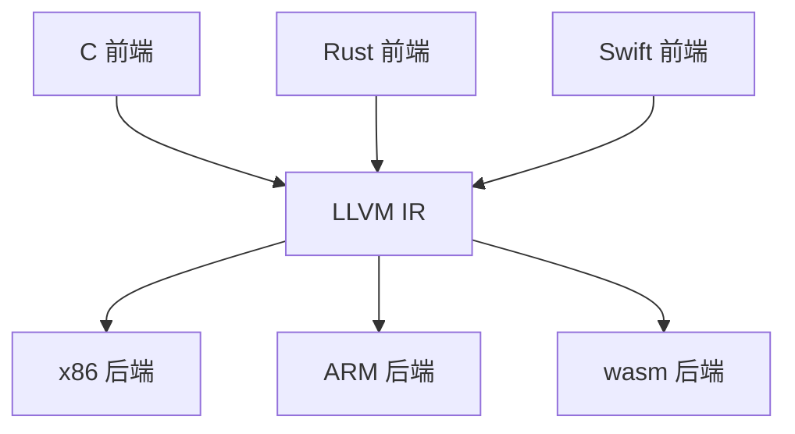
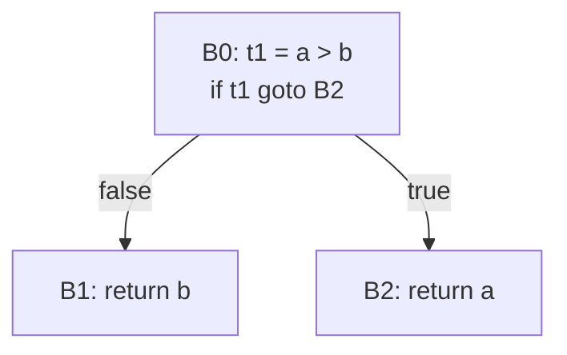

# 中间表示家族：从 AST 到可执行形态

> [返回：第五阶段导览](01-导览.md)
> 对应大纲第 1 条。同一程序的一千种表示：AST、三地址码、CFG、SSA、数据流图。本册用一个函数贯穿全部形态，讲透「降级（lowering）」，并说清 mini 为什么选栈式字节码。

## 为什么需要 IR：m + n 而不是 m × n

m 种语言前端 × n 种目标后端，直接编译需要 **m×n 个完整编译器**；插入统一中间表示后只需要 **m 个前端 + n 个后端**：



LLVM 是这个策略的极致（Clang/rustc/Swift 共享全部后端）；GCC 的 GIMPLE/RTL、V8 的 sea of nodes、JVM 字节码同理。对 mini 而言 IR 还有一层本地价值：**优化（第七阶段）需要一个"贴近机器、可线性遍历、可重写"的形态**——AST 层做优化处处掣肘（树形嵌套、控制流隐式）。

> "m 前端 + n 后端"的 mini 版在 [Wasm 专题](../11-Wasm专题/01-导览.md) 兑现：同一个前端，第二个后端（wasm）。

## 一个函数的五种表示

```ebnf
fn max(a: number, b: number) -> number {
  if (a > b) { return a; }
  return b;
}
```

**① AST**：结构忠实于语法，控制流是"树的形状"（IfStmt 包着 ReturnStmt）。

**② 三地址码（TAC）**：表达式拍平，每条指令至多一个运算、隐式临时变量：

```
t1 = a > b
if t1 goto L1
t2 = b
return t2
L1:
t3 = a
return t3
```

**③ 控制流图（CFG）**：按跳转目标切基本块（块内无跳转），块间有向边：



B0/B1/B2 是基本块，边 = 可能的执行路径。**while 的回边**在 CFG 里就是一个环——第七阶段数据流分析的迭代就沿这些边传播。Dominator（必经节点）等图论概念全部定义在 CFG 上。

**④ SSA**：每个名字只赋值一次，分支汇合插 φ：

```
t1 = a > b
if t1 goto L_else
  r1 = a
  goto L_join
L_else:
  r2 = b
L_join:
  r3 = φ(r1, r2)      ← 按来路取值
return r3
```

return 只剩一条（φ 把两条路"接回一条"），无数优化在 SSA 上变成局部模式匹配（第七阶段展开）。

**⑤ 数据流图 / sea of nodes**：把"计算"与"控制流"拆成两类节点，值的使用-定义直接连边（数据依赖），控制依赖单独一条边链。指令天然无序（只被依赖约束）——V8 TurboFan、Java Graal 用它，调度自由度最大，入门最难。

**mini 的选择**：栈式字节码（下一册详述）——它本质是 TAC 的"栈化变体"（临时变量 t1/t2 变成栈顶），保留 CFG 形态（跳转指令就是显式的边），跳过 SSA（第七阶段的 pass 直接在字节码上做保守版分析）。

## 降级（lowering）：从结构化控制流到跳转

降级 = 把 AST 里"语法糖级别"的结构翻译成 IR 里"机器级别"的等价物。三个代表：

**短路求值**——`a && b` 不是运算符，是控制流：

```
;; a && b 的字节序（result 落在栈顶）
  <编译 a>            ;; 栈: [a]
  DUP; JMP_IF_FALSE L_false
  POP                 ;; a 为真，弹出，继续求 b
  <编译 b>
  JMP L_end
L_false:              ;; a 为假，b 不求值（短路！）
L_end:
```

对照第四阶段：`LogicalExpr` 与 `BinaryExpr` 分列的价值在此兑现——**lowering 阶段两者走完全不同的代码路径**，Binary 是两条指令，Logical 是一段控制流。

**while 循环**——结构化语法 → 「测试 + 体 + 回边」：

```
L_start:
  <编译 cond>; JMP_IF_FALSE L_end
  <编译 body>
  JMP L_start          ;; 回边：CFG 上的环
L_end:
```

**糖的脱壳**：`else if` 链脱成嵌套 if、`for` 脱成 while + 计数器（mini v0.1 没有 for，第八册前无需处理）。降级的总原则：**IR 层不再有任何"语法概念"**——只剩值、运算、跳转。

## 自测

1. 把 `fn abs(x) { if (x < 0) { return -x; } return x; }` 分别写成 TAC 与 CFG（三个基本块）。
2. `a || b` 的字节码结构与 `a && b` 有什么差异？（提示：跳转条件与两条路径上"落栈"的值。）
3. SSA 版 max 里删掉 φ 会发生什么？`return` 该返回谁？
4. 为什么「IR 层不保留语法概念」是降级的铁律？如果 IR 里还有 IfStmt，第七阶段的哪个分析会直接没法做？
