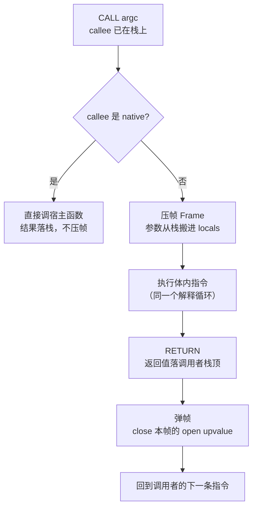

# 解释器实现：栈帧、调用与闭包

> [返回：第五阶段导览](01-导览.md)
> 对应大纲第 3 条。字节码是设计图，解释器是发动机。本册实现完整的执行引擎：解释循环、栈帧与调用约定、闭包 upvalue 的两种方案、内建函数。

## 解释循环：取指-译码-执行

```ts
export class VM {
  private stack: Value[] = [];          // 求值栈（当前帧的"工作台"）
  private frames: Frame[] = [];         // 调用栈（每函数一帧）

  run(proto: FnProto): Value {
    this.frames.push(new Frame(proto)); // 入口帧
    while (this.frames.length) {
      const f = this.frames.at(-1)!;
      const op = f.code[f.ip++] as OpCode;
      switch (op) {
        case OpCode.CONST:      this.stack.push(f.constants[this.readOperand(f)]); break;
        case OpCode.GET_LOCAL:  this.stack.push(f.locals[this.readOperand(f)]); break;
        case OpCode.SET_LOCAL:  f.locals[this.readOperand(f)] = this.pop(); break;
        case OpCode.ADD: {
          const b = this.pop() as number, a = this.pop() as number;
          this.stack.push(a + b); break;
        }
        case OpCode.JMP:        f.ip += this.readOperand(f); break;
        case OpCode.JMP_IF_FALSE:
          if (this.pop() === false) f.ip += this.readOperand(f); break;
        case OpCode.RETURN:     /* 弹帧、返回值已在栈顶 */ break;
        /* ... 34 条各一个 case ... */
      }
    }
    return this.result!;
  }
}
```

形态即血统：`while + switch(code[ip++])` 这一个循环从 CPython（ceval.c）到 JVM 到早期 JavaScriptCore 全是同款——**取指、译码、执行、推进**。教学 VM 的 case 里可以 `as number`（类型由 checker 保证——又是静态类型的红利），生产解释器还要考虑：直接线程化分发（computed goto）、内联缓存（JIT 前奏）、栈溢出保护（frames.length 上限）。

### 一次执行的完整 trace

给循环灌一段真程序，逐指令走一遍——`let i = 0; while (i < 2) { i = i + 1; }`（i 在槽 0，常量池 [0, 2, 1]；字节码沿用 02 册 while 偏移表的产物）：

| 步 | ip | 指令 | 动作 | 求值栈 | locals[0] | frames |
|---|---|---|---|---|---|---|
| 1 | 0 | CONST 0 | 压 0 | [0] | – | 1 |
| 2 | 2 | SET_LOCAL 0 | 弹出存槽 | [] | 0 | 1 |
| 3 | 4 | GET_LOCAL 0 | 压 i | [0] | 0 | 1 |
| 4 | 6 | CONST 1 | 压 2 | [0, 2] | 0 | 1 |
| 5 | 8 | LT | 弹二压一 | [true] | 0 | 1 |
| 6 | 9 | JMP_IF_FALSE 9 | 弹出 true，不跳 | [] | 0 | 1 |
| 7 | 11 | GET_LOCAL 0 | 压 i | [0] | 0 | 1 |
| 8 | 13 | CONST 2 | 压 1 | [0, 1] | 0 | 1 |
| 9 | 15 | ADD | 弹二压一 | [1] | 0 | 1 |
| 10 | 16 | SET_LOCAL 0 | 弹出存槽 | [] | 1 | 1 |
| 11 | 18 | JMP −16 | ip = 20 − 16 = 4 | [] | 1 | 1 |
| 12 | 4 | GET_LOCAL 0 | 第二轮条件 | [1] | 1 | 1 |
| 13 | 6 | CONST 1 | 压 2 | [1, 2] | 1 | 1 |
| 14 | 8 | LT | | [false] | 1 | 1 |
| 15 | 9 | JMP_IF_FALSE 9 | 弹出 false，跳 | [] | 1 | 1 |
| 16 | 20 | （出口） | 字节码走完 | [] | 1 | 1 |

十六步里看不出任何"聪明"——这正是要点：**解释器的全部语义都摊平在"取指-执行-推进"里**，没有隐藏的第三阶段。也注意两列：locals 列显示循环变量只经槽 0 进出，栈只是"运输通道"；frames 列纹丝不动——纯局部循环连压帧都不需要。这张表还顺带验证了 02 册的两条模板：第 6 步与第 15 步是 `JMP_IF_FALSE` 弹栈语义的两次出场（真不跳、假跳）。

### 分发的成本与两条提速路线

`while + switch` 每条指令都要过一次"取指 → 查表跳转"——分发成本是解释器税的大头。生产解释器的两条经典提速路线：

- **直接线程化（direct threading）**：每个操作码的 handler 末尾直接"跳"到下一条指令的 handler（C 里用 computed goto：`static void* table[] = {&&OP_CONST, &&OP_ADD, ...}`），省掉 switch 的查表与循环回跳——CPython 的 ceval.c 在支持的平台就走这条路；
- **指令特化/融合**：运行期发现"这对指令总是连发、且类型不变"就替换成特化版本——CPython 3.11 起的自适应解释器把热字节码在运行期改写成专用指令；HotSpot 的模板解释器则干脆为每条字节码准备一小段汇编模板，分发即直落机器码。

两条路线 mini 都没走——教学版保持 switch 的直白（性能账在 [第七阶段 · JIT 视角](../07-第七阶段/05-JIT视角.md) 再算），但**写 case 的纪律要先立好**：每个 case 自带 `break`、弹压数目与 03 册速查表逐条一致、绝不跨 case 共享栈假设。

### VM 的状态家底

解释循环之外，VM 实例上还挂着几样跨指令存活的状态——它们共同构成"GC 根集合"的雏形（第六阶段）：

| 状态 | 类型 | 谁读写 | 生命周期 |
|---|---|---|---|
| `stack` | 求值栈 | 几乎所有 case | run 全程；RETURN 回退到帧起点 |
| `frames` | 调用栈 | CALL/RETURN | 压帧进、弹帧出；入口帧一路活到 run 结束 |
| `result` | 最终返回值 | RETURN（最后一帧） | 脚本帧 RETURN 时写入 |
| open upvalue 链 | 链表 | CLOSURE 建、RETURN 关 | 随捕获变量的存活期 |
| natives 表 | 内建登记 | NATIVE/CALL | 与 VM 同寿命 |

看这张表的视角要提前换到第六阶段：**哪些状态里的哪些值是"引用"**——stack 上的值、frames 里的 closure、open upvalue 指向的栈槽、盒子本身，全是标记阶段的潜在起点。现在只需要记住"这五样就是 VM 的全部世界"，解释循环再复杂也没有第五样东西。

## 栈帧与调用约定

```ts
class Frame {
  readonly proto: FnProto;
  ip = 0;
  readonly locals: Value[];              // 槽位表（checker 分配的 index 直接用）
  readonly stackBase: number;            // 本帧在全局求值栈的起点
  readonly closure?: Closure;
}

// CALL argc 的语义（调用约定）
case OpCode.CALL: {
  const argc = this.readOperand(f);
  const callee = this.stack.at(-1 - argc) as Closure | Native;   // 栈布局: [callee, arg1..argN]
  if (isNative(callee)) {                                        // 内建：直接调 TS
    const args = this.stack.splice(this.stack.length - argc, argc);
    this.pop();                                                  // 弹 callee
    this.stack.push(callee.fn(...args));
    break;
  }
  const frame = new Frame(callee.proto, /* locals 从栈上搬参数 */);
  this.frames.push(frame);                                       // 压帧即"跳转"
  break;
}
case OpCode.RETURN: {
  const rv = f.closure ? this.stack[this.stack.length - 1] : undefined;
  this.stack.length = f.stackBase;                               // 回退到帧起点
  this.frames.pop();
  if (this.frames.length) this.stack.push(rv);                   // 返回值落调用者栈
  else this.result = rv;
  break;
}
```

三个约定细节：

- **参数压栈 + 入帧搬迁**：调用者把 `[callee, arg1..argN]` 依次压好；被调帧初始化时把参数搬到 `locals[0..argc)`——**栈是"传输协议"，locals 是"命名空间"**，两边解耦。
- **返回值走栈**：RETURN 前把返回值留在栈顶，弹帧后它恰好落在调用者的工作区——零额外协议。
- **递归 = 压帧**：`fib(25)` 的调用深度 25 帧，`frames` 数组就是全部状态——第六阶段 GC 的根集合第一位就是它。

### CALL/RETURN 的生命周期



### 栈布局与一次完整调用的手推

CALL 前后的栈布局（对照上文 `stack.at(-1 - argc)` 的取 callee 手法）：

```text
        ┌─────────┐
argN →  │  argN   │   ← 栈顶
        │   ...   │
arg1 →  │  arg1   │
        ├─────────┤
callee→ │ callee  │   ← at(-1 - argc) 正好摸到这里
        └─────────┘
```

callee 压在参数**下面**的直觉解释：调用表达式先求 callee 再逐个求参数，压栈次序天然如此；而 CALL 的动作是"弹 argc 个参数 → 剩下栈顶恰是 callee"——**callee 的位置由参数个数算出来，不需要第二个指令字段**。把 `at(-1 - argc)` 换算成下标：栈长 L 时 callee 在 `L - argc - 1`——参数个数一变，公式自动跟随。

把自测第 1 题在这里演完——`add(1, mul(2, 3))`（add 与 mul 都是双参用户函数，脚本槽 0 存 add、槽 1 存 mul）：

| 事件 | 求值栈（→ 顶） | frames | 被调帧 locals |
|---|---|---|---|
| GET_LOCAL 0（取 add） | [add] | 1 | — |
| CONST 1（第 1 参） | [add, 1] | 1 | — |
| GET_LOCAL 1（取 mul） | [add, 1, mul] | 1 | — |
| CONST 2 | [add, 1, mul, 2] | 1 | — |
| CONST 3 | [add, 1, mul, 2, 3] | 1 | — |
| CALL 2（mul）：callee = at(−3) | [add, 1]（参数与 callee 出栈，腾出被调帧工作区） | 2 | [2, 3] |
| mul 体：两取数 + MUL | mul 帧内 [6] | 2 | [2, 3] |
| RETURN：rv = 6 落调用者栈 | [add, 1, 6] | 1 | — |
| CALL 2（add）：callee = at(−3) | （add 帧开工） | 2 | [1, 6] |
| add 体：1 + 6 | add 帧内 [7] | 2 | [1, 6] |
| RETURN：rv = 7 | [7]（整个表达式的值） | 1 | — |

三个读数：**栈深峰值 5**（内层 CALL 前那一瞬）、**帧深峰值 2**（任意时刻最多"脚本 + 一个被调函数"）、mul 与 add 从不重叠——参数表达式求值完毕才有外层 CALL。把表达式改成 `add(mul(1, 2), mul(3, 4))` 重走一遍，帧深峰值才会爬到 3：**嵌套的深度由"参数表达式里的调用"决定，不是由函数数量决定**。

### 帧深上限与运行时错误的去路

两件"循环之外"的机器事务，05 册落地时补齐，这里先把机制想清：

- **帧深上限**：`frames.length` 超过上限（05 册取 512）抛 RuntimeError——死递归 `fn f() { return f(); }` 每次调用净增一帧，512 次后触顶。上限保护的不是内存（TS 数组自己会撑爆），而是**报错的可读性**：与其等宿主抛出无法定位的调用栈溢出，不如在 VM 层给出"调用链最后 10 帧"的回溯。对照：fib(25) 的最大帧深是 26（脚本帧 + 25 层递归）——数学事实，离 512 很远，三件套用例因此能安心跑；
- **运行时错误的去路**：除数为零这类错误在 case 里以异常抛出——VM 不逐指令检查错误码，异常直接把整个 run 调用撕开；05 册的 RuntimeError 在撕开前收集沿途每帧的 `proto.name` 与源码位置，打印成主流解释器的样子（`at fib (fib.mini:3:14)`）。取舍在于：**异常路径不维护栈一致性**（出错的程序反正要死），但**正常路径的每个 case 必须把栈进出配平**——错误模型反过来定义了正常路径的纪律。

## 闭包：函数值 = 代码 + 环境

`Closure { proto, upvalues }`——CLOSURE 指令执行时，按 `proto.upvalueDesc` 捕获外层变量，捕获名单来自第四阶段的自由变量分析（引用边表的直接消费）。

**两种 upvalue 实现**：

**方案 A：环境链（简单）**

```ts
Closure { proto, env: Map<string, Value> | Frame }
// 访问自由变量：沿 env 链上溯查找（每次访问 O(链深)）
```

每个闭包持有"定义时作用域"的引用；实现 30 行，但每次 `GET_UPVALUE` 都要查表——计数器闭包（热路径）性能难看。

**方案 B：拆盒（Lua 方案，mini 采用）**

```ts
interface Upvalue {
  location: { stack: number } | { closed: Value };   // open: 指向栈槽; closed: 已搬进盒子
}
Closure { proto, upvalues: Upvalue[] }
```

- **open 状态**：被捕获变量还在某个活跃栈帧上，upvalue 直接**指向那个栈槽**——读写与局部变量同速。
- **close 时机**：持有该变量的帧 RETURN 时，把栈槽的值**拷进盒子**（location 变 closed）——"变量逃出了自己的作用域"。
- VM 维护一条 **open upvalue 链表**（按栈槽地址排序）：close 时沿链把所有指向该帧的 upvalue 逐个关掉。

```ts
case OpCode.GET_UPVALUE: {
  const uv = f.closure!.upvalues[this.readOperand(f)];
  this.stack.push(uv.location.stack !== undefined
    ? this.stack[uv.location.stack]           // open：读栈槽
    : uv.location.closed);                    // closed：读盒子
  break;
}
```

方案 B 的三个红利：访问 O(1)、变量按值拷贝语义清晰（帧弹出不影响闭包）、第六阶段 GC 只需扫描盒子（不用扫描死帧）。代价是 close 逻辑——**教学界公认最难的 100 行**，Lua 论文（The Implementation of Lua 5.0 §5）是权威参照。

### 方案对读一张表

| | 方案 A（环境链） | 方案 B（拆盒，Lua） |
|---|---|---|
| 自由变量访问 | 沿链上溯查表，O(链深) | open 读栈槽 / closed 读盒子，O(1) |
| 捕获时机 | 闭包创建时整环境引用 | CLOSURE 时按名单逐个建 Upvalue |
| 多闭包共享语义 | 外层 env 被共享 → 天然"引用" | 同一栈槽的捕获者共享同一个 Upvalue → 同一盒子 |
| 帧弹出后 | env 若被引用则连带存活 | close 把值拷进盒子，栈槽归位 |
| GC 视角 | 闭包连带整条环境链可达 | 只扫盒子，死帧不拖活变量 |
| 实现量 | 约 30 行 | 拆盒 + open 链 + close 时机，"教学界公认最难的 100 行" |

第三行的两侧值得并排读：方案 A 的"引用语义"是买环境时**自带的**，方案 B 要靠"同槽共享 Upvalue"才能拿到同样语义——同一个函数里若有两个闭包都捕获 n，它们必须看到**同一个 n**：Lua 方案里两者的 upvalues[0] 是**同一个 Upvalue 对象**（open 链表按栈槽地址查重，同槽只建一次），close 时也只有一个盒子。这就是自测 3 的答案提前剧透：**盒子数 = 被捕获的槽位数，不是捕获者个数**。

### 计数器闭包的一生：open → close 的完整时间线

拿 05 册验收用例 ② 走一遍（`counter()` 返回一个捕获 n 的闭包）：

| 事件 | n 的所在 | upvalue 状态 |
|---|---|---|
| `counter()` 被调，n = 0 落槽 | counter 帧 locals | 尚无 upvalue |
| 体执行到返回函数字面量 → CLOSURE | counter 帧 locals | **open**：Upvalue 指向 counter 帧的栈槽 |
| counter RETURN | 槽即将随帧消失 | **close**：值拷进盒子，location 变 closed |
| `c()` 第一次 | 盒子里 | closed：GET_UPVALUE 读盒、SET_UPVALUE 写盒 → n 变 1 |
| `c()` 第二次 / 第三次 | 盒子里 | 1 → 2 → 3，盒子是唯一真身 |
| 再调一次 `counter()` | 新帧新槽 | 新 Upvalue、新盒子 → **独立计数器** |

时间线上最险的一步在第二、三行之间：**CLOSURE 发生在 counter 还活着的时候**，upvalue 指向的是栈上真槽——如果 close 忘了做（或做晚了），c() 读到的是"已弹帧的栈槽"，那是悬垂内存的 VM 版。方案 B 的 close 逻辑全部服务于这一步的正确性；最后一行的"新调用新盒子"则是验收清单里"两次调用产生独立计数器"的机制出处。

### open 链的两个操作：find-or-create 与 close-all

"VM 维护一条按栈槽地址排序的 open upvalue 链表"展开成两个动作：

- **CLOSURE 时 find-or-create**：为描述表里的每个捕获项，先在 open 链上查"有没有已经指向这个栈槽的 Upvalue"——有就直接复用（这就是"同槽只建一次"、多闭包共享一个盒子的来源），没有才新建并按地址插入链；
- **RETURN 时 close-all**：沿链扫一遍，把所有指向**本帧**栈槽的 upvalue 逐个 close（值拷进盒子、location 换成 closed、从链上摘除）——链按地址排序，所以"本帧的范围"是一段连续区间，扫到边界即可停。

两个操作的复杂度都压在"链有序"这个前提上：无序就得全链扫，有序则 find 与 close 都是"找到位置即停"。这也是为什么栈槽地址能当排序键——**栈是连续的，槽位号天然有序**；把它换成 Map<string, Upvalue>（方案 A 的味道），共享语义还能保住，但 close-all 退化成全表过滤。

## 内建函数：运行时调用编译产物

```ts
const natives: Record<string, Native> = {
  print:  { arity: 1, fn: (v) => { console.log(showValue(v)); return UNIT; } },
  clock:  { arity: 0, fn: ()  => performance.now() },
  str:    { arity: 1, fn: (v) => showValue(v) },
  // 数组（v1.1）：push/map/filter —— filter 的谓词是 mini 闭包：native 里回调 VM！
};
```

逐个登记项过一遍：

| 内建 | arity | 返回 | 要点 |
|---|---|---|---|
| print | 1 | UNIT | `showValue` 负责"值 → 可读串"的统一渲染；返回 UNIT 是 ExprStmt POP 的合规输入 |
| clock | 0 | number | 毫秒级时间戳——本阶段唯一的测量入口（耗时对比全靠它） |
| str | 1 | string | 与 print 共用渲染，但不打印、返回串——拼接调试的帮手 |
| 数组族（v1.1） | 各异 | 数组/新数组 | push 原地改、map/filter 造新数组；filter 的谓词走反向调用 |

三个共同点值得注意：**arity 是合同**（CALL 的参数个数对不上就是编程错误，要么报错要么按 checker 的约束前置拒绝）；**返回值一律按"压一个值"结算**（UNIT 也是值——语句级的调用结果有人收，栈才平衡）；**它们不碰 VM 的内部状态**（不偷读 frames/stack）——内建是"经由栈协议进出的黑盒"，这个边界让第六阶段把它们当普通调用者对待。

内建与用户函数共用 CALL 指令、共用栈协议——**"运行时"与"编译产物"在调用约定层统一**。`map/filter` 是分水岭案例：native 函数内部要**反向调用 mini 闭包**（构造 CALL 的栈布局、压帧、run）——从这里开始体会"运行时系统"四个字的重量。

### 反向调用的完整动作序列

以 `filter(list, pred)` 的一次谓词调用为例，native 内部要做五步：

1. **备栈**：把 `[pred, elem]` 按调用约定压上求值栈（callee 在下、参数在上——与手写 CALL 一模一样）；
2. **压帧**：`new Frame(pred.proto)`，参数搬 locals，frames.push；
3. **跑循环**：复用**同一个**解释循环直到 RETURN——不是另起一个 VM 实例，而是在当前执行流里继续推进（栈与 frames 是同一个）；
4. **收值**：RETURN 后栈顶就是谓词结果，native 拿它决定本轮元素留否；
5. **续外层**：解释循环从 native 返回点继续——外层遍历的进度一拍没丢。

第 3 步的"同一个循环"是关键设计：native 与用户函数共用一套栈协议，意味着**递归深度、帧深保护、错误回溯对两种调用一视同仁**——如果 native 另起炉灶，这三样全要重复实现。代价是 native 回调是同步的（谓词没跑完，filter 不能继续）；要异步就得把整个循环改成事件驱动——生产引擎的路，教学 VM 不走。

`clock` 的存在感也要点一下：它是本阶段唯一的"测量入口"——05 册验收里 fib(25) 的耗时区间就是拿它量的。VM 自带计时内建这个小事，让第七阶段做优化收益对比时**不用换测量工具**。

## 解释器的开销解剖：慢在哪一步

栈式解释器每条指令的固定开销，拆成四笔账：

| 开销项 | 每条指令发生几次 | mini 里的形态 |
|---|---|---|
| 取指与分发 | 1 次 | `f.code[f.ip++]` + switch 查表 |
| 栈进出 | 常见 1~2 次 | push / pop 的数组读写 |
| 操作数读取 | 0~1 次 | `readOperand` |
| 缓存与分支预测压力 | 持续 | 指令流与栈是两块热内存 |

`1 + 2 * 3` 要走 5 条指令才出一个数——每条指令都在付这四笔的固定开销。这笔账解释了三件事：为什么动态语言的解释执行明显慢于编译型语言（每条字节码都全额付税）；为什么 JIT 的第一步是**把指令流翻译成无分发的直线代码**（税一次性付清，见 [第七阶段 · JIT 视角](../07-第七阶段/05-JIT视角.md)）；为什么特化解释器（如 CPython 3.11 起的自适应路线）先砍"分发次数"（融合指令）而不是先上 JIT。mini 的教学立场：**先让 34 条 case 全对，再谈快**——本阶段的目标是行为正确与可调试。

## 常见误区

- **"解释循环里有魔法"**——没有：取指、译码、执行、推进，四步对每条指令都一样；难的不是循环，是 upvalue 的 close 与栈平衡纪律；
- **"CALL 就是压帧"**——CALL 是一整套约定：callee 定位（`at(-1-argc)`）、参数搬迁（栈→locals）、native 与用户函数分流；漏任何一步，下一帧的 locals 就是错的；
- **"upvalue 是变量的拷贝"**——open 状态下它指向**栈槽本体**，读写的是原变量；只有 close 才拷值。当成"按值捕获"实现，两个闭包就会各改各的副本——语义直接错；
- **"close 是 GC 的事"**——close 是解释器的事（RETURN 时触发），GC 只负责回收盒子；第六阶段给盒子挂上 Obj 头后，close 时机仍是 VM 的责任（对照 [第六阶段 · 运行时对象模型](../06-第六阶段/02-运行时对象模型.md)）；
- **"native 函数是二等公民"**——它走同一个 CALL、同一个栈协议、同一套回溯；map/filter 的反向调用更是把它变成"运行时的一部分"。把 native 写成旁路（不走栈协议），帧深保护与错误处理会同时失效；
- **"栈失衡是 VM 的 bug"**——多数时候是 emit 侧的 bug（少发一个 POP、跳转绕过了配对指令），VM 只是第一个受害者。排查口诀：先 dis 对拍字节码，再看 VM case 的弹压数目——顺序不能反；
- **"帧深上限 512 是性能参数"**——它只服务报错可读性与失控保护；正常递归深度由算法决定（fib(25) 只到 26 帧），调大上限不会让合法程序更快。

## 与其他册的连接

- 指令的栈效果契约（case 纪律的依据）：[03-字节码设计](03-字节码设计.md)；
- emit 侧的两条栈不变式与跳转回填：[05-实践-编译器VM与REPL](05-实践-编译器VM与REPL.md)；
- 捕获名单的来源（自由变量分析）：[第四阶段 · 符号表与作用域](../04-第四阶段/02-符号表与作用域.md)；
- 盒子成为 GC 对象、根集合里的 frames：[第六阶段 · 运行时对象模型](../06-第六阶段/02-运行时对象模型.md)、[第六阶段 · 垃圾回收深入](../06-第六阶段/03-垃圾回收深入.md)；
- 解释器税的账单与 JIT 的回收方式：[第七阶段 · JIT 视角](../07-第七阶段/05-JIT视角.md)；
- 另一类解释器的整册对照（元循环、Forth 栈机）：[演练场 · Lisp 元循环解释器](../09-演练场/02-Lisp元循环解释器.md)、[演练场 · Forth 栈机与字典](../09-演练场/03-Forth栈机与字典.md)。

## 自测

1. 画出 `add(1, mul(2, 3))` 执行期的完整事件序列：压栈 → CALL mul → RETURN → CALL add → RETURN，标出每步 stack 与 frames 的深度。
2. 调用约定为什么把 callee 压在参数**下面**？（提示：CALL 弹 argc 个参数后，callee 恰好在栈顶。）
3. open upvalue 什么时候 close？如果 close 时有**两个**闭包捕获了同一个变量，盒子有几个？
4. 方案 A 的环境链在 `f() { let x = 0; return () => ++x; }` 里，第二次调用 `f()` 会发生什么？（每次新 env，两个独立计数器——与拆盒方案行为一致吗？）

（5~10 为扩写增补题，答不出就回到对应小节的推演再读一遍。）

5. 复述 16 步 trace：第 6 步 `JMP_IF_FALSE` 为什么不跳？第 11 步 `JMP −16` 的 −16 是怎么算出来的？
6. `add(1, mul(2, 3))` 手推表里栈深峰值出现在哪个事件、为什么？改成 `add(mul(1, 2), mul(3, 4))`，帧深峰值变多少？
7. CALL 用 `at(-1 - argc)` 定位 callee——这个公式为什么依赖"callee 压在参数下面"的次序？次序反过来公式会变成什么？
8. 两个闭包捕获同一个变量：方案 B 里它们共享几个 Upvalue、几个盒子？靠哪条机制做到"同槽只建一次"？
9. counter 时间线上，如果 counter 的 RETURN 忘了 close，`c()` 第一次调用会读到什么？"悬垂内存的 VM 版"指的是什么？
10. filter 的反向调用五步里，哪一步依赖"native 与用户函数共用栈协议"？如果 native 另起一个 VM 实例跑谓词，哪三样保障会失效？
