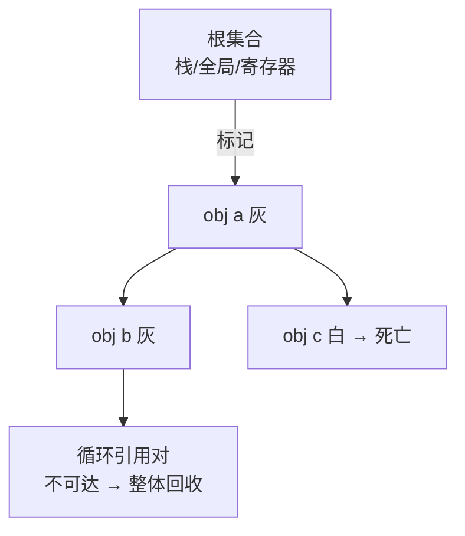

# 第六阶段导览：运行时与内存管理

> [返回：编译原理学习大纲](../编译原理学习大纲.md)
> 本文是第六阶段的入口：阶段目标、知识点地图、实践任务清单与阶段自测。

**建议时长**：2 周（每天 1~2 小时）。上一阶段 VM 里所有对象"只生不死"——本阶段补上运行时的另一半：值的表示与垃圾回收。理论对照 V8，动手实现一个能通过循环引用测试的标记-清除 GC。

## 阶段目标

学完本阶段，你应该能不查资料做到这些事：

1. 说清 tagged pointer 与 NaN-boxing 两种值表示的原理与取舍。
2. 给 VM 实现标记-清除 GC：根集合枚举、对象图遍历、空闲链表分配。
3. 构造循环引用用例，证明追踪回收不泄漏、朴素引用计数会泄漏。
4. 解释分代假说、写屏障、三色标记，并能读懂 V8 `--trace-gc` 的输出。

## 知识点地图

### 1. 运行时对象模型

- **值的表示困境**：动态类型语言的"值"是 `number | string | bool | object | ...`，怎么装进一个机器字？
  - tagged pointer：低位标记类型（0 = 数值、1 = 指针），数值直接移位内联——V8 31 位小整数（Smi）即此。
  - NaN-boxing：IEEE754 双精度中 NaN 的 2^51 种位模式"借"出来装指针与其他值——LuaJSC、JavaScriptCore 用。
  - 胖指针：`{ type, value }` 结构——mini VM 用这个（简单），但要明白性能差异在哪。
- **字符串内部化（interning）**：相同字符串共享同一对象，等值比较退化为指针比较；驻留池本身是 GC 的一个根。
- **面向对象机制（选做）**：方法表（vtable）+ 对象头；继承 = 原型链或类链；late binding = 方法调用经表间接寻址。`class` 语法糖脱糖到"构造函数 + 原型"是 JS 的经典案例。

### 2. 垃圾回收深入

- **可达性定义**：从根集合（栈、全局表、寄存器、内建对象）出发沿引用边可达 = 活；不可达 = 死。这是所有追踪 GC 的公理。
- **引用计数（RC）**：赋值即增减计数，零即回收——即时、简单，但**循环引用死锁**（a→b→a 计数永不归零）；Python 用 RC + 周期检测器补救。
- **标记-清除**：两阶段——标记（从根 DFS/BFS 标灰）、清除（线性扫描堆，未标记者入空闲链表）。外碎片化是缺点。
- **标记-整理 / 复制式**：整理把活对象压到一端（解决碎片但移动成本高）；复制式半空间翻转（from/to 两半空间对调，活对象拷贝过去，分配 = 指针递增，极快但空间利用率 50%）。**移动对象 = 所有引用要改写**——这是它们复杂度的来源。
- **分代假说**："多数对象朝生暮死"。新生代用复制式（小而快），晋升者进老生代用标记-整理（大而稳）。写屏障记录"老→新"引用，保证 minor GC 不用扫全堆。
- **增量 / 并发与三色标记**：白（未访问）灰（已访问、子未扫完）黑（子全扫完）；不变式"黑不指白"靠屏障维持——增量 GC 与主线程交替、并发 GC 走工作线程，把 STW 停顿摊薄。
- **V8 实测**：`node --trace-gc` / `--max-semi-space-size` 观察 Scavenge（新生代）与 Mark-Compact（老生代）；Chrome DevTools Memory 面板抓堆快照找泄漏。

## 与 mini 语言项目的关系

交付 VM 的对象系统改造：所有堆对象挂到 GC 链表（分配时登记），VM 栈与全局表注册为根。`alloc()` 触发"字节数超阈值即 GC"。循环引用用例（两个对象互指后置 null）验证内存归还——这是"造引擎"的收官动作。

## 实践任务清单

- [ ] 任务 0：对象头设计（type、mark 位、next 指针）；分配器 + 全堆链表。
- [ ] 任务 1：标记阶段——根枚举（VM 栈、全局表、驻留池、开放 upvalue）+ DFS 标记。
- [ ] 任务 2：清除阶段——链表遍历摘除死对象；`--trace-gc` 风格日志（分配量/存活量/耗时）。
- [ ] 任务 3：循环引用用例（构造 → 断根 → 强制 GC → 内存归还）+ 内存回归测试。
- [ ] 任务 4：用 `node --trace-gc` 跑一段"高频创建临时对象"的 JS，识别 Scavenge 与 Mark-Compact，写分析笔记。
- [ ] 选做：复制式新生代（半空间翻转）替换标记-清除，对比吞吐。

## 阶段自测

- [ ] 能画出"循环引用 a↔b 置 null 后"RC 与标记-清除各自的内存状态。
- [ ] 能解释为什么复制式分配快（指针递增）而标记-清除分配慢（空闲链表查找）。
- [ ] 能说清写屏障在"老生代对象引用新生代对象"场景里记录什么、给谁用。
- [ ] 能解释三色标记为什么需要"黑不指白"不变式，违反会发生什么（漏标 = 活对象被回收）。
