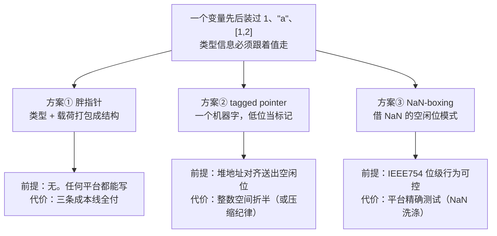

# 运行时对象模型：值怎么装进一个字

> [返回：第六阶段导览](01-导览.md)
> 对应大纲第 1 条。GC 之前先回答一个更基础的问题：动态类型语言的"值"——number / string / bool / 对象 / 闭包——在内存里到底长什么样？答案决定分配器、比较运算、乃至 GC 的形态。本册讲三种值表示（胖指针 / tagged pointer / NaN-boxing）与字符串驻留，并给 mini VM 落地对象头——它是下一册 GC 的地基。

## 值的表示困境

静态类型语言里 `double` 就是 64 位、指针就是 64 位，变量的形状编译期已定。动态类型语言的同一个变量先后装过 `1`、`"a"`、`[1,2]`——**类型信息必须跟着值走**。三条出路：

```ts
// ① 胖指针：类型与值打包成结构（mini VM 的起点）
type Value = { kind: 'num'; v: number } | { kind: 'str'; v: StrObj } | /* ... */;

// ② tagged pointer：一个机器字，低位当类型标记
//    末位 0 → 小整数（高位直接是数），末位 1 → 堆指针

// ③ NaN-boxing：一个机器字，借 IEEE754 NaN 的空闲位模式装类型 + 载荷
```

### 三条隐藏的成本线

三种方案没有"谁绝对快"，快的都是**成本线的落点不同**。任何值表示都要付三笔账，把账本摆开，后面的每个小节都在回答"这条线落在了哪"：

| 成本线 | 每次发生点 | 胖指针 | tagged pointer | NaN-boxing |
|---|---|---|---|---|
| **类型判别** | 每次分派、比较、内建分派 | 读 `kind` 字段（多一次内存访问） | 位与（寄存器内完成） | 位段比较（寄存器内完成） |
| **拆箱** | 每次算术/取值 | 解引用载荷 `v` 再算 | Smi 移位即算；非 Smi 解引用 HeapNumber | 非 NaN 位模式直接算 |
| **装箱/分配** | 每次造新值 | 结构本身就是一次分配 | 放不下的数才进堆（HeapNumber） | 需要堆的类型才进堆 |

读法：胖指针把三条线全付在"最贵"的路径上（内存访问）；两种单字方案把判别压进寄存器，差别在**拆箱**——NaN-boxing 让 double 走零拆箱快车道，tagged pointer 让整数走零分配快车道。**哪条快车道该给谁，取决于语言的负载以什么值为主**——这是本册末尾选型决策的种子。

### 设计空间的一张地图



三个"前提"就是三节的展开顺序：胖指针没有前提（所以它是起点）、tagged pointer 靠对齐红利（所以要看对齐从哪来）、NaN-boxing 靠位级纪律（所以要看坑在哪）。

## 胖指针：先跑对，再跑快

mini 的 `Value` 是 discriminated union（第四阶段 [ADT 分册](../04-第四阶段/06-代数数据类型与模式匹配.md)的又一次出场）：`kind` 是 tag，载荷跟在后面。优点是**直白**——TS 的 `switch (v.kind)` 窄化、每种值一个分支；代价是每次装箱都要分配一个结构（`{kind:'num', v:1}` 本身就是个小对象），两个胖指针判等要解引用比载荷。

教学 VM 止步于此完全合理；但要知道真实 VM 在省什么：**值表示是运行时性能的第一杠杆**——数组遍历里每个元素省一次解引用，累积起来就是两倍吞吐。

### 一次判等的手推：胖指针的代价在哪一步

`a === b` 在胖指针表示下的完整路径（设 a、b 都装着数字 1）：

| 步 | 动作 | 访存 | 结论 |
|---|---|---|---|
| 1 | 读 `a.kind` 与 `b.kind`，判别是否同类型 | 2 次内存访问 | kind 不同 → 直接不等 |
| 2 | kind 相同（都是 `'num'`），解引用 `a.v` 与 `b.v` | 2 次内存访问 | 载荷就在结构体里 |
| 3 | 比较两个 double | 0 次（寄存器） | 相等 |

三步里两步是访存——胖指针的"每次比较都贵"不是修辞，是步骤 1、2 的两次解引用。对照后文驻留串的指针比较（一次都不用解载荷），再看 tagged pointer 的整字比较——**同一种语义（相等），三种表示给三种价格**。这组对照是本册的主线：表示方案就是"把哪条成本线搬到哪"的决策书。

### 什么时候胖指针反而是对的选择

三条成本线全付不代表它没有长处：

- **实现直白**：每个分支窄化明确，调试器里看 Value 一眼知道是什么——教学 VM 与原型阶段的全部价值；
- **扩展无痛**：加一种值（比如 MAP）就是加一个 union 成员 + 一个 switch 分支，ADT 穷尽性检查兜底（第四阶段纪律）——单字方案的扩展要重新分配位空间；
- **没有平台前提**：对齐、IEEE754 位级行为都不依赖——跨平台的最稳起点。

所以 mini 的路线是"胖指针跑对 → 瘦身提速"（本册末节），而不是一步到位。**先跑对再跑快不是妥协，是顺序**——表示升级是手术，手术要有基准（第五阶段的 golden 输出）护着。

## tagged pointer：低位标记

64 位系统上堆对象地址按 8 字节对齐——**低 3 位恒为 0**，白送 3 位标记空间。最常用的方案占 1 位：

```text
…… xxxxxxxxxxxxxxxxxxxxxxxxxx xxxxxxx0   末位 0：Smi，高位 = 整数值（补码）
…… xxxxxxxxxxxxxxxxxxxxxxxxxx ppppp1   末位 1：指针 = 真地址 + 1（用前减 1）
```

- **小整数免费内联**：V8 的 Smi（Small Integer）正是这个——31 位（32 位机）或 32 位（64 位压缩指针下）整数**不进堆**，比较即整字比较、加法即移位后相加。
- **界限**：放不下的数退化为堆上的 HeapNumber 对象（一个对象头 + 8 字节 double）。`{x: 1, y: 2}` 全 Smi 是轻装；`{x: 1.5}` 就多一次堆分配——值表示解释了"JS 对象里为什么小整数便宜"。
- **指针压缩**（V8 现代默认）：堆限制在 4GB 内，指针只存 32 位偏移——Smi 空间回满 31 位，缓存局部性还更好。**用空间纪律换表示效率**。

### Smi 算术的手推：1 + 2 在标记字上怎么走

用上图的抽象模型（末位 0、数值放高位）走一遍 `1 + 2`——关键在**标记位全程不用碰**：

| 步 | 动作 | 字上的样子 |
|---|---|---|
| 1 | 值 1 入字：左移一位留出标记位 | `…0010`（末位 0） |
| 2 | 值 2 入字：同上 | `…0100`（末位 0） |
| 3 | 加法：两个标记字**直接整字相加** | `…0110` |
| 4 | 结果解释：末位自动是 0（两个偶数之和必为偶数）——标记位天然完好 | 数值 = `…0110` 右移一位 = 3 |

第 4 步是整个方案的精妙处：**所有 Smi 左移一位后相加，标记位在算术下自动保持**（`(a<<1)+(b<<1) === (a+b)<<1`），加法器不需要"先拆标记再装回去"。比较同理：左移保序，两个标记字的整字大小顺序与数值顺序一致——这就是"比较即整字比较"的全部机制。

溢出才是这条快车道的边界：两个大 Smi 相加超出数值域时，高位进位会污染数值——此时退化为堆上的 HeapNumber 路线。**快车道不是没有闸口，闸口是溢出检查**——真实引擎在加法后检查结果是否仍是合法 Smi，失败则走慢路径。这条"快路径 + 失败退慢"的结构与第七阶段 JIT 的"推测优化 + 去优化"同构，只是粒度从整个函数缩小到一次运算。

### 1.5 的账单：从值表示到 GC 的连锁反应

"`{x: 1.5}` 就多一次堆分配"值得把账单列全——因为这笔账最后会落到 GC 头上：

| 项 | `{x: 1}`（Smi） | `{x: 1.5}`（HeapNumber） |
|---|---|---|
| 值本身 | 内联在属性槽里，0 字节额外 | 对象头 + 8 字节 double |
| 分配 | 无（写槽即完成） | 一次堆分配（挂进全堆链表） |
| GC 视角 | 标记器扫属性槽时不追它 | 标记器把它当堆对象标记、清扫器管它生死 |
| 判别 | 位与即知 | 解引用对象头 |

三行对比读出一条链：**值表示决定分配次数，分配次数决定 GC 的工作量**。同一个对象字面量，全 Smi 版本几乎不给 GC 添活；一个 1.5 就多一个"要标记、要清扫、要占字节预算"的堆对象——下一册 `alloc()` 里 `bytes += size` 与超阈值触发 GC，收的正是这类账。这也是"循环里 `let x = i * 1.5` 为什么值得警惕"的底层解释：每次迭代都可能造一个 HeapNumber，分代假说里的"朝生暮死"批量来自这里。

### 指针压缩的账：纪律换效率的完整样板

"堆限制在 4GB 内，指针只存 32 位偏移"不是一个开关，是一整套纪律的接收：

- **谁守纪律**：所有堆内引用都改成 32 位偏移（相对压缩基址），只有堆外（栈、寄存器）才允许完整 64 位——边界内外两套表示，进出边界时解码；
- **买到什么**：一半的指针内存（缓存局部性还更好，一句已给）；同时 Smi 在压缩位宽下拿回 31 位数值域——**压缩不是单纯省内存，它重新分配了"地址空间 vs 数值空间"的位预算**；
- **付什么**：4GB 堆上限是硬约束（超限的负载没得选）；每次解引用多一步偏移换算。

对照 NaN-boxing 的"借位"与 Smi 的"借位"：三种方案本质都在做同一件事——**把 64 位这个预算拆成"数据 + 元数据"两份，怎么拆由负载说了算**。没有哪个拆法是免费的，只有哪个拆法与你的负载匹配。

## NaN-boxing：一个字装下 double 或指针

IEEE754 的 double 有 2^51 种位模式全是 NaN（指数全 1、尾数非零）——**真实程序几乎只用其中一种**（canonical NaN），其余全是空房间。LuaJIT、JavaScriptCore 的方案：

```text
63        51 50                 0
┌───────────┬────────────────────┐
│ 11111111111 │ tag │   payload   │   ← NaN 区域：tag 区分类型，payload 装指针/整数/bool
└───────────┴────────────────────┘
其余所有位模式 ──────────────────→  合法 double，直接就是数值
```

- **double 零成本**：不是 NaN 的位模式**就是**数值本身，算术路径无拆箱。
- **指针塞进 payload**：47 位有效地址 + tag，一个字内完成"值或引用"的判别。
- **坑**：不同平台 canonical NaN 不一致（sign 位、quiet bit 的差异），传值经过 FPU 寄存器可能被"洗"成 canonical——把藏着的指针洗掉。所以装箱/拆箱例程要平台精确测试。
- **谁选它**：寄存器紧张、双精度密集的 VM（LuaJIT、JSC 的 64 位版本）；V8 选的是 tagged + 压缩路线。**同一个问题的两种工程解**，都值得会。

### 位段判别：一张表说清"看哪几位"

NaN-boxing 的类型判别全部发生在位段上，把"看哪几位"整理成表：

| 位段 | 读数 | 含义 |
|---|---|---|
| 指数域（11 位） | 非"全 1" | 合法 double——**整个字就是数值，直接参与算术** |
| 指数域 | 全 1 且尾数非零 | NaN 空房间——按 tag 位段判别具体类型 |
| tag 位段（NaN 区内） | 各类型各有约定 | 指针（47 位有效地址）/ 整数 / bool / null … |

注意第一行的重量：**double 是"默认区"**，指针与其它类型住在"空房间"里。这个默认方向的选法有讲究：数值运算（四则、比较）是解释器最热的路径，让它们零判别零拆箱，等于把最热的路径完全交给硬件——判别成本只压在"跨类型"的操作（装箱、分派）上。tagged pointer 的默认区是整数（Smi），两者是对称的设计：**默认区给谁，谁的操作就免费**。

### NaN 洗涤的完整机理与测试纪律

"传值经过 FPU 寄存器可能被洗成 canonical"展开成一条事故链：

1. 装箱：把指针 payload 塞进 NaN 区的一个非 canonical 位模式；
2. 途中：这个字被装进 x87/SSE 寄存器当 double 用过一次（哪怕只是别的代码的寄存器分配巧合）——FPU 对 NaN 做规范化，sign 位与 quiet bit 被平台按自己的 canonical 约定改写；
3. 回来：位模式已经不是装箱时放进去的那个——**指针 payload 被无声改写**，解引用即灾难。

它的阴险在于**无报错**：不是崩溃在装箱处，而是崩在很久之后的一次解引用。所以纪律是三条：

- 装箱/拆箱只用整数指令（位运算），**永不把装箱值过 FPU**；
- 平台精确测试：每个目标平台的 canonical NaN 形状都要实测（sign/quiet bit 的差异表就是测试用例清单）；
- 能用整数寄存器传就不走 double 路径——VM 的调用约定要为"装箱值的传播通道"负责。

这层"平台差异要用测试钉住"的纪律，与 04 册"越界给足上下文再兜"是同一族工程观：**不确定的层，用确定性检查把它圈住**。

三种表示一张表：

| | 胖指针 | tagged pointer | NaN-boxing |
|---|---|---|---|
| 一个值占 | 16 字节（结构）+ 可能的堆分配 | 8 字节 | 8 字节 |
| 数值运算 | 解引用两次 | Smi 移位即算；非 Smi 解引用 | 非 NaN 直接算 |
| 类型判别 | 读 `kind` 字段 | 位与 | 位数比较 |
| 实现复杂度 | 最低 | 中（对齐、压缩） | 高（平台位级细节） |

### 选型的决策顺序

三张表看完，选型不是"挑最快的"，是按顺序问四个问题：

1. **负载以 double 为主吗**：是 → NaN-boxing 的零拆箱快车道收益最大（LuaJIT 的数值密集场景）；整数/引用为主 → tagged pointer 的 Smi 路线更稳；
2. **目标平台矩阵多大**：跨多平台多 FPU → NaN-boxing 的平台精确测试成本按平台数翻倍；平台可控 → 位级细节可锁定；
3. **堆上限政策是什么**：能接受 4GB 纪律 → tagged + 压缩；要满地址空间 → 不压缩或 NaN-boxing；
4. **处在什么阶段**：原型/教学 → 胖指针，先跑对；量产且数值密集 → 再动表示手术。

mini 的路线就是第 4 问的答案：胖指针起步（第五阶段）、本册末节瘦身——**表示升级放在"跑对"之后，永远**。

## 字符串内部化（interning）

标识符比较是编译器最热的循环之一。`if (a === b)` 逐字符是 O(n)；若**保证相同内容的字符串全程序只有一个对象**，等值比较退化为指针比较——这就是驻留（interning）：

```ts
class StringPool {
  private table = new Map<string, StrObj>();     // 内容 → 对象
  intern(s: string): StrObj {
    let o = this.table.get(s);
    if (!o) this.table.set(s, o = { type: ObjType.STR, chars: s, hash: hash32(s) });
    return o;
  }
}
```

三条工程边界：

- **谁进池**：标识符、关键字、常量池字符串（编译期已知）全驻留；**运行期拼接结果默认不驻留**（`"a"+x` 结果千变万化，驻留就是哈希表的无限膨胀），提供显式 `intern()` 内建按需收。
- **驻留池是 GC 根**：池子永远可达 → 驻留字符串永生（或按代回收，如 V8 对内部化字符串的 aging）。池子无限增长 = 变相泄漏，所以"什么进池"是语义决策不是优化细节。
- **哈希缓存**：StrObj 头里存 `hash`，算一次用终身——哈希表键、字典对象属性名都在吃这个缓存。

### intern 两次的手推：从 O(n) 到 O(1) 的那一步

同一标识符 intern 两次的完整路径（解释器逐行扫描 `let print = ...` 时两次见到 `print`）：

| 步 | 操作 | StringPool 内部 | 返回 |
|---|---|---|---|
| 1 | `intern("print")`（第一次） | 表中无 → 分配 StrObj，算 `hash32("print")` 存进对象头，插入表 | 新对象 o1 |
| 2 | `intern("print")`（第二次） | 表命中 | **o1（同一引用）** |
| 3 | 之后任何 `"print" === "print"` 判别 | 无字符串比较 | 指针相等，O(1) |

第 2 步是分水岭：内容比较（O(n)）在 intern 时只付一次，之后全程序拿到的都是同一个引用——**"逐字符比较"从热路径上被整体删除**。这也解释了为什么 AST 标识符、属性名要"生而驻留"：parser 一读到标识符就 intern，后续每趟 pass（checker、emit、符号表查找）都在吃第 2 步的红利。

### 哈希缓存的回报点：hash 算几次

`hash` 字段是"算一次用终身"——把"终身"展开：一个驻留串会被哈希的地方至少有三处（符号表插入、符号表每次查找、若做属性名则字典每次命中）。不缓存的话每处都要重算 O(n) 的哈希；缓存后全生命周期只算一次。回报点的条件是**"同一字符串被反复哈希"**——这正是驻留串的常态（标识符天天被查表）。反过来，运行期拼接串不驻留，每次进哈希表都要现算——这是"要不要显式 `intern()`"的成本核算项：**驻留的收益 = 比较省的 + 哈希省的，成本 = 池子多管一个永生对象**。

## 面向对象机制（选做）：对象头与方法表

带方法的对象在 C 风格 VM 里的经典三件套：

- **对象头**：`{ type, mark, next }`（type 给 GC 与内建分派、mark 给标记阶段、next 挂全堆链表——本阶段实践的地基）；
- **属性存储**：先想数组（`kvs: [key, value][]`），再升级 shapes/hidden class（V8 的 map：同一构造路径的对象共享"形状描述"，属性槽按偏移访问——隐藏类是内联缓存的前置，第七阶段展开）；
- **方法调用**：方法表（vtable）挂在形状上而不是每个实例里——`obj.m(x)` 编译成"取形状 → 查槽位 → 间接调用"。**late binding**（运行期才定目标函数）由此免费获得，多态的代价与红利是同一件事。

JS 的 `class` 语法糖脱糖到"构造函数 + 原型链"是对照样本：方法在 prototype 上（共享 = 省 + 晚绑定），字段在实例上（各自隔离）——**方法表思想的动态版**。

### obj.m(x) 的四步演算

"取形状 → 查槽位 → 间接调用"展开成可数的四步（设 `m` 是实例方法）：

| 步 | 动作 | 找什么 |
|---|---|---|
| 1 | 读 `obj` 的对象头，取形状指针 | 对象属于哪个形状（布局描述） |
| 2 | 在形状的方法表里查 `m` 的槽位 | 方法表可缓存（内联缓存的入口，第七阶段） |
| 3 | 按槽位取出目标函数 | 函数本体（不随实例变——共享） |
| 4 | 以 `obj` 为接收者间接调用 | late binding 落地：目标此刻才确定 |

要点在步 3 与步 4 的分离：**函数本体挂形状（全实例共享一份），调用目标运行期才绑定**——这就是"多态的代价与红利是同一件事"的机制化：红利是 100 万个实例共享一份方法表，代价是每次调用都要过步 1-2 的间接层。步 2 的"表可缓存"是第七阶段内联缓存的伏笔：同一个调用点反复见到同一形状时，步 1-2 可以被"核对形状 + 直取偏移"替代。

### 形状迁移链的微缩演算

"同一构造路径的对象共享形状描述"用一个三对象的微缩实验看清楚：

```text
a = {} → a.x = 1 → a.y = 2     走 S0 → S1(x) → S2(x,y) 链
b = {} → b.x = 3 → b.y = 4     同一条路径 → 落在同一个 S2
c = {} → c.y = 5 → c.x = 6     顺序不同 → S0 → S1'(y) → S2'(y,x)，另一条链
```

三个观察：

- **a 与 b 共享 S2**：属性槽偏移一致，`a.x` 与 `b.x` 的寻址代码完全相同——"形状即布局"的红利兑现点；
- **c 与 a 形状不同构**：即使属性集合相同（都有 x、y），添加顺序不同就长出另一条迁移链——第四阶段类型系统册里"`{x: 1, y: 2}` 与 `{y: 2, x: 1}` 走不同迁移链"说的就是这张图；
- **迁移链是"属性添加历史"的压缩记录**：每个形状记"从上一个形状加哪个属性变成我"，于是形状之间天然构成一棵树，树的路径 = 构造路径。

对照 mini 的数组属性存储（`kvs` 线性扫）：同样的属性访问，一个按偏移直取、一个逐键比较——这就是"先想数组、再升级 shapes"那句话的性能落差。hidden class 的完整机制（内联缓存、去优化）是第七阶段的正题，本册只需要带走一句：**属性访问的速度是布局设计的函数，不是对象数量的函数**。

## mini 落地：对象头先行

本阶段给第五阶段的 VM 动两处手术，本册先做第一处：

```ts
enum ObjType { STR, ARR, CLOSURE, UPVALUE, BOUND }

class Obj {
  readonly type: ObjType;
  marked = false;        // GC 标记位（下一册）
  next: Obj | null;      // 全堆侵入式链表（分配时头插）
  protected constructor(type: ObjType) { this.type = type; }
}

type Value = number | boolean | null | Obj;   // 数值/布尔/null 内联，其余都是 Obj
```

注意瘦身：`Value` 收敛成"**小标量内联 + 一律 Obj 引用**"——丢弃胖指针的 `{kind, v}` 包装，`typeof v === 'number'` 即标量、`v instanceof Obj` 即堆对象。这是从"胖指针"向"tagged pointer 思想"的靠拢：**标量不进堆**，堆上只有带头的复合值。分配器 `alloc()` 里加上 `obj.next = this.objects; this.objects = obj; this.bytes += sizeOf(obj);`——手术第二处（超阈值触发 GC）就是下一册的全部内容。

### alloc 手推：一个字符串对象的一生

瘦身后分配一个 `StrObj` 的完整路径（对照上节对象头三件套）：

| 步 | 动作 | 状态变化 |
|---|---|---|
| 1 | `intern("print")` 决定要造串对象（或字面量进常量池） | — |
| 2 | `new StrObj(...)` 走 `alloc()`：先记账 `bytes += sizeOf` | 字节预算前进 |
| 3 | 检查 `bytes > nextGC`？是 → 触发 `collect()`（下一册） | 可能发生 GC——**在本对象挂链之前** |
| 4 | 头插登记：`obj.next = this.objects; this.objects = obj` | 新对象成为全堆链表头 |
| 5 | 此后它的生死由 mark 位与全堆链表决定 | GC 视野内的正式居民 |

步 3 与步 4 的**次序**值得多看一眼：触发 GC 时这个新对象还没挂上链表——它不是任何根的引用目标，本轮 GC 不需要也不应该认识它。这个次序纪律在下一册会升级成一条明确的规则（"分配期对象必须生而为白"），实验室里还有对应的专项断言。`mark` 与 `next` 两个字段在本册看似闲置（没有 GC 逻辑在读它们），但它们就是手术第二处的全部前置——**对象头的字段清单是 GC 设计的接口，先定接口再写实现**。

### 瘦身前后的判别路径对照

`Value` 瘦身不是删几个字段的事，每条判别路径都换了走法：

| 判别 | 瘦身前（胖指针） | 瘦身后 |
|---|---|---|
| 是数值吗 | `v.kind === 'num'`（读字段） | `typeof v === 'number'`（TS/宿主内建，标量内联） |
| 是堆对象吗 | `kind` 是非标量成员 | `v instanceof Obj` |
| 取数组元素 | 解引用 `v`，再走 StrObj/ArrObj 结构 | 直接拿到 Obj，走对象头分派 |
| 判等（数字） | kind 比 + 载荷比（两次访存） | `===` 一步 |

与 tagged pointer 的对照：瘦身后 mini 用"类型判别交给宿主的 typeof/instanceof、标量不进堆"拿到了 tagged 思想的**一半**（标量免费）；另一半（堆指针的低位标记、判别压进寄存器）依赖真实地址布局，TS 宿主给不了——**教学模型取思想可移植的那半，工程版取位级的那半**，这正是"靠拢"二字的边界。

### 表示决定 GC 的工作量

值表示与下一册的关系值得单独钉住——**"哪些字是引用"的答案写在表示方案里**：

- **mini 瘦身后**：GC 的 `markValue` 一行 `if (v instanceof Obj)` 就把所有标量筛掉——数值、布尔、null 完全不进 GC 视野，标记面只剩堆对象；
- **tagged pointer 世界**：标记器对每个字先做低位判别——Smi 不追、指针才入队；判别错误在这里直接变成内存错误（把 Smi 当指针追 → 崩），所以判别例程是 GC 正确性的第一道闸；
- **NaN-boxing 世界**：同理，位段判别是标记器的第一动作；"NaN 洗涤"在 GC 视角下更凶险——被洗掉的指针会被标记器漏追或错追；
- **胖指针世界**：每个值都是对象（连 1 都要装箱）→ 标记面最大，GC 压力最大——这也是真实 VM 不停在胖指针上的原因之一。

一句话：**表示方案是 GC 的"引用识别协议"**。本册定协议，下一册写遍历。

## 常见误区

- **"胖指针慢，所以一开始就该上单字方案"**——直白性是第五阶段的全部收益来源（调试、窄化、ADT 穷尽检查兜底）；表示升级是有基准保护后的手术，不是起步姿势。mini 的两处手术次序就是这条误区的时间表；
- **"对齐送出 3 个空闲位，就该拿 3 位做标记"**——位预算不是免费的：每挪一位标记，数值域/地址域就缩一格，且不同方案对位的分配是各自的设计决策。V8 用 1 位是选择，不是能力上限；
- **"Smi 让所有整数都免费"**——快车道有闸口：溢出退 HeapNumber（见手推）。"JS 里整数便宜"的前提是"放得下"；
- **"NaN-boxing 能装下任意 64 位数据"**——47 位有效地址 + NaN 区是硬边界，canonical NaN 洗涤是运行时雷。它是一门"位级纪律学"，不是通用容器；
- **"interning 是免费优化，全驻留更好"**——驻留池是 GC 根，池子无限膨胀 = 变相泄漏（正文三条边界的第二条）。"谁进池"是语义决策：编译期已知才默认驻留，运行期结果显式收；
- **"指针压缩是省内存的免费午餐"**——4GB 堆上限是纪律的价格，边界内外两套表示的解码是路径的价格。它买的是"内存减半 + Smi 空间回满"，付的是"堆不可超 4GB"；
- **"对象头只是 GC 的事"**——`type` 同时服务内建分派，`next` 同时是全堆清单，方法表挂形状同时服务动态分派。对象头是运行时所有子系统的公共接口，字段清单要按"谁消费"来审，不是按"GC 要什么"来定。

## 与其他册的连接

- ADT 与 discriminated union 的理论基础：[第四阶段 · 代数数据类型与模式匹配](../04-第四阶段/06-代数数据类型与模式匹配.md)；
- `Value` 瘦身的消费方（解释器的求值循环）：[第五阶段 · 解释器实现](../05-第五阶段/04-解释器实现.md)；
- 对象头的下一站（标记、清除、根枚举）：[03-垃圾回收深入](03-垃圾回收深入.md) 与动手版 [04-实践-标记清除GC](04-实践-标记清除GC.md)；
- 隐藏类、内联缓存与"运行时重建形状信息"的另一半：[07-第七阶段 · JIT 视角](../07-第七阶段/05-JIT视角.md)；
- 驻留串作为 GC 根的完整讨论（根集合四类之一）：[03-垃圾回收深入](03-垃圾回收深入.md)；
- 属性槽按偏移访问的静态对照（记录类型与结构化判等）：[第四阶段 · 类型系统](../04-第四阶段/03-类型系统.md)。

## 自测

1. 64 位对齐为什么恰好给 tagged pointer 送了 3 个空闲位？V8 为什么只用 1 位？
2. Smi 范围外的 `1.5` 在 V8 里占多少内存、分几块？和 Smi 的 `1` 对比。
3. NaN-boxing 里一个合法 double 与一个装箱指针的判别只需看哪些位？装箱例程要防的"NaN 洗涤"是什么？
4. 驻留池为什么必须是 GC 根？运行期拼接串默认不驻留，防止的是什么泄漏？
5. mini 的 `Value` 瘦身后，`number` 判别和 `ARR` 判别各走什么路径？这和 tagged pointer 的哪半边思想一致？

（6~11 为扩写增补题，答不出就回到对应小节的推演再读一遍。）

6. 把三条成本线（判别/拆箱/装箱）对着三种表示各填一遍落点；`1 + 2` 在 FatValue（胖指针）表示下要走哪几步访存？
7. 复述 Smi 加法的手推：为什么两个标记字直接相加、标记位不会坏？溢出时退到哪条路？
8. `{x: 1.5}` 的完整账单有几块内存？每块分别由谁消费（属性槽/标记器/清扫器）？这个账单怎么连到下一册的 `alloc()` 与 `bytes` 预算？
9. NaN-boxing 为什么把 double 放"默认区"而不是指针？如果把方向反过来（指针零判别、double 要拆箱），解释器哪条路径最先付出代价？
10. `intern("print")` 两次：第几次发生内容比较与哈希计算？之后全程序的 `"print" === "print"` 走几步？哈希缓存的回报点在哪里？
11. 形状迁移链演算里 a、b、c 三个对象谁和谁共享形状？`a.x` 与 `c.x` 的寻址代码为什么不相同？"属性访问的速度是布局设计的函数"怎么从这张图读出来？
