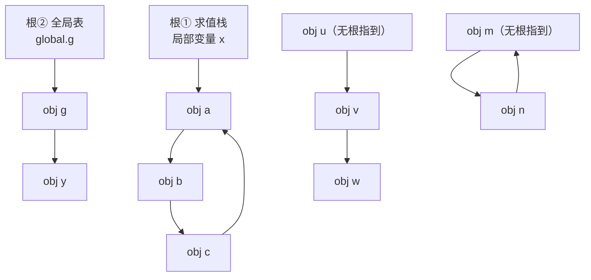

# 垃圾回收深入：可达性、分代与三色标记

> [返回：第六阶段导览](01-导览.md)
> 对应大纲第 2 条。自动内存管理的全部理论只有一句话——**不可达即可回收**；全部工程难度都在"可达性怎么算得又准又不停机"。本册从可达性定义出发，过完 RC 与追踪两大流派、三种基础回收器，到分代与三色标记，最后落到 V8 `--trace-gc` 的实测阅读。

## 可达性与根集合

**定义**：从根集合出发、沿引用边能走到的对象是活的（live）；走不到的是垃圾（garbage）。注意判据是**可达**不是"还被需要"——可达性是可判定的语义近似，循环引用一片不可达即整片回收，这正是它胜过引用计数的地方。

根集合（roots）四类：

1. **求值栈**与各栈帧的 locals（正在使用的值）；
2. **全局表**（REPL 持久环境、内建对象）；
3. **驻留池**（上一册：它永生，字符串才免费判等）；
4. **VM 内部结构**——open upvalue 链表、常量池里的堆对象。

漏一个根 = 活对象被回收（最恶性的 bug，程序莫名崩在无关代码）；多算一个根 = 慢性泄漏。**GC 实现的第一条纪律：根枚举清单是显式的、被测试覆盖的**。

### 手推一次可达性判定

把定义放到一张具体的对象图上（下一册的 GC 就要在这类图上跑）：



七个堆对象逐个判定：

| 对象 | 可达路径 | 判定 |
|---|---|---|
| a | 栈 x → a | 活 |
| b | x → a → b | 活 |
| c | x → a → b → c（且 c→a 成环） | 活——**环内互指不救不可达的环，但连着根就整片活** |
| g | 全局表 → g | 活 |
| y | 全局表 → g → y | 活——只被中间对象引用也算 |
| u, v, w | 链的源头 u 没有任何根指到 | **整链死**——"互相连着"不等于"可达"，可达必须有根当源头 |
| m, n | 互指成环但无根 | **整环死**——这正是 RC 无法回收、追踪无感的场景 |

两条关键读法：其一，**可达性是"从根出发的波前"，不是"图上有没有边"**——u→v→w 的边再漂亮，没有根供能整片是死；其二，m↔n 环的死活只看一件事：有没有一条边从根方向进入环内。这两条就是自测第 1 题的全部答案基础。

### 漏根与多根：一张代价表

"漏一个根/多算一个根"值得展开成表——两边的病、症与疗法定全不同：

| | 漏根 | 多算根 |
|---|---|---|
| 后果 | 活对象被判死、被回收 → **悬垂指针**，程序崩在无关代码（最恶性的 bug） | 死对象被当活 → 慢性泄漏，堆缓慢上涨 |
| 症状 | 难复现、崩点远离案发点、跑得久才炸 | `--trace-gc` 里 alive 逐轮单调上涨 |
| 疗法 | 根枚举清单显式化 + 专项测试（下一册回归清单里的"故意漏 openUpvalues 根"用例） | 快照 diff 找"只增不减"的构造函数 |
| 实验室对应 | 根槽位数组是显式清单；`assertNoDangling` 常驻兜底 | churn 用例 alive 稳定即反证 |

这张表还解释了为什么下一册说"最难的 100 行是根枚举清单的完备性"——**标记算法出错是算错，根枚举出错是语义错**，后者连测试都更难写（要在恰好那个场景下触发）。

### 根的精确与保守：枚举的两个流派

"根枚举清单是显式的"有一个前提：运行时**知道**哪里是指针。这个前提并非普适，按知情程度分两派：

- **精确根（precise）**：VM 自己管求值栈与对象布局（mini、V8、JVM），编译期就知道每个槽位是不是引用——枚举清单是代码写出来的，精确到槽；
- **保守根（conservative）**：C/C++ 互操作场景下栈上混着指针与普通整数，无法区分——把"长得像指针"的字都当指针试（值落在堆地址范围内就算）。代价是**多算根**（整数恰好像地址 → 对象被误保）与**不敢移动对象**（误判的"指针"改写不得）——Boehm GC 是这条路线的代表。

mini 走精确路线（栈就是 `Value[]`，逐槽判 `instanceof Obj`）——这也是"用高一层语言写低一层运行时"的福利之一：**表示方案（上一册）替 GC 挡掉了保守性的全部麻烦**。

## 引用计数 vs 追踪回收

| | 引用计数（RC） | 追踪（tracing） |
|---|---|---|
| 回收时机 | 计数归零**立即** | 内存不够时**批量** |
| 成本分布 | 摊到每次赋值 | 集中在一次 GC（常伴 STW） |
| 循环引用 | **死锁**：a→b→a 计数永不归零 | 无感（只看可达性） |
| 堆大小敏感 | 不敏感（无全局扫描） | 存活集越大标记越慢 |
| 代表 | Python（RC+周期检测）、Swift/ObjC（ARC） | JVM、V8、.NET、Go |

RC 的即时性在资源管理（文件句柄、锁）上仍不可替代——Swift 选 ARC 是"确定性释放压倒一切"的价值观；Python 用世代周期检测器给 RC 补漏。**主流托管 VM 全部选择追踪**：赋值路径零开销 + 天然处理循环。

### 赋值税的手推：x.f = y 的四步

RC 的成本分布是"摊到每次赋值"，把这次赋值展开：

| 步 | 动作 | 计数变化 | 说明 |
|---|---|---|---|
| 1 | `retain(y)`：新目标计数 +1 | `y.rc++` | 先**加** |
| 2 | 写槽：`x.f = y` | — | 落盘 |
| 3 | `release(old)`：旧值计数 -1 | `old.rc--` | 后**减** |
| 4 | `old.rc === 0`？是 → 递归释放整棵子树 | 子树全下葬 | 确定性析构发生在这里 |

先加后减的次序防的是**自赋值**：`x.f = x.f` 时第 1 步先保住计数，第 3 步再减回去——净变化为零，对象安全。反过来先减后加，中间一刻计数可能归零、触发对还活着的对象递归释放。实验室 `labs/gc/src/refcount.ts` 的 `setRoot` 里就有这行注释（"先加后减：自赋值也安全"）——**每个字段写入 = 一次 retain + 一次 release 的固定税**，这就是"摊到每次赋值"的字面意思。

### 成本曲线：两条路线各自的横轴

两张账单比大小之前，先看清各自的横轴（比什么变量）：

- **RC 的横轴是写入次数**：赋值税随 mutator 活跃度线性走，与堆大小无关——堆再大，只要不写，RC 一分钱不花；写入越热，税越重（多线程下还有缓存行乒乓的放大，GC 专题 [02-引用计数的进化](../10-GC算法专题/02-引用计数的进化.md) 专册展开）；
- **追踪的横轴是存活集（与全堆）**：标记成本 ∝ 存活集，清扫成本 ∝ 全堆——两次 GC 之间赋值随便写，零税；堆一大，单次停顿线性上涨。

由此推出选型的定性规则：**写入热、堆小、要确定性 → RC 有理（Swift/ObjC 的客户端对象）；写入相对冷、堆大、能容忍批处理 → 追踪有理（服务端 VM）**。Python 是混合样本：RC 管日常（横轴写入），世代周期检测器专扫环（横轴候选集）——两套机器各管各的强项。

### 循环引用：两派死活的对偶视角

a→b→a 置 null 后：追踪派在下一轮标记里发现整片不可达、整环回收；RC 派的两个计数互守在 1、永不归零。这个"同一张图、两种结局"不是巧合，而是一个对偶定理的两面——**RC 数的是"谁指我"，追踪问的是"我连谁"**：环内每条边在 RC 账本上都是"有用的生命"，在追踪账本上只是"图上的一条边、无根即死"。对偶定理的完整证明与它催生的试删法（Python `gc` 模块的内核），见 [GC 算法专题 · 引用计数的进化](../10-GC算法专题/02-引用计数的进化.md)——本册先记住现象，那边给机制。

## 三种基础回收器

**标记-清除（mark-sweep）**：两阶段。标记：从根 DFS，每个对象置 mark 位；清除：线性扫全堆，未标记者回收入**空闲链表**。不移动对象、实现最简；代价是**外碎片**（空闲块零散，大对象放不进任何一块）与分配慢（链表找合适块）。

**标记-整理（mark-compact）**：标记后把活对象全部压向堆一端，引用全部改写。无碎片、分配也可退化成指针递增；代价是**移动与改写**——整理一次的拷贝量和存活集成正比，适合"存活率高"的区域。

**复制式（copying / semispace）**：堆分 from/to 两半，只在一半分配。GC 时从根出发，活对象**拷贝**到另一半（紧挨着放），然后两半身份对调：

```text
GC 前（from 半空间）          GC 后（原 to 成为新 from）
┌─────────────────┐          ┌─────────────────┐
│ ░░活░░垃圾░活░垃圾│   ──►    │ 活 活 [空闲……    │  ← 分配 = 指针递增
└─────────────────┘          └─────────────────┘
```

**分配 = bump pointer（`*top++ = obj`，几条指令）**，存活率低时拷贝量极小——但空间利用率恒定 50%。三种器一张表：

| | 标记-清除 | 标记-整理 | 复制式 |
|---|---|---|---|
| 移动对象 | 否 | 是 | 是 |
| 碎片 | 外碎片 | 无 | 无 |
| 分配 | 空闲链表 | bump | bump |
| 成本敏感于 | 全堆大小 | 存活集大小 | 存活集大小 |
| 空间代价 | 1× | 1× | 2×（半空间） |

**没有免费午餐**：移动换来无碎片与快分配，代价是"所有指向被移动对象的引用都要改写"——这个改写正是写屏障、根集精确枚举等一切复杂度的源头。

### 同一张图，三种结局（手推）

拿一张固定的堆图把三种器各跑一遍——这是理解三器差异最短的路（下一册动手实现的就是第一种）：

```text
堆槽位： [0]=a  [1]=d  [2]=b  [3]=e  [4]=c  [5]=f
引用：   根 → a；a → b、c（a 有两个引用字段）；b、c 无出边
垃圾：   d、e、f（无任何根可达）
```

**标记-清除**（不移动）：

| 相 | 动作 | 堆的状态 |
|---|---|---|
| 标记 | 从根 DFS：a 入队 → a 黑、b 入队 → b 黑、c 入队 → c 黑 | a、b、c 带标记；d、e、f 白 |
| 清除 | 线性扫 0..5：槽 1、3、5 白 → 摘除、入空闲链表 | a、b、c 原地不动；**空洞在槽 1、3、5** |

结束后的堆是 `[a][空洞][b][空洞][c][空洞]`——总空闲 3 槽，但**不连续**。此刻来了一个要 3 个连续槽的新对象：空闲总量够、哪里都放不下，这就是外碎片的定义式演出；而"找哪块放"就是空闲链表分配慢的来源。

**标记-整理**（四相滑动，实验室 `mark-compact.ts` 同款相序）：

| 相 | 动作 | 中间产物 |
|---|---|---|
| ① 标记 | 同上 | a、b、c 黑 |
| ② 定址 | 第二根手指从头压出存活对象的新地址（保持相对顺序） | a→0、b→1、c→2 |
| ③ 改指针 | 全体存活对象按 forwarding 改写引用 | 根→0；a 的字段→1、2 |
| ④ 滑动 | 存活对象搬到新地址 | 堆变成 `[a][b][c]`，槽 3..5 抹平 |

关键在 ②③ 的次序与解耦：**先定新地址（forwarding 记账），再统一改指针，最后搬家**——三步分开才能保证引用改写一致（若边搬边改，读半旧的引用会指错）。整理结束堆长 = 存活数，分配退化为指针递增。

**复制式**（半空间）：

| 步 | 动作 | 结果 |
|---|---|---|
| ① 根搬家 | 根指向的 a 拷入 to-space 第 0 槽，a 留下转发指针 | 根改写为新地址 |
| ② Cheney 扫描 | to-space 即队列：扫 a 的字段 → b 拷入槽 1、c 拷入槽 2；扫 b、c 无出边 | to-space = `[a][b][c]` 连续 |
| ③ 翻面 | from/to 身份对调 | 分配指针停在 3 |

对照注意：d、e、f **从未被单独处理**——垃圾是"没被搬走"，不是"被发现"。三种器的同一张图三种结局：清除留下空洞、整理抹平空洞、复制连看都不看垃圾一眼。

### 空闲链表：标记-清除的慢分配从哪来、往哪去

"分配慢（链表找合适块）"的机理：清除把死对象的槽位串成空闲链表，分配时沿链找"放得下"的第一块（first-fit）——最坏要遍历整条链，且碎片越多链越长。工程改良的方向都朝同一个点走：**把"找"变成"算"**——按大小分桶（size class），每个桶一条链，分配 O(1) 取桶头。这条改良的极致就是 Go 的 size class 分配器（GC 专题 [04-工业回收器解剖](../10-GC算法专题/04-工业回收器解剖.md) 里"Go 抗碎片靠 size class"的那条），也解释了为什么"不移动 + 分桶"的组合敢不整理。教学版（下一册）不做分桶——教学堆的"分配"只是语义层的摘除登记，这个简化点会在那一册诚实声明。

## 分代假说与写屏障

经验定律（weak generational hypothesis）：**绝大多数对象朝生暮死**。据此把堆分代，各取所长：

- **新生代（young）小而快**：复制式。存活率低的场景它最赚——拷贝量小、分配是 bump。V8 的 Scavenge。
- **老生代（old）大而稳**：标记-整理/标记-清除。存活率高，复制的代价不划算。
- **晋升（promotion）**：熬过一两次 minor GC 的对象搬到老生代——"试用期转正"。

致命细节：minor GC 只扫新生代，可**老生代对象可能引用新生代对象**——不解决它，扫一遍老生代才能找到全部根，分代白分。方案：**写屏障（write barrier）**——每次"老对象字段写入新对象引用"时，把该字段（或老对象）记入 **remembered set**。minor GC 的根 = 栈/全局 + remembered set，老生代一次都不用扫。

```c
// 概念形态（Dijkstra 风格增量屏障见下节，这里先是分代屏障）
void barrier(Obj* old, Value new) {
  if (inOld(old) && inYoung(new)) rememberedSet.add(old);  // 记"老→新"边
  old->field = new;
}
```

**赋值路径从此不再零开销**——这是分代用一小段每次写入的税，换掉一大段每次 GC 的扫描。取舍范式与 RC vs 追踪同构：**成本放在哪条路径，取决于哪条路径更冷**。

### 写屏障的手推：五条边过一遍屏障

屏障代码里的两个条件（`inOld(old) && inYoung(new)`）单独看抽象，放进五条具体边就清楚了：

| # | 写入 | old 在哪 | new 在哪 | 记不记 remembered set | 谁会扫到这条边 |
|---|---|---|---|---|---|
| 1 | `oldA.f = youngB` | 老生代 | 新生代 | **记**（宿主 oldA 入集） | minor GC：从 remembered set 里的 oldA 出发追到 youngB |
| 2 | `youngC.f = youngD` | 新生代 | 新生代 | 不记 | minor GC 直接从新代内部追到（可达遍历覆盖） |
| 3 | `oldA.f = oldE` | 老生代 | 老生代 | 不记 | 只有 major GC 扫老生代时管 |
| 4 | `youngC.f = oldE` | 新生代 | 老生代 | 不记 | minor 只扫新代，这条边从新代出发到老代——追到 oldE 也只是标记它（晋升判定），不扫它的出边 |
| 5 | `oldA.f = null` | 老生代 | — | 不记 | 无新边产生 |

五条边里只有第 1 条触发记账——**屏障的税不是每次写入都全额收**，只是"老收新"这一种形态要交。这也解释了屏障条件为什么写成两个谓词的合取：漏一个谓词就漏一类边。漏第 1 条边的后果在实验室里可以一键复现：`generational.ts` 把 `barrierEnabled` 关掉，新对象被误收、老代出现悬垂（GC 专题 04 册把这个实验列为"屏障存在性证明"）。

### minor GC 的根集合公式：oldTraversed === 0 的分量

"minor GC 的根 = 栈/全局 + remembered set"这条公式，用实验室 `labs/gc/src/generational.ts` 的账本变量写成量化版：

```text
minorGC 的扫描面 = rootRefs（根槽位） + rememberedHosts（登记宿主） + 新代内部遍历
老生代本体扫描量 = oldTraversed = 0        ← 恒为 0，这是分代成立的定义式证据
```

`oldTraversed === 0` 不是断言巧合，是**设计目标本身**：分代的一切工程（写屏障、remembered set、晋升）都为把这一项压到 0 服务。每次 minor 的 events 行直接打印这组数（`roots N | remembered M | oldTraversed 0 | promoted K | reclaimed R`）——读 GC 日志时第一眼看的就是"有没有发生意外的全堆扫描"。这组变量也是 GC 专题 04 册"minor GC 快是因为扫描集合小、不是堆小"论断的可执行版本：堆多大都行，只要老代一步不碰。

### 晋升的两个时机与对象的一生

"试用期转正"具体在什么时候发生（V8 的两条规则，GC 专题 04 册的 Scavenge 旅程表里都出现过）：

- **年龄达标**：对象在 new space 活过两轮 Scavenge——"活过两轮"是负载无关的经验线（多数朝生暮死者两轮内必死）；
- **空间告急**：复制时 to-space 装不下（allocation overflow）——与其反复腾挪，直接晋升。

合起来看对象的一生：出生（新代 bump 分配）→ 第一轮 minor（要么死、要么进 to-space）→ 第二轮 minor（晋升）→ 老生代（major GC 才管）→ 最终死亡。**分代没有消灭回收，只是把"按年龄分流"做成了空间布局**——每个代用自己存活率匹配的算法，这就是假说兑现成架构的样子。

## 增量、并发与三色标记

整堆标记的停顿（STW）与堆大小成正比——大堆下一次 GC 停顿几十毫秒，交互场景不可接受。思路：**把标记切片，与主线程交替执行**（增量）或**挪到后台线程**（并发）。难点：标记进行中， mutator 还在改对象图——标到一半的对象图变了怎么办？

**三色抽象**：

- **白**：未访问——回收候选；
- **灰**：自己已标记，子引用**还没扫完**——待办队列；
- **结束条件**：无灰，白即垃圾，黑即存活。

一次正确的增量标记必须维持不变式：**黑不指白**（强三色不变式；放宽为"黑指的白必有灰遮护"是弱三色不变式）。若违反——黑对象 A 指向白对象 B，且 A 已出队、B 不再被任何灰对象引用——B 被误判为垃圾，**活对象被回收**，程序在未来的随机位置崩掉。维持不变式靠**屏障**：

- **Dijkstra 屏障（插入屏障）**：黑→白的引用写入时，把白目标**置灰**（推入待办）——"新边出现，目标重新入队"。精确但 mutator 每次写引用都要付税。
- **Steele 屏障**：黑→白写入时把**黑源退灰**——更保守，重新入队更少；代价是可能重复扫描。
- **起始快照 SATB**（Go 1.8+）：并发标记开始时逻辑上拍快照，**删除屏障**把被覆盖掉的白引用置灰——吞吐好，浮动垃圾略多。

Go 把它做成了教科书：并发标记 + 混合写屏障，停顿降到亚毫秒。V8 的版本：并发标记 + 增量标记步进 + 并发清扫，只在切换阶段短促 STW。**现代 GC = 三色抽象 + 若干屏障 + 调度策略**，理论内核本节已全部覆盖。

### 一次漏标事故的手推（三种屏障各在哪一步出手）

"违反不变式 → 活对象被回收"值得逐步演算——因为事故的每一步都对应一种屏障的出手点：

初始状态：标记进行中。a 已黑（扫描完毕）、b 白、g 灰（待办里，且 g → b——b 有灰遮护，不变式暂时安全）。

| 步 | mutator 动作 | 图的状态 | 判定 |
|---|---|---|---|
| 1 | `a.f = b`（黑→白新边） | a 黑指白；但 b 仍被 g 灰遮护 | **弱不变式仍成立**——暂时安全 |
| 2 | `g.f = null`（删掉唯一的灰→白边） | b 失去遮护；a 黑指白 | **不变式破**——此后 b 的死活只看 a，而 a 不会再被扫 |
| 3 | 标记继续：g 出队、队列空 → 标记结束 | b 白、无灰邻居 | 结束条件判定：白 = 垃圾 |
| 4 | 清扫回收 b | a.f 指向已回收地址 | **活对象没了**——悬垂，崩在未来的某次解引用 |

三种屏障的出手点对照（都只看这张表）：

- **Dijkstra（写时保新值）**：步 1 写 `a.f = b` 时把 b 置灰——b 重新入队，步 2 删边也无所谓，b 自己已经"在册"；
- **Steele（写时退黑源）**：步 1 把 a 退灰——a 被重新扫描，再次发现 b 并标灰；
- **Yuasa/SATB（删时保旧值）**：步 2 删 `g.f` 时把**旧值 b** 置灰——快照语义："标记开始那一刻可达的对象全部活"，b 在快照里可达。

注意三者全都在**步 1 或步 2** 动手，且全部不需要"暂停 mutator"——屏障把不变式的维护摊进了赋值路径。这是"成本放在哪条路径"取舍的又一次出现：整体式 GC（下一册）全停顿、不需要屏障；增量/并发 GC 赋值路径要交屏障税。事故的完整回放（含把屏障关掉复现误收）在 [GC 算法专题 · 实践-增量三色标记](../10-GC算法专题/06-实践-增量三色标记.md) 有可运行版本。

### 浮动垃圾：屏障的账单另一面

三种屏障救活 b 的代价是同一种：**把本来可能已死的对象也标活了**。Dijkstra 把新目标一律置灰——哪怕这条新边下一刻就被删掉，b 本轮也活；SATB 保快照——快照之后死的对象本轮照活。这就是**浮动垃圾**（floating garbage）：本轮该死没死、下轮照死的对象。三条性质值得记：

1. 浮动垃圾**不是 bug**，是保守性的定价——宁可多留一轮，不可错杀一个；
2. 它的上界与屏障的激进程度挂钩：SATB > Dijkstra > Steele 的浮动量大致递减、赋值税/重复扫描的量反向排列——**没有两头都占的屏障**；
3. 它解释了并发回收器的一个日志现象：并发标记轮次里 alive 略高于稳态——不是泄漏，是浮动垃圾的常态波动（对照 GC 专题 04 册"常见误区"里"浮动垃圾是 bug"一条）。

### 增量、并发、并行：三个词的分野

这三个词经常被混用，机制上却是三种不同的停顿策略：

| 术语 | 标记工作在哪跑 | mutator 在干嘛 | 屏障需求 |
|---|---|---|---|
| **增量（incremental）** | 主线程的小步切片 | 交替：走几步 mutator，走几步 GC | 要（图在标记间隙被改） |
| **并发（concurrent）** | 后台 GC 线程 | 几乎不停 | 要（图在标记期间被改） |
| **并行（parallel）** | 多个 GC 线程 | **全停顿（STW）** | 不要（无人在改图） |

V8 的组合拳逐项对号：Scavenge 是**并行**（STW 但多线程搬，快所以不停太久）；老生代标记是**增量 + 并发**（步进混进事件循环 + 后台线程），所以它需要黑分配与写屏障；老生代清扫是**并发**（清扫不看图、可安全后台跑）。实验室 `mark-sweep.ts` 的注释"整体式无屏障：全停顿世界没有并发问题"说的正是并行/整体式的豁免——**屏障不是 GC 的标配，是"图还在被改"时的标配**。下一册的整体式实现因此可以省掉全部屏障逻辑，这是它只有三百行还能跑对的原因。

## V8 实测：--trace-gc

```text
$ node --trace-gc bench.js
[34211:0x140]     3125 ms: Scavenge 2.4 (4.5) -> 1.1 (5.0) MB, 0.12 ms (allocation rate too high)
[34211:0x140]     4187 ms: Mark-Compact 28.1 (33.0) -> 12.4 (36.5) MB, 6.8 ms (progress marking) ...
```

逐字段读：

- **Scavenge** = 新生代复制式（半空间翻转）；**Mark-Compact** = 老生代标记-整理；`Mark-Compact ... (progress marking)` 说明启用了增量标记步进。
- `2.4 (4.5) -> 1.1 (5.0) MB`：GC 前"已用（总提交）"→ GC 后——第二对数字变大是堆在动态扩容/缩容。
- **末尾的耗时**是关键指标：Scavenge 亚毫秒正常；Mark-Compact 若到几十毫秒且频繁，说明老生代压力大（存活集大或分配速率高——大对象/长生命周期缓存泄漏的典型信号）。
- 对照实验：`--max-semi-space-size=64` 加大新生代看 Scavenge 频率变化；`--expose-gc` + `globalThis.gc()` 手动触发，把"分配速率"与"存活集"两个变量分开测。

DevTools Memory 面板的堆快照（Heap Snapshot）与 Allocation Timeline 是同一理论的 UI 版：快照 diff 找"只增不减"的构造函数名，就是泄漏嫌疑名单。

### 两行 trace 对读：数字背后的成本模型

把这两行里的数字放进本册的成本模型里对读（差值是给定数字的减法）：

| 行 | 回收量（前-后） | 停顿 | 吞吐（回收量/停顿） | 成本模型 |
|---|---|---|---|---|
| Scavenge | 2.4 − 1.1 = 1.3 MB | 0.12 ms | ≈ 10.8 MB/ms | 复制式：成本 ∝ **存活集**（当时新代存活极小） |
| Mark-Compact | 28.1 − 12.4 = 15.7 MB | 6.8 ms | ≈ 2.3 MB/ms | 整理：标记 ∝ 存活集 + 清扫 ∝ **全堆**，还要搬运改写 |

同一份 GC 系统，两行的单次吞吐差近 5 倍——不是 Scavenge "更快"，是**两个器的成本函数不同**：Scavenge 那轮的存活集小到几乎白搬，Mark-Compact 要走全堆标记与整理的完整四相。这组对照就是三种回收器表格里"成本敏感于"一列的实测注脚。另一处值得读的是括号里的触发原因：`allocation rate too high` 与 `progress marking`——GC 不是只在"内存满"时跑，**分配速率与增量步进都会触发**，触发策略本身就是设计变量（下一册的自适应阈值是它的教学版）。

### 从 trace 到行动：三问检查单

逐字段读完，真实排查的读法是固定三问（每问挂一个对应动作）：

1. **什么触发的**：`allocation rate too high` 高频 → 先看分配热点（循环里造大对象？），其次考虑加大半空间（`--max-semi-space-size`）——这是"分配速率"变量；
2. **哪种回收、多久**：Scavenge 亚毫秒是健康；Mark-Compact 上几十毫秒且频率涨 → 看"存活集"变量——是不是缓存无界、监听器没解绑；
3. **活了多大、趋势如何**：每行的"GC 后已用"连成曲线——平稳 = 正常波动（含浮动垃圾）；单调上涨 = 泄漏，转 DevTools 快照 diff 找"只增不减"的构造函数。

三问的顺序刻意是"触发 → 类型 → 趋势"：先排除"这是正常回收还是异常触发"，再定位是哪一代的压力，最后才谈泄漏。顺序反过来（一上来找泄漏）会浪费在健康的堆曲线上。GC 专题 04 册末尾的自检清单是这三问的工业完整版（V8/JVM/Go 三家），读完本册可直接去对表。

## 与主线对照

| 本册概念 | 主线位置 |
|---|---|
| mark 位 / 全堆链表 / 根枚举 | 下一册全部落地成代码 |
| 三色不变式 = 图上的数据流性质 | 第七阶段数据流分析同一套"不动点 + 工作表"思想 |
| remembered set 的"记冷路径税" | 编译器优化的基本取舍范式 |
| hidden class / 内联缓存 | 第七阶段 JIT 视角 |

### 实验室里的影子：本册概念 ↔ `labs/gc/`

本册每个概念在 `compiler/labs/gc/` 里都有最小可跑形态（实现走读在下一册展开，这里先给地图）：

| 本册概念 | 实验室文件 | 教学落点 |
|---|---|---|
| 根集合 | `src/core.ts` 的 `roots` 根槽位数组 | "求值栈 + 全局表"的替身；槽位写入免屏障 |
| 标记-清除 | `src/mark-sweep.ts` | 灰栈 DFS + 链表清扫 + 黑白翻转 + 自适应阈值 |
| 标记-整理 | `src/mark-compact.ts` | 标记 → 定址 → 改指针 → 滑动，四相与上文手推同序 |
| 复制式 | `src/copying.ts` | Cheney 扫描：to-space 即队列、转发指针去重 |
| RC 三档 | `src/refcount.ts` | naive / deferred / coalescing——赋值税的三种付法 |
| 分代 + 写屏障 | `src/generational.ts` | remembered set + `oldTraversed === 0` 账本 |
| 增量三色 | `src/incremental.ts` | none/dijkstra/steele/yuasa/hybrid 屏障可插拔 |
| 漏标事故 | `incremental.ts` 的 `barrier: 'none'` | 活对象被误收的复现与 `assertNoDangling` 兜底 |

用法建议：读本册正文时把对应文件开着对照（每个文件头都有指向本专题文档的注释）；跑测试的命令与断言清单见下一册与 GC 专题导览。

## 常见误区

- **"可达 = 还被需要"**——可达性是"从根沿边能走到"的机械判定，"需要"是语义判断（缓存可能没人用、监听器忘了解绑）。GC 只会回收前者判死的：**你以为"还需要"的对象若不可达，一样被收**；反过来，"不再需要"但还挂根的，永远不收——这就是泄漏的机制；
- **"GC 只在内存满时跑"**——触发原因有家族：阈值、分配速率、增量步进、手动调用（trace 里两种原因都见过）。触发策略是设计变量，不是环境常数；
- **"写屏障是个可选优化"**——分代场景下它是**正确性前提**，不是性能配件：关掉屏障，老代指向新代的边丢失，新对象被误收。成本能优化（卡表化），存在性不能优化；
- **"三色标记结束堆上没有白对象"**——标记结束时白 = 垃圾候选，**它们还在堆上**，由清扫阶段处置（或复制式里从未搬运）。"白即死"是判定，不是即时执行；
- **"增量/并发消灭了停机"**——消灭的是"长停顿"。根扫描启动、标记终止的短 STW 在所有工业并发回收器里都保留（GC 专题 04 册的误区表）；教学整体式才有"全程停顿"的奢侈；
- **"复制式慢在拷贝垃圾"**——垃圾根本不拷贝（上文手推：d、e、f 从未处理），成本 ∝ 存活者。50% 空间税才是它的真代价；
- **"分代让 GC 全面变快"**——minor 变快了，major 还是全堆账；分代的收益完全押注在"多数对象死在新代"的负载假设上，长寿对象为主的工作负载里分代是净负担（晋升搬运白付）；
- **"老生代用标记-清除因为简单"**——简单是真的，外碎片也是真的：老生代对象大而长寿，碎片积累后大对象分配失败。真实老生代几乎都配整理或分区机制（G1 的 region、V8 的页式整理）。

## 与其他册的连接

- 对象头与值表示（本册一切机制的载体）：[02-运行时对象模型](02-运行时对象模型.md)；
- 本册理论的动手版（标记-清除全程实现）：[04-实践-标记清除GC](04-实践-标记清除GC.md)；
- RC 的四代进化与对偶定理：[GC 算法专题 · 引用计数的进化](../10-GC算法专题/02-引用计数的进化.md)；
- 屏障族谱（Dijkstra/Steele/Yuasa/混合）的逐行代码与事故回放：[GC 算法专题 · 屏障与并发标记](../10-GC算法专题/03-屏障与并发标记.md)；
- V8/JVM/Go 三家工业回收器的解剖（本册"现代 GC = 三色 + 屏障 + 调度"的成品形态）：[GC 算法专题 · 工业回收器解剖](../10-GC算法专题/04-工业回收器解剖.md)；
- 不用 GC 的整条路线（arena/所有权/EBR）：[GC 算法专题 · 免 GC 的内存管理](../10-GC算法专题/05-免GC的内存管理.md)；
- 把整体式 GC 升级成增量三色的实践：[GC 算法专题 · 实践-增量三色标记](../10-GC算法专题/06-实践-增量三色标记.md)；
- 三色标记与"不动点 + 工作表"的算法同构：[07-第七阶段 · 数据流分析](../07-第七阶段/02-数据流分析.md)；
- 求值栈作为根的来源（解释器的帧结构）：[05-第五阶段 · 解释器实现](../05-第五阶段/04-解释器实现.md)。

## 自测

1. 循环引用 `a→b→a` 后置 `a = b = null`：RC 与标记-清除各自的内存状态画出来；周期检测器要做什么才能救 RC？
2. 复制式分配为什么只要几条指令？它 50% 的空间代价换来了什么、什么场景下这笔买卖最亏？
3. 分代 GC 若没有写屏障，minor GC 的根集合必须是什么？写屏障把哪部分扫描换成了哪部分记账？
4. 三色标记违反"黑不指白"的具体后果是什么？Dijkstra 插入屏障在**哪次赋值**做什么事来阻止它？
5. 一段每秒创建上千个临时数组的 JS：`--trace-gc` 里应看到什么？如果把临时对象换成持久缓存，输出又怎么变？

（6~12 为扩写增补题，答不出就回到对应小节的手推再读一遍。）

6. 可达性手推：u→v→w 无根链与 m↔n 无根环，各在哪个阶段被处置？追踪派"判定"与"执行"分别发生在标记阶段还是清扫阶段？复制式里这两个问题还存在吗？
7. RC 赋值四步里若 `old === y`（自赋值），每步计数怎么走？"先加后减"防的具体事故是什么？实验室 `refcount.ts` 哪个函数体现这个次序？
8. 同一张图三种结局的手推里，标记-整理为什么必须"先定址、后改指针"？哪一步引入了 forwarding，它解耦了哪两件事？
9. 写屏障五条边手推：`oldA.f = youngB` 记谁进 remembered set？`youngC.f = oldE` 为什么不记？漏记第 1 类边的后果在实验室怎么一键复现？
10. 漏标事故五步表里，Dijkstra、Steele、Yuasa 分别在哪一步出手？三者各自产生的浮动垃圾对应表的哪几步？
11. 两行 trace 的减除法：两轮各自回收多少 MB、单位吞吐差几倍？这个差距映射到三器对比表的哪一列？
12. 增量/并发/并行三分野：V8 的 Scavenge 属于哪类？老生代标记属于哪几类的组合？为什么并行（STW）不需要屏障——这句话在实验室哪个文件的哪条注释里？

> 进阶：屏障的逐行代码与事故回放、工业回收器解剖、免 GC 路线，见 [GC 算法专题](../10-GC算法专题/01-导览.md)。
