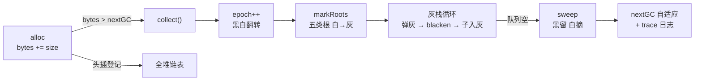

# 实践：给 VM 装上标记-清除 GC

> [返回：第六阶段导览](01-导览.md)
> 对应大纲实践任务。上一册的理论全部落地：对象头登记、根枚举、标记、清除、trace 日志、循环引用验收——第五阶段"只生不死"的 VM 从此有自动内存管理。全程约 300 行，其中最难的 100 行是根枚举清单的完备性。
>
> **可运行替代**：本册叙述的 `packages/vm` 在本仓库尚未落地；同样这套算法（对象头登记、根枚举、灰栈标记、链表清扫、黑白翻转、自适应阈值）已在对象图层实跑验证——`compiler/labs/gc/src/mark-sweep.ts` + `tests/mark-sweep.test.ts`（7 项断言，含循环引用验收、黑白翻转防诈尸、自适应阈值、trace 日志格式）。读法对照：求值栈/帧/全局表 ↔ 实验室的 `roots` 根槽位数组，`--trace-gc` ↔ `events` 日志。

## 手术清单

对 `packages/vm` 的改动一览（对象头已在[上一册](02-运行时对象模型.md)引入）：

```ts
class Heap {
  objects: Obj | null = null;        // 全堆侵入式链表（分配时头插）
  bytes = 0;                         // 已分配字节（触发依据）
  nextGC = 1 << 20;                  // 阈值：1MB 起步，GC 后按存活量自适应
  epoch = 0;                         // 标记期数（黑白翻转技巧）

  alloc<T extends Obj>(obj: T, size: number): T {
    if ((this.bytes += size) > this.nextGC) this.collect('threshold');
    obj.next = this.objects; this.objects = obj;   // 头插登记
    return obj;
  }
}
```

两个设计点：

- **触发策略**：`bytes > nextGC` 即回收，回收后 `nextGC = max(bytes * 2, 1MB)`——存活少则阈值回落（回收更勤），存活多则阈值抬升（摊薄频率）。这比固定阈值聪明一个量级，且只需一行。
- **显式触发口**：内建 `gc()`（直接调 `collect('manual')`）——测试与教学用例要确定性，不靠"攒够 1MB"碰运气。

### alloc 的次序纪律：先触发、后登记

六行 alloc 里藏着一处容易写反的**次序**：触发检查（可能引发整轮 GC）发生在**头插登记之前**。把两种次序各推一遍：

- **先触发、后登记（正确）**：触发的那轮 GC 跑完时，正在分配的对象还没进堆——它不被标记、不被清扫，等 GC 收场后才挂上链表，参加的是**下一轮**。语义干净："新对象生而为白"；
- **先登记、后触发（反例）**：GC 跑的时候这个对象已经在链表上，但它**没有被任何根引用**（调用方还没拿到返回值）——标记器追不到它，清扫器却会遍历到它。运气好它被当垃圾摘除（返回悬垂引用），运气好幸存——无论哪种，"alloc 返回的对象此刻是否合法"变成了玄学。

实验室 `mark-sweep.ts` 的 `alloc` 把这条纪律写成了字面顺序：`if (this.bytes + size > this.nextGC) this.collect('threshold')` 在前，建节点、头插在后。次序不是风格问题，是正确性问题——这也是 alloc 适合作为面试题的原因：**六行代码，两处次序敏感**。

### 生而为白：分配期对象不许带"已标记"的脸（实验室走读）

黑白翻转技巧有一个配套约束，实验室把它做成了专项断言（`tests/mark-sweep.test.ts` 的"生而为白"用例）：新对象的 `markEpoch` 初值必须取 `this.epoch - 1`——**生而为白，绝不能被上一轮的 mark 位误保**。把"为什么"推演成一张时间线：

| 时刻 | epoch | 新对象 markEpoch | 判定谓词（alive ⟺ markEpoch === epoch） | 结果 |
|---|---|---|---|---|
| 分配时（上一轮已收场） | 1 | **0**（epoch − 1） | — | 生而为白 |
| 下一轮 collect 开头 | 1 → 2 | 0 | 0 ≠ 2 → 白 | 不可达的新对象被正确回收 |
| 反例：初值误取到下一轮的值 | 1 | 2 | 下一轮 epoch 恰为 2 → **2 === 2 误判已标** | 未挂根的新对象**诈尸**——白占堆位，直到某轮被标又变白 |

判读：`markEpoch === epoch` 是"已标"的唯一定义，而 epoch 在 collect 开头自增——所以**初值只要落在"自增之后会与 epoch 撞车"的区间，新对象就被上一轮的账本误保**。`epoch − 1` 永远小于下一轮的任何值，从构造上排除撞车。这条约束与黑白翻转是一对：翻转让"清零"免费，生而为白让"新户口"免费——**两者合起来，mark 位的管理成本降为零行额外代码**。

## 标记阶段：根枚举 + 三色的过程感

```ts
private markRoots() {
  for (const v of this.vm.stack) this.markValue(v);       // ① 求值栈
  for (const f of this.vm.frames) {                       // ② 各帧 locals + 常量池
    for (const v of f.locals) this.markValue(v);
    for (const c of f.proto.constants) this.markValue(c);
  }
  for (const v of this.vm.globals.values()) this.markValue(v);   // ③ 全局表（REPL 环境）
  for (const s of this.internPool.table.values()) this.mark(s);  // ④ 驻留池
  for (let uv = this.vm.openUpvalues; uv; uv = uv.nextOpen)     // ⑤ open upvalue 链
    this.mark(uv);
}

private markValue(v: Value) { if (v instanceof Obj) this.mark(v); }

private grayWork: Obj[] = [];                 // 灰色待办队列
private mark(obj: Obj) {
  if (obj.markEpoch === this.epoch) return;   // 已标（黑）
  obj.markEpoch = this.epoch;                 // 入黑
  this.grayWork.push(obj);                    // 入灰待办
}
```

`collect()` 的主干就是教科书三色的直译：`markRoots()`（白→灰）→ 循环弹灰、扫子引用（灰→黑，子入灰）→ 队列空即标记完成：

```ts
collect(reason: 'threshold' | 'manual') {
  const t0 = performance.now();
  this.epoch++;                               // 黑白翻转：全堆 mark 位一秒清零
  this.markRoots();
  while (this.grayWork.length) {
    const o = this.grayWork.pop()!;           // 灰出队
    this.blacken(o);                          // 按 type 扫子引用：ARR→elements，
  }                                           // CLOSURE→upvalues，UPVALUE→closed……
  this.sweep(performance.now() - t0, reason);
}
```

**黑白翻转（mark epoch）**是本册最值得偷师的技巧：不翻转就得先全堆扫一遍清 mark 位（清完才准标，否则上一轮残留当活物）；期数比较 `obj.markEpoch === this.epoch` 让"清零"免费发生。扫子引用的 `blacken` 是一个 8 行的 `switch (o.type)`——每种 Obj 恰好一行，ADT 穷尽性检查（第四阶段）保证新增对象类型时漏扫直接编译报错。

整个回收的流程全景：



### 五类根逐个审问：完备性清单怎么"被测试覆盖"

根枚举是本册"最难的 100 行"——难不在代码量，在**每一行都对应一个"漏了会怎样"的具体场景**。五类根逐个过堂：

| # | 根源 | 谁在写它 | 漏掉的后果（具体场景） | 实验室对应 |
|---|---|---|---|---|
| ① | 求值栈 | 解释器每压/弹一个值 | 正在计算中的对象被收——崩在算术指令里 | `roots` 根槽位数组 |
| ② | 各帧 locals + 常量池 | 调用/返回/常量加载 | 深层调用栈里的对象被收；常量串凭空消失 | 根槽位的扩展形态 |
| ③ | 全局表 | 赋值语句、REPL 换轮 | 最常见事故：REPL 换轮忘了清——上一轮的死对象被全局表长期误保（正文验收三的排查提示） | 同上 |
| ④ | 驻留池 | intern 时刻（[上一册](02-运行时对象模型.md)） | 驻留串被收 → 指针判等失效 → 标识符比较出错（上册"驻留池是 GC 根"的实现面） | 收进 roots 槽位的语义 |
| ⑤ | open upvalue 链 | 闭包捕获/关闭 upvalue | 回归清单里的反面教材：注释掉这行，构造"帧已弹出但闭包仍被调用"用例即漏标 | 主线 VM 专属（实验室根是抽象槽位） |

两个审问结论：其一，**漏根的后果不是"GC 不工作"，是"GC 对一部分图失明"**——症状是随机崩或慢性泄漏，案发点远离病灶（上一册漏根/多根代价表的实现面）；其二，⑤ 是唯一"不看场景就想不到"的根——upvalue 让"栈帧已弹出的变量"依然存活，这是闭包语义强加给 GC 的义务。**每加一种运行时特性（闭包、生成器、弱引用），都要回到这张表审一遍**。

### grayWork 为什么是栈（DFS）而不是队列（BFS）

`grayWork.pop()` 从尾部弹出——这是一条 DFS 路径；换成 `shift()` 就是 BFS。两者的取舍在标记这一步几乎不影响正确性（三色只要求"每条边最终被扫到"），影响的是**内存与局部性**：

- **DFS（栈）**：纵深优先，灰栈长度 ≈ 图的最大深度——深链图的灰栈浅；且被弹出的对象是"刚被引用"的，缓存温度高。真实 GC 的灰工作表多取此形态；
- **BFS（队列）**：广度优先，队列长度 ≈ 最大宽度——宽图（大数组的所有元素互相独立被引用）会撑大队列；但访问顺序接近地址顺序，对"即将整理/复制"的回收器友好。Cheney 算法（[GC 算法专题 · 工业回收器解剖](../10-GC算法专题/04-工业回收器解剖.md) 的 Scavenge 旅程表）干脆不设独立队列——**to-space 本身就是 BFS 队列**，scan 指针追 top 指针。

教学版取 DFS 的理由是代码最短（一行 `pop`）；代价与收益的对照在实验室 `copying.ts` 里有完整对照物——两种遍历策略各 服务于后端的下一步动作（清除 vs 复制），**遍历顺序从来不是孤立的口味题，是下游算法的接口**。

### 手推：四个对象从白到黑

把三色的过程感落到一张最小图上（根 R → a；a → b；b → c；d 无根）：

| 步 | 动作 | grayWork | 状态 |
|---|---|---|---|
| 1 | `markRoots`：R 指向 a → `mark(a)`：epoch 未命中 → 入黑入灰 | [a] | a 灰 |
| 2 | 弹 a → `blacken(a)`：扫字段见 b → `mark(b)` | [b] | a 黑、b 灰 |
| 3 | 弹 b → `blacken(b)`：扫字段见 c → `mark(c)` | [c] | b 黑、c 灰 |
| 4 | 弹 c → `blacken(c)`：无引用字段 | [] | c 黑、队列空 |
| 5 | sweep：d 的 markEpoch ≠ epoch → 白 → 摘除 | — | a、b、c 存活 |

三处细节值得圈出来：步 1 的 `markValue` 用 `instanceof Obj` 把标量（数值/布尔/null）直接筛掉——[上一册](02-运行时对象模型.md)"标量不进堆"在这里兑换成"GC 根本看不见标量"；每一步的 `mark` 都先做 epoch 命中检查，**这是环不死循环的唯一防线**（下节验收一会用到）；grayWork 是复用字段，进出全靠 push/pop——**灰栈不需要每轮重建，翻转后的 epoch 自然作废旧内容**……等等，这里要较真一下：旧 epoch 的残留地址若留在栈里，新一轮弹出时 `mark()` 的 epoch 检查会放行重复标记吗？会——所以 `collect()` 在翻转后并不清灰栈（上一轮已弹空），而增量版（GC 专题 06 册）在 `beginMark` 里显式 `grayWork = []`——**整体式的"队列恰好空"依赖标记结束条件，增量式的中断点随时可能打断它，必须显式清**。这个差别就是整体式与增量式之间真实的管理成本差。

## 清除阶段：链表摘除

```ts
private sweep(ms: number, reason: string) {
  let alive = 0, link: Obj | null = this.objects, prev: Obj | null = null;
  while (link) {
    const next = link.next;
    if (link.markEpoch === this.epoch) { prev = link; alive++; }   // 黑：留
    else {                                                        // 白：摘
      if (prev) prev.next = next; else this.objects = next;
      this.bytes -= sizeOf(link);                 // 归还（TS 宿主 GC 自然收走）
    }
    link = next;
  }
  this.nextGC = Math.max(this.bytes * 2, 1 << 20);
  console.error(`[gc:${reason}] mark+sweep ${ms.toFixed(2)}ms | alive ${alive} objs (${this.bytes}B) | threshold ${this.nextGC}B`);
}
```

诚实声明：教学 VM 跑在 TS 宿主里，"归还"只是从链表摘除、让宿主 GC 收走——我们测的是**堆链表长度与 bytes 计数**（VM 语义层的正确性），不是进程 RSS。真实 VM 的 `free()` 对应这里的一次静默解除引用；语义模型完全同构，这层抽象恰恰是"用高一层语言写低一层运行时"的标准姿势。

### sweep 手推：摘中、摘尾、摘头三种特例

`prev` 双指针的链表手术值得逐步走一遍——设链表 a → b → c → d，其中 b、d 白：

| 步 | link | 判定 | 手术 | 链表状态 |
|---|---|---|---|---|
| 1 | a | 黑（epoch 命中） | `prev = a` | a → b → c → d |
| 2 | b | 白 | **摘中**：`prev.next = next`，即 a.next = c | a → c → d |
| 3 | c | 黑 | `prev = c` | a → c → d |
| 4 | d | 白 | **摘尾**：`prev.next = null` | a → c |
| 特例 | 头是白 | — | **摘头**：`prev` 还是 null → `this.objects = next`，新链头直接换人 | — |

摘中与摘尾是同一行代码（`prev.next = next`，next 为 null 时天然退化为摘尾）；摘头必须特判——`prev` 不存在，只能改堆字段 `this.objects`。忘掉这个特判的后果：链头是垃圾时整条链的入口悬空，下一次 GC 直接遍历到已"释放"的地址。双指针 + 一个特判，就是侵入式链表全部的清除复杂度——**这也是为什么对象头要带 `next` 字段：链表手术零额外分配**。

### 这层抽象买到什么：语义层与进程层的分工

诚实声明值得再往深推一层——"测的不是 RSS"不是妥协，是分层：

- **语义层（本册测量对象）**：堆链表长度、bytes 计数、alive/reclaimed——这些量在**任何宿主**下都成立，它们定义的是 mini VM 自己的内存语义。回归测试断言的正是这些（下一节清单）；
- **进程层（宿主的事）**：TS 宿主的 GC 是"更大的黑箱回收器"——它对摘除的 Obj 何时收走有自己的策略。混进测量只会引入宿主噪声：同一份语义正确的实现，RSS 曲线随宿主版本漂移；
- **换层的时刻**：等 mini VM 用 C/Rust 重写（毕业项目后路线），`free()` 才变成真实调用，那时进程层指标（RSS、页面水位）才有测量的意义——而且对应的工具（valgrind/heap profile）换一套。

"用高一层语言写低一层运行时"的完整姿势因此是：**语义层严格断言 + 进程层诚实免责**。两层都写清楚，测试才既稳定又不过度声称。

## 验收一：循环引用不泄漏

```scheme
# 两个数组互指成环，然后断根
let a = [1, 2, 3];
let b = [4, 5];
push(a, b);        # a → b
push(b, a);        # b → a  ——环成了
a = null; b = null;
gc();              # [gc:manual] ... alive 不含这两个数组
```

断言：回收后堆链表里**找不到**这两个数组（遍历 `objects` 比对 identity）；存活计数恰为回收前减二。**追踪回收对环无感**——可达性公理的直接验证。

### 手推：环的生死全程（两轮对照）

实验室同名用例（`tests/mark-sweep.test.ts`）比文档版多跑了一轮——先**挂根**收一次、再**断根**收一次，用第一轮证明"回收不是碰巧"：

| 阶段 | markRoots 产出 | 灰栈的轨迹 | sweep 结果 |
|---|---|---|---|
| 环挂根（a 在根上） | a 入灰 | 弹 a → 标 b；弹 b → 扫字段见 a → `mark(a)` **epoch 命中直接返回**（环不死循环） | alive 2、reclaimed 0——环活着 |
| 断根后（a = null） | 无对象入灰 | 灰栈从空到空 | alive 0、reclaimed 2——双双下葬 |

第一轮里有两处机制在干活：其一是"环不死循环"——b 扫回 a 时 epoch 命中即止，三色抽象处理环的全部开销就是这一次 O(1) 判定；其二是"活着要证据"——挂根轮的 reclaimed 0 与断根轮的 reclaimed 2 形成对照，排除"GC 把什么都收了"与"GC 什么都不收"两种假阳性。**对照组思想在这里第一次出现在 GC 测试里**，第七阶段优化 pass 的收益分析（先冻结 golden 再测收益）用的是同一招。

## 验收二：朴素 RC 会泄漏（对照实验）

同一条用例改用 30 行的引用计数器跑一遍（`allocRC` 计数、`SET_GLOBAL/SET_LOCAL` 覆盖旧值时减计、归零即收）——两个数组计数互守在 1，永不归零。**同一用例、两种管理器、两种结局**：这比任何文字都更能解释"主流 VM 为什么选追踪"。

### RC 计数手推：互守在 1 的僵局是怎么形成的

把"互守在 1"逐步列出来（计数含根槽位持有的 1，与实验室 `refcount.ts` 的 `setRoot`/`writeRef` 一致）：

| 步 | 操作 | a.rc | b.rc |
|---|---|---|---|
| 1 | `alloc` a、b（新对象计数 0） | 0 | 0 |
| 2 | 根槽位挂 a、b（`setRoot` 先加后减） | 1 | 1 |
| 3 | `push(a, b)`：a.f ← b → `retain(b)` | 1 | 2 |
| 4 | `push(b, a)`：b.f ← a → `retain(a)` ——环成 | 2 | 2 |
| 5 | `a = null`：release a → 1（b 还握着） | 1 | 2 |
| 6 | `b = null`：release b → 1（a 还握着） | **1** | **1** |

第 6 行之后是僵局的定义：两边各剩 1，而这个 1 的持有者（对方）自己也永远死不了——**"互相持有"在 RC 的账本上与"被外部持有"无法区分**。这就是上一册对偶定理的实现面：RC 数"谁指我"，永远问不到"指我的人可不可达"。解法谱系（世代周期检测、试删法）见 [GC 算法专题 · 引用计数的进化](../10-GC算法专题/02-引用计数的进化.md)——实验室 `refcount.ts` 的 `collectCycles` 就是试删法的三相同款，本验收只负责把"病"跑出来，药在那边。

## 验收三：trace 日志与阈值自适应

```
$ mini run churn.mini --trace-gc
[gc:threshold] mark+sweep 0.31ms | alive 42 objs (3048B) | threshold 16384B
[gc:threshold] mark+sweep 0.28ms | alive 45 objs (3104B) | threshold 16384B
```

用例：`while (n < 10000) { let t = [n, n+1]; n = n + 1; }`——大量朝生暮死对象，每轮 alive 应稳定在 40 上下（波动 = 工作集本身），bytes 不随循环次数增长。若 alive 单调上涨，先查根枚举清单是不是把死对象也当了根（最常见：全局表忘了在 REPL 换轮时清理）。

### 自适应阈值的推演：×2 为什么是对的

`nextGC = max(bytes * 2, 1MB)` 那一行"聪明一个量级"，聪明在**摊还**。推演分两半：

- **标记功**：每次 GC 的标记成本 ∝ 存活集 L（近似常数）。阈值翻倍 → GC 间隔翻倍 → 同样分配 N 个对象，GC 次数从 N/T 降到 N/2T 对数级递减——总标记功 ∝ L × log(N/L)，摊到每个分配对象上随 N 增大趋于零；
- **清扫功**：每次清扫扫全堆，堆量按 T → 2T → 4T → … 翻倍——总清扫功是几何级数 S + 2S + 4S + … ≈ 2N（N 为最终堆量）——**线性于总分配量，摊到每个对象 O(1)**。

两半合起来：阈值翻倍让 GC 的总功从"平方级陷阱"（若阈值固定，堆越大每轮越贵、轮数不变 → 总功超线性）压回线性。下限 1MB 的作用是**摊薄固定开销**：存活极少时若阈值跟着跌到几百字节，GC 会以每次几十微秒的频率空转——固定成本（触发检查、日志、翻转）× 超高频率反而更贵。**"×2 + 下限"就是摊还分析与工程护栏的最小组合**，Go 的 GOGC、V8 的半空间伸缩都是这条曲线的工业版（GC 专题 04 册）。

### 三种病对应三种曲线形态

"alive 稳定在 40 上下"是健康基线，偏差的形态本身就是诊断信息：

| 曲线形态 | 病灶方向 | 第一检查点 |
|---|---|---|
| alive 单调上涨 + bytes 同涨 | 泄漏或假根（死对象被当根） | 根枚举五类逐个审（上文清单表），尤其全局表的 REPL 换轮 |
| alive 稳定但 bytes 单调上涨 | bytes 记账 bug：sweep 摘除时漏 `bytes -= sizeOf` | 摘除分支的记账行 |
| 阈值只升不降 | 自适应公式没跑：`max(bytes*2, 1MB)` 写成了 `max(bytes, nextGC)` 之类 | sweep 末尾那一行 |

读日志的纪律与上一册 `--trace-gc` 的三问一致：**先看趋势，再定位病灶，最后才动手**——三条曲线形态对应三处不同代码，跳过第一问会修错地方。

## 回归测试清单

- [ ] 三件套基准（fib(25) / 闭包计数器 / map-filter）在 GC 版 VM 下输出逐字节不变——**GC 必须语义透明**。
- [ ] 循环引用用例：断根后强制 GC，两对象不在堆链表；不断根时都在。
- [ ] RC 对照实验复现循环泄漏（证明实验有效）。
- [ ] churn 用例 alive 稳定、bytes 不涨；`--trace-gc` 日志字段齐全。
- [ ] 故意注释掉 `openUpvalues` 根：构造"帧已弹出但闭包仍被调用"用例，观察漏标（这是根枚举完备性的反面教材测试）。
- [ ] 新增一种 Obj 类型（如 MAP）但不改 `blacken`：TS 编译期报非穷尽——ADT 兜底生效。
- [ ] `node --trace-gc` 笔记：识别 Scavenge 与 Mark-Compact 各至少 3 条，说明各自触发场景（附命令与输出）。

### 每条清单项的实验室对应

清单七项里，四项在 `labs/gc/` 有同名可跑断言（`tests/mark-sweep.test.ts`），三项是主线 VM 专属——对应关系与差异原因列全：

| 清单项 | 实验室落点 | 差异说明 |
|---|---|---|
| 循环引用用例（挂根/断根对照） | `mark-sweep.test.ts` "循环引用：断根后回收" | `rep1.reclaimed === 0` → 断根 → `=== 2`，与上文手推逐字对应 |
| 黑白翻转 / 诈尸防护 | "黑白翻转：连续两轮回收" + "生而为白" 两条 | 存活集不被上一轮 mark 位误保、新垃圾不被误保——两向都断 |
| 自适应阈值 | "自适应阈值：回收后 nextGC = max(存活×2, 初始)" | 公式逐字断言，含下限 |
| trace 日志字段 | "trace 日志字段齐全" | 正则对 `work/alive/reclaimed/threshold` 逐字段校验 |
| RC 对照实验 | `refcount.test.ts` "朴素 RC：环泄漏——计数互守永不归零" | 互守在 1 的僵局，与上文计数手推同序 |
| churn alive 稳定 | churn 驱动器在 `src/core.ts`；压力版断言在 GC 专题 06 册的增量测试里 | 整体式测试不跑 churn——它属于"屏障存在性"的压力场 |
| 三件套 golden / openUpvalues / MAP 穷尽 / trace-gc 笔记 | 主线 VM 专属 | 实验室根是抽象槽位（无帧与 upvalue）、出边统一数组化（`core.ts`："所有算法统一只看这一条出边列表"，无 switch 可漏）、真实 trace 属环境作业 |

最后一行的差异值得记一笔：实验室把 `blacken` 的"每种对象一行"压平成了统一的 `children` 出边列表——**类型分派被数据结构吸收**，于是"新增类型漏扫"这类 bug 在实验室里根本写不出来；主线 VM 保留 switch 是为了吃 ADT 穷尽性检查的兜底。两个世界的防错机制不同，目标相同：**让"漏"在编译期/测试期显形，而不是运行期诈尸**。

## 里程碑：运行时闭环

值表示、对象头、分配、标记、清除、日志、回归——至此 mini 语言的"引擎"侧全部闭环：**词法 → 语法 → 语义 → 字节码 → VM → GC**。第七阶段回头优化这套字节码（常量折叠、DCE、窥孔），基准就是本册冻结的三件套 golden 输出——优化的第一条军规：**先有不可变的对照物，再动手**。

> 继续深挖：把本册的整体式 GC 升级成**增量三色标记**（指令计数步进 + Dijkstra 屏障 + 压力验证），见 [GC 算法专题 · 实践](../10-GC算法专题/06-实践-增量三色标记.md)。

### 从整体式到增量：升级路径已经铺好

"继续深挖"那一步的成本比想象低，因为接口在本册就设计对了——实验室 `core.ts` 的 `Collector` 接口把这句话写成了注释："所有回收器实现同一个 Collector 接口，差异只在 `writeRef` 的屏障与 `collect` 的算法本体——mutator（测试/压力驱动）代码完全不用改。"落到升级清单：

- **把 `collect()` 拆成状态机**：`beginMark`（翻转 + 只入灰不扫完）→ `step`（每步按预算弹灰）→ 队列空后的**根重扫** → `finishCycle`。两个旋钮出厂即有：`stepBudget`（每步灰对象预算 = 停顿旋钮）、`markEvery`（每 N 次 tick 走一步 = 增量密度旋钮），`stats.maxStep` 记录最坏单步——"停顿上限"从愿望变成可断言的数；
- **把 `writeRef` 从裸写升级成屏障插槽**：none/dijkstra/steele/yuasa/hybrid 五档可插拔——none 档专门用来复现漏标事故（活对象被误收），hybrid 档是 Go 混合屏障的教学同款。本册整体式"无屏障"不是省事，是**全停顿世界的正确豁免**；
- **常驻不变式断言**：`assertTriColorInvariant`（标记期不许黑指白）与 `assertNoDangling`（不许指向已回收地址）挂在 tick 回调上——屏障 bug 在数千次随机操作内现形。这就是 GC 专题 03 册"把不变式变成可执行的检查"的落地形态；
- **churn 驱动器**（`src/core.ts`）当 mutator：分配/改边/断根按种子化 PRNG 随机推进，还故意踩两个经典事故入口（把未挂根的新对象写进字段、把已断根的旧对象挂回来）——**压力测试的价值取决于 mutator 会不会制造真实世界的麻烦**。

对照着读：本册的 `collect()` 是"一口气跑完的教科书直译"，增量版把同一个 while 循环拆成可中断的小步——**算法不变，调度变了；屏障从无到有；其余代码原封不动**。这就是"接口先定对"在 GC 上的回报。

## 常见误区

- **"GC 触发检查放在登记之后也一样"**——次序反了，alloc 返回的对象参与了自己触发的这轮 GC，且无根可追：语义从"生而为白"变成"生死看运气"（正文次序纪律一节的两推演）；
- **"mark 位用个 bool，GC 前手动清零就行"**——能跑，但每次 GC 多一遍全堆扫；忘清就是"上一轮残留当活物"。epoch 翻转把清零变成免费的比较，配套的"生而为白"初值纪律防诈尸——**两件事要一起做才闭环**；
- **"灰栈空了就等于标记完了"**——整体式成立；增量式在任意小步间都可能被打断，队列空 ≠ 根扫描完备，必须收尾根重扫兜底（增量版的 `rootRescans` 计数就是为它准备的）；
- **"sweep 摘头不用特判，都是 `prev.next = next`"**——头节点没有 prev，特判漏了链头直接悬空（手推表里的特例行）。链表手术的 bug 都在端点；
- **"教学版不还内存，说明这个 GC 是假的"**——语义层（链表、计数）与进程层（RSS）是两笔账：教学版测语义账，宿主收进程账。分层诚实声明比含糊的"也释放了内存"更有工程价值；
- **"阈值固定好调参"**——固定阈值在存活集漂移时两头挨打：存活少时疯狂空转、存活多时迟迟不收。"×2 + 下限"一行代码同时解决摊还与护栏，这是本册性价比最高的一行；
- **"环用例断根后 GC 通过就完事"**——还要先挂根跑一轮（reclaimed 0 的对照组）：没有它，"两对象不在堆上"可能是 GC 顺手的成果而非可达性判定的成果。验收一的两轮结构就是对照组思想；
- **"根枚举清单写完就行，测试是形式"**——openUpvalues 那条反面教材测试的用法是"故意注释掉一根、看漏标"：**清单的正确性靠"能证明它会漏"的测试维护**，而不是靠 code review 的记忆。每加一种运行时特性，回到五类根清单审一遍。

## 与其他册的连接

- 对象头三件套（type/mark/next）的出处：[02-运行时对象模型](02-运行时对象模型.md)；
- 本册全部算法的理论底稿（三色、分代、屏障、成本模型）：[03-垃圾回收深入](03-垃圾回收深入.md)；
- RC 对照实验的机制侧（四代进化、试删法救环）：[GC 算法专题 · 引用计数的进化](../10-GC算法专题/02-引用计数的进化.md)；
- 本册 trace 日志的工业完整版（V8/JVM/Go 的 trace 读法与自检清单）：[GC 算法专题 · 工业回收器解剖](../10-GC算法专题/04-工业回收器解剖.md)；
- 本册 GC 的升级版实践（增量三色、屏障可插拔、压力验证）：[GC 算法专题 · 实践-增量三色标记](../10-GC算法专题/06-实践-增量三色标记.md)；
- VM 侧的来历（本册手术的对象从哪来）：[05-第五阶段 · 实践-编译器VM与REPL](../05-第五阶段/05-实践-编译器VM与REPL.md)；
- 里程碑里"第七阶段回头优化"的正题：[07-第七阶段 · 经典优化 pass](../07-第七阶段/04-经典优化pass.md)；
- 免 GC 的另一条路（arena/所有权，对照本册的自动回收）：[GC 算法专题 · 免 GC 的内存管理](../10-GC算法专题/05-免GC的内存管理.md)。

## 自测

（本册原无自测节，以下为扩写增补题——答不出就回到对应小节的手推再读一遍。）

1. alloc 的"先触发、后登记"次序：反序后新对象会以哪两种身份参与 GC？各有什么后果？
2. "生而为白"的初值为什么取 `epoch - 1`？取到哪个区间的值会发生诈尸？诈尸对象的症状是"被回收"还是"赖着不走"？
3. 五类根里哪一类是"不看闭包语义就想不到"的？漏掉它后该构造什么用例让它现形？
4. 手推四个对象（R→a→b→c，d 无根）的标记过程：灰栈每一步的内容是什么？d 在哪一步被判死、在哪一步被执行？
5. 灰栈用栈（DFS）与用队列（BFS）的取舍各在什么下游算法上兑现？Cheney 复制式为什么不需要独立的灰栈？
6. 验收一的两轮对照里，第一轮（挂根）`reclaimed` 必须是多少？这个数字在对照组思想里扮演什么角色？b 扫回 a 时不死循环靠的是哪一行判定？
7. RC 互守手推：环成之后断根，两个计数各停在几？为什么这个 1 与"被外部持有"无法区分？
8. 自适应阈值的两半推演：标记功与清扫功各怎么摊还？"×2 之外还要下限"防的是什么病？
9. 三种曲线形态（alive 涨/bytes 涨/阈值僵）各对应哪处代码的哪类 bug？"先看趋势再定位"的顺序为什么不能反？
10. 整体式与增量式的灰栈管理差在哪一行？为什么增量版必须在 `beginMark` 里显式清栈而整体式"恰好不用"？
