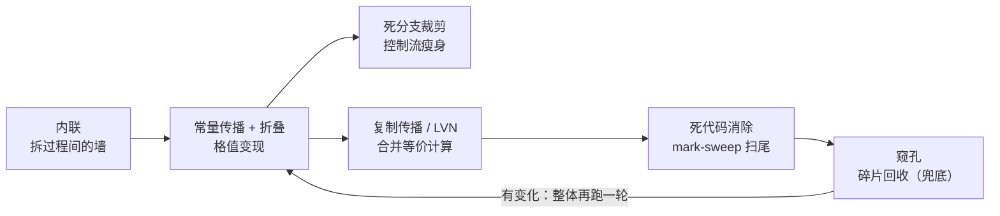

# 经典优化 pass 与管线组织

> [返回：第七阶段导览](01-导览.md)
> 对应大纲第 2 条（后半）。分析（02 册）与 SSA（03 册）都是"给依据"；本册是"动刀"的部分：折叠、传播、消除、内联、窥孔五类经典 pass，以及**它们为什么必须组成管线、按什么顺序跑**。所有代码在本机 Node 24 实跑（输出为真实运行结果），跑在不带 φ 的 TAC CFG 上——正如[第五阶段](../05-第五阶段/02-中间表示家族.md)所说，mini 走的是"字节码 + 保守分析"路线，SSA 版的同一批 pass 只是形态更漂亮，算法灵魂相同。

## pass 分类学：先认清楚手里的刀

| 维度 | 分类 | 例 |
|---|---|---|
| 作用范围 | 局部（块内）/ 全局（CFG）/ 循环 / 过程间 | 窥孔、LVN / 常量传播、DCE / LICM / 内联 |
| 性格 | **转换型**（把代码变好）vs **清理型**（把变好后的残骸扫掉） | 折叠、内联 / DCE、死分支裁剪 |
| 依据 | 确定性等价（怎么变换都合法）vs 分析支撑（依据分析结论才敢换） | 代数化简 / 常量传播、CSE、LICM |

第二行是本册的主线：**转换型 pass 制造机会，清理型 pass 兑现机会，且互相喂饭**——折叠让分支条件变常量 → 死分支裁剪删掉整块 → 块里的定值消失 → 传播的格值变准 → 又能折叠……管线必须**迭代到不动点**。

### 五类 pass 的一张地图

本册的刀按管线顺序排成一张图（边是"喂饭"方向）：



四个问题定位每把刀（读图自查）：

| pass | 改变什么 | 依赖的分析 | 危险边界 |
|---|---|---|---|
| 折叠 | 表达式 → 常量 | 无（纯等价） | 浮点/溢出/除零语义 |
| 传播 | 变量 → 已知格值 | 格 + meet（02 册） | 不满足分配律的保守解 |
| CSE/LVN | 重复计算 → 拷贝 | 等价关系（值编号） | kill 时机、交换律键 |
| DCE | 删指令/块 | 活跃变量（02 册） | 根集合必须含分支条件与副作用 |
| 窥孔 | 局部模式替换 | 无 | 窗口外的全局性质看不见 |

读表的顺序就是管线的顺序：**依赖分析越重的刀越靠后**——DCE 排在传播后面（等格值定案）、窥孔垫底（收所有残骸）。这不是审美，是"信息流向决定粗顺序"（本册末节）的预演。

## 常量折叠：先立规矩

折叠 = 编译期把 `2*3` 算成 `6`。规则看似废话，边界全是坑——**编译器不允许改变可观察行为**（否则正确的程序被优化错）：

- **整数除零**：不折叠，留给运行时报错——mini 的 `DIV` 语义是运行时错误，编译期算掉等于把错误吞了；
- **浮点 `x * 0` 不是 `0`**：`x = NaN` 时 `NaN*0 = NaN`，`x = -1` 时结果是 `-0`（`1/-0 = -∞`，符号可观察）。整数域可以 `x*0 → 0`，浮点域不行——阶段自测考过这题，这里给出机制层面的完整答案；
- 溢出：语言若定义回绕（wasm 的 `i32.add`）可折叠；若定义抛错（Rust debug）则不可——**折叠规则跟着语言语义走，不跟着数学走**。

```ts
const FOLD: Record<string, (a: any, b: any) => number | boolean | null> = {
  add: (a, b) => typeof a === 'number' && typeof b === 'number' ? a + b : null,   // null = 不可折叠
  sub: (a, b) => typeof a === 'number' && typeof b === 'number' ? a - b : null,
  mul: (a, b) => typeof a === 'number' && typeof b === 'number' ? a * b : null,
  lt:  (a, b) => typeof a === 'number' && typeof b === 'number' ? a < b : null,
  gt:  (a, b) => typeof a === 'number' && typeof b === 'number' ? a > b : null,
};
```

### 折叠边界四道判断题：手推

"边界全是坑"值得逐题推演——每题先问"哪些输入会让变换改变可观察行为"：

| 变换 | 整数域 | 浮点域 | 反例 |
|---|---|---|---|
| `x * 0 → 0` | 合法 | **不合法** | `x = NaN`：`NaN*0 = NaN ≠ 0`；`x = -1`：结果 `-0`（`1/-0 = -∞` 符号可观察） |
| `x - x → 0` | 合法 | **不合法** | `x = NaN`：`NaN-NaN = NaN`；`x = +∞`：`∞-∞ = NaN` |
| `x / 1 → x` | 合法 | 合法 | 无——除以 1.0 对一切 IEEE 值保值（NaN、±0、±∞ 均不变） |
| `x / x → 1` | 不合法（x=0 抛错） | **不合法** | 整数域 `x=0` 是运行时错误；浮点域 `x=0` 得 NaN、`x=∞` 得 NaN |

四道题合成一条判定纪律：**先枚举值域里的特殊值（0、±0、NaN、±∞），再问变换在每个特殊值上是否保值**——特殊值枚举不全，折叠就是潜伏的错误。FOLD 表里每条 lambda 只对 number 开闸，正是把"mini 当前只有整数语义"编码进了代码；一旦引入浮点，这张表要逐条重审。

## 常量传播 + 死分支裁剪：02 册格理论的变现

折叠只处理"字面量直接相碰"；传播负责把常量**送到**运算跟前。状态是 02 册讲过的三值格 `⊤ → c → ⊥`，meet 逐变量：相等则保持，不同则 ⊥。它就是数据流分析的直接实例化（`Env = Map<变量, 格值>`）：

```ts
type Lat = { k: 'top' } | { k: 'const'; v: number | boolean } | { k: 'bot' };
const meetV = (a: Lat, b: Lat): Lat =>
  a.k === 'top' ? b : b.k === 'top' ? a
  : a.k === 'const' && b.k === 'const' && a.v === b.v ? a : { k: 'bot' };

function evalInstr(d: Instr, env: Map<string, Lat>): Lat {   // 单条指令的抽象求值
  if (d.op === 'const' && d.lit !== undefined) return { k: 'const', v: d.lit };
  if (d.op === 'copy') return env.get(d.srcs[0]) ?? { k: 'top' };
  const f = FOLD[d.op];
  if (!f || !d.dest) return d.dest ? { k: 'bot' } : { k: 'top' };
  const vs = d.srcs.map(s => env.get(s));
  if (vs.some(v => !v || v.k === 'bot')) return { k: 'bot' };
  if (vs.some(v => v.k === 'top')) return { k: 'top' };
  const r = f(...vs.map(v => v!.v));
  return r === null ? { k: 'bot' } : { k: 'const', v: r };
}
// 块内逐步推进 + 块间 worklist 的骨架与 02 册 solve 完全同构，此处从略（完整实现见 07 册工程版）
```

传播收集到的常量有两种兑现方式，本册实现合在一个 `foldAndPrune` 里：

1. **算得出常量的指令 → 改写成 `const` 指令**（`t2 = mul(t1,k)` 当 k=3、t1=⊥ 时保持原样——只重写整体可折叠的）；
2. **分支条件是常量 → 删死边**：`br debug`（debug=false）只保留活边，终结指令退化为 `jmp`；随后沿活边做可达性，**不可达块整块删除**——块里就算有 `print` 也删，因为它永远不会执行。

第 2 条是常量传播威力的一半：它不只优化计算，**还优化控制流**，删掉代码后格值又能变准（死块里的定值不再污染汇合点）。完整形态是 SCCP（稀疏条件常量传播），把"边的可达性"也并进 worklist 一起迭代；本册的两步走（先传播后裁剪）是它的可读近似。

### 数据流方程的逐步迭代表：末节例子跑一遍

把 02 册的方程用到本册末节那个例子上（k=3、debug=false、a 是未知参数），逐轮列出格值——"迭代到不动点"的每一步都摊开：

```text
变量集:  k  debug  t1  t2  t3  w  d1  r  dead      （a 恒 ⊥；初值全 ⊤ = "未见过"）
```

| 轮 | 块 | IN（meet 后） | transfer 后 OUT |
|---|---|---|---|
| 1 | B0 | 入口边界 ⊤ | k=3, debug=false, t1=⊥, t2=⊥, t3=⊥, w=2 |
| 1 | B1 | OUT(B0)（单前驱） | 同 OUT(B0)，另 d1=⊥（add(t2,hundred)，t2=⊥） |
| 1 | B2 | OUT(B0)（单前驱） | 同 OUT(B0)，另 r=⊥, dead=⊥ |
| 2 | B0~B2 | 与第 1 轮相同 | **无变化 → 不动点** |

三处值得盯住：其一，`t2 = mul(t1,k)` 的格值是 ⊥ 而不是"部分常量"——格没有"一半知道"这个值，meet 与 transfer 都只在完整格值上操作（末节实测"传播停在格值的 ⊥ 处"的方程版）；其二，B1/B2 的 IN 都等于 OUT(B0)——单前驱块的 meet 是恒等；其三，第 2 轮"无变化"不是浪费——**不动点的验证轮是收敛证明的一部分**（02 册 worklist 的 visits 计数同理）。

传播阶段的解就位后，裁剪阶段接着跑：`debug` 的格值 false → `br debug` 只留假边 → B1 不可达整块删除 → **B1 里的 d1 定值随之消失**——这正是正文说的"删掉代码后格值又能变准"：d1 从方程组里除名，下一轮迭代不再被它污染。

## 复制传播与 CSE：局部值编号（LVN）

`a = b; use(a)` → `use(b)`：拷贝只为"改名"付费。块内做一张"名字 → 等价代表"的小表即可。CSE 的局部版 **LVN（local value numbering）** 把它一并解决：给每个计算出的值编号，**同值不同名 → 后者改写成前者的拷贝**：

```ts
function lvn(cfg: Cfg): boolean {
  let changed = false;
  for (const b of cfg) {
    const table = new Map<string, string>();            // 表达式键 → 首次计算的名字
    for (const d of b.instrs) {
      d.srcs = d.srcs.map(s => table.get(s) ?? s);      // 先换等价代表（顺带传播了拷贝）
      if (!d.dest || !FOLD[d.op]) continue;
      const key = `${d.op}(${d.srcs.join(',')})`;
      const hit = table.get(key);
      if (hit !== undefined && hit !== d.dest) {        // 算过 → 改写成拷贝
        d.op = 'copy'; d.srcs = [hit]; changed = true;
      } else if (hit === undefined) {
        table.set(key, d.dest);
      }
    }
  }
  return changed;
}
```

实现只有 15 行，但有三个"真实世界"的注意点：

1. **交换律**：`add(a,b)` 与 `add(b,a)` 键不同却同值——工业 LVN 先把操作数**按值编号排序**再拼键。教学版按键精确匹配，漏掉交换对的代价只是少优化，不会错；
2. **kill 要跟着值编号走**：块内重定义操作数后，涉及旧值的表项作废——本实现靠"srcs 先替换成代表名"间接触发（代表名变了，键就变了），能跑但绕；工业实现给"值"和"名字"分两张表；
3. **全局 CSE** 要 02 册的可用表达式分析把表扛过基本块边界——`B0 算过 gt(a,b)`、两条分支都没改 a/b，汇合处 `gt(a,b)` 才敢复用（02 册 max 的实测输出里 `gt(a,b)` 恰好在两支都可用，就是教科书案例）。

### LVN 手推：末节例子 B0 的编号表

把 lvn 函数在末节例子的 B0 上逐指令走一遍（列名对应函数里的变量）：

| 指令 | srcs 换成代表后 | 键 | 表内命中？ | 动作 | 表状态变化 |
|---|---|---|---|---|---|
| `k = const 3` | — | — | —（const 不在 FOLD） | 跳过 | — |
| `debug = const false` | — | — | —（同上） | 跳过 | — |
| `t1 = mul(a,a)` | `[a,a]` | `mul(a,a)` | 无 | 记键 | `mul(a,a) → t1` |
| `t2 = mul(t1,k)` | `[t1,k]` | `mul(t1,k)` | 无 | 记键 | `mul(t1,k) → t2` |
| `t3 = mul(a,a)` | `[a,a]` | `mul(a,a)` | **命中 t1** | 改写 `t3 = copy(t1)` | 不变 |
| `w = const 2` | — | — | —（const） | 跳过 | — |

第 5 行是全表的落点：t3 的键与 t1 完全一致 → 改写成拷贝——末节实测输出里 `t3 = copy(t1)` 就是这一行执行的直接产物。两个"跳过"也值得读：`const` 指令不进编号表（它不是"计算"，没有可复用的开销），`debug` 同理——**表只记"花了运行时成本的计算"**，这就是"值编号"里"值"的边界。DCE 随后接手：`w`、`dead` 无读者被删（下一节的手推）。

## 死代码消除：mark-sweep，和 GC 同构

DCE 的判据"结果没人读 + 无副作用"由[活跃变量分析](02-数据流分析.md)给出；实现形态是**标记-清除**——和第六阶段 GC 一个模子：

```ts
function dce(cfg: Cfg): boolean {
  const live = new Set<Instr>();                       // 按定值点标记（非 SSA 时同名多定义各自算）
  const defsOf = new Map<string, Instr[]>();
  for (const b of cfg) for (const d of b.instrs)
    if (d.dest) (defsOf.get(d.dest) ?? defsOf.set(d.dest, []).get(d.dest)!).push(d);
  const markVar = (v: string) => {
    for (const d of defsOf.get(v) ?? [])
      if (!live.has(d)) { live.add(d); d.srcs.forEach(markVar); }   // 活的定义传染它读的变量
  };
  for (const b of cfg) {                               // 根集合：副作用指令读的变量
    for (const d of b.instrs) if (d.op === 'print') d.srcs.forEach(markVar);
    if (b.term.op === 'br') markVar(b.term.cond);
    if (b.term.op === 'ret') b.term.srcs.forEach(markVar);
  }
  let changed = false;
  for (const b of cfg) {
    const keep = b.instrs.filter(d => d.dest === null || live.has(d));
    if (keep.length !== b.instrs.length) { b.instrs = keep; changed = true; }
  }
  return changed;
}
```

根是副作用（print/分支条件/返回值），可达性沿 use-def 链传染，扫掉的是"不可达的纯计算"——把根集合换成"栈+全局"，就是第六阶段的标记-清除 GC。**"活"的定义在两个世界里一字不差**；[前端工程对照册](06-前端工程优化对照.md)会把这份同构带到 tree-shaking。

### DCE 手推：从根集合出发的传染表

把 dce 函数在末节例子（裁剪后剩活分支）上走一遍——**标记**阶段的传染顺序：

| 步 | 根/传染源 | 动作 | live 集合新增 |
|---|---|---|---|
| 1 | `print(r)`（副作用） | 读 r → markVar(r) | r 的定值 |
| 2 | markVar(r) | r=add(t2,t3) 入 live；传染 t2、t3 | t2、t3 的定值 |
| 3 | markVar(t2) | t2=mul(t1,k) 入 live；传染 t1、k | t1、k 的定值 |
| 4 | markVar(t3) | t3=copy(t1) 入 live；传染 t1（已在） | 无 |
| 5 | `ret r`（副作用） | r 已在 live | 无 |
| 6 | term 已退化为 jmp | 死分支裁剪过，br 条件不进根 | 无 |

**清除**阶段按 live 过滤：`w = const 2`（w 从未被 mark）→ 删；`dead = add(r,r)`（同）→ 删；顺带 `debug` 的定值也无人再读（br 已退化成 jmp），与死分支一起被清——末节实测输出里 debug 消失的机制就在这。两个细节是这趟手推的真收获：其一，传染是**沿 use-def 边的多波扩散**——步 2~4 就是一轮 DFS，`markVar` 的递归形态与 [第六阶段 GC](../06-第六阶段/03-垃圾回收深入.md) 的标记函数同构（正文那句"把根集合换成栈+全局"的代码级对照）；其二，`k` 是被传染进来的——**DCE 只问"有没有人读"，不问"值是什么"**——值归常量传播管、活性归 DCE 管，两个判定独立，混起来是 DCE 的经典 bug 来源。

## 内联：优化之母

内联（inlining）= 把 `f(x)` 的调用点展开成函数体。它自己省的只是 CALL 开销，**真正的价值是把过程间的墙拆掉**：展开后，调用者的常量能传播进函数体、函数体的死代码能被整体消除、CSE 的表能横跨调用边界——几乎每一类 pass 都因内联而更强，所以说"内联是优化之母"。

mini 语义下的内联（AST 层面）：

```ts
// fn sq(x: number) -> number { return x * x; }
// sq(a + 1) + sq(b)
//
// ① 参数绑定：调用实参替换形参（重命名防碰撞：sq 体内 x → x_0）
// ② 单 return 展开：return e → 把 e 填回调用点
//    → (a + 1) * (a + 1) + b * b
// ③ 后续 pass 接管：LVN 抓住 (a+1)*(a+1) 的重复、传播/折叠/DCE 照常清扫
```

多 return、递归、体积阈值、调用深度预算——工程内联器一半的代码在做"**值不值得**"的决策：

- **收益**：常量实参（暴露折叠机会）、热点小函数、单行包装函数；
- **代价**：代码膨胀（I-cache 友好性下降）、编译时间、递归无界展开；
- 现代引擎更进一步：**运行时按 profile 内联**（只内联热点路径上见过的 callee 形状）——那是 [JIT 视角册](05-JIT视角.md)的主场。

### 手推 `sq(sq(a))`：内联后各 pass 的红利清单

自测第 5 题的答案值到手推一遍。内联两步展开（重命名防碰撞）：

```text
内联前:  sq(sq(a))
第 1 层:  t0 = a * a;  sq(t0)          ← 外层调用点填入内层结果
第 2 层:  t1 = t0 * t0                  ← sq 体的 return x*x 填回调用点
结果:    t1（两层 CALL 都消失）
```

后续 pass 各自吃到什么（逐 pass 对号）：

| pass | 红利 | 在本例中的形态 |
|---|---|---|
| 常量传播 | 若 `a` 是常量（如 5），一路折叠到底 | `5*5=25` → `25*25=625` → 整个表达式折叠成 `const 625`，**运行时零计算** |
| LVN/CSE | 相同子表达式合并 | 本例 `t0*t0` 与 `a*a` 键不同（无重复）；若源码是 `sq(a) + sq(a)`，第二处变 `copy(t0)` |
| DCE | 中间量若只喂死分支，整链消失 | 与死分支裁剪联动（"互相喂饭"的实例） |
| 复制传播 | 内联引入的参数拷贝被穿透 | `t0 = copy(a)` 形态的参数绑定消失 |

对照正文的三行代价（膨胀、编译时间、递归），把 `sq` 换成 500 行的函数：折叠/传播的红利**仍在**（内联的本质收益不变），但 I-cache 与编译时间的代价开始压过收益——**内联决策是收益表对代价表的逐例权衡**，工程内联器一半代码做的就是这个权衡。

## 窥孔优化：最便宜也最实用

在目标码（或接近目标的 IR）上开一个小窗口，匹配到模式就替换。它不依赖任何分析，靠的是一张**模式表**：

| 模式 | 替换 | 依据 |
|---|---|---|
| `JMP L; L:` | 删 JMP | 落到下一条 |
| `JMP L1` 且 L1 处是 `JMP L2` | 改 `JMP L2` | 跳转 threading |
| `ADD 0` / `MUL 1` | 删 | 代数恒等 |
| `NOT NOT x` | `x` | 双重否定 |
| 压栈后立即弹出（栈机） | 两条全删 | 栈平衡 |

窥孔是**兜底**：前端 lowering 产生的碎片（第五阶段短路求值模板里的冗余跳转）由它回收。[07 册实践](07-实践-优化pass与收益分析.md)在 mini 字节码上给出完整实现——`CONST x; POP → ε` 这个模式还顺手兜住了死存储消除换出来的 POP 残骸。

### 窥孔的窗口与局限：它看不见什么

窥孔的定义性特征是"小窗口 + 无分析"，这个特征同时是它的强与弱。弱在窗口外的一切全局性质：

| 窗口内的判断（窥孔能做） | 窗口外的判断（窥孔做不到） |
|---|---|
| `ADD 0` 删——恒等式局部成立 | `t2 = mul(t1,k)` 是否可折叠——取决于 t1 的格值（要传播） |
| `JMP L; L:` 删——落穿等价 | 某块是否不可达——取决于全图可达性 |
| `NOT NOT x` 删 | `t3 = mul(a,a)` 与 t1 等价——取决于值编号（要 LVN） |

所以窥孔在管线里是**兜底**而不是主力（正文的定位）：局部愚蠢它包办，全局聪明让位给前面的 pass。这个分工还解释了一个工程现象：窥孔通常跑在**目标码层**（或最接近目标的 IR 上）——越接近目标，指令选择与布局产生的碎片越多，兜底价值越大。[07 册实践](07-实践-优化pass与收益分析.md)把它放在四连 pass 的第 3 位，前面有传播与死存储、后面有可达性清扫——同一思想的字节码版排序。

## 循环优化一瞥

大纲点到两个循环优化，判据全部来自前两册：

- **LICM（不变量外提）**：`while (c) { y = n*one; }` 中 `n`、`one` 全环不变。判据 = 定值支配所有使用 + 循环内无定值（02 册实测输出里 `n/one` 全图活跃就是信号）。**安全点**：只能外提到**支配循环体的位置**（循环头入口）；若有 `break` 依赖或循环可能零执行，提到循环外可能多算一次——副作用与除零语义决定合法与否；
- **归纳变量简化**：`for i: a[i]` 的地址 `base + i*8` 每轮加 8 递推，乘法变加法、强度削弱；`i` 本身若只用于迭代（无人读），DCE 可再删——一个优化给另一个优化喂饭的循环案例。

SSA 上的循环优化（loop-rotate、indvar canonicalization）是 LLVM middle-end 的重头戏，思路同源、机器更贵——此处点到为止，Mini 不实现（列入 07 册选做）。

### LICM 手推：外提一次的前后对照

把 LICM 判据落到 02 册 loop 例子的骨架上（`s += n * one` 换个形状）：

```text
外提前（循环体 B2 内）:            外提后（预头块 P，循环头 B1 之前）:
B2: t   = mul(n, one)  ← 每轮都算   P:  t   = mul(n, one)  ← 整个循环只算 1 次
    s_2 = add(s_1, t)              B1: （φ 与条件判断照旧）
    i_2 = add(i_1, one)            B2: s_2 = add(s_1, t)
    br → B1                            i_2 = add(i_1, one)
                                       br → B1
```

合法性逐条过判据：① `n`、`one` 在循环内无定值 → 不变；② `t` 的使用点（`add(s_1,t)`）被外提位置支配，且外提位置到使用点之间 `t` 无重新定值 → 安全；③ `mul` 无副作用 → 挪动不改变可观察行为。收益对 N 轮循环：N 次 → 1 次。三个"如果"中任何一个反转，外提立即非法：若 `t` 在循环内被重新定值（不变量破坏）、若 `mul` 可能抛错而循环可能零执行（**零执行路径也多算了这一次**）、若 `one` 恰在 `t` 之后被赋值（use-def 序变化）。**"循环可能零执行"是最容易被忽略的一条**——`while (false) { x = 1/0 }` 外提后变成必抛错，可观察行为改变，这就是正文安全点条款的实例。

## 管线：组织起来，迭代到不动点

单看每个 pass 都简单，**难在顺序**（phase ordering 是 NP 难的开放问题），工程答案朴素：

1. **信息流向决定粗顺序**：内联最先（拆墙）→ 传播/折叠（产生常量与死代码）→ CSE/复制传播（合并）→ DCE 最后扫尾；
2. **不猜一轮够不够，直接迭代到不动点**：任何 pass 报告了变化就整体再跑一轮；
3. **pass manager 管依赖与预算**：LLVM 新 PM 按 pass 明确声明分析依赖（谁要 AAResults、谁要 DominatorTree），分析结果按需缓存失效——教学版一个 for 循环足矣：

```ts
function pipeline(cfg: Cfg): number {
  let round = 0;
  let changed = true;
  while (changed && round < 10) {
    round++;
    changed = false;
    changed = foldAndPrune(cfg, constProp(cfg)) || changed;   // 传播+折叠+死分支裁剪
    changed = copyProp(cfg) || changed;
    changed = lvn(cfg) || changed;
    changed = dce(cfg) || changed;
  }
  return round;
}
```

一个吃满所有 pass 的例子（`k=3`、`debug=false`、`t3` 与 `t1` 同式、死分支、无用计算），实测 **2 轮到不动点**：

```text
--- 优化前 ---
B0: k = const 3; debug = const false; t1 = mul(a,a); t2 = mul(t1,k);
    t3 = mul(a,a); w = const 2;            br debug → [B2, B1]
B1: d1 = add(t2,hundred); print(d1)        ← 死分支（debug 恒假）
B2: r = add(t2,t3); dead = add(r,r); print(r); ret r

--- 优化后（2 轮到不动点） ---
B0: k = const 3; t1 = mul(a,a); t2 = mul(t1,k); t3 = copy(t1); jmp → [B1]
B1: r = add(t2,t3); print(r); ret r

可观察行为: 前=[print(64) ret(64)]  后=[print(64) ret(64)] → OK 语义一致
（块号因删除不可达块而变化，不计入对照）
```

逐条对账：`debug` 与死分支一起消失；`w`、`dead` 被 DCE 清掉；`t3` 被 LVN 改写成 `copy(t1)`；`t2 = mul(t1, k)` 保留（t1 未知，只把 k 传播到位——**传播停在格值的 ⊥ 处，不多走一步**）。

第二个例子接[上一册](03-SSA构建.md)的摊子：SSA 销毁留下的拷贝链，同一个管线清理后 `s = add(a0, b0)` 一条留下（`b1 = copy(b0)` 无读者，DCE 删除；`a1 = copy(a0)` 被复制传播穿透）——实测 `ret(42)` 前后一致。**转换 pass 之间互相喂饭的具体形态，就在这两个例子里**。

### 顺序敏感的一个最小样本

"phase ordering 难"不需要大例子，两把刀的先后就能演示（质量差异，不是正确性差异）：

```text
代码:  t1 = add(a, b);   t2 = add(b, a);   r = add(t1, t2)

顺序 A（LVN 先跑，无交换律规范化）:
  t1 记键 add(a,b)；t2 键 add(b,a) 不同 → 不合并；r 键 add(t1,t2) 新 → 3 条计算全保留

顺序 B（代数规范化先跑：操作数按字典序重排）:
  t2 键规范化为 add(a,b) → 命中 t1 → t2 = copy(t1)；r 的键也随之收敛
  → 少一条计算，后续 DCE 的可清对象变多
```

两种顺序**语义都对**——差的只是收敛轮数与最终留下的冗余量。真实的 phase ordering 问题就是这个样本的放大：任何一对 pass 都可能互相"制造或消灭对方的工作"，全序的最优解没人知道（NP 难的开放问题），工程答案是"经验序 + 迭代到不动点兜底"。LLVM 新 PM 的 pass 管线（inline → mem2reg → instcombine → SCCP/GVN → 循环族 → 死存储/ADCE 的骨架，随版本演进）就是这份经验序的工业沉淀——本册 pipeline() 的"传播 → 合并 → 扫尾"是它的教学缩影。

## 常见误区

- **"优化不会改变语义，所以可以随便堆 pass"**——前半句只在"语义 = 语言的精确定义（含错误、NaN、溢出）"时成立。折叠规则跟着语义走（四道判断题），语义理解错一步，堆多少 pass 都是把对的程序改错；
- **"传播比折叠强，直接上全局传播"**——折叠是纯等价（零风险零成本），传播依赖格分析（有保守性与实现成本）。块内折叠先清一轮，全局传播的工作量与误报面都显著变小——**先局部后全局**是管线顺序的普遍理由；
- **"SSA 让优化都不需要数据流了"**——SSA 消灭的是"同名多版本"这一类问题；循环携带、全局 CSE 的可用性、活性判据仍要分析（02 册）。SSA 把一部分迭代分析变成图查询，不是把分析消灭；
- **"DCE 放最后是习惯"**——它是信息流向：DCE 的判据"没人读"在传播/内联/CSE 之后才最终定案——中途跑一遍 DCE 没错（迭代会补），但最后一次扫尾必须在所有转换之后，否则残骸没人收；
- **"轮数越少说明管线越好"**——轮数是管线组织与例子的函数（本册例子 2 轮、[07 册实测一](07-实践-优化pass与收益分析.md) 3 轮），不是语义属性；追求"一轮收敛"的正确路径是按信息流排序（02 册的 RPO 技巧），不是把迭代轮数当 KPI。

## 与其他册的连接

- 分析的格与 worklist：[02-数据流分析](02-数据流分析.md)——传播与 DCE 的全部依据；
- SSA 与 GVN 的全局版：[03-SSA构建](03-SSA构建.md)——本册 LVN 的图上推广；
- 字节码上的同一批 pass 与实测收益：[07-实践-优化pass与收益分析](07-实践-优化pass与收益分析.md)；
- mark-sweep 的同构本尊：[06-第六阶段 · 垃圾回收深入](../06-第六阶段/03-垃圾回收深入.md)；
- tree-shaking：同一套可达性思想在前端构建器的投影：[06-前端工程优化对照](06-前端工程优化对照.md)；
- profile 驱动的内联与推测特化：[05-JIT视角](05-JIT视角.md)；
- TAC/字节码两种 IR 的谱系：[05-第五阶段 · 中间表示家族](../05-第五阶段/02-中间表示家族.md)。

## 自测

1. 为什么整数 `x*0 → 0` 合法而浮点不合法？分别给出 `x` 的取值使两种语言的浮点 `x*0` 不等于 `0`。
2. 常量传播的格 meet 里，`⊤ ∧ ⊥ = ⊥` 而不是 `⊤`——从"没见过"和"见过但不是常量"的语义差别解释为什么。
3. LVN 的键 `add(a,b)` 与 `add(b,a)` 不同值吗？给出工业实现"按值编号排序操作数"仍不安全的运算符类别（提示：减法不行吗？浮点加法的交换有例外吗）。
4. DCE 的根集合为什么必须包含分支条件，而不仅是有副作用的调用？漏掉它哪个用例会优化错？
5. 内联 `sq(sq(a))` 两层之后，哪些后续 pass 各自吃到什么红利？如果 sq 体积是 500 行呢？
6. 管线为什么把 DCE 放在最后而不是最先？"转换 pass 报告变化就重跑一轮"的停止条件为什么必然停？

（7~12 为扩写增补题，答不出就回到对应小节的手推再读一遍。）

7. 四道折叠判断题里 `x/1` 在浮点域合法。给 `x` 的特殊值（NaN、±0、±∞）逐一代入验证保值；哪道题的"不合法反例"同时用到符号与 NaN 两个机制？
8. 数据流逐步迭代表里 B1/B2 的 IN 都等于 OUT(B0)。若 B2 的前驱还有一个来自别处的边（菱形变三角），meet 会怎么变、t2 的格值会变吗？
9. LVN 手推表里 `const` 指令不进编号表。如果把它也记进去（键 `const(3)`），DCE 之后哪条指令可能被错误地"复用"？"值"的边界为什么划在"有运行时成本的计算"上？
10. DCE 手推第 6 步，若 term 仍是 `br debug`（裁剪没跑），live 集合会多出谁？debug 的定值保得住吗？这与自测第 4 题"根集合必须含分支条件"是什么关系？
11. LICM 手推的"零执行路径多算一次"：若 `mul` 换成 `div`（可能除零），外提合法吗？给出两个修法（不外提 / 加守卫块），各自付出什么？
12. 顺序样本里顺序 B"少一条计算"。为什么不能据此说"规范化永远该排在 LVN 前面"？举一个规范化白费功夫的场景（提示：操作数本来就是字典序时）。
