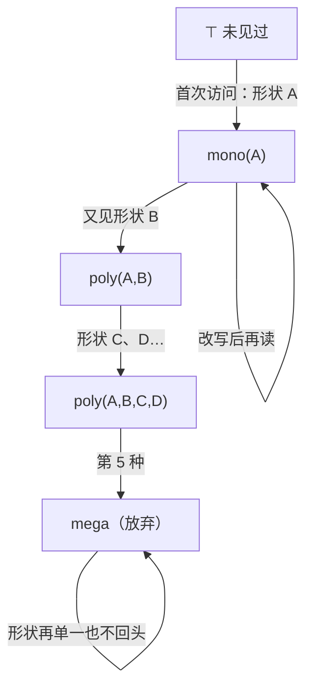

# JIT 视角：反馈、推测与反悔的权利

> [返回：第七阶段导览](01-导览.md)
> 对应大纲第 3 条。前置阅读：[js-ts 站 · V8 引擎](https://yidafu.github.io/tech-learning/js-ts/notes/stage-2-engine-runtime/07-v8-engine)——那一册从**引擎工程**视角讲全链路（Ignition/Sparkplug/TurboFan 分层、隐藏类迁移链、elements kinds 退化、可操作的性能清单）；本册换**编译原理**视角讲同一台机器：**JIT 是一台运行着的优化编译器，它的每类武器都是前几册 pass 的运行时变体**——内联缓存是运行时的窥孔/记忆化，类型反馈是运行时的数据流格，去优化是"反悔的权利"。两册刻意不重复：那册回答"V8 里有什么"，本册回答"为什么恰好是这些、它们凭什么合法"。本册代码在本机 Node 24 实跑（输出为真实运行结果）。

## JIT 的一号问题：拿什么喂优化器

AOT 编译器（gcc/LLVM 静态编译、以及[ wasm 后端](../11-Wasm专题/06-实践-mini到Wasm.md)）看到的是"全部程序 + 全部类型信息"——本阶段 02~04 册的 pass 都建立在静态可知上。JS 呢？

- 动态类型：`a + b` 的语义到运行时才知道；
- 热点未知：哪段代码值得编译，跑起来才知道；
- 加载迟滞：`eval`、动态属性注入能推翻一切静态结论。

JIT（just-in-time）的答案是把编译器搬到运行时，用**观测**补静态信息的缺口：先解释执行（便宜启动 + 顺手记账），热点函数再依据账本（feedback）做优化编译。分层是预算问题的解——js-ts 那册的层级表（Ignition 1× / Sparkplug ~2× / Maglev / TurboFan）本质是一张"**每个函数按热度拿到性价比最高的一档**"的分配表：给冷函数上 TurboFan 是亏本买卖（编译成本收不回来），这正是[05 册工具链](../11-Wasm专题/05-工具链与性能真相.md)"该不该上 wasm"同款决策的引擎内版。

### 一笔预算账：什么时候值得编译

分层不需要测量学，只需要一笔收支账。把"执行一个函数 N 次"的总成本写成两条路径的对比：

```text
一直解释：    N × c_interp                    （c_interp = 解释一条指令的摊销成本）
编译后再跑：  c_compile + N × c_opt           （一次性编译成本 + 优化后每条指令的成本）
```

`c_compile + N × c_opt < N × c_interp` 解出临界次数 `N* = c_compile / (c_interp − c_opt)`——**热点阈值就是这条收支平衡线**：函数的预计执行次数低于 N* 该留在解释器，高于才值得编译。分层不是"层数越多越好"，是把同一笔账按热度分段收费：极冷（跑一两次）→ 解释；温（几百次）→ 便宜基线层；热（上万次）→ 全力优化。三个推论立刻能读出来：

1. **c_compile 越大，N* 越大**——TurboFan 的优化管线最贵，所以它的热点阈值最高；
2. **c_opt 越接近 c_interp，编译越不划算**——基线层（只做模板式翻译、不做分析）的 c_opt 只比解释器略好，但 c_compile 小一个量级，N* 极低，"温代码"交给它刚好；
3. **预测执行次数的只能是运行时自己**——interrupt budget 就是这台账本的收支记录员（OSR 一节的判定点）。

AOT 编译器把这笔账整个砍掉：它假设"所有代码都会被反复执行"（或干脆不计编译时间），预算问题不存在——代价是放弃"按实际热度分配编译资源"的能力。这笔账与 [07 册实测二](07-实践-优化pass与收益分析.md)互为注脚：那边的结论是"静态优化消灭静态指令"，这边的结论是"运行时优化按动态热度收费"——两台机器的成本模型横轴不同，拼在一起才是完整图景。

### 观测的三本账

"用观测补静态信息的缺口"落到实现上是三本并行的账，各自回答一个问题：

| 账本 | 记在谁头上 | 记什么 | 喂给谁 |
|---|---|---|---|
| 热度计数 | 函数入口与循环回边 | 调用/回边次数（interrupt budget） | 分层决策：该不该 tier-up |
| 内联缓存 | 每个属性访问/调用点 | 见过的形状与取值 handler | 优化编译器：固化成"比较 + 偏移" |
| 类型反馈 | 每个字节码槽位（feedback slot） | 见过的类型/元素种类/常量值 | 优化编译器：特化与 guard 的依据 |

三本账共享一个设计取向：**记账动作必须便宜到可以常驻**——计数是"每次执行减一"，IC 是"一次形状比较"，反馈是"一次写入"。任何一本账贵过它省下的解释开销，分层就亏本。这也解释了反馈数据为什么按**程序点**存放而不是按函数汇总：优化编译器特化的是"这个位置的这个操作"，不是"这个函数的笼统画像"——下文的 guard 与特化全部以程序点为单位。

## 内联缓存：调用点上的记忆化

动态语言的属性访问 `o.x`，朴素的实现是"查哈希表"。但**同一个程序点的对象形状高度稳定**——"查一次、记住结果"就是内联缓存（IC）：把"这个字节码位置上次见到的形状 + 对应的取值方案"缓存在调用点。它是：

- **运行时的窥孔优化**：把"通用查找"这条"指令"替换成"比较 + 偏移读取"这个更短的固定模式；
- **运行时的 CSE/记忆化**：相同输入（形状）→ 复用首次计算的结果（handler）；
- **按程序点独立的**：每个访问点各一份缓存、各走各的状态机——"函数是多态的"其实是指"函数内某个 IC 点是多态的"。

状态机（与 js-ts 那册的 stateDiagram 同一回事，这里给出可跑的实现）：

```ts
class LoadIC {
  state: 'uninit' | 'mono' | 'poly' | 'mega' = 'uninit';
  private cached = new Map<string, Handler>();         // ≤ 4 条：mono 1 条 / poly 2~4 条
  misses = 0;
  load(obj: Record<string, any>, keyIdx: number): any {
    const shape = Object.keys(obj).join(',');          // 键集合+顺序 = 形状（那册的 Map）
    let h = this.cached.get(shape);
    if (!h) {                                          // miss：按状态机迁移
      this.misses++;
      if (this.cached.size < 4) {
        this.cached.set(shape, handlerFor(shape));
        this.state = this.cached.size === 1 ? 'mono' : 'poly';
      } else {
        this.state = 'mega';                           // 第 5 种形状：放弃本地缓存
      }
    }
    void h;
    return Object.values(obj)[keyIdx];
  }
}
```

实测输出（真实运行）：

```text
load x → state=mono  shapes=1 misses=1     ← 同形状对象重复出现：1 次比较即命中
load x → state=poly  shapes=2 misses=2
load x → state=poly  shapes=3 misses=3
load x → state=poly  shapes=4 misses=4
load x → state=mega  shapes=4 misses=5     ← 第 5 种形状
load x → state=mega  shapes=4 misses=5     ← 回到老形状也还是 mega——单向，不回头
```

两条硬结论都能从输出里读出来：**多态的代价是"逐个比较"**（缓存是线性表，k 态最坏 k 次形状比较——1 态 1 次，4 态 4 次）；**mega 不可逆**（回到单一形状也回不去 mono，缓存已放弃局部性）。这就是"热循环里混形状对象慢一个数量级"的机制内因——那册练习 02 的现象，在这里降到了状态机层面。

### 四种状态的访问成本表

把实测输出翻译成成本视角，四个状态各有各的账单（定性排列，非实测数字）：

| 状态 | 一次 `o.x` 的成本构成 | 相对成本 |
|---|---|---|
| mono | 1 次形状比较 + 1 次偏移读取 | 最低——"单态代码快"的全部内容 |
| poly（k 态） | 最坏 k 次形状比较 + 命中后的偏移读取 | 随 k 线性上涨 |
| mega | 查引擎级的共享查找结构 | 恒定但贵——不再赌局部性 |

**mega 并不是"回到原点"**：它查的是引擎共享的查找结构，仍比朴素哈希查找快；真正的损失是**特化资格**——优化编译器看到 mega 反馈只能生成通用代码。这补全了本节的判断：多态的代价不止"逐个比较"，还有"按形状特化的可能性消失"。

### 逐次比较的手推：最坏情形长什么样

把 4 态 poly 的一次访问展开成逐形状比较的时间线（假设访问的形状恰排在缓存末位——最坏情形）：

| 比较轮 | 缓存项 | 当前对象形状 | 结果 |
|---|---|---|---|
| 1 | 形状 A | 形状 D | 不等，继续 |
| 2 | 形状 B | 形状 D | 不等，继续 |
| 3 | 形状 C | 形状 D | 不等，继续 |
| 4 | 形状 D | 形状 D | **命中** → 偏移读取 |

缓存按填入顺序比较，最坏情形就是"永远访问最后填入的形状"——k 态、k 次比较。IC 的设计赌注因此看清了：**赌的是形状分布的局部性**——一旦一个调用点被轮询 k 种形状，缓存的钱全花在重复比较上。js-ts 那册练习 02 的"混形状轮询慢一个数量级"，把数量级拆开就是这张表乘上循环次数。

### 名字的来历：IC 曾是自修改代码

内联缓存的名字比现代实现更直白：最早的 IC（Smalltalk-80 的高速实现，1980 年代）真的**改写调用点的机器码**——首次执行走慢路径查哈希，查完后把这段指令原地重写成"比较形状 → 跳快速路径"的桩（stub）。现代引擎把"改写机器码"换成"改写 feedback slot + 内置 handler"，更安全，骨架未变：**慢路径只走一次，走完把快路径焊在原地**。这就是"IC 是运行时窥孔"的历史注脚——窥孔用静态知识替换通用模式，IC 用运行时观测替换通用模式，替换发生的时机不同、形状相同。

## 类型反馈：运行时构造的数据流格

feedback vector 记录每个字节码位置实际见过的类型/形状。用 02 册的语言重述：**每个 IC 点有一个类型格，观测是 transfer，格值只升不降**：



和 02 册的"初始化决定解的方向"完全同构：**格只向"更保守"的方向走，单向不回头**——因为引擎无法证明"旧形状再也不会出现"（另一个分支、另一段时间之后都可能再喂进来），只能把已见的都记住。elements kinds 的退化链（PACKED_SMI → DOUBLE → PACKED → HOLEY，那册第 4 节）是同一件事在数组存储上的投影。

优化编译器消费这份格值的方式：**把"mono(小整数)"编译成机器整数加法 + 一条 guard**。于是进入本册的核心问题——

### feedback slot 里到底存什么

"类型/形状"是个概括；真实的 slot 按字节码操作分工记账（机制清单，字段名随引擎版本变、机制不变）：

| 字节码 | slot 记什么 | 优化编译器拿它做什么 |
|---|---|---|
| 属性访问 | 形状 + 偏移/查找 handler | 固化成"比较形状 + 读偏移" |
| 二元运算 | 见过的操作数类型对 | 特化成机器整数/浮点运算 + guard |
| 调用 | 调用计数 + 常见的 callee | 内联决策的输入 |
| 常量类指令 | 是否反复出现同一个值 | 按值特化（常量折叠的运行时版） |
| 数组访问 | elements kind（PACKED_SMI…） | 选择存取布局 + 越界 guard |

第二行与 [04 册](04-经典优化pass.md)常量折叠的关系值得钉住：折叠的依据是"操作数**是**常量"，特化的依据是"操作数**一直是**某类值"——后者弱得多（不需要值本身，只需要格），所以它能在运行时普遍可行。**类型反馈就是把 04 册的格从编译期搬到了运行时**，格的定义一字不用改：未见过 = ⊤、只见过一类 = 单一格值、见过多类 = ⊥（下一节的 guard 兑现它）。

## 推测优化与去优化：反悔的权利

**guard（守卫）**是推测优化编译进代码里的检查："我赌 a 是小整数，进门先验一把"。赌对了走高速代码；赌错了触发**去优化（deopt）**。最小闭环（实测代码节选，输出为真实运行结果）：

```ts
class OptAdd {
  usedSpec = false;                        // 当前是否在用优化路径（tier-up 后置位）
  deoptCount = 0;
  call(a: any, b: any): any {
    if (this.usedSpec) {
      if (typeof a === 'number' && typeof b === 'number')   // guard：编译进优化代码
        return a + b;                      // 优化体：没有 string 分派
      this.deoptCount++;
      this.usedSpec = false;               // deopt：作废优化代码，回解释器
    }
    return addInterp(a, b);                // 通用路径 + feedback 收集
  }
}
```

```text
call(1, 2)     → 3   优化开启（首次解释后 tier-up）
call(20, 22)   → 42  命中优化路径
call('a','b')  → ab  deopt（deopts=1），回解释器
call(3, 4)     → 7   重新收集 feedback 后可再优化
```

deopt 真正难的部分在上面被一行带过（`usedSpec = false`）：**解释器帧的重建**。优化代码里的值住在物理寄存器里、控制流可能已被重排（展开、外提、跳转 threading），而解释器期望"字节码 ip + 操作数栈 + 局部变量表"。去优化时引擎要按**反优化表**（优化编译器随代码一起生成的映射：每个 guard 失败点 → 对应字节码位置与寄存器→栈槽的还原方案）把机器状态翻译回解释器状态——**deopt 是优化编译的逆运行**，编译器必须为自己的每个激进决定预付退路。这也是"优化代码可能比不优化更慢"的机制根源：反复 deopt = 反复重建帧 + 反复重新编译（osr/optimized 之间的抖动），js-ts 那册用 `--trace-deopt` 观测的就是这个循环。

由此可以精确说出 JIT 与 AOT 的边界：**AOT 的每个优化必须对一切输入正确；JIT 的每个优化只需对"观测过的输入类"正确，其余交给 guard + deopt**。乐观优化的全部激进性（NaN 检查都敢省、未加载的属性都敢按偏移读）都建立在"错了能回退"之上——**反悔的权利是激进的许可证**。

### guard 的家族：赌什么，就验什么

"进门先验一把"的 guard 在真实引擎里是一个家族，按赌的内容分类（机制清单，不是某引擎的枚举）：

| guard 类型 | 赌的内容 | 检查动作 | 失败后引擎学到的 |
|---|---|---|---|
| 类型 guard | 操作数是数/字符串/对象 | 类型标记位比较 | 该点类型格收窄或放弃 |
| 形状 guard | 对象仍是某个 hidden class | 形状指针比较 | IC 状态机迁移（本册实测） |
| 值 guard | 某变量仍是特定常量 | 值比较 | 常量格值作废 |
| 原型链 guard | 原型链未被改过 | 原型链校验码比对 | 属性查找缓存作废 |
| 边界 guard | 数组访问在 length 内 | 越界比较 | 退回带检查的慢路径 |

每类 guard 都是 [04 册](04-经典优化pass.md)"分析支撑的转换"里**保守假设**的运行时对应物：静态编译器发现假设不成立只能放弃优化，JIT 发现不成立能反悔。同一类优化因此在两边呈现两种命运——AOT 里"超出分析能力的优化"直接不存在；JIT 里它存在，只要挂一个 guard。**guard 是把"不确定"转换成"确定但可撤销"的价格标签**。

### 一次特化的完整走查：从格值到机器码

把各节的零件串成一条流水线（机制走查，非实测）——`a + b` 在热点循环里的生命周期：

| 阶段 | 发生什么 | 用到的账本 |
|---|---|---|
| 解释执行 | 记账：`a`/`b` 反复是整数 | 类型反馈（格值收窄为"数"） |
| tier-up 触发 | 预算耗尽，送优化编译器 | 热度计数 |
| 特化 | 格值 → 生成机器整数加法 | 类型反馈 |
| 挂 guard | 加一条"两边都是数"检查 | —— |
| 优化代码 | guard 通过 → 纯机器加法，无类型分派 | —— |
| 形状变化 | 某轮 `b` 是字符串 | guard 失败 → deopt（反优化表起效） |
| 重新收集 | 回解释器，格值升级 poly(数,字符串) | 类型反馈（格只降不升） |

最后一行是格论与工程的重逢：poly 的格值让下一轮编译要么放弃特化、要么生成两条路径加两个 guard——**格值每降一级，机器码的特化度跟着降一级**。js-ts 那册性能清单里"保持类型稳定"的每一条建议，都是在给这张表的第一行省时间。

### 帧重建的手推：反优化表长什么样

把"deopt 是优化编译的逆运行"落到一张小表（机制手推）：

```text
优化态（guard 失败的一瞬）          解释器态（deopt 后必须呈现）
ip：无对应（控制流已重排）    →     字节码 ip：12（原来的位置）
r0 = 42                      →     局部槽 1（a）= 42
r1 = 84                      →     局部槽 2（t）= 84（若 t 在字节码层占真槽）
求值栈：已被优化打散           →     求值栈：按字节码 ip 重建出应有形状
```

反优化表就是连接两列的**逐行映射**：`(guard 失败点 → 字节码 ip，物理位置 → 栈槽/局部槽)`。它是优化编译器生成代码时**顺手写下的副产品**——不为它付一份额外编译成本，就没资格激进。两个直接推论：

1. **保留的帧状态信息越多，deopt 越便宜、可激进余地越大**——优化器内部真实的一对张力：寄存器分配想少留活性信息，deopt 想多留；
2. **guard 只能落在"帧状态完整可知"的位置**——优化器只在能完整解释当前状态的地方允许 guard，"guard 插在哪"不是随便选的。

### eager 与 lazy：两种反悔时机

- **eager（守卫处立即反悔）**：guard 比较失败的瞬间触发——上文闭环与帧重建讲的都是它。触发点在优化代码内部，反优化表直接可用；
- **lazy（迟到反悔）**：优化代码依赖某个外部假设（如"函数对象未被改写"），外部世界（另一次调用、一次对象注入）把假设改掉了——引擎在**下次执行到相关操作**时才触发。触发点常在运行时桩（builtin）里，先逃出优化代码再走帧重建。

共同点是**正确性优先于性能**：宁可整段优化代码作废，不带错误假设继续跑。差异决定工程表现——eager 的频率取决于代码形状（混类型输入），lazy 的频率取决于"程序对运行时做了多少小动作"（改原型、改内建）。js-ts 那册性能清单里"别改原型链"一类规矩，lazy deopt 就是它们的机制解释。

## 内联：profile 指挥的跨函数优化

[04 册](04-经典优化pass.md)称内联为"优化之母"，并留了一句"现代引擎更进一步：运行时按 profile 内联"——本节兑现这句话。JIT 内联与 AOT 内联是同一把刀（callee 体展开进调用点），差别在**决策依据**：

| 决策输入 | AOT 编译器 | JIT 编译器 |
|---|---|---|
| 函数大小 | 源码/IR 指令数 | 同左，外加编译产物大小预算 |
| 调用热度 | 静态猜测（全程序平等） | **实测**：feedback slot 里的调用计数 |
| callee 形状 | 全部（类型已知） | 只展开观测过的类型路径，其余挂 guard |
| 递归/深度 | 编译期预算 | 同样要预算（防无界展开） |

第三行是 JIT 特有红利：**AOT 内联必须对一切调用形状正确，JIT 内联只需对观测过的形状正确**——`f(x)` 的 profile 显示绝大多数调用传的是数，JIT 就内联"数路径"、其余路径留 guard 走通用代码。内联决策从"保守启发式"变成"按热点分布下注"，是推测优化在内联维度的投影。

内联还给 deopt 添了新工作量：**反优化表必须能重建内联链上的每一层帧**——`main → helper → inlined` 三层里 guard 失败，解释器需要三层字节码帧才能继续。优化编译器为每个内联点保存一份帧状态快照，deopt 时从最内层向外逐层重建。内联越深、反优化表越大——又一次"激进要预付退路"。

## 逃逸分析：把"建对象"特化掉

逃逸分析问一个问题：**这个新建对象会不会活到这次调用之外？** 判定是图上的可达性问题：以"堆写入点/返回点/全局赋值"为根做活跃性传染（[02 册](02-数据流分析.md)框架），传染够不着的新建对象 = 不逃逸。不逃逸解锁一串特化：

- **标量替换**：对象不创建，字段拆成独立局部值住寄存器——"读堆字段"变"读寄存器"；
- **栈分配**：对象放栈帧，函数返回自动回收，GC 绕行；
- **锁消除**：只被本线程看见的对象，同步操作无意义，一并消失。

它是 JIT 武库里赌得最狠的一类：分析错了不是慢，是**错**——所以工业实现要么极保守（分析不透当逃逸），要么给"不逃逸"结论挂 guard（运行时再验一次，失败走 deopt）。[04 册](04-经典优化pass.md)说"转换型 pass 制造机会，清理型 pass 兑现机会"，逃逸分析是极限版：**它制造的机会（消灭分配）要一整条下游链兑现**——寄存器分配接住标量、GC 统计对账少了对象。与 mini 对照：mini 的对象全在堆上、无逃逸分析；若给 mini 上这套，最先受益的是循环里造临时对象的基准——分配压力下降，[第六阶段](../06-第六阶段/03-垃圾回收深入.md)的 GC 频率跟着降。

## OSR：正在跑的循环怎么办

热点常常是**一个正在执行的长循环**，等它返回再优化 = 优化永远不来。OSR（on-stack replacement，栈上替换）：在循环回边处（interrupt budget 耗尽的判定点，那册第 1 节）把**当前栈上的解释器帧直接替换成优化帧**——从"本循环的第 k 次迭代"起改跑优化代码。两个工程要点：

- **入口在循环中间**：优化代码必须为"从任意迭代进入"生成一个特殊入口（LLVM 的 `osr` 入口块、V8 的 OSR 编译产物带循环入口桩）；
- **替换是原子的**：帧布局完全不同（解释器栈槽 vs 物理寄存器），切换瞬间要做一次与 deopt 对称的翻译——OSR 是"解释态→优化态"的翻译，deopt 是反方向，**同一套映射表两头用**。

这就是"一个死循环也能越跑越快"的机制：回边预算耗尽 → OSR 替换 → 循环体以优化形态继续。

### OSR 一次旅程的六步手推

把"死循环也能越跑越快"展开成时序表（机制步骤，非实测）：

| 步 | 发生什么 | 状态 |
|---|---|---|
| 1 | 解释器跑循环，每次回边使 interrupt budget 减一 | 解释态，慢 |
| 2 | 预算耗尽：在**当前这次回边**处停下 | 循环第 k 轮中途 |
| 3 | 触发 OSR 编译：以循环体为优化单元、以"第 k 轮的活值"为初始状态 | 编译中（旧帧还活着） |
| 4 | 生成带**循环入口桩**的优化代码 | 双态并存 |
| 5 | 帧翻译：解释器栈槽 → 优化帧布局（deopt 的映射表反着用） | 一次性成本 |
| 6 | 从循环体中间跳进优化代码，继续第 k 轮 | 优化态，快 |

第 5 步是 OSR 与普通 tier-up 的本质差异：普通编译从函数入口启动、变量值来自参数；OSR 入口的变量值来自**当前栈上的活值**，翻译表要为"任意一轮中途进入"备好每个槽的来源。第 3 步另藏一手：OSR 编译只掌握"到第 k 轮为止"的观测，特化的依据天然少一半——这也是 OSR 产物通常比"自然 tier-up 产物"保守的原因之一。OSR 与 deopt 的对称性一张图收束：


## 与 mini 的关系：为什么 mini 不做 JIT

值得诚实回答的问题。JIT 的前提是有"观测"可依：类型反馈、形状、热点计数——mini 的 checker 在**编译期**就把类型定死（`ADD` 与 `ADD_STR` 分列，第五阶段的设计红利），运行时没有分派也就**没有可观测的"类型意外"**；CALL 的目标经 CLOSURE 常量池在编译期已知。没有反馈，推测优化无从谈起；没有分派开销，IC 无利可图。**静态类型 VM 不需要 IC/类型反馈这一整层**——这不是偷懒，是类型系统把 JIT 的一号问题提前消灭了。留给 mini 的运行时优化是更朴素的方向（07 册）：编译期 pass 做足 + 调用约定的直接开销（CALL/帧切换）——那也是 fib 在解释器里的真实大头。

### 但 mini 能从 JIT 思想里白拿两件东西

"不做 JIT"不等于这套思想对 mini 无用。有两件不需要反馈就能平移的东西：

1. **分层是预算管理的通用形态**——哪怕不引入编译层，"热点检测 + 针对热路径的廉价预翻译"（如把热循环的指令流缓存成连续块改善取指局部性）也是同款思路的降级版：**成本按热度分配**这个决策骨架与引擎无关；
2. **guard 思想在前端也有位置**——若 mini 未来引入动态特性（如 `any`），每个动态点就应是一处显式 guard：静态快速路径 + 动态回退，而不是让 VM 每条指令都付隐式检查的税。**把"可能不成立"显式化成 guard，比"处处隐式检查"便宜**——这是 JIT 教给所有运行时的通用课。

## 两册地图

| 主题 | 本册（原理视角） | js-ts · V8 引擎册（工程视角） |
|---|---|---|
| 分层编译 | 预算分配问题的解 | Ignition/Sparkplug/Maglev/TurboFan 全链路与各层参数 |
| 内联缓存 | 调用点记忆化 + 状态机实现与实测 | feedback slot/vector、LoadIC/StoreIC、混形状轮询实验 |
| 隐藏类 | （形状=IC 的键，一笔带过） | Map/迁移链/dictionary mode/`%HaveSameMap` 全解 |
| 类型反馈 | 运行时格、单向退化的格论解释 | elements kinds 退化链与工程规避清单 |
| 去优化 | guard→deopt 闭环、帧重建、AOT/JIT 边界 | `--trace-deopt` 实测、性能清单 |
| OSR | 栈上替换的对称性 | （那册一句带过，本册展开） |

## 常见误区

- **"JIT 让 JS 一定比静态语言慢（或一样快）"**——两个方向都错。分层加推测优化的目标是"让观测到的形状以 AOT 的方式跑"：形状稳定的热点可逼近 AOT，形状狂换的代码连 IC 都救不了。快慢的分界在**形状稳定性**，不在语言标签；
- **"deopt 是 bug 或异常"**——它是设计内的常规路径（猜测的修正机制）。病态的是**反复 deopt**（同一函数不断优化→反悔→再优化的抖动），那才需要排查；
- **"tier 越高越好，全用 TurboFan 编译"**——预算账否决：冷代码上重型编译是净亏损，且优化编译本身占用主线程时间；
- **"megamorphic 之后代码就废了"**——退到共享查找结构，仍比朴素查找快；丢的是特化资格。要避免的是**同一个 IC 点混多种形状**，不是"对象不能有多种形状"；
- **"guard 便宜所以到处加"**——单条 guard 便宜，但 guard 也是指令：占字节、增加分支、约束后续优化（被 guard 的值在优化器眼里是"可能有多种态"）。**guard 的密度是激进程度的价格标签**；
- **"OSR 是 deopt 的别名"**——方向相反的两次翻译：OSR 把解释态换成优化态（继续跑），deopt 把优化态塌回解释态（重新收集）。

## 与其他册的连接

- 格、不动点、单向退化：[02-数据流分析](02-数据流分析.md)——类型反馈格是它的运行时变体；
- 保守假设与转换合法性、AOT 版内联：[04-经典优化pass](04-经典优化pass.md#内联优化之母)；
- 帧结构与解释器栈槽（deopt 帧重建的目标形态）：[05-第五阶段 · 解释器实现](../05-第五阶段/04-解释器实现.md)；
- "活"的两种判定（可达性 vs 活跃性）的成本互文：[06-第六阶段 · 垃圾回收深入](../06-第六阶段/03-垃圾回收深入.md)；
- 字节码层 pass 与实测收益：[07-实践-优化pass与收益分析](07-实践-优化pass与收益分析.md)；
- 引擎工程全链路（分层参数、隐藏类、elements kinds）：js-ts 站 · V8 引擎册（见本册开头）——两册刻意互补，读完本册应回去对表。

## 自测

1. IC 的缓存放"每个程序点"而不是"每个函数"或"全局形状表"，各有什么代价？mega 不可逆的根因是什么？
2. 用 02 册的术语描述 elements kinds 退化链：格元素是什么？meet 是什么？为什么只降不升？
3. guard 与 04 册"分析支撑的转换"里的保守假设是什么关系？AOT 编译器为什么不能靠 guard 合法化 `x*0 → 0`（浮点）？
4. deopt 时"帧重建"需要优化编译器额外生成什么数据？没有它的优化编译器遇到 guard 失败只能怎么办？
5. OSR 与 deopt 在"翻译方向"上互为镜像，具体各自把什么翻译成什么？为什么 OSR 需要特殊的循环入口？
6. mini VM 为什么不需要内联缓存？给出"静态类型红利"在这件事上的完整推理链（从 checker 的 inferredType 到运行时无分派）。

（7~12 为扩写增补题，答不出就回到对应小节的手推再读一遍。）

7. 预算账里 `N* = c_compile / (c_interp − c_opt)`：基线层（c_opt 略优于解释、c_compile 极小）与优化层（c_opt 远优、c_compile 大）各把 N* 推向哪个方向？三层的热点阈值由此怎么排序？
8. guard 家族表里，"值 guard"对应 04 册的哪类信息？"原型链 guard"失守时，三本账里哪一本要作废重记？
9. 帧重建手推里，为什么"求值栈的形状"也必须重建？只还原局部槽、不还原栈，解释器会在哪条指令上出错？
10. 改原型链触发的是 eager 还是 lazy deopt？为什么 lazy 的触发点常在运行时桩里？
11. 内联三层帧后 deopt，反优化表为什么要存三层帧状态？这笔代价随内联深度怎么涨？它与"内联是优化之母"的收益如何权衡？
12. 逃逸分析的判定能翻译成 02 册的哪种分析？标量替换、栈分配、锁消除各消灭了哪类运行时成本？
