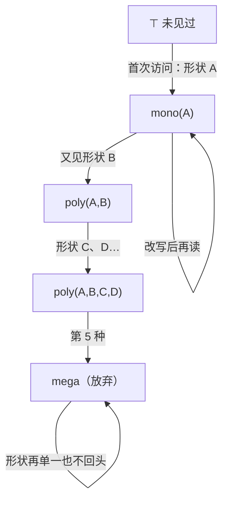

# JIT 视角：反馈、推测与反悔的权利

> [返回：第七阶段导览](01-导览.md)
> 对应大纲第 3 条。前置阅读：[js-ts 站 · V8 引擎](https://yidafu.github.io/tech-learning/js-ts/notes/stage-2-engine-runtime/07-v8-engine)——那一册从**引擎工程**视角讲全链路（Ignition/Sparkplug/TurboFan 分层、隐藏类迁移链、elements kinds 退化、可操作的性能清单）；本册换**编译原理**视角讲同一台机器：**JIT 是一台运行着的优化编译器，它的每类武器都是前几册 pass 的运行时变体**——内联缓存是运行时的窥孔/记忆化，类型反馈是运行时的数据流格，去优化是"反悔的权利"。两册刻意不重复：那册回答"V8 里有什么"，本册回答"为什么恰好是这些、它们凭什么合法"。本册代码在本机 Node 24 实跑（输出为真实运行结果）。

## JIT 的一号问题：拿什么喂优化器

AOT 编译器（gcc/LLVM 静态编译、以及[ wasm 后端](../11-Wasm专题/06-实践-mini到Wasm.md)）看到的是"全部程序 + 全部类型信息"——本阶段 02~04 册的 pass 都建立在静态可知上。JS 呢？

- 动态类型：`a + b` 的语义到运行时才知道；
- 热点未知：哪段代码值得编译，跑起来才知道；
- 加载迟滞：`eval`、动态属性注入能推翻一切静态结论。

JIT（just-in-time）的答案是把编译器搬到运行时，用**观测**补静态信息的缺口：先解释执行（便宜启动 + 顺手记账），热点函数再依据账本（feedback）做优化编译。分层是预算问题的解——js-ts 那册的层级表（Ignition 1× / Sparkplug ~2× / Maglev / TurboFan）本质是一张"**每个函数按热度拿到性价比最高的一档**"的分配表：给冷函数上 TurboFan 是亏本买卖（编译成本收不回来），这正是[05 册工具链](../11-Wasm专题/05-工具链与性能真相.md)"该不该上 wasm"同款决策的引擎内版。

## 内联缓存：调用点上的记忆化

动态语言的属性访问 `o.x`，朴素的实现是"查哈希表"。但**同一个程序点的对象形状高度稳定**——"查一次、记住结果"就是内联缓存（IC）：把"这个字节码位置上次见到的形状 + 对应的取值方案"缓存在调用点。它是：

- **运行时的窥孔优化**：把"通用查找"这条"指令"替换成"比较 + 偏移读取"这个更短的固定模式；
- **运行时的 CSE/记忆化**：相同输入（形状）→ 复用首次计算的结果（handler）；
- **按程序点独立的**：每个访问点各一份缓存、各走各的状态机——"函数是多态的"其实是指"函数内某个 IC 点是多态的"。

状态机（与 js-ts 那册的 stateDiagram 同一回事，这里给出可跑的实现）：

```ts
class LoadIC {
  state: 'uninit' | 'mono' | 'poly' | 'mega' = 'uninit';
  private cached = new Map<string, Handler>();         // ≤ 4 条：mono 1 条 / poly 2~4 条
  misses = 0;
  load(obj: Record<string, any>, keyIdx: number): any {
    const shape = Object.keys(obj).join(',');          // 键集合+顺序 = 形状（那册的 Map）
    let h = this.cached.get(shape);
    if (!h) {                                          // miss：按状态机迁移
      this.misses++;
      if (this.cached.size < 4) {
        this.cached.set(shape, handlerFor(shape));
        this.state = this.cached.size === 1 ? 'mono' : 'poly';
      } else {
        this.state = 'mega';                           // 第 5 种形状：放弃本地缓存
      }
    }
    void h;
    return Object.values(obj)[keyIdx];
  }
}
```

实测输出（真实运行）：

```text
load x → state=mono  shapes=1 misses=1     ← 同形状对象重复出现：1 次比较即命中
load x → state=poly  shapes=2 misses=2
load x → state=poly  shapes=3 misses=3
load x → state=poly  shapes=4 misses=4
load x → state=mega  shapes=4 misses=5     ← 第 5 种形状
load x → state=mega  shapes=4 misses=5     ← 回到老形状也还是 mega——单向，不回头
```

两条硬结论都能从输出里读出来：**多态的代价是"逐个比较"**（缓存是线性表，k 态最坏 k 次形状比较——1 态 1 次，4 态 4 次）；**mega 不可逆**（回到单一形状也回不去 mono，缓存已放弃局部性）。这就是"热循环里混形状对象慢一个数量级"的机制内因——那册练习 02 的现象，在这里降到了状态机层面。

## 类型反馈：运行时构造的数据流格

feedback vector 记录每个字节码位置实际见过的类型/形状。用 02 册的语言重述：**每个 IC 点有一个类型格，观测是 transfer，格值只升不降**：



和 02 册的"初始化决定解的方向"完全同构：**格只向"更保守"的方向走，单向不回头**——因为引擎无法证明"旧形状再也不会出现"（另一个分支、另一段时间之后都可能再喂进来），只能把已见的都记住。elements kinds 的退化链（PACKED_SMI → DOUBLE → PACKED → HOLEY，那册第 4 节）是同一件事在数组存储上的投影。

优化编译器消费这份格值的方式：**把"mono(小整数)"编译成机器整数加法 + 一条 guard**。于是进入本册的核心问题——

## 推测优化与去优化：反悔的权利

**guard（守卫）**是推测优化编译进代码里的检查："我赌 a 是小整数，进门先验一把"。赌对了走高速代码；赌错了触发**去优化（deopt）**。最小闭环（实测代码节选，输出为真实运行结果）：

```ts
class OptAdd {
  usedSpec = false;                        // 当前是否在用优化路径（tier-up 后置位）
  deoptCount = 0;
  call(a: any, b: any): any {
    if (this.usedSpec) {
      if (typeof a === 'number' && typeof b === 'number')   // guard：编译进优化代码
        return a + b;                      // 优化体：没有 string 分派
      this.deoptCount++;
      this.usedSpec = false;               // deopt：作废优化代码，回解释器
    }
    return addInterp(a, b);                // 通用路径 + feedback 收集
  }
}
```

```text
call(1, 2)     → 3   优化开启（首次解释后 tier-up）
call(20, 22)   → 42  命中优化路径
call('a','b')  → ab  deopt（deopts=1），回解释器
call(3, 4)     → 7   重新收集 feedback 后可再优化
```

deopt 真正难的部分在上面被一行带过（`usedSpec = false`）：**解释器帧的重建**。优化代码里的值住在物理寄存器里、控制流可能已被重排（展开、外提、跳转 threading），而解释器期望"字节码 ip + 操作数栈 + 局部变量表"。去优化时引擎要按**反优化表**（优化编译器随代码一起生成的映射：每个 guard 失败点 → 对应字节码位置与寄存器→栈槽的还原方案）把机器状态翻译回解释器状态——**deopt 是优化编译的逆运行**，编译器必须为自己的每个激进决定预付退路。这也是"优化代码可能比不优化更慢"的机制根源：反复 deopt = 反复重建帧 + 反复重新编译（osr/optimized 之间的抖动），js-ts 那册用 `--trace-deopt` 观测的就是这个循环。

由此可以精确说出 JIT 与 AOT 的边界：**AOT 的每个优化必须对一切输入正确；JIT 的每个优化只需对"观测过的输入类"正确，其余交给 guard + deopt**。乐观优化的全部激进性（NaN 检查都敢省、未加载的属性都敢按偏移读）都建立在"错了能回退"之上——**反悔的权利是激进的许可证**。

## OSR：正在跑的循环怎么办

热点常常是**一个正在执行的长循环**，等它返回再优化 = 优化永远不来。OSR（on-stack replacement，栈上替换）：在循环回边处（interrupt budget 耗尽的判定点，那册第 1 节）把**当前栈上的解释器帧直接替换成优化帧**——从"本循环的第 k 次迭代"起改跑优化代码。两个工程要点：

- **入口在循环中间**：优化代码必须为"从任意迭代进入"生成一个特殊入口（LLVM 的 `osr` 入口块、V8 的 OSR 编译产物带循环入口桩）；
- **替换是原子的**：帧布局完全不同（解释器栈槽 vs 物理寄存器），切换瞬间要做一次与 deopt 对称的翻译——OSR 是"解释态→优化态"的翻译，deopt 是反方向，**同一套映射表两头用**。

这就是"一个死循环也能越跑越快"的机制：回边预算耗尽 → OSR 替换 → 循环体以优化形态继续。

## 与 mini 的关系：为什么 mini 不做 JIT

值得诚实回答的问题。JIT 的前提是有"观测"可依：类型反馈、形状、热点计数——mini 的 checker 在**编译期**就把类型定死（`ADD` 与 `ADD_STR` 分列，第五阶段的设计红利），运行时没有分派也就**没有可观测的"类型意外"**；CALL 的目标经 CLOSURE 常量池在编译期已知。没有反馈，推测优化无从谈起；没有分派开销，IC 无利可图。**静态类型 VM 不需要 IC/类型反馈这一整层**——这不是偷懒，是类型系统把 JIT 的一号问题提前消灭了。留给 mini 的运行时优化是更朴素的方向（07 册）：编译期 pass 做足 + 调用约定的直接开销（CALL/帧切换）——那也是 fib 在解释器里的真实大头。

## 两册地图

| 主题 | 本册（原理视角） | js-ts · V8 引擎册（工程视角） |
|---|---|---|
| 分层编译 | 预算分配问题的解 | Ignition/Sparkplug/Maglev/TurboFan 全链路与各层参数 |
| 内联缓存 | 调用点记忆化 + 状态机实现与实测 | feedback slot/vector、LoadIC/StoreIC、混形状轮询实验 |
| 隐藏类 | （形状=IC 的键，一笔带过） | Map/迁移链/dictionary mode/`%HaveSameMap` 全解 |
| 类型反馈 | 运行时格、单向退化的格论解释 | elements kinds 退化链与工程规避清单 |
| 去优化 | guard→deopt 闭环、帧重建、AOT/JIT 边界 | `--trace-deopt` 实测、性能清单 |
| OSR | 栈上替换的对称性 | （那册一句带过，本册展开） |

## 自测

1. IC 的缓存放"每个程序点"而不是"每个函数"或"全局形状表"，各有什么代价？mega 不可逆的根因是什么？
2. 用 02 册的术语描述 elements kinds 退化链：格元素是什么？meet 是什么？为什么只降不升？
3. guard 与 04 册"分析支撑的转换"里的保守假设是什么关系？AOT 编译器为什么不能靠 guard 合法化 `x*0 → 0`（浮点）？
4. deopt 时"帧重建"需要优化编译器额外生成什么数据？没有它的优化编译器遇到 guard 失败只能怎么办？
5. OSR 与 deopt 在"翻译方向"上互为镜像，具体各自把什么翻译成什么？为什么 OSR 需要特殊的循环入口？
6. mini VM 为什么不需要内联缓存？给出"静态类型红利"在这件事上的完整推理链（从 checker 的 inferredType 到运行时无分派）。
