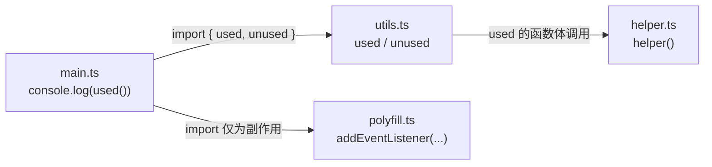
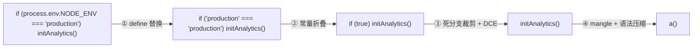

# 前端工程优化对照：tree-shaking、minify 与 sourcemap

> [返回：第七阶段导览](01-导览.md)
> 对应大纲第 4 条。前五册把优化技术讲成了"编译器的内部事务"，本册换一个视角：**你每天在用的前端构建工具，就是一台台编译器**——tree-shaking 是可达性分析，minify 是重命名加窥孔，sourcemap 是位置追踪的最终变现。读完本册，`rollup`/`esbuild`/`terser` 的文档对你来说应该不再有新概念。本册 VLQ 编解码与 mappings 生成的代码全部在本机 Node 24 实跑验证（输出为真实运行结果）。

## 先立一张对照表

| 前端工具做的事 | 编译原理里的经典问题 | 本站对应册 |
|---|---|---|
| tree-shaking（摇掉未用导出） | 程序图上的**可达性分析** + 死代码消除 | [02 册数据流](02-数据流分析.md)的 use-def、[04 册 DCE](04-经典优化pass.md) |
| mangle（变量重命名压缩） | **作用域感知的 alpha-renaming** | [03 册 SSA 重命名](03-SSA构建.md)同源 |
| 语法压缩（`if(!0)` → 直落） | **窥孔优化** | [04 册窥孔表](04-经典优化pass.md) |
| scope hoisting（模块拍平） | **函数内联** | 04 册"内联是优化之母" |
| sourcemap | **源位置映射**（词法阶段的 start/end 追踪） | [第三阶段 AST 位置字段](../03-第三阶段/05-AST设计与错误恢复.md) |

一张表能立住，是因为**前端构建器的输入输出恰好都是同构的**：JS → JS，AST → AST。没有指令选择、没有寄存器分配——一台只做 middle-end 的编译器。

### 为什么不需要指令选择与寄存器分配

把"没有"这两个词展开——每少一个阶段，都因为目标语言替你回答了一个问题：

| 经典编译阶段 | 传统编译器为什么需要 | JS→JS 为什么可以免掉 |
|---|---|---|
| 指令选择 | 把 IR 运算映射到目标机指令集 | "目标机"还是 JS：`a+b` 就是 `a+b`，一一对应 |
| 寄存器分配 | 无限的临时变量 → 有限的物理寄存器 | JS 变量数量不限（引擎自己再做寄存器分配） |
| 调用约定 | 谁清栈、参数走寄存器还是栈 | JS 调用约定由引擎统一负责 |

**变量就是寄存器**是这层等价的核心：源码里每个 `let` 绑定天然是一个"具名寄存器"，AST 重写直接在这些名字上做，不需要先降到低层 IR 再升回来。这也划定了前端构建器的**能力上界**：所有优化只能在"变量与表达式"的粒度上做——想跨过这层粒度（指令调度、显式内存布局），就得换目标语言，那是 wasm 后端（[11-Wasm专题](../11-Wasm专题/06-实践-mini到Wasm.md)）的领地。

## 四台真实机器的站位

对照表里的"前端工具"在真实生态里是四台不同的机器，站位一张表（定性对照，能力随版本演进）：

| 工具 | 在管线里的角色 | 强项 | 弱项（相对） |
|---|---|---|---|
| rollup | 打包器（ESM 优先） | tree-shaking 粒度细、scope hoisting 干净 | 语法转换依赖插件、压缩要外挂 |
| webpack | 打包器（CJS 时代兼容全谱） | 生态与 loader 全谱 | tree-shaking 受 CJS 互操作拖累 |
| terser | 纯压缩器（JS → JS） | 压缩规则表最全（本册那张表的工业完整版） | 运行在 JS 里、全量 AST 操作，速度吃亏 |
| esbuild | 打包 + 压缩一体 | 从零实现、解析与打包高度并行 | 压缩激进程度留了保守余量 |

站位解释了选型的常见争论："esbuild 快"的答案不全是实现语言，**架构选择（一遍解析、产物复用、并行化）占了大头**——这是它官方自己强调的归因；"rollup 产物小"也不神秘——它把可达性分析做在了最细的粒度上（导出级）且 scope hoisting 默认开启。四台机器对本册五个主题的覆盖度不同，但**没有一个主题在它们之间存在概念分歧**——分歧只在实现质量与默认粒度，这正说明"对照表"抓住了本质。

## tree-shaking：以导出为根的标记-清除

[04 册 DCE](04-经典优化pass.md)已经把同构性讲透：根集合（副作用指令读的变量）→ 沿 use-def 传染"活" → 清除不可达。tree-shaking 换了个图，骨架一字不差：

```
根集合 = 入口模块的副作用语句 + 入口直接/间接使用的导出
边     = import 绑定（module graph 的静态边）
标记   = 从根 BFS/DFS 整个模块图
清除   = 未被标记的「导出声明、其依赖的函数、纯 class 字段」被删
```

**为什么 ESM 摇得动、CommonJS 摇不动**：ESM 的 `import`/`export` 是**语法级声明**——模块图在解析期就是一张静态图，哪些绑定被引用一望而知。CJS 的 `require` 是**普通函数调用**，`if (debug) require('./x')`、`const name = 'a'; require('./' + name)` 都是合法代码——引用关系要执行才能确定，静态分析只能保守地全保留。这正是形式语言那套老结论（[第一阶段](../01-第一阶段/01-导览.md)）：表达力换可分析性。

**`sideEffects: false` 的准确语义**：它不是说"这个文件没有副作用"，而是向打包器**承诺**"删除此文件中未被引用的部分，不会改变程序的可观察行为"。这个承诺是包作者替工具做的——写错了，摇掉的就是真的 bug（比如一个注册全局 polyfill 的文件被标了 false）。它对应的正是 04 册那句编译器铁律：**优化不允许改变可观察行为**，只是这里的"证明责任"从分析器转移到了人工声明。

摇不动的常见残留（每一项都能用 `rollup` 或 `webpack-bundle-analyzer` 观察到）：

1. **顶层副作用语句**：`console.log`、`document.addEventListener`——没有 use-def 链可追，只能保留；
2. **类的方法**：`class A { m() {} }` 中 `m` 无人调用也常被保留——原型上的方法可能被字符串反射调用，多数工具默认不删（分析成本高过收益）；
3. **`export *` 与 CJS 互操作产物**：转译生成的 `Object.defineProperty(exports, ...)` 是表达式语句，保守保留；
4. **TypeScript 的 `enum` 与参数属性**：它们编译成真实运行时对象（不是纯类型），声明即副作用。

### 手推一次 tree-shaking：四模块的标记-清除

拿一个最小模块图把骨架跑一遍（手推，与 [06-第六阶段 GC 册](../06-第六阶段/03-垃圾回收深入.md)的手推同款画风）：



标记-清除四步在模块图上的逐步执行：

| 步 | 动作 | 标记结果 |
|---|---|---|
| 1 | 根集合：`main.ts` 的顶层副作用（`console.log(used())`）+ 它读的绑定 `used` | main、used 入队 |
| 2 | `used` 的声明在 `utils.ts` → utils 进入图；连带考察它的其他导出 | utils 保留（**部分**） |
| 3 | `used` 的函数体调用 `helper` → 沿 use-def 传染跨模块 | helper 保留 |
| 4 | `unused` 没有任何根可达（helper 只被 used 传染，不连 unused） | **摇掉**：unused 声明 + 它专属的依赖 |
| 5 | `polyfill.ts` 只有 `addEventListener` 顶层副作用 | 保留——副作用语句没有 use-def 链可追 |

| 模块 | 判定 | 依据 |
|---|---|---|
| main.ts | 整体保留 | 入口 |
| utils.ts | **部分保留**（used 留、unused 删） | 导出粒度的可达性 |
| helper.ts | 保留 | 被保留代码传染 |
| polyfill.ts | 保留 | 顶层副作用（没有"未使用"可言） |

与 GC 手推的对照一目了然：根集合从"栈与全局表"换成"副作用与被引用的导出"，边从"对象引用"换成"import 绑定"，**标记-清除的骨架四步一字不差**。第 4 步还演示了传染的深度——摇掉一个导出可能连锁摇掉一整条依赖链，这正是 tree-shaking 对体积的收益常常**超比例**的原因。

### 粒度阶梯：从模块到语句

tree-shaking 不是一刀切的开关，不同工具在不同粒度上摇（定性阶梯，工具能力随版本演进）：

| 粒度 | 摇掉的单位 | 谁在做 |
|---|---|---|
| 模块级 | 整个文件不进 bundle | 所有打包器（模块图可达性） |
| 导出级 | 模块内未用的导出声明 | rollup（以 ESM 静态结构见长） |
| 语句级 | 函数体内不可达分支 | 压缩器（terser/esbuild 的 DCE） |
| 表达式级 | 死的表达式子树 | 压缩器的常量折叠 |

四级阶梯在真实构建里**串成一条链**：打包器摇模块与导出 → 压缩器摇语句与表达式。rollup 摇不掉的语句级死代码（比如导出函数内部某个恒假分支），交给 terser 补刀——这就是"为什么 bundle 还要再 minify 一遍"的分工解释：**两台机器的可达性分析跑在不同的图上**（模块图 vs AST），谁也不能替谁。

## minify：重命名、窥孔与死代码的三合一套餐

**mangle = 作用域感知的 alpha-renaming**。把 `greeting` 改成 `a` 而程序不变，靠的是第三阶段的**作用域分析**：同一绑定内的所有引用同步替换、不同作用域的短名可以复用（`a` 在每个函数里指不同的东西）。这与 [03 册 SSA 重命名](03-SSA构建.md)是同一个问题的两次出场：**换名不变义，前提是名字的解析完全由静态结构决定**。不能 mangle 的名字也因此清晰：`eval` 与 `new Function` 里的字符串会引用局部名（静态结构管不到）、对象的属性名（那是数据不是绑定）、全局名。

**语法压缩 = 窥孔优化**。terser 的压缩规则表就是一张窥孔表：

| 模式 | 替换 | 说明 |
|---|---|---|
| `if (!0) A` | `A` | 常量条件折叠（04 册同款） |
| `if (a) B else C` | `a ? B : C` | 语法级等价变换 |
| `a(); b();` | `(a(), b());` | 语句变表达式，省一个分号级 |
| `true` / `false` | `!0` / `!1` | 字面量瘦身 |
| `x = x + 1` | `x++`？（ terser 输出 `++x`/`x++` 视上下文） | 代数简化 |

**死代码消除**与 04 册同源：`const DEV = false; if (DEV) { ... }` 走常量传播 + 死分支裁剪——与你给 mini 写的 pass 是同一对搭档，只是发生在 JS 的 AST 上。

**scope hoisting = 模块包装函数的内联**。CJS/ESM 每个模块默认包一层函数作用域（隔离顶层变量）；hoisting 把模块体直接拍进目标作用域、把跨模块引用改成局部变量。这就是 04 册"内联拆掉过程间的墙"的模块版：内联之后，跨模块的常量才能传播、死导出才能整体消失。它要求 ESM 的两个性质兜底：顶层 `this` 是 `undefined`（没有隐式接收者）、没有循环 `require` 时的执行顺序语义可静态满足。

### mangle 手推：一张作用域表的前后

把 alpha-renaming 落到具体的作用域上（手推，形态对照 terser 的默认行为）：

```text
源（压缩前）                       压缩后
顶层:                              顶层:
  const greeting = ...      →        const o = ...          ← 顶层名默认保留
  function greet(who) {              function e(r) {
    const msg = `Hi ${who}`;           const t = `Hi ${r}`;   ← 函数作用域内自由复用短名
    return msg;                        return t;
  }                                  }
greet('mini');                     e('mini');
```

规则逐条可验证：`greeting`/`greet`/`msg`/`who` 分属三层作用域；`msg` 与 `who` 变成 `t`/`r` 是**安全重命名**——它们的作用域完全由静态结构决定；顶层名默认不动（可能有外部引用、`window` 挂载、eval 访问），除非工具显式开启顶层 mangle 并保证单文件自包含。**名字越短、作用域嵌套越深，可复用的短名池越大**——这就是为什么压缩率与作用域分析的质量直接挂钩：分析错一层嵌套，重命名就撞名。

### 读一段压缩产物：每个 token 都能归位

压缩器输出的"天书"其实每个 token 都有出处。读法是把本册对照表当解码本（示意产物，非实测）：

```text
const e=o=>`Hi ${o}`,r=(o,n)=>o+n,s="mini";e(s);r(1,!1)
```

逐段归位：`e`/`r` 是 mangle 后的顶层名（原名记在 sourcemap 的 `names` 数组里）；`!1` 是 `false` 的窥孔瘦身（本册那张表）；两个语句被 `,` 压成一个表达式序列（语句变表达式）；`s` 被两处引用共享——同一个绑定。**压缩产物的可读性是"损失"的，但信息的每一分都转移到了 sourcemap**——这是本册主线"位置追踪的最终变现"的另一面：产物可以任意变形，映射表负责把变形撤销。

### 一条常量走完全程：生产构建链

把"构建时替换 + 折叠 + 消除 + 重命名"串成一次完整的旅程——`process.env.NODE_ENV` 是最著名的例子：



四步各自对应本册/04 册的哪个 pass，一一可指：① 是前端注入的常量（等价于把 `debug=false` 写进 IR）；② ③ 是 [04 册](04-经典优化pass.md)的折叠 + 死分支 + DCE；④ 是 mangle + 窥孔。**dev 与 prod 构建的差异不是"多压缩了一下"，而是这条链是否被触发**——`NODE_ENV` 不替换，① 就走不动，后面整条链瘫痪，`else` 分支原样进 bundle。这解释了前端工程里"忘了设 NODE_ENV 导致包里带着整套开发工具"的经典事故：**常量替换是整条优化链的第一张多米诺**。

## sourcemap：位置追踪的最终变现

第三阶段给 AST 每个节点存了 `start`/`end`，第四、五阶段用它们报过类型错误和运行时回溯——sourcemap 是这条线的终点：**生成代码的每个位置 → 源码位置的映射表**。压缩后的代码报错堆栈只指向 `bundle.min.js:1:8342`，sourcemap 让它还原成 `src/app.ts:42:7`。

### 文件结构

```json
{
  "version": 3,
  "sources": ["src/a.ts", "src/b.ts"],
  "sourcesContent": ["const greet = ...", "..."],
  "names": ["greet", "who"],
  "mappings": "AAAA,MAAMA,EAAU,sBAChB;"
}
```

`version: 3` 是当前唯一活着的版本（1/2 已死，教 SSE 的历史课）；`sourcesContent` 让报错面板不依赖源文件就能高亮（也是它让 map 文件变大）。

### mappings：三层结构，一层比一层密

```
mappings = 行(;分隔) → 段(,分隔) → 字段(VLQ 编码的 delta)
```

- **分号**切分**生成代码的行**：第一个分号前的段属于生成第 1 行（压缩产物常常只有一两行——整行只有一个巨长的段序列）；
- **逗号**切分段：每段描述"生成代码的这个列位置，映射到源的哪里"；
- 段内是 **1、4 或 5 个 VLQ 数**：`[genCol]`（只有生成列，无源信息——比如生成代码里插入的括号）、`[genCol, srcIdx, srcLine, srcCol]`、`[genCol, srcIdx, srcLine, srcCol, nameIdx]`。

**所有数值都是相对前一个段的 delta**（genCol 相对同段前行内前段；srcIdx/srcLine/srcCol/nameIdx 相对整个文件里前一个**有源信息的段**——跨行也累计）。delta 编码让"逐 token 生成"的映射几乎不付代价：相邻 token 的 delta 是 1、2 这种单字符 VLQ。

### VLQ：5 个 bit 一组的变长编码

把一个带符号整数切成 5 bit 一组、低位在前，每组映射成一个 base64 字符；**最低字节的最低位是符号位**（1 为负），每组最高位是**续位**（还有后续组）：

```js
const B64 = 'ABCDEFGHIJKLMNOPQRSTUVWXYZabcdefghijklmnopqrstuvwxyz0123456789+/';

function vlqEncode(n) {
  let v = n < 0 ? ((-n) << 1) | 1 : n << 1;   // 符号位折进最低位
  let out = '';
  do {
    let digit = v & 31;                        // 取 5 bit
    v >>>= 5;
    if (v > 0) digit |= 32;                    // 还有后续 → 续位
    out += B64[digit];
  } while (v > 0);
  return out;
}
```

实跑的编码-解码对照（Node 24，roundtrip 全部 ✓）：

```text
        0 -> A      16 -> gB     123 -> 2H      123456 -> gkxH
       -1 -> D     -16 -> hB    -123 -> 3H
```

读点直觉：`A`=0 是最常见的字符（delta 0：同列并列的段、name 沿用）；正负数只差符号位——`gB`（16）与 `hB`（-16）首字符相邻。**32 是分水岭**：0~15（`A`~`O` 正、`D`…负）单字符，16 起要两个字符——mappings 的密度优势正来自绝大多数 delta 落在 0~15。

### 手推 `gkxH`：123456 的编码逐步演算

实测表里最大的数值得亲手拆一遍（对照 VLQ 代码逐步走）：

| 步 | 计算 | 结果 |
|---|---|---|
| 0 | `v = 123456 << 1`（正数符号位 0，整体左移腾出最低位） | v = 246912，二进制 18 bit |
| 1 | 第 1 组：`v & 31`（最低 5 bit）= 0；`v >>>= 5` 后仍 > 0 → 置续位 | 0 + 32 = 32 → **`g`** |
| 2 | 第 2 组：`v & 31` = 4；仍 > 0 → 续位 | 4 + 32 = 36 → **`k`** |
| 3 | 第 3 组：`v & 31` = 17；仍 > 0 → 续位 | 17 + 32 = 49 → **`x`** |
| 4 | 第 4 组：剩 3 bit = 7；`v >>>= 5` 后 = 0 → 续位清零 | 7 → **`H`** |

拼起来正是实测表的 `gkxH`。再拆一个负数验证符号位的位置：`-16` → `v = (16 << 1) | 1 = 33`：第 1 组 `v & 31 = 1`，右移后 v=1 > 0 → 续位 → 1+32 = 33 → `h`；第 2 组 = 1，v=0 → 续位清零 → `B`。得 `hB`，与实测一致——**16 的编码 `gB` 与 -16 的 `hB` 只差首字符**（0/1 翻在最低位），正是"读点直觉"说的正负相邻。

解码是同一张表的逆行：`g`→0（有续位）、`k`→4（有续位）、`x`→17（有续位）、`H`→7（无续位，收尾）；按低位在前的顺序重组：`0 | (4<<5) | (17<<10) | (7<<15) = 246912`，最低位是符号位（0 = 正）→ 右移一位得 `123456`。**encode 与 decode 是同一组 5-bit 切片的正反两向**，mappings 的海量段就靠这对 20 行的函数支撑。

### 亲手生成一张 mappings（实跑结果）

两行源码压成一行：

```text
源 src/a.ts:                    生成 bundle.js(第 1 行):
1 | const greet = (who) => …    const e=o=>`Hi ${o}`;e('mini');
2 | greet('mini');
```

四个映射段（生成列 → 源位置，第二段还带 name：`e` 原名 `greet`）：

| 段 | genCol | srcIdx | srcLine | srcCol | nameIdx | delta（相对前段） |
|---|---|---|---|---|---|---|
| 1 | 0 | 0 | 0 | 0 | — | 0,0,0,0 |
| 2 | 6 | 0 | 0 | 6 | 0 | 6,0,0,6,0 |
| 3 | 8 | 0 | 0 | 16 | — | 2,0,0,10 |
| 4 | 30 | 0 | 1 | 0 | — | 22,0,1,-16 |

逐段 VLQ 再拼接（实跑程序输出）：

```text
mappings = "AAAA,MAAMA,EAAU,sBAChB;"
```

解码还原（同一程序）：

```text
生成 行1:列0  <-  源 0:1:1     生成 行1:列8  <-  源 0:1:17
生成 行1:列6  <-  源 0:1:7     生成 行1:列30 <-  源 0:2:1
```

（展示为 1-based；**map 文件里行号列号全是 0-based**——无数工具 bug 的第一来源。）

### delta 表的验算：逐段减法

把 deltas 的来历钉在已有的四段表上（每段 delta = 本段绝对值 − 前段绝对值）：

| 段 | genCol（绝对） | genCol delta | srcLine（绝对） | srcLine delta | srcCol（绝对） | srcCol delta |
|---|---|---|---|---|---|---|
| 1 | 0 | 0（首段基线为 0） | 0 | 0 | 0 | 0 |
| 2 | 6 | 6−0 = 6 | 0 | 0−0 = 0 | 6 | 6−0 = 6 |
| 3 | 8 | 8−6 = 2 | 0 | 0 | 16 | 16−6 = 10 |
| 4 | 30 | 30−8 = 22 | 1 | 1−0 = 1 | 0 | 0−16 = **−16** |

与四段表的最后一列逐格相等。两个读法：其一，**genCol 的 delta 是"行内回零"的**——第 4 段相对第 3 段（8）而不是相对第 1 段；其二，srcCol 的 −16 暴露了"源行换了、列重新数"的语义：源第 2 行第 0 列在第 1 行第 16 列之前 16 个字符——跨行也照减不误（delta 相对的是**整个文件里上一个有源信息的段**）。

### 复合映射手推：两级 map 的两段查找

工程坑 2 说还原要"复合两次映射"，手推一次（数字为示意演算，展示机制）：

```text
报错栈:   bundle.min.js 1:57
第 1 级 map（min → bundle）:  1:57  →  bundle.js 1:31
第 2 级 map（bundle → src）:  1:31  →  src/a.ts 1:17
最终还原: src/a.ts 1:17
```

两段查找各自是"在 mappings 的对应行里找 ≤ 目标列的最大段"——列映射是**阶梯函数**：每个段管辖到下一个段的列号为止，查表即"落在哪一级台阶"。工具链每多一级（ts → js → bundle → min），就多查一级阶梯；index map 存在的原因就是把多级阶梯打包成单一文件结构，让 DevTools 只查一次。自己写还原器时忘了复合，报错位置会"对得上但偏一截"——正是查错一级台阶的症状。

### 三个工程坑

1. **列的计量单位**：规范说"生成列"按字符计，但历史实现分裂过（V8 堆栈按 UTF-16 码元、部分工具按字节）。含非 ASCII 源码对不上号时，先怀疑这个；
2. **map 链（index map）**：打包（tsc → bundle.js）再压缩（bundle.js → bundle.min.js）产生两级 map，还原要**复合两次映射**——DevTools 自动做，自己写工具时必须做；
3. **`sourcesContent` 与隐私**：它把源码完整嵌进 map；map 若随产物一起部署到线上，等于把未压缩源码公开。生产部署常见做法：map 上传到错误监控平台（Sentry 等），线上不发布。

## 与 mini 的关系

mini 暂不实现 sourcemap（收益小、且位置追踪机制在第三阶段已练过）；但本册的 tree-shaking/minify 对照会在 **[07 册实践](07-实践-优化pass与收益分析.md)** 里以另一种方式回收：你给 mini 字节码写的常量传播 + 死代码消除 + 窥孔三连，正是 terser 那张压缩规则表的字节码版。做完 07 册再回头看 terser 的输出，你应该能指着每一行说出"这是哪个 pass 干的"。

### 如果给 mini 补 sourcemap：三件事的清单

"暂不实现"不等于"无从下手"，机制在本册已齐备，工程上剩三件事：

1. **发射时记账**：emit 侧每生成一条字节码指令，记一条 `(字节码地址, AST 节点位置)`——与 [07 册](07-实践-优化pass与收益分析.md)"encode 回填跳转"同一时机，成本是一次数组 `push`；
2. **按 VLQ 规范编码**：本册的 `vlqEncode` 可直接复用（mini 字节码"行"单一、无列内多段，mappings 退化为一段超长的段序列）；
3. **解释器报错回溯时查表**：第五阶段的运行时错误已带源位置——从"编译期带过"升级为"按生成地址查 mappings 还原"。

做完这三件事，mini 的栈回溯就从"字节码地址"变成"源码行列"——理解 sourcemap 最好的收官练习。

## 常见误区

- **"minify 让代码跑得更快"**——主要卖点是**体积**（下载/解析的字节数），运行时速度通常无感：mangle 与语法压缩不改动态指令数。运行时提速靠的是给更强后端铺路那类事——那是引擎的事（[07 册实测二](07-实践-优化pass与收益分析.md)专门演示了这一点）；
- **"tree-shaking 会删掉所有没用的代码"**——它只删"可达性判死"的代码：顶层副作用、类方法、CJS 互操作产物（本节四条残留）都会保留。**保守是合法性的代价，不是实现缺陷**；
- **"`sideEffects` 数组是白名单"**——数组列出的是"**有副作用的文件**"，没列出的文件按"无副作用"处理（正是承诺）。语义要按"排除表"读：列错文件的后果是"该摇的没摇"或"不该摇的摇了"两种都可能；
- **"sourcemap 会拖慢线上运行"**——map 文件只在 DevTools 打开时才被请求（`//# sourceMappingURL` 注释指引）；不开 DevTools 的用户一行都不会下载。要管的是"别把 map 公开部署"（工程坑 3），不是"别生成 map"；
- **"压缩等级越高越好"**——激进压缩（如属性名 mangle）破坏的是**外部契约**：被字符串反射、被 DOM 属性、被外部脚本访问的名字都可能失守。压缩的边界是"可观察行为不变"——与 [04 册](04-经典优化pass.md)的第一条铁律同一条；
- **"ESM 一定摇得动"**——摇得动的是**静态结构**；`export *` 重导出、动态字符串导入、CJS 互操作层都会让静态边退化。工具的保守残留清单就是这些退化点的实体。

## 自测

1. `sideEffects: false` 的承诺用编译器的话术怎么说？它把谁的职责转移给了谁？给出一个"标了 false 但会摇出错"的具体文件内容。
2. 为什么 mangle 不能重命名 `obj.method` 里的 `method`，却能重命名 `const method = ...` 里的 `method`？用"绑定 vs 数据"回答，并指出哪种 AST 节点是绑定名。
3. scope hoisting 依赖 ESM 的哪两个静态性质？CJS 违反的是哪一个？
4. 手算：delta 序列 `[16, 1, 0, -1]` 的 VLQ 编码是什么？（对照上面的实跑表验证）
5. mappings 里一个段只有 1 个字段（只有 genCol），语义是什么？什么指令会生成这种段？
6. 为什么 sourcemap 的段内字段用 delta 而不用绝对值？如果用绝对值，最坏情况下 mappings 的膨胀系数大约是多少（用"每段 4 个字段、多数 delta 单字符"估算）？

（7~12 为扩写增补题，答不出就回到对应小节的手推再读一遍。）

7. 四模块手推里，若 `sideEffects` 把 `polyfill.ts` 列入、而 `utils.ts` 标为 false，五个判定各怎么变？`unused` 还能被摇掉吗？
8. 粒度阶梯的四级各自跑在不同的"图"上。语句级摇掉的一个死分支，为什么打包器（模块图）永远管不到？
9. mangle 手推里 `who` 变成 `r`。如果 `greet` 的函数体里有一段 `eval("who")`，这个重命名还安全吗？对应的编译原理概念是什么？
10. `gkxH` 手推里第 3 组值是 17、加续位变 49。若某个 delta 是 31，编码是几个字符？31 与 32 的编码长度为什么差一位？
11. 复合映射手推：报错列号 57 落在第 1 级 map 的哪一段的"管辖范围"里？"阶梯函数"的段起点列与管辖范围是什么关系？
12. 四台机器的站位表说"没有主题存在概念分歧"。实现质量与默认粒度的分歧各举一例，并指出它们为什么不是概念分歧。
